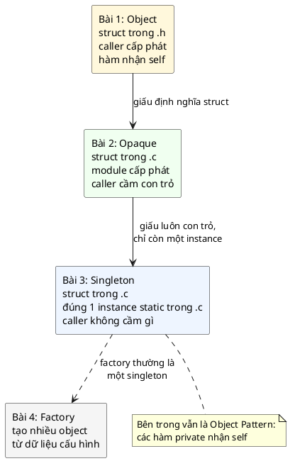
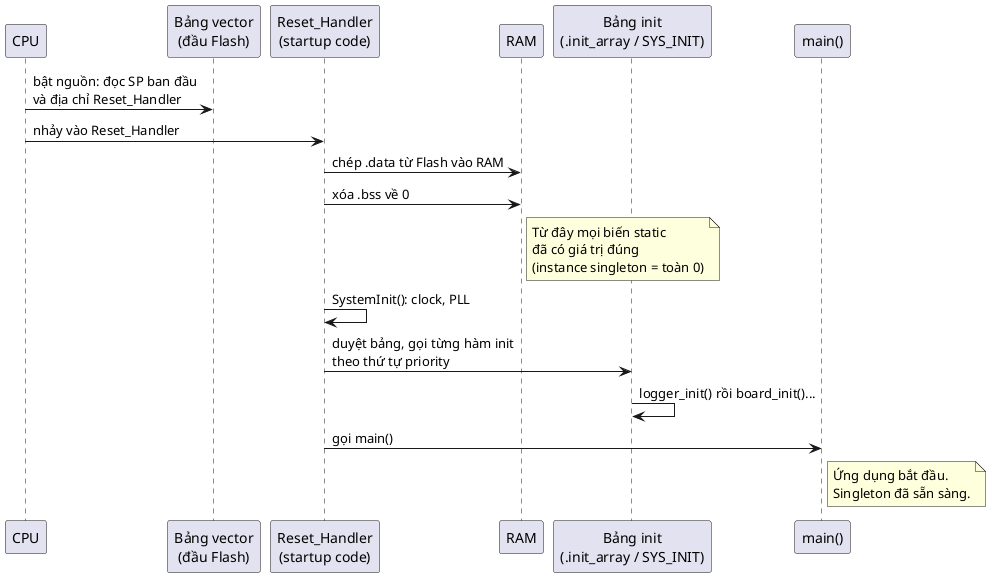
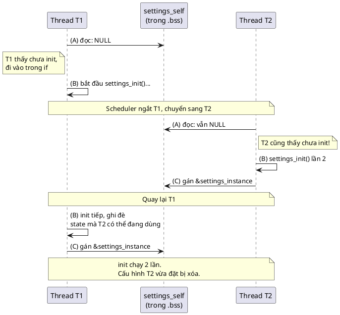
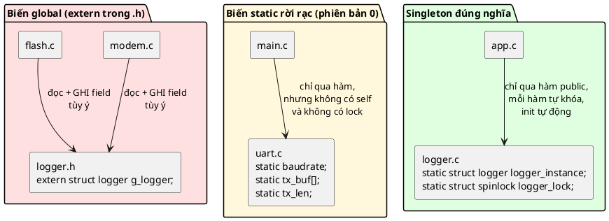
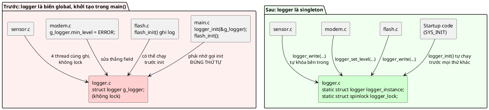
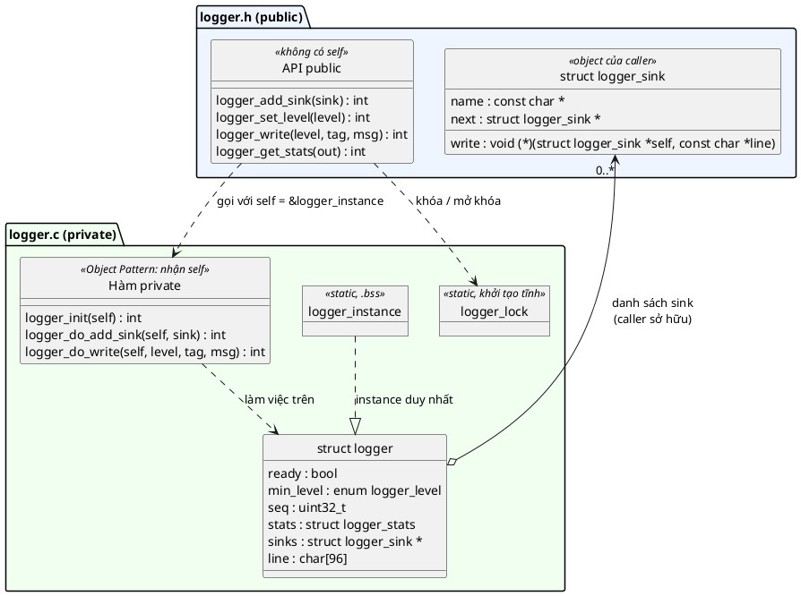
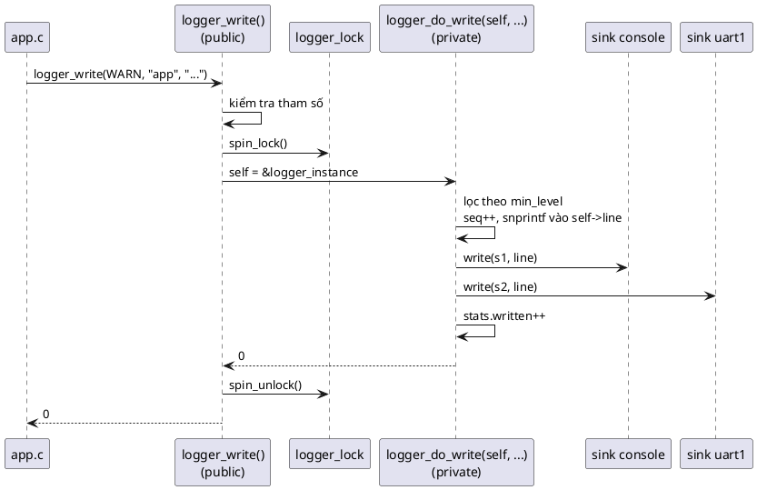
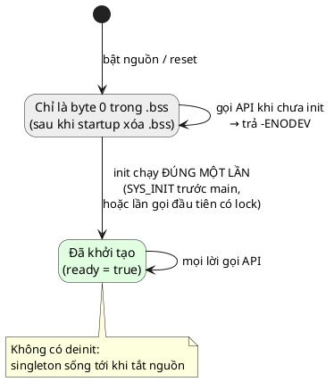
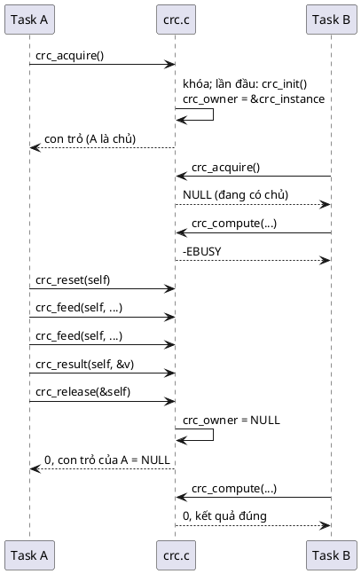
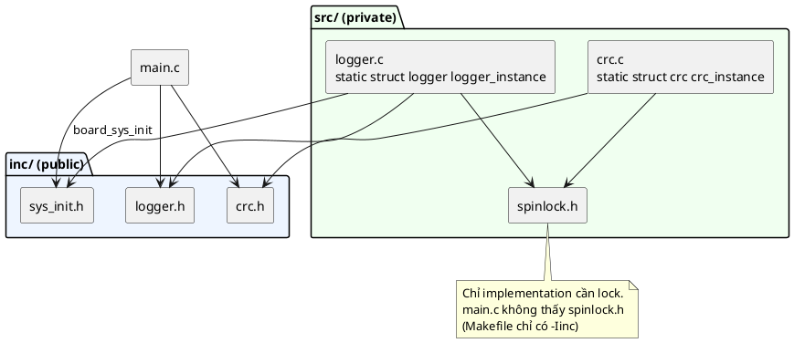

# Bài giảng 03 — Singleton Pattern

> **Về nguồn:** Bài này bám theo chương *Singleton Pattern* trong sách của Martin Schröder (bản 0.38.0, file `00_Document/Martin-Schroder-Design-Patterns-Singleton-Pattern-0.38.0.pdf`).
> - 📖 đánh dấu nội dung **theo sách** (dịch và diễn giải lại).
> - 💡 đánh dấu phần **giải thích thêm**, không có trong sách.
> - 🔬 đánh dấu **thí nghiệm thật**: chương trình đã được build bằng gcc 16.2 (MSYS2 UCRT64, Windows 64-bit) và chạy; output in trong bài là output thật.
> - Phần nói về Zephyr (`SYS_INIT`, `k_spinlock`, `LOG_MODULE_REGISTER`) được **giải thích nhưng không chạy**, vì repo này build trên PC. Thay vào đó bài có bản mô phỏng chạy được trên PC.

Code mẫu đi kèm: [inc/logger.h](inc/logger.h), [src/logger.c](src/logger.c), [inc/crc.h](inc/crc.h), [src/crc.c](src/crc.c), [inc/sys_init.h](inc/sys_init.h), [src/spinlock.h](src/spinlock.h), [main.c](main.c). Ghi chú ngắn: [README.md](README.md).
Bài trước: [01 — Object Pattern](../01_ObjectPattern/LECTURE.md), [02 — Opaque Pattern](../02_OpaquePattern/LECTURE.md). Bài sau: [04 — Factory Pattern](../04_FactoryPattern/LECTURE.md).

> ⚠️ **Lưu ý build:** code bài này dùng `<stdatomic.h>` nên build với **`-std=c11`** (CLAUDE.md cho phép C11 khi cần `_Atomic`). Makefile đã đổi sẵn.

---

## Mục lục

**Phần A — Kiến thức nền**

1. [Bối cảnh: từ Opaque tới Singleton](#1-bối-cảnh-từ-opaque-tới-singleton)
2. [Từ khóa `static` và linkage: ai nhìn thấy tên nào](#2-từ-khóa-static-và-linkage-ai-nhìn-thấy-tên-nào)
3. [Vòng đời của biến `static`: C khác C++ ở đâu](#3-vòng-đời-của-biến-static-c-khác-c-ở-đâu)
4. [Chuyện gì xảy ra trước `main()`](#4-chuyện-gì-xảy-ra-trước-main)
5. [Race condition: "kiểm tra rồi làm" không còn đúng khi có thread](#5-race-condition-kiểm-tra-rồi-làm-không-còn-đúng-khi-có-thread)
6. [Biến global, biến `static` và singleton: khác nhau thế nào](#6-biến-global-biến-static-và-singleton-khác-nhau-thế-nào)

**Phần B — Pattern**

7. [Vấn đề: hai cách làm sai đối xứng nhau](#7-vấn-đề-hai-cách-làm-sai-đối-xứng-nhau)
8. [Ý tưởng cốt lõi](#8-ý-tưởng-cốt-lõi)
9. [3 đặc điểm nhận dạng và lý do của từng cái](#9-3-đặc-điểm-nhận-dạng-và-lý-do-của-từng-cái)
10. [Khi nào dùng, khi nào tránh](#10-khi-nào-dùng-khi-nào-tránh)
11. [Ai khởi tạo singleton? Ba cách](#11-ai-khởi-tạo-singleton-ba-cách)
12. [Thiết kế interface: stateless, self và quyền sở hữu](#12-thiết-kế-interface-stateless-self-và-quyền-sở-hữu)

**Phần C — Đọc code**

13. [Đọc code mẫu từng dòng](#13-đọc-code-mẫu-từng-dòng)
14. [Theo dõi demo chạy từng bước](#14-theo-dõi-demo-chạy-từng-bước)
15. [Các quyết định thiết kế và phương án khác](#15-các-quyết-định-thiết-kế-và-phương-án-khác)

**Phần D — Thực tế và tổng kết**

16. [Singleton trong thực tế](#16-singleton-trong-thực-tế)
17. [Unit test với singleton](#17-unit-test-với-singleton)
18. [Trade-off](#18-trade-off)
19. [Phương án thay thế](#19-phương-án-thay-thế)
20. [Lỗi hay gặp](#20-lỗi-hay-gặp)
21. [Quy trình refactor](#21-quy-trình-refactor)
22. [Câu hỏi thường gặp (FAQ)](#22-câu-hỏi-thường-gặp-faq)
23. [Tóm tắt và checklist](#23-tóm-tắt-và-checklist)
24. [Quiz (có đáp án)](#24-quiz-có-đáp-án)
25. [Bài tập](#25-bài-tập)

---

# Phần A — Kiến thức nền

Singleton nghe có vẻ là pattern đơn giản nhất: "chỉ có một cái". Nhưng để dùng **đúng**, cần hiểu bốn thứ nằm bên dưới: từ khóa `static` thật sự làm gì, biến `static` sống ở đâu và được khởi tạo khi nào, code nào chạy trước `main()`, và vì sao "kiểm tra rồi gán" lại hỏng khi có nhiều thread. Phần A đi qua từng thứ một.

## 1. Bối cảnh: từ Opaque tới Singleton

### 1.1. Nhìn lại: hai bài trước đã đi tới đâu

Hãy nhìn lại ba phiên bản của driver UART mà ta đã viết, theo đúng thứ tự thời gian.

**Phiên bản 0 — trước bài 1** (code "chưa có pattern" ở [bài giảng 01, mục 2](../01_ObjectPattern/LECTURE.md#2-vấn-đề-code-khi-chưa-có-pattern)):

```c
/* uart.c — chưa có pattern */
static uint32_t uart_baudrate;
static uint8_t uart_tx_buf[32];
static size_t uart_tx_len;

int uart_init(uint32_t baudrate);
int uart_write(const uint8_t *data, size_t len);
```

**Phiên bản 1 — Object Pattern (bài 1):** gom state vào `struct uart` trong header, mọi hàm nhận `self`.

```c
struct uart { const char *name; uint32_t baudrate; uint8_t tx_buf[32]; size_t tx_len; };
int uart_write(struct uart *self, const uint8_t *data, size_t len);
```

**Phiên bản 2 — Opaque Pattern (bài 2):** chuyển định nghĩa struct vào `.c`, caller chỉ cầm con trỏ.

```c
struct uart;                         /* chỉ khai báo */
struct uart *uart_new(void);
int uart_write(struct uart *self, const uint8_t *data, size_t len);
```

Giờ để ý một điều thú vị: **phiên bản 0 chính là một singleton**. Không có `self`, state nằm trong biến `static` của `uart.c`, cả chương trình chỉ có đúng một UART. Nó có đủ "hình dáng" của Singleton Pattern. Vậy mà bài 1 đã dành cả một bài để **phá bỏ** nó.

Vậy tại sao bài 3 lại học Singleton như một pattern **nên dùng**? Câu trả lời nằm ở chữ "đúng chỗ":

| | Phiên bản 0 (bài 1 phá bỏ) | Singleton đúng nghĩa (bài này) |
|---|---|---|
| Thứ được làm thành "một instance" | Driver UART, trong khi chip có 3–8 UART | Thứ **thật sự** chỉ có một: logger hệ thống, bộ lập lịch, khối CRC duy nhất trên chip |
| Lý do có một instance | Tình cờ, vì lười viết `self` | **Cố ý**, và thể hiện rõ ý đồ đó |
| State bên trong | Các biến `static` rời rạc | Gom vào **một struct**, các hàm private vẫn nhận `self` (Object Pattern ở bên trong) |
| Khởi tạo | Ai đó nhớ gọi `uart_init()` | Tự động, có thứ tự rõ ràng, hoặc theo yêu cầu nhưng có lock |
| An toàn thread | Không nghĩ tới | Mỗi hàm public tự khóa |

📖 Sách mở đầu chương bằng đúng nhận xét này: Singleton *"thường bị dùng sai trong chương trình C, vì thường có hàng trăm biến nhỏ khai báo `static`, cả trong lẫn ngoài hàm. Một số còn được khai báo global, điều còn tệ hơn về mặt bảo trì code. Đây là một vấn đề lớn"*. Vì vậy chương này nói rõ singleton **nên** và **không nên** dùng thế nào.

Nói cách khác: bài 1 dạy bạn **bỏ** thói quen singleton vô tình. Bài 3 dạy bạn dùng singleton **có chủ đích**, cho đúng loại module cần nó.

### 1.2. Một dự án lớn dần: singleton dùng sai và thiếu singleton đều gây hại

💡 *Tình huống minh họa (không phải ví dụ trong sách), nhưng rất điển hình trong các dự án firmware.*

Team 4 người làm firmware cho một **bộ ghi dữ liệu nhiệt độ** (data logger) chạy RTOS, có UART debug, cảm biến I2C, flash ngoài và modem NB-IoT.

#### Tháng 1: mọi thứ là biến `static`

Code khởi đầu từ ví dụ của vendor. Mọi module đều kiểu phiên bản 0: `uart.c`, `i2c.c`, `flash.c`, `log.c`, mỗi file một đống biến `static`. Chạy được, demo được cho khách.

#### Tháng 3: học xong bài 1, refactor... hơi quá tay

Team áp dụng Object Pattern cho driver: `struct uart`, `struct i2c`, rất tốt. Rồi áp dụng luôn cho logger:

```c
struct logger { enum logger_level min_level; uint32_t seq; /* ... */ };
int logger_write(struct logger *self, enum logger_level lvl, const char *msg);
```

Logger được tạo trong `main()`. Và giờ **mọi hàm muốn ghi log đều cần con trỏ `struct logger *`**. Hàm đọc cảm biến nằm ở tầng thứ 5 của call stack (`main` → `app_run` → `sampler_tick` → `sensor_read` → `i2c_transfer`), nên con trỏ logger phải đi qua **cả 5 tầng**, kể cả những tầng không bao giờ ghi log. Thêm một tham số vào hàm `i2c_transfer` kéo theo sửa 40 chỗ gọi.

Đây là cái giá thật của việc truyền context **khi thứ đó chỉ có một trong cả hệ thống**. 📖 Sách ghi đúng lợi ích này của singleton: *"Simplifies code: no requirement to pass the context along code execution path"*.

#### Tháng 4: "giải pháp nhanh" là biến global

Một người mệt mỏi với việc truyền con trỏ, nên viết:

```c
/* logger.h */
extern struct logger g_logger;   /* ai cũng dùng được */
```

Tạm ổn. Nhưng `g_logger` là **biến global**: ai cũng đọc, ai cũng **ghi** được. Ba tuần sau có người viết `g_logger.min_level = LOGGER_LEVEL_ERROR;` trong module modem để "bớt ồn khi debug", rồi quên xóa. Log của cả hệ thống im bặt mà không ai hiểu vì sao.

#### Tháng 5: thứ tự khởi tạo

Module `flash.c` ghi log ngay trong `flash_init()`. Trong `main()`, ai đó sắp xếp lại các lệnh init, và `flash_init()` giờ chạy **trước** `logger_init()`. Log đầu tiên ghi vào một logger chưa khởi tạo: danh sách sink là rác, chương trình nhảy vào địa chỉ rác và HardFault ngay lúc khởi động. Mà chỉ trên **một số** board, vì RAM lúc bật nguồn không phải lúc nào cũng giống nhau.

#### Tháng 7: RTOS, 4 thread cùng ghi log

Thread cảm biến, thread modem, thread lưu flash và thread giao diện cùng gọi `logger_write`. Log bị **trộn lẫn** giữa chừng dòng, bộ đếm số dòng log bị **hụt**. Có người thêm `logger_lock()` / `logger_unlock()` vào API và dặn "nhớ khóa trước khi ghi". Một tháng sau, có chỗ quên khóa.

#### Tháng 9: phía ngược lại — singleton dùng sai

Khách hàng muốn thêm module GPS dùng UART thứ hai. Nhưng driver UART của tháng 1 vẫn là kiểu `static`, chưa refactor. Cách "nhanh nhất": chép `uart.c` thành `uart_gps.c`... và linker báo `multiple definition of 'uart_init'` (mục 7 có thí nghiệm thật). Muốn sửa phải đổi tên mọi hàm, hoặc refactor sang Object Pattern, kéo theo sửa mọi nơi gọi.

#### Nhìn lại

| Tháng | Chuyện gì xảy ra | Nguyên nhân gốc |
|---|---|---|
| 3 | Con trỏ logger phải truyền qua 5 tầng | Thứ **chỉ có một** lại bị làm thành object truyền tay |
| 4 | Ai đó sửa `g_logger.min_level` từ module khác | Instance bị **lộ ra** dưới dạng biến global |
| 5 | Dùng logger trước khi init → HardFault | Khởi tạo **phụ thuộc thứ tự gọi** trong `main()` |
| 7 | Log trộn lẫn, đếm hụt; API lock/unlock bị quên | Không có **lock bên trong**; API **stateful** |
| 9 | Không thêm được UART thứ hai | Thứ **có thể có nhiều** lại bị làm thành singleton |

Singleton Pattern đúng nghĩa giải quyết các dòng 3, 4, 5, 7: **giấu instance** (không global), **khởi tạo tự động** với thứ tự rõ ràng, **API stateless** tự khóa bên trong, và **không bắt truyền context**. Còn dòng 9 nhắc ta mặt trái: dùng singleton cho thứ không phải là duy nhất là một sai lầm nghiêm trọng.

### 1.3. Đọc kỹ định nghĩa của sách

📖 Câu mở đầu chương:

> *"The Singleton pattern ensures that only one instance of an object can exist. In C, the API of such an object typically consists of methods that do not take an instance pointer (no self pointer as first parameter)."*
>
> *Singleton bảo đảm chỉ có thể tồn tại **một** instance của một object. Trong C, API của object như vậy thường gồm các hàm **không nhận con trỏ instance** (không có `self` làm tham số đầu tiên).*

📖 Và định nghĩa ở mục *Definition*:

> *"The singleton pattern is a widely-used design technique that ensures that a specific class has only one instance at any given time. It also provides a global access point to this instance, making it easily accessible throughout your application."*

Từng vế:

| Vế | Nghĩa là gì |
|---|---|
| *"ensures"* (bảo đảm) | Không phải "thường chỉ có một" hay "hy vọng chỉ có một". Thiết kế phải làm cho việc tạo instance thứ hai là **không thể** |
| *"only one instance"* | Đúng **một** vùng nhớ chứa state của object trong cả chương trình |
| *"at any given time"* | Tại mọi thời điểm. Không có lúc nào hai instance cùng tồn tại, kể cả lúc khởi tạo (đây là chỗ race condition ở mục 5 làm hỏng) |
| *"a global access point"* | Có một **điểm truy cập** dùng được từ mọi nơi. Chú ý: điểm truy cập là **các hàm**, không phải **biến** global |
| *"methods that do not take an instance pointer"* | Dấu hiệu nhận biết trong C: hàm không có `self`. Vì chỉ có một instance, nên không cần nói "instance nào" |

📖 Sách liệt kê ba đặc điểm (*key characteristics*), mục 9 sẽ phân tích từng cái:
1. **Control over instantiation and use**: ngăn nhiều instance cùng tồn tại. Đôi khi mở rộng thành **chỉ một người dùng tại một thời điểm**.
2. **Private construction**: trong C, nghĩa là việc tạo instance là **tự động**, diễn ra **bên trong file `.c`**, và **chỉ một lần**.
3. **Stateless interface**: cung cấp một hàm để lấy instance, **hoặc** chỉ có các hàm stateless với API **không phụ thuộc thứ tự gọi** (hàm không nhận con trỏ instance).

📖 Sách cũng thêm một câu cảnh báo ngay sau định nghĩa: *"có những tình huống mà pattern khác phù hợp hơn"*. Phần lớn chương sách là về **khi nào không dùng** singleton.

Viết gọn thành công thức:

> **Singleton = Opaque Pattern + đúng một instance nằm sẵn trong `.c` + API không có `self` (và bên trong vẫn là Object Pattern)**

### 1.4. Singleton trong bức tranh các Creational Pattern

📖 Sách xếp Object, Opaque, Singleton và Factory vào nhóm **Creational Patterns**. Phần giới thiệu sách viết: Singleton *"là cách ép chỉ có một instance của một object... khi mọi người trong team hiểu design pattern, việc dùng pattern trở thành cách **thể hiện ý đồ**"*.



| | Object (bài 1) | Opaque (bài 2) | Singleton (bài 3) |
|---|---|---|---|
| Caller thấy field? | Thấy | Không | Không |
| Ai cấp phát? | Caller | Module | Module, **sẵn từ lúc build** (`.bss`) |
| Số instance | Tùy ý | Tùy ý | **Đúng 1** |
| Caller cầm gì? | Object hoặc con trỏ | Con trỏ | **Không cầm gì** (hoặc con trỏ tạm khi acquire) |
| Hàm public nhận `self`? | Có | Có | **Không** (trừ biến thể acquire/release) |
| Hàm private nhận `self`? | Có | Có | **Có** |

📖 Hai chương trước đều đã nhắc tới Singleton:
- Chương Opaque: *"Singleton về bản chất là Opaque Pattern, khác ở chỗ ngay cả con trỏ tới context cũng không được truyền đi... Lưu ý rằng ngay cả singleton cũng nên dùng Object Pattern ở bên trong."*
- Chương Object: *"Object Pattern là cách chính để hiện thực singleton, vì mọi dữ liệu trước đây khai báo `static` trong implementation giờ có thể đặt vào một object singleton, và mọi hàm private làm việc trên object đó."* Và trong đặc điểm của Object Pattern: *"Dữ liệu không bao giờ được truy cập global: dữ liệu global hay singleton được truy cập qua các hàm của singleton."*

📖 Còn chương Factory (bài sau) có best practice *"Singleton factory"*: factory đơn giản trong C *"gần như mặc định là singleton"*. Tức là bài 4 sẽ dùng lại những gì học ở đây.

### 1.5. Câu hỏi bài này sẽ trả lời

1. Instance duy nhất **nằm ở đâu**, và làm sao **không ai khác chạm vào** được? (Mục 2, 3, 8)
2. **Ai khởi tạo, khi nào**? Làm sao chắc nó được khởi tạo **trước** lần dùng đầu tiên? (Mục 4, 11)
3. Nhiều thread cùng gọi thì sao? (Mục 5, 11.3, 12)
4. Khi API cần **thứ tự gọi** (stateful), làm sao an toàn? (Mục 12)
5. Khi nào **không** được dùng singleton? (Mục 10, 19)

---

## 2. Từ khóa `static` và linkage: ai nhìn thấy tên nào

Singleton trong C dựa hoàn toàn vào từ khóa `static`. Nhưng `static` trong C có **ba nghĩa khác nhau** tùy chỗ đặt, và đây là nguồn nhầm lẫn rất phổ biến.

### 2.1. Ba nghĩa của `static`

```c
static int counter;              /* (1) biến ở phạm vi file */

static void helper(void) { }     /* (2) hàm */

int next_id(void)
{
	static int id;           /* (3) biến bên trong hàm */
	return ++id;
}
```

| Vị trí | `static` thay đổi điều gì | Ví dụ trong bài |
|---|---|---|
| (1) Biến ở phạm vi file | **Linkage**: tên chỉ thấy được trong file `.c` này (internal linkage) | `logger_instance`, `crc_owner` |
| (2) Hàm | **Linkage**: tên hàm chỉ thấy trong file này | `logger_do_write`, `crc_init` |
| (3) Biến trong hàm | **Thời gian sống** (storage duration): biến sống suốt chương trình, không mất khi hàm return | Macro của sách dùng `static struct type _singleton` trong hàm |

💡 Biến ở phạm vi file **luôn** sống suốt chương trình, dù có `static` hay không. Với biến loại (1), `static` chỉ thay đổi **ai nhìn thấy tên**. Với biến loại (3), `static` thay đổi **sống bao lâu** (còn tên thì vốn đã chỉ thấy trong hàm).

### 2.2. Linkage: linker nối tên thế nào

Nhớ lại [bài giảng 02, mục 2](../02_OpaquePattern/LECTURE.md#2-compiler-nhìn-thấy-gì-translation-unit): mỗi file `.c` được dịch riêng thành file `.o`, rồi **linker** nối các `.o` lại bằng **tên** (symbol).

- Tên có **external linkage** (không có `static`) được ghi vào `.o` dưới dạng symbol **toàn cục**: file khác tham chiếu tới tên đó thì linker nối vào.
- Tên có **internal linkage** (có `static`) vẫn có trong `.o`, nhưng được đánh dấu **cục bộ**: linker **không bao giờ** dùng nó để nối với tham chiếu từ file khác.

🔬 Thí nghiệm: dùng công cụ `nm` liệt kê symbol trong `logger.o` (đã lọc bớt):

```
000000000000020f T logger_add_sink
00000000000000e1 t logger_do_write
0000000000000032 t logger_init
0000000000000000 b logger_instance
0000000000000080 b logger_lock
00000000000001de t logger_sys_init
00000000000001fb t logger_sys_init_sys_init_entry
00000000000002d1 T logger_write
```

Đọc cột thứ hai:

| Ký tự | Nghĩa | Symbol |
|---|---|---|
| `T` (hoa) | Code, **toàn cục** | `logger_add_sink`, `logger_write`: API public |
| `t` (thường) | Code, **cục bộ** | `logger_do_write`, `logger_init`: hàm private `static` |
| `b` (thường) | Dữ liệu trong `.bss`, **cục bộ** | `logger_instance`, `logger_lock`: instance duy nhất và lock |

Chữ **thường** = cục bộ = internal linkage. Instance của singleton là `b` thường: nó nằm trong `.bss` nhưng không file nào khác "với" tới được.

### 2.3. 🔬 Thử "lách" để chạm vào instance

Một file khác cố khai báo `extern` để truy cập instance:

```c
#include "logger.h"

/* Cố "lách" để chạm vào instance bên trong logger.c */
struct logger;
extern struct logger logger_instance;

int main(void)
{
	struct logger *p = &logger_instance;
	return p != 0;
}
```

Compile thì qua (compiler tin lời khai báo `extern`), nhưng **linker** từ chối:

```
peek.c:(.rdata$.refptr.logger_instance[.refptr.logger_instance]+0x0): undefined reference to `logger_instance'
collect2.exe: error: ld returned 1 exit status
```

Linker tìm symbol toàn cục tên `logger_instance` và không thấy, vì symbol duy nhất mang tên đó là cục bộ của `logger.o`. Đây là **hàng rào thứ hai** sau hàng rào incomplete type của bài 2:

| Hàng rào | Do ai dựng | Chặn cái gì |
|---|---|---|
| Incomplete type (bài 2) | Compiler | Đọc/ghi **field**, biết **kích thước** |
| Internal linkage (bài này) | Linker | Lấy được **địa chỉ** của instance |

Singleton dùng **cả hai**: `struct logger` định nghĩa trong `.c` (incomplete ở ngoài), và `logger_instance` là `static` (không ai lấy được địa chỉ).

📖 Đây chính là best practice *"Hide the instance"* của sách: *"dùng biến `static` để giữ instance, bảo đảm instance chỉ hiện diện với implementation, và không thể truy cập trực tiếp bằng bất kỳ cách nào khác ngoài interface của singleton"*.

---

## 3. Vòng đời của biến `static`: C khác C++ ở đâu

### 3.1. Biến `static` sống ở đâu

Nhớ lại bản đồ bộ nhớ ở [bài giảng 02, mục 6](../02_OpaquePattern/LECTURE.md#6-bản-đồ-bộ-nhớ-của-vi-điều-khiển):

| Khai báo | Vùng nhớ | Giá trị lúc chương trình bắt đầu |
|---|---|---|
| `static struct logger logger_instance;` (không khởi tạo) | `.bss` | Toàn bộ là 0 |
| `static struct spinlock logger_lock = SPINLOCK_INIT;` | `.bss` (🔬 `nm` cho thấy `b`: giá trị khởi tạo toàn bit 0 nên linker xếp vào `.bss`) | Giá trị khởi tạo |
| `static const char *const logger_level_names[] = {...}` | `.rodata` (Flash) | Giá trị khởi tạo, không đổi được |

💡 Điểm quan trọng nhất cho singleton: **biến `static` có sẵn từ trước khi `main()` chạy**, đã mang giá trị 0 hoặc giá trị khởi tạo. Không có bước "tạo" nào lúc chạy. Vùng nhớ cho instance được linker dành sẵn, kích thước biết ngay lúc build.

🔬 Lệnh `size` trên `demo.exe` của bài này:

```
   text	   data	    bss	    dec	    hex	filename
  14556	    208	    440	  15204	   3b64	demo.exe
```

`logger_instance` (128 byte, xem mục 13) và `crc_instance` nằm trong 440 byte `.bss` đó, cùng với biến của C runtime.

### 3.2. C không có "khởi tạo lười" cho biến `static`

📖 Ví dụ khởi tạo theo yêu cầu đầu tiên trong sách (mục 11.1) được ghi là *"In C"*, nhưng thật ra viết theo cú pháp kiểu C++/Java (`class`, `private static`, `public static`). 💡 Điều này đáng chú ý, vì **C và C++ khác nhau đúng ở chỗ này**.

Trong C++, biến `static` bên trong hàm có thể khởi tạo bằng **lời gọi hàm**, và lời gọi đó chạy ở **lần đầu tiên** hàm được gọi (C++11 còn bảo đảm việc này an toàn với thread). Đó là "Meyers singleton" nổi tiếng của C++.

Trong C, giá trị khởi tạo của biến `static` **phải là hằng số lúc compile**. 🔬 Thử:

```c
static int read_config(void) { return 115200; }

int get_baud(void)
{
	static int baud = read_config(); /* C++ cho phép, C thì không */
	return baud;
}
```

```
static_init.c:5:27: error: initializer element is not constant
```

Hệ quả cho singleton trong C:
- Vùng nhớ của instance luôn có sẵn (`.bss`), nhưng **nội dung** chỉ là số 0.
- Muốn đưa instance vào trạng thái dùng được (gán level mặc định, cấu hình phần cứng...), **phải có code chạy** một hàm `init`. Câu hỏi "ai gọi hàm init đó, khi nào?" là câu hỏi trung tâm của mục 11.

💡 Đây cũng là lý do code mẫu tách `spinlock` ra **khởi tạo tĩnh** (`= SPINLOCK_INIT`, là một hằng số): lock phải dùng được **trước** khi bất kỳ hàm init nào chạy, vì chính lock bảo vệ việc init.

---

## 4. Chuyện gì xảy ra trước `main()`

📖 Sách ưa dùng cách khởi tạo singleton bằng **startup code**, qua macro `SYS_INIT` của Zephyr: *"cách này dùng các bảng khởi tạo, là các section đặc biệt trong file thực thi. Các bảng này được code khởi tạo hệ thống duyệt và thực thi khi ứng dụng khởi động"*. Để hiểu câu đó, cần biết điều gì xảy ra từ lúc bật nguồn tới lúc vào `main()`.

### 4.1. Từ reset tới `main()` trên Cortex-M

💡 *Kiến thức chung về MCU ARM Cortex-M (ví dụ file `startup_stm32xxxx.s` của ST), không trích từ sách.*



Các bước:
1. **Reset:** CPU đọc hai word đầu tiên trong Flash: giá trị ban đầu của stack pointer và địa chỉ hàm `Reset_Handler`.
2. **Chép `.data`:** biến có giá trị khởi tạo khác 0 được lưu trong Flash, startup code chép chúng vào RAM.
3. **Xóa `.bss`:** ghi 0 lên toàn bộ vùng `.bss`. Instance singleton của ta giờ là một khối byte 0.
4. **Cấu hình hệ thống:** clock, PLL...
5. **Chạy bảng init:** với thư viện C chuẩn (newlib) thì là `__libc_init_array()`, gọi các hàm trong `.init_array` (constructor). Với Zephyr thì là các mức `PRE_KERNEL_1`, `PRE_KERNEL_2`, `POST_KERNEL`, `APPLICATION` của `SYS_INIT`.
6. **Gọi `main()`.**

Bước 5 là chỗ singleton được khởi tạo một cách tự động.

### 4.2. Bảng init là gì: một mảng con trỏ hàm do linker ghép lại

Ý tưởng rất đơn giản:
- Mỗi module muốn được khởi tạo tự động sẽ đặt **một con trỏ tới hàm init của nó** vào một **section** riêng của file thực thi (ví dụ `.myinit`).
- Linker gom mọi con trỏ từ mọi file `.o` vào **chung một chỗ**, liền nhau, tạo thành **một mảng**. Nếu tên section có kèm priority, linker sắp xếp theo đó.
- Startup code biết địa chỉ đầu và cuối của mảng, và chỉ việc **duyệt từ đầu tới cuối**, gọi từng hàm.

Không module nào phải sửa `main()` để đăng ký. Thêm file `.c` vào build là hàm init của nó tự có mặt trong bảng.

🔬 Thí nghiệm: tự xây một bảng init kiểu `SYS_INIT` bằng section, trên PC:

```c
#include <stdio.h>

/* Một entry của bảng khởi tạo: con trỏ hàm + tên để in ra */
struct init_entry {
	int (*fn)(void);
	const char *name;
};

/*
 * Đặt entry vào section ".myinit$b<prio>". Linker PE (MinGW) gộp mọi section
 * ".myinit$..." thành một section ".myinit" và SẮP XẾP theo phần sau dấu $.
 * Trên ELF (ARM Cortex-M) Zephyr làm tương tự bằng linker script.
 */
#define MY_SYS_INIT(fn, prio)                                                  \
	static const struct init_entry init_entry_##fn                         \
		__attribute__((used, section(".myinit$b" #prio))) = { fn, #fn };

/* Hai entry "lính canh" đánh dấu đầu và cuối bảng */
static const struct init_entry init_start __attribute__((used, section(".myinit$a"))) = { 0, 0 };
static const struct init_entry init_end __attribute__((used, section(".myinit$c"))) = { 0, 0 };

static int board_init(void)  { puts("  board_init");  return 0; }
static int logger_init(void) { puts("  logger_init"); return 0; }
static int clock_init(void)  { puts("  clock_init");  return 0; }

/* Cố tình khai báo lộn xộn: thứ tự chạy do priority quyết định */
MY_SYS_INIT(board_init, 120)
MY_SYS_INIT(logger_init, 110)
MY_SYS_INIT(clock_init, 101)

/* Việc của "startup code": duyệt bảng từ đầu tới cuối */
static void run_init_table(void)
{
	for (const struct init_entry *e = &init_start + 1; e < &init_end; e++) {
		printf("entry @ %p -> %s\n", (const void *)e, e->name);
		e->fn();
	}
}

int main(void)
{
	run_init_table();
	puts("application main logic");
	return 0;
}
```

Output thật:

```
entry @ 00007FF623B85010 -> clock_init
  clock_init
entry @ 00007FF623B85020 -> logger_init
  logger_init
entry @ 00007FF623B85030 -> board_init
  board_init
application main logic
```

Và `objdump -h` cho thấy linker đã gom tất cả thành một section:

```
Idx Name          Size      VMA               LMA               File off  Algn
  3 .myinit       00000050  0000000140005000  0000000140005000  00002400  2**2
```

Đọc kết quả:
- Ba entry được khai báo theo thứ tự board → logger → clock, nhưng chạy theo thứ tự **priority**: 101 → 110 → 120.
- Các entry nằm **liền nhau**, cách nhau đúng 16 byte (`0x10`) = `sizeof(struct init_entry)` trên PC 64-bit (con trỏ hàm 8 byte + con trỏ chuỗi 8 byte).
- Section `.myinit` dài `0x50` = 80 byte = 5 entry × 16 byte (3 entry thật + 2 lính canh).
- `__attribute__((used))` bảo compiler giữ biến lại dù không ai tham chiếu tới nó theo tên. Thiếu nó, compiler thấy biến `static` không dùng và xóa đi.

💡 Hai lưu ý trung thực:
- Phép so sánh `e < &init_end` giữa hai object khác nhau, về lý thuyết chuẩn C không định nghĩa. Nó chạy được vì ta **biết chắc** linker đặt chúng liền nhau. Code startup thật (Zephyr, newlib) cũng dựa vào hiểu biết về linker như vậy, nhưng dùng symbol do linker script tạo ra.
- Kỹ thuật sắp xếp theo hậu tố `$` là đặc thù của định dạng PE (Windows). Trên ELF, Zephyr dùng linker script với `KEEP(*(SORT(.z_init_*)))` cho mục đích tương tự.

### 4.3. Constructor của C runtime: bảng init có sẵn

📖 Chương Factory của sách nhận xét: *"cách này thật ra luôn được dùng trong mọi chương trình C, chỉ là nó được hiện thực bởi thư viện của compiler. Code startup của C thực thi constructor cho các biến static và global."*

gcc có sẵn một bảng init như vậy: đánh dấu hàm bằng `__attribute__((constructor(prio)))`, và C runtime sẽ gọi nó trước `main()`, theo thứ tự `prio` tăng dần.

🔬 Thí nghiệm hai file, cố tình đặt hàm priority lớn ở file đứng trước:

```c
/* a.c */
#include <stdio.h>
static void __attribute__((constructor(120))) board(void) { puts("board_init (prio 120, a.c)"); }
```

```c
/* b.c */
#include <stdio.h>
static void __attribute__((constructor(110))) logger(void) { puts("logger_init (prio 110, b.c)"); }
int main(void) { puts("main()"); return 0; }
```

Build theo cả hai thứ tự `a.c b.c` và `b.c a.c`, output **giống hệt nhau**:

```
logger_init (prio 110, b.c)
board_init (prio 120, a.c)
main()
```

Thứ tự do priority quyết định, không phụ thuộc thứ tự file trên dòng lệnh build.

🔬 Nhìn vào bên trong `logger.o` của code mẫu (`objdump -h`):

```
  6 .ctors.65425  00000008  0000000000000000  0000000000000000  00000664  2**3
```

Constructor priority 110 được gcc đặt vào section tên `.ctors.65425` (65425 = 65535 − 110), dài đúng **8 byte = một con trỏ hàm**. Đó chính là "entry trong bảng init" của logger. Cơ chế y hệt thí nghiệm `.myinit` ở trên, chỉ là compiler làm hộ.

Code mẫu của bài dùng cơ chế này để mô phỏng `SYS_INIT` (file [inc/sys_init.h](inc/sys_init.h), đọc ở mục 13).

💡 Priority từ 0 tới 100 được gcc giữ lại cho chính C runtime, nên code của ta dùng từ 101 trở lên.

---

## 5. Race condition: "kiểm tra rồi làm" không còn đúng khi có thread

### 5.1. Một dòng C không phải là một bước

Xét đoạn khởi tạo lười kiểu ngây thơ:

```c
if (!settings_self) {                  /* (A) kiểm tra */
	settings_init(&settings_instance); /* (B) khởi tạo */
	settings_self = &settings_instance;/* (C) đánh dấu đã khởi tạo */
}
```

Với một thread, đoạn này đúng. Nhưng với hai thread T1 và T2, scheduler của RTOS có thể **ngắt T1 ở bất kỳ đâu** giữa (A), (B), (C) để chạy T2:



Đây gọi là **race condition** (tranh chấp): kết quả phụ thuộc vào thứ tự ngẫu nhiên mà các thread được chạy. Mẫu "kiểm tra một điều kiện, rồi hành động dựa trên nó" (*check-then-act*) luôn có nguy cơ này, vì giữa "kiểm tra" và "hành động", thế giới có thể đã thay đổi.

📖 Sách nói đúng điều này về cách khởi tạo theo yêu cầu: *"cách hiện thực này thiếu an toàn thread. Ta không thể bảo đảm hai thread sẽ không tạo singleton hai lần vì cả hai lần lượt kiểm tra thấy `_singleton` là null và tiếp tục tạo nó."*

### 5.2. 🔬 Thí nghiệm: 8 thread cùng lấy singleton

Chương trình dưới đây cho 8 thread (pthread) cùng gọi `settings_get_singleton()`. Hàm init có `usleep(1000)` để mô phỏng một init "tốn thời gian" (đọc flash, chờ phần cứng), làm cửa sổ race rộng ra:

```c
#include <pthread.h>
#include <stdio.h>
#include <unistd.h>

struct settings {
	int init_count_seen;
};

static struct settings settings_instance;
static struct settings *settings_self;
static int settings_inits; /* đếm số lần init thật sự chạy */

static void settings_init(struct settings *self)
{
	settings_inits++;
	usleep(1000); /* init "tốn thời gian": đọc flash, chờ phần cứng... */
	self->init_count_seen = settings_inits;
}

/* Khởi tạo lười KIỂU NGÂY THƠ: kiểm tra rồi gán, không có lock */
struct settings *settings_get_singleton(void)
{
	if (!settings_self) {
		settings_init(&settings_instance);
		settings_self = &settings_instance;
	}
	return settings_self;
}

static void *worker(void *arg)
{
	(void)arg;
	settings_get_singleton();
	return NULL;
}

int main(void)
{
	pthread_t t[8];

	for (int i = 0; i < 8; i++) {
		pthread_create(&t[i], NULL, worker, NULL);
	}
	for (int i = 0; i < 8; i++) {
		pthread_join(t[i], NULL);
	}
	printf("8 threads -> settings_init() ran %d times\n", settings_inits);
	return 0;
}
```

Build: `gcc -std=c11 -Wall -Wextra -Werror -pedantic -pthread lazy_race.c`. Chạy 3 lần:

```
8 threads -> settings_init() ran 8 times
8 threads -> settings_init() ran 8 times
8 threads -> settings_init() ran 8 times
```

Không phải "thỉnh thoảng hai lần", mà là **8 lần**: cả 8 thread đều kịp đi qua phép kiểm tra trước khi thread đầu tiên gán xong. 💡 Bỏ `usleep` đi thì lỗi hiếm hơn rất nhiều, và đó mới là điều đáng sợ: bug chỉ xuất hiện một lần trong hàng nghìn lần khởi động, ở hiện trường.

(💡 Nói chính xác theo chuẩn C11, hai thread cùng truy cập một biến thường mà ít nhất một bên ghi là **data race**, tức undefined behavior. Thí nghiệm chỉ để minh họa.)

### 5.3. Cách sửa: gom "kiểm tra" và "hành động" vào cùng một vùng khóa

Giải pháp là một **lock**: một cơ chế bảo đảm tại mỗi thời điểm chỉ một thread được ở trong đoạn code nằm giữa `lock` và `unlock` (gọi là **critical section**, vùng găng).

```c
struct settings *settings_get_singleton(void)
{
	struct settings *self;

	spin_lock(&settings_lock);
	if (!settings_self) {
		settings_init(&settings_instance);
		settings_self = &settings_instance;
	}
	self = settings_self;
	spin_unlock(&settings_lock);
	return self;
}
```

Cùng thí nghiệm, chỉ thêm lock, chạy 3 lần:

```
8 threads -> settings_init() ran 1 times
8 threads -> settings_init() ran 1 times
8 threads -> settings_init() ran 1 times
```

Chú ý dòng `self = settings_self;` nằm **trong** vùng khóa: đọc biến dùng chung cũng phải được bảo vệ.

### 5.4. Spinlock tối giản: `atomic_flag`

📖 Sách dùng `k_spinlock` của Zephyr. Trên PC, code mẫu dùng một spinlock tự viết bằng C11 (file [src/spinlock.h](src/spinlock.h)):

```c
#include <stdatomic.h>

struct spinlock {
	atomic_flag flag;
};

#define SPINLOCK_INIT { ATOMIC_FLAG_INIT }

static inline void spin_lock(struct spinlock *lock)
{
	while (atomic_flag_test_and_set_explicit(&lock->flag, memory_order_acquire)) {
	}
}

static inline void spin_unlock(struct spinlock *lock)
{
	atomic_flag_clear_explicit(&lock->flag, memory_order_release);
}
```

💡 Ý tưởng cốt lõi:
- `atomic_flag` là một cờ đúng/sai mà phần cứng bảo đảm thao tác **"đặt thành true và trả về giá trị cũ"** (test-and-set) diễn ra **nguyên khối** (atomic): không thread nào chen vào giữa được. Trên Cortex-M3/M4, compiler sinh ra cặp lệnh `LDREX`/`STREX` cho việc này.
- `spin_lock`: liên tục test-and-set. Nếu giá trị cũ là `false`, ta vừa là người đặt nó thành `true`, tức là đã giành được lock, thoát vòng lặp. Nếu giá trị cũ là `true`, người khác đang giữ, **quay vòng** (spin) thử lại.
- `spin_unlock`: đặt cờ về `false`.
- `memory_order_acquire` / `release`: bảo đảm mọi thao tác đọc/ghi trong vùng găng không bị compiler hoặc CPU "dời" ra ngoài vùng găng.

⚠️ **Khác biệt quan trọng với `k_spin_lock` của Zephyr**: 📖 sách nói spinlock trong macro *"bảo đảm threading (và mọi interrupt) bị tắt khi singleton đang được khởi tạo"*. Tức là `k_spin_lock` **tắt interrupt** trước khi giành lock. Bản PC của ta không làm vậy. 💡 Trên MCU một nhân, nếu thread đang giữ lock mà một ISR chạy vào và cũng gọi `spin_lock`, ISR sẽ quay vòng mãi (thread không bao giờ được chạy tiếp để mở khóa): **deadlock**. Vì vậy spinlock thật trên MCU luôn đi kèm tắt interrupt. Bài 11 (Spinlock) sẽ đi sâu chủ đề này.

---

## 6. Biến global, biến `static` và singleton: khác nhau thế nào

Ba thứ này hay bị gộp chung là "biến toàn cục". Thật ra chúng khác nhau rất xa về mức độ kiểm soát:



| | Biến global | Biến `static` rời rạc | Singleton đúng nghĩa |
|---|---|---|---|
| Ai sửa được dữ liệu? | **Mọi file** | Chỉ file `.c` đó | Chỉ file `.c` đó |
| Truy cập qua đâu? | Trực tiếp tên biến | Hàm | Hàm |
| State được gom lại? | Có thể | Không, rải rác nhiều biến | **Có, một struct** |
| Bên trong có Object Pattern? | Không | Không | **Có**: hàm private nhận `self` |
| An toàn thread? | Không | Thường không | **Có**: mỗi hàm public tự khóa |
| Khởi tạo | Ai đó gọi | Ai đó gọi | **Tự động** hoặc theo yêu cầu có lock |
| Có chủ đích "chỉ một"? | Không rõ | Thường là tình cờ | **Có, và nói rõ ra** |

📖 Sách: một số biến *"thậm chí được khai báo global, điều còn tệ hơn về mặt bảo trì code"*. 💡 Lý do biến global tệ nhất: khi một biến global mang giá trị sai, **bất kỳ dòng nào trong toàn bộ project** cũng có thể là thủ phạm. Với singleton, chỉ cần tìm trong **một file `.c`**.

---

# Phần B — Pattern

## 7. Vấn đề: hai cách làm sai đối xứng nhau

Tình huống ở mục 1.2 cho thấy có **hai** kiểu sai, ngược chiều nhau. Singleton Pattern là câu trả lời cho kiểu sai thứ nhất, và là **nguyên nhân** của kiểu sai thứ hai nếu dùng bừa.

### 7.1. Sai kiểu 1: thứ duy nhất nhưng không được thiết kế như singleton

Logger hệ thống, bộ lập lịch, khối CRC phần cứng... trong hệ thống chỉ có **một**. Nếu không làm chúng thành singleton đúng nghĩa, ta rơi vào một trong hai ngả:

**Ngả A: truyền context khắp nơi.**

```c
int i2c_transfer(struct i2c *self, struct logger *log, /* ... */);
int sensor_read(struct sensor *self, struct logger *log, int32_t *out);
int sampler_tick(struct sampler *self, struct logger *log);
```

Mọi tầng đều phải mang theo `struct logger *`, kể cả tầng không bao giờ ghi log. Nó **làm nhiễu chữ ký hàm** và không mang lại gì, vì đằng nào cũng chỉ có một logger.

**Ngả B: biến global.**

```c
extern struct logger g_logger;
```

Gọn, nhưng mất mọi kiểm soát (mục 6): ai cũng ghi được field, không có lock, không biết ai khởi tạo, khởi tạo lúc nào.

### 7.2. Sai kiểu 2: thứ có thể có nhiều nhưng bị làm thành singleton

📖 Ví dụ đầu tiên của sách trong mục *Reasons to avoid*: **driver UART**. *"Bạn có thể có nhiều UART, và dùng singleton cho việc này làm giảm tính linh hoạt."*

🔬 Thí nghiệm: driver UART kiểu singleton (không có `self`, state là biến `static`):

```c
/* uart.h */
#ifndef UART_H
#define UART_H
#include <stddef.h>
#include <stdint.h>
/* UART kiểu singleton: không có self, chỉ có MỘT UART */
int uart_init(uint32_t baudrate);
int uart_write(const uint8_t *data, size_t len);
#endif
```

```c
/* uart.c */
#include "uart.h"
#include <stdio.h>
static uint32_t uart_baud;
int uart_init(uint32_t baudrate) { uart_baud = baudrate; return 0; }
int uart_write(const uint8_t *data, size_t len)
{
	printf("[UART @ %lu] %.*s\n", (unsigned long)uart_baud, (int)len, (const char *)data);
	return 0;
}
```

Cần thêm UART cho GPS, cách "nhanh nhất" là chép `uart.c` thành `uart_gps.c` rồi build cả hai:

```
uart_gps.c:(.text+0x0): multiple definition of `uart_init'; uart.c:(.text+0x0): first defined here
uart_gps.c:(.text+0x17): multiple definition of `uart_write'; uart.c:(.text+0x17): first defined here
collect2.exe: error: ld returned 1 exit status
```

Hai file cùng định nghĩa hàm `uart_init` có external linkage: linker không biết dùng cái nào. Muốn có UART thứ hai, phải hoặc đổi tên toàn bộ hàm (`uart_gps_init`...), nhân đôi code; hoặc refactor sang Object Pattern và sửa **mọi chỗ gọi**. Cả hai đều đắt hơn nhiều so với việc viết `self` ngay từ đầu.

### 7.3. Trước và sau



---

## 8. Ý tưởng cốt lõi

Ghép kiến thức nền lại:
- **Instance duy nhất** là một biến `static` trong file `.c` (mục 2): nằm sẵn trong `.bss` từ lúc build (mục 3), không ai bên ngoài lấy được địa chỉ (internal linkage).
- **Struct** của instance định nghĩa trong `.c` (như bài 2): bên ngoài không biết field.
- **API public không có `self`**: chỉ có một instance nên không cần chỉ ra "instance nào".
- **Bên trong vẫn là Object Pattern**: các hàm private nhận `struct logger *self`, hàm public chỉ là lớp vỏ mỏng truyền `&logger_instance` vào.
- **Khởi tạo tự động** trước `main()` (mục 4), hoặc theo yêu cầu nhưng có lock (mục 5).
- **Mỗi hàm public tự khóa**, nên gọi từ thread nào, theo thứ tự nào cũng đúng.

📖 Sách minh họa sự khác nhau giữa object thường và singleton bằng hai đoạn code:

```c
/* object thường: có self */
void object_method(struct object *self)
{
	/* ... */
}
```

```c
/* singleton: không có self, instance là static trong .c */
static struct object _singleton;

void object_method(void)
{
	/* ... */
}
```

📖 *"Khi dùng singleton, mọi hàm thành viên làm việc trên một instance duy nhất, nên ta có thể đơn giản hóa interface bằng cách bỏ con trỏ `self`, và không phải truyền tham chiếu tới instance qua code khác dùng singleton."*

Áp vào code mẫu:



Một lời gọi `logger_write` đi như sau:



---

## 9. 3 đặc điểm nhận dạng và lý do của từng cái

📖 Ba đặc điểm (*key characteristics*) của sách, là "dấu vân tay" để nhận ra singleton trong code người khác.

### 1. Kiểm soát việc tạo và sử dụng (*Control over instantiation and use*)

📖 *"Singleton ngăn nhiều instance cùng tồn tại trong hệ thống. Đôi khi điều này được mở rộng thành chỉ cho phép một người dùng tại một thời điểm."*

Trong code mẫu:
- Logger: instance là `static`, struct là opaque, nên **không có cách nào** tạo `struct logger` thứ hai bên ngoài `logger.c`.
- CRC: ngoài "một instance" còn có "một người dùng": `crc_acquire()` trả `NULL` nếu đã có người giữ (mục 12.4).

**Tại sao:** "chỉ có một" phải được **ép bằng cấu trúc code**, không phải bằng lời dặn. Nếu ai đó có thể tạo instance thứ hai, sớm muộn sẽ có người làm vậy, và hai instance cùng điều khiển một phần cứng duy nhất là thảm họa.

### 2. Tạo instance ở bên trong (*Private construction*)

📖 *"Trong C, điều này về cơ bản nghĩa là việc tạo instance là tự động, được làm riêng bên trong source code của module, và chỉ một lần."*

Trong code mẫu:
- Logger: `logger_init()` là `static`, được gọi bởi `SYS_INIT` trước `main()`. Không ai bên ngoài gọi được nó.
- CRC: `crc_init()` là `static`, được gọi lần đầu tiên khi có người `crc_acquire()`, trong vùng khóa.

**Tại sao:** nếu caller phải tự gọi `init`, sẽ có lúc **quên gọi**, gọi **hai lần**, hoặc gọi **sai thứ tự** (tháng 5 trong mục 1.2). 📖 Sách: việc gọi hàm init từ code ứng dụng *"dễ sai (và bị bỏ sót khởi tạo khi ứng dụng thay đổi)"*.

### 3. Interface stateless (*Stateless interface*)

📖 *"Cung cấp một hàm để lấy instance, hoặc chỉ hiện thực các hàm stateless với API không phụ thuộc thứ tự gọi (hàm không nhận con trỏ instance)."*

Trong code mẫu:
- Logger: mọi hàm public đều không có `self`, và gọi theo thứ tự nào cũng đúng. `logger_write` trước hay sau `logger_set_level` đều hợp lệ, chỉ khác kết quả lọc.
- CRC: là trường hợp "cung cấp hàm để lấy instance" (`crc_acquire`), vì bản chất phần cứng CRC là stateful. Kèm theo đó là bản stateless `crc_compute()`.

**Tại sao:** singleton được dùng chung bởi **cả hệ thống**. Nếu API đòi thứ tự gọi (ví dụ `lock` → `write` → `unlock`), thì chỉ cần **một** chỗ trong hàng trăm chỗ gọi sai thứ tự là hỏng, và không có cách nào kiểm tra được (mục 12 có thí nghiệm).

💡 Chú ý chữ *"stateless"* ở đây **không** có nghĩa là singleton không có state (logger có `seq`, `stats`, danh sách sink...). Nó nghĩa là **mỗi lời gọi tự hoàn chỉnh**: caller không cần nhớ "mình đang ở bước nào" giữa các lời gọi.

---

## 10. Khi nào dùng, khi nào tránh

### 10.1. Use cases của sách

📖 *"Singleton thường được dùng cho các subsystem toàn cục và dịch vụ chủ chốt của firmware như network stack, virtual file system và cây phần cứng hệ thống."* Cụ thể:

| Use case | Vì sao là singleton | Ghi chú |
|---|---|---|
| 📖 **Logging** | Cả firmware chỉ có một hệ thống log | Zephyr: `LOG_MODULE_REGISTER` ở đầu file tạo logger, `LOG_MODULE_DECLARE` chia sẻ cùng instance giữa nhiều file, `LOG_INF`/`LOG_DBG` không cần truyền object nào |
| 📖 **Configuration** | Một kho cấu hình duy nhất | Settings subsystem của Zephyr cho phép subsystem khác **đăng ký** handler, được gọi khi load/save settings |
| 📖 **Firmware subsystems** | Power management, khởi tạo device, network stack | |
| 📖 **Thread scheduler** | Chỉ có một bộ lập lịch | Thread "đăng ký" với scheduler; *"ta để hệ thống tạo scheduler"* |

📖 Điểm chung mà sách rút ra: *"singleton đóng vai trò **trung tâm đăng ký** (central hub for registration) cho nhiều phần khác của code"*. Và: *"Callback là đặc điểm phổ biến của singleton, vì object singleton đóng vai 'người quản lý' cho nhiều object khác đăng ký với nó."*

Code mẫu thể hiện đúng điều đó: logger là hub, các `struct logger_sink` (console, uart1) **đăng ký** với nó. Cơ chế "đăng ký một con trỏ hàm" chính là Callback Pattern, sẽ học kỹ ở [bài 5](../05_CallbackPattern/LECTURE.md).

📖 Sách so sánh singleton với một **dịch vụ** (service): *"giống như một web server nhận request và định tuyến chúng tới các subdomain và API endpoint, singleton nhận 'request' từ mọi thành phần của ứng dụng và định tuyến tới nơi cần tới (hoặc tự xử lý). Nó là tài nguyên dùng chung mà ta chắc chắn chỉ cần một instance."*

📖 Câu hỏi để tìm use case: *"phần nào trong ứng dụng của tôi **phải được bảo đảm** chỉ có một instance?"*

### 10.2. Khi nào tránh: lý do của sách

📖 Sách nói thẳng: *"Trong phần lớn tình huống lập trình, singleton **không phải** là giải pháp phù hợp."* Các ví dụ:

| Không dùng singleton cho | 📖 Lý do của sách |
|---|---|
| **Driver UART** | Có thể có nhiều UART; nên dùng nhiều instance, kèm factory và abstract interface để truy cập chung |
| **Driver giao thức mạng** | Phải lường trước nhiều thiết bị cùng dùng một giao thức; state các instance phải tách biệt |
| **Abstract interface** | Khi cần đổi qua lại nhiều implementation sau cùng một interface, singleton **chủ động ngăn** sự linh hoạt đó |
| **Hoạt động đồng thời** | Singleton dùng chung luôn là **nút thắt cổ chai** nếu thao tác bên trong tốn thời gian và nhiều thread cùng truy cập |

📖 Kết luận của sách: *"Không nên dùng singleton trong bất kỳ tình huống nào mà có khả năng object sẽ được dùng bởi nhiều thread, ở nhiều nơi, **với các state khác nhau**. Điều này nói chung nghĩa là: hầu hết các trường hợp."* Và: *"hãy dành singleton cho subsystem, dịch vụ toàn cục, và **bộ tổng hợp object** (khi có một facade toàn cục duy nhất và nhiều implementation đăng ký bằng callback)"*.

💡 Lưu ý câu "với các state khác nhau": logger được nhiều thread dùng, nhưng tất cả dùng **chung một state** (cùng level, cùng danh sách sink), nên vẫn hợp với singleton. Còn hai UART thì mỗi cái có baud rate, buffer **riêng**: đó là dấu hiệu cần nhiều instance.

### 10.3. Cách quyết định

```plantuml
@startuml
set separator none
skinparam defaultFontName Segoe UI
start
:Module mới cần thiết kế;
if (Có BẤT KỲ khả năng nào\ncần instance thứ hai?\n(thêm board, thêm kênh, test...)) then (có)
  :Object Pattern\n(hoặc Opaque);
  note right: Sách gọi đây là pitfall "Cutting corners":\nđừng nghĩ "giờ cần một, sau tính"
  stop
else (không bao giờ)
endif
if (Là dịch vụ toàn cục / hub đăng ký?\n(log, settings, scheduler,\nkhối phần cứng duy nhất)) then (có)
else (không)
  :Object Pattern\n(tạo một instance trong main);
  stop
endif
if (Có hệ thống init lúc khởi động?\n(SYS_INIT, constructor)) then (có)
  :Singleton khởi tạo tự động,\nAPI không self; <<#D0FFD0>>
else (không)
  :Singleton khởi tạo theo yêu cầu,\ncó lock; <<#D0E8FF>>
endif
if (API bắt buộc stateful?\n(reset → feed → result)) then (có)
  :Thêm acquire/release\n(một người dùng tại một thời điểm); <<#FFF0C0>>
else (không)
endif
stop
@enduml
```

---

## 11. Ai khởi tạo singleton? Ba cách

📖 *"Vấn đề đầu tiên nảy sinh là: ai chịu trách nhiệm khởi tạo instance singleton?"*

Vòng đời của một singleton đơn giản hơn object thường: nó không bao giờ bị hủy.



### 11.1. Cách 1: khởi tạo lười, không lock (đừng dùng)

📖 Sách đưa ví dụ (cú pháp kiểu C++, như đã nói ở mục 3.2):

```
class SomeClass {
    private static SomeClass *_singleton = 0;
    public static SomeClass *getSingleton() {
        if(!_singleton){
            _singleton = ...
        }
        return _singleton;
    }
}
```

📖 Hai nhược điểm sách nêu:
1. *"Cách này khởi tạo singleton theo yêu cầu và ta **không kiểm soát** được lúc nó được khởi tạo lần đầu."* 💡 Trong firmware, điều đó có nghĩa là một thao tác tốn thời gian (đọc flash, cấu hình phần cứng) có thể xảy ra ở **giữa một đoạn code real-time**, chỉ vì đó tình cờ là lần đầu ai đó dùng singleton.
2. *"Thiếu an toàn thread"*: 🔬 thí nghiệm ở mục 5.2 cho thấy 8 thread → init chạy 8 lần.

### 11.2. Cách 2: khởi tạo lúc khởi động bằng `SYS_INIT` (sách ưa dùng)

📖 *"Cách tôi ưa dùng trong phát triển firmware là dùng startup code để gọi một hàm init, hàm này khởi tạo singleton":*

```c
static struct object _singleton;
static void _init_singleton(void){
    ... initialize instance
}
SYS_INIT(_init_singleton, APPLICATION, priority)
```

📖 Lợi ích sách nêu:
- *"Tôi kiểm soát được khi nào singleton được khởi tạo, và không phải lo gọi hàm init từ code ứng dụng"*.
- *"Bảng init tự nó hoạt động như một singleton, và macro `SYS_INIT`, bằng cách đặt một entry vào bảng đó, bảo đảm hàm init **luôn** được startup code gọi, và luôn **trước** ứng dụng chính."*
- *"Rất hữu ích cho dịch vụ toàn hệ thống, vì nó cho phép khởi động dịch vụ khi ứng dụng khởi động một cách chắc chắn, không có sự mơ hồ về việc nó thật sự được khởi động lúc nào."*
- *"Ta không có sự linh hoạt này với constructor của biến static trong C++. `SYS_INIT` là tính năng có được từ kernel Zephyr."*

💡 Trong Zephyr, tham số thứ hai của `SYS_INIT` là **mức** khởi tạo (`PRE_KERNEL_1`, `PRE_KERNEL_2`, `POST_KERNEL`, `APPLICATION`), tham số thứ ba là priority trong mức đó. Logger thường ở mức sớm để các module sau dùng được. *(Giải thích chung về Zephyr, không chạy trong repo này.)*

💡 Về nhận xét "C++ không linh hoạt bằng": ý sách là constructor của biến static toàn cục trong C++ chạy theo thứ tự **không xác định giữa các file** (vấn đề nổi tiếng gọi là *static initialization order fiasco*), còn `SYS_INIT` có mức và priority rõ ràng. Bản mô phỏng trên PC của ta dùng `constructor(prio)` của gcc, vốn **có** priority, nên gần với `SYS_INIT` hơn constructor C++ chuẩn.

#### Bản mô phỏng trên PC

File [inc/sys_init.h](inc/sys_init.h):

```c
#define SYS_INIT_PRIO_SUBSYSTEM 110 /* dịch vụ hệ thống: logger, settings... */
#define SYS_INIT_PRIO_BOARD     120 /* cấu hình board, dùng được các dịch vụ trên */

#define SYS_INIT(fn, prio)                                                    \
	static void __attribute__((constructor(prio))) fn##_sys_init_entry(void) \
	{                                                                     \
		(void)fn();                                                   \
	}
```

Dùng trong `logger.c`:

```c
static int logger_sys_init(void)
{
	return logger_init(&logger_instance);
}

SYS_INIT(logger_sys_init, SYS_INIT_PRIO_SUBSYSTEM)
```

Và trong `main.c`, cấu hình board chạy **sau** logger nhưng vẫn **trước** `main()`:

```c
static int board_sys_init(void)
{
	logger_add_sink(&console_sink);
	return logger_write(LOGGER_LEVEL_INFO, "board", "sinks ready (before main)");
}

SYS_INIT(board_sys_init, SYS_INIT_PRIO_BOARD)
```

Output thật của demo bắt đầu bằng:

```
console| [0001] INF board: sinks ready (before main)
main() starts
```

Dòng log của board in ra **trước** dòng đầu tiên của `main()`.

#### 🔬 Priority sai thì sao?

Priority không loại bỏ hoàn toàn vấn đề thứ tự, chỉ làm nó **rõ ràng** và **kiểm tra được**. Thí nghiệm: một module đặt priority 105, nhỏ hơn 110 của logger, và ghi log trong hàm init:

```c
#include <stdio.h>

#include "logger.h"
#include "sys_init.h"

/* Priority 105 < 110: chạy TRƯỚC logger_sys_init */
static int too_early_init(void)
{
	int ret = logger_write(LOGGER_LEVEL_INFO, "early", "hello");

	printf("too_early_init: logger_write -> %d\n", ret);
	return ret;
}

SYS_INIT(too_early_init, 105)

int main(void)
{
	printf("main: logger_write -> %d\n", logger_write(LOGGER_LEVEL_INFO, "main", "hello"));
	return 0;
}
```

Output:

```
too_early_init: logger_write -> -19
main: logger_write -> 0
```

`-19` là `-ENODEV`: logger chưa sẵn sàng. Nhờ cờ `ready` trong `struct logger` (khởi đầu là `false` vì `.bss` toàn 0), lỗi thứ tự được **báo bằng mã lỗi** thay vì nhảy vào con trỏ rác như tháng 5 ở mục 1.2. Mục 15 bàn thêm về quyết định có cờ `ready`.

### 11.3. Cách 3: khởi tạo theo yêu cầu, có lock

📖 *"Nếu bạn muốn hiện thực singleton cho một object có sẵn theo cách khởi tạo theo yêu cầu, đây là một cách."* Thêm vào interface một hàm global:

```c
struct object *object_get_singleton(void);
```

📖 Và để tái sử dụng, sách viết thành macro `DEFINE_SINGLETON_TYPE(type)`. Đây là nguyên văn trong sách:

```c
#define DEFINE_SINGLETON_TYPE(type) \
    static struct type *_##type##_self; \
    static struct k_spinlock _##type##_lock; \
    struct type *type##_get_singleton(void) \
    { \
        static struct type _singleton = { 0 }; \
        k_spinlock_key_t key = k_spin_lock(&lock); \
        if (!_##type##_self) { \
            _##type##_self = &_singleton; \
            ##type##_init(_##type##_self); \
        } \
        k_spin_unlock(&_##type##_lock, key); \
        return _##type##_self; \
    } \
```

Cách dùng theo sách:

```c
DEFINE_SINGLETON_TYPE(my_object)

void main(void){
    struct my_object *obj = my_object_get_singleton();
    my_object_do_something(obj);
}
```

💡 Hai toán tử preprocessor cần biết để đọc macro (đã gặp ở X-macro bài 2):
- `a##b`: **nối token**. Với `type = my_object`, `type##_get_singleton` thành `my_object_get_singleton`, `_##type##_self` thành `_my_object_self`.
- `\` cuối dòng: nối dòng, để macro viết được trên nhiều dòng.

#### ⚠️ Đối chiếu với thực tế: macro của sách không compile được

🔬 Mình chép **nguyên văn** macro trên, viết một file giả lập tối thiểu `k_spinlock`/`k_spin_lock`/`k_spin_unlock` để chạy trên PC, rồi build:

```
book_macro.c:11:45: error: 'lock' undeclared (first use in this function)
book_macro.c:13:41: error: pasting ';' and 'my_object' does not give a valid preprocessing token
```

Hai lỗi đánh máy:
1. `k_spin_lock(&lock)` phải là `k_spin_lock(&_##type##_lock)`: biến tên `lock` không tồn tại.
2. `##type##_init(...)`: `##` đứng đầu dòng sẽ nối `type` với token **đứng trước nó** là dấu `;` của dòng trên, tạo ra token vô nghĩa. Phải là `type##_init(...)`.

Ngoài ra còn ba điểm 💡 nên sửa dù không gây lỗi compile:
- **Gán `_self` trước khi init xong.** Sách gán `_##type##_self = &_singleton` rồi mới gọi init. Vì cả hai nằm trong vùng khóa, và mọi lần đọc `_self` cũng nằm trong vùng khóa, nên trong macro này không gây lỗi. Nhưng thứ tự "init xong rồi mới công bố" an toàn hơn khi có ai đó sau này sửa code đọc `_self` ở ngoài khóa. Bản sửa cũng xử lý trường hợp init **thất bại** (trả mã lỗi), khi đó không công bố instance.
- **Tên bắt đầu bằng dấu `_`.** Theo chuẩn C, mọi tên bắt đầu bằng `_` ở phạm vi file đều **dành cho implementation** (compiler, thư viện chuẩn). `_my_object_self` vi phạm điều này. Thực tế hiếm khi đụng độ, nhưng không có lý do gì để mạo hiểm.
- **Instance là `static` bên trong hàm.** Không sai, nhưng macro thứ hai của sách (mục 12.4) lại cần tham chiếu tới instance từ **bên ngoài** hàm này, nên phải đưa nó ra phạm vi file.

#### Bản đã sửa

```c
#ifndef SINGLETON_H
#define SINGLETON_H

#include <errno.h>
#include <stddef.h>

#include "spinlock.h"

/*
 * Bản đã sửa của hai macro trong sách. Yêu cầu: có hàm
 *     int <type>_init(struct <type> *self);
 * khai báo trước khi dùng macro.
 */
#define DEFINE_SINGLETON_TYPE(type)                                           \
	static struct type type##_singleton_instance;                         \
	static struct type *type##_singleton_self;                            \
	static struct spinlock type##_singleton_lock = SPINLOCK_INIT;         \
	struct type *type##_get_singleton(void)                               \
	{                                                                     \
		struct type *self;                                            \
		spin_lock(&type##_singleton_lock);                            \
		if (!type##_singleton_self &&                                 \
		    type##_init(&type##_singleton_instance) == 0) {           \
			type##_singleton_self = &type##_singleton_instance;   \
		}                                                             \
		self = type##_singleton_self;                                 \
		spin_unlock(&type##_singleton_lock);                          \
		return self;                                                  \
	}

/* Phải đặt SAU DEFINE_SINGLETON_TYPE(type) của cùng type */
#define DEFINE_SINGLETON_ACQUIRE_RELEASE(type)                                \
	static struct type *type##_singleton_in_use;                          \
	struct type *type##_acquire_singleton(void)                           \
	{                                                                     \
		struct type *self = type##_get_singleton();                   \
		spin_lock(&type##_singleton_lock);                            \
		if (self && !type##_singleton_in_use) {                       \
			type##_singleton_in_use = self;                       \
		} else {                                                      \
			self = NULL;                                          \
		}                                                             \
		spin_unlock(&type##_singleton_lock);                          \
		return self;                                                  \
	}                                                                     \
	int type##_release_singleton(struct type **self)                      \
	{                                                                     \
		int ret = -EPERM;                                             \
		if (!self || !*self) {                                        \
			return -EINVAL;                                       \
		}                                                             \
		spin_lock(&type##_singleton_lock);                            \
		if (*self == type##_singleton_in_use) {                       \
			type##_singleton_in_use = NULL;                       \
			*self = NULL;                                         \
			ret = 0;                                              \
		}                                                             \
		spin_unlock(&type##_singleton_lock);                          \
		return ret;                                                   \
	}

#endif /* SINGLETON_H */
```

🔬 Dùng thử với 8 thread, cùng kiểu init "chậm" như mục 5.2:

```c
#include <pthread.h>
#include <stdio.h>
#include <unistd.h>

#include "singleton.h"

struct settings {
	int baudrate;
};

static int settings_inits;

static int settings_init(struct settings *self)
{
	settings_inits++;
	usleep(1000);
	self->baudrate = 115200;
	return 0;
}

/* Hai dòng này sinh ra settings_get_singleton, settings_acquire_singleton, settings_release_singleton */
DEFINE_SINGLETON_TYPE(settings)
DEFINE_SINGLETON_ACQUIRE_RELEASE(settings)

static void *worker(void *arg)
{
	(void)arg;
	settings_get_singleton();
	return NULL;
}

int main(void)
{
	pthread_t t[8];
	struct settings *a;
	struct settings *b;
	int ret;

	for (int i = 0; i < 8; i++) {
		pthread_create(&t[i], NULL, worker, NULL);
	}
	for (int i = 0; i < 8; i++) {
		pthread_join(t[i], NULL);
	}
	printf("8 threads -> settings_init() ran %d times, baudrate=%d\n", settings_inits,
	       settings_get_singleton()->baudrate);

	a = settings_acquire_singleton();
	b = settings_acquire_singleton();
	printf("acquire: a=%s b=%s\n", a ? "ok" : "NULL", b ? "ok" : "NULL");
	ret = settings_release_singleton(&a);
	printf("release a -> %d, a=%s\n", ret, a ? "NOT NULL" : "NULL");
	b = settings_acquire_singleton();
	printf("acquire b again: %s\n", b ? "ok" : "NULL");
	return 0;
}
```

Output:

```
8 threads -> settings_init() ran 1 times, baudrate=115200
acquire: a=ok b=NULL
release a -> 0, a=NULL
acquire b again: ok
```

💡 Code mẫu của bài (`crc.c`) **không** dùng macro này mà viết tay cùng logic, để bạn đọc được từng dòng ở mục 13. Macro hợp khi project có nhiều singleton theo yêu cầu và muốn chúng giống hệt nhau.

#### Lời khuyên của sách về cách 3

📖 *"Việc khởi tạo singleton lúc này nên rất cơ bản, chỉ làm lượng việc tối thiểu để đưa nó vào trạng thái hoạt động."* 💡 Lý do: init chạy **trong vùng khóa**, mà với `k_spin_lock` thì vùng khóa **tắt interrupt**. Init càng lâu, interrupt bị tắt càng lâu, hệ thống càng mất tính đáp ứng.

📖 *"Nếu bạn có `SYS_INIT` thì nên dùng cách đó. Cách `SYS_INIT` dùng các hàm không có instance và giấu hoàn toàn instance singleton khỏi người dùng, loại bỏ sự mơ hồ khi nhìn một biến và cố đoán xem biến này có phải singleton hay không."* 💡 Tức là: với cách 3, caller cầm một `struct my_object *obj`, trông y hệt object thường. Người đọc code không biết `obj` là duy nhất hay là một trong nhiều. Với cách 2, không có biến nào cả, nhìn `logger_write(...)` là biết ngay.

### 11.4. So sánh ba cách

| | Lười, không lock | `SYS_INIT` / constructor | Theo yêu cầu, có lock |
|---|---|---|---|
| Init chạy khi nào? | Lần dùng đầu, không kiểm soát | **Trước `main()`, theo priority** | Lần dùng đầu |
| Thread-safe? | **Không** (🔬 8 lần) | Có (chạy trước khi có thread) | Có (🔬 1 lần) |
| Chi phí mỗi lần gọi | Một phép so sánh | Không có | Lock + so sánh |
| Caller thấy instance? | Có con trỏ | **Không** | Có con trỏ |
| Phụ thuộc nền tảng | Không | Cần startup code hỗ trợ | Cần lock |
| 📖 Sách khuyên | Không | **Ưu tiên** | Khi không có `SYS_INIT` |

---

## 12. Thiết kế interface: stateless, self và quyền sở hữu

### 12.1. API stateful là gì, và vì sao nó nguy hiểm với singleton

📖 Sách dành hẳn một mục *Interface considerations*, mở đầu bằng: **"Tránh điều này"**:

```c
my_singleton_object_lock();
my_singleton_object_do_something();
my_singleton_object_do_something_else();
my_singleton_object_unlock();
```

📖 *"Đây là cách dùng API stateful."* Một API là **stateful** (có trạng thái theo phiên) khi **kết quả đúng phụ thuộc vào thứ tự gọi**: phải `lock` trước, `unlock` sau, ở giữa mới được làm việc.

📖 *"Vì singleton được dùng chung bởi cả ứng dụng, bạn không có cách nào bảo đảm interface stateful không bị các thành phần khác vi phạm, điều rất dễ dẫn tới race condition và bug khó lần."*

#### 🔬 Thí nghiệm: khối CRC với API stateful, không có acquire

Khối CRC phần cứng tự nhiên có API stateful: reset → feed → đọc kết quả. Giả sử ta viết singleton CRC kiểu ngây thơ, hàm không `self`, không acquire:

```c
#include <pthread.h>
#include <stdint.h>
#include <stdio.h>

/* Singleton CRC với API STATEFUL, không self, không acquire: thứ tự gọi quan trọng */
static uint32_t crc_dr;

void crc_reset(void) { crc_dr = 0xFFFFFFFFu; }
void crc_feed(const uint8_t *d, int n)
{
	for (int i = 0; i < n; i++) {
		crc_dr ^= d[i];
		for (int b = 0; b < 8; b++) {
			crc_dr = (crc_dr & 1u) ? (crc_dr >> 1) ^ 0xEDB88320u : crc_dr >> 1;
		}
	}
}
uint32_t crc_result(void) { return crc_dr ^ 0xFFFFFFFFu; }

#define RUNS 100000

static void *worker(void *arg)
{
	static const uint8_t check[] = "123456789";
	int *wrong = arg;

	for (int i = 0; i < RUNS; i++) {
		crc_reset();               /* bước 1 */
		crc_feed(check, 9);        /* bước 2: thread kia có thể chen vào giữa */
		if (crc_result() != 0xCBF43926u) { /* bước 3 */
			(*wrong)++;
		}
	}
	return NULL;
}

int main(void)
{
	pthread_t t1, t2;
	int wrong1 = 0, wrong2 = 0;

	pthread_create(&t1, NULL, worker, &wrong1);
	pthread_create(&t2, NULL, worker, &wrong2);
	pthread_join(t1, NULL);
	pthread_join(t2, NULL);
	printf("stateful API: wrong results = %d + %d (out of %d)\n", wrong1, wrong2, 2 * RUNS);
	return 0;
}
```

Hai thread cùng tính CRC của chuỗi `"123456789"` (đáp án chuẩn của CRC-32 là `0xCBF43926`), mỗi thread 100 000 lần. Chạy 3 lần:

```
stateful API: wrong results = 20875 + 38531 (out of 200000)
stateful API: wrong results = 33083 + 30769 (out of 200000)
stateful API: wrong results = 37832 + 21579 (out of 200000)
```

Khoảng **30%** kết quả sai. Mỗi hàm riêng lẻ đều "đúng", nhưng thread này `reset` giữa lúc thread kia đang `feed`.

#### Cách sửa của sách: khóa bên trong mỗi hàm

📖 *"Mọi hàm thành viên của singleton nên stateless: luôn khóa bên trong hàm."*

```c
my_object_do_something(); // locks and unlocks as needed
```

📖 *"Mọi hàm trong interface singleton phải **gọi được theo bất kỳ thứ tự nào, từ bất kỳ thread nào**, và luôn cho kết quả như mong đợi."*

Code mẫu có `crc_compute()` làm đúng điều này: một lời gọi tự acquire → reset → feed → result → release. 🔬 Cùng thí nghiệm hai thread, dùng `crc_compute` của code mẫu, gặp `-EBUSY` thì thử lại:

```c
#include <errno.h>
#include <pthread.h>
#include <stdio.h>

#include "crc.h"

#define RUNS 100000

struct result {
	int wrong;
	int busy;
};

static void *worker(void *arg)
{
	static const uint8_t check[] = "123456789";
	struct result *r = arg;
	uint32_t value;

	for (int i = 0; i < RUNS; i++) {
		int ret;

		/* Stateless: một lời gọi tự acquire/reset/feed/result/release */
		while ((ret = crc_compute(check, 9, &value)) == -EBUSY) {
			r->busy++; /* thread kia đang giữ khối CRC: thử lại */
		}
		if (ret != 0 || value != 0xCBF43926u) {
			r->wrong++;
		}
	}
	return NULL;
}

int main(void)
{
	pthread_t t1, t2;
	struct result r1 = { 0 }, r2 = { 0 };

	pthread_create(&t1, NULL, worker, &r1);
	pthread_create(&t2, NULL, worker, &r2);
	pthread_join(t1, NULL);
	pthread_join(t2, NULL);
	printf("crc_compute: wrong = %d + %d, -EBUSY retries = %d + %d, init count = %lu\n",
	       r1.wrong, r2.wrong, r1.busy, r2.busy, (unsigned long)crc_init_count());
	return 0;
}
```

Build: `gcc -std=c11 -Wall -Wextra -Werror -pedantic -pthread -Iinc stateless_ok.c src/crc.c`. Output:

```
crc_compute: wrong = 0 + 0, -EBUSY retries = 4146543 + 4095849, init count = 1
crc_compute: wrong = 0 + 0, -EBUSY retries = 3764331 + 4010344, init count = 1
crc_compute: wrong = 0 + 0, -EBUSY retries = 4252358 + 3888157, init count = 1
```

- **0 kết quả sai.**
- Nhưng nhìn cột `-EBUSY retries`: **hàng triệu** lần thử lại. Mỗi thread mất phần lớn thời gian chờ thread kia. Đây chính là điều 📖 sách cảnh báo ở *Reasons to avoid*: singleton dùng chung *"luôn là nút thắt cổ chai"* khi nhiều thread cùng truy cập. Và cũng là điều sách gọi là *"Improving performance... đổi lại phải khóa tài nguyên khi đang dùng và tuần tự hóa việc truy cập"*. An toàn có giá của nó.

### 12.2. Không có `self` là tín hiệu "stateless"

📖 Sách đưa ra một quy ước rất đáng nhớ:
- *"Khi bạn tạo một hàm không có con trỏ `self`, hãy coi đó là dấu hiệu hàm đó stateless."*
- *"Ngược lại, con trỏ `self` là dấu hiệu một thao tác stateful có thể xảy ra, vì con trỏ `self` đại diện cho 'state' của object."*
- *"Bạn nên dùng khái niệm này trong firmware của mình kể cả khi code bên thứ ba không theo quy ước này."*

| Chữ ký | Người đọc hiểu là |
|---|---|
| `logger_write(level, tag, msg)` | Gọi lúc nào cũng được, không cần chuẩn bị gì |
| `crc_feed(self, data, len)` | Mình đang cầm một object có state, thứ tự gọi có ý nghĩa |

### 12.3. Có `self` là tín hiệu "quyền sở hữu"

📖 *"Sự hiện diện của con trỏ `self` còn cho biết ai đang gọi hàm thì cũng là **chủ sở hữu** con trỏ `self` tại thời điểm gọi. Không có con trỏ `self`, không thể chỉ định chủ sở hữu, và bất kỳ phần nào của chương trình cũng có thể truy cập và dùng API không giới hạn."*

📖 Vì vậy sách khuyên *"nên theo quy ước đòi con trỏ `self` tới state của object nhiều nhất có thể (nó làm rõ ai sở hữu object và dẫn tới kiến trúc sạch hơn)"*. 💡 Câu này nghe như mâu thuẫn với "singleton không có `self`", nhưng không phải: nó nhắc rằng **phần lớn code nên là object có `self`**, singleton không `self` là ngoại lệ dành cho dịch vụ toàn cục.

### 12.4. Một người dùng tại một thời điểm: acquire / release

📖 *"Đôi khi cần chỉ một người dùng sở hữu singleton tại một thời điểm. Điều này đặc biệt quan trọng nếu API của object là stateful (thứ tự gọi quan trọng)."* Sách viết macro `DEFINE_SINGLETON_ACQUIRE_RELEASE`. Nguyên văn:

```c
#define DEFINE_SINGLETON_ACQUIRE_RELEASE(type) \
    static struct type *_##type##_in_use; \
    struct type *type##_acquire_singleton(void) \
    { \
        k_spinlock_key_t key = k_spin_lock(&_##type##lock); \
        if (!_##type##_in_use) { \
            _##type##_in_use = &_##type##_singleton; \
            k_spin_unlock(&_##type##_lock, key); \
            return _##type##_in_use; \
        } \
        k_spin_unlock(&_##type##_lock, key); \
        return NULL; \
    } \
    void type##_release_singleton(struct type **self) \
    { \
          k_spinlock_key_t key = k_spin_lock(&_##type##_lock); \
          if ((self != NULL) && (*self == _##type##_in_use)) { \
              _##type##_in_use = NULL; \
              *self = NULL; \
          } \
          k_spin_unlock(&_##type##_lock, key); \
    }
```

Cách dùng theo sách:

```c
void main(void){
    struct object *self = object_acquire_singleton();
    if(self){
        object_do_something(self);
        object_do_something_else(self);
        object_release_singleton(&self);
    }
}
```

📖 *"API này bảo đảm nếu singleton đã được acquire thì không thể acquire lần nữa. Kết quả là chỉ một phần của ứng dụng dùng được nó tại một thời điểm."* 📖 Hàm release nhận con trỏ cấp hai *"vì ta muốn bảo đảm con trỏ đã release được đặt về NULL"* (cùng lý do với `uart_free(struct uart **)` ở [bài 2, mục 10.2](../02_OpaquePattern/LECTURE.md#102-kiểu-2-cấp-phát-trên-heap-bằng-newfree)).

#### ⚠️ Đối chiếu với thực tế

🔬 Mình ghép macro này (nguyên văn) với bản `DEFINE_SINGLETON_TYPE` đã sửa hai lỗi đánh máy ở mục 11.3, rồi build:

```
book_macro2.c:25:45: error: '_my_objectlock' undeclared (first use in this function); did you mean '_my_object_lock'?
book_macro2.c:27:33: error: '_my_object_singleton' undeclared (first use in this function); did you mean 'my_object_get_singleton'?
```

1. `_##type##lock` thiếu dấu `_` (phải là `_##type##_lock`).
2. `_##type##_singleton` không tồn tại ở phạm vi file: trong macro thứ nhất, instance là biến `static` **bên trong hàm** `get_singleton`, nên macro thứ hai không với tới được.
3. 💡 Lỗi logic (không gây lỗi compile): `acquire` không gọi `get_singleton`, nên nếu ai đó acquire **trước** khi có người gọi `get_singleton`, sẽ nhận về một instance **chưa init**.
4. 📖 Sách cũng ghi: macro này *"cần `DEFINE_SINGLETON` được gọi trước"*, nhưng macro kia tên là `DEFINE_SINGLETON_TYPE`.

Bản sửa ở mục 11.3 xử lý cả bốn điểm, và đổi `release` trả về `int` (`-EINVAL`, `-EPERM`) thay vì `void`, theo quy ước Return Value của repo. 📖 Sách cũng nói: *"Bạn có thể sửa nó theo cách bạn muốn cho cách dùng của mình."*

📖 Câu kết của mục này trong sách rất quan trọng: *"Đáng tiếc là ngôn ngữ C không có quy ước sở hữu bộ nhớ chặt chẽ được compiler ép buộc. Nghĩa là ta phải tự quản lý quyền sở hữu bằng cách tuân thủ các quy ước tự đặt."* 💡 Cụ thể: nếu chủ sở hữu **copy** con trỏ ra một biến khác rồi release, bản copy vẫn dùng được object, và không cơ chế nào chặn được. Acquire/release là **hợp đồng**, không phải hàng rào.

Luồng acquire/release trong code mẫu:



### 12.5. Singleton "có instance": để ngỏ đường refactor

📖 Ở mục *Common pitfalls*, sách đưa ra một lựa chọn trung gian: *"Nếu có bất kỳ khả năng nào bạn muốn thêm instance khác trong tương lai, bạn có thể hiện thực một **instanced singleton** (các hàm thành viên nhận con trỏ `self`, nhờ vậy sau này dễ refactor code nếu bỏ singleton), hoặc tránh hẳn singleton và chỉ dùng Object Pattern."*

```c
/* Instanced singleton: API giống hệt object thường... */
struct settings;
struct settings *settings_get_singleton(void);   /* ...chỉ khác chỗ lấy instance */
int settings_set_u32(struct settings *self, const char *key, uint32_t value);
int settings_get_u32(struct settings *self, const char *key, uint32_t *out);
```

Hôm nay mọi nơi gọi `settings_get_singleton()`. Nếu mai cần hai kho settings (ví dụ một cho cấu hình nhà máy, một cho cấu hình người dùng), chỉ cần thêm hàm tạo instance; **mọi chỗ gọi `settings_set_u32(self, ...)` giữ nguyên**.

💡 CRC trong code mẫu cũng là một instanced singleton: `crc_feed(self, ...)` có `self`, chỉ có `crc_acquire()` là biết đến tính duy nhất.

---

# Phần C — Đọc code

Code mẫu có hai singleton, cố ý chọn hai kiểu khác nhau để so sánh:

| | Logger ([logger.h](inc/logger.h), [logger.c](src/logger.c)) | CRC ([crc.h](inc/crc.h), [crc.c](src/crc.c)) |
|---|---|---|
| Vì sao chỉ có một | Một hệ thống log cho cả firmware | Chip chỉ có một khối CRC phần cứng |
| Khởi tạo | `SYS_INIT`, trước `main()` | Theo yêu cầu, lần `acquire` đầu, có lock |
| API | Không `self`, stateless | `acquire`/`release` + hàm có `self` (stateful), kèm bản stateless `crc_compute` |
| Vai trò | Hub đăng ký sink | Tài nguyên độc quyền |



## 13. Đọc code mẫu từng dòng

### 13.1. [inc/sys_init.h](inc/sys_init.h)

```c
#define SYS_INIT_PRIO_SUBSYSTEM 110
#define SYS_INIT_PRIO_BOARD     120
```
Đặt tên cho các mức priority thay vì rải số 110, 120 khắp nơi. Ai cần chèn một mức mới (ví dụ driver ở 115) thì nhìn một chỗ là thấy.

```c
#define SYS_INIT(fn, prio)                                                    \
	static void __attribute__((constructor(prio))) fn##_sys_init_entry(void) \
	{                                                                     \
		(void)fn();                                                   \
	}
```
- Sinh ra một hàm **`static`** tên `<fn>_sys_init_entry`, được đánh dấu constructor. Hàm này chỉ gọi `fn()`.
- Vì sao không đánh dấu thẳng `fn` là constructor? Vì constructor của gcc phải có kiểu `void (void)`, còn hàm init kiểu Zephyr trả `int`. Lớp vỏ này chuyển đổi, và `(void)` nói rõ ta cố ý bỏ qua mã lỗi.
- 💡 Trong Zephyr thật, nếu hàm init trả lỗi thì kernel ghi nhận lại. Bản mô phỏng bỏ qua cho đơn giản.
- `__attribute__((...))` là phần mở rộng của gcc/clang, không thuộc chuẩn C. `-pedantic` không báo lỗi vì tên bắt đầu bằng `__` được dành cho implementation.

### 13.2. [src/spinlock.h](src/spinlock.h)

Đã giải thích ở mục 5.4. Thêm vài chi tiết:
- Header nằm trong `src/`, không phải `inc/`: lock là **chi tiết implementation**. Caller của logger không cần biết logger dùng spinlock, mutex hay tắt interrupt. Mai đổi sang mutex của RTOS, `logger.h` không đổi một chữ.
- Hàm là `static inline` trong header: mỗi file `.c` include nó có bản copy riêng, compiler chèn thẳng vào chỗ gọi, không tốn lời gọi hàm.
- `SPINLOCK_INIT` là macro khởi tạo **tĩnh** (`{ ATOMIC_FLAG_INIT }`): lock dùng được ngay từ khi `.bss`/`.data` được khởi tạo, trước mọi constructor.

### 13.3. [inc/logger.h](inc/logger.h)

```c
enum logger_level {
	LOGGER_LEVEL_DEBUG,
	LOGGER_LEVEL_INFO,
	LOGGER_LEVEL_WARN,
	LOGGER_LEVEL_ERROR,
};
```
Thứ tự có ý nghĩa: giá trị lớn hơn là nghiêm trọng hơn, nên lọc chỉ cần một phép so sánh `level < min_level`. Dấu phẩy sau phần tử cuối là hợp lệ từ C99, giúp thêm phần tử mới chỉ sửa một dòng.

```c
struct logger_sink {
	const char *name;
	void (*write)(struct logger_sink *self, const char *line);
	struct logger_sink *next; /* logger dùng để xâu chuỗi; caller không đụng vào */
};
```
- Đây là struct **public**, khác với `struct logger` (private). Lý do: sink là object của **caller**, caller phải cấp phát nó (thường là `static`), nên phải biết kích thước.
- `write` là **con trỏ hàm**: logger không biết sink ghi vào đâu (console, UART, flash), chỉ biết gọi `s->write(s, line)`. Callback nhận `self` để một hàm có thể phục vụ nhiều sink (trong demo, `console_sink` và `uart1_sink` dùng chung `console_sink_write`, phân biệt bằng `self->name`).
- `next` là con trỏ cho **danh sách liên kết nội tuyến** (intrusive linked list): logger nối các sink lại bằng chính field nằm trong sink, nên **không cần cấp phát** gì thêm. 💡 Cái giá: field `next` lộ ra cho caller. Comment nhắc caller không đụng vào. Đây là một thỏa hiệp: không cần `malloc` đổi lấy một field "public nhưng không được dùng". Linux kernel và Zephyr (`sys_slist_t`) dùng đúng kỹ thuật này. Bài 5–6 sẽ quay lại.

```c
struct logger_stats {
	uint32_t written;
	uint32_t filtered;
};
int logger_get_stats(struct logger_stats *out);
```
Getter trả **bản copy** vào bộ nhớ của caller, không trả con trỏ vào `logger_instance.stats`. Nếu trả con trỏ, caller sẽ đọc state dùng chung **ngoài vùng khóa**, và có thể đọc được `written` cũ với `filtered` mới.

```c
int logger_add_sink(struct logger_sink *sink);
int logger_set_level(enum logger_level level);
int logger_write(enum logger_level level, const char *tag, const char *msg);
```
Không hàm nào có `self`, không có `logger_init` public, không có `struct logger;` trong header. Caller **không có cách nào** biết có một struct đằng sau, đúng như sách nói cách `SYS_INIT` *"giấu hoàn toàn instance singleton khỏi người dùng"*.

### 13.4. [src/logger.c](src/logger.c)

**Include:**

```c
#include "logger.h"
#include "spinlock.h"
#include "sys_init.h"
```
`logger.h` đầu tiên (thói quen ở bài 2: lộ ngay header thiếu include). `spinlock.h` tìm thấy vì cùng thư mục `src/`.

**Struct private:**

```c
struct logger {
	bool ready;
	enum logger_level min_level;
	uint32_t seq;
	struct logger_stats stats;
	struct logger_sink *sinks;
	char line[LOGGER_LINE_LEN];
};
```
- Mọi state gom vào **một struct**: đúng lời sách *"Object Pattern là cách chính để hiện thực singleton"*. So với phiên bản 0 (mỗi state là một biến `static`), cách này cho phép test tạo một `struct logger` riêng (mục 17), và nhìn một chỗ là biết logger có những state gì.
- `ready`: cờ "đã init". Vì `.bss` toàn 0, nó là `false` cho tới khi `logger_init` chạy. Đây là thứ biến lỗi "dùng trước init" thành `-ENODEV` (🔬 mục 11.2).
- `line[96]`: buffer định dạng **dùng chung**. Chỉ một buffer cho mọi thread, nên chỉ được dùng khi đang giữ lock. 💡 Phương án khác là buffer trên stack của mỗi lời gọi: không cần lock cho việc định dạng, nhưng tốn 96 byte stack ở mỗi thread gọi log. Trên MCU, stack của thread thường nhỏ, nên buffer dùng chung là lựa chọn phổ biến.
- 🔬 `sizeof(struct logger)` = **128 byte** trên PC 64-bit: `ready` 1 + đệm 3 + `min_level` 4 + `seq` 4 + `stats` 8 = 20, đệm thêm 4 để con trỏ `sinks` (8 byte) bắt đầu ở 24, tới 32, cộng `line` 96 = 128.

**Instance và lock:**

```c
static struct logger logger_instance;
static struct spinlock logger_lock = SPINLOCK_INIT;
```
- Instance duy nhất, `static` → internal linkage (🔬 `nm` cho thấy `b`, mục 2.2).
- Lock **tách khỏi** struct. Lý do: `logger_init` gọi `memset(self, 0, ...)` lên cả struct; nếu lock nằm trong struct thì bị xóa luôn. Và lock phải dùng được **trước** khi init chạy.

```c
static const char *const logger_level_names[] = { "DBG", "INF", "WRN", "ERR" };
```
Hai chữ `const`: `const char *` là "chuỗi không sửa được", `*const` là "phần tử mảng (con trỏ) không sửa được". Nhờ vậy cả mảng nằm trong `.rodata` (Flash), không tốn RAM. Đây cũng là một "singleton": dữ liệu duy nhất, nhưng **không có state**, nên không cần lock.

**Hàm private `logger_init`:**

```c
static int logger_init(struct logger *self)
{
	memset(self, 0, sizeof(*self));
	self->min_level = LOGGER_LEVEL_INFO;
	self->ready = true;
	return 0;
}
```
Nhận `self` như mọi hàm init của Object Pattern. Không hề biết mình đang khởi tạo "instance singleton". Nhờ vậy test dùng lại được (mục 17). `ready = true` đặt **cuối cùng**: object chỉ được công bố là sẵn sàng khi đã init xong.

**Hàm private `logger_do_add_sink`:**

```c
static int logger_do_add_sink(struct logger *self, struct logger_sink *sink)
{
	struct logger_sink **pos = &self->sinks;

	while (*pos) {
		if (*pos == sink) {
			return -EALREADY;
		}
		pos = &(*pos)->next;
	}
	sink->next = NULL;
	*pos = sink;
	return 0;
}
```
- `pos` là **con trỏ tới con trỏ** (`struct logger_sink **`): nó trỏ vào "ô đang chứa con trỏ tới sink tiếp theo". Ban đầu đó là `self->sinks`, sau đó là `next` của từng sink. Khi `*pos == NULL`, ta đang đứng ở ô cuối danh sách và chỉ cần ghi `*pos = sink`. 💡 Kỹ thuật này tránh phải xử lý riêng trường hợp "danh sách rỗng", vì ô đầu tiên (`self->sinks`) và các ô `next` được đối xử giống nhau.
- Kiểm tra trùng: đăng ký một sink hai lần sẽ làm `sink->next` trỏ vào chính nó hoặc tạo vòng, và vòng `for` trong `logger_do_write` chạy mãi.
- Nối vào **cuối** để sink nhận log theo thứ tự đăng ký.

**Hàm private `logger_do_write`:**

```c
static int logger_do_write(struct logger *self, enum logger_level level, const char *tag,
			   const char *msg)
{
	if (level < self->min_level) {
		self->stats.filtered++;
		return 0;
	}
```
Bị lọc không phải là lỗi: trả `0`. Caller không cần biết dòng log có được in hay không.

```c
	self->seq++;
	snprintf(self->line, sizeof(self->line), "[%04lu] %s %s: %s", (unsigned long)self->seq,
		 logger_level_names[level], tag, msg);
```
- `snprintf` với `sizeof(self->line)`: không bao giờ ghi quá 96 byte, chuỗi dài bị cắt bớt thay vì tràn buffer.
- `(unsigned long)self->seq` với `%lu`: `uint32_t` không có format chuẩn ngắn gọn (có `PRIu32` trong `<inttypes.h>`), ép sang `unsigned long` (tối thiểu 32 bit) là cách an toàn và dễ đọc.
- `%04lu`: in đủ 4 chữ số, thêm số 0 phía trước.

```c
	for (struct logger_sink *s = self->sinks; s; s = s->next) {
		s->write(s, self->line);
	}
	self->stats.written++;
	return 0;
}
```
Duyệt danh sách và gọi callback của từng sink. **Sink được gọi khi đang giữ lock** (comment trong code nhắc điều đó). Hệ quả xem mục 15.

**Khởi tạo tự động:**

```c
static int logger_sys_init(void)
{
	return logger_init(&logger_instance);
}

SYS_INIT(logger_sys_init, SYS_INIT_PRIO_SUBSYSTEM)
```
Đây là **chỗ duy nhất** trong cả chương trình mà `logger_instance` được khởi tạo. Không cần lock: constructor chạy trước `main()`, khi chưa có thread nào.

**Hàm public:**

```c
int logger_add_sink(struct logger_sink *sink)
{
	int ret;

	if (!sink || !sink->write) {
		return -EINVAL;
	}

	spin_lock(&logger_lock);
	ret = logger_instance.ready ? logger_do_add_sink(&logger_instance, sink) : -ENODEV;
	spin_unlock(&logger_lock);
	return ret;
}
```
Khuôn mẫu chung của mọi hàm public trong singleton:
1. **Kiểm tra tham số ngoài vùng khóa**: không đụng state dùng chung nên không cần khóa, và giữ vùng khóa ngắn nhất có thể.
2. **Khóa.**
3. **Gọi hàm private** với `self = &logger_instance`.
4. **Mở khóa** trên **mọi** đường đi. Để chắc chắn điều đó, kết quả được gom vào `ret` và chỉ có **một** `return` sau `spin_unlock`. Nếu viết `return -ENODEV;` giữa chừng, lock sẽ bị giữ mãi và mọi lời gọi log sau đó treo vĩnh viễn.

```c
int logger_set_level(enum logger_level level)
{
	/* Ép sang unsigned: một phép so sánh bắt được cả giá trị âm lẫn quá lớn */
	if ((unsigned)level > (unsigned)LOGGER_LEVEL_ERROR) {
		return -EINVAL;
	}
```
💡 Enum trong C thực chất là số nguyên, caller có thể truyền `(enum logger_level)7` hay `-1`. Ép sang `unsigned`: `-1` thành một số rất lớn, nên một phép `>` bắt được cả hai trường hợp. Kiểm tra này quan trọng vì `level` được dùng làm **chỉ số mảng** `logger_level_names[level]`: chỉ số sai là đọc ra ngoài mảng.

`logger_set_level` **không** kiểm tra `ready`: nếu gọi trước init, giá trị sẽ bị `memset` của `logger_init` xóa. Trong thực tế không xảy ra vì không ai chạy trước priority 110 ngoài các module cố tình đặt sớm hơn. 💡 Đây là một chỗ có thể chặt chẽ hơn (Bài tập 2).

`logger_write` và `logger_get_stats` theo đúng khuôn mẫu trên.

### 13.5. [inc/crc.h](inc/crc.h)

```c
struct crc;

struct crc *crc_acquire(void);
int crc_release(struct crc **self);
```
`struct crc` là **opaque** như bài 2. Con trỏ nhận từ `crc_acquire` vừa là handle, vừa là **bằng chứng sở hữu**.

```c
int crc_reset(struct crc *self);
int crc_feed(struct crc *self, const uint8_t *data, size_t len);
int crc_result(const struct crc *self, uint32_t *out);
```
Các hàm stateful đều nhận `self`, đúng quy ước 📖 "có `self` = stateful + có chủ sở hữu". `crc_result` nhận `const struct crc *`: chỉ đọc.

```c
int crc_compute(const uint8_t *data, size_t len, uint32_t *out);
```
Bản stateless, cho 90% trường hợp chỉ cần "tính CRC của một khối dữ liệu".

```c
uint32_t crc_init_count(void);
```
Chỉ để demo và test chứng minh init chạy đúng một lần. 💡 Code production thường không có hàm này, hoặc chỉ biên dịch khi bật cờ test.

### 13.6. [src/crc.c](src/crc.c)

**Hằng số CRC-32:**

```c
#define CRC32_POLY_REFLECTED 0xEDB88320u
#define CRC32_INIT           0xFFFFFFFFu
#define CRC32_XOR_OUT        0xFFFFFFFFu
```
💡 Đây là CRC-32 chuẩn IEEE 802.3 (dùng trong Ethernet, zip, PNG). `0xEDB88320` là đa thức `0x04C11DB7` viết theo thứ tự bit đảo ngược. Giá trị kiểm tra chuẩn: CRC của chuỗi `"123456789"` là `0xCBF43926`; demo và test đều kiểm tra con số này. (Khối CRC phần cứng của STM32 mặc định dùng cùng đa thức nhưng không đảo bit, nên cho kết quả khác; ở đây ta chỉ mô phỏng.)

**Struct và state của singleton:**

```c
struct crc {
	uint32_t dr;
};

static struct crc crc_instance;
static struct crc *crc_self;
static struct crc *crc_owner;
static uint32_t crc_inits;
static struct spinlock crc_lock = SPINLOCK_INIT;
```
| Biến | Vai trò |
|---|---|
| `crc_instance` | Vùng nhớ của instance (4 byte trong `.bss`) |
| `crc_self` | `NULL` = chưa init; khác `NULL` = đã init. Đây là "cờ" của khởi tạo theo yêu cầu |
| `crc_owner` | `NULL` = rảnh; khác `NULL` = đang có người giữ |
| `crc_inits` | Đếm số lần init, chỉ để demo |
| `crc_lock` | Một lock bảo vệ **cả bốn** biến trên |

💡 Vì sao `crc_self`, `crc_owner` không nằm trong `struct crc`? Vì chúng là state của **cơ chế singleton** (đã init chưa, ai đang giữ), không phải state của **khối CRC** (thanh ghi `dr`). Cách tách này giống bài 2: `uart_pool_used` là state của bộ cấp phát, không phải của UART nào.

💡 Trên chip thật, `struct crc` sẽ chứa con trỏ tới thanh ghi tại địa chỉ cố định, ví dụ `volatile struct crc_hw_regs *regs` trỏ tới `0x40023000` (khối CRC của STM32F4).

**Mô phỏng phần cứng:**

```c
static void crc_hw_write_byte(struct crc *self, uint8_t byte)
{
	self->dr ^= byte;
	for (int bit = 0; bit < 8; bit++) {
		self->dr = (self->dr & 1u) ? (self->dr >> 1) ^ CRC32_POLY_REFLECTED : self->dr >> 1;
	}
}
```
Thuật toán CRC từng bit: trộn byte vào, rồi 8 lần "dịch phải, nếu bit rơi ra là 1 thì XOR với đa thức". Trên chip thật, dòng này chỉ là `self->regs->DR = byte;`, phần cứng làm phần còn lại trong 1–4 chu kỳ.

**Init và lấy instance:**

```c
static int crc_init(struct crc *self)
{
	memset(self, 0, sizeof(*self));
	self->dr = CRC32_INIT;
	crc_inits++;
	return 0;
}

static struct crc *crc_get_singleton_locked(void)
{
	if (!crc_self) {
		if (crc_init(&crc_instance) == 0) {
			crc_self = &crc_instance;
		}
	}
	return crc_self;
}
```
- Hậu tố `_locked` trong tên là **quy ước**: "hàm này giả định caller đang giữ lock". Đây là cách phổ biến (Linux kernel cũng dùng) để người đọc biết không được gọi hàm này tùy tiện.
- Chỉ gán `crc_self` **sau khi** init thành công: "init xong rồi mới công bố" (khác bản trong sách, xem mục 11.3).
- 💡 Hàm này là `static`, nên không có `crc_get_singleton()` public. Caller **chỉ** có thể lấy instance qua `crc_acquire()`, tức là luôn đi qua kiểm tra quyền sở hữu.

**Acquire:**

```c
struct crc *crc_acquire(void)
{
	struct crc *self;

	spin_lock(&crc_lock);
	self = crc_get_singleton_locked();
	if (self && !crc_owner) {
		crc_owner = self;
	} else {
		self = NULL;
	}
	spin_unlock(&crc_lock);
	return self;
}
```
Init (nếu cần), kiểm tra chủ và đặt chủ đều nằm trong **một** vùng khóa. Nếu tách thành hai vùng khóa, hai task có thể cùng thấy "rảnh" rồi cùng đặt mình là chủ (lại là check-then-act ở mục 5).

`self = NULL` khi đang có chủ: **từ chối ngay** thay vì chờ. Caller tự quyết định thử lại, làm việc khác, hay báo lỗi. Mục 15 bàn về phương án chờ.

**Release:**

```c
int crc_release(struct crc **self)
{
	int ret = -EPERM;

	if (!self || !*self) {
		return -EINVAL;
	}

	spin_lock(&crc_lock);
	if (*self == crc_owner) {
		crc_owner = NULL;
		*self = NULL;
		ret = 0;
	}
	spin_unlock(&crc_lock);
	return ret;
}
```
- `-EINVAL` khi con trỏ đã là `NULL`: đây là lần release thứ hai. Demo in ra đúng trường hợp này.
- `-EPERM` khi con trỏ khác `crc_owner`. 💡 Thực tế trong singleton, con trỏ hợp lệ duy nhất là `&crc_instance`, nên nhánh này chỉ xảy ra khi caller truyền một con trỏ rác, hoặc release khi không ai giữ. Nó **không** phân biệt được hai người cùng cầm `&crc_instance` (một chủ thật và một bản copy cũ), xem lời sách ở mục 12.4.
- Đặt `*self = NULL`: xóa "bằng chứng sở hữu" của caller. Gọi `crc_feed(self, ...)` sau đó trả `-EINVAL` ngay.

**Các hàm stateful:**

```c
int crc_feed(struct crc *self, const uint8_t *data, size_t len)
{
	if (!self || (!data && len > 0)) {
		return -EINVAL;
	}
	/* ... */
}
```
`!data && len > 0`: cho phép `crc_feed(self, NULL, 0)` (không có gì để nạp, hợp lệ), nhưng chặn `NULL` kèm độ dài khác 0.

💡 Các hàm này **không khóa**. Lý do: chỉ chủ sở hữu mới gọi chúng (theo hợp đồng acquire), nên không có ai tranh chấp. Khóa ở đây là thừa và làm chậm.

**Bản stateless:**

```c
int crc_compute(const uint8_t *data, size_t len, uint32_t *out)
{
	struct crc *self = crc_acquire();
	int ret;

	if (!self) {
		return -EBUSY;
	}

	ret = crc_reset(self);
	if (ret == 0) {
		ret = crc_feed(self, data, len);
	}
	if (ret == 0) {
		ret = crc_result(self, out);
	}
	crc_release(&self);
	return ret;
}
```
- Chuỗi `if (ret == 0)` chạy tiếp chỉ khi bước trước thành công, nhưng **`crc_release` luôn được gọi**. Nếu `return` sớm khi `crc_feed` lỗi (ví dụ `data == NULL`), khối CRC bị giữ vĩnh viễn và mọi `crc_compute` sau đó trả `-EBUSY`.
- Đây là hiện thực trực tiếp lời sách: *"lock inside the function always"*.

### 13.7. [main.c](main.c)

```c
static void console_sink_write(struct logger_sink *self, const char *line)
{
	printf("%-7s| %s\n", self->name, line);
}

static struct logger_sink console_sink = { .name = "console", .write = console_sink_write };
static struct logger_sink uart1_sink = { .name = "uart1", .write = console_sink_write };
```
- `%-7s`: in tên căn trái trong 7 ký tự, để cột `|` thẳng hàng.
- Hai sink là biến `static`: logger giữ con trỏ tới chúng **mãi mãi** (không có hàm gỡ đăng ký), nên chúng phải sống suốt chương trình. Đăng ký một sink nằm trên stack của hàm rồi return là con trỏ treo. 📖 Chương Callback của sách cũng cảnh báo đúng lỗi này với listener nằm trên stack.
- `.name = ...` là **designated initializer** (C99): gán theo tên field, field không nêu (`next`) tự là 0.

```c
static int board_sys_init(void)
{
	logger_add_sink(&console_sink);
	return logger_write(LOGGER_LEVEL_INFO, "board", "sinks ready (before main)");
}

SYS_INIT(board_sys_init, SYS_INIT_PRIO_BOARD)
```
Mô phỏng file cấu hình board: chạy ở priority 120, **sau** logger (110), trước `main()`. `main()` không cần biết sink nào đã được đăng ký.

`demo_logger()` và `demo_crc()` được theo dõi chi tiết ở mục 14. Một chi tiết trong `demo_crc()` đáng nói riêng:

```c
	/*
	 * Gọi release trên một dòng riêng: thứ tự tính các tham số của printf là
	 * không xác định, nếu viết chung thì "a" có thể bị đọc TRƯỚC khi release chạy.
	 */
	ret = crc_release(&a);
	printf("release a -> %d, a is %s\n", ret, a ? "NOT NULL" : "NULL");
```

🔬 Câu chuyện thật khi viết bài: bản đầu tiên của demo viết gọn trong một dòng:

```c
printf("release a -> %d, a is %s\n", crc_release(&a), a ? "NOT NULL" : "NULL");
```

và in ra `release a -> 0, a is NOT NULL`, dù `crc_release` chắc chắn đã đặt `a = NULL`. Thu gọn thành thí nghiệm:

```c
#include <stdio.h>

static int release(int **pp)
{
	*pp = NULL;
	return 0;
}

int main(void)
{
	int x = 1;
	int *p = &x;

	printf("release -> %d, p is %s\n", release(&p), p ? "NOT NULL" : "NULL");
	return 0;
}
```

Output, cả với `-O0` lẫn `-O2`:

```
release -> 0, p is NOT NULL
```

Và gcc **không cảnh báo gì**, kể cả với `-Wall -Wextra -Wsequence-point`. 💡 Lý do: chuẩn C **không quy định** thứ tự tính các tham số của một lời gọi hàm. gcc trên x86-64 tình cờ tính `p ? ... : ...` trước `release(&p)`. Bài học: **đừng gọi hàm có tác dụng phụ trong cùng biểu thức với việc đọc biến mà hàm đó sửa.** Lỗi kiểu này đặc biệt dễ gặp với các hàm `release(&p)`/`free(&p)` nhận con trỏ cấp hai.

---

## 14. Theo dõi demo chạy từng bước

Output đầy đủ của `make run`:

```
console| [0001] INF board: sinks ready (before main)
main() starts
console| [0002] DBG app: visible after set_level(DEBUG)
add uart1 again -> -103 (-EALREADY = -103)
console| [0003] WRN app: goes to both sinks
uart1  | [0003] WRN app: goes to both sinks
stats: written=3 filtered=1
crc init count before first use: 0
crc_compute("123456789") = 0xCBF43926, init count = 1
acquire: a=ok b=NULL
crc_compute while a holds it -> -16 (-EBUSY = -16)
a: fed in two parts = 0xCBF43926
release a -> 0, a is NULL
release a again -> -22 (-EINVAL = -22)
acquire b after release: ok, init count = 1
```

(Mã lỗi là của MinGW: `EALREADY` = 103, `EBUSY` = 16, `EINVAL` = 22. Trên Linux `EALREADY` là 114. Demo in kèm giá trị macro để không phải nhớ.)

### Trước `main()`

Ngay sau khi C runtime xóa `.bss`: `logger_instance` toàn 0 (`ready = false`, `sinks = NULL`), `crc_instance.dr = 0`, `crc_self = crc_owner = NULL`.

| # | Ai chạy | Lệnh | State sau lệnh | Output |
|---|---|---|---|---|
| 1 | Constructor prio 110 | `logger_sys_init()` → `logger_init(&logger_instance)` | `ready=true`, `min_level=INFO`, `seq=0`, `sinks=NULL` | |
| 2 | Constructor prio 120 | `logger_add_sink(&console_sink)` | `sinks → console` | |
| 3 | | `logger_write(INFO, "board", ...)` | INFO ≥ INFO: `seq=1`, `written=1` | `console\| [0001] INF board: ...` |

### `demo_logger()`

| # | Lệnh | State sau lệnh | Output |
|---|---|---|---|
| 1 | `logger_write(DEBUG, ...)` | DEBUG < INFO: `filtered=1` | (không có) |
| 2 | `logger_set_level(DEBUG)` | `min_level=DEBUG` | |
| 3 | `logger_write(DEBUG, ...)` | `seq=2`, `written=2` | `console\| [0002] DBG app: ...` |
| 4 | `logger_add_sink(&uart1_sink)` | `sinks → console → uart1` | |
| 5 | `logger_add_sink(&uart1_sink)` lần 2 | Không đổi, trả `-EALREADY` | `add uart1 again -> -103` |
| 6 | `logger_write(WARN, ...)` | `seq=3`, `written=3`; gọi 2 sink | 2 dòng `[0003]`, console trước, uart1 sau |
| 7 | `logger_get_stats(&stats)` | Copy `{3, 1}` ra `stats` | `stats: written=3 filtered=1` |

💡 Chú ý dòng 6: hai dòng log có **cùng** số `[0003]`, vì `seq` tăng một lần cho mỗi lần `logger_write`, không phải mỗi sink.

### `demo_crc()`

| # | Lệnh | `crc_self` | `crc_owner` | `a` / `b` | Output |
|---|---|---|---|---|---|
| 1 | `crc_init_count()` | NULL | NULL | | `init count before first use: 0` |
| 2 | `crc_compute(...)`: acquire | **&inst** (init lần 1) | &inst | | |
| 3 | ... reset, feed 9 byte, result, release | &inst | NULL | | `= 0xCBF43926, init count = 1` |
| 4 | `a = crc_acquire()` | &inst | &inst | a=&inst | |
| 5 | `b = crc_acquire()` | &inst | &inst | b=NULL | `acquire: a=ok b=NULL` |
| 6 | `crc_compute(...)` | &inst | &inst | | `-> -16` (`-EBUSY`) |
| 7 | `crc_reset(a)`, `crc_feed(a, 4 byte)`, `crc_feed(a, 5 byte)`, `crc_result` | &inst | &inst | | `fed in two parts = 0xCBF43926` |
| 8 | `crc_release(&a)` | &inst | NULL | a=NULL | `release a -> 0, a is NULL` |
| 9 | `crc_release(&a)` lần 2 | &inst | NULL | | `-> -22` (`-EINVAL`) |
| 10 | `b = crc_acquire()` | &inst (không init lại) | &inst | b=&inst | `ok, init count = 1` |
| 11 | `crc_release(&b)` | &inst | NULL | b=NULL | |

Ba điều demo chứng minh:
- **Khởi tạo lười thật sự**: init count là 0 trước lần dùng đầu (dòng 1), thành 1 sau đó, và **giữ nguyên 1** dù acquire nhiều lần (dòng 10).
- **Một người dùng tại một thời điểm**: dòng 5 và 6.
- **API stateful an toàn khi độc quyền**: dòng 7 nạp dữ liệu làm hai phần vẫn ra đúng CRC, vì không ai chen vào giữa được.

---

## 15. Các quyết định thiết kế và phương án khác

### Cờ `ready` và mã lỗi `-ENODEV`

Có thể bỏ cờ `ready`, giả định "SYS_INIT luôn chạy trước". Nhưng 🔬 mục 11.2 cho thấy chỉ cần một module đặt sai priority là giả định đó sai. Cờ `ready` tốn 1 byte và một phép so sánh, đổi lại biến một lỗi khó lần (con trỏ rác) thành một mã lỗi rõ ràng.

💡 Một phương án khác là `assert(logger_instance.ready)`: dừng ngay khi debug. Nhưng build release thường tắt `assert`.

### Gọi sink khi đang giữ lock

| Phương án | Ưu | Nhược |
|---|---|---|
| **Code mẫu:** gọi sink trong vùng khóa | Đơn giản; dòng log của các thread không bao giờ trộn lẫn ở sink | Sink chậm (UART 115200 baud mất ~8 ms cho 96 byte) giữ lock lâu, mọi thread khác phải chờ. **Sink không được gọi `logger_write`**, nếu không sẽ tự deadlock |
| Copy dòng log ra buffer riêng, mở khóa rồi mới gọi sink | Vùng khóa ngắn | Cần buffer cho mỗi lời gọi; dòng log của hai thread có thể tới sink sai thứ tự |
| Đưa dòng log vào hàng đợi, một thread riêng gửi tới sink (*deferred logging*) | `logger_write` rất nhanh, gọi được cả từ ISR | Phức tạp hơn nhiều; cần hàng đợi, thread, xử lý tràn |

💡 Zephyr logging mặc định dùng phương án 3 (*deferred mode*). Bài 10–14 về concurrency sẽ cho bạn công cụ để tự làm.

### Spinlock hay mutex?

Code mẫu dùng spinlock để bám theo sách (`k_spinlock`). 💡 Với logger có sink chậm, **mutex** hợp hơn: thread phải chờ sẽ ngủ, nhường CPU, thay vì quay vòng đốt CPU. Nhưng mutex không dùng được trong ISR. Bài 11 và 13 so sánh chi tiết.

### `crc_acquire` từ chối ngay hay chờ?

| Phương án | Khi nào hợp |
|---|---|
| **Code mẫu:** trả `NULL` ngay | Caller có việc khác để làm, hoặc gọi từ ISR (không được chờ) |
| Chờ tới khi rảnh (blocking) | Caller không có gì làm ngoài chờ. Cần semaphore/mutex (bài 12–13) để chờ mà không đốt CPU |
| Chờ có timeout: `crc_acquire(timeout_ms)` | Phổ biến nhất trong RTOS: không treo mãi nếu chủ cũ quên release |

🔬 Thí nghiệm ở mục 12.1 cho thấy cái giá của "từ chối ngay + caller thử lại liên tục": hàng triệu lần thử lại.

### `release` trả `int` thay vì `void` như sách

Sách để `release` trả `void`. Code mẫu trả `int` để caller biết được lần release thứ hai (`-EINVAL`) hay release khi không phải chủ (`-EPERM`). Theo quy ước Return Value của repo: hàm có thể thất bại thì trả mã lỗi.

### Instance ở phạm vi file hay `static` trong hàm?

Macro của sách đặt instance là `static` **bên trong** hàm `get_singleton`. Cách đó giấu instance kỹ hơn (ngay cả code khác trong cùng file `.c` cũng không thấy tên). Nhưng hàm khác trong file (như `acquire`) cần tham chiếu tới instance thì không được. Code mẫu đặt ở phạm vi file, `static`.

### Không có `deinit`

Singleton sống tới khi tắt nguồn, nên không có `logger_deinit`. 💡 Nếu firmware có chế độ ngủ sâu tắt RAM, hoặc test cần "reset" singleton, có thể thêm hàm reset riêng **chỉ biên dịch khi test** (mục 17).

---

# Phần D — Thực tế và tổng kết

## 16. Singleton trong thực tế

### Zephyr RTOS

📖 Các ví dụ sách nêu (giải thích, không chạy trong repo):
- **Logging:** `LOG_MODULE_REGISTER(my_module)` ở đầu file tạo một logger, `LOG_INF(...)`/`LOG_DBG(...)` dùng logger đó mà không truyền object nào. `LOG_MODULE_DECLARE(my_module)` ở file khác để dùng **chung** instance logger đó.
- **Settings subsystem:** các subsystem khác đăng ký handler; settings gọi chúng khi load/save. Một hub đăng ký điển hình.
- **Scheduler, power management, khởi tạo device, network stack.**
- **`SYS_INIT`** chính là bảng init mà sách gọi là *"tự nó hoạt động như một singleton"*.

### 💡 FreeRTOS

- **Scheduler** là singleton: `vTaskStartScheduler()`, `vTaskDelay()`, `xTaskGetTickCount()` đều không nhận handle scheduler nào. State nằm trong các biến `static` của `tasks.c` (ví dụ `pxCurrentTCB`, danh sách task sẵn sàng).
- Ngược lại, **task, queue, semaphore** đều là object có handle (`TaskHandle_t`, `QueueHandle_t`), vì có thể có nhiều. Đúng tinh thần "singleton cho hub, object cho phần còn lại".

### 💡 Thư viện C chuẩn

- `stdout`, `printf`: một luồng ra chuẩn duy nhất, dùng được từ mọi nơi mà không truyền gì.
- `errno`: một biến "global" kinh điển. Khi có thread, nó trở thành vấn đề lớn tới mức các thư viện phải biến `errno` thành **mỗi thread một bản** (thread-local). Một bài học về việc state toàn cục và concurrency không hợp nhau.
- `rand()`/`srand()`: bộ sinh số ngẫu nhiên singleton. Hai module cùng gọi `srand()` với seed khác nhau sẽ phá kết quả của nhau, và `rand()` không bắt buộc phải thread-safe. Vì vậy POSIX thêm `rand_r(unsigned *seed)`, tức là... chuyển sang Object Pattern với state do caller giữ.

### 💡 Phần cứng: thứ thật sự là duy nhất

Trên một MCU, những khối sau thường chỉ có **một**, là ứng viên tự nhiên cho singleton (thường kèm acquire/release nếu API stateful):

| Khối | Ghi chú |
|---|---|
| Bộ điều khiển clock (RCC), power (PWR) | Cấu hình toàn chip |
| Khối CRC, RNG, AES/HASH | Như `crc.c` trong bài |
| Bộ điều khiển Flash nội | Ghi/xóa Flash là thao tác stateful (unlock → erase → program → lock) |
| SysTick / bộ đếm thời gian hệ thống | Nguồn "thời gian" duy nhất |
| Watchdog độc lập (IWDG) | Một chip, một watchdog |

Còn UART, SPI, I2C, timer, kênh ADC, chân GPIO: luôn có **nhiều**, nên dùng Object/Opaque.

### 💡 AUTOSAR

Nếu bạn làm AUTOSAR Classic: phần lớn module BSW (`Det`, `EcuM`, `Dem`, `NvM`, `ComM`...) có API kiểu singleton: `Det_ReportError(ModuleId, InstanceId, ApiId, ErrorId)` không có handle, state nằm trong module, khởi tạo theo thứ tự cố định do `EcuM` điều khiển lúc khởi động. Đó là tinh thần "khởi tạo tập trung, thứ tự rõ ràng" của `SYS_INIT`.

---

## 17. Unit test với singleton

Singleton là một trong những thứ **khó test nhất**, vì ba lý do:
1. **State sống qua các test:** test trước để lại state, test sau bị ảnh hưởng. Không thể "tạo mới" một singleton.
2. **Khởi tạo tự động:** `SYS_INIT` chạy trước cả hàm `main()` của chương trình test, trước khi test kịp chuẩn bị gì. 📖 Chương Factory của sách nêu đúng vấn đề này với driver Zephyr: phải *"định nghĩa lại các macro tạo device thành không làm gì trong test, để driver không được tạo trước khi code test kịp tạo mọi mock"*.
3. **Module khác phụ thuộc ngầm:** `sensor.c` gọi `logger_write` mà không có tham số nào cho biết điều đó, nên test `sensor.c` cũng kéo theo logger.

Code mẫu được thiết kế để giảm bớt các vấn đề này.

### Cách 1: Black-box qua API public (cho CRC)

```c
#include <assert.h>
#include <errno.h>
#include <stdio.h>

#include "crc.h"

static const uint8_t check[] = "123456789";

static void test_known_vector(void)
{
	uint32_t v = 0;

	assert(crc_compute(check, 9, &v) == 0);
	assert(v == 0xCBF43926u);
}

static void test_single_owner(void)
{
	struct crc *a = crc_acquire();
	uint32_t v;

	assert(a != NULL);
	assert(crc_acquire() == NULL);
	assert(crc_compute(check, 9, &v) == -EBUSY);
	assert(crc_release(&a) == 0 && a == NULL);
	assert(crc_release(&a) == -EINVAL);
}

static void test_split_feed_equals_whole(void)
{
	struct crc *c = crc_acquire();
	uint32_t split, whole;

	assert(c);
	crc_reset(c);
	crc_feed(c, check, 3);
	crc_feed(c, check + 3, 6);
	crc_result(c, &split);
	crc_release(&c);
	crc_compute(check, 9, &whole);
	assert(split == whole);
}

int main(void)
{
	test_known_vector();
	test_single_owner();
	test_split_feed_equals_whole();
	/* Mọi test phải release: state của singleton sống qua các test */
	printf("black-box tests passed, init count = %lu\n", (unsigned long)crc_init_count());
	return 0;
}
```

Build: `gcc -std=c11 -Wall -Wextra -Werror -pedantic -Iinc test_crc_blackbox.c src/crc.c`. 🔬 Output:

```
black-box tests passed, init count = 1
```

Chú ý **mọi test đều release** những gì đã acquire. Nếu `test_single_owner` quên `crc_release(&a)`, mọi test sau nó đều thất bại vì `-EBUSY`, và lỗi hiện ra ở test **khác** với test có lỗi.

### Cách 2: White-box, test Object Pattern bên trong (cho logger)

Đây là phần thưởng của việc **bên trong singleton vẫn dùng Object Pattern**. Các hàm private nhận `self`, nên test có thể tạo một `struct logger` **mới tinh** cho mỗi test, không đụng tới `logger_instance`:

```c
#include <assert.h>
#include <stdio.h>
#include <string.h>

#include "logger.c" /* white-box: thấy struct logger và các hàm private */

static char last_line[LOGGER_LINE_LEN];

static void capture_write(struct logger_sink *self, const char *line)
{
	(void)self;
	strcpy(last_line, line);
}

/* Mỗi test tạo một struct logger MỚI, không đụng tới instance thật */
static void test_filter_by_level(void)
{
	struct logger t;
	struct logger_sink cap = { .name = "cap", .write = capture_write };

	assert(logger_init(&t) == 0);
	assert(logger_do_add_sink(&t, &cap) == 0);
	assert(logger_do_write(&t, LOGGER_LEVEL_DEBUG, "x", "dropped") == 0);
	assert(t.stats.filtered == 1 && t.stats.written == 0);
	assert(logger_do_write(&t, LOGGER_LEVEL_ERROR, "x", "kept") == 0);
	assert(strcmp(last_line, "[0001] ERR x: kept") == 0);
}

static void test_add_sink_twice(void)
{
	struct logger t;
	struct logger_sink cap = { .name = "cap", .write = capture_write };

	logger_init(&t);
	assert(logger_do_add_sink(&t, &cap) == 0);
	assert(logger_do_add_sink(&t, &cap) == -EALREADY);
}

int main(void)
{
	test_filter_by_level();
	test_add_sink_twice();
	printf("white-box tests passed; real instance untouched: written=%lu\n",
	       (unsigned long)logger_instance.stats.written);
	return 0;
}
```

Build: `gcc -std=c11 -Wall -Wextra -Werror -pedantic -Iinc -Isrc test_logger_whitebox.c` (không link thêm `logger.c`). 🔬 Output:

```
white-box tests passed; real instance untouched: written=0
```

`written=0`: instance thật không bị test chạm vào. Nếu logger được viết kiểu phiên bản 0 (mỗi state một biến `static`, hàm không nhận `self`), cách test này **không thể** làm được. 📖 Đó là lý do sách nhấn mạnh *"ngay cả object singleton cũng nên dùng Object Pattern ở bên trong để tăng chất lượng tổ chức code và **dễ test**"*.

### Cách 3: Thay cả module lúc link (link seam)

💡 Khi test `sensor.c` (module **dùng** logger), ta thường không muốn logger thật. Vì logger không có `self` để "tiêm" bản giả vào, ta thay ở mức **link**: viết `fake_logger.c` hiện thực cùng các hàm `logger_write`... (chỉ ghi lại các lời gọi vào mảng), và build test với `fake_logger.c` thay cho `src/logger.c`. Đây là kỹ thuật chuẩn của các framework như CMock/fff. Nó chạy được chính nhờ singleton có **API cố định, không có instance**.

### 🔬 Kiểm tra an toàn thread

Bốn thread, mỗi thread gọi `logger_write` 25 000 lần, kèm một sink đếm số dòng nhận được:

```c
#include <pthread.h>
#include <stdio.h>

#include "logger.h"

#define THREADS 4
#define WRITES  25000

static unsigned long sink_lines; /* chỉ được sửa trong sink, tức là khi logger đang giữ lock */

static void count_sink_write(struct logger_sink *self, const char *line)
{
	(void)self;
	(void)line;
	sink_lines++;
}

static struct logger_sink count_sink = { .name = "count", .write = count_sink_write };

static void *worker(void *arg)
{
	(void)arg;
	for (int i = 0; i < WRITES; i++) {
		logger_write(LOGGER_LEVEL_INFO, "worker", "tick");
	}
	return NULL;
}

int main(void)
{
	pthread_t t[THREADS];
	struct logger_stats stats;

	logger_add_sink(&count_sink);
	for (int i = 0; i < THREADS; i++) {
		pthread_create(&t[i], NULL, worker, NULL);
	}
	for (int i = 0; i < THREADS; i++) {
		pthread_join(t[i], NULL);
	}
	logger_get_stats(&stats);
	printf("expected %d, stats.written = %lu, sink saw %lu\n", THREADS * WRITES,
	       (unsigned long)stats.written, sink_lines);
	return 0;
}
```

Build với `logger.c` thật, chạy 3 lần:

```
expected 100000, stats.written = 100000, sink saw 100000
expected 100000, stats.written = 100000, sink saw 100000
expected 100000, stats.written = 100000, sink saw 100000
```

Build lại với một `spinlock.h` "quên khóa" (hai hàm lock/unlock rỗng), mọi thứ khác giữ nguyên:

```
expected 100000, stats.written = 86724, sink saw 87465
expected 100000, stats.written = 86405, sink saw 88271
expected 100000, stats.written = 87814, sink saw 88251
```

Mất khoảng **13%** số lần đếm. 💡 Lý do: `stats.written++` thật ra là ba bước (đọc, cộng 1, ghi lại). Hai thread cùng đọc giá trị 500, cùng ghi 501: một lần đếm biến mất. Đây là dạng race thứ hai (*read-modify-write*), bên cạnh *check-then-act* ở mục 5. Và đó mới chỉ là bộ đếm; buffer `line` dùng chung cũng bị ghi đè lẫn nhau theo cùng cách.

---

## 18. Trade-off

📖 Lợi ích sách liệt kê, kèm chi phí tương ứng:

| Lợi ích (📖) | Chi phí / mặt trái |
|---|---|
| **Một điểm truy cập toàn cục**, bảo đảm chỉ một instance | Mọi module dùng singleton đều **phụ thuộc ngầm** vào nó; nhìn chữ ký hàm không thấy |
| **Code gọn**: không phải truyền context theo đường gọi hàm | Mất khả năng **thay** instance (test, nhiều cấu hình) qua tham số |
| **Hiệu năng**: không phải tạo, init, hủy thêm instance | 📖 *"Đổi lại phải khóa tài nguyên khi đang dùng và tuần tự hóa truy cập"* (🔬 hàng triệu lần `-EBUSY` ở mục 12.1) |
| **Quản lý tài nguyên chung**: điểm đăng ký callback, vai trò điều phối | Callback chạy trong vùng khóa của singleton: một sink chậm làm chậm cả hệ thống |

| Tiêu chí | Object (bài 1) | Opaque (bài 2) | Singleton (bài 3) |
|---|---|---|---|
| **RAM** | Đúng bằng struct | Như Object + chi phí cấp phát | Đúng bằng struct + lock, **biết lúc build** |
| **Flash** | | | Thêm các hàm vỏ public (khóa → gọi private → mở khóa) |
| **Tốc độ mỗi lời gọi** | Gọi thẳng | Gọi thẳng | Thêm lock/unlock (với `k_spin_lock`: tắt/bật interrupt) |
| **Thread-safe** | Caller tự lo | Caller tự lo | **Module tự lo** |
| **Testability** | Tốt | Tốt (black-box) | **Kém nhất**: state sống qua test, khó thay bằng bản giả |
| **Linh hoạt** | Cao | Cao | **Thấp**: muốn có instance thứ hai phải refactor |
| **Thể hiện ý đồ** | | | 📖 Rõ: "thứ này chỉ có một" |

---

## 19. Phương án thay thế

📖 *"Trường hợp chính cần cân nhắc phương án khác là khi nhiều instance của object phải cùng tồn tại."* Sách liệt kê:

| Phương án | 📖 Ý của sách | 💡 Khi nào chọn |
|---|---|---|
| **Object Pattern** | Instance do người dùng tạo rồi truyền vào; *"đây cũng là một biến thể của **dependency injection**"* | Mặc định cho hầu hết module. Ví dụ: tạo `struct logger` trong `main()` rồi truyền cho các module cần |
| **Factory Pattern** | Giấu chi tiết tạo instance khỏi người dùng | Cần nhiều instance, tạo từ cấu hình ([bài 4](../04_FactoryPattern/LECTURE.md)) |
| **Prototype Pattern** | Copy một object có sẵn bằng "virtual constructor" (biến thể của Virtual API) | Tạo object phức tạp tốn thời gian, copy nhanh hơn ([bài 4](../04_FactoryPattern/LECTURE.md) có ví dụ) |
| **Endpoint API Pattern** | Gọi hàm global với một đường dẫn như `"path/to/endpoint"`, hàm tìm callback đã đăng ký; *"còn gọi là Service Locator Pattern"* | Nhiều dịch vụ, muốn tra cứu theo tên lúc chạy |

💡 Về dependency injection: khác biệt cốt lõi so với singleton là **ai quyết định dùng instance nào**. Với singleton, module tự gọi `logger_write`, nó quyết định. Với DI, module nhận `struct logger *log` từ bên ngoài, **người tạo ra module** quyết định. DI dễ test hơn (truyền logger giả vào), nhưng phải truyền con trỏ (vấn đề tháng 3 ở mục 1.2). Không có lựa chọn nào luôn đúng: logger thường là singleton, còn driver luôn nên là object.

---

## 20. Lỗi hay gặp

| Lỗi | Hậu quả | Cách tránh |
|---|---|---|
| 📖 **Lạm dụng** (*Overuse*): singleton cho mọi thứ | *"Phá hủy nghiêm trọng tính linh hoạt của kiến trúc"* | Mặc định dùng Object Pattern; singleton chỉ khi **bắt buộc** chỉ có một |
| 📖 **Interface stateful** (`lock` → `do` → `unlock`) | Race condition, bug khó lần (🔬 30% kết quả sai ở mục 12.1) | Mỗi hàm public tự khóa; API stateful thì dùng acquire/release |
| 📖 **Đi đường tắt** (*Cutting corners*): "giờ chỉ cần một, sau này tính" | Tháng 9 ở mục 1.2: không thêm được UART thứ hai | 📖 Chỉ dùng singleton khi *"không có bất kỳ khả năng nào"* cần instance thứ hai; nếu nghi ngờ, dùng instanced singleton hoặc Object |
| Biến instance **không `static`** hoặc có `extern` trong header | Thành biến global, ai cũng ghi được (tháng 4) | 📖 *"Hide the instance"*: `static` trong `.c` |
| State rải rác nhiều biến `static` | Không test được, không biết singleton có state gì | Gom vào một struct, hàm private nhận `self` |
| Khởi tạo lười không lock | Init chạy nhiều lần (🔬 8 lần) | Lock bao cả kiểm tra và gán; hoặc dùng `SYS_INIT` |
| Đặt `_self` (công bố instance) **trước** khi init xong | Thread khác có thể dùng instance đang init dở (nếu có chỗ đọc ngoài khóa) | Init xong rồi mới gán |
| `return` giữa chừng trong vùng khóa | Lock bị giữ vĩnh viễn, hệ thống treo | Gom vào `ret`, một `return` sau `unlock` |
| Init tốn thời gian trong vùng khóa | Interrupt bị tắt lâu (với `k_spin_lock`) | 📖 Init tối thiểu; việc nặng làm sau |
| Sink/callback gọi ngược lại singleton khi đang giữ lock | Tự deadlock | Ghi rõ trong tài liệu API; hoặc gọi callback ngoài vùng khóa |
| Priority `SYS_INIT` sai | Dùng singleton trước khi init (🔬 `-ENODEV` ở mục 11.2) | Đặt tên cho các mức priority; có cờ `ready` |
| Quên `release` (nhất là trên nhánh lỗi) | Tài nguyên bị khóa vĩnh viễn, mọi người khác nhận `-EBUSY` | Một điểm thoát duy nhất có `release`, như `crc_compute` |
| Giữ bản copy con trỏ sau khi `release` | Dùng tài nguyên khi không còn là chủ, không ai phát hiện | 📖 C không ép quyền sở hữu; chỉ một biến giữ con trỏ, `release(&p)` đặt nó về `NULL` |
| Đọc biến trong cùng biểu thức với hàm sửa nó: `printf(..., release(&p), p)` | Thứ tự tính không xác định (🔬 in sai ở mục 13.7) | Gọi hàm trên một dòng riêng |
| Đăng ký object nằm trên stack vào singleton | Singleton giữ con trỏ treo sau khi hàm return | Object đăng ký phải sống lâu hơn singleton dùng nó (`static`), hoặc có hàm gỡ đăng ký |

---

## 21. Quy trình refactor

📖 Sách: *"Refactor code singleton có sẵn sang Object Pattern thường là một trong những cách **nhanh nhất** để cải thiện kiến trúc."* Có hai chiều refactor, tùy module đang ở đâu.

### 21.1. Từ "biến static rời rạc" sang singleton đúng nghĩa

Dành cho module **thật sự chỉ có một** (logger, settings...) nhưng đang viết kiểu phiên bản 0.

1. **Xác nhận** module thật sự duy nhất: hỏi câu của sách *"phần này có phải được bảo đảm chỉ có một instance không?"*. Nếu không chắc → làm mục 21.2 thay vì mục này.
2. **Gom** mọi biến `static` của module vào một `struct <module>` định nghĩa trong `.c`.
3. **Tạo một instance** `static struct <module> <module>_instance;`.
4. **Chuyển mọi hàm hiện tại thành private** `static ... <module>_do_xxx(struct <module> *self, ...)`, thay mỗi biến `static` cũ bằng `self->field`.
5. **Viết lại hàm public** thành lớp vỏ: kiểm tra tham số → khóa → gọi `_do_xxx(&instance, ...)` → mở khóa. Chữ ký public **giữ nguyên**, nên không phải sửa chỗ gọi.
6. **Chuyển `init`** thành private, gọi qua `SYS_INIT` (hoặc khởi tạo theo yêu cầu có lock). Xóa các lời gọi `<module>_init()` trong `main()`.
7. **Rà API stateful**: hàm nào đòi thứ tự gọi thì gộp lại thành một hàm tự khóa, hoặc chuyển sang acquire/release.
8. **Xóa mọi `extern`** biến của module khỏi header.
9. **Viết test white-box** cho các hàm private (mục 17).

### 21.2. Từ singleton sang Object Pattern

Dành cho module **có thể có nhiều** (UART, driver giao thức...) nhưng đang là singleton. Đây là chiều sách khuyên mạnh.

1. Làm bước 2–4 của mục 21.1: gom state vào struct, hàm nhận `self`.
2. **Đưa định nghĩa struct ra header** (Object) hoặc giữ trong `.c` và thêm cấp phát (Opaque, bài 2).
3. **Thêm `self` vào API public.** Compiler sẽ báo lỗi ở **mọi chỗ gọi** cũ: đó là danh sách việc cần làm.
4. Nếu muốn chuyển dần: tạm giữ một hàm `struct <module> *<module>_get_default(void)` trả về instance cũ, sửa từng chỗ gọi thành `<module>_write(<module>_get_default(), ...)`, rồi thay dần bằng instance được truyền vào. Đây chính là **instanced singleton** (mục 12.5) dùng làm bước đệm.
5. Xóa lock bên trong nếu mỗi instance chỉ được một thread dùng (caller tự lo đồng bộ), hoặc chuyển lock vào trong struct (mỗi instance một lock).

---

## 22. Câu hỏi thường gặp (FAQ)

**Hỏi: Singleton khác gì biến global?**

Biến global cho mọi file **đọc và ghi trực tiếp** dữ liệu. Singleton cho mọi file **gọi hàm**, còn dữ liệu bị giấu (`static`, struct opaque), mọi truy cập đi qua hàm có kiểm tra và có lock. Cùng là "một instance dùng chung", nhưng singleton có người gác cổng. Xem bảng mục 6.

**Hỏi: Biến `static` bên trong hàm có phải singleton không?**

Về kỹ thuật, đó là một instance duy nhất, nên có "hình dáng" singleton. 📖 Nhưng sách coi chính hàng trăm biến `static` như vậy là **dùng sai** singleton: chúng là state ẩn, không có lock, không test được. Một biến `static` trong hàm chỉ chấp nhận được khi nó là **hằng số** (`static const`) hoặc là cơ chế của chính singleton (như macro của sách).

**Hỏi: Tại sao không dùng `__attribute__((constructor))` thẳng mà phải bọc trong macro `SYS_INIT`?**

Để code của module không gắn chặt vào gcc. Đổi sang Zephyr: sửa `sys_init.h` thành `#include <zephyr/init.h>`, các module giữ nguyên dòng `SYS_INIT(...)`. Đổi sang compiler khác không có constructor: sửa macro thành đăng ký vào bảng section (mục 4.2).

**Hỏi: Singleton có cần lock nếu firmware không có RTOS (bare-metal, super loop)?**

Vẫn có thể cần, nếu **ISR** gọi singleton. Ví dụ ISR của UART gọi `logger_write` để báo lỗi tràn buffer, đúng lúc vòng lặp chính cũng đang ghi log. Trên bare-metal, "lock" thường là tắt interrupt (`__disable_irq()`) trong vùng găng. Nếu chắc chắn chỉ vòng lặp chính gọi, có thể bỏ lock, nhưng ghi rõ điều đó trong header.

**Hỏi: Gọi `logger_write` từ ISR với code mẫu có được không?**

**Không.** Spinlock của code mẫu không tắt interrupt (mục 5.4). Nếu ISR xảy ra khi thread đang giữ `logger_lock`, ISR quay vòng chờ mãi: deadlock. Thêm nữa, sink in qua `printf` vốn không được gọi từ ISR. Logger dùng được trong ISR cần lock tắt interrupt và sink không chặn (thường là deferred logging, mục 15).

**Hỏi: Singleton có thể có nhiều "kênh" không, ví dụ logger với nhiều sink?**

Có, và đó chính là vai trò hub. Singleton là **logger**, còn các sink là object thường (có `self`) do caller tạo và đăng ký. Một singleton quản lý nhiều object là mô hình rất phổ biến: scheduler quản lý nhiều task, settings quản lý nhiều handler.

**Hỏi: Factory có phải singleton không?**

📖 Thường là có: best practice *"Singleton factory"* của chương Factory nói factory đơn giản trong C *"gần như mặc định"* là singleton. Factory là **một**, nó tạo ra **nhiều** object. Xem [bài 4](../04_FactoryPattern/LECTURE.md).

**Hỏi: Làm sao biết code có đang lạm dụng singleton không?**

💡 Ba dấu hiệu: (1) nhiều hàm không có `self` mà lại làm việc với **phần cứng có nhiều bản** (UART, timer); (2) test phải chạy theo thứ tự nhất định mới qua, vì state sót lại; (3) có hàm `xxx_reset_for_test()` trong code production. 📖 Quiz của sách cũng hỏi đúng câu này: *"Bạn có thấy chỗ nào trong code hiện tại mà singleton đang bị dùng sai, làm mất tính linh hoạt không?"*

---

## 23. Tóm tắt và checklist

**Một câu:** *Đúng một instance `static` trong `.c`, khởi tạo tự động một lần, API không `self` và tự khóa bên trong; chỉ dùng cho thứ thật sự duy nhất.*

**Vì sao nó chạy được:** `static` cho instance internal linkage (linker không cho file khác lấy địa chỉ), struct định nghĩa trong `.c` (compiler không cho đọc field), biến `static` có sẵn trong `.bss` từ trước `main()`, bảng init của startup code gọi hàm init đúng một lần trước ứng dụng.

Checklist cho mỗi singleton:

- [ ] Đã trả lời được: "vì sao **không bao giờ** cần instance thứ hai?"
- [ ] Instance là `static` trong `.c`; không có `extern` nào trong header
- [ ] Struct định nghĩa trong `.c`; mọi state gom vào struct đó
- [ ] Bên trong là Object Pattern: hàm private nhận `self`
- [ ] Khởi tạo tự động (`SYS_INIT`/constructor) hoặc theo yêu cầu **có lock bao cả kiểm tra và gán**
- [ ] Init tối thiểu, chỉ công bố instance sau khi init xong
- [ ] Có cách báo "chưa init" (cờ `ready` → `-ENODEV`) thay vì dùng state rác
- [ ] API public không có `self`, gọi theo thứ tự nào cũng đúng
- [ ] Mỗi hàm public tự khóa; mọi đường thoát đều mở khóa
- [ ] API stateful (nếu không tránh được) đi qua acquire/release; release nhận `**self` và đặt `NULL`
- [ ] Getter trả bản copy, không trả con trỏ vào state bên trong
- [ ] Ghi rõ: gọi được từ ISR không, callback có được gọi ngược lại không

---

## 24. Quiz (có đáp án)

Câu 1–8 là quiz gốc của sách. Câu 9–15 do Claude thêm.

**Câu 1.** 📖 Mục đích chính của Singleton Pattern là gì?

<details><summary>Đáp án</summary>

Bảo đảm **chỉ có một instance** của một object tồn tại tại mọi thời điểm, và cung cấp **một điểm truy cập toàn cục** tới instance đó (qua các hàm, không phải qua biến). Mọi thao tác dự định thực hiện trên object đều diễn ra trên instance duy nhất này. Trong C, dấu hiệu là API gồm các hàm không nhận `self`. Một mục đích phụ nhưng quan trọng: **thể hiện ý đồ**, người đọc biết ngay "thứ này chỉ có một".
</details>

**Câu 2.** 📖 Khi nào nên tránh dùng Singleton Pattern?

<details><summary>Đáp án</summary>

Khi có **bất kỳ khả năng nào** cần nhiều instance, hoặc object được dùng ở nhiều nơi **với các state khác nhau**. Ví dụ của sách: driver UART (chip có nhiều UART), driver giao thức mạng (nhiều thiết bị cùng giao thức, state phải tách biệt), abstract interface (cần đổi nhiều implementation, singleton chặn điều đó), và hoạt động đồng thời (singleton dùng chung thành nút thắt cổ chai khi nhiều thread truy cập). Sách kết luận: điều này áp dụng cho *"hầu hết các trường hợp"*.
</details>

**Câu 3.** 📖 Singleton được hiện thực trong C như thế nào?

<details><summary>Đáp án</summary>

(1) Instance là biến `static` trong file `.c` (giấu khỏi mọi file khác), struct định nghĩa trong `.c`. (2) API public là các hàm **không có `self`**, mỗi hàm làm việc trên instance duy nhất và tự khóa bên trong. (3) Bên trong vẫn dùng Object Pattern: hàm private nhận `self`. (4) Khởi tạo: tốt nhất bằng startup code (`SYS_INIT` của Zephyr, hoặc constructor trên PC) để init chạy một lần trước `main()`; nếu không có thì khởi tạo theo yêu cầu qua `xxx_get_singleton()` với lock bao cả kiểm tra và gán. (5) Nếu API stateful: thêm `acquire`/`release` để chỉ một người dùng tại một thời điểm.
</details>

**Câu 4.** 📖 Cho vài ví dụ use case phổ biến của singleton trong firmware.

<details><summary>Đáp án</summary>

Logging (Zephyr `LOG_MODULE_REGISTER`/`LOG_INF`), configuration/settings subsystem (các module đăng ký handler), power management, khởi tạo device, network stack, thread scheduler. Điểm chung: singleton là **hub trung tâm** mà nhiều phần khác của code đăng ký vào (thường bằng callback), giống một "dịch vụ". 💡 Thêm từ phía phần cứng: khối duy nhất trên chip như CRC, RNG, bộ điều khiển Flash, RCC.
</details>

**Câu 5.** 📖 Các best practice khi hiện thực singleton?

<details><summary>Đáp án</summary>

(1) **Khởi tạo tự động** lúc khởi động, dùng priority để quyết định chính xác khi nào. (2) **API public stateless**: `my_object_operation(params)` thay vì `my_object_operation(self, params)`, để không đưa con trỏ instance cho người dùng. (3) **Tránh singleton nhiều nhất có thể**, dùng thiết kế hướng đối tượng thông thường cho phần lớn code. (4) **Dùng lock** khi khởi tạo instance để tránh race khi nhiều thread cùng tạo/truy cập (không phải lúc nào cũng cần). (5) **Giấu instance** trong biến `static`, chỉ truy cập được qua interface của singleton.
</details>

**Câu 6.** 📖 Các lỗi hay gặp (pitfalls)?

<details><summary>Đáp án</summary>

(1) **Lạm dụng**: dùng singleton cho mọi thứ làm hỏng tính linh hoạt của kiến trúc. (2) **Interface stateful**: API dựa vào thứ tự gọi (`lock` → `do` → `unlock`), không bảo đảm được khi cả ứng dụng dùng chung, dẫn tới race condition. (3) **Đi đường tắt**: "giờ chỉ cần một, sau này chuyển sang nhiều instance cũng được". Sách: chỉ dùng singleton khi *không có bất kỳ khả năng nào* cần nhiều hơn một instance; nếu có khả năng, dùng instanced singleton (hàm nhận `self`) hoặc Object Pattern.
</details>

**Câu 7.** 📖 Bạn có thấy chỗ nào trong code hiện tại có thể cải thiện cấu trúc bằng Singleton Pattern?

<details><summary>Gợi ý trả lời</summary>

Câu hỏi mở, áp dụng vào code của bạn. Tìm: (a) dịch vụ toàn cục đang là **biến global** có `extern` trong header (logger, cấu hình, thời gian hệ thống) → giấu instance, thêm API hàm; (b) dịch vụ duy nhất mà **con trỏ bị truyền qua nhiều tầng** chỉ để tới chỗ dùng; (c) dịch vụ phải được **gọi `init()` đúng thứ tự trong `main()`** → chuyển sang khởi tạo tự động; (d) khối phần cứng duy nhất có API stateful bị nhiều task dùng chung không có bảo vệ → acquire/release.
</details>

**Câu 8.** 📖 Bạn có thấy chỗ nào singleton đang bị dùng sai, làm mất tính linh hoạt?

<details><summary>Gợi ý trả lời</summary>

Câu hỏi mở. Dấu hiệu: driver của ngoại vi **có nhiều bản** (UART, SPI, I2C, timer, ADC) viết bằng biến `static` và hàm không `self`; module có hàm `reset_for_test()`; test phải chạy theo thứ tự; muốn thêm instance phải chép file (🔬 `multiple definition` ở mục 7.2). Cách sửa: refactor sang Object Pattern theo mục 21.2.
</details>

**Câu 9.** Đoạn code sau có vấn đề gì khi chạy trên RTOS?

```c
static struct settings settings_instance;
static bool settings_ready;

struct settings *settings_get(void)
{
	if (!settings_ready) {
		settings_init(&settings_instance);
		settings_ready = true;
	}
	return &settings_instance;
}
```

<details><summary>Đáp án</summary>

Race condition kiểu **check-then-act**: hai thread cùng đọc `settings_ready == false` trước khi một trong hai kịp gán `true`, cả hai cùng gọi `settings_init`. Lần init thứ hai có thể xóa cấu hình mà thread đầu vừa đặt. 🔬 Thí nghiệm mục 5.2: 8 thread → init chạy 8 lần. Sửa: bọc **cả** phép kiểm tra, init và gán trong một vùng khóa; hoặc tốt hơn, khởi tạo bằng `SYS_INIT` trước khi có thread nào.
</details>

**Câu 10.** Vì sao trong `logger.c`, lock (`logger_lock`) được khai báo **tách riêng** khỏi `struct logger`, và khởi tạo tĩnh bằng `SPINLOCK_INIT`?

<details><summary>Đáp án</summary>

(1) Lock phải dùng được **trước** khi `logger_init` chạy, vì chính lock bảo vệ mọi truy cập (kể cả lời gọi tới quá sớm, trả `-ENODEV`). Khởi tạo tĩnh nghĩa là lock đã đúng giá trị ngay khi startup code khởi tạo `.bss`/`.data`. (2) `logger_init` gọi `memset(self, 0, ...)` lên toàn bộ struct; nếu lock nằm trong struct thì bị xóa luôn, có thể đang lúc có người giữ. (3) Lock là state của **cơ chế đồng bộ**, không phải state của logger.
</details>

**Câu 11.** Một đồng nghiệp đề xuất thêm vào `logger.h`: `void logger_lock(void); void logger_unlock(void);` "để caller ghi nhiều dòng log liền nhau không bị chen". Bạn trả lời thế nào?

<details><summary>Đáp án</summary>

Đó chính là **interface stateful** mà 📖 sách nói "tránh điều này". Chỉ cần một chỗ quên `unlock` (nhất là trên nhánh lỗi) là toàn bộ logging treo; một chỗ quên `lock` là log trộn lẫn; một sink gọi `logger_lock` khi logger đang giữ lock là deadlock. Và không có cách nào kiểm tra hàng trăm chỗ gọi. Phương án tốt hơn: thêm một hàm stateless tự khóa, ví dụ `logger_write_lines(level, tag, const char *const lines[], size_t count)`, hoặc nếu thật sự cần độc quyền thì dùng acquire/release trả về con trỏ (có chủ sở hữu rõ ràng).
</details>

**Câu 12.** Chương trình in ra `release -> 0, p is NOT NULL` dù hàm `release(&p)` chắc chắn đặt `p = NULL`. Vì sao?

```c
printf("release -> %d, p is %s\n", release(&p), p ? "NOT NULL" : "NULL");
```

<details><summary>Đáp án</summary>

Chuẩn C **không quy định thứ tự tính các tham số** của một lời gọi hàm. gcc (🔬 cả `-O0` và `-O2`) tính biểu thức `p ? ... : ...` **trước** `release(&p)`, nên thấy `p` cũ. gcc không cảnh báo gì, kể cả với `-Wsequence-point`. Sửa: gọi `release` trên dòng riêng, lưu kết quả vào biến, rồi mới `printf`.
</details>

**Câu 13.** Tại sao `crc_feed`, `crc_reset`, `crc_result` trong code mẫu **không khóa**, trong khi `crc_acquire` thì có?

<details><summary>Đáp án</summary>

Theo hợp đồng acquire/release, chỉ **chủ sở hữu** (người vừa `acquire` thành công) mới được gọi các hàm có `self`. Tại một thời điểm chỉ có một chủ, nên không có tranh chấp, khóa là thừa. Còn `crc_acquire`/`crc_release` thì **ai cũng gọi được**, cùng đọc/ghi `crc_owner` và `crc_self`, nên phải khóa. 💡 Điểm yếu: C không ép hợp đồng này; một bản copy cũ của con trỏ vẫn gọi được `crc_feed` sau khi release.
</details>

**Câu 14.** So sánh khởi tạo bằng `SYS_INIT` và khởi tạo theo yêu cầu có lock: nêu một ưu điểm của mỗi cách.

<details><summary>Đáp án</summary>

**`SYS_INIT`:** init chạy trước `main()`, trước khi có thread, nên không cần lock cho việc init và không tốn chi phí kiểm tra ở mỗi lời gọi; thời điểm init được kiểm soát (không xảy ra giữa đoạn code real-time); API không cần trả instance, nên instance được giấu hoàn toàn (📖 sách ưu tiên cách này). **Theo yêu cầu:** không cần startup code hỗ trợ (chạy được ở mọi nền tảng); không tốn thời gian khởi động cho singleton có thể không bao giờ được dùng (như khối CRC trong demo: init count = 0 cho tới lần dùng đầu).
</details>

**Câu 15.** Vì sao test white-box của logger (mục 17) tạo được một `struct logger` riêng mà không đụng tới instance thật, và điều gì sẽ làm cách test này **không thể** thực hiện?

<details><summary>Đáp án</summary>

Vì bên trong logger dùng **Object Pattern**: mọi logic nằm trong các hàm private nhận `self` (`logger_init(self)`, `logger_do_write(self, ...)`). Test include `logger.c`, thấy định nghĩa struct, tạo `struct logger t;` trên stack và gọi các hàm đó với `&t`. Nếu logger viết kiểu "mỗi state một biến `static`, hàm làm việc thẳng trên biến `static`" (phiên bản 0), thì chỉ có đúng một bộ state, test không thể tạo bản mới, và mọi test dùng chung state với nhau.
</details>

---

## 25. Bài tập

### Bài 1: Singleton `uptime` (cơ bản)

Viết module `uptime` là singleton khởi tạo bằng `SYS_INIT`:
- `inc/uptime.h`: `int uptime_tick(void);` (gọi mỗi 1 ms, mô phỏng ISR SysTick), `int uptime_get_ms(uint64_t *out);`, `int uptime_get_stats(struct uptime_stats *out);` (số lần tick, số lần `get`).
- `src/uptime.c`: struct private, instance `static`, hàm private nhận `self`, lock bên trong.
- Trong `main.c`, gọi `uptime_tick()` 1500 lần rồi in `uptime_get_ms` (phải là 1500).
- Dùng `nm` kiểm tra instance có ký tự `b` (cục bộ).
- **Câu hỏi suy nghĩ:** `uint64_t` trên Cortex-M 32-bit được đọc bằng **hai** lệnh 32-bit. Nếu ISR `uptime_tick` chạy chen vào giữa hai lệnh đó, `uptime_get_ms` có thể trả về giá trị gì? Lock giải quyết vấn đề này thế nào?

### Bài 2: Làm chặt logger (sửa code)

- `logger_set_level` hiện không kiểm tra `ready`. Sửa để trả `-ENODEV` khi gọi trước init. Viết thí nghiệm với `SYS_INIT(..., 105)` chứng minh.
- Thêm `int logger_remove_sink(struct logger_sink *sink);` trả `-ENOENT` nếu sink chưa đăng ký. Dùng kỹ thuật con trỏ cấp hai `pos` như `logger_do_add_sink`.
- Viết test white-box cho `logger_remove_sink`: xóa sink đầu, sink giữa, sink cuối.

### Bài 3: Refactor singleton dùng sai (refactor)

Cho driver ADC viết kiểu singleton:

```c
/* adc.h */
int adc_init(uint8_t channel);
int adc_read(uint16_t *out);
```

```c
/* adc.c */
static uint8_t adc_channel;
static uint16_t adc_last;
```

Board mới có cảm biến nhiệt độ ở kênh 3 và cảm biến pin ở kênh 7, đọc xen kẽ nhau. Refactor theo quy trình mục 21.2 thành Object Pattern (`struct adc_channel`). Trong bước trung gian, giữ `adc_get_default()` (instanced singleton) và chứng minh code cũ vẫn chạy.
**Câu hỏi suy nghĩ:** bản thân **khối ADC** (bộ chuyển đổi duy nhất trên chip, được các kênh dùng chung) có nên là singleton không? Thiết kế kết hợp sẽ trông thế nào?

### Bài 4: Singleton bằng macro (nâng cao)

Dùng macro đã sửa ở mục 11.3 (tạo file `src/singleton.h`) để viết lại `crc.c` gọn hơn: `DEFINE_SINGLETON_TYPE(crc)` và `DEFINE_SINGLETON_ACQUIRE_RELEASE(crc)`.
- Vấn đề: macro sinh ra `crc_get_singleton` **public**, cho phép caller lấy instance mà không acquire. Sửa macro để nhận thêm tham số storage class: `DEFINE_SINGLETON_TYPE(static, crc)`.
- Chạy lại thí nghiệm 8 thread và thí nghiệm hai thread `crc_compute`.

### Bài 5: Bảng init của riêng bạn (nâng cao)

Dựa trên thí nghiệm mục 4.2, viết `inc/my_init.h` với macro `MY_INIT(fn, prio)` dùng section, và hàm `my_init_run()` duyệt bảng, **dừng lại và in tên hàm** nếu một hàm init trả mã lỗi khác 0. Chuyển logger sang dùng `MY_INIT` thay cho constructor, gọi `my_init_run()` ở đầu `main()`.
**Câu hỏi suy nghĩ:** cách này khác constructor ở điểm nào về **ai** gọi bảng init và **khi nào**? Điều đó có lợi gì cho unit test (nhớ lời sách về việc phải vô hiệu hóa macro tạo device trong test)?

Làm xong bài nào thì gõ `/review-exercise 03_SingletonPattern` để Claude review.
