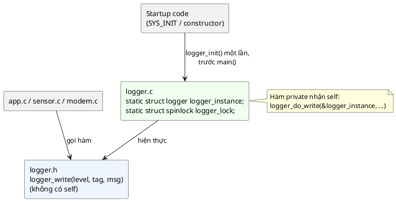

# 03 — Singleton Pattern

📖 Bài giảng chi tiết: [LECTURE.md](LECTURE.md). File này là ghi chú tóm tắt, bám theo chương *Singleton Pattern* của sách.

Build với `-std=c11` (cần `<stdatomic.h>` cho spinlock). `make run` để chạy demo.

## Overview

Singleton = **đúng một instance `static` trong `.c`** + **API không có `self`** + **bên trong vẫn là Object Pattern**. Instance được khởi tạo tự động một lần (tốt nhất là trước `main()`), mỗi hàm public tự khóa bên trong.

3 đặc điểm (📖): kiểm soát việc tạo và dùng (một instance, đôi khi một người dùng), tạo instance ở bên trong (tự động, một lần), interface stateless (gọi theo thứ tự nào cũng đúng).

## Use Cases

- Dịch vụ toàn cục, **hub đăng ký**: logging, settings, power management, network stack, thread scheduler.
- Khối phần cứng **duy nhất** trên chip: CRC, RNG, bộ điều khiển Flash, RCC.
- Câu hỏi kiểm tra: *"phần này có **phải được bảo đảm** chỉ có một instance không?"*

**Không dùng cho:** driver UART/SPI/I2C (có nhiều bản), driver giao thức, abstract interface, thứ dùng ở nhiều nơi với state khác nhau. Sách: *"hầu hết các trường hợp"*.

## Benefits

- Một điểm truy cập toàn cục, bảo đảm một instance.
- Code gọn: không phải truyền context qua mọi tầng.
- Không phải tạo/hủy thêm instance (đổi lại phải khóa và tuần tự hóa truy cập).
- Điều phối tài nguyên chung: nơi các module khác đăng ký callback.

## Drawbacks

- Phụ thuộc ngầm: nhìn chữ ký hàm không thấy module dùng singleton.
- Khó test: state sống qua các test, khởi tạo tự động chạy trước code test.
- Nút thắt cổ chai khi nhiều thread cùng dùng (🔬 hàng triệu lần `-EBUSY`).
- Mất linh hoạt: muốn instance thứ hai phải refactor.

## Implementation

Xem [inc/logger.h](inc/logger.h), [src/logger.c](src/logger.c), [inc/crc.h](inc/crc.h), [src/crc.c](src/crc.c), [inc/sys_init.h](inc/sys_init.h), [src/spinlock.h](src/spinlock.h), [main.c](main.c).

| Cách khởi tạo | Code mẫu | Ghi chú |
|---|---|---|
| Lười, không lock | (không dùng) | 🔬 8 thread → init chạy 8 lần |
| `SYS_INIT` / constructor | Logger | 📖 Sách ưu tiên; init trước `main()`, theo priority |
| Theo yêu cầu, có lock | CRC | Lock bao cả kiểm tra và gán; 🔬 init đúng 1 lần |

| API | Khi nào |
|---|---|
| Hàm không `self`, tự khóa (`logger_write`) | Mặc định |
| `acquire` → hàm có `self` → `release(&p)` (`crc_*`) | API bắt buộc stateful, cần một người dùng tại một thời điểm |
| Instanced singleton: `x_get_singleton()` + hàm có `self` | Còn chút khả năng cần nhiều instance sau này |

⚠️ Macro `DEFINE_SINGLETON_TYPE` và `DEFINE_SINGLETON_ACQUIRE_RELEASE` trong sách **không compile được** nguyên văn (4 lỗi đánh máy/phạm vi). Bản đã sửa ở [LECTURE.md mục 11.3](LECTURE.md#113-cách-3-khởi-tạo-theo-yêu-cầu-có-lock).

## Best Practices

- Khởi tạo tự động lúc khởi động, dùng priority để quyết định thứ tự.
- API public stateless: `op(params)` thay vì `op(self, params)`.
- Tránh singleton nhiều nhất có thể; mặc định dùng Object Pattern.
- Dùng lock khi khởi tạo theo yêu cầu.
- Giấu instance trong biến `static`.
- (💡) Có cờ `ready` để lỗi "dùng trước init" thành `-ENODEV`; getter trả bản copy.

## Common Pitfalls

- Lạm dụng singleton → mất linh hoạt.
- Interface stateful (`lock` → `do` → `unlock`) → 🔬 30% kết quả CRC sai khi 2 thread dùng chung.
- "Giờ cần một, sau tính" → không thêm được UART thứ hai (🔬 `multiple definition`).
- `return` giữa vùng khóa, quên `release` trên nhánh lỗi, callback gọi ngược lại singleton (deadlock).
- `printf(..., release(&p), p)`: thứ tự tính tham số không xác định (🔬 in sai, gcc không cảnh báo).

## Alternatives

- **Object Pattern** (dependency injection): người dùng tạo instance và truyền vào.
- **Factory** (bài 4): giấu chi tiết tạo nhiều instance.
- **Prototype**: copy object có sẵn bằng virtual constructor.
- **Endpoint API / Service Locator**: gọi hàm global với đường dẫn, tra callback đã đăng ký.

## Quiz

1. Mục đích chính của Singleton Pattern là gì?
2. Khi nào nên tránh dùng Singleton Pattern?
3. Singleton được hiện thực trong C như thế nào?
4. Cho vài ví dụ use case phổ biến của singleton trong firmware.
5. Các best practice khi hiện thực singleton?
6. Các lỗi hay gặp?
7. Bạn có thấy chỗ nào trong code hiện tại có thể cải thiện cấu trúc bằng singleton?
8. Bạn có thấy chỗ nào singleton đang bị dùng sai, làm mất tính linh hoạt?

(Đáp án và 7 câu thêm trong [LECTURE.md](LECTURE.md#24-quiz-có-đáp-án).)

## Câu hỏi còn thắc mắc

-
