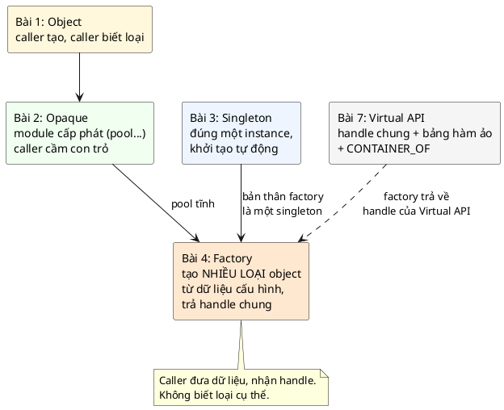
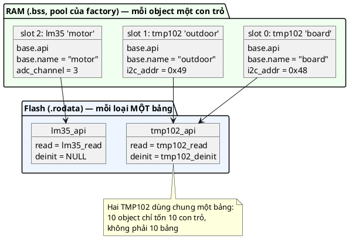
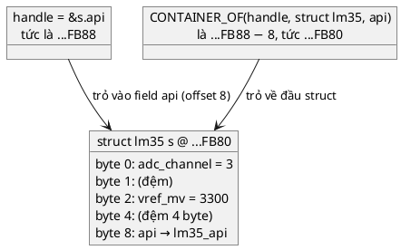
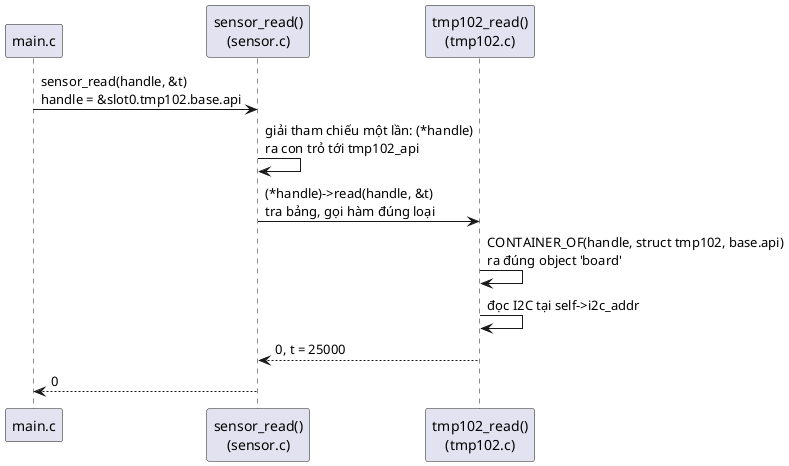
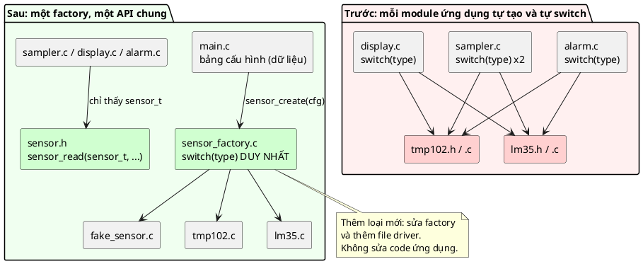
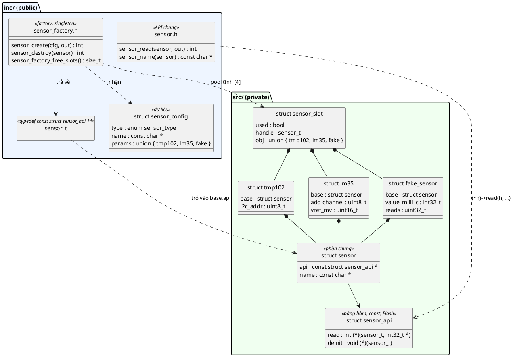
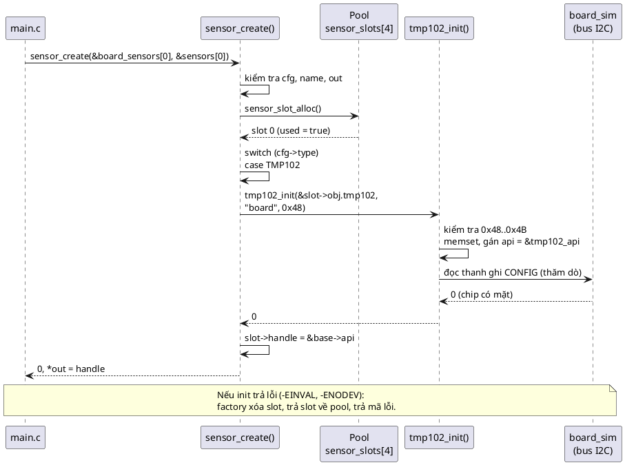
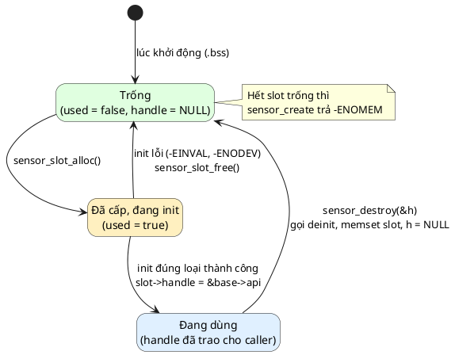
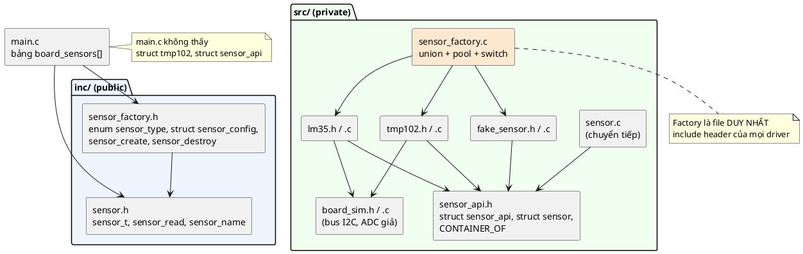

# Bài giảng 04 — Factory Pattern

> **Về nguồn:** Bài này bám theo chương *Factory Pattern* trong sách của Martin Schröder (bản 0.38.0, file `00_Document/Martin-Schroder-Design-Patterns-Factory-Pattern-0.38.0.pdf`).
> - 📖 đánh dấu nội dung **theo sách** (dịch và diễn giải lại).
> - 💡 đánh dấu phần **giải thích thêm**, không có trong sách.
> - 🔬 đánh dấu **thí nghiệm thật**: chương trình đã được build bằng gcc 16.2 (MSYS2 UCRT64, Windows 64-bit) và chạy; output in trong bài là output thật.
> - Phần nói về Zephyr (`DEVICE_DT_INST_DEFINE`, device tree, `bt_conn`) được **giải thích nhưng không chạy**. Bài có bản mô phỏng chạy được trên PC.
> - Sách minh họa bằng ví dụ hình học (`shape`, `circle`, `rectangle`). Bài này giữ nguyên ý nhưng dùng ví dụ **cảm biến nhiệt độ** trên board thật, theo quy ước của repo. Code của sách vẫn được trích và **compile thử** để đối chiếu.

Code mẫu đi kèm: [inc/sensor.h](inc/sensor.h), [inc/sensor_factory.h](inc/sensor_factory.h), [src/sensor_api.h](src/sensor_api.h), [src/sensor.c](src/sensor.c), [src/sensor_factory.c](src/sensor_factory.c), [src/tmp102.c](src/tmp102.c), [src/lm35.c](src/lm35.c), [src/fake_sensor.c](src/fake_sensor.c), [src/board_sim.c](src/board_sim.c), [main.c](main.c). Ghi chú ngắn: [README.md](README.md).
Bài trước: [01 — Object](../01_ObjectPattern/LECTURE.md), [02 — Opaque](../02_OpaquePattern/LECTURE.md), [03 — Singleton](../03_SingletonPattern/LECTURE.md). Liên quan chặt: [07 — Virtual API](../07_VirtualApiPattern/LECTURE.md) (bài này dùng trước một phần của nó).

---

## Mục lục

**Phần A — Kiến thức nền**

1. [Bối cảnh: từ "tạo một object" tới "tạo đúng loại object"](#1-bối-cảnh-từ-tạo-một-object-tới-tạo-đúng-loại-object)
2. [Con trỏ hàm và bảng hàm: gọi hàm mà lúc compile chưa biết là hàm nào](#2-con-trỏ-hàm-và-bảng-hàm-gọi-hàm-mà-lúc-compile-chưa-biết-là-hàm-nào)
3. [`offsetof` và `CONTAINER_OF`: từ một field về struct chứa nó](#3-offsetof-và-container_of-từ-một-field-về-struct-chứa-nó)
4. [Vì sao handle là con trỏ cấp hai](#4-vì-sao-handle-là-con-trỏ-cấp-hai)
5. [`union`: một vùng nhớ, nhiều cách nhìn](#5-union-một-vùng-nhớ-nhiều-cách-nhìn)
6. [Dữ liệu điều khiển việc tạo object](#6-dữ-liệu-điều-khiển-việc-tạo-object)

**Phần B — Pattern**

7. [Vấn đề: việc tạo object nằm rải rác](#7-vấn-đề-việc-tạo-object-nằm-rải-rác)
8. [Ý tưởng cốt lõi](#8-ý-tưởng-cốt-lõi)
9. [5 đặc điểm nhận dạng và lý do của từng cái](#9-5-đặc-điểm-nhận-dạng-và-lý-do-của-từng-cái)
10. [Use cases, ưu và nhược điểm theo sách](#10-use-cases-ưu-và-nhược-điểm-theo-sách)
11. [Năm cách hiện thực](#11-năm-cách-hiện-thực)

**Phần C — Đọc code**

12. [Đọc code mẫu từng dòng](#12-đọc-code-mẫu-từng-dòng)
13. [Theo dõi demo chạy từng bước](#13-theo-dõi-demo-chạy-từng-bước)
14. [Các quyết định thiết kế và phương án khác](#14-các-quyết-định-thiết-kế-và-phương-án-khác)

**Phần D — Thực tế và tổng kết**

15. [Factory trong thực tế](#15-factory-trong-thực-tế)
16. [Unit test với factory](#16-unit-test-với-factory)
17. [Trade-off](#17-trade-off)
18. [Khi nào không nên dùng và phương án thay thế](#18-khi-nào-không-nên-dùng-và-phương-án-thay-thế)
19. [Lỗi hay gặp](#19-lỗi-hay-gặp)
20. [Quy trình refactor sang Factory](#20-quy-trình-refactor-sang-factory)
21. [Câu hỏi thường gặp (FAQ)](#21-câu-hỏi-thường-gặp-faq)
22. [Tóm tắt và checklist](#22-tóm-tắt-và-checklist)
23. [Quiz (có đáp án)](#23-quiz-có-đáp-án)
24. [Bài tập](#24-bài-tập)

---

# Phần A — Kiến thức nền

Factory Pattern trong C dựa trên bốn kỹ thuật mà ba bài trước chưa dùng: **con trỏ hàm**, macro **`CONTAINER_OF`**, **handle con trỏ cấp hai** và **`union`**. Nhiều người thấy code factory trong C "quá nhiều dấu `*`" và bỏ cuộc. Phần A đi từng bước để mỗi dấu `*` đều có lý do.

## 1. Bối cảnh: từ "tạo một object" tới "tạo đúng loại object"

### 1.1. Nhìn lại: ba bài trước đã tạo object thế nào

Cả ba bài trước đều trả lời câu hỏi **"tạo object như thế nào"**, nhưng luôn cho **một loại** object:

**Bài 1 (Object):** caller cấp phát, gọi `init`.

```c
struct uart debug_uart;
uart_init(&debug_uart, "UART0", 115200);
```

**Bài 2 (Opaque):** module cấp phát (heap, pool, sinh code), caller cầm con trỏ.

```c
struct uart *u = uart_pool_get();
uart_init(u, "UART2", 57600);
/* ... */
uart_pool_put(&u);
```

**Bài 3 (Singleton):** không ai tạo cả, instance có sẵn và tự khởi tạo trước `main()`.

```c
logger_write(LOGGER_LEVEL_INFO, "app", "hello");
```

Trong cả ba, caller **biết chính xác** mình đang tạo loại gì: một `struct uart`. Nhưng hãy nghĩ tới một bộ ghi nhiệt độ mà mỗi phiên bản board gắn **loại cảm biến khác nhau**: bản A dùng TMP102 qua I2C, bản B dùng LM35 qua ADC, bản cho phòng thí nghiệm không có cảm biến thật mà cần một cảm biến giả. Code ứng dụng chỉ muốn **"đọc nhiệt độ"**. Ai quyết định tạo loại nào, với tham số nào, ở đâu?

Đó là câu hỏi của bài 4. 📖 Sách viết: *"Đến giờ bạn đã quen với Object Pattern, và Factory Pattern đưa nó lên một tầm mới."*

### 1.2. Một dự án lớn dần: việc tạo object bị rải khắp nơi

💡 *Tình huống minh họa (không phải ví dụ trong sách), nhưng rất điển hình trong các dự án firmware.*

Cùng team làm bộ ghi nhiệt độ ở bài 3.

#### Tháng 1: một cảm biến, một dòng

Board đời đầu có một cảm biến TMP102. Driver viết theo Object Pattern, `main.c` có:

```c
struct tmp102 board_temp;
tmp102_init(&board_temp, 0x48);
```

Và vòng lặp lấy mẫu gọi `tmp102_read(&board_temp, &t)`. Mọi thứ đơn giản.

#### Tháng 3: board rev B và cơn mưa `#ifdef`

Board rev B thay TMP102 bằng LM35 (rẻ hơn, đọc qua ADC). Cách nhanh nhất:

```c
#ifdef BOARD_REV_B
	struct lm35 board_temp;
	lm35_init(&board_temp, 3, 3300);
#else
	struct tmp102 board_temp;
	tmp102_init(&board_temp, 0x48);
#endif
```

Và **mọi chỗ đọc** cũng phải `#ifdef`: `sampler.c`, `display.c`, `alarm.c`. Bốn file, bốn khối `#ifdef` y hệt nhau.

#### Tháng 5: ba phiên bản sản phẩm

Khách hàng muốn ba SKU: "cơ bản" (1 cảm biến), "công nghiệp" (3 cảm biến, có cả LM35 gắn vào động cơ), "ngoài trời" (thêm TMP102 thứ hai ở địa chỉ 0x49). Code khởi tạo bị chép thành ba khối trong `main.c`, rồi chép thêm vào chương trình test sản xuất (*factory test*, ở nhà máy).

#### Tháng 6: kiểm tra tham số không nhất quán

Một kỹ sư nhập nhầm địa chỉ TMP102 thành `0x84` (thay vì `0x48`) trong khối "ngoài trời". Khối "công nghiệp" có kiểm tra địa chỉ hợp lệ, nhưng khối "ngoài trời" được chép từ phiên bản cũ hơn, chưa có. Thiết bị xuất xưởng đọc nhiệt độ toàn số rác. Lỗi chỉ lộ ra khi khách hàng phàn nàn.

#### Tháng 8: `switch` mọc khắp nơi

Để bớt `#ifdef`, có người đưa vào `enum sensor_type` và một `switch` trong mỗi chỗ dùng:

```c
switch (cfg.type) {
case SENSOR_TYPE_TMP102: tmp102_read(&s.tmp102, &t); break;
case SENSOR_TYPE_LM35:   lm35_read(&s.lm35, &t);     break;
}
```

Giờ có `switch` trong hàm đọc, hàm in, hàm tắt nguồn, hàm hiệu chuẩn. Thêm loại cảm biến thứ ba (NTC) nghĩa là đi tìm và sửa **mọi** `switch`. Sót một cái là cảm biến NTC "im lặng" trong chức năng đó.

#### Tháng 10: không test được trên PC

Muốn test thuật toán báo động trên PC (không có board), nhưng `alarm.c` gọi thẳng `tmp102_read`, mà `tmp102_read` gọi driver I2C thật. Không có cách nào thay cảm biến thật bằng cảm biến giả mà không sửa `alarm.c`.

#### Nhìn lại

| Tháng | Chuyện gì xảy ra | Nguyên nhân gốc |
|---|---|---|
| 3 | `#ifdef` lặp lại ở mọi nơi dùng cảm biến | Code dùng **phụ thuộc vào loại cụ thể** |
| 5 | Code khởi tạo chép thành nhiều bản | Việc tạo **không nằm ở một chỗ** |
| 6 | Một bản chép thiếu kiểm tra tham số | Logic kiểm tra **bị nhân bản** |
| 8 | `switch (type)` mọc khắp nơi, thêm loại phải sửa tất cả | Việc **chọn hành vi theo loại** bị rải rác |
| 10 | Không thay được bằng cảm biến giả để test | Không có **điểm duy nhất** quyết định tạo loại nào |

Factory Pattern gom tất cả vào **một chỗ**: một hàm nhận **bản mô tả** (loại gì, tham số gì), kiểm tra, cấp phát, khởi tạo đúng loại, và trả về một **handle chung** mà code ứng dụng dùng được cho mọi loại. Kết hợp với bảng hàm ảo (mục 2), `switch` chỉ còn **một** cái, nằm trong factory.

### 1.3. Đọc kỹ định nghĩa của sách

📖 Câu mở đầu chương:

> *"The factory design pattern is a creational design pattern that provides an interface for creating objects in a super class, but allows sub-classes to alter the type of objects that will be created."*
>
> *Factory là một creational pattern cung cấp một interface để tạo object ở lớp cha, nhưng cho phép lớp con thay đổi loại object sẽ được tạo.*

💡 Câu này là định nghĩa kinh điển từ sách *Design Patterns* của "Gang of Four" (1994), viết cho ngôn ngữ có class. C không có class, nên sách dịch ngay sang ngôn ngữ của firmware:

> *"In practice (and in embedded firmware development in C) this translates into code that **parameterizes the creation of objects**."*
>
> *Trong thực tế (và trong phát triển firmware nhúng bằng C), điều này nghĩa là code **tham số hóa việc tạo object**.*

Từng vế:

| Vế | Nghĩa là gì trong C |
|---|---|
| *"an interface for creating objects"* | Một **hàm** (hoặc vài hàm) chuyên tạo object: `sensor_create(cfg, &out)`. Caller không gọi `tmp102_init` hay `lm35_init` trực tiếp |
| *"in a super class"* | "Lớp cha" ở đây là **kiểu chung** mà caller nhận về: `sensor_t`, không phải `struct tmp102 *` |
| *"allows sub-classes to alter the type"* | Loại cụ thể (TMP102, LM35, fake) được quyết định **bên trong**, caller không phải biết |
| *"parameterizes the creation"* | Quyết định đó dựa trên **dữ liệu** caller đưa vào (`struct sensor_config`), không dựa trên việc caller gọi hàm nào |

Viết gọn thành công thức:

> **Factory = một chỗ duy nhất nhận dữ liệu mô tả → chọn loại, cấp phát, khởi tạo → trả về handle chung**

### 1.4. Factory trong bức tranh các Creational Pattern

📖 Phần giới thiệu sách: Factory *"là một pattern khác thuộc nhóm Creational Patterns. Pattern này đơn giản hóa code rất nhiều khi dùng đúng, và có thể **tham số hóa việc tạo các cấu trúc dữ liệu phức tạp bằng dữ liệu có cấu trúc**"*.



| | Opaque (bài 2) | Singleton (bài 3) | Factory (bài 4) |
|---|---|---|---|
| Số loại object | 1 | 1 | **Nhiều** |
| Số instance | Nhiều | 1 | Nhiều |
| Caller biết loại cụ thể? | Có (`struct uart`) | Không có object | **Không** (`sensor_t` chung) |
| Ai chọn loại? | Caller | | **Factory, theo dữ liệu** |
| Bộ nhớ | Heap/pool/stack | `.bss` | **Pool** (thường), hoặc sinh lúc build |
| Bản thân module có `self`? | Có | Không | **Thường không** (factory là singleton) |

💡 Factory xếp chồng lên các bài trước:
- Object mà factory tạo ra là **opaque** (bài 2): ứng dụng không thấy `struct tmp102`.
- Bộ nhớ lấy từ **pool tĩnh** (bài 2, mục 10.3), nhưng pool giờ chứa **nhiều loại**.
- Bản thân factory là **singleton** (bài 3): 📖 best practice *"Singleton factory"* của sách nói factory đơn giản trong C *"gần như mặc định"* là singleton.
- Handle trả về theo kiểu **Virtual API** (bài 7). 📖 Best practice *"Utilize the abstract api pattern: dùng `CONTAINER_OF` và phương pháp abstract api"*. Bài này giải thích đủ để dùng; bài 7 sẽ đi sâu.

### 1.5. Câu hỏi bài này sẽ trả lời

1. Làm sao code ứng dụng gọi `sensor_read(s, &t)` mà đúng hàm của TMP102 hay LM35 được gọi? (Mục 2–4)
2. Factory chứa object **nhiều loại, kích thước khác nhau** trong một pool tĩnh thế nào? (Mục 5, 11.5)
3. Dữ liệu cấu hình nên trông thế nào? (Mục 6)
4. Năm cách hiện thực factory của sách khác nhau ra sao, khi nào dùng cái nào? (Mục 11)
5. Khi nào factory là thừa? (Mục 18, 19)

---

## 2. Con trỏ hàm và bảng hàm: gọi hàm mà lúc compile chưa biết là hàm nào

### 2.1. Hàm cũng có địa chỉ

Code của một hàm là một dãy lệnh máy nằm trong Flash (`.text`). Như mọi thứ trong bộ nhớ, nó có **địa chỉ**. C cho phép lưu địa chỉ đó vào một biến: **con trỏ hàm**.

```c
#include <stdint.h>
#include <stdio.h>

static int tmp102_read(int32_t *out) { *out = 25000; return 0; }
static int lm35_read(int32_t *out)   { *out = 29900; return 0; }

int main(void)
{
	int (*read)(int32_t *out);   /* biến "read": trỏ tới một hàm nhận int32_t*, trả int */
	int32_t t;

	read = tmp102_read;          /* tên hàm (không có ngoặc) = địa chỉ của hàm */
	read(&t);
	printf("%ld\n", (long)t);

	read = lm35_read;            /* cùng một dòng gọi, nhưng giờ gọi hàm khác */
	read(&t);
	printf("%ld\n", (long)t);
	return 0;
}
```

🔬 Output:

```
25000
29900
```

Cú pháp `int (*read)(int32_t *out)` đọc từ trong ra ngoài: `read` là **con trỏ** (`*read`), trỏ tới **hàm** nhận `(int32_t *out)`, trả về **`int`**. Dấu ngoặc quanh `*read` là bắt buộc: thiếu nó, `int *read(int32_t *)` lại là khai báo một **hàm** trả về `int *`.

Dòng `read(&t)` được compiler dịch thành "nhảy tới địa chỉ đang lưu trong biến `read`" (trên Cortex-M là lệnh `BLX r3`), thay vì "nhảy tới địa chỉ cố định của hàm X" (lệnh `BL tmp102_read`). Hàm nào thật sự chạy được quyết định **lúc chạy**, theo giá trị của biến. Đây là nền tảng của mọi thứ "đa hình" (polymorphism) trong C.

### 2.2. Gom nhiều con trỏ hàm thành một bảng

Một cảm biến có nhiều thao tác (đọc, tắt nguồn...). Thay vì lưu từng con trỏ rời rạc trong mỗi object, ta gom chúng vào một struct, gọi là **bảng hàm** (ops table, hay *vtable* trong C++):

```c
struct sensor_api {
	int (*read)(sensor_t sensor, int32_t *out_milli_c);
	void (*deinit)(sensor_t sensor);
};
```

Mỗi **loại** cảm biến có **một** bảng, khai báo `static const`:

```c
static const struct sensor_api tmp102_api = {
	.read = tmp102_read,
	.deinit = tmp102_deinit,
};
```

Và mỗi **object** chỉ chứa **một con trỏ** tới bảng của loại mình:

```c
struct sensor {
	const struct sensor_api *api;
	const char *name;
};
```



📖 Đây là điểm sách nhấn mạnh ở chương Virtual API: bảng hàm *"luôn là hằng và được lưu dưới dạng con trỏ... để có thể mở rộng ra nhiều instance mà không nhân bản bảng con trỏ hàm trong mọi instance"*.

🔬 Kiểm chứng bằng `nm` trên `demo.exe` của bài:

```
0000000140004260 r fake_sensor_api
0000000140004270 r lm35_api
0000000140004290 r tmp102_api
0000000140007020 b sensor_slots
```

Ba bảng mang ký tự `r` (**read-only data**, trên MCU là Flash), còn pool `sensor_slots` mang `b` (`.bss`, RAM). Bảng hàm không tốn byte RAM nào.

💡 Vì sao bảng phải `const`? (1) Nằm trong Flash, không tốn RAM. (2) Không ai sửa được con trỏ hàm lúc chạy. Một con trỏ hàm trong RAM bị ghi đè (do tràn buffer chẳng hạn) nghĩa là CPU nhảy tới địa chỉ rác: lỗi khó lần nhất trong firmware, và cũng là kỹ thuật tấn công kinh điển.

---

## 3. `offsetof` và `CONTAINER_OF`: từ một field về struct chứa nó

### 3.1. Vấn đề

Hàm ảo `tmp102_read` được gọi qua bảng, với tham số là **handle** (mục 4 sẽ nói vì sao handle là `&object.base.api`). Nhưng để đọc nhiệt độ, `tmp102_read` cần `i2c_addr`, tức là cần **cả struct `tmp102`**. Từ địa chỉ của một field bên trong, làm sao lấy lại địa chỉ của struct chứa nó?

### 3.2. Lời giải: lùi lại đúng bằng offset của field

Nhớ lại [bài 2, mục 5](../02_OpaquePattern/LECTURE.md#5-compiler-cần-biết-gì-để-dịch-p-field): mỗi field nằm ở một **offset** cố định tính từ đầu struct. Macro chuẩn `offsetof(type, member)` (trong `<stddef.h>`) cho ra con số đó. Vậy:

> **địa chỉ struct = địa chỉ field − offset của field**

```c
#define CONTAINER_OF(ptr, type, member) ((type *)((char *)(ptr) - offsetof(type, member)))
```

Từng phần:
- `(char *)(ptr)`: ép sang `char *` để phép trừ tính theo **byte** (`char` luôn là 1 byte). Nếu để nguyên kiểu con trỏ gốc, `ptr - 8` sẽ lùi 8 **phần tử**, không phải 8 byte.
- `- offsetof(type, member)`: lùi lại đúng bằng offset.
- `(type *)`: ép kết quả về con trỏ tới struct chứa.

🔬 Thí nghiệm, cố tình đặt field `api` **không** ở đầu struct để thấy phép trừ thật sự xảy ra:

```c
#include <stddef.h>
#include <stdint.h>
#include <stdio.h>

#define CONTAINER_OF(ptr, type, member) ((type *)((char *)(ptr) - offsetof(type, member)))

struct api {
	int (*read)(const struct api **handle);
};

/* Field api KHÔNG đứng đầu: để thấy CONTAINER_OF thật sự phải trừ offset */
struct lm35 {
	uint8_t adc_channel;
	uint16_t vref_mv;
	const struct api *api;
};

static int lm35_read(const struct api **handle)
{
	struct lm35 *self = CONTAINER_OF(handle, struct lm35, api);

	printf("  trong lm35_read: handle = %p, offsetof(api) = %u, self = %p\n", (void *)handle,
	       (unsigned)offsetof(struct lm35, api), (void *)self);
	return self->vref_mv;
}

static const struct api lm35_api = { .read = lm35_read };

int main(void)
{
	struct lm35 s = { .adc_channel = 3, .vref_mv = 3300, .api = &lm35_api };
	const struct api **handle = &s.api; /* thứ được trao cho ứng dụng */

	printf("&s = %p, handle = &s.api = %p\n", (void *)&s, (void *)handle);
	printf("(*handle)->read(handle) = %d\n", (*handle)->read(handle));
	printf("sizeof(struct lm35) = %u\n", (unsigned)sizeof(struct lm35));
	return 0;
}
```

Output thật:

```
&s = 00000078093FFB80, handle = &s.api = 00000078093FFB88
  trong lm35_read: handle = 00000078093FFB88, offsetof(api) = 8, self = 00000078093FFB80
(*handle)->read(handle) = 3300
sizeof(struct lm35) = 16
```

Đọc kết quả:
- `adc_channel` (1 byte) ở offset 0, `vref_mv` (2 byte) ở offset 2 (sau 1 byte đệm), con trỏ `api` (8 byte) phải căn lề 8 nên ở offset **8**.
- Handle là `...FB88`. `CONTAINER_OF` trừ đi 8 → `...FB80`, **đúng bằng** `&s`.
- Từ đó `self->vref_mv` đọc ra 3300.



### 3.3. Field lồng nhau: `base.api`

Trong code mẫu, `api` nằm trong `struct sensor base`, mà `base` lại nằm trong `struct tmp102`. `offsetof` chấp nhận tên field lồng nhau:

```c
struct tmp102 *self = CONTAINER_OF(sensor, struct tmp102, base.api);
```

🔬 Với `base` là field đầu tiên, `offsetof(struct tmp102, base.api)` = **0** (đo thật), nên phép trừ không đổi gì cả. Nhưng **vẫn nên dùng `CONTAINER_OF`** thay vì ép kiểu thẳng `(struct tmp102 *)sensor`: nếu sau này ai đó chèn một field lên trước `base`, `CONTAINER_OF` vẫn đúng, còn phép ép kiểu thẳng sẽ âm thầm sai.

### 3.4. "Type safe" nghĩa là gì ở đây

📖 Sách nhiều lần gọi cách này là *"type safe"*, *"không có con trỏ `void *` và không ép kiểu có thể dẫn tới kết quả sai"*. 💡 Nói chính xác: bên trong `CONTAINER_OF` vẫn có ép kiểu. Điểm an toàn là:
- Ép kiểu chỉ nằm **bên trong implementation của từng loại** (`tmp102.c` chỉ chuyển handle về `struct tmp102`, và hàm đó chỉ có trong bảng của TMP102, nên không thể nhận nhầm handle của LM35).
- Ở **API công khai**, handle có kiểu riêng `const struct sensor_api **`, nên compiler bắt được lỗi truyền nhầm. 🔬 Thử truyền handle của một interface khác:

```c
#include "sensor.h"

struct uart_api;

void app(const struct uart_api **uart, void *anything)
{
	int32_t t;

	sensor_read(uart, &t);     /* nhầm handle UART thành handle sensor */
	sensor_read(anything, &t); /* void * thì compiler không bắt được */
}
```

```
wrong_handle.c:9:21: error: passing argument 1 of 'sensor_read' from incompatible pointer type [-Wincompatible-pointer-types]
sensor.h:22:26: note: expected 'sensor_t' {aka 'const struct sensor_api **'} but argument is of type 'const struct uart_api **'
```

Dòng thứ nhất bị bắt. Dòng thứ hai (truyền `void *`) **không** có lỗi nào: `void *` chuyển ngầm sang mọi kiểu con trỏ. Đó là lý do API không bao giờ dùng `void *` làm handle (cùng kết luận với [bài 2, mục 13](../02_OpaquePattern/LECTURE.md#handle-có-kiểu-thay-vì-void-)).

---

## 4. Vì sao handle là con trỏ cấp hai

Handle của bài này là `const struct sensor_api **`: con trỏ tới **field `api`** nằm trong object. Tại sao không đơn giản là `const struct sensor_api *` (con trỏ tới bảng hàm)?

🔬 Thí nghiệm: tạo hai TMP102 và in cả hai thứ:

```c
#include <stdio.h>

#include "tmp102.h"

int main(void)
{
	struct tmp102 a, b;

	tmp102_init(&a, "a", 0x48);
	tmp102_init(&b, "b", 0x49);

	/* Con trỏ cấp 1 (giá trị của field api): bảng hàm DÙNG CHUNG cho mọi TMP102 */
	printf("a.base.api  = %p\nb.base.api  = %p\n", (const void *)a.base.api,
	       (const void *)b.base.api);
	/* Con trỏ cấp 2 (địa chỉ của field api): mỗi object một địa chỉ riêng */
	printf("&a.base.api = %p\n&b.base.api = %p\n", (void *)&a.base.api, (void *)&b.base.api);
	return 0;
}
```

```
a.base.api  = 00007FF7FB6F4070
b.base.api  = 00007FF7FB6F4070
&a.base.api = 000000CC101FFA80
&b.base.api = 000000CC101FFA60
```

- `a.base.api` và `b.base.api` **bằng nhau**: cả hai trỏ tới cùng bảng `tmp102_api` trong Flash. Nếu handle là con trỏ cấp một, hàm `tmp102_read` nhận được `...4070` và **không có cách nào biết** đó là cảm biến `a` hay `b`.
- `&a.base.api` và `&b.base.api` **khác nhau**: mỗi object có field `api` ở chỗ riêng. Từ đó `CONTAINER_OF` tìm lại đúng object.

Handle cấp hai làm được **cả hai việc** cùng lúc:



| Từ handle | Thao tác | Được gì |
|---|---|---|
| `*handle` | Giải tham chiếu một lần | Bảng hàm của **loại** → biết gọi hàm nào |
| `handle` | `CONTAINER_OF` | Địa chỉ **object** → biết làm việc trên dữ liệu nào |

📖 Chương Bridge của sách nhấn mạnh: *"một thay đổi đơn giản như đổi con trỏ cấp hai thành con trỏ thường sẽ khiến bạn **không thể** dùng `CONTAINER_OF` trên handle"*.

💡 So sánh với C++: một object C++ có hàm ảo chứa một con trỏ ẩn `vptr` trỏ tới vtable, và hàm ảo nhận con trỏ `this` tới object. Handle cấp hai của C gói **cả `this` lẫn `vptr`** vào một giá trị.

---

## 5. `union`: một vùng nhớ, nhiều cách nhìn

### 5.1. `struct` và `union` khác nhau ở đâu

- `struct`: các field nằm **nối tiếp** nhau. Kích thước ≈ **tổng** các field (cộng đệm).
- `union`: các field nằm **chồng lên nhau**, cùng bắt đầu ở offset 0. Kích thước = field **lớn nhất** (cộng đệm căn lề). Tại một thời điểm chỉ một field "có nghĩa".

```c
union sensor_storage {
	struct tmp102 tmp102;
	struct lm35 lm35;
	struct fake_sensor fake;
};
```

Một `union sensor_storage` đủ chỗ cho **bất kỳ** loại cảm biến nào. Đây chính là thứ cho phép một pool tĩnh chứa nhiều loại object kích thước khác nhau (📖 *Pooled factory*, mục 11.5).

### 5.2. 🔬 Kích thước thật trong code mẫu

```
struct sensor      = 16 bytes
struct tmp102      = 24 bytes
struct lm35        = 24 bytes
struct fake_sensor = 24 bytes
union storage      = 24 bytes
struct sensor_slot = 40 bytes
pool (4 slots)     = 160 bytes
offsetof(struct tmp102, base.api) = 0
```

- `struct sensor` (phần chung) = 2 con trỏ = 16 byte.
- Ba loại cụ thể đều 24 byte: 16 byte phần chung + vài byte riêng, làm tròn lên bội số của 8 (căn lề con trỏ).
- Union = 24 byte, vì loại lớn nhất là 24.
- Mỗi slot = `bool used` (1, đệm thành 8) + `sensor_t handle` (8) + union (24) = 40 byte.

### 5.3. Cái giá: union luôn rộng bằng loại lớn nhất

📖 Sách: *"Ta định nghĩa slot có kích thước của shape có cấu trúc lớn nhất. Dù cách này lãng phí một ít bộ nhớ, nó đơn giản hóa đáng kể việc hiện thực. Miễn là các shape có kích thước xấp xỉ nhau, bộ nhớ lãng phí trong slot sẽ là tối thiểu."*

🔬 Điều gì xảy ra khi các loại **không** xấp xỉ nhau? Thêm một loại cảm biến NTC cần bảng hiệu chuẩn 32 điểm:

```c
#include <stdbool.h>
#include <stdint.h>
#include <stdio.h>

struct sensor { const void *api; const char *name; };
struct tmp102 { struct sensor base; uint8_t i2c_addr; };
struct lm35 { struct sensor base; uint8_t adc_channel; uint16_t vref_mv; };
/* Loại mới: NTC cần bảng hiệu chuẩn 32 điểm */
struct ntc { struct sensor base; int16_t table[32]; };

union small_storage { struct tmp102 a; struct lm35 b; };
union big_storage { struct tmp102 a; struct lm35 b; struct ntc c; };

int main(void)
{
	printf("tmp102 %u, lm35 %u, ntc %u\n", (unsigned)sizeof(struct tmp102),
	       (unsigned)sizeof(struct lm35), (unsigned)sizeof(struct ntc));
	printf("union without ntc: %u bytes/slot, with ntc: %u bytes/slot\n",
	       (unsigned)sizeof(union small_storage), (unsigned)sizeof(union big_storage));
	printf("8 slots holding only tmp102: used %u, reserved %u bytes\n",
	       (unsigned)(8 * sizeof(struct tmp102)), (unsigned)(8 * sizeof(union big_storage)));
	return 0;
}
```

```
tmp102 24, lm35 24, ntc 80
union without ntc: 24 bytes/slot, with ntc: 80 bytes/slot
8 slots holding only tmp102: used 192, reserved 640 bytes
```

Chỉ thêm **một** loại lớn, **mọi** slot phình từ 24 lên 80 byte. Nếu board chỉ gắn TMP102, 448/640 byte bị lãng phí. 💡 Khi chênh lệch lớn, giải pháp là **mỗi loại một pool riêng** (pool TMP102, pool NTC), đổi lại phải đoán số lượng từng loại. Bài tập 4 cho bạn làm thử.

### 5.4. Tagged union: biết field nào đang có nghĩa

Union không tự nhớ field nào đang được dùng. Phải có một biến **tag** đi kèm. `struct sensor_config` là một ví dụ:

```c
struct sensor_config {
	enum sensor_type type;     /* tag: cho biết phần nào của params có nghĩa */
	const char *name;
	union {
		struct { uint8_t i2c_addr; } tmp102;
		struct { uint8_t adc_channel; uint16_t vref_mv; } lm35;
		struct { int32_t value_milli_c; } fake;
	} params;
};
```

Với `type = SENSOR_TYPE_TMP102`, chỉ `params.tmp102` có nghĩa. Factory đọc `type` trước rồi mới đọc đúng nhánh của union. Mẫu "tag + union" này gọi là **tagged union** (hay *discriminated union*).

💡 Trong pool của factory, ta **không cần** tag riêng cho mỗi slot: object bên trong tự mang con trỏ `api` tới bảng hàm của loại mình, chính con trỏ đó đóng vai tag.

### 5.5. Bẫy: `struct` và `union` dùng chung không gian tên tag

Trong C, tên sau `struct`, `union`, `enum` (gọi là **tag**) nằm chung **một** không gian tên. Không thể có cả `union shape_slot` lẫn `struct shape_slot`. Mục 11.5 sẽ thấy code của sách vấp đúng lỗi này.

---

## 6. Dữ liệu điều khiển việc tạo object

📖 Sách coi đây là điểm mạnh nhất của Factory: *"Data driven architecture: Cách dùng đáng chú ý nhất của Factory là khi object được tạo dựa trên một **mô tả có cấu trúc** (dạng JSON, dạng struct thông thường, hay dạng node trong device tree). Đây là chỗ Factory Pattern thật sự tỏa sáng."*

### 6.1. Bảng cấu hình bằng designated initializer

C99 cho phép khởi tạo struct theo **tên field** (designated initializer), kể cả field lồng trong union:

```c
static const struct sensor_config board_sensors[] = {
	{ .type = SENSOR_TYPE_TMP102, .name = "board", .params.tmp102 = { .i2c_addr = 0x48 } },
	{ .type = SENSOR_TYPE_TMP102, .name = "outdoor", .params.tmp102 = { .i2c_addr = 0x49 } },
	{ .type = SENSOR_TYPE_LM35, .name = "motor",
	  .params.lm35 = { .adc_channel = 3, .vref_mv = 3300 } },
	/* Có trong cấu hình nhưng chip không được hàn trên bản board này */
	{ .type = SENSOR_TYPE_TMP102, .name = "spare", .params.tmp102 = { .i2c_addr = 0x4A } },
};
```

- Đọc như một **tài liệu mô tả board**: có gì, ở đâu, tham số gì. Người làm phần cứng đọc được.
- `static const` → nằm trong Flash, không tốn RAM.
- Field không nêu tên tự động là 0.
- Thêm cảm biến = thêm **một dòng**. Đổi board = đổi bảng này, hoặc chọn bảng khác lúc build.

### 6.2. Từ bảng trong C tới device tree

💡 Bảng trên được viết tay. Bước tiếp theo, mà Zephyr và Linux đã làm, là **sinh bảng tự động** từ một file mô tả phần cứng riêng (device tree). Ví dụ một node device tree cho TMP102 trong Zephyr trông như sau *(minh họa cú pháp, không chạy trong repo)*:

```
&i2c1 {
	board_temp: tmp102@48 {
		compatible = "ti,tmp102";
		reg = <0x48>;
	};
};
```

Lúc build, công cụ của Zephyr đọc file này, sinh ra macro, và macro của driver sinh ra object tương ứng (mục 11.2). Từ góc nhìn của pattern: device tree là **dữ liệu**, driver là **implementation**, macro `DEVICE_DT_INST_DEFINE` là **factory**.

📖 Best practice *"Parameterize your creation"* của sách: *"Hãy nghĩ về factory như một cách tạo object trong bộ nhớ từ một mô tả XML hay JSON. Factory nhận tham số ở dạng đơn giản và tạo object cụ thể theo các tham số đó mà không để lộ implementation của object cho người dùng."*

---

# Phần B — Pattern

## 7. Vấn đề: việc tạo object nằm rải rác

Đây là code ở tháng 8 của mục 1.2, viết gọn lại cho hai loại cảm biến:

```c
#include <errno.h>
#include <stdint.h>

/* Driver kiểu Object Pattern (bài 1): struct public, hàm riêng cho từng loại */
struct tmp102 { uint8_t i2c_addr; };
struct lm35 { uint8_t adc_channel; uint16_t vref_mv; };
int tmp102_init(struct tmp102 *self, uint8_t i2c_addr);
int tmp102_read(struct tmp102 *self, int32_t *out_milli_c);
int lm35_init(struct lm35 *self, uint8_t adc_channel, uint16_t vref_mv);
int lm35_read(struct lm35 *self, int32_t *out_milli_c);

enum sensor_type { SENSOR_TYPE_TMP102, SENSOR_TYPE_LM35 };

/* sampler.c — TRƯỚC khi có factory: module ứng dụng biết mọi loại cảm biến */
struct sampler {
	enum sensor_type type;
	union {
		struct tmp102 tmp102;
		struct lm35 lm35;
	} s;
};

int sampler_init(struct sampler *self, enum sensor_type type)
{
	self->type = type;
	switch (type) { /* switch thứ nhất: tạo */
	case SENSOR_TYPE_TMP102:
		return tmp102_init(&self->s.tmp102, 0x48); /* tham số cứng trong code */
	case SENSOR_TYPE_LM35:
		return lm35_init(&self->s.lm35, 3, 3300);
	}
	return -EINVAL;
}

int sampler_read(struct sampler *self, int32_t *out_milli_c)
{
	switch (self->type) { /* switch thứ hai: đọc. Còn display.c, alarm.c... */
	case SENSOR_TYPE_TMP102:
		return tmp102_read(&self->s.tmp102, out_milli_c);
	case SENSOR_TYPE_LM35:
		return lm35_read(&self->s.lm35, out_milli_c);
	}
	return -EINVAL;
}
```

Những gì sai ở đây:
1. **`sampler.c` phụ thuộc vào mọi driver**: include `tmp102.h`, `lm35.h`, biết kích thước và hàm của từng loại. Thêm loại thứ ba là sửa `sampler.c`.
2. **Có hai `switch` cho cùng một quyết định** ("đây là loại nào"), và mỗi module dùng cảm biến (`display.c`, `alarm.c`) lại có `switch` riêng.
3. **Tham số nằm cứng trong code** (`0x48`, `3`, `3300`). Đổi board là sửa code ứng dụng.
4. **Không có chỗ nào để thay bằng cảm biến giả** khi test.



---

## 8. Ý tưởng cốt lõi

Ghép kiến thức nền lại:
- Mỗi loại cảm biến là một struct riêng (`struct tmp102`, `struct lm35`...), **nhúng phần chung** `struct sensor` (chứa con trỏ tới bảng hàm) làm field đầu tiên.
- Mỗi loại có **một bảng hàm `const`** (mục 2) trỏ tới các hàm của nó.
- Ứng dụng chỉ cầm **handle chung** `sensor_t` = con trỏ cấp hai tới field `api` (mục 4), và chỉ gọi API chung `sensor_read()`.
- **Factory** là nơi **duy nhất** biết mọi loại cụ thể: nó nhận `struct sensor_config` (dữ liệu, mục 6), kiểm tra, lấy một slot trong **pool tĩnh dùng `union`** (mục 5), gọi `init` đúng loại, và trả về handle.
- Khi hủy, factory gọi **hàm dọn dẹp** của object qua bảng hàm, rồi trả slot về pool.



Một lời gọi `sensor_create` đi như sau:



---

## 9. 5 đặc điểm nhận dạng và lý do của từng cái

📖 Sách liệt kê năm thành phần chính (*Defining characteristics*).

### 1. Object được tạo (*Object being created*)

📖 *"Trong C, đây thường là một struct được tạo tĩnh hoặc động."*

Trong code mẫu: `struct tmp102`, `struct lm35`, `struct fake_sensor`, tạo **tĩnh** trong pool.

**Tại sao quan trọng:** factory không tạo ra "thứ gì đó trừu tượng". Cuối cùng vẫn là một struct cụ thể, có kích thước cụ thể, nằm ở một chỗ cụ thể trong RAM. Phần "trừu tượng" chỉ là cách ứng dụng **nhìn** nó.

### 2. Vị trí bộ nhớ (*Location of the memory*)

📖 *"Factory quản lý pool bộ nhớ và tạo object khi cần. Khi object không còn cần nữa, **chính factory** chịu trách nhiệm gọi các hàm dọn dẹp và đặt object đã giải phóng trở lại pool các object còn trống."*

Trong code mẫu: `static struct sensor_slot sensor_slots[4]` trong `sensor_factory.c`; `sensor_destroy` gọi `api->deinit` (TMP102 chuyển sang chế độ ngủ), rồi `memset` slot.

**Tại sao:** nếu caller tự dọn dẹp, caller phải biết loại cụ thể ("đây là TMP102 nên phải tắt nó"), tức là quay lại vấn đề của mục 7. Gom vào factory, **vòng đời** (tạo → dùng → dọn dẹp → trả bộ nhớ) nằm trọn ở một chỗ. 📖 *"Bất cứ khi nào bạn cần quản lý việc tạo object và vòng đời của chúng ở một chỗ, hãy cân nhắc Factory Pattern."*

### 3. Tham số (*Parameters*)

📖 *"Factory thường tạo object dựa trên một struct chứa các thuộc tính mong muốn của object cần tạo. Nó không nhất thiết trả về kiểu cụ thể. Với device driver, mọi driver được truy cập qua con trỏ `struct device` chung, và driver được 'tạo' bởi một factory từ thông tin device tree."*

Trong code mẫu: `struct sensor_config` (tagged union, mục 5.4); trả về `sensor_t` chung, không phải `struct tmp102 *`.

**Tại sao:** tham số dạng **dữ liệu** (struct) thay vì dạng **lời gọi hàm khác nhau** cho phép lưu cấu hình trong bảng, đọc từ Flash, sinh từ device tree, gửi qua mạng.

### 4. Implementation cụ thể (*Concrete implementation*)

📖 *"Implementation của factory thường quyết định tạo object nào tùy theo tham số. Đây là **chìa khóa** cho sự linh hoạt của Factory Pattern: nó tách chi tiết implementation khỏi người dùng object."*

Trong code mẫu: `switch (cfg->type)` trong `sensor_construct()`, **switch duy nhất** về loại cảm biến trong toàn chương trình.

**Tại sao:** "loại nào" là quyết định được đưa ra **một lần**, lúc tạo. Sau đó, bảng hàm ảo mang quyết định đó theo object, nên không cần `switch` nào nữa.

### 5. Người dùng (*Client or user*)

📖 *"Người dùng factory thường là code tầng ứng dụng. Tuy nhiên, việc tạo object cũng có thể được giấu hoàn toàn khỏi người dùng và tự động thực hiện lúc chương trình khởi động (trong Zephyr bằng cách đăng ký một callback `SYS_INIT` được startup code thực thi)."*

Trong code mẫu: `main.c` gọi `sensor_create` trong vòng lặp qua bảng cấu hình. 🔬 Mục 11.2 có thí nghiệm "tạo tự động trước `main()`" dùng lại kỹ thuật bảng init của [bài 3, mục 4](../03_SingletonPattern/LECTURE.md#4-chuyện-gì-xảy-ra-trước-main).

📖 Tổng kết của sách: Factory *"hữu ích để tạo object một cách linh hoạt và module hóa, vì nó cho phép tạo nhiều loại object khác nhau mà client không cần biết chi tiết implementation cụ thể. Nó cũng cho phép mở rộng dễ dàng, vì có thể thêm loại object mới mà không phải sửa code ứng dụng."*

---

## 10. Use cases, ưu và nhược điểm theo sách

### 10.1. Use cases trong Zephyr

📖 *"So với ngôn ngữ hướng đối tượng hoàn toàn như C++, trong C việc dùng pattern này có thể không hiển nhiên lúc đầu."* Sách liệt kê chỗ Zephyr dùng nó *(giải thích, không chạy trong repo)*:

| Use case | 📖 Theo sách | 💡 Liên hệ |
|---|---|---|
| **Tạo device driver** | Ứng dụng và driver khác không cần biết cách tạo instance; factory giấu chi tiết, làm cho việc tạo "trông như tự động" | Mục 11.2 |
| **Memory pool và buffer** | Người dùng định nghĩa một pool rồi tạo object trong pool tĩnh đó; factory hiện thực chủ yếu bằng macro | Pool của bài 2, nhưng tổng quát hóa |
| **Tạo network device** | Network interface không định nghĩa trong device tree mà được network subsystem tạo và quản lý, truy cập qua `struct net_if` | Factory không nhất thiết đọc device tree |
| **File system object** | Implementation file system biết file object chứa gì, nên nó tạo object cụ thể và trả về **handle chung** | Giống `fopen()` trả `FILE *` |
| **Tạo gói tin mạng** | Buffer gói tin được nhiều tầng giao thức xây dần từng bước, xong thì chứa gói tin hoàn chỉnh để gửi | Tạo object **theo nhiều bước** |

### 10.2. Ưu điểm (📖 *Pros*)

| Ưu điểm | 📖 Ý của sách | Trong code mẫu |
|---|---|---|
| **Linh hoạt hơn** | Việc tạo object được tách khỏi ứng dụng, thêm loại mới không sửa code người dùng | Thêm NTC: thêm `ntc.c` và một `case`, `main.c` không đổi |
| **Tổ chức code tốt hơn** | Tách việc tạo khỏi implementation, code dễ đọc | `tmp102.c` chỉ biết đo nhiệt độ, không biết pool |
| **Kiến trúc hướng dữ liệu** | Tạo object từ mô tả có cấu trúc (JSON, struct, device tree): *"chỗ factory thật sự tỏa sáng"* | Bảng `board_sensors[]` |
| **Dễ test hơn** | Bắt người viết nghĩ về việc tạo và dọn dẹp, chuẩn hóa việc tạo, nên *"dễ tạo bản giả (mock-up) của object để test"* | `SENSOR_TYPE_FAKE`, mục 16 |
| **Tái sử dụng code** | Việc tạo trở thành hàm dùng lại được, không lặp logic tạo khắp nơi (*"bạn sẽ ngạc nhiên vì nguyên tắc hiển nhiên này ít được dùng trong code production thế nào"*) | Kiểm tra địa chỉ I2C chỉ ở `tmp102_init` |
| **Dễ mở rộng quy mô** | Việc tạo tập trung và tham số hóa, dễ thêm nhiều loại mà không đổi code tạo instance có sẵn | |

### 10.3. Nhược điểm (📖 *Cons*)

| Nhược điểm | 📖 Ý của sách |
|---|---|
| **Thêm độ phức tạp** | Không phải lúc nào cũng cần factory. *"Đôi khi một hàm `my_object_init()` thông thường là đủ."* Chỉ dùng khi việc tạo, quản lý và dọn dẹp cần nằm ở một chỗ |
| **Thiếu linh hoạt** (nếu làm sai) | Factory **không nên** dùng tham số cứng. Nó linh hoạt nhất khi hoàn toàn hướng dữ liệu |
| **Khó test** (trong vài trường hợp) | Driver Zephyr tạo qua section riêng của file thực thi: trong test phải định nghĩa lại macro tạo device thành rỗng, để driver không bị tạo trước khi code test kịp tạo mock |

📖 Sách kết luận: *"Phần lớn thời gian, các nhược điểm này không thành vấn đề, vì khi dùng đúng ngữ cảnh, Factory là lời giải hợp lý nhất cho bài toán tạo object."*

---

## 11. Năm cách hiện thực

📖 Sách nêu năm kiểu hiện thực *"phù hợp đặc biệt cho firmware nhúng bằng C, không có cấu trúc hướng đối tượng có sẵn như C++"*:

| Kiểu | 📖 Ý tưởng | Code mẫu của bài |
|---|---|---|
| **Simple factory** | Một hàm tĩnh tạo object nhiều loại, chọn loại theo input | **Có**: `sensor_create()` |
| **Embedded factory** | Tạo object qua danh sách "constructor" đặt trong section đặc biệt của file thực thi | 🔬 Thí nghiệm mục 11.2 |
| **Abstract factory** | Bản thân factory là interface ảo, có nhiều implementation, mỗi cái tạo một nhóm object | 🔬 Thí nghiệm mục 11.3 |
| **Prototype factory** | Factory giữ object mẫu, tạo object mới bằng cách **clone** | 🔬 Thí nghiệm mục 11.4 |
| **Pooled factory** | Cấp phát từ pool tĩnh dựng sẵn, người dùng yêu cầu instance theo khóa (Zephyr dùng cho `bt_conn` trong Bluetooth stack) | **Có**: pool `union` |

Code mẫu là **simple + pooled** kết hợp, kiểu phổ biến nhất trong firmware.

### 11.1. Simple factory

📖 *"Để hiện thực simple factory, ta dùng abstract object pattern và tham số hóa factory bằng một enum đơn giản. Ta giấu hoàn toàn các kiểu object đang tạo và làm toàn bộ quá trình tạo dựa trên tham số truyền vào factory method."*

Code của sách (rút gọn, giữ nguyên các dòng quan trọng):

```c
// shape.h — this is our public header
enum shape_type {
    SHAPE_CIRCLE,
    SHAPE_SQUARE
};
struct shape_api {
    void (*draw)(shape_t shape);
};

// define a generic shape handle
typedef struct shape_api ** shape_t;

struct shape {
    const struct shape_api * const api;
};

shape_t shape_create(enum shape_type type);
void shape_draw(shape_t shape);
```

```c
// shape.c
struct shape_circle {
    struct shape shape;
    float radius;
};

static void _shape_circle_draw(shape_t shape){
    struct shape_circle *self = CONTAINER_OF(shape, struct shape_circle, shape.api);
    _do_draw_circle(self->radius);
}

const struct shape_api _circle_api = {
    .draw = _shape_circle_draw
};

static void shape_circle_init(struct shape_circle *self){
    memset(self, 0, sizeof(*self));
    self->api = &_circle_api;
}

/* ... rectangle tương tự ... */

void shape_draw(shape_t shape){
    // call the virtual method
    (*shape)->draw(shape);
}

shape_t shape_create(enum shape_type type){
    switch(type){
        case SHAPE_CIRCLE: {
            struct shape_circle *shape = (struct shape_circle*)your_alloc();
            shape_circle_init(shape);
            return &shape->api;
        } break;
        case SHAPE_RECTANGLE: {
            struct shape_rectangle *shape = (struct shape_rectangle*)your_alloc();
            shape_rectangle_init(shape);
            return &shape->api;
        } break;
    }
    return NULL;
}
```

```c
// application.c
int main(void){
    shape_t rect = shape_create(SHAPE_RECTANGLE);
    shape_t circle = shape_create(SHAPE_CIRCLE);

     shape_draw(rectangle);
     shape_draw(circle);
}
```

📖 *"Kết quả là ta không phải lo việc tạo từng object. Factory làm việc đó cho ta."*

#### ⚠️ Đối chiếu với thực tế: code của sách không compile được

🔬 Mình chép nguyên văn ba file trên (thêm `CONTAINER_OF`, `your_alloc()` và hai hàm `_do_draw_*` giả để đủ ký hiệu), build bằng gcc 16.2:

```
shape.h:7:18: error: unknown type name 'shape_t'
shape.c:26:6: error: 'const struct shape_api' has no member named 'draw'
shape.c:31:9: error: 'struct shape_circle' has no member named 'api'
shape.c:47:9: error: 'struct shape_rectangle' has no member named 'api'
shape.c:62:14: error: 'SHAPE_RECTANGLE' undeclared (first use in this function)
...
app.c:3:33: error: 'SHAPE_RECTANGLE' undeclared (first use in this function)
app.c:6:17: error: 'rectangle' undeclared (first use in this function)
```

Phân tích từng lỗi và cách code mẫu của bài tránh nó:

| # | Lỗi | Nguyên nhân | Code mẫu làm gì |
|---|---|---|---|
| 1 | `unknown type name 'shape_t'` | `struct shape_api` dùng `shape_t` **trước** dòng `typedef` | `sensor.h`: `struct sensor_api;` + `typedef` trước, định nghĩa struct sau (trong `sensor_api.h`) |
| 2 | `no member named 'draw'` | Lỗi dây chuyền từ lỗi 1: struct bị hỏng nên không có field nào | |
| 3 | `'SHAPE_RECTANGLE' undeclared` | Enum khai báo `SHAPE_SQUARE`, code dùng `SHAPE_RECTANGLE` | |
| 4 | `no member named 'api'` | `api` nằm trong `self->shape.api`, không phải `self->api` | `self->base.api = &tmp102_api;` |
| 5 | `'rectangle' undeclared` | Biến tên `rect`, dùng `rectangle` | |

🔬 Sửa lỗi 1 và đổi `self->api` thành `self->shape.api`, build lại thì gặp lỗi **thứ sáu**, lần này là lỗi thiết kế chứ không phải đánh máy:

```
shape3.c:31:21: error: assignment of read-only member 'api'
shape3.c:47:21: error: assignment of read-only member 'api'
```

`struct shape { const struct shape_api * const api; }` có chữ `const` thứ hai: **bản thân field** `api` là hằng, chỉ gán được lúc khai báo biến (bằng initializer), không gán được sau đó trong hàm `init`. Mà object lấy từ `your_alloc()` hay từ pool thì **không có lúc khai báo**. 💡 Ý đồ của sách có lẽ là "không ai được đổi bảng hàm của object sau khi tạo", một ý tốt, nhưng C không cho làm vậy với object cấp phát động. Code mẫu bỏ `const` thứ hai: **bảng** vẫn là `const` (nằm trong Flash), chỉ con trỏ trong object là gán được. (Thêm nữa, dùng `memset` để "lách" ghi vào một field khai báo `const` là thói quen nguy hiểm: compiler được phép giả định field đó không bao giờ đổi, và với object được **khai báo** là hằng thì đó là hành vi không xác định.)

Và một cảnh báo khi đã sửa hết: `warning: enumeration value 'SHAPE_SQUARE' not handled in switch [-Wswitch]`. Cảnh báo này **có ích**: thêm một giá trị vào enum mà quên thêm `case` trong factory, gcc sẽ nhắc. Đó là lý do `switch` trong factory nên liệt kê **đủ** các giá trị enum, và (💡) cân nhắc không viết `default:` khi muốn tận dụng cảnh báo này. Code mẫu vẫn có `default:` để bắt giá trị rác đọc từ cấu hình bên ngoài; mục 14 bàn về lựa chọn này.

#### Simple factory trong code mẫu

```c
static int sensor_construct(struct sensor_slot *slot, const struct sensor_config *cfg,
			    struct sensor **out_base)
{
	int ret;

	switch (cfg->type) {
	case SENSOR_TYPE_TMP102:
		ret = tmp102_init(&slot->obj.tmp102, cfg->name, cfg->params.tmp102.i2c_addr);
		*out_base = &slot->obj.tmp102.base;
		break;
	/* ... LM35, FAKE ... */
	default:
		ret = -EINVAL;
		break;
	}
	return ret;
}
```

Khác biệt chính so với sách: tham số không chỉ là `enum` mà là cả **struct cấu hình** (theo đúng best practice *"Parameterize your creation"* và pitfall *"Insufficient parametrization"* của chính sách), và trả mã lỗi `int` (mục 14).

### 11.2. Embedded factory

📖 *"Kiểu này đặc biệt phổ biến trong firmware nhúng, xây quanh việc định nghĩa macro C để tạo biến bên trong các section cụ thể của file thực thi. Khi file thực thi được nạp vào bộ nhớ hoặc chạy từ Flash, các biến này xuất hiện như một danh sách con trỏ đơn giản trong section đó, mỗi con trỏ trỏ tới một cấu trúc dữ liệu định nghĩa một object cần tạo. Ta có thể có code init chỉ việc duyệt qua các con trỏ này và tạo mọi object từ dữ liệu mà compiler đã tự động đặt vào đó."*

📖 Sách trích đoạn driver UART STM32 của Zephyr:

```c
DEVICE_DT_INST_DEFINE(index,                        \
            &uart_stm32_init,                   \
            NULL,                       \
            &uart_stm32_data_##index, &uart_stm32_cfg_##index,           \
            PRE_KERNEL_1, CONFIG_SERIAL_INIT_PRIORITY,      \
            &uart_stm32_driver_api);                \
                                     \
STM32_UART_IRQ_HANDLER(index)

DT_INST_FOREACH_STATUS_OKAY(STM32_UART_INIT)
```

💡 Đọc đoạn này với kiến thức đã có *(giải thích chung về Zephyr, không chạy)*:
- `DT_INST_FOREACH_STATUS_OKAY(STM32_UART_INIT)`: với **mỗi** node UART trong device tree có `status = "okay"`, mở rộng macro `STM32_UART_INIT(index)` một lần. Board có 3 UART bật thì có 3 lần mở rộng. Đây là **dữ liệu** (device tree) điều khiển việc tạo.
- `DEVICE_DT_INST_DEFINE(...)`: tạo một `struct device` và đặt nó vào **section khởi tạo** ở mức `PRE_KERNEL_1`. Các tham số: hàm init (`uart_stm32_init`), dữ liệu runtime (`uart_stm32_data_##index`, trong RAM), cấu hình (`uart_stm32_cfg_##index`, trong Flash), và **bảng hàm** API (`uart_stm32_driver_api`).
- Startup code của Zephyr duyệt section đó (đúng như bảng init ở bài 3) và gọi `uart_stm32_init` cho từng device.

📖 *"Cách này thật ra luôn được dùng trong mọi chương trình C, chỉ là nó được hiện thực bởi thư viện của compiler. Code startup của C thực thi constructor cho biến static và global. Từ góc nhìn người dùng, điều này trông như phép màu."*

#### 🔬 Thí nghiệm: embedded factory cho cảm biến

Ghép kỹ thuật section của [bài 3, mục 4.2](../03_SingletonPattern/LECTURE.md#42-bảng-init-là-gì-một-mảng-con-trỏ-hàm-do-linker-ghép-lại) với factory của bài này:

```c
#include <stdio.h>

#include "sensor.h"
#include "sensor_factory.h"

/* Một "định nghĩa thiết bị": cấu hình + chỗ để factory ghi handle vào */
struct sensor_def {
	struct sensor_config cfg;
	sensor_t *handle;
};

/*
 * SENSOR_DEFINE(id, ...) làm hai việc, giống DEVICE_DT_INST_DEFINE của Zephyr:
 *  1. sinh biến handle sensor_<id> để ứng dụng dùng
 *  2. đặt một sensor_def vào section ".sensors$b": linker gom mọi định nghĩa
 *     từ mọi file .c thành một mảng liền nhau
 */
#define SENSOR_DEFINE(id, ...)                                                       \
	sensor_t sensor_##id;                                                        \
	static const struct sensor_def sensor_def_##id                               \
		__attribute__((used, section(".sensors$b"))) = { { __VA_ARGS__ }, &sensor_##id };

static const struct sensor_def sensors_start __attribute__((used, section(".sensors$a")));
static const struct sensor_def sensors_end __attribute__((used, section(".sensors$c")));

/* Có thể nằm rải rác ở nhiều file .c khác nhau: không ai phải sửa danh sách trung tâm */
SENSOR_DEFINE(board, .type = SENSOR_TYPE_TMP102, .name = "board",
	      .params.tmp102 = { .i2c_addr = 0x48 })
SENSOR_DEFINE(motor, .type = SENSOR_TYPE_LM35, .name = "motor",
	      .params.lm35 = { .adc_channel = 3, .vref_mv = 3300 })

/* "Startup code": chạy trước main(), duyệt bảng và gọi factory cho từng định nghĩa */
static void __attribute__((constructor(110))) sensors_sys_init(void)
{
	for (const struct sensor_def *d = &sensors_start + 1; d < &sensors_end; d++) {
		int ret = sensor_create(&d->cfg, d->handle);

		printf("[init] %-6s -> %d\n", d->cfg.name, ret);
	}
}

int main(void)
{
	int32_t t;

	printf("main() starts\n");
	/* Ứng dụng dùng handle như thể object "tự nhiên có sẵn" */
	if (sensor_read(sensor_board, &t) == 0) {
		printf("board = %ld m°C\n", (long)t);
	}
	if (sensor_read(sensor_motor, &t) == 0) {
		printf("motor = %ld m°C\n", (long)t);
	}
	return 0;
}
```

Build cùng các file `src/*.c` của bài (`gcc -std=c99 ... -Iinc embedded_factory.c src/*.c`). Output:

```
[init] board  -> 0
[init] motor  -> 0
main() starts
board = 25000 m°C
motor = 29900 m°C
```

- Hai cảm biến được tạo **trước** dòng đầu tiên của `main()`.
- `main()` không gọi `sensor_create` nào. Từ góc nhìn của nó, `sensor_board` "tự nhiên có sẵn": đúng là *"phép màu"* mà sách nói.
- `__VA_ARGS__` (C99) cho phép macro nhận phần còn lại của danh sách tham số, ở đây là các designated initializer, và dán nguyên vào `{ ... }`.
- Mặt trái 📖 sách đã cảnh báo: chương trình test **không thể** ngăn hai cảm biến này được tạo trước khi test chạy, trừ khi định nghĩa lại `SENSOR_DEFINE` thành rỗng trong build test.

### 11.3. Abstract factory

📖 *"Ta cũng có thể ảo hóa chính factory. Làm vậy bằng cách có một shape factory chung, và factory này có nhiều implementation (mỗi implementation chịu trách nhiệm tạo một lớp shape nhất định). Các object kết quả đều là shape, nhưng giờ ta có thể có nhiều factory để tạo chúng."*

Code của sách (rút gọn):

```c
// shape_factory.h: abstract api
struct shape_factory {
    const struct shape_factory_api * const api;
};

shape_t shape_factory_create_shape(shape_factory_t factory, enum shape_type type);
```

```c
// shape_factory_yellow.c
shape_t _yellow_create(shape_factory_t factory, enum shape_type type){
    struct shape_factory_yellow *self = CONTAINER_OF(factory, struct
shape_factory_yellow, factory.api);
    switch(type){
        case SHAPE_CIRCLE: {
            return _create_yellow_circle();
        } break;
        case SHAPE_RECTANGLE: {
            return _create_yellow_rectangle();
        } break;
    }
    return NULL;
}

const struct shape_factory_api _yellow_api = {
    .create = _yellow_create
};

void shape_factory_yellow_init(struct shape_factory_yellow *self){
    memset(self, 0, sizeof(*self));
    self->api = &_yellow_api;
}
```

```c
void main(void){
    struct shape_factory_yellow yellow_fac;
    shape_factory_yellow_init(&yellow_fac);
    shape_factory_t fac = shape_factory_yellow_cast_to_factory(&yellow_fac);
    shape_t circle = shape_factory_create_shape(fac, SHAPE_CIRCLE);
    shape_draw(circle);
}
```

📖 *"Chi tiết implementation lại được giấu khỏi người dùng và code rất gọn. Có bao nhiêu factory cũng không quan trọng: code được thiết kế để làm việc với shape mà không cần biết shape loại gì vẫn chạy y hệt."*

💡 Đoạn này có cùng hai vấn đề với simple factory (field `const` không gán được trong `init`, `self->api` thay vì `self->factory.api`). Vì cùng nguyên nhân, mình không compile lại riêng.

#### 💡 Abstract factory trong firmware: phần cứng thật và giả lập

"Vàng" hay "xanh" không có nhiều ý nghĩa trong firmware. Một ví dụ thực tế hơn: **một factory tạo cảm biến thật, một factory tạo mọi thứ thành cảm biến giả** để chạy toàn bộ ứng dụng trên PC. Code ứng dụng chỉ nhận một `sensor_factory_t` và không biết mình đang chạy trên board hay trên máy tính.

🔬 Thí nghiệm (build cùng `src/*.c` của bài):

```c
#include <stddef.h>
#include <stdio.h>

#include "sensor.h"
#include "sensor_factory.h"

#define CONTAINER_OF(ptr, type, member) ((type *)((char *)(ptr) - offsetof(type, member)))
#define ARRAY_SIZE(a) (sizeof(a) / sizeof((a)[0]))

/* ---- Abstract factory: chính factory cũng là một interface ảo ---- */
struct sensor_factory_api {
	int (*create)(const struct sensor_factory_api **factory, const struct sensor_config *cfg,
		      sensor_t *out);
};
typedef const struct sensor_factory_api **sensor_factory_t;

static int sensor_factory_create(sensor_factory_t factory, const struct sensor_config *cfg,
				 sensor_t *out)
{
	return (*factory)->create(factory, cfg, out);
}

/* Factory 1: phần cứng thật, chuyển thẳng cho sensor_create() */
struct board_factory {
	const struct sensor_factory_api *api;
};

static int board_factory_create(sensor_factory_t factory, const struct sensor_config *cfg,
				sensor_t *out)
{
	(void)factory;
	return sensor_create(cfg, out);
}

static const struct sensor_factory_api board_factory_api = { .create = board_factory_create };

/* Factory 2: cho test trên PC, biến MỌI cảm biến thành cảm biến giả cùng một giá trị */
struct sim_factory {
	const struct sensor_factory_api *api;
	int32_t value_milli_c;
};

static int sim_factory_create(sensor_factory_t factory, const struct sensor_config *cfg,
			      sensor_t *out)
{
	struct sim_factory *self = CONTAINER_OF(factory, struct sim_factory, api);
	struct sensor_config fake = { .type = SENSOR_TYPE_FAKE, .name = cfg->name,
				      .params.fake = { .value_milli_c = self->value_milli_c } };

	return sensor_create(&fake, out);
}

static const struct sensor_factory_api sim_factory_api = { .create = sim_factory_create };

/* ---- Code ứng dụng: chỉ biết sensor_factory_t, không biết factory nào ---- */
static const struct sensor_config board_sensors[] = {
	{ .type = SENSOR_TYPE_TMP102, .name = "board", .params.tmp102 = { .i2c_addr = 0x48 } },
	{ .type = SENSOR_TYPE_LM35, .name = "motor",
	  .params.lm35 = { .adc_channel = 3, .vref_mv = 3300 } },
};

static void app_run(const char *label, sensor_factory_t factory)
{
	sensor_t s[ARRAY_SIZE(board_sensors)] = { 0 };

	printf("%s:\n", label);
	for (size_t i = 0; i < ARRAY_SIZE(board_sensors); i++) {
		int32_t t = 0;

		if (sensor_factory_create(factory, &board_sensors[i], &s[i]) == 0 &&
		    sensor_read(s[i], &t) == 0) {
			printf("  %-6s %ld m°C\n", sensor_name(s[i]), (long)t);
		}
		sensor_destroy(&s[i]);
	}
}

int main(void)
{
	struct board_factory board = { .api = &board_factory_api };
	struct sim_factory sim = { .api = &sim_factory_api, .value_milli_c = 21500 };

	app_run("board factory", &board.api);
	app_run("sim factory", &sim.api);
	return 0;
}
```

Output:

```
board factory:
  board  25000 m°C
  [sim i2c 0x48] write reg 0x01 = 0x61A0
  motor  29900 m°C
sim factory:
  board  21500 m°C
  motor  21500 m°C
```

- Hàm `app_run` **giống hệt** cho cả hai lần chạy. Chỉ có factory truyền vào là khác.
- Với board factory, TMP102 được tạo thật, nên khi `sensor_destroy` thì `tmp102_deinit` ghi bit shutdown (dòng `[sim i2c 0x48]`).
- Với sim factory, mọi cảm biến đều là fake 21.5 °C, không đụng tới bus I2C.
- Chú ý cấu trúc lặp lại y hệt: `sensor_factory_t` cũng là handle con trỏ cấp hai, cũng dùng `CONTAINER_OF` để lấy `struct sim_factory`. Đây là điều 📖 sách nói: *"khó mà sai được khi bạn áp dụng api pattern"*, vì mọi interface trông giống nhau.

### 11.4. Prototype factory

📖 *"Kiểu factory này hợp với trường hợp ta muốn tránh dựng một object phức tạp từ đĩa mỗi lần. Đó là một tối ưu."* Ví dụ của sách là phần mềm CAD nạp sẵn các hình chuẩn rồi copy ra khi cần. Để làm được, API ảo cần thêm hàm **clone**:

```c
struct shape_api {
    void (*draw)(shape_t shape);
    void (*clone)(shape_t shape);
};
...
static shape_t _circle_prototype;
static shape_t _rectangle_prototype;
shape_t shape_create(enum shape_type type){
    switch(type){
        case SHAPE_CIRCLE: {
            return shape_clone(_circle_prototype);
        } break;
        case SHAPE_RECTANGLE: {
            return shape_clone(_rectangle_prototype);
        } break;
    }
    return NULL;
}
void shape_factory_init(void){
    _circle_prototype = _load_circle_from_disk();
    _rectangle_prototype = _load_rectangle_from_disk();
```

💡 Lưu ý nhỏ: trong code sách, `clone` khai báo trả `void`, nhưng được dùng như thể trả về `shape_t`. Một hàm clone phải trả về object mới, nên kiểu đúng là `shape_t (*clone)(shape_t shape)`.

📖 Nhận xét thẳng thắn của tác giả: *"Trong C, pattern này rườm rà và hơi khó hiểu. Đơn giản là có quá nhiều tầng gián tiếp để theo dõi. Cá nhân tôi hiếm khi dùng cách này, nhưng vẫn nên biết là có khả năng đó và cách hiện thực."*

#### 💡 Một trường hợp firmware hợp lý: đầu dò có bảng hiệu chuẩn

Đầu dò nhiệt độ có bảng hiệu chuẩn 16 điểm, phải đọc từ Flash ngoài và kiểm tra (chậm). Nhiều đầu dò cùng model dùng chung bảng, chỉ khác kênh. Nạp **một lần** vào prototype, các đầu dò sau chỉ cần copy RAM rồi đổi kênh.

🔬 Thí nghiệm:

```c
#include <stddef.h>
#include <stdint.h>
#include <stdio.h>

#define CONTAINER_OF(ptr, type, member) ((type *)((char *)(ptr) - offsetof(type, member)))
#define POOL_SIZE 4

struct probe_api;
typedef const struct probe_api **probe_t;

/* API ảo có thêm "virtual constructor": clone */
struct probe_api {
	int32_t (*read)(probe_t probe, int16_t raw);
	probe_t (*clone)(probe_t probe, uint8_t channel);
};

/* Đầu dò nhiệt có bảng hiệu chuẩn 16 điểm: tạo từ đầu thì phải đọc và kiểm tra cả bảng */
struct cal_probe {
	const struct probe_api *api;
	uint8_t channel;
	int16_t cal[16];
};

static struct cal_probe pool[POOL_SIZE];
static size_t pool_used;

static int32_t cal_probe_read(probe_t probe, int16_t raw)
{
	struct cal_probe *self = CONTAINER_OF(probe, struct cal_probe, api);

	return (int32_t)raw * 10 + self->cal[raw & 0x0F]; /* tra bảng hiệu chuẩn */
}

static probe_t cal_probe_clone(probe_t probe, uint8_t channel)
{
	struct cal_probe *self = CONTAINER_OF(probe, struct cal_probe, api);
	struct cal_probe *copy;

	if (pool_used >= POOL_SIZE) {
		return NULL;
	}
	copy = &pool[pool_used++];
	*copy = *self;          /* copy cả bảng hiệu chuẩn bằng một phép gán struct */
	copy->channel = channel; /* chỉ chỉnh phần khác biệt */
	return &copy->api;
}

static const struct probe_api cal_probe_api = { .read = cal_probe_read, .clone = cal_probe_clone };

/* "Tạo từ đầu": mô phỏng việc tốn thời gian (đọc flash ngoài, kiểm CRC bảng...) */
static probe_t cal_probe_load_from_flash(uint8_t channel)
{
	struct cal_probe *p = &pool[pool_used++];

	printf("  loading calibration table from flash (slow)...\n");
	p->api = &cal_probe_api;
	p->channel = channel;
	for (int i = 0; i < 16; i++) {
		p->cal[i] = (int16_t)(i * 3 - 20);
	}
	return &p->api;
}

/* ---- Prototype factory ---- */
static probe_t probe_prototype;

static void probe_factory_init(void)
{
	probe_prototype = cal_probe_load_from_flash(0); /* tốn thời gian: làm MỘT lần lúc khởi động */
}

static probe_t probe_create(uint8_t channel)
{
	return (*probe_prototype)->clone(probe_prototype, channel); /* nhanh: chỉ copy RAM */
}

int main(void)
{
	probe_factory_init();
	probe_t a = probe_create(4);
	probe_t b = probe_create(7);

	printf("a: channel %u, read(0x25) = %ld\n",
	       (unsigned)CONTAINER_OF(a, struct cal_probe, api)->channel, (long)(*a)->read(a, 0x25));
	printf("b: channel %u, read(0x25) = %ld\n",
	       (unsigned)CONTAINER_OF(b, struct cal_probe, api)->channel, (long)(*b)->read(b, 0x25));
	printf("pool used: %u of %d\n", (unsigned)pool_used, POOL_SIZE);
	return 0;
}
```

Output:

```
  loading calibration table from flash (slow)...
a: channel 4, read(0x25) = 365
b: channel 7, read(0x25) = 365
pool used: 3 of 4
```

- "Nạp từ Flash" chỉ chạy **một lần**; hai đầu dò sau tạo bằng clone.
- `read(0x25)`: 0x25 = 37, 37 × 10 = 370, cộng `cal[37 & 0x0F]` = `cal[5]` = 5 × 3 − 20 = −5, ra **365**. Cả hai bản clone có cùng bảng.
- `pool used: 3`: prototype chiếm một slot, hai bản clone hai slot.
- `*copy = *self`: phép gán struct copy toàn bộ, kể cả mảng `cal[16]` (C copy mảng nằm **trong** struct khi gán struct, dù không cho gán mảng trực tiếp).
- 💡 Cảnh báo kinh điển của clone: copy struct là **copy nông** (shallow copy). Nếu struct chứa con trỏ tới tài nguyên (buffer ngoài, thanh ghi), bản clone trỏ vào **cùng** tài nguyên với bản gốc. Hàm clone phải tự quyết định field nào cần làm mới (ở đây là `channel`). Đây cũng là câu FAQ "có nên `memcpy` object không" ở [bài 2](../02_OpaquePattern/LECTURE.md#20-câu-hỏi-thường-gặp-faq).

### 11.5. Pooled factory

📖 *"Cấp phát bộ nhớ là một câu hỏi quan trọng. Khi làm với Zephyr hay firmware vi điều khiển nói chung, ta không muốn dùng cấp phát động. Ta vẫn sống tốt mà không có nó."* 📖 *"Một cách là dùng pool object có sẵn. Có thể đơn giản là một số instance cố định và theo dõi slot nào đang được dùng."*

📖 Code của sách định nghĩa một union của mọi loại shape:

```c
union shape_slot {
    struct shape_circle circle;
    struct shape_rectangle rectangle;
};
struct shape_slot {
    bool empty;
    union shape_slot data;
};

static struct shape_slot _slots[CONFIG_MAX_SLOTS];
```

📖 *"Union là cách bảo đảm ta giữ được mọi slot trong một mảng duy nhất."*

#### ⚠️ Đối chiếu với thực tế

🔬 Build nguyên văn đoạn trên (thêm định nghĩa hai struct shape cho đủ):

```
slot.c:11:8: error: 'shape_slot' defined as wrong kind of tag
slot.c:13:11: error: 'shape_slot' defined as wrong kind of tag
slot.c:13:22: error: field 'data' has incomplete type
slot.c:14:1: error: 'shape_slot' defined as wrong kind of tag
slot.c:16:15: error: 'shape_slot' defined as wrong kind of tag
slot.c:16:26: error: array type has incomplete element type 'struct shape_slot'
```

Đúng bẫy ở mục 5.5: `union shape_slot` và `struct shape_slot` dùng **cùng một tag**, mà tag của `struct` và `union` chung không gian tên. Code mẫu đặt tên khác nhau: `union sensor_storage` và `struct sensor_slot`.

#### Pool trong code mẫu

```c
union sensor_storage {
	struct tmp102 tmp102;
	struct lm35 lm35;
	struct fake_sensor fake;
};

struct sensor_slot {
	bool used;
	sensor_t handle;
	union sensor_storage obj;
};

static struct sensor_slot sensor_slots[SENSOR_FACTORY_MAX];
```

So với sách, thêm field `handle`: lưu lại handle đã trao cho caller, để `sensor_destroy` tìm slot bằng **phép so sánh bằng**, không cần tính toán địa chỉ (mục 12.9 giải thích vì sao). 📖 Quiz của sách hỏi đúng điều này: *"Làm sao có một pool slot để cấp phát object và quản lý nó theo cách hướng đối tượng (và type safe)?"*



### 11.6. So sánh năm cách

| | Simple | Embedded | Abstract | Prototype | Pooled |
|---|---|---|---|---|---|
| Khi nào tạo | Lúc chạy, khi gọi | **Trước `main()`** | Lúc chạy | Lúc chạy (clone) | Lúc chạy |
| Bộ nhớ | Tùy (`your_alloc`) | Tĩnh, sinh lúc build | Tùy | Tùy | **Pool tĩnh** |
| Thêm loại mới | Sửa `switch` | Thêm macro define | Thêm factory | Thêm prototype | Sửa union + `switch` |
| Độ phức tạp | Thấp | Trung bình (linker) | Cao | Cao | Thấp |
| Testability | Tốt | **Kém** (tạo trước test) | **Rất tốt** (thay factory) | Trung bình | Tốt |
| 📖 Sách nói | Ví dụ chính | *"Đặc biệt phổ biến trong firmware"* | Ảo hóa chính factory | *"Hiếm khi dùng"* | Không dùng cấp phát động |

💡 Trong firmware thực tế, các kiểu này thường **kết hợp**: Zephyr là embedded + pooled (dữ liệu sinh lúc build, đặt sẵn trong RAM tĩnh); code mẫu là simple + pooled; abstract factory hay xuất hiện ở tầng test.

---

# Phần C — Đọc code

Bố cục file và ai include ai:



## 12. Đọc code mẫu từng dòng

### 12.1. [inc/sensor.h](inc/sensor.h)

```c
struct sensor_api;
```
Chỉ khai báo (incomplete type, [bài 2](../02_OpaquePattern/LECTURE.md#3-khai-báo-định-nghĩa-và-incomplete-type)). Ứng dụng không biết bảng hàm có những hàm gì, nên **không thể** gọi thẳng `(*s)->read(...)` mà phải đi qua `sensor_read`.

```c
typedef const struct sensor_api **sensor_t;
```
- Handle chung cho mọi loại cảm biến: con trỏ tới con trỏ tới bảng hàm `const` (mục 4).
- 📖 Typedef theo best practice của chương Virtual API: *"Typedef kiểu handle cho đơn giản, vì nó được dùng lặp lại ở nhiều nơi"*. Mục 14 bàn về xung đột với lời khuyên "đừng typedef con trỏ" ở bài 2.

```c
int sensor_read(sensor_t sensor, int32_t *out_milli_c);
const char *sensor_name(sensor_t sensor);
```
- Đơn vị **milli độ C** kiểu `int32_t`: 25.5 °C = 25500. 💡 Nhiều MCU (Cortex-M0/M3) không có FPU, phép tính `float` bị giả lập bằng phần mềm, chậm và tốn Flash. Số nguyên có đơn vị nhỏ (fixed-point) là cách phổ biến. `int32_t` chứa được ±2 147 483 °C, thừa sức.
- Trả `int` (mã lỗi), dữ liệu qua con trỏ: quy ước của repo.

### 12.2. [inc/sensor_factory.h](inc/sensor_factory.h)

```c
#include "sensor.h"
```
Factory trả về `sensor_t`, nên header của nó phải tự include `sensor.h` (header tự đủ).

```c
enum sensor_type {
	SENSOR_TYPE_TMP102,
	SENSOR_TYPE_LM35,
	SENSOR_TYPE_FAKE,
};
```
Danh sách loại là **public**: người viết bảng cấu hình phải chọn được loại. Nhưng `struct tmp102` thì **không** public. Caller biết "có loại TMP102", không biết "TMP102 được hiện thực thế nào".

```c
struct sensor_config {
	enum sensor_type type;
	const char *name;
	union {
		struct {
			uint8_t i2c_addr;
		} tmp102;
		/* ... */
	} params;
};
```
Tagged union (mục 5.4). Union **không tên kiểu** (anonymous type) nhưng **có tên field** (`params`), hợp lệ trong C99. 💡 C11 có thêm *anonymous union* (bỏ cả tên field, viết thẳng `cfg.tmp102.i2c_addr`), nhưng code giữ C99.

```c
int sensor_create(const struct sensor_config *cfg, sensor_t *out);
int sensor_destroy(sensor_t *sensor);
size_t sensor_factory_free_slots(void);
```
- `sensor_create` nhận cấu hình là con trỏ **`const`**: factory không sửa cấu hình, nên bảng cấu hình nằm trong Flash được.
- `sensor_t *out`: handle trả về qua tham số, vì giá trị trả về đã dành cho mã lỗi.
- `sensor_destroy(sensor_t *sensor)`: nhận **địa chỉ biến handle** của caller để đặt nó về `NULL`, cùng lý do với `uart_free(struct uart **)` ở bài 2. Không có typedef thì kiểu này là `const struct sensor_api ***`: ba dấu `*`. Đây là một lý do thực tế cho typedef.
- Comment trong header liệt kê đủ mã lỗi (`-EINVAL`, `-ENOMEM`, `-ENODEV`): caller cần biết để xử lý.

### 12.3. [src/sensor_api.h](src/sensor_api.h)

```c
#define CONTAINER_OF(ptr, type, member) ((type *)((char *)(ptr) - offsetof(type, member)))
```
Mục 3. Đặt trong header private vì chỉ implementation cần.

```c
struct sensor_api {
	int (*read)(sensor_t sensor, int32_t *out_milli_c);
	void (*deinit)(sensor_t sensor);
};
```
- Bảng hàm. Mỗi hàm ảo nhận **handle** (không phải `struct tmp102 *`), vì người gọi (`sensor.c`, factory) không biết loại cụ thể.
- `deinit` cho phép `NULL` (comment ghi rõ): LM35 không có gì để tắt. Người gọi phải kiểm tra trước khi gọi.
- 📖 Chương Virtual API gọi đây là phần *"project private"*: chỉ chia sẻ giữa API chung và các implementation, *"không lộ ra ngoài, vì ta muốn chủ động ngăn code khác thay đổi nó"*.

```c
struct sensor {
	const struct sensor_api *api;
	const char *name;
};
```
Phần chung mà mọi loại **nhúng vào làm field đầu tiên**. Cho phép `sensor_name()` lấy tên mà không cần biết loại. 💡 Đây là dạng đơn giản của Inheritance Pattern (bài 6): `struct tmp102` "kế thừa" `struct sensor` bằng cách chứa nó.

### 12.4. [src/sensor.c](src/sensor.c)

```c
int sensor_read(sensor_t sensor, int32_t *out_milli_c)
{
	if (!sensor || !*sensor || !out_milli_c) {
		return -EINVAL;
	}

	return (*sensor)->read(sensor, out_milli_c);
}
```
- Kiểm tra **hai cấp**: `sensor` (handle) khác `NULL`, và `*sensor` (con trỏ bảng hàm bên trong object) khác `NULL`. Cấp hai bắt được trường hợp handle trỏ vào một slot đã bị `memset` về 0 (object đã hủy nhưng caller còn giữ bản copy handle cũ): thay vì nhảy tới địa chỉ 0, hàm trả `-EINVAL`. 💡 Đây chỉ là lưới an toàn, không phải bảo đảm: nếu slot đã được cấp lại cho object khác, `*sensor` khác `NULL` và lời gọi sẽ chạy trên object mới.
- `(*sensor)->read(sensor, out)`: giải tham chiếu handle một lần ra bảng hàm, lấy con trỏ hàm `read`, gọi nó với **chính handle** (mục 4). 📖 Sách gọi lớp này là *"delegator"*: *"kết nối API với implementation"*.

```c
const char *sensor_name(sensor_t sensor)
{
	if (!sensor) {
		return "(null)";
	}

	return CONTAINER_OF(sensor, struct sensor, api)->name;
}
```
Không gọi hàm ảo nào: vì mọi loại đều nhúng `struct sensor`, `CONTAINER_OF` với kiểu `struct sensor` cho ra phần chung. Trả `"(null)"` thay vì `NULL` để `printf("%s", sensor_name(x))` không bao giờ crash.

### 12.5. [src/tmp102.h](src/tmp102.h) và [src/tmp102.c](src/tmp102.c)

```c
struct tmp102 {
	struct sensor base; /* phải là field đầu tiên: handle = &base.api */
	uint8_t i2c_addr;
};
```
Header private. Comment trong file nói rõ ai được include nó: **chỉ factory**, vì factory cần `sizeof(struct tmp102)` để dựng union.

```c
#define TMP102_REG_TEMP     0x00
#define TMP102_REG_CONFIG   0x01
#define TMP102_CONFIG_SD    0x0100
#define TMP102_ADDR_MIN     0x48
#define TMP102_ADDR_MAX     0x4B
#define TMP102_MILLI_C_X10  625
```
💡 Theo datasheet TMP102: thanh ghi nhiệt độ ở `0x00`, cấu hình ở `0x01`; bit SD (shutdown) là bit 8 của thanh ghi cấu hình 16 bit; chân ADD0 cho 4 địa chỉ `0x48`–`0x4B`; độ phân giải 0.0625 °C/LSB. Giữ các con số này thành macro có tên, vì chúng đến từ datasheet và cần đối chiếu lại được.

```c
static int tmp102_read(sensor_t sensor, int32_t *out_milli_c)
{
	struct tmp102 *self = CONTAINER_OF(sensor, struct tmp102, base.api);
```
`static`: hàm này **không có tên** ở bên ngoài file. Cách duy nhất gọi nó là qua bảng `tmp102_api`. Dòng `CONTAINER_OF` chuyển handle về object (mục 3.3).

```c
	uint16_t raw;
	int ret = board_i2c_read_u16(self->i2c_addr, TMP102_REG_TEMP, &raw);

	if (ret) {
		return ret;
	}
```
Lỗi bus I2C (`-EIO`) được **truyền nguyên** lên trên: `sensor_read` trả `-EIO`, ứng dụng biết là lỗi giao tiếp.

```c
	int32_t counts = (int16_t)raw / 16;
	*out_milli_c = counts * TMP102_MILLI_C_X10 / 10;
	return 0;
}
```
- TMP102 trả 12 bit có dấu, **căn trái** trong 16 bit (4 bit thấp luôn 0). Ép sang `int16_t` để lấy dấu, rồi chia 16 để bỏ 4 bit thấp.
- 💡 Vì sao **chia 16** mà không **dịch phải 4** (`>> 4`)? Dịch phải một số âm là hành vi **do implementation định nghĩa** trong C (gcc làm dịch số học, nhưng chuẩn không bảo đảm). Chia thì chuẩn quy định rõ (làm tròn về 0). Compiler thường tự tối ưu phép chia cho 16 thành vài lệnh dịch.
- 💡 `(int16_t)raw` với `raw > 32767` (số âm như `0xE700`) cũng là chuyển đổi do implementation định nghĩa; mọi compiler cho MCU phổ biến đều cho ra giá trị bù hai như mong đợi.
- Tính theo trace ở mục 13: `0x1900` → `(int16_t)` = 6400 → /16 = 400 → 400 × 625 / 10 = **25000** (25.000 °C). `0xE700` → −6400 → −400 → **−25000**.
- `× 625 / 10` thay cho `× 62.5`: giữ số nguyên. Nhân trước, chia sau để không mất độ chính xác.

```c
static void tmp102_deinit(sensor_t sensor)
{
	struct tmp102 *self = CONTAINER_OF(sensor, struct tmp102, base.api);
	uint16_t config;

	if (board_i2c_read_u16(self->i2c_addr, TMP102_REG_CONFIG, &config) == 0) {
		board_i2c_write_u16(self->i2c_addr, TMP102_REG_CONFIG, config | TMP102_CONFIG_SD);
	}
}
```
Đọc–sửa–ghi (*read-modify-write*) thanh ghi cấu hình: chỉ bật bit SD, giữ nguyên các bit khác. `0x60A0 | 0x0100 = 0x61A0`, đúng giá trị in ra trong demo. Đây là "hàm dọn dẹp" mà 📖 sách nói factory phải gọi khi object không còn dùng.

```c
static const struct sensor_api tmp102_api = {
	.read = tmp102_read,
	.deinit = tmp102_deinit,
};
```
Bảng hàm của loại TMP102: `static const`, một bản duy nhất trong Flash (🔬 `nm` cho thấy `r`, mục 2.2).

```c
int tmp102_init(struct tmp102 *self, const char *name, uint8_t i2c_addr)
{
	uint16_t config;

	if (!self || !name || i2c_addr < TMP102_ADDR_MIN || i2c_addr > TMP102_ADDR_MAX) {
		return -EINVAL;
	}

	memset(self, 0, sizeof(*self));
	self->base.api = &tmp102_api;
	self->base.name = name;
	self->i2c_addr = i2c_addr;

	if (board_i2c_read_u16(i2c_addr, TMP102_REG_CONFIG, &config) != 0) {
		return -ENODEV;
	}
	return 0;
}
```
- Kiểm tra địa chỉ hợp lệ **ở đây, một lần duy nhất**. Đây là thứ giải quyết tháng 6 của mục 1.2: không thể có bản chép nào "quên" kiểm tra, vì không có bản chép nào.
- `self->base.api = &tmp102_api`: dòng biến một vùng nhớ 24 byte thành "một TMP102". Từ giờ mọi lời gọi qua handle sẽ tới các hàm của TMP102.
- **Thăm dò** (*probe*) chip bằng một lần đọc: nếu không có ACK, trả `-ENODEV` **ngay lúc tạo**. 💡 Không có bước này, lỗi "chưa hàn chip" chỉ lộ ra ở lần đọc đầu tiên, có khi vài giờ sau khi khởi động. Linux và Zephyr đều có khái niệm `probe` cho đúng mục đích này.
- `tmp102_init` **không** static: factory cần gọi nó. Nhưng nó chỉ khai báo trong header private, nên ứng dụng không gọi được.

### 12.6. [src/lm35.c](src/lm35.c)

```c
	uint32_t mv = (uint32_t)raw * self->vref_mv / LM35_ADC_FULL;
	*out_milli_c = (int32_t)(mv * LM35_MILLI_C_PER_MV);
```
- Đổi giá trị ADC 12 bit ra mV: `raw × Vref / 4095`. 💡 Ép `raw` sang `uint32_t` **trước** khi nhân: 4095 × 3600 = 14 742 000, vượt xa 65 535 của 16 bit. Nếu `int` chỉ có 16 bit (MCU 8/16 bit như AVR, MSP430), không ép là tràn số. Trên Cortex-M, `int` 32 bit nên không tràn, nhưng viết rõ ràng thì code chạy đúng ở mọi nơi.
- LM35: 10 mV/°C, tức 1 mV = 100 m°C.
- Trace: kênh 3, raw = 372, Vref = 3300 → 372 × 3300 / 4095 = 299.78 → cắt thành **299** mV → **29900** m°C (29.900 °C). Cảm biến thật ở ~30 °C cho ra 29.9 do sai số lượng tử hóa của ADC 12 bit (mỗi bước ≈ 0.8 mV ≈ 0.08 °C, cộng thêm phép chia cắt phần lẻ).

```c
static const struct sensor_api lm35_api = {
	.read = lm35_read,
	.deinit = NULL,
};
```
`deinit = NULL` tường minh: người đọc biết đây là **cố ý**, không phải quên.

```c
	if (!self || !name || adc_channel >= LM35_ADC_CHANNELS || vref_mv < LM35_VREF_MIN_MV ||
	    vref_mv > LM35_VREF_MAX_MV) {
		return -EINVAL;
	}
```
Kiểm tra cả kênh (0–15) và Vref (1.0–3.6 V). Không có bước thăm dò: ADC không có cách nào biết có cảm biến hay không.

### 12.7. [src/fake_sensor.c](src/fake_sensor.c)

```c
struct fake_sensor {
	struct sensor base;
	int32_t value_milli_c;
	uint32_t reads;
};
```
Cảm biến giả: trả giá trị cố định, và **đếm số lần đọc**. 💡 Bộ đếm cho phép test kiểm tra hành vi của code ứng dụng ("thuật toán báo động có đọc cảm biến mỗi chu kỳ không?"). Đây là khác biệt giữa *stub* (chỉ trả giá trị) và *mock/spy* (ghi lại cách được dùng). Cảm biến giả là **một loại như mọi loại khác** trong factory: ứng dụng không phân biệt được.

### 12.8. [src/board_sim.c](src/board_sim.c)

Mô phỏng phần cứng, không thuộc pattern. Ba điểm đáng biết:
- Bảng `sim_i2c_devs[]` chỉ có `0x48` và `0x49`: địa chỉ khác trả `-EIO`, giống như bus I2C thật không nhận được ACK.
- `sim_adc_raw[16]` dùng designated initializer cho **mảng** (`[3] = 372`): phần tử không nêu là 0.
- `board_i2c_write_u16` in ra mỗi lần ghi, nhờ đó demo **nhìn thấy** factory gọi `deinit`.

### 12.9. [src/sensor_factory.c](src/sensor_factory.c)

**Include:**

```c
#include "sensor_factory.h"
#include "fake_sensor.h"
#include "lm35.h"
#include "sensor_api.h"
#include "tmp102.h"
```
File **duy nhất** include header của mọi driver. 💡 Đây là cái giá của pooled factory dùng union: factory phụ thuộc vào **mọi** loại. Nhưng sự phụ thuộc đó bị **giam** trong một file, thay vì lan ra mọi module ứng dụng như ở mục 7.

```c
#ifndef SENSOR_FACTORY_MAX
#define SENSOR_FACTORY_MAX 4
#endif
```
Kích thước pool chỉnh được bằng cờ build (`-DSENSOR_FACTORY_MAX=8`), như `UART_POOL_SIZE` ở bài 2. 💡 Zephyr dùng `CONFIG_...` từ Kconfig cho mục đích này; sách viết `CONFIG_MAX_SLOTS`.

**Union và slot:** mục 11.5. Field `handle`:

```c
struct sensor_slot {
	bool used;
	sensor_t handle;
	union sensor_storage obj;
};
```
💡 Vì sao lưu `handle` thay vì tính ngược từ handle ra slot? Có thể viết `CONTAINER_OF(handle, struct sensor, api)`, rồi coi địa chỉ đó là đầu union, rồi `CONTAINER_OF(..., struct sensor_slot, obj)`. Về địa chỉ thì đúng (mọi loại đặt `base` ở offset 0, union cũng bắt đầu ở offset 0 của mọi field). Nhưng nếu caller truyền vào một handle **không** do factory tạo (ví dụ một `struct tmp102` khai báo trên stack trong test), phép tính ra một "slot" nằm ngoài mảng, và việc ghi `used = false` vào đó là ghi đè bộ nhớ ngẫu nhiên. Lưu `handle` rồi so sánh **bằng** thì handle lạ chỉ đơn giản là không khớp slot nào, trả `-EINVAL`. Tốn 8 byte mỗi slot, đổi lấy an toàn (cùng lý luận với `uart_pool_put` ở [bài 2, mục 11.3](../02_OpaquePattern/LECTURE.md#113-implementation-srcuartc)).

```c
static struct sensor_slot sensor_slots[SENSOR_FACTORY_MAX];
```
Pool tĩnh, `.bss`, 160 byte trên PC (🔬 mục 5.2). Biết chính xác lúc build.

**Cấp phát và giải phóng slot:**

```c
static struct sensor_slot *sensor_slot_alloc(void)
{
	for (size_t i = 0; i < SENSOR_FACTORY_MAX; i++) {
		if (!sensor_slots[i].used) {
			sensor_slots[i].used = true;
			return &sensor_slots[i];
		}
	}
	return NULL;
}

static void sensor_slot_free(struct sensor_slot *slot)
{
	memset(slot, 0, sizeof(*slot));
}
```
Giống pool của bài 2. `memset` cả slot: `used = false`, `handle = NULL`, và **con trỏ `api` trong object = NULL**. Dòng cuối là thứ làm cho kiểm tra `!*sensor` trong `sensor_read` (mục 12.4) có tác dụng với handle cũ.

**`sensor_construct`:** mục 11.1. Chú ý `*out_base` được gán **trong từng case**, trỏ tới `base` của **đúng field union đang dùng** (`&slot->obj.tmp102.base`). 💡 Không viết một dòng chung `*out_base = &slot->obj.???.base` sau `switch`, vì union không có field "chung" nào; đọc qua field khác với field vừa ghi là vùng xám của chuẩn C. Mỗi case tự lấy đúng field của mình thì không có gì mơ hồ.

**`sensor_create`:**

```c
int sensor_create(const struct sensor_config *cfg, sensor_t *out)
{
	struct sensor_slot *slot;
	struct sensor *base = NULL;
	int ret;

	if (!cfg || !cfg->name || !out) {
		return -EINVAL;
	}

	slot = sensor_slot_alloc();
	if (!slot) {
		return -ENOMEM;
	}

	ret = sensor_construct(slot, cfg, &base);
	if (ret) {
		sensor_slot_free(slot);
		return ret;
	}

	slot->handle = &base->api;
	*out = slot->handle;
	return 0;
}
```
- Thứ tự: kiểm tra tham số chung → lấy slot → khởi tạo đúng loại → nếu lỗi thì **trả slot ngay** → nếu được thì ghi handle.
- `-ENOMEM` khi hết slot: đúng nghĩa "hết bộ nhớ" dù không có `malloc` nào.
- Nhánh lỗi gọi `sensor_slot_free`: tạo hỏng không bao giờ làm **rò rỉ** slot. 🔬 Test ở mục 16 kiểm tra đúng điều này (`free_slots() == 4` sau ba lần tạo hỏng).
- `*out` chỉ được ghi khi **thành công**: nếu lỗi, biến handle của caller giữ nguyên giá trị cũ (thường là `NULL` do caller khởi tạo).

**`sensor_destroy`:**

```c
int sensor_destroy(sensor_t *sensor)
{
	if (!sensor || !*sensor) {
		return -EINVAL;
	}

	for (size_t i = 0; i < SENSOR_FACTORY_MAX; i++) {
		struct sensor_slot *slot = &sensor_slots[i];

		if (slot->used && slot->handle == *sensor) {
			if ((**sensor)->deinit) {
				(**sensor)->deinit(*sensor);
			}
			sensor_slot_free(slot);
			*sensor = NULL;
			return 0;
		}
	}
	return -EINVAL;
}
```
- `sensor` là `sensor_t *`, tức `const struct sensor_api ***`. Giải tham chiếu: `*sensor` = handle; `**sensor` = con trỏ bảng hàm; `(**sensor)->deinit` = con trỏ hàm dọn dẹp. Ba cấp, mỗi cấp một ý nghĩa.
- Gọi `deinit` **trước** `memset`: `deinit` cần dữ liệu của object (địa chỉ I2C) để tắt chip.
- `*sensor = NULL`: xóa handle của caller.
- Handle không khớp slot nào (đã hủy, hoặc không do factory tạo) → `-EINVAL`. Nhờ vậy vòng "hủy tất cả" trong `main.c` có thể gọi `sensor_destroy` cho cả handle `NULL` mà không sợ gì.

```c
size_t sensor_factory_free_slots(void)
{
	size_t n = 0;

	for (size_t i = 0; i < SENSOR_FACTORY_MAX; i++) {
		n += !sensor_slots[i].used;
	}
	return n;
}
```
`!used` cho ra 1 hoặc 0 (kiểu `int`), cộng dồn. Hàm cho test và cho chẩn đoán lúc chạy.

💡 **Factory này là singleton** (bài 3): pool `static`, API không `self`. Nhưng nó **chưa có lock**. Hai thread cùng gọi `sensor_create` có thể cùng lấy một slot (check-then-act, [bài 3, mục 5](../03_SingletonPattern/LECTURE.md#5-race-condition-kiểm-tra-rồi-làm-không-còn-đúng-khi-có-thread)). Trong firmware, việc tạo thường chỉ diễn ra lúc khởi động (một thread) nên chấp nhận được, nhưng phải ghi rõ. Bài tập 3 cho bạn thêm lock.

### 12.10. [main.c](main.c)

```c
#include "sensor.h"
#include "sensor_factory.h"
```
Chỉ hai header public. Không có `tmp102.h`, `lm35.h`. 💡 Thử thêm `#include "tmp102.h"` vào `main.c` sẽ báo không tìm thấy file, vì Makefile chỉ có `-Iinc` (hàng rào thư mục, như bài 2).

Bảng `board_sensors[]`: mục 6.1.

```c
static void print_milli_c(const char *name, int32_t milli_c)
{
	printf("  %-8s %s%ld.%03ld C\n", name, milli_c < 0 ? "-" : "", labs((long)milli_c) / 1000,
	       labs((long)milli_c) % 1000);
}
```
In 25000 thành `25.000`, −25000 thành `-25.000`. 💡 Phải tự in dấu và dùng `labs`: nếu in `milli_c / 1000` và `milli_c % 1000` trực tiếp, −1500 sẽ ra `-1.-500`. Và tránh `printf("%f")`, vì trên MCU nó kéo theo cả phần hỗ trợ `float` của thư viện C (thường vài KB Flash).

```c
static void read_all(sensor_t *sensors, size_t count)
{
	for (size_t i = 0; i < count; i++) {
		int32_t milli_c;

		if (sensors[i] && sensor_read(sensors[i], &milli_c) == 0) {
			print_milli_c(sensor_name(sensors[i]), milli_c);
		}
	}
}
```
**Đây là phần thưởng của cả pattern:** một vòng lặp đọc mọi cảm biến, **không có `switch` nào**, không biết TMP102 hay LM35. Bỏ qua handle `NULL` (cảm biến tạo hỏng).

```c
	sensor_t sensors[ARRAY_SIZE(board_sensors)] = { 0 };
```
Mảng handle song song với bảng cấu hình, khởi tạo toàn `NULL`. Cảm biến tạo hỏng giữ `NULL`, mọi bước sau tự bỏ qua.

```c
	const struct sensor_config bad_addr = { .type = SENSOR_TYPE_TMP102, .name = "bad",
						.params.tmp102 = { .i2c_addr = 0x50 } };
```
Khai báo biến giữa khối code (sau các lệnh khác): hợp lệ từ C99. Phần còn lại của `main` được theo dõi chi tiết ở mục 13.

---

## 13. Theo dõi demo chạy từng bước

Output đầy đủ của `make run`:

```
create from board table (pool has 4 slots):
  board    -> 0
  outdoor  -> 0
  motor    -> 0
  spare    -> -19
read all:
  board    25.000 C
  outdoor  -25.000 C
  motor    29.900 C
tmp102 @ 0x50 -> -22 (-EINVAL = -22)
free slots: 1
fake #1 -> 0
fake #2 -> -12 (-ENOMEM = -12)
  fake     42.000 C
destroy outdoor:
  [sim i2c 0x49] write reg 0x01 = 0x61A0
  -> 0, handle is NULL, free slots: 1
fake #2 again -> 0
destroy everything:
  [sim i2c 0x48] write reg 0x01 = 0x61A0
free slots: 4
```

(Mã lỗi của MinGW: `ENODEV` = 19, `EINVAL` = 22, `ENOMEM` = 12.)

### Tạo từ bảng cấu hình

Ký hiệu slot: `T` = tmp102, `L` = lm35, `F` = fake, `.` = trống.

| # | Lệnh | Điều xảy ra bên trong | Slot [0..3] | Output |
|---|---|---|---|---|
| 0 | (khởi động) | `.bss` toàn 0 | `. . . .` | `pool has 4 slots` |
| 1 | `create("board")` | slot 0; `tmp102_init(0x48)`: hợp lệ, thăm dò OK | `T . . .` | `board -> 0` |
| 2 | `create("outdoor")` | slot 1; `tmp102_init(0x49)` OK | `T T . .` | `outdoor -> 0` |
| 3 | `create("motor")` | slot 2; `lm35_init(ch 3, 3300)` OK | `T T L .` | `motor -> 0` |
| 4 | `create("spare")` | slot 3 được cấp; `tmp102_init(0x4A)`: địa chỉ hợp lệ, nhưng thăm dò nhận `-EIO` → `-ENODEV`; **slot 3 được trả lại** | `T T L .` | `spare -> -19` |

### Đọc tất cả

| # | Handle | Hàm thật sự chạy | Tính toán | Output |
|---|---|---|---|---|
| 5 | slot 0 | `tmp102_read` | raw `0x1900` → 400 LSB → 25000 | `board 25.000 C` |
| 6 | slot 1 | `tmp102_read` | raw `0xE700` → −400 LSB → −25000 | `outdoor -25.000 C` |
| 7 | slot 2 | `lm35_read` | raw 372 → 299 mV → 29900 | `motor 29.900 C` |
| — | `sensors[3]` = NULL | (bỏ qua) | | |

Cùng một dòng `sensor_read(sensors[i], ...)`, nhưng hàng 5–6 gọi `tmp102_read`, hàng 7 gọi `lm35_read`: bảng hàm quyết định lúc chạy.

### Các trường hợp lỗi và tái sử dụng slot

| # | Lệnh | Điều xảy ra | Slot [0..3] | Output |
|---|---|---|---|---|
| 8 | `create(tmp102 @ 0x50)` | slot 3 được cấp; `tmp102_init`: 0x50 ngoài 0x48–0x4B → `-EINVAL`; trả slot | `T T L .` | `-> -22` |
| 9 | `free_slots()` | | `T T L .` | `free slots: 1` |
| 10 | `create(fake)` → `extra[0]` | slot 3; `fake_sensor_init(42000)` | `T T L F` | `fake #1 -> 0` |
| 11 | `create(fake)` → `extra[1]` | không còn slot → `-ENOMEM` | `T T L F` | `fake #2 -> -12` |
| 12 | `read_all(extra)` | `fake_sensor_read`: `reads = 1` | `T T L F` | `fake 42.000 C` |
| 13 | `destroy(&sensors[1])` | khớp slot 1; gọi `tmp102_deinit` (ghi SD); `memset` slot; `sensors[1] = NULL` | `T . L F` | `[sim i2c 0x49] ... 0x61A0`, `-> 0, handle is NULL, free slots: 1` |
| 14 | `create(fake)` → `extra[1]` | slot 1 (vừa trống) | `T F L F` | `fake #2 again -> 0` |

### Hủy tất cả

| # | Lệnh | Điều xảy ra | Slot | Output |
|---|---|---|---|---|
| 15 | `destroy(&sensors[0])` | TMP102 0x48: gọi `deinit` | `. F L F` | `[sim i2c 0x48] ... 0x61A0` |
| 16 | `destroy(&sensors[1])` | đã là `NULL` (hủy ở bước 13) → `-EINVAL`, vô hại | | |
| 17 | `destroy(&sensors[2])` | LM35: `deinit == NULL`, bỏ qua; xóa slot | `. F . F` | |
| 18 | `destroy(&sensors[3])` | `NULL` (tạo hỏng ở bước 4) → `-EINVAL` | | |
| 19 | `destroy(&extra[0..1])` | hai fake, `deinit == NULL` | `. . . .` | |
| 20 | `destroy(&extra[2..3])` | `NULL` → `-EINVAL` | | |
| 21 | `free_slots()` | | `. . . .` | `free slots: 4` |

💡 Chú ý bước 14: fake #2 nằm ở **slot 1**, đúng chỗ cảm biến "outdoor" vừa ở. Nếu đâu đó còn giữ bản copy handle cũ của "outdoor", bản copy đó giờ trỏ vào... **cùng địa chỉ** `&slot1.obj.???.base.api` (vì `base.api` ở offset 0 của mọi loại). `sensor_read` qua handle cũ sẽ đọc ra 42.000 °C của cảm biến giả. Đây là phiên bản factory của lỗi use-after-free ([bài 2, mục 12](../02_OpaquePattern/LECTURE.md#12-theo-dõi-demo-chạy-từng-bước)).

---

## 14. Các quyết định thiết kế và phương án khác

### `sensor_create` trả `int` thay vì trả handle như sách

Sách: `shape_t shape_create(enum shape_type type)`, trả `NULL` khi lỗi. Code mẫu: `int sensor_create(const struct sensor_config *cfg, sensor_t *out)`.

| | Trả handle (sách) | Trả mã lỗi (code mẫu) |
|---|---|---|
| Gọi | `s = sensor_create(&cfg);` | `ret = sensor_create(&cfg, &s);` |
| Biết **vì sao** lỗi? | Không: chỉ có `NULL` | Có: `-EINVAL`, `-ENOMEM`, `-ENODEV` |
| Quy ước repo | | Đúng Return Value pattern (bài 9) |

🔬 Output demo cho thấy giá trị của việc này: `spare -> -19` (chip không có mặt) khác `-> -22` (cấu hình sai) khác `-12` (hết pool). Ba lỗi cần ba cách xử lý khác nhau: báo lỗi phần cứng, báo lỗi cấu hình, tăng `SENSOR_FACTORY_MAX`. Với `NULL`, cả ba trông như nhau.

### Typedef handle: mâu thuẫn với bài 2?

[Bài 2, FAQ](../02_OpaquePattern/LECTURE.md#20-câu-hỏi-thường-gặp-faq) khuyên **tránh** `typedef struct uart *uart_handle_t;` vì giấu dấu `*` và làm `const` khó hiểu. Bài này lại `typedef const struct sensor_api **sensor_t;`. Lý do:
- 📖 Sách khuyên typedef **riêng cho kiểu handle của Virtual API** (*"bạn có thể tạo một ngoại lệ typedef cho kiểu này"*).
- Không typedef, `sensor_destroy` nhận `const struct sensor_api ***`: ba dấu `*` làm khó đọc hơn là giúp hiểu.
- Handle này **không bao giờ** được giải tham chiếu ở code ứng dụng (struct `sensor_api` là incomplete ở đó), nên việc "quên đây là con trỏ" ít gây hại.

Cái bẫy `const` vẫn còn: `const sensor_t s` nghĩa là `const struct sensor_api ** const s` (biến `s` không gán lại được), **không** phải "object hằng". 💡 Quy tắc thực tế: typedef handle thì được, nhưng đừng viết `const sensor_t`.

### Thăm dò phần cứng trong `init`

Phương án khác: `init` chỉ lưu tham số, lỗi lộ ra ở lần `read` đầu. Code mẫu chọn thăm dò, vì factory là nơi **quyết định object có được tạo không**: tạo ra một object "hỏng từ trong trứng" rồi trao cho ứng dụng là đẩy lỗi đi xa khỏi nguyên nhân. Cái giá: `sensor_create` có thể chậm (một giao dịch I2C) và phụ thuộc bus đã sẵn sàng.

### `deinit` có thể `NULL`

Phương án khác: bắt mọi loại cung cấp `deinit`, loại không cần thì viết hàm rỗng. Ưu: người gọi không cần kiểm tra. Nhược: thêm hàm rỗng cho mỗi loại. 📖 Pitfall *"Overly specific interfaces"* của chương Virtual API nhắc rằng phải viết hàm rỗng là dấu hiệu interface quá cụ thể. Với một hàm tùy chọn như dọn dẹp, cho phép `NULL` là lựa chọn phổ biến (Linux kernel làm vậy với rất nhiều ops).

### `default:` trong `switch` của factory

Có `default:` thì bắt được giá trị rác (cấu hình đọc từ Flash bị hỏng, hoặc firmware cũ gặp cấu hình mới) nhưng **mất** cảnh báo `-Wswitch` khi thêm giá trị enum mà quên `case`. 💡 Một cách giữ cả hai: bỏ `default:`, liệt kê đủ `case`, và đặt `return -EINVAL;` **sau** `switch`. gcc vẫn cảnh báo khi thiếu `case`, giá trị rác vẫn rơi xuống dòng sau `switch`. Bài tập 2 cho bạn thử.

### Một pool chung (union) hay mỗi loại một pool

Mục 5.3. Union: đơn giản, linh hoạt (slot nào cũng chứa được loại nào), lãng phí khi kích thước chênh lệch. Mỗi loại một pool: không lãng phí, nhưng phải chọn trước số lượng **từng** loại, và một pool có thể hết trong khi pool kia còn trống.

### Factory phụ thuộc vào mọi driver

Với union, factory **phải** thấy định nghĩa mọi struct. 💡 Phương án tránh: mỗi driver tự có pool riêng và tự **đăng ký** hàm tạo của mình vào factory (qua bảng section như mục 11.2). Factory chỉ còn tra bảng theo `type`, không include driver nào. Đó là hướng của Zephyr. Đổi lại phức tạp hơn nhiều.

### Không có lock

Đã nói ở mục 12.9. Hợp lý khi mọi `create`/`destroy` diễn ra lúc khởi động. Nếu tạo/hủy lúc chạy từ nhiều thread, cần lock như bài 3.

---

# Phần D — Thực tế và tổng kết

## 15. Factory trong thực tế

### Zephyr RTOS

📖 Sách nêu (giải thích, không chạy):
- **Device driver:** `DEVICE_DT_INST_DEFINE` + `DT_INST_FOREACH_STATUS_OKAY` sinh object driver từ device tree, đặt vào section init, startup code khởi tạo trước `main()` (mục 11.2). Ứng dụng nhận `const struct device *` chung.
- **Pooled factory cho `bt_conn`:** Bluetooth stack giữ một pool cố định các object kết nối; người dùng yêu cầu instance theo khóa.
- **Memory pool, network buffer, `struct net_if`, file system object, gói tin mạng.**

📖 Một lưu ý trung thực của sách ở chương Virtual API: handle `struct device *` của Zephyr **không** type safe, vì *"không có cách nào biết một device handle chung có hiện thực một API cụ thể hay không"*. Truyền nhầm một device I2C vào hàm của UART, compiler không bắt được. Handle `const struct sensor_api **` của bài này thì bắt được (🔬 mục 3.4).

### 💡 Linux kernel

Device tree + **platform driver**: kernel đọc device tree, với mỗi node tìm driver có chuỗi `compatible` khớp, rồi gọi hàm `probe()` của driver để tạo object. Đó là factory hướng dữ liệu ở quy mô lớn. Hàm `probe()` cũng chính là bước "thăm dò phần cứng lúc tạo" của `tmp102_init`.

### 💡 STM32 HAL: struct cấu hình **không** phải factory

```c
huart2.Init.BaudRate = 115200;
huart2.Init.WordLength = UART_WORDLENGTH_8B;
HAL_UART_Init(&huart2);
```

Có struct cấu hình, nhưng caller **tự chọn loại** (`UART_HandleTypeDef`), **tự cấp phát** (biến global), **tự gọi init đúng loại**. Đây là Object Pattern có tham số, không phải factory. Đúng như 📖 sách nói ở *Alternatives*: *"phần lớn trường hợp, `my_object_init` là đủ, không cần factory"*. Factory chỉ xuất hiện khi **loại** object được quyết định bởi dữ liệu.

### 💡 Thư viện C chuẩn

`fopen("data.txt", "r")` là một factory: tham số là đường dẫn và chế độ (dữ liệu), kết quả là `FILE *` chung, và thư viện bên trong quyết định tạo loại stream nào (file thường, thiết bị, pipe...). `fclose` là `destroy`, gọi dọn dẹp (flush buffer) rồi trả tài nguyên.

### 💡 AUTOSAR

Công cụ cấu hình (DaVinci, EB tresos) đọc file mô tả ECU (ARXML), sinh ra các bảng cấu hình `const` và các struct runtime cho từng module BSW. Module đọc bảng lúc `Xxx_Init(const Xxx_ConfigType *cfg)`. Đó là phần "dữ liệu → object" của factory, được làm hoàn toàn lúc build: tinh thần *embedded factory* của mục 11.2.

---

## 16. Unit test với factory

📖 Sách liệt kê *"Improved testability"* là một ưu điểm: factory *"chuẩn hóa việc tạo object, nên dễ tạo bản giả của object để test"*. Có ba mức tận dụng.

### Mức 1: Test chính factory (black-box)

```c
#include <assert.h>
#include <errno.h>
#include <stdio.h>

#include "sensor.h"
#include "sensor_factory.h"

static const struct sensor_config fake_cfg = { .type = SENSOR_TYPE_FAKE, .name = "f",
					       .params.fake = { .value_milli_c = -1500 } };

static void test_create_read_destroy(void)
{
	sensor_t s = NULL;
	int32_t t = 0;

	assert(sensor_create(&fake_cfg, &s) == 0 && s != NULL);
	assert(sensor_read(s, &t) == 0 && t == -1500);
	assert(sensor_destroy(&s) == 0 && s == NULL);
	assert(sensor_destroy(&s) == -EINVAL); /* hủy hai lần bị bắt */
}

static void test_invalid_configs(void)
{
	sensor_t s = NULL;
	struct sensor_config c = { .type = SENSOR_TYPE_LM35, .name = "x",
				   .params.lm35 = { .adc_channel = 16, .vref_mv = 3300 } };

	assert(sensor_create(&c, &s) == -EINVAL && s == NULL); /* kênh 16 không tồn tại */
	c.params.lm35.adc_channel = 0;
	c.params.lm35.vref_mv = 500;
	assert(sensor_create(&c, &s) == -EINVAL); /* Vref quá thấp */
	c.type = (enum sensor_type)99;
	assert(sensor_create(&c, &s) == -EINVAL); /* loại không biết */
	assert(sensor_factory_free_slots() == 4); /* tạo hỏng không làm rò slot */
}

static void test_pool_exhaustion_and_reuse(void)
{
	sensor_t s[5] = { 0 };

	for (int i = 0; i < 4; i++) {
		assert(sensor_create(&fake_cfg, &s[i]) == 0);
	}
	assert(sensor_create(&fake_cfg, &s[4]) == -ENOMEM);
	assert(sensor_destroy(&s[2]) == 0);
	assert(sensor_create(&fake_cfg, &s[4]) == 0); /* slot được tái sử dụng */
	for (int i = 0; i < 5; i++) {
		sensor_destroy(&s[i]);
	}
	assert(sensor_factory_free_slots() == 4);
}

int main(void)
{
	test_create_read_destroy();
	test_invalid_configs();
	test_pool_exhaustion_and_reuse();
	printf("factory tests passed\n");
	return 0;
}
```

Build: `gcc -std=c99 -Wall -Wextra -Werror -pedantic -Iinc test_factory.c src/*.c`. 🔬 Output:

```
factory tests passed
```

Điểm đáng chú ý:
- Dòng `assert(sensor_factory_free_slots() == 4)` trong `test_invalid_configs`: kiểm tra **không rò slot** sau ba lần tạo hỏng. Nếu ai đó sửa `sensor_create` và quên `sensor_slot_free` trên nhánh lỗi, test này bắt ngay.
- Như mọi singleton (bài 3), pool sống qua các test, nên **mỗi test phải hủy hết** những gì đã tạo.

### Mức 2: Test code ứng dụng bằng cảm biến giả

Code ứng dụng (thuật toán báo động, hiển thị...) chỉ thấy `sensor_t`. Trong test, tạo các handle bằng `SENSOR_TYPE_FAKE` với giá trị mong muốn và truyền vào: ứng dụng không phân biệt được. Bộ đếm `reads` của `fake_sensor` còn cho phép kiểm tra **ứng dụng đã đọc bao nhiêu lần**. Không cần sửa một dòng nào của ứng dụng: đúng điều tháng 10 ở mục 1.2 không làm được.

### Mức 3: Thay cả factory (abstract factory)

🔬 Thí nghiệm mục 11.3: ứng dụng nhận `sensor_factory_t`, test truyền `sim_factory` biến mọi cảm biến thành giả. Toàn bộ code khởi tạo theo bảng cấu hình chạy được trên PC.

### Khó khăn mà sách cảnh báo

📖 Với embedded factory (tạo trước `main()`), test **không kịp chen vào** trước khi object được tạo. Zephyr phải định nghĩa lại các macro tạo device thành rỗng trong build test. 💡 Đây là lý do nên để việc tạo tự động **tùy chọn được** (ví dụ chỉ bật khi không phải build test), hoặc gom việc duyệt bảng vào một hàm gọi tường minh như `run_init_table()` ở bài 3, để test tự quyết định có gọi hay không.

---

## 17. Trade-off

| Tiêu chí | Không có factory (Object + `switch` rải rác) | Factory (code mẫu) |
|---|---|---|
| **Code ứng dụng phụ thuộc** | Mọi driver | Chỉ `sensor.h`, `sensor_factory.h` |
| **Thêm loại mới** | Sửa mọi `switch` trong ứng dụng | Thêm driver + một `case` trong factory |
| **Kiểm tra tham số** | Có thể bị nhân bản, lệch nhau | **Một chỗ** |
| **Đổi board** | Sửa code | Sửa **dữ liệu** (bảng cấu hình) |
| **Test trên PC** | Khó | Dễ (fake, abstract factory) |
| **RAM** | Đúng bằng các struct | Mỗi slot rộng bằng loại lớn nhất + 16 byte quản lý (`used`, `handle`); 🔬 160 byte cho 4 slot |
| **Flash** | | Thêm bảng hàm (16 byte mỗi loại trên PC, 8 byte trên Cortex-M) + code factory |
| **Tốc độ mỗi lần đọc** | Gọi thẳng | 💡 Thêm một lời gọi qua con trỏ hàm: vài chu kỳ; compiler không inline được qua con trỏ hàm |
| **Độ phức tạp** | Thấp lúc đầu, tăng theo số loại | Cao hơn lúc đầu, **không tăng** theo số loại |
| **Lỗi hay gặp** | `switch` thiếu `case` | Dùng handle sau khi hủy; union phình to |

📖 Về hiệu năng, chương Virtual API nhận xét: overhead của hai lần gián tiếp (hàm chung → hàm cụ thể) *"rất nhỏ so với mọi thứ bạn có thể làm trong hàm implementation"*. 💡 Với cảm biến I2C, một giao dịch I2C ở 400 kHz mất hàng chục micro giây; một lời gọi qua con trỏ hàm mất vài chục nano giây trên Cortex-M ở 100+ MHz.

---

## 18. Khi nào không nên dùng và phương án thay thế

### 18.1. Dấu hiệu factory là thừa

📖 Pitfall chính của sách: *"Nếu mức độ tham số hóa thấp và cuối cùng factory method chỉ gọi hàm init của object, thì tình huống này chỉ làm code phức tạp hơn mà không thêm giá trị thực nào."*

```c
/* Factory thừa: chỉ có một loại, không có dữ liệu cấu hình, chỉ bọc init */
struct uart *uart_factory_create(void)
{
	struct uart *u = uart_pool_get();
	uart_init(u, "UART0", 115200);   /* tham số cứng: đây là init, không phải factory */
	return u;
}
```

💡 Hỏi ba câu:
1. Có **nhiều hơn một loại** object được tạo sau cùng một interface không?
2. Việc chọn loại / tham số có đến từ **dữ liệu** (bảng, device tree, cấu hình) không?
3. Có **vòng đời** (tạo, dọn dẹp, trả bộ nhớ) cần quản lý tập trung không?

Không câu nào "có" → dùng Object Pattern với `init`/`deinit`.

### 18.2. Phương án thay thế của sách

| Phương án | 📖 Ý của sách | Khi nào chọn |
|---|---|---|
| **Object Pattern** | *"Đôi khi một constructor `my_object_init` đơn giản là đủ. Phần lớn thời gian bạn tạo object trực tiếp, trong bộ nhớ tĩnh hoặc trong một pool. Với đa số use case, như vậy là đủ và không cần factory."* | Một loại, tham số đơn giản |
| **Singleton Pattern** | API không nhận object, giấu implementation trong `.c`, *"nhưng nhược điểm là chỉ có đúng một instance"* | Chỉ có một, không phải nhiều loại ([bài 3](../03_SingletonPattern/LECTURE.md)) |
| **Bridge Pattern** | Tạo lớp trừu tượng giữa hai thành phần để chúng tương tác mà không gắn chặt; *"mở rộng" một object bằng các hàm định nghĩa trong file C riêng với API riêng, header public không phụ thuộc implementation* | Khi vấn đề là **nối hai hệ thống phân cấp**, không phải tạo object ([bài 8](../08_BridgePattern/LECTURE.md)) |

---

## 19. Lỗi hay gặp

| Lỗi | Hậu quả | Cách tránh |
|---|---|---|
| 📖 **Tham số hóa không đủ** (*Insufficient parametrization*) | Factory chỉ bọc `init`, thêm phức tạp không thêm giá trị | Factory nhận **dữ liệu**; nếu chỉ có một loại và tham số cứng thì bỏ factory |
| 📖 **API tạo object quá phức tạp** | Người dùng khó viết đúng cấu hình | Một struct cấu hình rõ ràng, field có tên, giá trị mặc định 0 hợp lý |
| 📖 Tham số cứng trong factory | Mất linh hoạt (*"Lack of flexibility"*) | Mọi thứ khác nhau giữa các board phải nằm trong cấu hình |
| Dùng handle sau khi `destroy` | Đọc nhầm object khác dùng lại slot (mục 13, bước 14) | Chỉ một nơi giữ handle; `destroy(&h)` đặt `h = NULL` |
| Quên trả slot trên nhánh lỗi của `create` | Pool rò dần tới `-ENOMEM` | Mọi nhánh lỗi sau khi lấy slot đều gọi `slot_free`; test `free_slots()` |
| `struct` và `union` trùng tag | Lỗi compile *"wrong kind of tag"* (🔬 code của sách) | Tên khác nhau: `union sensor_storage`, `struct sensor_slot` |
| Field con trỏ bảng hàm khai báo `* const` | Không gán được trong `init` (🔬 code của sách) | Bảng `const`, con trỏ trong object không `const` |
| Dùng typedef trước khi khai báo | `unknown type name` (🔬 code của sách) | Khai báo `struct x;` + typedef trước, định nghĩa sau |
| Ép kiểu thẳng thay vì `CONTAINER_OF` | Sai âm thầm khi ai đó chèn field lên trước `base` | Luôn dùng `CONTAINER_OF` |
| Handle là `void *` | Truyền nhầm loại handle mà compiler không báo | Handle có kiểu riêng (🔬 mục 3.4) |
| Gọi `deinit` mà không kiểm tra `NULL` | Nhảy tới địa chỉ 0, HardFault | Kiểm tra trước khi gọi hàm tùy chọn |
| Union chứa một loại rất lớn | Mọi slot phình to (🔬 24 → 80 byte) | Pool riêng cho loại lớn |
| Factory không có lock nhưng gọi từ nhiều thread | Hai thread cùng lấy một slot | Tạo/hủy chỉ lúc khởi động, hoặc thêm lock (bài 3) |
| Clone bằng copy struct có con trỏ tới tài nguyên | Hai object dùng chung tài nguyên | Hàm `clone` tự quyết định field nào làm mới |
| `default:` che mất cảnh báo `-Wswitch` | Thêm loại mới quên `case`, chỉ phát hiện lúc chạy | Liệt kê đủ `case`, xử lý giá trị rác sau `switch` |

---

## 20. Quy trình refactor sang Factory

Bắt đầu từ code kiểu mục 7 (`switch` rải rác, mỗi module tự tạo cảm biến):

1. **Xác nhận cần factory**: ba câu hỏi ở mục 18.1. Nếu không, dừng ở Object Pattern.
2. **Định nghĩa interface chung**: liệt kê những gì ứng dụng làm với **mọi** loại (đọc, tên, dọn dẹp). Viết `struct sensor_api` (private) và `sensor.h` với handle + hàm chung.
3. **Chuyển từng driver sang implementation của interface**: thêm `struct sensor base` làm field đầu tiên; đổi hàm `read` thành `static` nhận handle, dùng `CONTAINER_OF`; tạo bảng `static const struct sensor_api`; `init` gán `base.api`.
4. **Viết struct cấu hình** (tagged union) gom mọi tham số của mọi loại.
5. **Viết factory**: union của mọi loại, pool tĩnh, `switch` duy nhất, kiểm tra tham số, trả mã lỗi, nhánh lỗi trả slot.
6. **Viết `destroy`**: gọi `deinit` qua bảng, trả slot, đặt handle về `NULL`.
7. **Chuyển header driver vào `src/`**: compiler báo lỗi ở mọi chỗ ứng dụng còn dùng `struct tmp102` trực tiếp. Đó là danh sách việc cần làm.
8. **Thay từng chỗ dùng**: `tmp102_read(&x, &t)` → `sensor_read(s, &t)`; xóa từng `switch` trong ứng dụng.
9. **Chuyển tham số cứng thành bảng cấu hình** (`board_sensors[]`), một vòng lặp tạo tất cả.
10. **Thêm loại `FAKE`** và viết test cho ứng dụng bằng nó.
11. Kiểm tra lại: `grep -n "switch" app/*.c` không còn `switch` theo loại cảm biến; `grep -n "tmp102" app/*.c` không còn gì.

---

## 21. Câu hỏi thường gặp (FAQ)

**Hỏi: Factory khác gì một hàm `init` nhận struct cấu hình?**

`init` nhận cấu hình nhưng caller **đã chọn loại** và **đã cấp phát** (`struct tmp102 x; tmp102_init(&x, &cfg);`). Factory nhận cấu hình và **tự chọn loại, tự cấp phát**, trả về handle chung. Ranh giới: nếu caller phải biết tên struct cụ thể, đó chưa phải factory.

**Hỏi: Bắt buộc phải dùng Virtual API (bảng hàm, `CONTAINER_OF`) mới gọi là factory?**

Không bắt buộc. Factory có thể trả về một object một loại duy nhất nhưng được cấu hình phức tạp từ dữ liệu (📖 sách: tạo *"cấu trúc dữ liệu phức tạp"*). Nhưng khi factory tạo **nhiều loại**, ứng dụng cần một cách dùng chúng giống nhau, và Virtual API là cách 📖 sách khuyên (*"Utilize the abstract api pattern"*). Không có nó, `switch` theo loại sẽ quay lại trong ứng dụng.

**Hỏi: Sao không dùng `malloc` cho đơn giản?**

📖 Sách: trong firmware *"ta không muốn dùng cấp phát động, và vẫn sống tốt mà không có nó"*. Lý do đã học ở [bài 2, mục 10.2](../02_OpaquePattern/LECTURE.md#102-kiểu-2-cấp-phát-trên-heap-bằng-newfree): phân mảnh, thời gian không cố định, RAM không biết lúc build. Pool tĩnh cho RAM biết chính xác lúc build và `-ENOMEM` có giới hạn rõ ràng.

**Hỏi: Có thể có nhiều factory cùng tạo `sensor_t` không?**

Có, đó chính là abstract factory (🔬 mục 11.3). Chú ý: object do factory nào tạo thì phải trả về **đúng factory đó**. Code mẫu chỉ có một pool nên `sensor_destroy` là duy nhất. Với nhiều factory, `destroy` nên là một hàm ảo của factory, hoặc mỗi object nhớ factory đã tạo ra nó.

**Hỏi: Ứng dụng muốn gọi một hàm riêng của TMP102 (ví dụ đặt ngưỡng cảnh báo) thì sao?**

Interface chung không có hàm đó. Ba lựa chọn: (1) thêm vào `struct sensor_api` dưới dạng hàm tùy chọn (`NULL` với loại không hỗ trợ), API chung trả `-ENOTSUP`; (2) đưa ngưỡng vào `struct sensor_config` để factory cấu hình lúc tạo; (3) một interface thứ hai riêng cho "cảm biến có ngưỡng". 📖 Chương Virtual API cảnh báo interface quá cụ thể (*"Overly specific interfaces"*); lựa chọn (2) thường gọn nhất.

**Hỏi: Vì sao handle trỏ vào `base.api` mà không trỏ vào đầu struct?**

Trong code mẫu, hai địa chỉ đó **bằng nhau** (offset 0). Nhưng kiểu thì khác: `const struct sensor_api **` mang theo thông tin "đây là thứ hiện thực sensor API", nên compiler kiểm tra được (mục 3.4). Một object có thể hiện thực **nhiều** interface (ví dụ vừa là sensor, vừa là thiết bị có thể ngủ), mỗi interface một field `api` ở offset khác nhau, mỗi handle trỏ vào field tương ứng. Bài 6–7 sẽ quay lại.

**Hỏi: Factory có nên là singleton không?**

📖 Sách khuyên có (*"Singleton factory"*): *"Trong C, đây gần như là chế độ mặc định của simple factory. Với abstract factory, bạn có thể muốn khởi tạo các factory lúc boot trước khi vào `main`, bằng boot time initialization callback trong Zephyr."* Code mẫu: factory là singleton (pool `static`, không `self`). Abstract factory trong thí nghiệm mục 11.3 thì mỗi factory là một object có `self`, vì có thể có nhiều factory.

---

## 22. Tóm tắt và checklist

**Một câu:** *Một chỗ duy nhất nhận dữ liệu mô tả, chọn loại, cấp phát từ pool, khởi tạo, và trả về handle chung; ứng dụng chỉ thấy interface chung, không biết loại cụ thể.*

**Vì sao nó chạy được:** mỗi loại có bảng hàm `const` riêng; object nhúng con trỏ tới bảng đó; handle là địa chỉ của con trỏ ấy, nên từ handle vừa tra được bảng (hàm nào) vừa `CONTAINER_OF` được về object (dữ liệu nào); union cho phép một pool tĩnh chứa mọi loại.

Checklist cho mỗi factory:

- [ ] Có ít nhất hai loại object, **hoặc** việc tạo được điều khiển bởi dữ liệu phức tạp (không thì dùng `init`)
- [ ] Interface chung (bảng hàm) nằm trong header private; ứng dụng chỉ thấy handle và hàm chung
- [ ] Handle có kiểu riêng (không `void *`), là con trỏ cấp hai tới field `api`
- [ ] Bảng hàm `static const` (Flash), một bảng mỗi loại
- [ ] Mỗi loại nhúng phần chung làm field đầu tiên; hàm ảo dùng `CONTAINER_OF`, không ép kiểu thẳng
- [ ] Tham số là struct cấu hình (dữ liệu), không phải tham số cứng
- [ ] Kiểm tra tham số **trong** factory/init, một lần duy nhất
- [ ] Bộ nhớ từ pool tĩnh; kích thước pool chỉnh được lúc build
- [ ] Nhánh lỗi của `create` luôn trả slot
- [ ] Trả mã lỗi phân biệt (`-EINVAL`, `-ENOMEM`, `-ENODEV`)
- [ ] `destroy` gọi dọn dẹp qua bảng hàm (kiểm tra `NULL`), trả slot, đặt handle của caller về `NULL`
- [ ] Có loại giả (fake) để test ứng dụng
- [ ] Ghi rõ: factory có thread-safe không

---

## 23. Quiz (có đáp án)

Câu 1–8 là quiz gốc của sách. Câu 9–15 do Claude thêm.

**Câu 1.** 📖 Mục đích chính của Factory Pattern là gì?

<details><summary>Đáp án</summary>

**Tham số hóa việc tạo object**: gom việc tạo (chọn loại, cấp phát, khởi tạo) và quản lý vòng đời (dọn dẹp, trả bộ nhớ) về **một chỗ**, dựa trên một mô tả dữ liệu ("công thức"). Người dùng chỉ đưa dữ liệu và nhận về một handle chung, không cần biết loại cụ thể hay chi tiết tạo. 📖 Sách: hữu ích *"khi muốn tạo object dựa trên một công thức (tham số), và việc tạo nên làm ở một chỗ vì tính đúng đắn của quá trình tạo phụ thuộc vào sự kết hợp phức tạp của các tham số"*.
</details>

**Câu 2.** 📖 Các thành phần chính của Factory Pattern là gì?

<details><summary>Đáp án</summary>

(1) **Object được tạo**: thường là struct, tạo tĩnh hoặc động. (2) **Vị trí bộ nhớ**: factory quản lý pool, tạo object khi cần, và khi object không cần nữa thì **factory** gọi dọn dẹp và trả object về pool. (3) **Tham số**: struct chứa thuộc tính mong muốn; không nhất thiết trả về kiểu cụ thể (như `struct device *` chung). (4) **Implementation cụ thể**: factory quyết định tạo loại nào theo tham số, chìa khóa của sự linh hoạt. (5) **Người dùng**: thường là code ứng dụng, hoặc việc tạo được giấu hẳn và tự động lúc khởi động (`SYS_INIT`).
</details>

**Câu 3.** 📖 Lợi ích của Factory Pattern?

<details><summary>Đáp án</summary>

Linh hoạt hơn (thêm loại mới không sửa code người dùng); tổ chức code tốt hơn (tách tạo khỏi implementation); kiến trúc hướng dữ liệu (tạo từ JSON, struct, device tree: chỗ factory "tỏa sáng"); dễ test hơn (chuẩn hóa việc tạo, dễ tạo bản giả); tái sử dụng code (logic tạo không bị lặp); dễ mở rộng quy mô (thêm nhiều loại mà không đổi code tạo có sẵn).
</details>

**Câu 4.** 📖 Factory Pattern được dùng ở đâu trong Zephyr? Object và device được khởi tạo thế nào trước khi ứng dụng chính bắt đầu?

<details><summary>Đáp án</summary>

Dùng để tạo device driver từ device tree, memory pool và buffer, network interface (`struct net_if`), file system object, gói tin mạng, pool `bt_conn` trong Bluetooth stack. Trước `main()`: macro như `DEVICE_DT_INST_DEFINE`, mở rộng cho mỗi node device tree bật (`DT_INST_FOREACH_STATUS_OKAY`), đặt object và một entry vào **section đặc biệt** của file thực thi (bảng init theo mức, ví dụ `PRE_KERNEL_1`). Startup code duyệt bảng đó và gọi hàm init của từng device trước khi gọi `main()` (cùng cơ chế `SYS_INIT`). 🔬 Mục 11.2 mô phỏng cơ chế này trên PC.
</details>

**Câu 5.** 📖 Trong những tình huống nào Factory hữu ích để quản lý việc tạo và vòng đời object?

<details><summary>Đáp án</summary>

Khi việc tạo, quản lý và dọn dẹp object cần nằm ở **một chỗ**: có nhiều loại object sau cùng một interface; loại và tham số đến từ dữ liệu cấu hình (bảng, device tree, file); tính đúng đắn của việc tạo phụ thuộc vào tổ hợp tham số phức tạp cần kiểm tra tập trung; bộ nhớ lấy từ pool cần trả lại đúng chỗ; cần thay object thật bằng object giả khi test. Ví dụ: driver tạo từ device tree, buffer mạng, kết nối Bluetooth, cảm biến trên các phiên bản board khác nhau.
</details>

**Câu 6.** 📖 Làm sao có một pool slot để cấp phát object và quản lý nó theo cách hướng đối tượng (và type safe)?

<details><summary>Đáp án</summary>

Định nghĩa một **union** của mọi loại object factory có thể tạo; mỗi slot là struct gồm cờ trạng thái (trống/đang dùng) và union đó; pool là mảng tĩnh các slot (`static struct sensor_slot sensor_slots[N]`). Kích thước slot bằng loại lớn nhất (lãng phí ít nếu các loại xấp xỉ nhau). Factory tìm slot trống, khởi tạo đúng field của union theo loại, trả về **handle có kiểu** (`const struct sensor_api **`, không phải `void *`) trỏ vào field `api` của object; mọi truy cập tiếp theo qua bảng hàm và `CONTAINER_OF`. Lưu ý (🔬): `union` và `struct` không được trùng tag như code của sách.
</details>

**Câu 7.** 📖 Ưu và nhược điểm của Factory Pattern?

<details><summary>Đáp án</summary>

**Ưu:** linh hoạt, tổ chức code tốt, hướng dữ liệu, dễ test, tái sử dụng, dễ mở rộng (câu 3). **Nhược:** thêm độ phức tạp (đôi khi `my_object_init()` là đủ); thiếu linh hoạt nếu dùng tham số cứng; khó test trong một số trường hợp (object tạo qua section trước `main()` phải vô hiệu hóa macro trong build test). Thêm (💡): mỗi slot rộng bằng loại lớn nhất; một lần gọi gián tiếp qua con trỏ hàm; factory phụ thuộc vào mọi driver.
</details>

**Câu 8.** 📖 Những pattern nào có thể dùng thay thế khi Factory không phù hợp?

<details><summary>Đáp án</summary>

**Object Pattern** (`init`/`deinit`, tạo trực tiếp trong bộ nhớ tĩnh hoặc pool: đủ cho đa số trường hợp); **Singleton Pattern** (API không nhận object, giấu implementation, nhưng chỉ có một instance); **Bridge Pattern** (lớp trừu tượng giữa hai thành phần, mở rộng object bằng API riêng mà header public không phụ thuộc implementation).
</details>

**Câu 9.** Vì sao handle là `const struct sensor_api **` mà không phải `const struct sensor_api *`?

<details><summary>Đáp án</summary>

Con trỏ cấp một (giá trị của field `api`) chỉ tới **bảng hàm**, mà bảng dùng chung cho mọi object cùng loại: 🔬 hai TMP102 có `a.base.api == b.base.api`. Từ đó không thể biết object nào. Con trỏ cấp hai (địa chỉ của field `api`) là **duy nhất cho mỗi object**: `*handle` cho ra bảng hàm (biết gọi hàm nào), còn `CONTAINER_OF(handle, ...)` cho ra object (biết làm việc trên dữ liệu nào).
</details>

**Câu 10.** `CONTAINER_OF(ptr, type, member)` hoạt động thế nào? Vì sao phải ép sang `char *`?

<details><summary>Đáp án</summary>

Lấy địa chỉ của field (`ptr`), trừ đi offset của field trong struct (`offsetof(type, member)`), được địa chỉ đầu struct, rồi ép về `type *`. Ép sang `char *` để phép trừ tính theo **byte**: phép trừ con trỏ trong C tính theo đơn vị kích thước kiểu được trỏ, mà `char` luôn là 1 byte. 🔬 Mục 3.2: handle `...FB88`, offset 8, ra `...FB80` đúng bằng `&s`.
</details>

**Câu 11.** Trong `sensor_create`, nếu `tmp102_init` trả `-ENODEV` mà factory **không** gọi `sensor_slot_free(slot)`, chuyện gì xảy ra sau vài lần khởi động lại cảm biến?

<details><summary>Đáp án</summary>

Slot bị đánh dấu `used = true` nhưng không ai giữ handle của nó, nên không ai có thể `destroy` nó: **rò rỉ pool**. Mỗi lần thử tạo một cảm biến không có mặt lại mất một slot, cho tới khi `sensor_create` trả `-ENOMEM` cho cả những cảm biến hợp lệ. Lỗi lộ ra ở chỗ khác, lúc khác so với nguyên nhân. Test `free_slots() == 4` sau các lần tạo hỏng (mục 16) bắt được lỗi này.
</details>

**Câu 12.** Code của sách khai báo `struct shape { const struct shape_api * const api; };`. Vấn đề là gì, và code mẫu làm khác thế nào?

<details><summary>Đáp án</summary>

`const` thứ hai làm **chính field** `api` thành hằng, chỉ gán được bằng initializer lúc khai báo. Object lấy từ pool hay allocator không có "lúc khai báo", nên `init` không gán được: 🔬 gcc báo `assignment of read-only member 'api'`. Code mẫu bỏ `const` thứ hai: **bảng hàm** vẫn `const` (nằm trong Flash, không ai sửa được), chỉ con trỏ trong object là gán được trong `init`.
</details>

**Câu 13.** Thêm loại cảm biến thứ tư (NTC) vào code mẫu: những file nào phải sửa, file nào **không** phải sửa?

<details><summary>Đáp án</summary>

**Thêm/sửa:** `src/ntc.h`, `src/ntc.c` (struct nhúng `struct sensor base`, hàm `read` dùng `CONTAINER_OF`, bảng `ntc_api`, `ntc_init`); `inc/sensor_factory.h` (thêm `SENSOR_TYPE_NTC` và nhánh `params.ntc`); `src/sensor_factory.c` (thêm `struct ntc` vào union, thêm `case`); bảng cấu hình của board có NTC. **Không sửa:** `sensor.h`, `sensor.c`, `tmp102.c`, `lm35.c`, và **mọi code ứng dụng** đọc cảm biến qua `sensor_read` (như `read_all` trong `main.c`). Lưu ý (🔬 mục 5.3): nếu `struct ntc` lớn hơn nhiều, mọi slot phình theo.
</details>

**Câu 14.** Phân biệt: (a) `HAL_UART_Init(&huart2)` với `huart2.Init` đã điền; (b) `sensor_create(&cfg, &s)`. Cái nào là factory? Vì sao?

<details><summary>Đáp án</summary>

(b) là factory: factory **tự chọn loại** theo `cfg.type`, **tự cấp phát** từ pool, trả handle **chung**; caller không biết loại cụ thể. (a) là Object Pattern có tham số: caller đã chọn loại (`UART_HandleTypeDef`), đã cấp phát (biến `huart2`), và gọi init của đúng loại. Có struct cấu hình không làm nó thành factory.
</details>

**Câu 15.** Sau bước 14 của demo (mục 13), cảm biến giả "fake #2" nằm ở slot 1, chỗ cũ của "outdoor". Nếu một module còn giữ bản copy handle cũ của "outdoor" và gọi `sensor_read`, kết quả là gì? Vì sao kiểm tra `!*sensor` trong `sensor_read` không cứu được?

<details><summary>Đáp án</summary>

Đọc ra **42.000 °C** của cảm biến giả. Handle cũ là `&slot1.obj.tmp102.base.api`, mà `base.api` ở offset 0 của mọi loại trong union, nên đúng bằng địa chỉ `&slot1.obj.fake.base.api` của object mới. `*sensor` lúc này trỏ tới `fake_sensor_api` (khác `NULL`), nên kiểm tra đi qua. Kiểm tra `!*sensor` chỉ bắt được trường hợp slot **đang trống** (đã `memset` về 0). Đây là use-after-free phiên bản pool: chỉ có kỷ luật "một chủ sở hữu handle, `destroy(&h)` đặt `h = NULL`" mới tránh được.
</details>

---

## 24. Bài tập

### Bài 1: Thêm cảm biến NTC (cơ bản)

Thêm loại `SENSOR_TYPE_NTC` theo câu 13 của quiz:
- `struct ntc` gồm `struct sensor base`, `uint8_t adc_channel` và bảng tra `int16_t table[8]` (nhiệt độ ứng với 8 mức ADC). `read` nội suy tuyến tính giữa hai điểm gần nhất.
- Thêm vào union, `switch`, và bảng cấu hình của `main.c`.
- In `sizeof(union sensor_storage)` trước và sau khi thêm. Bao nhiêu byte mỗi slot tăng thêm?
- Kiểm tra: `read_all()` trong `main.c` **không** phải sửa dòng nào.

### Bài 2: `switch` không có `default` (nhỏ)

- Bỏ `default:` trong `sensor_construct`, đặt `return -EINVAL;` sau `switch` (khởi tạo `ret` hợp lý).
- Thêm `SENSOR_TYPE_NTC` vào enum nhưng **chưa** thêm `case`: build và chép lại cảnh báo gcc.
- Chứng minh bằng test rằng `(enum sensor_type)99` vẫn trả `-EINVAL`.

### Bài 3: Factory an toàn với thread (refactor)

Dùng `src/spinlock.h` của [bài 3](../03_SingletonPattern/LECTURE.md) (cần `-std=c11`):
- Bảo vệ `sensor_slot_alloc`, `sensor_slot_free` và vòng tìm trong `sensor_destroy` bằng một lock.
- **Câu hỏi suy nghĩ:** có nên giữ lock trong lúc gọi `tmp102_init` (giao dịch I2C, có thể mất hàng trăm µs) không? Nếu không, làm sao để slot "đang khởi tạo" không bị thread khác lấy mất? (Gợi ý: slot có ba trạng thái như sơ đồ mục 11.5.)
- Viết thí nghiệm 4 thread, mỗi thread tạo/hủy 10 000 lần, kiểm tra `free_slots()` cuối cùng bằng 4.

### Bài 4: Mỗi loại một pool (nâng cao)

Thay union bằng pool riêng cho từng loại (`SENSOR_FACTORY_MAX_TMP102`, `SENSOR_FACTORY_MAX_LM35`...):
- `sensor_destroy` phải tìm handle trong đúng pool. Cách nào gọn nhất?
- So sánh tổng RAM của hai cách với cấu hình: 2 TMP102, 1 LM35, 1 NTC (từ Bài 1).
- **Câu hỏi suy nghĩ:** khi nào một pool chung tốt hơn dù tốn RAM hơn?

### Bài 5: Embedded factory nhiều file (nâng cao)

Dựa trên thí nghiệm mục 11.2:
- Tạo `inc/sensor_define.h` chứa macro `SENSOR_DEFINE(id, ...)` và khai báo `extern sensor_t sensor_##id;` qua một macro `SENSOR_DECLARE(id)`.
- Đặt định nghĩa cảm biến ở **hai file `.c` khác nhau** (`board_a.c`, `board_b.c`) và chứng minh cả hai đều được tạo trước `main()`.
- Thêm hàm `sensor_factory_run_definitions()` để thay constructor: `main()` gọi nó tường minh. Viết một chương trình test **không** gọi nó, và tạo cảm biến giả của riêng test.
- **Câu hỏi suy nghĩ:** so sánh với lời sách về việc phải định nghĩa lại macro tạo device trong test Zephyr.

Làm xong bài nào thì gõ `/review-exercise 04_FactoryPattern` để Claude review.
