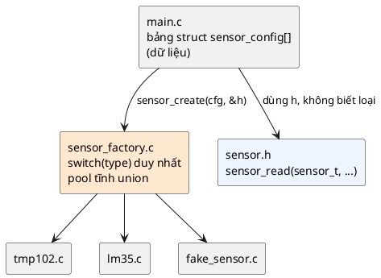

# 04 — Factory Pattern

📖 Bài giảng chi tiết: [LECTURE.md](LECTURE.md). File này là ghi chú tóm tắt, bám theo chương *Factory Pattern* của sách (sách dùng ví dụ `shape`; repo dùng cảm biến nhiệt độ).

## Overview

Factory = **một chỗ duy nhất nhận dữ liệu mô tả → chọn loại, cấp phát, khởi tạo → trả về handle chung**. Trong C: *"code tham số hóa việc tạo object"*. Ứng dụng chỉ thấy `sensor_t` và `sensor_read()`, không biết TMP102 hay LM35.

5 thành phần (📖): object được tạo, vị trí bộ nhớ (factory quản lý pool và gọi dọn dẹp), tham số (struct mô tả), implementation cụ thể (factory chọn loại), người dùng (ứng dụng, hoặc tự động trước `main()`).

## Use Cases

- Tạo device driver từ device tree (Zephyr `DEVICE_DT_INST_DEFINE`).
- Memory pool, buffer, gói tin mạng, `struct net_if`, file system object, pool `bt_conn`.
- Cảm biến khác nhau trên các phiên bản board; thay bằng cảm biến giả khi test.
- Khi việc tạo, quản lý và dọn dẹp cần nằm ở **một chỗ**.

## Benefits

- Linh hoạt: thêm loại mới không sửa code ứng dụng.
- Tổ chức code tốt: tách việc tạo khỏi implementation.
- **Hướng dữ liệu**: tạo từ struct / JSON / device tree (chỗ factory "tỏa sáng").
- Dễ test: chuẩn hóa việc tạo, dễ có bản giả.
- Tái sử dụng logic tạo, kiểm tra tham số ở một chỗ; dễ mở rộng.

## Drawbacks

- Thêm phức tạp: đôi khi `my_object_init()` là đủ.
- Mất linh hoạt nếu dùng tham số cứng.
- Khó test khi object được tạo tự động trước `main()`.
- (💡) Slot của union rộng bằng loại lớn nhất (🔬 24 → 80 byte khi thêm một loại lớn); thêm một lần gọi qua con trỏ hàm; factory phụ thuộc mọi driver.

## Implementation

Xem [inc/sensor.h](inc/sensor.h), [inc/sensor_factory.h](inc/sensor_factory.h), [src/sensor_api.h](src/sensor_api.h), [src/sensor.c](src/sensor.c), [src/sensor_factory.c](src/sensor_factory.c), [src/tmp102.c](src/tmp102.c), [src/lm35.c](src/lm35.c), [src/fake_sensor.c](src/fake_sensor.c), [main.c](main.c).

| Kiểu (📖) | Ý tưởng | Trong repo |
|---|---|---|
| Simple | Một hàm, `switch` theo tham số | `sensor_create()` |
| Embedded | Định nghĩa đặt trong section, startup code tạo trước `main()` | 🔬 thí nghiệm `SENSOR_DEFINE` |
| Abstract | Factory cũng là interface ảo | 🔬 board factory / sim factory |
| Prototype | Clone object mẫu | 🔬 đầu dò có bảng hiệu chuẩn |
| Pooled | Pool tĩnh, `union` của mọi loại | Pool `sensor_slots[]` |

Kỹ thuật nền: bảng hàm `static const` (Flash), handle con trỏ cấp hai `const struct sensor_api **`, `CONTAINER_OF`, tagged union cho cấu hình.

⚠️ Code của sách **không compile được** nguyên văn: typedef dùng trước khai báo, `SHAPE_SQUARE`/`SHAPE_RECTANGLE`, `self->api` thay vì `self->shape.api`, field `* const api` không gán được trong `init`, `union shape_slot` trùng tag với `struct shape_slot`. Chi tiết và lỗi gcc thật ở [LECTURE.md mục 11](LECTURE.md#11-năm-cách-hiện-thực).

## Best Practices

- Interface tạo object rõ ràng, đặt tên đúng.
- Singleton factory (gần như mặc định trong C).
- Tham số hóa việc tạo: nghĩ như tạo object từ JSON/XML.
- Dùng abstract api pattern với `CONTAINER_OF` (type safe, không `void *`).
- Chỉ dùng prototype factory khi tạo từ đầu chậm hơn copy.
- (💡) Trả mã lỗi phân biệt (`-EINVAL`, `-ENOMEM`, `-ENODEV`); nhánh lỗi luôn trả slot; `destroy(&h)` đặt `h = NULL`.

## Common Pitfalls

- **Tham số hóa không đủ**: factory chỉ gọi `init` → phức tạp vô ích.
- **API tạo object quá phức tạp.**
- Dùng handle sau khi hủy (slot đã cấp cho object khác).
- Quên trả slot khi `init` lỗi → pool rò dần tới `-ENOMEM`.
- Gọi `deinit` không kiểm tra `NULL`; ép kiểu thẳng thay vì `CONTAINER_OF`.

## Alternatives

- **Object Pattern**: `init`/`deinit` là đủ cho đa số trường hợp.
- **Singleton** (bài 3): chỉ một instance.
- **Bridge** (bài 8): nối hai hệ phân cấp mà không gắn chặt.

## Quiz

1. Mục đích chính của Factory Pattern là gì?
2. Các thành phần chính của Factory Pattern là gì?
3. Lợi ích của Factory Pattern?
4. Factory được dùng ở đâu trong Zephyr? Object và device được khởi tạo thế nào trước khi ứng dụng chính bắt đầu?
5. Trong những tình huống nào Factory hữu ích để quản lý việc tạo và vòng đời object?
6. Làm sao có một pool slot để cấp phát object và quản lý nó theo cách hướng đối tượng (và type safe)?
7. Ưu và nhược điểm của Factory Pattern?
8. Những pattern nào có thể dùng thay thế khi Factory không phù hợp?

(Đáp án và 7 câu thêm trong [LECTURE.md](LECTURE.md#23-quiz-có-đáp-án).)

## Câu hỏi còn thắc mắc

-
