# Bài giảng 05 — Callback Pattern

> **Về nguồn:** Bài này bám theo chương *Callback Pattern* trong sách của Martin Schröder (bản 0.38.0, file `00_Document/Martin-Schroder-Design-Patterns-Callback-Pattern-0.38.0.pdf`).
> - 📖 đánh dấu nội dung **theo sách** (dịch và diễn giải lại).
> - 💡 đánh dấu phần **giải thích thêm**, không có trong sách.
> - 🔬 đánh dấu **thí nghiệm thật**: chương trình đã được build bằng gcc 16.2 (MSYS2 UCRT64, Windows 64-bit) và chạy; output in trong bài là output thật.

Code mẫu đi kèm: [inc/container_of.h](inc/container_of.h), [inc/slist.h](inc/slist.h), [src/slist.c](src/slist.c), [inc/button.h](inc/button.h), [src/button.c](src/button.c), [inc/status_led.h](inc/status_led.h), [src/status_led.c](src/status_led.c), [inc/press_counter.h](inc/press_counter.h), [src/press_counter.c](src/press_counter.c), [main.c](main.c). Ghi chú ngắn: [README.md](README.md).
Các bài trước: [01 — Object](../01_ObjectPattern/LECTURE.md), [02 — Opaque](../02_OpaquePattern/LECTURE.md), [03 — Singleton](../03_SingletonPattern/LECTURE.md), [04 — Factory](../04_FactoryPattern/LECTURE.md). Bài sau: [06 — Inheritance](../06_InheritancePattern/LECTURE.md).

---

## Mục lục

**Phần A — Kiến thức nền**

1. [Bối cảnh: khi tin tức phải đi ngược lên](#1-bối-cảnh-khi-tin-tức-phải-đi-ngược-lên)
2. [Hàm cũng có địa chỉ: con trỏ hàm từ gốc](#2-hàm-cũng-có-địa-chỉ-con-trỏ-hàm-từ-gốc)
3. [Con trỏ hàm không mang theo dữ liệu](#3-con-trỏ-hàm-không-mang-theo-dữ-liệu)
4. [`offsetof` và `CONTAINER_OF`: đi ngược từ member về struct](#4-offsetof-và-container_of-đi-ngược-từ-member-về-struct)
5. [Danh sách liên kết "intrusive"](#5-danh-sách-liên-kết-intrusive)
6. [Callback chạy trong ngữ cảnh nào?](#6-callback-chạy-trong-ngữ-cảnh-nào)

**Phần B — Pattern**

7. [Vấn đề: ba cách làm "trước khi có pattern"](#7-vấn-đề-ba-cách-làm-trước-khi-có-pattern)
8. [Ý tưởng cốt lõi: callback là một struct](#8-ý-tưởng-cốt-lõi-callback-là-một-struct)
9. [Đặc điểm nhận dạng và lý do của từng cái](#9-đặc-điểm-nhận-dạng-và-lý-do-của-từng-cái)
10. [Từ một callback tới danh sách callback](#10-từ-một-callback-tới-danh-sách-callback)
11. [Vòng đời: callback không bao giờ được "chết trước"](#11-vòng-đời-callback-không-bao-giờ-được-chết-trước)

**Phần C — Đọc code**

12. [Đọc code mẫu từng dòng](#12-đọc-code-mẫu-từng-dòng)
13. [Theo dõi demo chạy từng bước](#13-theo-dõi-demo-chạy-từng-bước)
14. [Các quyết định thiết kế và phương án khác](#14-các-quyết-định-thiết-kế-và-phương-án-khác)

**Phần D — Thực tế và tổng kết**

15. [Callback Pattern trong thực tế (và work queue)](#15-callback-pattern-trong-thực-tế-và-work-queue)
16. [Unit test với callback](#16-unit-test-với-callback)
17. [Trade-off](#17-trade-off)
18. [Khi nào không nên dùng](#18-khi-nào-không-nên-dùng)
19. [Lỗi hay gặp](#19-lỗi-hay-gặp)
20. [Quy trình refactor từ lời gọi trực tiếp sang Callback](#20-quy-trình-refactor-từ-lời-gọi-trực-tiếp-sang-callback)
21. [Câu hỏi thường gặp (FAQ)](#21-câu-hỏi-thường-gặp-faq)
22. [Tóm tắt và checklist](#22-tóm-tắt-và-checklist)
23. [Quiz (có đáp án)](#23-quiz-có-đáp-án)
24. [Bài tập](#24-bài-tập)

---

# Phần A — Kiến thức nền

Callback Pattern đứng trên ba viên gạch của C: **con trỏ hàm**, **bố cục struct trong bộ nhớ** (để dùng `offsetof`) và **phép tính trên con trỏ**. Phần A dựng lại từng viên gạch đó từ đầu. Nhưng trước hết, hãy xem pattern này sinh ra để chữa căn bệnh gì.

## 1. Bối cảnh: khi tin tức phải đi ngược lên

### 1.1. Nhìn lại: bốn bài trước đã xây được gì

Sau bốn bài Creational, một module trong repo trông như sau (lấy lại ví dụ GPS ở [bài 1, mục 6](../01_ObjectPattern/LECTURE.md#6-object-chứa-object-gỡ-rối-dependency)):

```c
/* gps.h — Object Pattern + dependency injection (bài 1) */
struct uart;   /* bài 2: chỉ cần khai báo, không cần biết bên trong */

struct gps {
	struct uart *uart;   /* GPS được "đưa" UART vào qua gps_init */
	uint8_t fix_quality;
};

int gps_init(struct gps *self, struct uart *uart);
int gps_send_cmd(struct gps *self, const char *cmd);
```

```c
/* gps.c */
int gps_send_cmd(struct gps *self, const char *cmd)
{
	return uart_write(self->uart, (const uint8_t *)cmd, strlen(cmd));
}
```

Để ý **chiều** của lời gọi: `gps.c` gọi `uart_write()`. Module **tầng cao** (GPS, biết về giao thức NMEA) gọi module **tầng thấp** (UART, chỉ biết gửi byte). Mũi tên dependency đi từ trên xuống:

| Bài | Đã giải quyết | Lời gọi đi theo chiều |
|---|---|---|
| 01 Object | State nằm trong struct, có `self`, nhiều instance | App → driver |
| 02 Opaque | Giấu field và dependency của driver | App → driver (qua con trỏ opaque) |
| 03 Singleton | Một instance cho cả hệ thống (logger, settings) | App → subsystem |
| 04 Factory | Tạo object phức tạp từ dữ liệu cấu hình | App → factory → object |

Mọi thứ đều là **"tôi cần gì thì tôi gọi"**. Nhưng firmware còn một loại thông tin đi theo chiều **ngược lại**:

- Phần cứng nhận được byte UART → driver UART phải **báo lên** cho parser GPS.
- Người dùng bấm nút → driver nút phải **báo lên** cho LED, bộ đếm, menu.
- Timer hết hạn → module timer phải **báo lên** cho ai đã đặt hẹn giờ.
- ADC đo xong → driver ADC phải **báo lên** cho bộ lọc tín hiệu.

Đây là **sự kiện** (event): tầng thấp biết *khi nào* chuyện xảy ra, tầng cao biết *phải làm gì* với nó. Câu hỏi của bài này: **tầng thấp báo lên bằng cách nào mà không phải phụ thuộc vào tầng cao?**

📖 Sách mở đầu chương bằng đúng ý này: Callback Pattern là pattern trung tâm, dùng khi ta muốn **báo cho nhiều object khác biết về thay đổi trạng thái** của object đang bị theo dõi.

💡 Chú ý: chương *Singleton* của sách cũng đã nhắc trước: *"callback là đặc điểm phổ biến của singleton, vì singleton đóng vai 'người quản lý' cho nhiều object khác đăng ký với nó"*. Tức là bài 3 đã dùng tới thứ mà bài này mới dạy cách làm cho đúng.

### 1.2. Một dự án lớn dần: sự kiện đi ngược lên gây hại ra sao

💡 *Tình huống minh họa (không phải ví dụ trong sách), nhưng rất điển hình trong các dự án firmware.*

#### Tháng 1: một nút, một LED

Team làm firmware cho một bộ điều khiển máy bơm. Board có một nút `BTN_USER`, bấm vào thì đảo LED trạng thái. Cách nhanh nhất:

```c
/* button.c */
#include "led.h"

void button_isr(bool level)
{
	if (level) {
		led_toggle();
	}
}
```

Chạy ngon. Không ai thấy vấn đề gì.

#### Tháng 2: thêm bộ đếm và còi

Yêu cầu mới: đếm số lần bấm để lưu thống kê, và kêu "bíp" mỗi lần bấm. `button.c` thêm hai dòng gọi và hai dòng `#include`:

```c
#include "buzzer.h"
#include "counter.h"
#include "led.h"

void button_isr(bool level)
{
	if (level) {
		led_toggle();
		counter_on_press();
		buzzer_beep();
	}
}
```

Để ý điều lạ: **driver nút**, thứ đáng lẽ chỉ biết về một chân GPIO, giờ phụ thuộc vào LED, bộ đếm và còi. Sửa `buzzer.h` là phải build lại `button.c`.

#### Tháng 4: biến thể sản phẩm

Khách hàng thứ hai muốn bản không có còi. Không ai muốn copy cả project, nên `button.c` mọc ra `#ifdef`:

```c
#ifdef CONFIG_HAS_BUZZER
		buzzer_beep();
#endif
```

Cứ mỗi biến thể là thêm một tầng `#ifdef` vào **driver nút**, một file đáng lẽ không bao giờ phải đổi khi sản phẩm đổi.

#### Tháng 5: viết unit test cho nút

Muốn test logic chống dội phím của `button.c` trên PC, phải link kèm `led.c`, `counter.c`, `buzzer.c`, hoặc viết hàm giả cho từng cái. Test một module mà phải kéo theo cả hệ thống.

#### Tháng 6: "sửa cho gọn" bằng con trỏ hàm

Một kỹ sư mới đề xuất: *"cho button giữ một con trỏ hàm, ai muốn nghe thì gán vào"*. `button.c` hết include `led.h`. Nhưng con trỏ hàm `void (*)(void)` không có tham số nào, nên handler không biết **LED nào**: state phải để ở biến global. Board mới có **hai** nút và **hai** LED. Cả hai nút trỏ vào cùng một handler, cùng đảo một biến `g_led_on`. Bấm nút B thì LED A đổi trạng thái (🔬 mục 7.2 chạy lại đúng lỗi này).

#### Tháng 8: thêm `void *user_data`

Để handler biết LED nào, ai đó thêm tham số `void *user_data`. Chạy được. Ba tháng sau, một người đăng ký nhầm: truyền con trỏ tới **bộ đếm** cho handler của **LED**. Compiler im lặng, vì mọi con trỏ đều chuyển ngầm sang `void *`. Ngoài hiện trường, thiết bị thỉnh thoảng reset (🔬 mục 7.3 cho thấy compiler không cảnh báo gì và chương trình ghi ra ngoài object).

#### Nhìn lại

| Tháng | Chuyện gì xảy ra | Gốc rễ |
|---|---|---|
| 2 | Driver nút include LED, counter, buzzer | Tầng thấp **gọi thẳng** tầng cao |
| 4 | `#ifdef` mọc trong driver | Thêm/bớt người nghe = **sửa người nói** |
| 5 | Test nút phải kéo cả hệ thống | Dependency đi **ngược** |
| 6 | Bấm nút B, LED A đổi | Con trỏ hàm **không mang ngữ cảnh** (instance nào?) |
| 8 | Truyền nhầm con trỏ, compiler im lặng | `void *` **mất kiểm tra kiểu** |

Callback Pattern của sách chữa **cả năm** vấn đề này cùng lúc, bằng một kỹ thuật duy nhất: **callback là một struct, được nhúng vào object của người nghe, và người nghe dùng `CONTAINER_OF` để lấy lại chính mình.**

### 1.3. Đọc kỹ định nghĩa của sách

📖 Sách định nghĩa:

> *"The Callback design pattern is a behavioral pattern in which an object, called the subject, maintains a list of its dependents, called 'observers', and notifies them automatically through callbacks of any changes to its state, allowing multiple objects to observe the changes to the subject and be notified accordingly."*
>
> *Callback là một behavioral pattern, trong đó một object, gọi là **subject**, giữ một **danh sách** những object phụ thuộc vào nó, gọi là **observer**, và **tự động** báo cho chúng qua **callback** mỗi khi trạng thái của nó thay đổi, nhờ đó nhiều object cùng theo dõi được thay đổi của subject.*

Từng vế:

| Vế | Nghĩa là gì | Trong code mẫu |
|---|---|---|
| *"a behavioral pattern"* | Pattern về **cách các object tương tác**, không phải về cách tạo (creational) hay cách ghép (structural) | (xem ghi chú phân loại ở mục 1.4) |
| *"an object, called the subject"* | Object **bị theo dõi**, là nơi sự kiện phát sinh | `struct button` |
| *"maintains a list of its dependents"* | Subject giữ **danh sách**, không phải một con trỏ cố định tới ai đó | `struct slist callbacks` trong `struct button` |
| *"called 'observers'"* | Những object **quan tâm** tới sự kiện | `struct status_led`, `struct press_counter` |
| *"notifies them automatically"* | Subject tự gọi khi sự kiện xảy ra, observer không phải hỏi liên tục (không polling) | `button_set_level()` gọi `button_notify()` |
| *"through callbacks"* | Báo tin bằng cách **gọi một hàm** mà observer đã đưa cho subject | `cb->handler(cb, event)` |
| *"of any changes to its state"* | Báo khi **trạng thái** đổi, không phải mỗi lần được gọi | Cùng mức GPIO thì không báo |
| *"allowing multiple objects"* | Một-nhiều: một subject, nhiều observer | `BTN_USER` có LED1 và CNT_USER |

📖 Sách giải thích vì sao gọi là "Callback" chứ không phải "Observer": pattern này *"cũng thường được gọi là Observer Pattern, nhưng trong môi trường embedded ta còn phải nghĩ xem callback sẽ chạy trong **ngữ cảnh** (context) nào, nên phải bàn kỹ hơn về chính cái callback"*. Gần như mọi đặc điểm thêm vào đều xoay quanh callback, nên tác giả gọi tên theo nó.

📖 Ba thành phần sách nêu ngay sau định nghĩa:

1. **Object bị theo dõi:** có thể là một **opaque object** (bài 2), chỉ lộ ra interface để **đăng ký callback** cho các sự kiện. Observer đăng ký callback với object này.
2. **Callback receiver** (bên nhận callback): code thực thi callback. Điểm quan trọng: hàm này **phải có cách lấy lại state của chủ sở hữu callback**, vì *"từ góc nhìn của object bị theo dõi, ta không biết gì về object đang theo dõi nó, ta chỉ có cái callback"*.
3. **Tách biệt hoàn toàn mối quan tâm** (*full separation of concerns*): object bị theo dõi tách hẳn khỏi các object theo dõi nó.

Vế thứ 2 là trái tim của bài này. Gạch chân câu đó: **"ta chỉ có cái callback"**. Button cầm một con trỏ `struct button_callback *`. Từ con trỏ đó, bằng cách nào handler tìm lại được `struct status_led` chứa nó? Câu trả lời (`CONTAINER_OF`) chiếm cả mục 4.

Viết gọn thành công thức:

> **Callback Pattern = struct callback (node + con trỏ hàm) nhúng trong object observer + subject giữ danh sách các struct đó + handler dùng `CONTAINER_OF` để lấy lại observer**

### 1.4. Callback trong bức tranh các pattern

📖 Về phân loại có một chỗ không nhất quán trong sách: **định nghĩa** trong chương này gọi Callback là *"behavioral pattern"*, nhưng chương **Introduction** lại xếp nó mở đầu nhóm **Structural Patterns** (*"In the Structural Patterns section we begin with looking at the Callback Pattern..."*). Bảng lộ trình của repo theo Introduction. 💡 Cả hai cách nhìn đều có lý: về *mục đích*, nó điều phối tương tác (behavioral); về *cách làm* trong C, nó là một quy tắc **ghép struct** (nhúng callback vào observer), nên cũng là structural.

📖 Introduction gọi Callback là pattern *"tuyệt đối thiết yếu cho mọi lập trình embedded, vì không có nó thì source code gần như luôn thoái hóa thành một mớ dependency dữ liệu và dependency code hoàn toàn mất kiểm soát. Khi không áp dụng pattern này mà dùng **lời gọi hàm trần hoặc con trỏ hàm trần**, các lựa chọn thiết kế tồi có xu hướng lan ra khắp firmware"*.

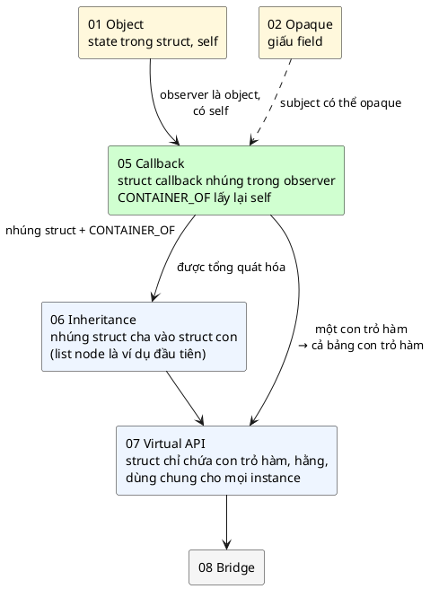

So sánh bốn cách để tầng thấp "báo lên" (mục 7 sẽ chạy thử từng cách):

| | Gọi trực tiếp | Con trỏ hàm trần | Con trỏ hàm + `void *user_data` | **Callback struct (bài này)** |
|---|---|---|---|---|
| Subject include header của observer? | **Có** | Không | Không | Không |
| Nhiều observer? | Sửa subject | Một | Một (hoặc mảng cố định) | **Không giới hạn** (danh sách) |
| Handler biết instance nào? | Không cần (chỉ có một) | **Không** | Có | **Có** |
| Kiểm tra kiểu? | Có | Có | **Mất** | **Có** |
| Cần cấp phát? | Không | Không | Không | Không (node nằm trong observer) |

### 1.5. Câu hỏi bài này sẽ trả lời

1. Con trỏ hàm là gì ở mức máy, và vì sao một mình nó **không đủ**? (Mục 2–3)
2. Từ địa chỉ một member, làm sao **tính ra địa chỉ struct chứa nó**, an toàn kiểu? (Mục 4)
3. Subject giữ **danh sách** observer thế nào mà không cần `malloc`? (Mục 5)
4. Callback chạy **ở đâu**: trong ISR, trong thread nào? Hệ quả là gì? (Mục 6)
5. Vòng đời: chuyện gì xảy ra nếu observer **biến mất trước** khi gỡ đăng ký? (Mục 11)

---

## 2. Hàm cũng có địa chỉ: con trỏ hàm từ gốc

### 2.1. Hàm nằm ở đâu trong bộ nhớ

Ở [bài 2, mục 6](../02_OpaquePattern/LECTURE.md#6-bản-đồ-bộ-nhớ-của-vi-điều-khiển) ta đã có bản đồ bộ nhớ: code (lệnh máy) nằm ở vùng `.text` trong **Flash**. Mỗi hàm là một dãy lệnh máy liên tiếp, bắt đầu ở một địa chỉ cố định do linker chọn. **Tên hàm chính là nhãn của địa chỉ đó.**

Khi bạn viết `led_toggle();`, compiler sinh ra lệnh kiểu `call <địa chỉ của led_toggle>` (x86) hay `bl led_toggle` (ARM). Địa chỉ được **viết cứng vào lệnh** lúc link. Đây là **lời gọi trực tiếp** (direct call).

Nhưng địa chỉ cũng chỉ là một con số. Ta có thể **cất con số đó vào một biến**, rồi sau này "gọi tới địa chỉ đang nằm trong biến". Biến đó là **con trỏ hàm** (function pointer), và lời gọi đó là **lời gọi gián tiếp** (indirect call).

### 2.2. Cú pháp

```c
void (*fp)(void);
```

Đọc từ tên biến ra ngoài:
- `fp` là tên biến.
- `(*fp)`: `fp` là **con trỏ**. Cặp ngoặc này bắt buộc: thiếu nó, `void *fp(void);` lại thành *khai báo một hàm tên `fp` trả về `void *`*.
- `(void)` phía sau: thứ được trỏ tới là **hàm không nhận tham số**.
- `void` phía trước: hàm đó **trả về `void`**.

Con trỏ hàm của bài này phức tạp hơn một chút:

```c
void (*handler)(struct button_callback *cb, enum button_event event);
```

*`handler` là con trỏ, trỏ tới hàm nhận (một con trỏ `struct button_callback`, một `enum button_event`) và trả về `void`.*

### 2.3. 🔬 Thí nghiệm: gán và gọi qua con trỏ hàm

```c
#include <stdio.h>

static int counter;

static void led_toggle(void)
{
	puts("  led_toggle chạy");
}

static void buzzer_beep(void)
{
	puts("  buzzer_beep chạy");
}

int main(void)
{
	void (*fp)(void); /* biến fp: con trỏ tới hàm không tham số, trả void */

	printf("sizeof(fp) = %u byte\n", (unsigned)sizeof(fp));
	fp = led_toggle;  /* tên hàm tự chuyển thành địa chỉ hàm */
	fp();             /* gọi qua con trỏ */
	fp = &buzzer_beep; /* viết & cũng được, cùng nghĩa */
	(*fp)();          /* viết (*fp)() cũng được, cùng nghĩa */
	(void)counter;
	return 0;
}
```

Output thật:

```
sizeof(fp) = 8 byte
  led_toggle chạy
  buzzer_beep chạy
```

Và lệnh `nm` (liệt kê symbol trong file `.o`) cho thấy hàm và biến nằm ở vùng nào:

```
000000000000001e t buzzer_beep
0000000000000000 b counter
0000000000000000 t led_toggle
```

- `t` = vùng **text** (code), chữ thường vì hàm là `static` (không lộ ra ngoài file).
- `b` = vùng **bss** (biến khởi tạo bằng 0).
- `buzzer_beep` bắt đầu ở byte `0x1e` = 30 của vùng text: `led_toggle` chiếm 30 byte đầu.

Điều cần nhớ:
- Con trỏ hàm trên PC 64-bit là **8 byte**. 💡 Trên Cortex-M là **4 byte**, và có một chi tiết riêng: bit thấp nhất của địa chỉ hàm luôn bằng 1 (đánh dấu chế độ lệnh Thumb). Bạn không phải tự lo chuyện này, compiler làm hộ.
- `fp = led_toggle` và `fp = &led_toggle` là **như nhau**. `fp()` và `(*fp)()` cũng **như nhau**. Code mẫu dùng dạng ngắn.

### 2.4. 🔬 Lời gọi gián tiếp trông thế nào ở mức máy

Mình dịch `src/button.c` của code mẫu với `-O2` rồi xem mã máy (`objdump -d`). Đây là đoạn vòng lặp báo tin trong `button_set_level` (đã được compiler inline `button_notify` vào):

```
 12f:	mov    (%rax),%rbx       ; đọc node->next TRƯỚC (vòng lặp SAFE)
 132:	mov    %rax,%rcx         ; tham số 1 = cb
 ...
 13a:	call   *0x8(%rax)        ; gọi hàm có địa chỉ nằm ở (cb + 8), tức cb->handler
```

- `call *0x8(%rax)`: dấu `*` nghĩa là **gián tiếp**: CPU đọc 8 byte ở địa chỉ `cb + 8` (field `handler`, nằm sau `node` 8 byte), rồi nhảy tới địa chỉ đọc được.
- So với lời gọi trực tiếp, chỉ tốn thêm **một lần đọc bộ nhớ**. 💡 Trên Cortex-M, đó là `ldr r3, [r0, #4]` rồi `blx r3`: vài chu kỳ.

💡 **Hệ quả quan trọng cho kiến trúc:** với lời gọi trực tiếp, `button.c` phải biết **tên** `led_toggle` lúc compile, tức là phải include `led.h`. Với lời gọi gián tiếp, `button.c` chỉ cần biết **kiểu** của con trỏ hàm. Ai cung cấp địa chỉ, cung cấp lúc nào, `button.c` không cần biết. Đó là cách dependency bị cắt đứt.

---

## 3. Con trỏ hàm không mang theo dữ liệu

### 3.1. Vấn đề "instance nào?"

Một **hàm** chỉ có một bản trong Flash, dù có bao nhiêu object. Ở bài 1, các hàm `uart_write()` phục vụ được nhiều UART vì mỗi lần gọi ta **truyền `self`** vào. Hàm = code dùng chung; `self` = dữ liệu riêng.

Khi button gọi lại observer qua con trỏ hàm, **button là bên gọi**, nên button quyết định truyền gì. Nhưng button **không biết** observer là kiểu gì (đó là cả mục đích của pattern). Vậy button truyền `self` của observer bằng cách nào?

💡 Ở các ngôn ngữ cấp cao, vấn đề này được giải bằng **closure** (hàm kèm dữ liệu "bắt" được từ chỗ tạo ra nó), như lambda trong C++ (`[this]() { toggle(); }`) hay Rust. C không có closure. Con trỏ hàm C chỉ là **địa chỉ code**, không có chỗ để gắn dữ liệu.

### 3.2. Ba cách người ta thường "gắn" dữ liệu vào callback trong C

| Cách | Ý tưởng | Vấn đề |
|---|---|---|
| **Biến global** | Handler đọc/ghi một biến toàn cục | Chỉ có một bộ state cho mọi instance (🔬 mục 7.2) |
| **`void *user_data`** | Lúc đăng ký, đưa kèm một con trỏ `void *`; button cất nó và truyền lại | Mất kiểm tra kiểu: truyền nhầm không ai báo (🔬 mục 7.3) |
| **Nhúng struct callback + `CONTAINER_OF`** (sách) | Button truyền lại **chính con trỏ tới struct callback**; struct đó nằm **bên trong** observer, nên tính ngược ra được observer | Phải hiểu `offsetof` (mục 4) |

📖 Sách nói rõ ở phần *Use Cases*: *"nếu bạn có nhiều instance của một cấu trúc dữ liệu và muốn đăng ký callback cho từng instance riêng, thì trong nhiều trường hợp bạn phải bằng cách nào đó truyền con trỏ tới dữ liệu private của instance đó vào callback. **Lập trình C truyền thống không có cách nào thẳng thắn để làm việc này. Đó là lý do có Callback Pattern.**"*

Cách thứ ba dựa trên một quan sát đơn giản: **nếu biết địa chỉ của một phần trong vật thể, và biết phần đó nằm ở vị trí nào trong vật thể, thì tính được địa chỉ của cả vật thể.** Mục 4 biến câu này thành code.

---

## 4. `offsetof` và `CONTAINER_OF`: đi ngược từ member về struct

### 4.1. Nhắc lại: struct là các field xếp liền nhau

Ở [bài 2, mục 5](../02_OpaquePattern/LECTURE.md#5-compiler-cần-biết-gì-để-dịch-p-field) ta đã thấy: `p->field` được compiler dịch thành *"ô nhớ ở địa chỉ `p + offset_của_field`"*. Offset do compiler tính từ định nghĩa struct, và macro chuẩn `offsetof(type, member)` (trong `<stddef.h>`) cho ta đọc con số đó.

Đây là `struct status_led` trong code mẫu:

```c
struct status_led {
	const char *name;
	struct button *btn;
	struct button_callback on_button;
	bool on;
};
```

Trên PC 64-bit:

| Offset | Kích thước | Field |
|---|---|---|
| 0 | 8 | `name` |
| 8 | 8 | `btn` |
| **16** | 16 | `on_button` (gồm `node` 8 byte + `handler` 8 byte) |
| 32 | 1 | `on` |
| 33 | 7 | (padding để kích thước chia hết cho 8) |
| | **40** | |

### 4.2. Phép tính ngược

Chiều xuôi (compiler làm mỗi ngày):

> `&led.on_button` = `&led` + 16

Chiều ngược (thứ ta cần):

> `&led` = `&led.on_button` − 16 = `cb` − `offsetof(struct status_led, on_button)`

Đó là toàn bộ ý tưởng của `CONTAINER_OF`. Viết thành macro (dạng tối giản):

```c
#define CONTAINER_OF(ptr, type, member) \
	((type *)((char *)(ptr) - offsetof(type, member)))
```

Đọc từng phần, từ trong ra ngoài:

| Phần | Ý nghĩa | Tại sao |
|---|---|---|
| `(char *)(ptr)` | Ép con trỏ về `char *` | Phép trừ trên con trỏ được tính **theo đơn vị kích thước kiểu được trỏ**. `cb - 16` với `cb` là `struct button_callback *` (16 byte) sẽ lùi 16 × 16 = **256 byte**. `char` luôn 1 byte, nên `char *` trừ 16 là lùi đúng **16 byte** |
| `offsetof(type, member)` | Hằng số tính lúc compile | Compiler biết bố cục struct, nên con số này không tốn gì lúc chạy |
| `- offsetof(...)` | Lùi về đầu struct | Chiều ngược của `&obj.member = &obj + offset` |
| `(type *)(...)` | Ép kết quả về con trỏ tới struct chứa | Để dùng được `self->on`, `self->name` |

### 4.3. 🔬 Thí nghiệm: xem các địa chỉ thật

```c
#include "container_of.h"
#include "status_led.h"

#include <stdio.h>

int main(void)
{
	static struct button btn;
	static struct status_led led;
	struct button_callback *cb = &led.on_button; /* thứ duy nhất button cầm */

	printf("&led                 = %p\n", (void *)&led);
	printf("&led.on_button (cb)  = %p\n", (void *)cb);
	printf("offsetof(on_button)  = %u\n", (unsigned)offsetof(struct status_led, on_button));
	printf("(char *)cb - 16      = %p\n", (void *)((char *)cb - 16));
	printf("CONTAINER_OF(cb,...) = %p\n", (void *)CONTAINER_OF(cb, struct status_led, on_button));
	printf("&led.on_button.node  = %p (node ở offset 0 của callback)\n", (void *)&led.on_button.node);
	(void)btn;
	return 0;
}
```

Output thật:

```
&led                 = 00007FF7BBBE7020
&led.on_button (cb)  = 00007FF7BBBE7030
offsetof(on_button)  = 16
(char *)cb - 16      = 00007FF7BBBE7020
CONTAINER_OF(cb,...) = 00007FF7BBBE7020
&led.on_button.node  = 00007FF7BBBE7030 (node ở offset 0 của callback)
```

Đọc từng dòng:
- `&led` kết thúc bằng `...020`, `cb` kết thúc bằng `...030`: chênh `0x10` = **16**, đúng bằng `offsetof`.
- Lùi `cb` 16 byte ra đúng `&led`. `CONTAINER_OF` cho cùng kết quả.
- `&led.on_button.node` **trùng** `cb`, vì `node` là field đầu tiên của `struct button_callback` (offset 0). Ta sẽ dùng điều này ở mục 10: từ `node`, `CONTAINER_OF` ra `button_callback` mà không tốn phép trừ nào.

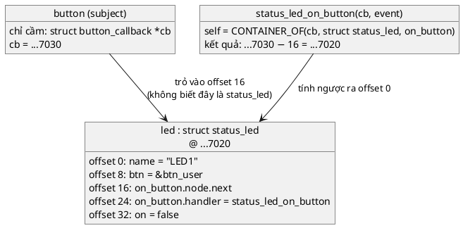

### 4.4. `CONTAINER_OF` gần như miễn phí lúc chạy

🔬 Mã máy của handler `press_counter_on_button` khi dịch với `-O2` (trong `struct press_counter`, `on_button` nằm ở offset 24, `presses` ở 16, `releases` ở 20, `name` ở 0):

```
   4:	mov    -0x4(%rcx),%eax      ; self->releases  = *(cb - 4)
   7:	mov    -0x8(%rcx),%r9d      ; self->presses   = *(cb - 8)
  ...
  1a:	mov    %r9d,-0x8(%rcx)      ; ghi lại self->presses
  1e:	mov    -0x18(%rcx),%rdx     ; self->name      = *(cb - 24)
```

`%rcx` đang giữ `cb`. Compiler **không** sinh lệnh trừ riêng để tính `self`: nó gộp `-24` (từ `CONTAINER_OF`) với `+16` (offset của `presses`) thành `-8`, nhét thẳng vào lệnh đọc. **Chi phí của `CONTAINER_OF` là 0 lệnh.**

### 4.5. Bản an toàn kiểu: bắt lỗi truyền nhầm member

Macro tối giản ở trên có một lỗ hổng: nó tin `ptr` đúng là con trỏ tới `member`. 🔬 Truyền nhầm con trỏ tới **một member khác kiểu** vẫn build sạch:

```c
#include <stddef.h>
#include "status_led.h"
#define NAIVE_CONTAINER_OF(ptr, type, member) ((type *)((char *)(ptr) - offsetof(type, member)))
void wrong(struct slist_node *node)
{
	struct status_led *self = NAIVE_CONTAINER_OF(node, struct status_led, on_button);
	(void)self;
}
```

Kết quả: build OK với `-Wall -Wextra -Werror -pedantic`, **không một cảnh báo**. (Ở ví dụ này `node` tình cờ nằm ở offset 0 của `on_button` nên địa chỉ vẫn đúng, nhưng nếu nó là node của một struct khác thì `self` sẽ trỏ vào rác.)

Code mẫu thêm một "cái bẫy kiểu" vào macro, chạy được với C99 thuần:

```c
#define CONTAINER_OF(ptr, type, member) \
	((type *)((char *)(ptr) - offsetof(type, member) + \
		  0 * sizeof((ptr) == &((type *)0)->member)))
```

Phần thêm vào: `0 * sizeof((ptr) == &((type *)0)->member)`.
- `&((type *)0)->member` là một biểu thức có kiểu *"con trỏ tới kiểu của `member`"*. Nó nằm trong `sizeof`, nên **không bao giờ được tính lúc chạy** (không có phép truy cập địa chỉ 0 nào thật sự xảy ra), compiler chỉ xét **kiểu** của nó.
- `(ptr) == ...` bắt compiler so sánh hai con trỏ. So sánh hai con trỏ khác kiểu (trừ `void *`) là vi phạm ràng buộc của chuẩn C, gcc báo `comparison of distinct pointer types`.
- `0 * sizeof(...)` bằng 0, nên không đổi kết quả.

🔬 Với bản này, đoạn `wrong()` ở trên cho lỗi:

```
container_of.h:18:36: error: comparison of distinct pointer types lacks a cast [-Werror=compare-distinct-pointer-types]
   18 |                   0 * sizeof((ptr) == &((type *)0)->member)))
      |                                    ^~
e5_typecheck.c:7:35: note: in expansion of macro 'CONTAINER_OF'
    7 |         struct status_led *self = CONTAINER_OF(node, struct status_led, on_button);
```

💡 Chú ý: không có `-Werror` thì đây chỉ là **cảnh báo**. Đó là một lý do nữa để repo luôn build với `-Werror`.

💡 **Các phiên bản "thật":** Linux kernel định nghĩa `container_of` bằng phần mở rộng GNU `typeof` cùng một `static_assert` kiểm tra kiểu. Zephyr có `CONTAINER_OF` trong `<zephyr/sys/util.h>`, các bản cũ là đúng dạng tối giản ở mục 4.2, các bản mới thêm bước kiểm tra kiểu lúc compile. Mình **không chạy** code Linux/Zephyr trong bài này. Code mẫu dùng bản C99 thuần ở trên để build được với `-pedantic`.

💡 **Về tính hợp lệ theo chuẩn C:** chuẩn C không nói thẳng về kỹ thuật "lùi từ member về struct". Trong thực tế, nó được dùng ở hàng nghìn chỗ trong Linux và Zephyr, và các compiler embedded phổ biến đều xử lý đúng. Điều kiện để kết quả đúng: con trỏ truyền vào **thật sự** trỏ tới `member` của một object kiểu `type`. Mọi thứ còn lại của bài này xoay quanh việc giữ điều kiện đó.

---

## 5. Danh sách liên kết "intrusive"

Subject cần giữ **nhiều** observer, số lượng không biết trước. Trong embedded ta không muốn `malloc` (bài 2, mục 10). Vậy cất danh sách ở đâu?

### 5.1. Hai kiểu danh sách liên kết

**Kiểu thông thường (non-intrusive)**: mỗi phần tử là một node riêng, do danh sách cấp phát, node trỏ tới dữ liệu:

```c
struct list_item {
	struct list_item *next;
	void *data;               /* trỏ tới observer: lại là void * */
};
/* thêm phần tử = malloc(sizeof(struct list_item)) */
```

**Kiểu intrusive** (xâm nhập): node **không** chứa dữ liệu, mà được **nhúng vào bên trong** dữ liệu:

```c
struct slist_node {
	struct slist_node *next;
};

struct button_callback {
	struct slist_node node;   /* node nằm NGAY TRONG callback */
	void (*handler)(struct button_callback *cb, enum button_event event);
};
```

| | Non-intrusive | Intrusive |
|---|---|---|
| Ai cấp phát node? | Danh sách (`malloc`) | **Không ai**: node nằm sẵn trong object |
| Thêm phần tử có thể thất bại? | Có (hết heap) | **Không** |
| Từ node lấy dữ liệu bằng | `node->data` (`void *`, mất kiểu) | `CONTAINER_OF` (giữ kiểu) |
| Một object nằm trong mấy danh sách? | Bao nhiêu cũng được | **Một node = một danh sách**; muốn nằm ở hai danh sách thì cần hai node |
| Dùng ở | Thư viện desktop | Linux (`list_head`), Zephyr (`sys_slist_t`, `sys_dlist_t`), FreeRTOS (`ListItem_t`) |

📖 Sách dùng `sys_slist_t` của Zephyr. Code mẫu chạy trên PC nên tự viết một bản tối giản cùng ý tưởng: [inc/slist.h](inc/slist.h), [src/slist.c](src/slist.c). 💡 Danh sách intrusive chính là ví dụ đầu tiên của **Inheritance Pattern** (bài 6): `struct button_callback` "kế thừa" `struct slist_node` bằng cách chứa nó. Bài 6 sẽ mổ xẻ kỹ.

### 5.2. Hình dạng trong bộ nhớ khi chạy demo

Sau khi `status_led_init(&led, ..., &btn_user)` và `press_counter_init(&cnt_user, ..., &btn_user)`:

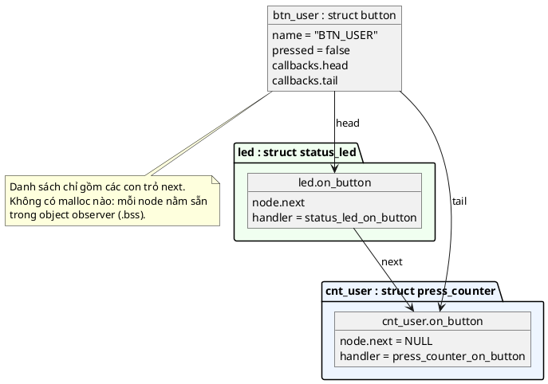

Button chỉ thấy các `slist_node`. Nó không biết node thứ nhất nằm trong một `status_led` còn node thứ hai nằm trong một `press_counter`. Lúc duyệt, nó dùng `CONTAINER_OF(node, struct button_callback, node)` để ra callback (offset 0, nên địa chỉ không đổi), rồi gọi `cb->handler(cb, ...)`. Mỗi handler lại dùng `CONTAINER_OF` lần thứ hai, với **offset của riêng nó** (16 cho `status_led`, 24 cho `press_counter`), để ra observer.

---

## 6. Callback chạy trong ngữ cảnh nào?

Đây là lý do sách đặt tên "Callback" thay vì "Observer" (mục 1.3), nên cần hiểu kỹ.

### 6.1. Ngữ cảnh thực thi là gì

💡 Trên một vi điều khiển, code có thể đang chạy trong một trong mấy **ngữ cảnh** (execution context):

| Ngữ cảnh | Ví dụ | Được phép | Không được phép |
|---|---|---|---|
| **ISR** (interrupt service routine) | `EXTI0_IRQHandler` khi chân GPIO đổi mức | Việc rất ngắn: đọc thanh ghi, ghi cờ, đẩy vào hàng đợi | Chờ (sleep, chờ mutex), `printf`, `malloc`, việc lâu |
| **Thread** (task của RTOS) | Task xử lý giao diện | Chờ, gọi API block | Chạy quá lâu mà không nhường CPU cho task khác cùng ưu tiên |
| **Main loop** (bare-metal, không RTOS) | `while (1) { ... }` trong `main` | Mọi thứ | Block quá lâu làm trễ mọi việc khác |

Khi đang ở ISR, CPU đã **cắt ngang** code khác. Mọi ngắt có ưu tiên bằng hoặc thấp hơn phải chờ. ISR càng lâu, hệ thống càng chậm phản ứng.

### 6.2. Quy tắc: callback chạy trong ngữ cảnh của **bên gọi notify**

Handler của observer **không** chạy "ở chỗ của observer". Nó chạy **ngay trong lời gọi** của subject. Subject được gọi từ ISR, thì handler chạy trong ISR.

🔬 Thí nghiệm: mô phỏng ISR bằng một thread riêng (`pthread`). Observer đăng ký từ `main`, nhưng sự kiện thứ nhất được phát từ thread "ISR", sự kiện thứ hai từ `main`:

```c
/* Callback chạy trong ngữ cảnh của BÊN GỌI notify, không phải của observer */
#include "button.h"
#include "container_of.h"

#include <pthread.h>
#include <stdio.h>

static pthread_t main_thread;

struct observer {
	struct button_callback cb;
};

static void observer_on_button(struct button_callback *cb, enum button_event ev)
{
	(void)cb;
	printf("  handler (%s) chạy trên thread: %s\n",
	       ev == BUTTON_EVENT_PRESSED ? "PRESSED" : "RELEASED",
	       pthread_equal(pthread_self(), main_thread) ? "main" : "\"ISR\" (thread khác)");
}

static void *fake_isr(void *arg)
{
	button_set_level(arg, true); /* như GPIO IRQ handler */
	return NULL;
}

int main(void)
{
	static struct button btn;
	static struct observer obs = { { { NULL }, observer_on_button } };
	pthread_t isr;

	main_thread = pthread_self();
	button_init(&btn, "BTN");
	button_add_callback(&btn, &obs.cb); /* đăng ký từ main */

	pthread_create(&isr, NULL, fake_isr, &btn);
	pthread_join(isr, NULL);
	button_set_level(&btn, false); /* lần này gọi từ main */
	return 0;
}
```

Build: `gcc -std=c99 -Wall -Wextra -Werror -pedantic -pthread -Iinc e11_context.c src/button.c src/slist.c`

Output thật:

```
  handler (PRESSED) chạy trên thread: "ISR" (thread khác)
  handler (RELEASED) chạy trên thread: main
```

Cùng một handler, cùng một observer, nhưng hai lần chạy ở hai ngữ cảnh khác nhau. **Observer không chọn được nó chạy ở đâu; subject quyết định.**

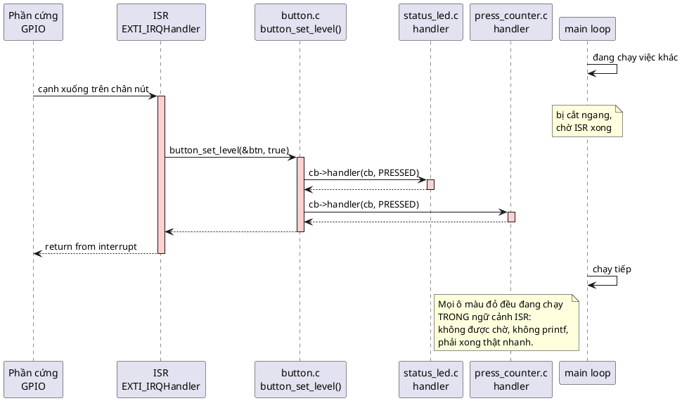

📖 Đây chính là cơ sở của hai lời khuyên trong sách: **tránh việc tốn thời gian trong callback**, và **dời việc nặng sang work queue** (mục 15.2). 📖 Phần nhược điểm của sách gọi tình huống ngược lại là **Lockup**: *"nếu một observer vì lý do nào đó block, mọi listener khác không có cơ hội chạy"*.

💡 Code mẫu của bài in bằng `printf` ngay trong handler cho dễ quan sát trên PC. Trên chip thật, nếu `button_set_level` được gọi từ ISR thì **đừng làm vậy**: `printf` qua UART có thể mất hàng mili-giây.

---

# Phần B — Pattern

## 7. Vấn đề: ba cách làm "trước khi có pattern"

Mục này chạy thật ba cách làm ở tình huống mục 1.2, để thấy tận mắt mỗi cách hỏng ở đâu.

### 7.1. Cách 1: gọi trực tiếp

```c
/* button.c "trước khi có pattern": gọi thẳng mọi module cần biết sự kiện */
#include "buzzer.h"
#include "counter.h"
#include "led.h"

#include <stdbool.h>

static bool pressed;

void button_isr(bool level)
{
	if (level == pressed) {
		return;
	}
	pressed = level;
	if (pressed) {
		led_toggle();       /* thêm module mới = sửa file này */
		counter_on_press();
		buzzer_beep();
	}
}
```

🔬 Lệnh `gcc -MM` in ra danh sách file mà một file `.c` phụ thuộc (tức là sửa file nào thì file `.c` này phải build lại):

```
button.o: button.c buzzer.h counter.h led.h
```

So với driver nút của code mẫu (dùng Callback Pattern):

```
button.o: src/button.c inc/button.h inc/slist.h inc/container_of.h
```

Driver nút trong code mẫu **không phụ thuộc vào bất kỳ observer nào**. Ngược lại, observer phụ thuộc vào button:

```
status_led.o: src/status_led.c inc/status_led.h inc/button.h inc/slist.h \
 inc/container_of.h
```

Mũi tên dependency đã **bị đảo chiều**: người nghe biết người nói, người nói không biết người nghe.

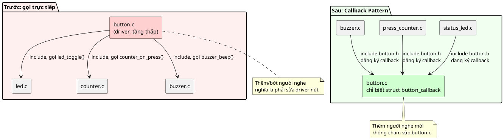

📖 Sách mô tả đúng hệ quả này ở phần *Benefits* (**Scalability**): *"không có Callback Pattern, subject sẽ phải phụ thuộc trực tiếp vào API của mọi observer, điều rõ ràng là rất tệ"*. Và câu hỏi quiz số 3 của sách hỏi chính điều này.

### 7.2. Cách 2: con trỏ hàm trần + biến global

```c
/* Bước 2: con trỏ hàm "trần" void (*)(void) - button hết phụ thuộc LED,
 * nhưng handler không biết LED NÀO, nên state phải nằm ở biến global. */
#include <stdbool.h>
#include <stdio.h>

struct button {
	const char *name;
	void (*on_press)(void); /* không có tham số nào: không mang được ngữ cảnh */
};

static void button_press(struct button *self)
{
	if (self->on_press) {
		self->on_press();
	}
}

/* Hai LED vật lý, nhưng handler chỉ có một chỗ để lưu state */
static bool g_led_on;

static void led_on_press(void)
{
	g_led_on = !g_led_on;
	printf("  led_on_press: LED %s (LED nào? không biết!)\n", g_led_on ? "ON" : "OFF");
}

int main(void)
{
	struct button btn_a = { "BTN_A", led_on_press }; /* muốn điều khiển LED_A */
	struct button btn_b = { "BTN_B", led_on_press }; /* muốn điều khiển LED_B */

	printf("nhấn BTN_A\n");
	button_press(&btn_a);
	printf("nhấn BTN_B (LED_B mong đợi ON vì chưa từng bật)\n");
	button_press(&btn_b);
	return 0;
}
```

🔬 Output thật:

```
nhấn BTN_A
  led_on_press: LED ON (LED nào? không biết!)
nhấn BTN_B (LED_B mong đợi ON vì chưa từng bật)
  led_on_press: LED OFF (LED nào? không biết!)
```

Bấm nút B lại **tắt** LED mà nút A vừa bật. Đã cắt được dependency, nhưng lại rơi về đúng căn bệnh của bài 1: **state ở biến global, chỉ có một instance**.

📖 Sách liệt kê đây là một pitfall: *"Bạn biến dữ liệu thành global: trông có vẻ tiện, nhưng nó phá hoàn toàn luồng dữ liệu đi qua code. Nếu callback làm việc trên dữ liệu global, bạn không chỉ làm rối luồng dữ liệu cho một listener, mà cho mọi listener"*.

### 7.3. Cách 3: thêm `void *user_data`

```c
/* Bước 3: thêm void *user_data - chạy được, nhưng compiler hết kiểm tra kiểu */
#include <stdbool.h>
#include <stdint.h>
#include <stdio.h>

struct button {
	const char *name;
	void (*on_press)(void *user_data);
	void *user_data;
};

static void button_register(struct button *self, void (*fn)(void *), void *user_data)
{
	self->on_press = fn;
	self->user_data = user_data;
}

static void button_press(struct button *self)
{
	if (self->on_press) {
		self->on_press(self->user_data);
	}
}

struct led {
	const char *name;
	bool on;
};

struct press_counter {
	uint32_t presses;
	uint32_t releases;
};

static void led_on_press(void *user_data)
{
	struct led *led = user_data; /* tin rằng caller truyền đúng struct led * */
	led->on = !led->on;
	printf("  [%s] LED %s\n", led->name, led->on ? "ON" : "OFF");
}

int main(void)
{
	struct led led_a = { "LED_A", false };
	struct press_counter cnt = { 0, 0 };
	struct button btn_a = { "BTN_A", NULL, NULL };
	struct button btn_b = { "BTN_B", NULL, NULL };

	button_register(&btn_a, led_on_press, &led_a); /* đúng */
	button_register(&btn_b, led_on_press, &cnt);   /* SAI kiểu: compiler im lặng */

	printf("nhấn BTN_A\n");
	button_press(&btn_a);
	printf("nhấn BTN_B\n");
	button_press(&btn_b);
	return 0;
}
```

🔬 Build với `-Wall -Wextra -Werror -pedantic`: **không có cảnh báo nào**. Output thật:

```
nhấn BTN_A
  [LED_A] LED ON
nhấn BTN_B
  [(null)] LED OFF
exit code: 0
```

(Dòng `exit code` do shell in ra bằng `echo $?`.) Chuyện gì đã xảy ra với BTN_B:
- Handler coi `&cnt` (8 byte: `presses`, `releases`) là `struct led` (16 byte: `name` ở offset 0, `on` ở offset 8).
- `led->name` đọc 8 byte của `presses` + `releases` (đều bằng 0) thành con trỏ `NULL`. `printf` của MinGW in `(null)`. 💡 Thư viện C khác có thể crash ngay ở đây.
- `led->on = !led->on` ghi vào byte ở offset 8, tức là **ngay sau** `cnt`, đè lên một biến khác trên stack. Đây là ghi tràn bộ nhớ, hành vi không xác định. Lần này chương trình "may mắn" thoát bình thường.

Đây là loại bug nguy hiểm nhất: **chạy được trên bàn thí nghiệm, hỏng ngẫu nhiên ngoài hiện trường**.

📖 Sách nói rất mạnh về điểm này: *"Bất cứ khi nào tôi thấy một biến thể nào đó của `void *user_data` trong struct hay callback, tôi biết người viết chưa thật sự hiểu cách cài Observer Pattern cho đúng. Nhớ rằng: bạn hoàn toàn không cần lưu con trỏ tới user data. Bạn lấy user data bằng macro `CONTAINER_OF`."* 💡 Đây là quan điểm của tác giả. Thực tế nhiều thư viện lớn vẫn dùng `void *` (mục 15.1, mục 21). Lý lẽ của sách là đúng: `void *` tắt kiểm tra kiểu, còn `CONTAINER_OF` (bản an toàn ở mục 4.5) giữ được nó.

### 7.4. Tổng kết ba cách

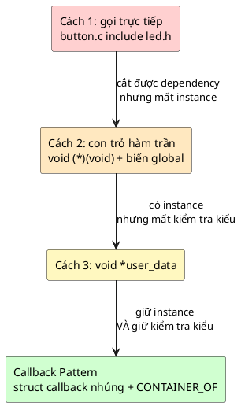

---

## 8. Ý tưởng cốt lõi: callback là một struct

### 8.1. Từ con trỏ hàm tới struct callback

📖 Bản cơ bản nhất của sách:

```c
struct button_callback {
	void (*cb)(struct button_callback *cb);
};
```

Hai điều cần thấy:
1. Con trỏ hàm nằm **trong một struct**, không đứng trần.
2. Hàm nhận **con trỏ tới chính struct đó** làm tham số.

📖 Sách giải thích: *"hàm callback nhận con trỏ tới struct callback. Đây là đặc điểm quan trọng của việc dùng struct: khi dùng struct, ta truyền được con trỏ của struct vào chính hàm đó. **Không có struct, ta không thể truyền con trỏ tới thứ ta đang định nghĩa vào chính nó.**"*

💡 Câu cuối có nghĩa là: một kiểu con trỏ hàm không thể nhận "chính nó" làm tham số (`typedef void (*cb_t)(cb_t self);` là lỗi, vì `cb_t` chưa tồn tại khi đang định nghĩa nó). Nhưng struct thì có thể chứa con trỏ tới chính kiểu struct đó, vì tên `struct button_callback` có hiệu lực ngay từ dòng mở struct (đó cũng là lý do danh sách liên kết `struct slist_node *next` viết được).

📖 Sách nêu **hai lợi ích** của thiết kế này:
- **Lợi ích 1:** ta **tạo được instance của chính callback**, một phương án sạch hơn nhiều so với `typedef` con trỏ hàm. (💡 Một biến `struct button_callback on_button;` là một "vật" có địa chỉ, có thể nhúng vào object, xếp vào danh sách, thêm field sau này; một biến con trỏ hàm thì không làm được những việc đó một cách gọn gàng.)
- **Lợi ích 2:** từ con trỏ tới struct callback, ta lấy được **địa chỉ của ngữ cảnh cấp cao hơn** (object chứa nó), nhờ đó tách rời A và B. *"Điều này là không thể nếu callback chỉ là một con trỏ hàm."*

📖 Sách cũng gợi ý: một struct chứa callback có thể chứa **một hoặc nhiều** callback, và có thể gọi struct đó là **`ops`** (viết tắt của *operations*). 💡 Đây là cây cầu sang **Virtual API** (bài 7): một struct chứa nhiều con trỏ hàm, hằng, dùng chung.

### 8.2. Ba vai trò

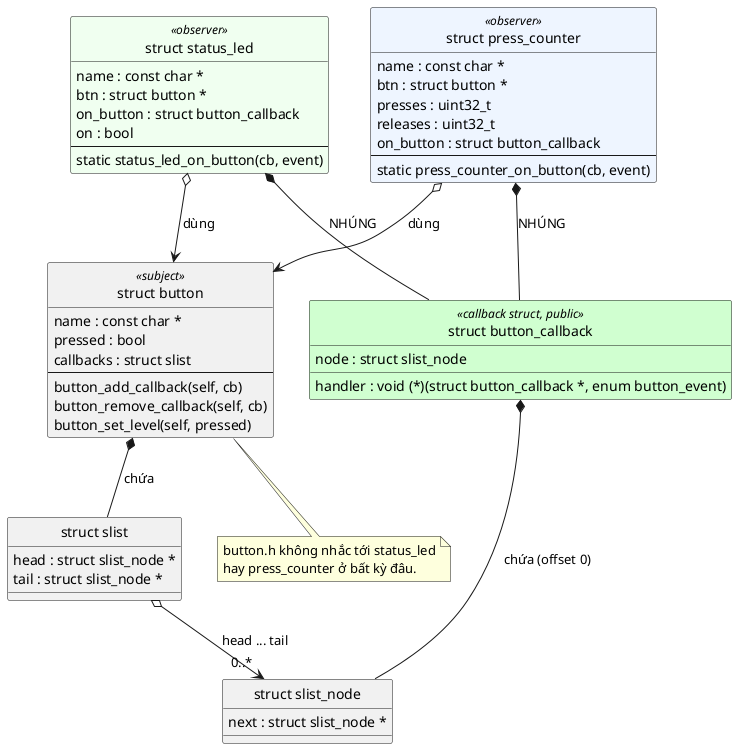

| Vai trò | Trong code | Biết những gì |
|---|---|---|
| **Subject** (bị theo dõi) | `struct button` | Chỉ biết `struct button_callback` và `struct slist` |
| **Callback struct** (hợp đồng chung) | `struct button_callback` | 📖 *"cấu trúc dữ liệu **duy nhất** cần dùng chung giữa code quan sát và object bị quan sát"* |
| **Observer** (người nghe) | `struct status_led`, `struct press_counter` | Biết `struct button` (để đăng ký) và nhúng `struct button_callback` |

### 8.3. Mẫu code của observer (bốn dòng phải nhớ)

📖 Sách nhấn mạnh: *"điểm mấu chốt là ta **tạo instance của struct callback như một phần của object** (nhúng vào), nhờ đó lấy được con trỏ tới instance của observer từ bên trong chính handler"*.

```c
struct status_led {
	/* ... */
	struct button_callback on_button;                 /* 1. NHÚNG, không phải con trỏ */
};

static void status_led_on_button(struct button_callback *cb, enum button_event event)
{
	struct status_led *self = CONTAINER_OF(cb, struct status_led, on_button); /* 2. lấy lại self */
	/* ... dùng self như mọi method khác ... */
}

int status_led_init(struct status_led *self, const char *name, struct button *btn)
{
	/* ... */
	self->on_button.handler = status_led_on_button;  /* 3. gán handler */
	return button_add_callback(btn, &self->on_button); /* 4. đăng ký */
}
```

Sau dòng 2, handler **giống hệt một method bình thường** của Object Pattern: có `self`, có state riêng của instance, không có biến global, không có `void *`.

📖 Sách nhận xét về bản demo của mình: *"Hãy để ý cách này thanh lịch thế nào. Ta tách hoàn toàn button khỏi observer. Observer tất nhiên cần biết kiểu của button, nhưng button không còn phải biết về mọi observer có thể có."*

---

## 9. Đặc điểm nhận dạng và lý do của từng cái

💡 Sách không có mục "Defining Characteristics" riêng cho chương này như chương Opaque. Danh sách dưới đây được rút ra từ **định nghĩa, phần Implementation và Best Practices** của sách; mỗi dòng ghi rõ nguồn.

### 1. Callback là một struct, không phải con trỏ hàm trần

📖 Best practice đầu tiên: *"Always use struct for the callback"*: nó cho ngữ cảnh, và quan trọng nhất là đảm bảo ta dùng được nó cùng Object Pattern.

**Tại sao:** chỉ struct mới có địa chỉ để `CONTAINER_OF` tính ngược (mục 8.1), và mới chứa thêm được node danh sách.

### 2. Handler nhận con trỏ tới struct callback làm tham số đầu tiên

📖 Từ phần Implementation: *"The callback function itself takes pointer to the callback structure"*.

**Tại sao:** đó là "`self`" của callback, giống quy ước `self` đầu tiên của bài 1. Không có nó, handler không có điểm xuất phát để tìm lại observer.

### 3. Struct callback được NHÚNG trong object observer

📖 *"we instantiate the callback struct as part of our object"*.

**Tại sao:** `CONTAINER_OF` chỉ đúng khi callback **thật sự nằm bên trong** observer. Nếu observer chỉ giữ **con trỏ** tới một callback nằm ở chỗ khác, phép trừ offset sẽ ra rác.

### 4. Ngữ cảnh lấy bằng `CONTAINER_OF`, không bằng global hay `user_data`

📖 Hai best practice: *"Always pass context to callback"* (đặt dữ liệu trong chính struct callback hoặc trong object bao ngoài, không phát minh ra "user data") và *"Use CONTAINER_OF"*.

**Tại sao:** giữ kiểm tra kiểu (mục 4.5) và giữ mỗi instance một state riêng (mục 7.2).

### 5. Subject giữ danh sách, không biết kiểu của observer

📖 Từ định nghĩa (*"maintains a list of its dependents"*) và ba thành phần (*"full separation of concerns"*).

**Tại sao:** thêm observer không phải sửa subject. 📖 Sách gọi đây là **Decoupling** và **Scalability**.

### 6. Observer tự gỡ đăng ký trước khi chết

📖 Phần Implementation: *"struct callback của bạn **không bao giờ được ra khỏi phạm vi sống**... nếu object chứa callback nằm trên stack, bạn phải cài cách gỡ callback trước khi object ra khỏi phạm vi"*.

**Tại sao:** subject giữ con trỏ tới node nằm trong observer. Observer chết mà không gỡ thì subject giữ con trỏ treo (🔬 mục 11.2).

### 7. Handler là hàm `static` trong file `.c` của observer

💡 Không phải quy tắc của chương Callback, nhưng code mẫu của sách viết `static void observer_on_button_cb(...)`, và chương Inheritance của sách có hẳn một best practice: *"Trait callbacks always static"*.

**Tại sao:** không ai ngoài subject được gọi handler, và subject gọi qua con trỏ, không cần tên. Để `static` thì tên không lọt ra ngoài và không thể bị gọi nhầm trực tiếp.

---

## 10. Từ một callback tới danh sách callback

### 10.1. Bản một callback của sách

📖 Sách bắt đầu với `struct button` giữ **một** con trỏ `struct button_callback *cb`:

```c
void button_add_callback(struct button *self, struct button_callback *cb){
    self->cb = cb;
}

void button_remove_callback(struct button *self, struct button_callback *cb){
    self->cb = NULL;
}

void button_do_something(struct button *self){
    if(self->cb)
        self->cb->cb(self->cb); // call the callback
}
```

(Code nguyên văn của sách, dùng Zephyr.)

⚠️ **Đối chiếu với thực tế:** hàm `button_remove_callback` của sách **bỏ qua tham số `cb`**, cứ thế xóa callback hiện tại. 🔬 Mình dựng lại đúng ba hàm trên: observer A đăng ký, rồi observer B (chưa từng đăng ký) gọi `button_remove_callback(&btn, &b)`:

```
nhấn nút:
  (không có callback nào)
```

B đã gỡ mất đăng ký của A. 💡 Trong bản "một callback" thì đây chỉ là sơ suất nhỏ của ví dụ, nhưng là thói quen nguy hiểm. Code mẫu của bài luôn kiểm tra: `button_remove_callback` chỉ gỡ đúng node được truyền vào, và trả `-ENOENT` nếu node không có trong danh sách.

### 10.2. Bản danh sách của sách

📖 *"Nếu muốn mở rộng để hỗ trợ nhiều listener, tất cả những gì ta phải làm là thêm một list node vào struct callback"*, rồi `button_add_callback` dùng `sys_slist_append`, `button_do_something` dùng `SYS_SLIST_FOR_EACH_NODE` và `CONTAINER_OF(node, struct button_callback, node)`.

⚠️ **Đối chiếu với thực tế:** trong đoạn code "nhiều listener", sách khai báo field node là `sys_slist_t node;` (kiểu **danh sách**), trong khi đoạn trước đó viết đúng là `sys_snode_t node;` (kiểu **node**). 🔬 Mình dựng các kiểu giả lập theo đúng định nghĩa sách in ở chương Inheritance (`sys_snode_t` chỉ có `next`, `sys_slist_t` có `head`, `tail`) và dịch đoạn code đó:

```
e12_book_node.c:18:44: error: passing argument 2 of 'sys_slist_append' from incompatible pointer type [-Wincompatible-pointer-types]
   18 |         sys_slist_append(&self->callbacks, &cb->node);
      |                                            ^~~~~~~~~
      |                                            |
      |                                            sys_slist_t * {aka struct _slist *}
e12_book_node.c:6:55: note: expected 'sys_snode_t *' {aka 'struct _snode *'} but argument is of type 'sys_slist_t *' {aka 'struct _slist *'}
```

Đây là lỗi đánh máy của sách. Đúng phải là `sys_snode_t node;`. (Một chi tiết nhỏ khác: sách đặt tên hàm gỡ là `button_remove_callback` ở bản đầu và `button_delete_callback` ở bản danh sách.)

### 10.3. Bản của code mẫu

```c
static void button_notify(struct button *self, enum button_event event)
{
	struct slist_node *node;
	struct slist_node *next;

	/* Bản SAFE: handler được phép tự gỡ mình khỏi danh sách giữa chừng */
	SLIST_FOR_EACH_NODE_SAFE(&self->callbacks, node, next) {
		struct button_callback *cb = CONTAINER_OF(node, struct button_callback, node);

		cb->handler(cb, event);
	}
}
```

Hai lần `CONTAINER_OF` trên đường đi của một sự kiện:

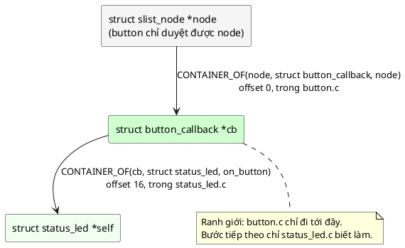

Lần thứ nhất do **button** làm (button biết `struct button_callback`). Lần thứ hai do **observer** làm (chỉ observer biết mình là `struct status_led`). Không bên nào cần biết thứ của bên kia.

### 10.4. Tại sao phải duyệt "SAFE"

Sách dùng `SYS_SLIST_FOR_EACH_NODE`, tức là đọc `node->next` **sau khi** đã gọi handler. Nếu handler tự gỡ mình khỏi danh sách (ví dụ callback "một lần": chỉ muốn biết lần nhấn đầu tiên), `node->next` bị đặt về `NULL` trước khi vòng lặp kịp đọc.

🔬 Thí nghiệm với ba callback A, B, C, trong đó B tự gỡ mình:

```c
/* Callback "một lần" tự gỡ mình trong lúc button đang duyệt danh sách */
#include "container_of.h"
#include "slist.h"

#include <stdio.h>

struct cb {
	struct slist_node node;
	const char *name;
	void (*fn)(struct cb *self);
};

static struct slist list;

static void print_fn(struct cb *self)
{
	printf("  %s chạy\n", self->name);
}

static void oneshot_fn(struct cb *self)
{
	printf("  %s chạy và tự gỡ mình\n", self->name);
	slist_find_and_remove(&list, &self->node); /* đặt self->node.next = NULL */
}

static void setup(struct cb *a, struct cb *b, struct cb *c)
{
	slist_init(&list);
	slist_append(&list, &a->node);
	slist_append(&list, &b->node);
	slist_append(&list, &c->node);
}

int main(void)
{
	struct cb a = { { NULL }, "A", print_fn };
	struct cb b = { { NULL }, "B (oneshot)", oneshot_fn };
	struct cb c = { { NULL }, "C", print_fn };
	struct slist_node *node;
	struct slist_node *tmp;

	printf("Duyệt thường (đọc node->next SAU khi gọi callback):\n");
	setup(&a, &b, &c);
	for (node = list.head; node; node = node->next) {
		struct cb *it = CONTAINER_OF(node, struct cb, node);
		it->fn(it);
	}

	printf("Duyệt SAFE (đọc next TRƯỚC khi gọi callback):\n");
	setup(&a, &b, &c);
	SLIST_FOR_EACH_NODE_SAFE(&list, node, tmp) {
		struct cb *it = CONTAINER_OF(node, struct cb, node);
		it->fn(it);
	}
	return 0;
}
```

Output thật:

```
Duyệt thường (đọc node->next SAU khi gọi callback):
  A chạy
  B (oneshot) chạy và tự gỡ mình
Duyệt SAFE (đọc next TRƯỚC khi gọi callback):
  A chạy
  B (oneshot) chạy và tự gỡ mình
  C chạy
```

Với vòng lặp thường, **C không bao giờ được báo**, và không có lỗi nào hiện ra. 💡 Zephyr có sẵn `SYS_SLIST_FOR_EACH_NODE_SAFE` cho đúng trường hợp này. Code mẫu luôn dùng bản SAFE. Lưu ý giới hạn: bản SAFE chỉ cho phép gỡ **chính node đang chạy**; nếu handler gỡ node **kế tiếp** thì `tmp` đang giữ sẽ thành node đã bị gỡ.

### 10.5. Thứ tự báo tin

📖 Sách liệt kê ở phần nhược điểm: **Order of notifications**: *"thường không có thứ tự có thể đoán trước để báo cho các observer. Điều này gây vấn đề nếu các listener được thiết kế theo cách không cho phép chúng hành động độc lập với nhau."*

💡 Với code mẫu, thứ tự **thật ra là xác định**: theo thứ tự đăng ký (`slist_append` thêm vào cuối). Nhưng đó là **chi tiết cài đặt**, không phải hợp đồng của API. Đổi sang thêm vào đầu (`prepend`, nhanh hơn nếu không có `tail`) là thứ tự đảo ngược. Quy tắc an toàn: **viết observer sao cho không phụ thuộc vào việc observer khác đã chạy hay chưa**. 📖 Sách nói gọn: interface của mỗi object nên *"reentrant và commutative"* (gọi theo thứ tự nào cũng cho cùng kết quả).

---

## 11. Vòng đời: callback không bao giờ được "chết trước"

### 11.1. Quy tắc của sách

📖 *"Một sự thật quan trọng cần nhớ: struct callback của bạn **không bao giờ được ra khỏi phạm vi sống** (go out of scope). Bạn phải đảm bảo điều đó, nếu không con trỏ callback sẽ thành rác. Nghĩa là nếu bạn cấp phát object chứa callback trên stack, bạn phải cài cách gỡ callback trước khi object ra khỏi phạm vi."*

📖 Phần Common Pitfalls còn nhắc lại hai lần: *"Callback going out of scope: không gỡ đăng ký callback trước khi hủy observer là một trong những pitfall lớn nhất của pattern này"* và *"Life cycle of objects... con trỏ rác, vì object không còn tồn tại nhưng vẫn được tham chiếu từ danh sách callback"*.

### 11.2. 🔬 Thí nghiệm: observer trên stack quên gỡ đăng ký

```c
/* Observer nằm trên stack, đăng ký rồi return mà KHÔNG gỡ callback */
#include "press_counter.h"

#include <stdio.h>
#include <string.h>

static struct button btn;

static void temporary_observer(void)
{
	struct press_counter cnt; /* sống trong stack frame của hàm này */

	press_counter_init(&cnt, "CNT_TMP", &btn);
	button_set_level(&btn, true);
	button_set_level(&btn, false);
	/* quên press_counter_deinit(&cnt); */
}

static void other_work(void)
{
	/* Hàm bình thường dùng stack: ghi đè đúng vùng cnt từng nằm */
	volatile unsigned char scratch[256];
	memset((void *)scratch, 0xA5, sizeof(scratch));
}

int main(void)
{
	button_init(&btn, "BTN");
	temporary_observer();
	other_work();
	printf("nhấn nút lần nữa: button vẫn giữ con trỏ tới cnt đã chết...\n");
	fflush(stdout);
	button_set_level(&btn, true);
	printf("(không in ra dòng này nếu chương trình đã crash)\n");
	return 0;
}
```

Output thật:

```
  [CNT_TMP] PRESSED : presses=1 releases=0
  [CNT_TMP] RELEASED: presses=1 releases=1
nhấn nút lần nữa: button vẫn giữ con trỏ tới cnt đã chết...
/usr/bin/bash: line 53:  1048 Segmentation fault         ./e6
exit code: 139
```

(Hai dòng cuối do shell Git Bash in ra khi chương trình bị hệ điều hành giết, không phải do chương trình in. Dòng *"không in ra dòng này..."* đúng là không bao giờ xuất hiện.)

Giải thích:
1. Trong `temporary_observer`, `cnt` nằm trên stack, node của nó được nối vào danh sách của `btn` (một biến `static`, sống mãi).
2. Hàm return, stack frame bị thu hồi, nhưng `btn.callbacks.head` **vẫn trỏ vào đó**.
3. `other_work` dùng lại đúng vùng stack đó, ghi `0xA5` khắp nơi. Field `handler` của node giờ là `0xA5A5A5A5A5A5A5A5`.
4. Lần nhấn tiếp theo, button gọi `cb->handler(...)`, tức là nhảy tới địa chỉ `0xA5A5...`. CPU báo lỗi truy cập bộ nhớ (trên Windows là access violation, shell MSYS2 in là *Segmentation fault*).

💡 Trên Cortex-M, nhảy tới địa chỉ rác thường gây **HardFault** (hoặc tệ hơn, nếu địa chỉ rác tình cờ hợp lệ, CPU chạy một đoạn code bất kỳ). Thời điểm crash cách xa chỗ gây lỗi (quên `deinit`), nên rất khó lần ra.

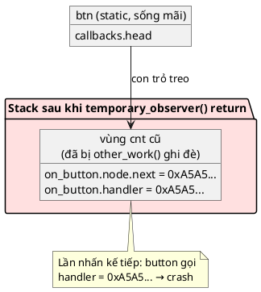

### 11.3. Vòng đời đúng của một callback

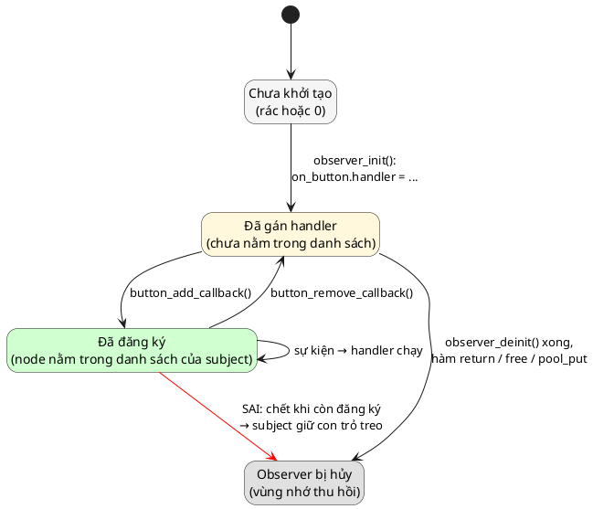

Quy tắc thực hành:
- **Mỗi `observer_init` có một `observer_deinit`**, và `deinit` luôn gỡ callback trước tiên.
- **Thứ tự hủy ngược thứ tự tạo**: observer tạo sau subject thì hủy trước subject. Code mẫu ép điều này: `button_deinit` trả `-EBUSY` nếu còn callback (mục 12.4).
- 💡 Cách an toàn nhất trong firmware: cho mọi subject và observer sống **suốt chương trình** (biến `static` / `.bss`, như `main.c` của code mẫu), đăng ký một lần lúc khởi động. 📖 Sách: *"nếu bạn dùng Object Pattern, dữ liệu của bạn sẽ khá trật tự"*.

---

# Phần C — Đọc code

## 12. Đọc code mẫu từng dòng

Cấu trúc code mẫu:

| File | Vai trò |
|---|---|
| [inc/container_of.h](inc/container_of.h) | Macro `CONTAINER_OF` có kiểm tra kiểu |
| [inc/slist.h](inc/slist.h), [src/slist.c](src/slist.c) | Danh sách liên kết đơn intrusive (mô phỏng `sys_slist_t` của Zephyr) |
| [inc/button.h](inc/button.h), [src/button.c](src/button.c) | **Subject**: nút nhấn, giữ danh sách callback |
| [inc/status_led.h](inc/status_led.h), [src/status_led.c](src/status_led.c) | **Observer 1**: đảo LED mỗi lần nhấn |
| [inc/press_counter.h](inc/press_counter.h), [src/press_counter.c](src/press_counter.c) | **Observer 2**: đếm số lần nhấn/nhả |
| [main.c](main.c) | "Nối dây" các object và mô phỏng ngắt GPIO |

### 12.1. [inc/container_of.h](inc/container_of.h)

```c
#include <stddef.h>
```
Cần cho `offsetof`. Header tự đủ: ai include `container_of.h` cũng không phải nhớ include `<stddef.h>` trước.

```c
#define CONTAINER_OF(ptr, type, member) \
	((type *)((char *)(ptr) - offsetof(type, member) + \
		  0 * sizeof((ptr) == &((type *)0)->member)))
```
Đã phân tích kỹ ở mục 4.2 và 4.5. Hai chú ý thêm:
- Mọi tham số đều được bọc ngoặc: `(ptr)`. 💡 Quy tắc chung của macro: nếu ai đó truyền `p + 1` vào, không có ngoặc thì `(char *)p + 1` sẽ bị hiểu sai thứ tự phép tính.
- Macro **bỏ mất `const`**: truyền `const struct button_callback *` vào vẫn ra `struct status_led *` không `const`. Code mẫu không cần `const` ở đây vì handler sửa state của observer.

### 12.2. [inc/slist.h](inc/slist.h) và [src/slist.c](src/slist.c)

```c
struct slist_node {
	struct slist_node *next;
};

struct slist {
	struct slist_node *head;
	struct slist_node *tail;
};
```
- `struct slist_node` chỉ có **một con trỏ**: 8 byte trên PC, 4 byte trên Cortex-M. Không có dữ liệu, không có `void *`.
- `struct slist` giữ cả `tail` để `append` (thêm vào cuối) chỉ mất một bước, không phải duyệt cả danh sách.

```c
void slist_init(struct slist *self);
bool slist_is_empty(const struct slist *self);
void slist_append(struct slist *self, struct slist_node *node);
bool slist_contains(const struct slist *self, const struct slist_node *node);
bool slist_find_and_remove(struct slist *self, struct slist_node *node);
```
Các hàm danh sách trả `void`/`bool`, không trả mã lỗi `int`, và **không kiểm tra `NULL`**. 💡 Đây là quyết định có chủ ý (xem mục 14): danh sách là "viên gạch" cấp thấp, giống `sys_slist_*` của Zephyr. Việc kiểm tra đầu vào và trả mã lỗi do lớp API phía trên (`button_*`) làm.

```c
#define SLIST_FOR_EACH_NODE_SAFE(list, node, tmp)                         \
	for ((node) = (list)->head, (tmp) = (node) ? (node)->next : NULL; \
	     (node) != NULL;                                              \
	     (node) = (tmp), (tmp) = (node) ? (node)->next : NULL)
```
Đọc ba phần của `for`:
1. **Khởi tạo:** `node` = phần tử đầu; `tmp` = phần tử **kế tiếp** (đọc ngay, khi `node` còn chắc chắn hợp lệ).
2. **Điều kiện:** còn `node` thì chạy thân vòng lặp.
3. **Bước nhảy:** `node` lấy giá trị `tmp` đã đọc sẵn, **không đọc lại `node->next`**. Vì vậy thân vòng lặp có gỡ `node` (đặt `node->next = NULL`) cũng không ảnh hưởng (🔬 mục 10.4).

`src/slist.c`:

```c
void slist_append(struct slist *self, struct slist_node *node)
{
	/* Node có thể còn rác từ lần dùng trước: luôn đặt lại next */
	node->next = NULL;

	if (self->tail) {
		self->tail->next = node;
	} else {
		self->head = node;
	}
	self->tail = node;
}
```
- `node->next = NULL` đầu tiên: node mới luôn là phần tử cuối. Observer trên stack hay heap có thể chứa rác, nên không được tin giá trị cũ.
- Danh sách rỗng (`tail == NULL`): node vừa là `head` vừa là `tail`.
- Danh sách có phần tử: nối vào sau `tail` cũ.

```c
bool slist_find_and_remove(struct slist *self, struct slist_node *node)
{
	struct slist_node *prev = NULL;

	for (struct slist_node *it = self->head; it; prev = it, it = it->next) {
		if (it != node) {
			continue;
		}

		if (prev) {
			prev->next = it->next;
		} else {
			self->head = it->next;
		}
		if (self->tail == it) {
			self->tail = prev;
		}
		it->next = NULL;
		return true;
	}
	return false;
}
```
- Danh sách **đơn** không đi lùi được, nên phải nhớ `prev` khi duyệt.
- Gỡ phần tử đầu: `head` nhảy sang phần tử thứ hai. Gỡ phần tử giữa: `prev->next` bỏ qua `it`.
- Gỡ phần tử cuối: `tail` lùi về `prev` (có thể là `NULL` nếu danh sách thành rỗng).
- `it->next = NULL`: node đã gỡ không còn trỏ vào danh sách. Đây chính là điều làm vòng lặp thường bị đứt ở 🔬 mục 10.4.
- Duyệt toàn bộ: O(n). Với vài observer thì không đáng kể. 💡 Danh sách **đôi** (`sys_dlist_t` của Zephyr) gỡ được trong O(1) nhưng mỗi node tốn gấp đôi.

### 12.3. [inc/button.h](inc/button.h)

```c
#include "slist.h"

#include <stdbool.h>
```
`button.h` cần `slist.h` vì `struct button` và `struct button_callback` **chứa** `struct slist` / `struct slist_node` (cần kiểu hoàn chỉnh, xem bài 2 mục 5). Không include `container_of.h`: đó là chi tiết của file `.c`.

```c
enum button_event {
	BUTTON_EVENT_PRESSED,
	BUTTON_EVENT_RELEASED,
};
```
Sự kiện truyền **qua tham số** của handler. 📖 Sách nói observer theo dõi state của subject *"có thể qua thông báo sự kiện hoặc trực tiếp qua tham số của callback"*. Dấu phẩy sau phần tử cuối được phép từ C99, giúp thêm sự kiện mới chỉ sửa một dòng.

```c
struct button_callback {
	struct slist_node node; /* Do button quản lý, observer không đụng vào */
	void (*handler)(struct button_callback *cb, enum button_event event);
};
```
- Đây là **hợp đồng duy nhất** giữa button và observer. Struct này **phải public** (nằm trong header), vì observer cần **nhúng** nó, tức là cần biết kích thước của nó.
- `node` đặt **đầu tiên** (offset 0): `CONTAINER_OF(node, struct button_callback, node)` trong `button.c` không tốn phép trừ nào. Nhưng code vẫn viết `CONTAINER_OF` chứ không ép kiểu thẳng, để không phụ thuộc vào vị trí (bài 6 bàn kỹ).
- Sách đặt tên con trỏ hàm là `cb`, nên lời gọi thành `self->cb->cb(self->cb)`, khó đọc. Code mẫu đổi thành `handler`: `cb->handler(cb, event)`.

```c
struct button {
	const char *name;
	bool pressed;
	struct slist callbacks;
};
```
- `struct button` là **Object Pattern** thường (bài 1), caller tự cấp phát. 📖 Sách nói subject *"có thể là một opaque object"*. Code mẫu giữ nó public cho đơn giản; Bài tập 3 yêu cầu bạn làm nó opaque.
- `callbacks` chứa **thẳng** `struct slist` (không phải con trỏ): danh sách sống và chết cùng button.
- Không có trường nào nhắc tới `status_led` hay `press_counter`.

```c
int button_init(struct button *self, const char *name);
int button_deinit(struct button *self);
int button_add_callback(struct button *self, struct button_callback *cb);
int button_remove_callback(struct button *self, struct button_callback *cb);
int button_set_level(struct button *self, bool pressed);
bool button_is_pressed(const struct button *self);
```
Mọi hàm theo quy ước của repo: `self` đầu tiên, trả mã lỗi `int`. `button_is_pressed` là getter `const`, cho observer nào muốn đọc thêm state của subject (ví dụ FAQ ở mục 21 dùng nó).

### 12.4. [src/button.c](src/button.c)

```c
#include "button.h"
#include "container_of.h"

#include <errno.h>
#include <string.h>
```
`button.h` được include đầu tiên (thói quen từ bài 2: phát hiện header thiếu include). Không có `status_led.h`, `press_counter.h`. Đó là toàn bộ mục đích của bài.

```c
int button_init(struct button *self, const char *name)
{
	if (!self || !name) {
		return -EINVAL;
	}

	memset(self, 0, sizeof(*self));
	self->name = name;
	slist_init(&self->callbacks);
	return 0;
}
```
`memset` đã làm `head`/`tail` bằng 0, nên `slist_init` ở đây hơi thừa. Nhưng gọi nó thể hiện **ý định**, và không phụ thuộc vào chuyện "con trỏ toàn bit 0 là `NULL`" (đúng trên mọi chip phổ biến, nhưng chuẩn C không bảo đảm).

```c
int button_deinit(struct button *self)
{
	if (!self) {
		return -EINVAL;
	}

	if (!slist_is_empty(&self->callbacks)) {
		return -EBUSY;
	}

	memset(self, 0, sizeof(*self));
	return 0;
}
```
💡 Sách để `button_deinit` chỉ xóa con trỏ callback. Code mẫu chặt hơn: còn observer đăng ký thì **từ chối hủy** và trả `-EBUSY`. Lý do: observer giữ con trỏ `btn` và sẽ gọi `button_remove_callback(self->btn, ...)` lúc `deinit`. Button bị xóa trước thì lời gọi đó làm việc trên một object đã chết. Trả lỗi sớm làm **sai thứ tự hủy lộ ra ngay lúc chạy thử**, thay vì thành bug ngẫu nhiên.

```c
int button_add_callback(struct button *self, struct button_callback *cb)
{
	if (!self || !cb || !cb->handler) {
		return -EINVAL;
	}

	if (slist_contains(&self->callbacks, &cb->node)) {
		return -EALREADY;
	}

	slist_append(&self->callbacks, &cb->node);
	return 0;
}
```
- `!cb->handler`: callback không có handler mà vẫn đăng ký thì lần notify tới sẽ gọi địa chỉ `NULL`, crash. Chặn từ lúc đăng ký, nơi còn biết rõ ai gây lỗi.
- `slist_contains` chặn đăng ký trùng. 🔬 Không có dòng này, đăng ký một node hai lần sẽ biến danh sách thành **vòng tròn**:

```c
/* Thêm cùng một node hai lần mà không kiểm tra: danh sách thành vòng tròn */
#include "slist.h"

#include <stdio.h>

int main(void)
{
	struct slist list;
	struct slist_node a, b;

	slist_init(&list);
	slist_append(&list, &a);
	slist_append(&list, &b);
	slist_append(&list, &b); /* đăng ký nhầm lần 2: b->next = b */

	int visits = 0;
	for (struct slist_node *n = list.head; n && visits < 6; n = n->next, visits++) {
		printf("visit %d: %s\n", visits, n == &a ? "a" : "b");
	}
	printf("b.next == &b ? %s -> vòng lặp không bao giờ dừng nếu không giới hạn\n",
	       b.next == &b ? "có" : "không");
	return 0;
}
```

Output thật:

```
visit 0: a
visit 1: b
visit 2: b
visit 3: b
visit 4: b
visit 5: b
b.next == &b ? có -> vòng lặp không bao giờ dừng nếu không giới hạn
```

Lần append thứ hai: `tail` đang là `b`, nên `b->next = b`. Danh sách giờ là `a → b → b → b → ...`. Mỗi lần nhấn nút, button gọi handler của `b` mãi mãi và firmware **treo cứng** trong ISR (watchdog reset nếu có). Đổi lại, phép kiểm tra tốn O(n) mỗi lần đăng ký; đăng ký thường chỉ xảy ra lúc khởi động nên chấp nhận được.

```c
int button_remove_callback(struct button *self, struct button_callback *cb)
{
	if (!self || !cb) {
		return -EINVAL;
	}

	return slist_find_and_remove(&self->callbacks, &cb->node) ? 0 : -ENOENT;
}
```
Chỉ gỡ đúng node được truyền vào (khác bản của sách, mục 10.1). Không tìm thấy thì `-ENOENT`, để caller biết mình đang gỡ thứ chưa từng đăng ký.

```c
static void button_notify(struct button *self, enum button_event event)
{
	struct slist_node *node;
	struct slist_node *next;

	SLIST_FOR_EACH_NODE_SAFE(&self->callbacks, node, next) {
		struct button_callback *cb = CONTAINER_OF(node, struct button_callback, node);

		cb->handler(cb, event);
	}
}
```
- `static`: chỉ dùng nội bộ. Bên ngoài phát sự kiện qua `button_set_level`.
- Duyệt SAFE (mục 10.4), `CONTAINER_OF` lần thứ nhất (mục 10.3), gọi gián tiếp (mục 2.4).
- Không kiểm tra `cb->handler != NULL` ở đây vì `button_add_callback` đã kiểm tra. 💡 Nếu observer tự xóa `handler` về `NULL` **sau khi** đăng ký thì vẫn crash; đó là lỗi của observer.

```c
int button_set_level(struct button *self, bool pressed)
{
	if (!self) {
		return -EINVAL;
	}

	if (self->pressed == pressed) {
		return 0;
	}

	self->pressed = pressed;
	button_notify(self, pressed ? BUTTON_EVENT_PRESSED : BUTTON_EVENT_RELEASED);
	return 0;
}
```
- Chỉ báo khi **trạng thái đổi** (vế *"of any changes to its state"* trong định nghĩa). Ngắt GPIO có thể đến hai lần cùng mức (dội phím, nhiễu); không đổi thì không báo.
- `self->pressed` được cập nhật **trước** khi notify. Nhờ vậy handler nào gọi `button_is_pressed(btn)` sẽ thấy giá trị mới (FAQ ở mục 21 dựa vào điều này). 💡 Nếu đảo thứ tự, handler sẽ thấy state cũ: một loại bug khó thấy.
- 💡 Driver thật còn cần **chống dội phím** (debounce): bỏ qua các lần đổi mức trong vài mili-giây sau lần đổi trước. Code mẫu bỏ qua để tập trung vào pattern (Bài tập 5).

### 12.5. [inc/status_led.h](inc/status_led.h) và [src/status_led.c](src/status_led.c)

```c
#include "button.h"
```
Observer **phụ thuộc** vào subject: cần `struct button_callback` để nhúng, cần `button_add_callback` để đăng ký. Đây là chiều dependency đúng (mục 7.1).

```c
struct status_led {
	const char *name;
	struct button *btn;
	struct button_callback on_button;
	bool on;
};
```
- `btn`: nhớ button nào để `deinit` gỡ được callback. 📖 Observer của sách cũng giữ `struct button *btn`.
- `on_button`: **nhúng**, đặt tên theo *nguồn sự kiện nó nghe*, không đặt tên chung chung `cb`. Một observer nghe nhiều nguồn sẽ có `on_button`, `on_timer`, ... (FAQ mục 21).
- `on_button` nằm ở offset 16, **không phải** offset 0. Có chủ ý: để thấy `CONTAINER_OF` thật sự trừ một con số, chứ không phải tình cờ đúng nhờ ép kiểu.

```c
static void status_led_on_button(struct button_callback *cb, enum button_event event)
{
	struct status_led *self = CONTAINER_OF(cb, struct status_led, on_button);

	if (event != BUTTON_EVENT_PRESSED) {
		return;
	}

	self->on = !self->on;
	printf("  [%s] nút %s nhấn -> LED %s\n", self->name, self->btn->name,
	       self->on ? "ON" : "OFF");
}
```
- `static` (đặc điểm 7, mục 9). Tên theo mẫu `<module>_on_<nguồn>`.
- Dòng đầu tiên luôn là `CONTAINER_OF`. Từ dòng thứ hai, đây là method bình thường.
- LED chỉ quan tâm `PRESSED`; bỏ qua `RELEASED`. Mỗi observer tự lọc sự kiện nó cần.
- `printf` ở đây chỉ để demo (mục 6.2).

```c
int status_led_init(struct status_led *self, const char *name, struct button *btn)
{
	if (!self || !name || !btn) {
		return -EINVAL;
	}

	memset(self, 0, sizeof(*self));
	self->name = name;
	self->btn = btn;
	self->on_button.handler = status_led_on_button;
	return button_add_callback(btn, &self->on_button);
}
```
- `memset` trước: `on_button.node.next` bắt đầu bằng 0.
- Gán `handler` **trước** khi đăng ký: `button_add_callback` từ chối callback không có handler.
- Đăng ký là **việc cuối cùng**: từ dòng này trở đi, observer có thể được gọi bất cứ lúc nào (kể cả từ ISR), nên mọi field khác phải sẵn sàng trước đó.
- Trả thẳng mã lỗi của `button_add_callback` cho caller.

```c
int status_led_deinit(struct status_led *self)
{
	if (!self) {
		return -EINVAL;
	}

	int err = button_remove_callback(self->btn, &self->on_button);

	memset(self, 0, sizeof(*self));
	return err;
}
```
- Gỡ callback là **việc đầu tiên**, ngược thứ tự với `init`.
- 💡 Khai báo `int err` giữa khối code là hợp lệ từ C99.

### 12.6. [inc/press_counter.h](inc/press_counter.h) và [src/press_counter.c](src/press_counter.c)

Cấu trúc y hệt `status_led`. Điểm đáng chú ý:
- `on_button` nằm ở offset **24** (khác 16 của `status_led`). Mỗi handler dùng offset của riêng nó; button không biết, không cần biết.
- **Một hàm handler phục vụ mọi instance**: `cnt_user` và `cnt_mode` cùng dùng `press_counter_on_button`, nhưng mỗi lần chạy, `CONTAINER_OF` ra đúng instance chứa callback được gọi. Đây chính là điều cách 2 (mục 7.2) không làm được.

### 12.7. [main.c](main.c)

```c
static const char *err_name(int err)
```
Giá trị số của `errno` khác nhau giữa các nền tảng (🔬 trên MinGW, `EALREADY` là 103 và `EBUSY` là 16; Linux dùng số khác), nên in tên cho dễ đọc.

```c
static void gpio_irq(struct button *btn, bool pressed)
{
	printf("GPIO IRQ: %s %s\n", btn->name, pressed ? "xuống (nhấn)" : "lên (nhả)");
	button_set_level(btn, pressed);
}
```
Mô phỏng ISR. 💡 Trên chip thật, sẽ là `void EXTI0_IRQHandler(void)` đọc thanh ghi trạng thái chân, xóa cờ ngắt rồi gọi `button_set_level(&btn_user, level)`. Giống [bài 1, mục 7](../01_ObjectPattern/LECTURE.md#7-object-pattern-trên-phần-cứng-thật): ISR không có tham số, nên tầng board giữ object `static` và chuyển tiếp vào.

```c
	static struct button btn_user;
	static struct button btn_mode;
	static struct status_led led;
	static struct press_counter cnt_user;
	static struct press_counter cnt_mode;
```
Mọi object là `static` trong `main`: nằm ở `.bss`, sống suốt chương trình. Vòng đời đơn giản nhất có thể (mục 11.3).

```c
	button_init(&btn_user, "BTN_USER");
	button_init(&btn_mode, "BTN_MODE");
	status_led_init(&led, "LED1", &btn_user);
	press_counter_init(&cnt_user, "CNT_USER", &btn_user);
	press_counter_init(&cnt_mode, "CNT_MODE", &btn_mode);
```
Thứ tự: **subject trước, observer sau**. `main` là nơi duy nhất quyết định "ai nghe ai": đổi LED sang nghe `BTN_MODE` chỉ sửa một tham số. Đây là dependency injection của bài 1, áp dụng cho sự kiện.

💡 Code mẫu bỏ qua mã lỗi của các lời gọi `init` cho gọn. Firmware thật nên kiểm tra (bài 9, Return Value Pattern).

Phần còn lại của `main` chạy các kịch bản ở mục 13, rồi hủy theo thứ tự ngược: observer trước, subject sau.

---

## 13. Theo dõi demo chạy từng bước

Output đầy đủ của `make run`:

```
offsetof(struct status_led, on_button)    = 16
offsetof(struct press_counter, on_button) = 24

GPIO IRQ: BTN_USER xuống (nhấn)
  [LED1] nút BTN_USER nhấn -> LED ON
  [CNT_USER] PRESSED : presses=1 releases=0
GPIO IRQ: BTN_USER lên (nhả)
  [CNT_USER] RELEASED: presses=1 releases=1
GPIO IRQ: BTN_MODE xuống (nhấn)
  [CNT_MODE] PRESSED : presses=1 releases=0
GPIO IRQ: BTN_MODE xuống (nhấn)
GPIO IRQ: BTN_USER xuống (nhấn)
  [LED1] nút BTN_USER nhấn -> LED OFF
  [CNT_USER] PRESSED : presses=2 releases=1

đăng ký LED1 lần 2: -EALREADY
button_deinit(BTN_USER) khi còn observer: -EBUSY

đã gỡ CNT_USER
GPIO IRQ: BTN_USER lên (nhả)
GPIO IRQ: BTN_USER xuống (nhấn)
  [LED1] nút BTN_USER nhấn -> LED ON

LED1 ON, CNT_MODE presses=1
button_deinit(BTN_USER) = 0
button_deinit(BTN_MODE) = 0
```

### Sau phần khởi tạo

| Object | Trạng thái |
|---|---|
| `btn_user` | `pressed=false`, danh sách: `led.on_button` → `cnt_user.on_button` |
| `btn_mode` | `pressed=false`, danh sách: `cnt_mode.on_button` |
| `led` | `on=false` |
| `cnt_user`, `cnt_mode` | `presses=0`, `releases=0` |

### Từng sự kiện

Viết tắt: **L** = `led.on_button`, **CU** = `cnt_user.on_button`, **CM** = `cnt_mode.on_button`. Cột "presses/releases" ghi dạng `p/r`.

| # | Lệnh | Danh sách `btn_user` | Danh sách `btn_mode` | Handler được gọi | State sau lệnh |
|---|---|---|---|---|---|
| 1 | `gpio_irq(&btn_user, true)` | L → CU | CM | L (PRESSED), CU (PRESSED) | `led.on=true`; `cnt_user` 1/0 |
| 2 | `gpio_irq(&btn_user, false)` | L → CU | CM | L (bỏ qua RELEASED), CU | `cnt_user` 1/1 |
| 3 | `gpio_irq(&btn_mode, true)` | L → CU | CM | CM | `cnt_mode` 1/0 |
| 4 | `gpio_irq(&btn_mode, true)` | L → CU | CM | **không ai** (cùng mức) | không đổi |
| 5 | `gpio_irq(&btn_user, true)` | L → CU | CM | L, CU | `led.on=false`; `cnt_user` 2/1 |
| 6 | `button_add_callback(&btn_user, &led.on_button)` | L → CU | CM | | Trả `-EALREADY`, danh sách không đổi |
| 7 | `button_deinit(&btn_user)` | L → CU | CM | | Trả `-EBUSY`, `btn_user` không bị xóa |
| 8 | `press_counter_deinit(&cnt_user)` | **L** | CM | | CU được gỡ: `tail` lùi về L; `cnt_user` về 0 |
| 9 | `gpio_irq(&btn_user, false)` | L | CM | L (bỏ qua RELEASED) | Không in gì ngoài dòng GPIO |
| 10 | `gpio_irq(&btn_user, true)` | L | CM | L | `led.on=true` |
| 11 | `status_led_deinit(&led)` | (rỗng) | CM | | `head = tail = NULL` |
| 12 | `press_counter_deinit(&cnt_mode)` | (rỗng) | (rỗng) | | |
| 13 | `button_deinit` × 2 | | | | Cả hai trả `0` |

💡 Để ý bước 2 và bước 9: LED **có được gọi** khi nhả nút (nó vẫn nằm trong danh sách), chỉ là nó tự bỏ qua. Subject báo **mọi** sự kiện cho **mọi** observer; lọc là việc của observer. Nếu có hàng chục observer mà mỗi cái chỉ quan tâm một loại sự kiện, chi phí này đáng kể (mục 17). Zephyr giải quyết bằng `pin_mask` trong `struct gpio_callback` (mục 15.1).

💡 Để ý bước 8: sau khi gỡ CU, các bước 9–10 không còn dòng `[CNT_USER]` nào. Không cần sửa `button.c`, không cần `if` nào: observer biến mất khỏi danh sách là đủ.

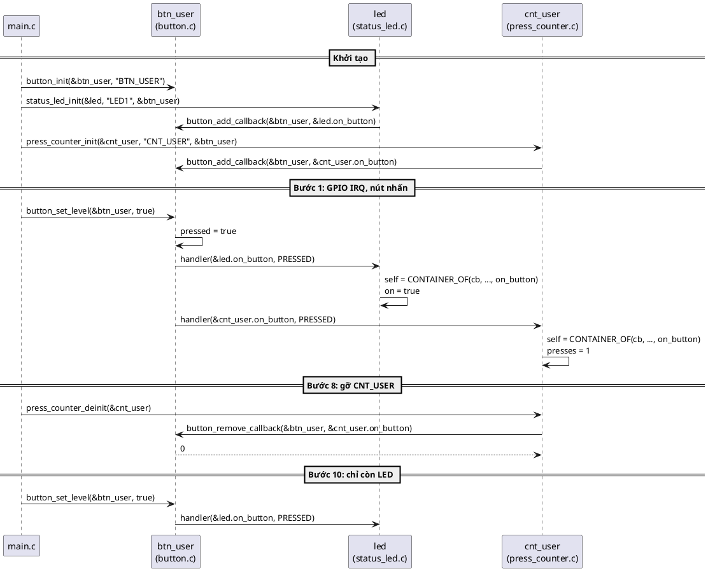

---

## 14. Các quyết định thiết kế và phương án khác

### Đổi tên `cb` thành `handler`

Sách: `void (*cb)(struct button_callback *cb);`, lời gọi `self->cb->cb(self->cb)`. Ba chữ `cb` mang ba nghĩa. Code mẫu: struct là `button_callback`, biến là `cb`, con trỏ hàm là `handler`. Không ảnh hưởng gì tới pattern.

### Truyền sự kiện qua tham số

Sách chỉ truyền `cb`. Code mẫu thêm `enum button_event event`. Các phương án:

| Phương án | Ví dụ | Ưu | Nhược |
|---|---|---|---|
| Không tham số sự kiện (sách) | `handler(cb)` | Đơn giản nhất | Handler phải tự hỏi subject "chuyện gì vừa xảy ra" |
| Một handler + `enum` sự kiện (code mẫu) | `handler(cb, PRESSED)` | Thêm sự kiện không đổi struct | Mọi observer nhận mọi sự kiện, tự lọc |
| Nhiều con trỏ hàm trong struct (`ops`) | `on_press(cb)`, `on_release(cb)` | Observer chỉ cài cái mình cần (để `NULL` cái còn lại) | Struct to hơn; subject phải kiểm tra `NULL` từng cái |
| Truyền cả con trỏ subject | `handler(cb, btn, event)` | Observer nghe nhiều subject biết ai gọi | Thêm tham số; thường không cần vì observer đã giữ `btn` |

💡 Phương án `ops` có nhiều con trỏ hàm chính là bước đầu của **Virtual API** (bài 7). Khi mọi instance dùng chung cùng một bảng hàm, ta cất bảng đó ở Flash (`const`) và chỉ giữ một con trỏ tới nó.

### `button_add_callback` kiểm tra đăng ký trùng

Tốn O(n) mỗi lần đăng ký, đổi lại chặn được lỗi treo cứng (🔬 mục 12.4). Phương án khác: thêm cờ `bool registered` vào `struct button_callback` (O(1), tốn thêm vài byte mỗi callback), hoặc chỉ kiểm tra trong bản build debug (`assert`). 💡 `sys_slist_append` của Zephyr **không** kiểm tra; trách nhiệm thuộc về người gọi.

### `button_deinit` trả `-EBUSY`

Sách cho `deinit` xóa luôn. Code mẫu từ chối để lộ sai thứ tự hủy. Phương án khác: `deinit` tự gỡ hết node (đặt `next = NULL` cho từng node). An toàn cho button, nhưng observer vẫn giữ con trỏ `btn` đã chết, nên lỗi chỉ dời chỗ.

### Duyệt SAFE

Tốn thêm một biến và một lần đọc. Đổi lại handler được tự gỡ mình (🔬 mục 10.4). Zephyr có cả hai bản; code mẫu chỉ dùng bản SAFE vì không có lý do gì để chọn bản kia trong vòng lặp gọi callback.

### Danh sách trả `void`/`bool`, button trả `int`

Quy ước của repo là trả mã lỗi `int`. Nhưng danh sách intrusive là một **cấu trúc dữ liệu** cấp thấp: thao tác của nó không thể "thất bại" theo nghĩa thông thường (không cấp phát gì), và nó được gọi trong vòng lặp nóng. 💡 Thư viện cấp thấp như `sys_slist` của Zephyr cũng theo cách này. Lớp API có ý nghĩa nghiệp vụ (`button_*`) mới là nơi kiểm tra và trả lỗi.

### `struct button` không opaque

Chỉ để code ngắn. Làm opaque được, **nhưng `struct button_callback` thì không bao giờ opaque được**: observer phải nhúng nó, nên phải biết kích thước. Đây là một điểm hay để hiểu ranh giới của bài 2 (Bài tập 3).

### Không `typedef` con trỏ hàm

Nhiều code viết `typedef void (*button_handler_t)(struct button_callback *, enum button_event);`. Không sai, nhưng 📖 sách coi chính struct callback là *"phương án sạch hơn nhiều so với typedef"* (lợi ích 1 ở mục 8.1). Code mẫu không cần typedef vì con trỏ hàm chỉ xuất hiện đúng một chỗ: trong struct.

### Handler được gọi ngay trong `button_set_level`

Đơn giản và nhanh nhất, nhưng handler chạy trong ngữ cảnh ISR (mục 6.2). Phương án khác: `button_set_level` chỉ ghi nhận sự kiện, việc gọi handler dời sang work queue (mục 15.3). Đổi lại độ trễ cao hơn và cần đồng bộ (bài 11–12).

---

# Phần D — Thực tế và tổng kết

## 15. Callback Pattern trong thực tế (và work queue)

### 15.1. Bạn đã gặp pattern này ở đâu

💡 Phần này là kiến thức chung về các thư viện thật, **không chạy** trong bài và không trích từ sách (trừ chỗ ghi 📖). Đoạn code Zephyr dưới đây chỉ để đối chiếu, không build được trên PC.

**Zephyr RTOS: GPIO callback.** Đây gần như đúng code của bài:

```c
/* Zephyr (không chạy được trên PC, chỉ để đối chiếu) */
struct gpio_callback {
	sys_snode_t node;                /* node danh sách intrusive */
	gpio_callback_handler_t handler; /* void (*)(const struct device *port,
	                                    struct gpio_callback *cb, gpio_port_pins_t pins) */
	gpio_port_pins_t pin_mask;       /* chỉ gọi handler khi chân trong mask đổi */
};

struct my_app {
	struct gpio_callback button_cb;  /* nhúng */
	int presses;
};

static void my_app_on_button(const struct device *port, struct gpio_callback *cb,
			     gpio_port_pins_t pins)
{
	struct my_app *self = CONTAINER_OF(cb, struct my_app, button_cb);
	self->presses++;                 /* chạy trong ngữ cảnh ISR */
}

/* lúc khởi động: */
gpio_init_callback(&app.button_cb, my_app_on_button, BIT(pin));
gpio_add_callback(port, &app.button_cb);
```

Node, handler nhận con trỏ tới struct callback, `CONTAINER_OF`, handler chạy trong ISR: đủ cả. `pin_mask` là cách Zephyr lọc sự kiện ở phía subject (bước 2 ở mục 13).

**Zephyr: work queue.** `struct k_work` chứa node và handler `void (*)(struct k_work *work)`. Bạn nhúng `struct k_work` vào object của mình, handler dùng `CONTAINER_OF` lấy lại object. Cùng một pattern, áp dụng cho "việc cần làm sau". Với `struct k_work_delayable`, việc chạy sau một khoảng thời gian: đó là ý 📖 sách nói ở phần Use Cases, *"observer của một work queue item sẽ thực thi callback khi timeout hết hạn, một cách rất mạnh để tránh thread không cần thiết trong hệ embedded"*.

**STM32 HAL.** Có hai kiểu:
- *Weak callback*: `void HAL_GPIO_EXTI_Callback(uint16_t GPIO_Pin)` được khai báo `__weak` trong HAL, ứng dụng định nghĩa lại để "ghi đè". Chỉ có **một** hàm cho cả chip, linker nối thẳng. Bản chất là **lời gọi trực tiếp** từ HAL lên ứng dụng: không nhiều observer, không instance.
- *Register callback* (bật `USE_HAL_UART_REGISTER_CALLBACKS`): `HAL_UART_RegisterCallback(&huart2, HAL_UART_RX_COMPLETE_CB_ID, my_rx_done)`, handler nhận `UART_HandleTypeDef *huart`. Không có `user_data`, nhưng nếu bạn **nhúng** `UART_HandleTypeDef` vào struct của mình thì `CONTAINER_OF(huart, struct my_uart, huart)` lấy lại được object. Đúng tinh thần của sách.

**FreeRTOS software timer và lwIP.** Đây là phe `void *`: timer FreeRTOS cho bạn gắn một "timer ID" kiểu `void *` (`pvTimerGetTimerID`); lwIP đăng ký `tcp_arg(pcb, arg)` rồi mọi callback TCP nhận `void *arg`. Chạy tốt hàng chục năm, nhưng không có kiểm tra kiểu ở chỗ ép `void *` về kiểu thật.

**Linux kernel.** `struct work_struct`, `struct timer_list`, notifier chain: đều nhúng vào object và dùng `container_of`. Đây là nơi kỹ thuật này phổ biến nhất.

### 15.2. Observer chậm làm tắc cả hệ thống

📖 Nhược điểm **Lockup** (mục 6.2) và best practice *"Avoid time consuming operations in callback"*. 🔬 Thí nghiệm: nút dừng khẩn cấp E-STOP có hai observer. Observer ghi log đăng ký trước và "ghi flash" mất 200 ms ngay trong callback; observer dừng motor đăng ký sau:

```c
/* Một observer chậm làm mọi observer phía sau phải chờ */
#include "container_of.h"
#include "button.h"

#include <stdio.h>
#include <time.h>

static clock_t t_irq;

static double ms_since_irq(void)
{
	return 1000.0 * (double)(clock() - t_irq) / CLOCKS_PER_SEC;
}

struct slow_logger {
	struct button_callback cb;
};

struct motor_stop {
	struct button_callback cb;
};

static void slow_logger_on_button(struct button_callback *cb, enum button_event ev)
{
	(void)cb;
	(void)ev;
	/* Giả lập ghi log vào flash ngay trong callback: bận 200 ms */
	clock_t end = clock() + CLOCKS_PER_SEC / 5;
	while (clock() < end) {
	}
	printf("  slow_logger xong sau %.0f ms\n", ms_since_irq());
}

static void motor_stop_on_button(struct button_callback *cb, enum button_event ev)
{
	(void)cb;
	(void)ev;
	printf("  motor_stop được gọi sau %.0f ms kể từ lúc nhấn nút E-STOP\n", ms_since_irq());
}

int main(void)
{
	static struct button estop;
	static struct slow_logger logger = { { { NULL }, slow_logger_on_button } };
	static struct motor_stop motor = { { { NULL }, motor_stop_on_button } };

	button_init(&estop, "E-STOP");
	button_add_callback(&estop, &logger.cb); /* đăng ký trước */
	button_add_callback(&estop, &motor.cb);

	t_irq = clock();
	button_set_level(&estop, true);
	return 0;
}
```

Output thật:

```
  slow_logger xong sau 200 ms
  motor_stop được gọi sau 200 ms kể từ lúc nhấn nút E-STOP
```

Motor dừng trễ **200 ms** chỉ vì một observer **không liên quan** đăng ký trước nó. Observer motor không làm gì sai, và không có cách nào biết được. Thứ tự đăng ký quyết định ai phải chờ (mục 10.5). 💡 Chức năng an toàn thật như E-STOP không dựa vào callback chung mà nối thẳng phần cứng hoặc dùng ngắt ưu tiên cao riêng; ví dụ chỉ để minh họa.

### 15.3. Giải pháp: dời việc nặng sang work queue

📖 Sách: *"Tốt hơn là dời các thao tác tốn thời gian sang một work queue riêng, vì callback tốn thời gian sẽ làm tắc mọi callback handler khác cũng đang chờ thông báo."* Và ở phần Use Cases: *"submit work vào system work queue và đảm bảo mọi work item chạy **tuần tự, không cắt ngang nhau**. Có bảo đảm này, ta giữ được code sạch và lập trình bất đồng bộ mà không cần logic phức tạp nào ngoài chính các work item và vài biến giữ state"*.

⚠️ Sách hứa *"chúng ta sẽ xem chi tiết hơn ở bên dưới"*, nhưng bản 0.38.0 của chương **không có** ví dụ work queue nào. Phần dưới đây là ví dụ 💡 do mình viết, theo đúng ý tưởng đó và theo mẫu `struct k_work` của Zephyr.

🔬 Một work queue tối giản. Để ý: `struct work` **cũng là một struct callback** (node + handler nhận con trỏ tới chính nó), cũng nhúng vào observer, cũng lấy lại `self` bằng `CONTAINER_OF`:

```c
/*
 * Work queue tối giản: callback trong "ISR" chỉ nộp việc, việc nặng chạy sau
 * trong vòng lặp chính. struct work cũng là một callback struct: node + handler.
 * Chưa an toàn khi ISR và main loop chạy đồng thời thật (cần spinlock, bài 11).
 */
#include "button.h"
#include "container_of.h"

#include <stdbool.h>
#include <stdio.h>

struct work {
	struct slist_node node;
	void (*handler)(struct work *work);
	bool pending;
};

struct work_queue {
	struct slist items;
};

static void work_submit(struct work_queue *q, struct work *w)
{
	if (w->pending) {
		return; /* đã nằm trong hàng đợi: không thêm lần hai (tránh vòng tròn) */
	}
	w->pending = true;
	slist_append(&q->items, &w->node);
}

static void work_queue_run(struct work_queue *q)
{
	while (!slist_is_empty(&q->items)) {
		struct slist_node *node = q->items.head;
		struct work *w = CONTAINER_OF(node, struct work, node);

		slist_find_and_remove(&q->items, node);
		w->pending = false;
		w->handler(w); /* chạy tuần tự, không bao giờ chen ngang nhau */
	}
}

/* Observer: ghi log sự kiện nút vào flash (chậm) */
struct event_logger {
	struct work_queue *wq;
	struct button_callback on_button;
	struct work flush_work;
	unsigned events;
};

static void event_logger_flush(struct work *work)
{
	struct event_logger *self = CONTAINER_OF(work, struct event_logger, flush_work);

	printf("  [main loop] work: ghi %u sự kiện vào flash (chậm, nhưng không ai phải chờ)\n",
	       self->events);
	self->events = 0;
}

static void event_logger_on_button(struct button_callback *cb, enum button_event ev)
{
	struct event_logger *self = CONTAINER_OF(cb, struct event_logger, on_button);

	(void)ev;
	self->events++;
	printf("  [ISR] callback: đếm sự kiện (%u), nộp work rồi return ngay\n", self->events);
	work_submit(self->wq, &self->flush_work);
}

int main(void)
{
	static struct work_queue wq;
	static struct button btn;
	static struct event_logger logger;

	slist_init(&wq.items);
	button_init(&btn, "BTN");
	logger.wq = &wq;
	logger.on_button.handler = event_logger_on_button;
	logger.flush_work.handler = event_logger_flush;
	button_add_callback(&btn, &logger.on_button);

	printf("GPIO IRQ: nhấn\n");
	button_set_level(&btn, true);
	printf("GPIO IRQ: nhả\n");
	button_set_level(&btn, false);
	printf("main loop: chạy work queue\n");
	work_queue_run(&wq);
	return 0;
}
```

Output thật:

```
GPIO IRQ: nhấn
  [ISR] callback: đếm sự kiện (1), nộp work rồi return ngay
GPIO IRQ: nhả
  [ISR] callback: đếm sự kiện (2), nộp work rồi return ngay
main loop: chạy work queue
  [main loop] work: ghi 2 sự kiện vào flash (chậm, nhưng không ai phải chờ)
```

Thấy được gì:
- Callback trong "ISR" chỉ tăng một biến đếm và nộp work: vài lệnh máy.
- Hai sự kiện nhưng **chỉ một lần ghi flash**: lần nộp thứ hai bị bỏ qua vì work đang `pending`. 💡 `k_work_submit` của Zephyr cũng vậy: nộp một work đang chờ thì không thêm lần nữa. Nhờ vậy việc nặng tự "gộp" lại khi sự kiện đến dồn dập.
- `struct event_logger` nhúng **hai** struct callback: `on_button` (nghe button) và `flush_work` (nghe work queue). Hai handler, hai lần `CONTAINER_OF` với hai member khác nhau, cùng ra một `self`.

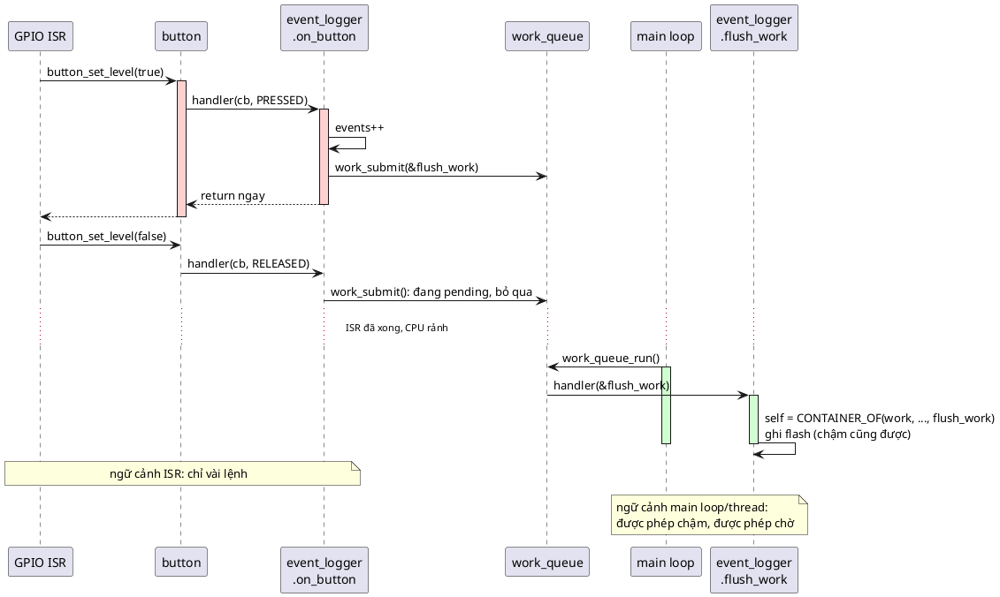

⚠️ Work queue tối giản này **chưa an toàn** khi ISR thật và main loop chạy xen nhau: ISR có thể `append` đúng lúc main loop đang `remove`, làm hỏng danh sách. Cần khóa ngắt hoặc spinlock quanh thao tác danh sách. Đó là nội dung của bài 11 (Spinlock) và bài 12 (Semaphore).

---

## 16. Unit test với callback

Callback Pattern làm test **dễ hơn hẳn** cách gọi trực tiếp: muốn test `button.c`, chỉ cần một observer giả (gọi là **spy**) ghi lại mọi lần được gọi. Không cần link LED, counter hay buzzer.

```c
#include "button.h"
#include "container_of.h"

#include <assert.h>
#include <errno.h>
#include <stdio.h>

/* Observer giả (spy): ghi lại mọi lần được gọi để test kiểm tra */
struct spy {
	struct button_callback cb;
	int calls;
	enum button_event last;
	int order;
};

static int call_seq;

static void spy_handler(struct button_callback *cb, enum button_event ev)
{
	struct spy *self = CONTAINER_OF(cb, struct spy, cb);

	self->calls++;
	self->last = ev;
	self->order = ++call_seq;
}

static void spy_init(struct spy *self)
{
	*self = (struct spy){ .cb = { .handler = spy_handler } };
}

static void test_notify_all_in_registration_order(void)
{
	struct button btn;
	struct spy a, b;

	call_seq = 0;
	spy_init(&a);
	spy_init(&b);
	assert(button_init(&btn, "T") == 0);
	assert(button_add_callback(&btn, &a.cb) == 0);
	assert(button_add_callback(&btn, &b.cb) == 0);

	assert(button_set_level(&btn, true) == 0);
	assert(a.calls == 1 && a.last == BUTTON_EVENT_PRESSED);
	assert(b.calls == 1 && a.order < b.order);

	assert(button_set_level(&btn, true) == 0); /* cùng mức: không báo */
	assert(a.calls == 1);

	assert(button_remove_callback(&btn, &a.cb) == 0);
	assert(button_remove_callback(&btn, &b.cb) == 0);
	assert(button_deinit(&btn) == 0);
}

static void test_errors(void)
{
	struct button btn;
	struct spy a;
	struct button_callback no_handler = { { NULL }, NULL };

	spy_init(&a);
	assert(button_init(&btn, "T") == 0);
	assert(button_add_callback(&btn, &no_handler) == -EINVAL);
	assert(button_add_callback(&btn, &a.cb) == 0);
	assert(button_add_callback(&btn, &a.cb) == -EALREADY);
	assert(button_deinit(&btn) == -EBUSY);
	assert(button_remove_callback(&btn, &a.cb) == 0);
	assert(button_remove_callback(&btn, &a.cb) == -ENOENT);
	assert(button_deinit(&btn) == 0);
}

int main(void)
{
	test_notify_all_in_registration_order();
	test_errors();
	printf("tất cả test đều qua\n");
	return 0;
}
```

Build: `gcc -std=c99 -Wall -Wextra -Werror -pedantic -Iinc test_button.c src/button.c src/slist.c`

🔬 Output thật:

```
tất cả test đều qua
```

Chú ý:
- Lệnh build chỉ có `button.c` và `slist.c`. **Không có observer thật nào**. So với tình huống "Tháng 5" ở mục 1.2, đây là khác biệt lớn nhất.
- `spy` dùng đúng pattern của bài: nhúng callback, `CONTAINER_OF`. Test cũng là một "người dùng" của API.
- `*self = (struct spy){ .cb = { .handler = spy_handler } };` là **compound literal** với **designated initializer** (C99). Mọi field không ghi tên đều bằng 0, kể cả `cb.node.next`.
- Test kiểm tra cả **thứ tự** gọi (`a.order < b.order`). 💡 Nhưng như mục 10.5, thứ tự là chi tiết cài đặt. Nếu nhóm quyết định thứ tự **không** phải hợp đồng của API, nên bỏ dòng kiểm tra đó, để không ai dựa vào nó.
- `call_seq` là biến `static` trong file test: chấp nhận được trong test (mỗi test tự đặt lại về 0), không chấp nhận trong module.

Test **observer** cũng dễ: tạo một `struct button` thật (nó nhỏ, không phụ thuộc phần cứng), đăng ký observer, gọi `button_set_level`, kiểm tra state observer qua getter (`status_led_is_on`, `press_counter_presses`).

---

## 17. Trade-off

| Tiêu chí | Gọi trực tiếp | Callback Pattern |
|---|---|---|
| **Dependency** | Subject include mọi observer | 📖 **Chỉ chia sẻ struct callback** |
| **Thêm/bớt observer** | Sửa subject | Không chạm subject |
| **RAM** | 0 | 💡 Mỗi callback = node + con trỏ hàm: **8 byte** trên Cortex-M 32-bit (16 byte trên PC 64-bit); mỗi subject thêm `head` + `tail` = 8 byte |
| **Flash** | Ít nhất | Thêm vài chục byte cho hàm danh sách, dùng chung cho mọi subject |
| **Tốc độ mỗi sự kiện** | Gọi thẳng, compiler có thể inline | Duyệt danh sách O(n) + một lời gọi gián tiếp mỗi observer (🔬 mục 2.4), không inline được. 📖 *"Performance overhead... đặc biệt khi có nhiều listener"* |
| **Đăng ký** | Không có | O(n) nếu kiểm tra trùng (code mẫu) |
| **Độ phức tạp** | Thấp | 📖 *"phải cài và bảo trì danh sách observer và cơ chế báo tin"*; sách nói có thể dùng cấu trúc dữ liệu có sẵn của Zephyr |
| **Testability** | Phải giả lập mọi observer | **Rất tốt** (spy ở mục 16) |
| **Đọc code / debug** | "Go to definition" ra ngay hàm được gọi | 💡 Khó hơn: `cb->handler(...)` không cho biết ai sẽ chạy; phải đặt breakpoint hoặc tìm chỗ gán `handler` |
| **Thứ tự báo tin** | Viết cứng, rõ ràng | 📖 Không nên dựa vào |
| **Lỗi vòng đời** | Không có | 📖 Callback ra khỏi phạm vi = con trỏ treo (🔬 mục 11.2) |

🔬 Kích thước thật trên PC 64-bit (in bằng `sizeof`/`offsetof` với các header của code mẫu):

```
sizeof(struct slist_node)      = 8
sizeof(struct button_callback) = 16
sizeof(struct slist)           = 16
sizeof(struct button)          = 32
sizeof(struct status_led)      = 40 (on ở offset 32)
sizeof(struct press_counter)   = 40
```

💡 Trên Cortex-M 32-bit, con trỏ là 4 byte nên `struct button_callback` chỉ còn 8 byte, `struct slist` 8 byte. Mình không có toolchain ARM trong máy nên con số 32-bit là suy ra từ kích thước con trỏ, **không đo**.

📖 Sách tổng kết cách tránh các nhược điểm: *"cài callback dưới dạng **struct object**, và làm cho mọi object khác trong hệ thống theo **Object Pattern** nhiều nhất có thể, có các thao tác tương đối độc lập, không phụ thuộc nhiều vào state bên ngoài object mà chủ yếu vào state của chính object (về cơ bản, để có kết quả tốt nhất, interface của mỗi object nên **reentrant** và **commutative**)"*.

💡 *Reentrant*: gọi lại khi đang chạy dở (ví dụ từ ISR) vẫn đúng. *Commutative*: đổi thứ tự hai lời gọi không đổi kết quả. Observer nào chỉ đụng vào state của chính nó thì tự nhiên gần với cả hai tính chất.

📖 Một nhược điểm nữa sách nêu: **Tight coupling risk**: nếu không cẩn thận, pattern vẫn có thể dẫn tới coupling chặt giữa subject và observer, *"đặc biệt khi callback được cài bằng lời gọi trực tiếp thay vì con trỏ hàm"*.

---

## 18. Khi nào không nên dùng

💡 Callback giải bài toán "tầng thấp báo lên tầng cao, không biết trước ai nghe". Nếu bài toán không phải vậy, đừng dùng:

- **Chỉ có đúng một bên nhận, cố định, và tầng trên gọi tầng dưới.** App gọi driver thì cứ gọi thẳng `uart_write()` (bài 1). Thêm callback chỉ thêm gián tiếp.
- **Bên nhận phải chạy ở thread khác, hoặc sự kiện phải được xếp hàng.** Callback chạy ngay trong ngữ cảnh của subject (mục 6). Nếu cần tách về thời gian, dùng hàng đợi (message queue, work queue, event bus).
- **Cần nhiều thao tác đa hình, không phải thông báo.** Ví dụ "mọi driver serial đều có `write`, `read`, `configure`": đó là **Virtual API** (bài 7), không phải callback.
- **Đường code cực nóng trong ISR** (vài trăm nghìn lần mỗi giây) mà chỉ có một người nghe cố định: lời gọi trực tiếp, thậm chí inline, rẻ hơn.

📖 Ba phương án thay thế sách nêu:
- **Event Bus Pattern:** khác Callback ở chỗ có một **hàng đợi sự kiện toàn cục** lưu các sự kiện đang chuyển đi (*"observer/callback pattern KHÔNG có hàng đợi sự kiện"*). Dùng để làm publish/subscribe quy mô nhỏ trong chương trình C. Cả bên quan sát lẫn bên bị quan sát đều tách rời nhau.
- **MVC (Model-View-Controller):** một dạng dẫn xuất của Callback: controller làm adapter giữa model và view, dùng model biểu diễn state và đăng ký callback với phần hiển thị để phản ứng với sự kiện.
- **Command Request Pattern:** dùng một "yêu cầu lệnh" làm cách trung tâm để truyền sự kiện. Khác event pattern ở chỗ chính yêu cầu có thể được xếp hàng, và bên xếp hàng không cần biết kiểu của bên nhận.

📖 Chương *Virtual API* của sách ghi chiều ngược lại: *"Callback Pattern là phiên bản đơn giản hơn của abstract interface, trong đó thay vì định nghĩa một API chung, ta làm việc với danh sách callback"*.

```plantuml
@startuml
set separator none
skinparam defaultFontName Segoe UI
start
:Module A cần báo cho module khác\nkhi có chuyện xảy ra;
if (Bên nhận cố định, chỉ một,\nvà A được phép biết nó?) then (có)
  :Gọi trực tiếp; <<#F5F5F5>>
elseif (Bên nhận phải chạy ở\nthread/ngữ cảnh khác,\nhoặc sự kiện cần xếp hàng?) then (có)
  :Hàng đợi: work queue,\nmessage queue, event bus; <<#D0E8FF>>
elseif (Cần một bộ thao tác đa hình\n(write/read/...) chứ không\nphải thông báo?) then (có)
  :Virtual API (bài 7); <<#FFF8C0>>
else (không: một-nhiều,\nA không được biết ai nghe)
  :Callback Pattern; <<#D0FFD0>>
endif
stop
@enduml
```

---

## 19. Lỗi hay gặp

| Lỗi | Hậu quả | Cách tránh |
|---|---|---|
| 📖 Callback ra khỏi phạm vi sống (observer trên stack, quên gỡ) | Con trỏ treo, crash ở lần sự kiện sau (🔬 mục 11.2) | Mỗi `init` có `deinit` gỡ callback; ưu tiên observer `static` |
| 📖 Dữ liệu global trong handler | Mọi instance dùng chung state (🔬 mục 7.2) | State trong observer, lấy bằng `CONTAINER_OF` |
| 📖 Phát minh `void *user_data` | Mất kiểm tra kiểu, truyền nhầm không ai báo (🔬 mục 7.3) | Nhúng callback, `CONTAINER_OF` bản an toàn |
| 📖 Handler chạy lâu / block | Mọi observer sau phải chờ (🔬 mục 15.2) | Chỉ ghi nhận, dời việc nặng sang work queue |
| 📖 Dựa vào thứ tự báo tin | Đổi cách cài danh sách là hỏng | Observer độc lập, commutative |
| Đăng ký cùng một callback hai lần | Danh sách vòng tròn, treo cứng (🔬 mục 12.4) | Kiểm tra trùng (`-EALREADY`) hoặc cờ `registered` |
| Handler tự gỡ mình trong vòng lặp thường | Observer phía sau bị bỏ qua, không báo lỗi (🔬 mục 10.4) | Duyệt bản SAFE |
| Observer giữ **con trỏ** tới callback thay vì nhúng | `CONTAINER_OF` ra địa chỉ rác | Callback luôn là member trực tiếp (Câu 6 quiz) |
| `CONTAINER_OF` với sai member hoặc sai kiểu | `self` trỏ vào rác | Bản macro có kiểm tra kiểu (🔬 mục 4.5) |
| Đăng ký trước khi khởi tạo xong observer | Sự kiện (từ ISR) đến khi state còn rác | `add_callback` là việc **cuối** của `init` |
| Hủy subject trước observer | Observer gỡ callback trên object đã chết | Hủy ngược thứ tự tạo; `-EBUSY` trong `button_deinit` |
| Cập nhật state subject **sau** khi notify | Handler đọc state cũ | Cập nhật trước, notify sau (mục 12.4) |
| `printf`, `malloc`, chờ mutex trong handler gọi từ ISR | Trễ, deadlock, crash | Biết handler chạy ở ngữ cảnh nào (mục 6) |
| Main loop sửa danh sách trong khi ISR đang duyệt | Danh sách hỏng | Khóa ngắt / spinlock (bài 11), hoặc chỉ đăng ký lúc khởi động |
| Một struct callback đăng ký vào **hai** subject | Node chỉ có một `next`: hai danh sách bị nối vào nhau | Một callback cho mỗi subject (FAQ mục 21, Câu 11 quiz) |

---

## 20. Quy trình refactor từ lời gọi trực tiếp sang Callback

1. **Tìm các lời gọi "đi ngược lên"**: trong driver/module tầng thấp, tìm `#include` tới module tầng cao. `gcc -MM` (🔬 mục 7.1) liệt kê nhanh.
2. **Đặt tên sự kiện**: subject đang báo điều gì? Tạo `enum <subject>_event` nếu có nhiều loại.
3. **Định nghĩa struct callback** trong header của subject: `struct <subject>_callback { struct slist_node node; void (*handler)(struct <subject>_callback *cb, ...); };`
4. **Thêm danh sách vào subject**: `struct slist callbacks;` cùng `add_callback`/`remove_callback` (kiểm tra `NULL`, trùng, không tìm thấy).
5. **Thay các lời gọi trực tiếp** bằng một hàm `notify` duyệt SAFE.
6. **Với mỗi module từng được gọi trực tiếp**: nhúng struct callback vào object của nó, viết handler `static` bắt đầu bằng `CONTAINER_OF`, đăng ký ở cuối `init`, gỡ ở đầu `deinit`.
7. **Xóa các `#include` tầng cao** khỏi subject. Build lại: nếu còn lỗi thì vẫn còn chỗ gọi trực tiếp.
8. **Dời phần "nối dây"** về `main.c`/`board.c`: nơi duy nhất quyết định ai nghe ai.
9. **Rà ngữ cảnh**: handler nào sẽ chạy trong ISR? Có handler nào chậm? Dời sang work queue.
10. **Viết test cho subject** bằng spy observer; chạy lại `gcc -MM` để xác nhận subject không còn phụ thuộc observer.

---

## 21. Câu hỏi thường gặp (FAQ)

**Hỏi: `void *user_data` thật sự tệ vậy sao? Thư viện lớn vẫn dùng mà.**

📖 Sách rất dứt khoát: thấy `void *user_data` là dấu hiệu người viết chưa hiểu pattern. 💡 Thực tế, `void *` phổ biến vì nó **đơn giản cho người viết thư viện**, và dùng được cả khi người dùng không thể nhúng struct (ví dụ cùng một hàm C phải nhận ngữ cảnh từ code viết bằng ngôn ngữ khác). Cái giá là **mất kiểm tra kiểu** (🔬 mục 7.3). Trong code bạn tự viết, nơi bạn kiểm soát cả hai phía, `CONTAINER_OF` gần như luôn tốt hơn: không tốn thêm field, không tốn thêm RAM, compiler kiểm tra được.

**Hỏi: Một observer muốn nghe hai nút thì sao?**

Một node chỉ nằm được trong **một** danh sách, nên cần **hai** struct callback, mỗi cái một handler. 🔬 Ví dụ phát hiện tổ hợp phím A+B:

```c
/* Một observer nghe HAI subject: cần hai struct callback, mỗi cái một node */
#include "button.h"
#include "container_of.h"

#include <stdio.h>

struct combo_detector {
	struct button_callback on_a;
	struct button_callback on_b;
	struct button *a;
	struct button *b;
};

static void combo_check(struct combo_detector *self)
{
	if (button_is_pressed(self->a) && button_is_pressed(self->b)) {
		printf("  combo A+B -> vào chế độ cài đặt\n");
	}
}

static void combo_on_a(struct button_callback *cb, enum button_event ev)
{
	struct combo_detector *self = CONTAINER_OF(cb, struct combo_detector, on_a);

	(void)ev;
	combo_check(self);
}

static void combo_on_b(struct button_callback *cb, enum button_event ev)
{
	struct combo_detector *self = CONTAINER_OF(cb, struct combo_detector, on_b);

	(void)ev;
	combo_check(self);
}

int main(void)
{
	static struct button a, b;
	static struct combo_detector combo;

	button_init(&a, "A");
	button_init(&b, "B");
	combo.a = &a;
	combo.b = &b;
	combo.on_a.handler = combo_on_a;
	combo.on_b.handler = combo_on_b;
	button_add_callback(&a, &combo.on_a);
	button_add_callback(&b, &combo.on_b);

	printf("nhấn A\n");
	button_set_level(&a, true);
	printf("nhấn B (A vẫn đang giữ)\n");
	button_set_level(&b, true);
	return 0;
}
```

Output thật:

```
nhấn A
nhấn B (A vẫn đang giữ)
  combo A+B -> vào chế độ cài đặt
```

Hai handler khác nhau vì `CONTAINER_OF` cần biết **tên member** lúc compile (`on_a` hay `on_b`). Cả hai cùng ra một `self`, rồi gọi chung `combo_check`. Ví dụ này cũng dựa vào việc button cập nhật `pressed` **trước** khi notify (mục 12.4).

**Hỏi: Nếu callback là field đầu tiên của observer, ép kiểu thẳng `(struct status_led *)cb` có được không?**

Được: chuẩn C bảo đảm con trỏ tới một struct, ép kiểu đúng cách, trỏ tới member đầu tiên của nó và ngược lại. Nhưng đó là một **giả định ngầm** về vị trí: ai đó thêm một field lên đầu struct là code hỏng âm thầm, và một observer chỉ có một "vị trí đầu tiên" (nghe hai nguồn là hết cách). `CONTAINER_OF` đúng với mọi vị trí. Bài 6 (Inheritance) có thí nghiệm riêng về điều này.

**Hỏi: Struct callback có `const` được không, để nằm trong Flash?**

Không, vì `node.next` thay đổi khi đăng ký/gỡ. Nhưng phần **con trỏ hàm** thì có thể tách ra: nhiều observer cùng loại dùng chung một bảng hàm `static const` trong Flash, mỗi instance chỉ giữ con trỏ tới bảng. Đó chính là ý tưởng của **Virtual API** (bài 7).

**Hỏi: Handler có được gọi `button_add_callback` (đăng ký thêm người khác) không?**

Với code mẫu: được, không làm hỏng danh sách. Nhưng observer mới **có thể được hoặc không được** gọi ngay trong lần notify đang chạy, tùy vị trí: nếu handler đang chạy là phần tử cuối, `tmp` đã là `NULL`, nên người mới chỉ được gọi từ sự kiện sau. Tránh viết code phụ thuộc vào chi tiết này.

**Hỏi: Callback có nên trả giá trị không, ví dụ `bool` "đã xử lý, đừng báo tiếp"?**

Có thể (giống event bubbling trong giao diện đồ họa), nhưng khi đó **thứ tự** đăng ký trở thành một phần của hợp đồng, trái với khuyến nghị của sách (mục 10.5). 💡 Chỉ làm khi có lý do rõ ràng, và ghi thứ tự vào tài liệu API.

**Hỏi: Callback Pattern trong C khác gì Observer của C++/Java?**

Ở C++, observer là một interface có hàm ảo `virtual void on_event(Event e)`; con trỏ `this` được truyền **ngầm**. Trong C ta làm thủ công đúng việc đó: struct callback đóng vai interface, `CONTAINER_OF` đóng vai việc tìm lại `this`. 📖 Sách nói dùng struct callback giúp kiến trúc *"thật sự hướng đối tượng"*.

**Hỏi: ISR và main loop cùng đụng vào danh sách callback thì sao?**

Nguy hiểm: ISR đang duyệt đúng lúc main loop gỡ một node có thể làm ISR đọc node đã gỡ. Cách đơn giản nhất: **chỉ đăng ký/gỡ lúc khởi động**, trước khi bật ngắt. Nếu phải đăng ký lúc chạy, cần khóa ngắt trong lúc sửa danh sách (bài 11).

---

## 22. Tóm tắt và checklist

**Một câu:** *Callback là một struct (node + con trỏ hàm nhận chính struct đó) được nhúng vào object observer; subject giữ danh sách các struct đó; handler dùng `CONTAINER_OF` để lấy lại observer.*

**Vì sao nó chạy được:** struct có địa chỉ; member nằm ở offset cố định trong struct chứa nó; nên từ địa chỉ member lùi đúng `offsetof` byte là ra struct chứa. Subject chỉ biết kiểu của member, observer biết kiểu của struct chứa.

Checklist cho mỗi subject:

- [ ] Header có `struct <subject>_callback` gồm `node` và `handler(struct <subject>_callback *cb, ...)`
- [ ] Subject giữ `struct slist`, không giữ con trỏ tới observer cụ thể nào
- [ ] Subject không include header của bất kỳ observer nào (`gcc -MM` để kiểm tra)
- [ ] `add_callback` kiểm tra `NULL`, `handler != NULL`, đăng ký trùng
- [ ] `remove_callback` chỉ gỡ đúng node truyền vào, báo lỗi nếu không có
- [ ] `notify` duyệt bản SAFE
- [ ] Cập nhật state subject **trước** khi notify
- [ ] Ghi rõ trong header: handler chạy trong ngữ cảnh nào (ISR? thread?)

Checklist cho mỗi observer:

- [ ] Struct callback được **nhúng** (không phải con trỏ), đặt tên theo nguồn: `on_button`, `on_timer`
- [ ] Handler là `static`, dòng đầu tiên là `CONTAINER_OF`
- [ ] Không biến global, không `void *user_data`
- [ ] Gán handler rồi mới đăng ký; đăng ký là việc **cuối** của `init`
- [ ] Gỡ callback là việc **đầu** của `deinit`; observer không bao giờ chết khi còn đăng ký
- [ ] Handler ngắn, không block; việc nặng dời sang work queue
- [ ] Không phụ thuộc thứ tự với observer khác

---

## 23. Quiz (có đáp án)

Câu 1–5 là quiz gốc của sách. Câu 6–12 do Claude thêm.

**Câu 1.** 📖 Vấn đề chính được giải quyết bằng cơ chế callback là gì?

<details><summary>Đáp án</summary>

Cho phép một object (subject) **báo tin về thay đổi trạng thái của nó cho nhiều object khác** mà **không phụ thuộc** vào kiểu hay API của những object đó. Subject không thể biết trước mọi observer có thể có; nếu gọi trực tiếp, subject phải include và gọi API của từng observer, nên mọi lần thêm/bớt người nghe đều phải sửa subject, và dependency đi ngược từ tầng thấp lên tầng cao (🔬 `gcc -MM` ở mục 7.1). Callback đảo chiều dependency: observer biết subject, subject chỉ biết struct callback.
</details>

**Câu 2.** 📖 Observer/Callback Pattern giúp giữ tổ chức code hướng đối tượng trong C như thế nào?

<details><summary>Đáp án</summary>

Callback là một struct **nhúng trong object** observer, và handler nhận con trỏ tới struct đó. Nhờ `CONTAINER_OF`, handler lấy lại được `self` của observer, nên nó hoạt động **như một method** của Object Pattern: có state riêng cho từng instance, không cần biến global, không cần `void *`. Một hàm handler phục vụ được nhiều instance (hai `press_counter` trong demo). Đây chính là cách C làm điều mà C++ làm bằng hàm ảo và con trỏ `this` ngầm.
</details>

**Câu 3.** 📖 Chuyện gì xảy ra nếu bạn gửi sự kiện bằng lời gọi trực tiếp? Nó ảnh hưởng gì tới cấu trúc code?

<details><summary>Đáp án</summary>

Subject phải `#include` header và gọi hàm của **mọi** bên nhận: driver tầng thấp phụ thuộc vào module tầng cao. Hệ quả: thêm/bớt bên nhận phải sửa subject; biến thể sản phẩm sinh ra `#ifdef` trong driver; sửa header của bất kỳ bên nhận nào cũng phải build lại subject; test subject phải link hoặc giả lập mọi bên nhận; không có nhiều instance (lời gọi cứng tới một hàm, một state). 📖 Sách gọi đó là *"dependencies out of control"*, một trong những nguồn gây chậm bảo trì lớn nhất trong dự án C.
</details>

**Câu 4.** 📖 Vì sao ta luôn bọc callback trong một struct? Nếu không làm vậy thì thiết kế bị ảnh hưởng xấu thế nào?

<details><summary>Đáp án</summary>

(1) Struct có **địa chỉ** nằm bên trong object observer, nên handler nhận con trỏ tới struct đó rồi dùng `CONTAINER_OF` tính ngược ra observer. Con trỏ hàm trần không mang được ngữ cảnh nào, nên chỉ còn hai lựa chọn tồi: biến global (mất nhiều instance, 🔬 mục 7.2) hoặc `void *user_data` (mất kiểm tra kiểu, 🔬 mục 7.3). (2) Struct chứa thêm được **node danh sách**, nên một subject có nhiều observer mà không cần `malloc`. (3) 📖 Struct là một "instance" của callback, sạch hơn `typedef` con trỏ hàm; có thể thêm field sau này (như `pin_mask` của Zephyr) mà không đổi chữ ký hàm.
</details>

**Câu 5.** 📖 Vì sao ta dùng `CONTAINER_OF` để lấy ngữ cảnh, thay vì để ngữ cảnh ở biến global hay để subject truyền thẳng nó vào callback?

<details><summary>Đáp án</summary>

- **Global:** chỉ có một bộ state cho mọi instance, và phá luồng dữ liệu của mọi listener (📖 pitfall "You make your data global").
- **Subject truyền ngữ cảnh** (`void *user_data`): subject phải lưu thêm một con trỏ cho mỗi callback, và vì subject không biết kiểu observer nên con trỏ đó phải là `void *`, tức là **mất kiểm tra kiểu**: truyền nhầm compiler không báo.
- **`CONTAINER_OF`:** không tốn thêm field nào (chi phí lúc chạy là 0 lệnh, 🔬 mục 4.4), giữ được kiểu (bản có kiểm tra ở mục 4.5 bắt được truyền nhầm member), và chỉ observer, bên duy nhất biết kiểu của chính mình, mới làm phép tính đó.
</details>

**Câu 6.** Đoạn code sau có lỗi gì?

```c
struct buzzer {
	struct button_callback *on_button;   /* con trỏ */
	uint32_t beeps;
};

static void buzzer_on_button(struct button_callback *cb, enum button_event ev)
{
	struct buzzer *self = CONTAINER_OF(cb, struct buzzer, on_button);
	self->beeps++;
}
```

<details><summary>Đáp án</summary>

`on_button` là **con trỏ**, không phải struct nhúng. Struct callback thật nằm ở chỗ khác, nên lùi `offsetof(struct buzzer, on_button)` byte từ địa chỉ của nó **không** ra `struct buzzer` nào cả: `self` là rác, `self->beeps++` ghi đè bộ nhớ lạ. Với macro có kiểm tra kiểu của bài, dòng `CONTAINER_OF` còn **không compile được**: `cb` có kiểu `struct button_callback *`, còn `&((struct buzzer *)0)->on_button` có kiểu `struct button_callback **`. Sửa: `struct button_callback on_button;` (nhúng).
</details>

**Câu 7.** Vì sao `button_notify` phải đọc `node->next` **trước** khi gọi handler?

<details><summary>Đáp án</summary>

Handler có thể gỡ chính nó khỏi danh sách (callback một lần). `slist_find_and_remove` đặt `node->next = NULL`. Nếu vòng lặp đọc `node->next` **sau** khi gọi handler, nó đọc được `NULL` và dừng sớm: mọi observer phía sau bị bỏ qua mà không có lỗi nào (🔬 mục 10.4: C không được gọi). Bản SAFE đọc trước vào `tmp` nên không bị ảnh hưởng.
</details>

**Câu 8.** Một observer được khai báo là biến cục bộ trong hàm `setup()`, đăng ký với một button `static`, rồi `setup()` return. Chuyện gì xảy ra ở lần nhấn nút sau đó?

<details><summary>Đáp án</summary>

Button vẫn giữ con trỏ tới node nằm trong stack frame đã bị thu hồi. Các hàm gọi sau đó ghi đè vùng stack này, nên `handler` thành giá trị rác. Lần nhấn kế tiếp, button nhảy tới địa chỉ rác: crash (🔬 mục 11.2: Segmentation fault; trên Cortex-M thường là HardFault), hoặc tệ hơn là chạy một đoạn code bất kỳ. Sửa: gọi `observer_deinit` trước khi return, hoặc cho observer sống suốt chương trình (`static`).
</details>

**Câu 9.** `button_set_level` được gọi từ ISR GPIO. Observer A trong handler gọi `printf` qua UART mất 3 ms. Observer B đăng ký sau A. Có những vấn đề gì?

<details><summary>Đáp án</summary>

(1) Handler của A chạy **trong ngữ cảnh ISR** (mục 6.2), nên mọi ngắt cùng hoặc thấp ưu tiên hơn bị chặn 3 ms. (2) B chỉ được gọi sau khi A xong, nên trễ ít nhất 3 ms (📖 Lockup, 🔬 mục 15.2). (3) `printf` thường không reentrant và có thể dùng buffer/khóa nội bộ, gọi từ ISR có thể deadlock hoặc làm hỏng output. Sửa: A chỉ ghi nhận sự kiện và nộp work; việc in chạy trong work queue (🔬 mục 15.3).
</details>

**Câu 10.** Vì sao `struct button` có thể làm opaque, nhưng `struct button_callback` thì không?

<details><summary>Đáp án</summary>

Observer chỉ cần **con trỏ** tới button, nên `struct button` có thể là incomplete type (bài 2). Nhưng observer phải **nhúng** `struct button_callback` vào object của mình, tức là compiler cần biết **kích thước** và bố cục của nó khi dịch file observer, và `CONTAINER_OF` cần `offsetof` của member có kiểu đó. Một incomplete type không thể làm member nhúng. Vì vậy struct callback là thứ **public bắt buộc**, và nên giữ nó thật nhỏ.
</details>

**Câu 11.** Cùng một struct callback được đăng ký vào hai button khác nhau. Điều gì xảy ra?

<details><summary>Đáp án</summary>

Node chỉ có **một** con trỏ `next`. Lần đăng ký thứ hai đặt `next = NULL` và nối node vào cuối danh sách thứ hai, trong khi node vẫn là phần tử của danh sách thứ nhất. Kết quả: phần đuôi của danh sách thứ nhất (các observer đăng ký sau node này) bị cắt mất, còn observer nào được thêm vào danh sách thứ hai sau đó sẽ nằm sau node này, nên cũng bị gọi khi button thứ nhất phát sự kiện. Hai danh sách dính vào nhau. Code mẫu chỉ kiểm tra trùng **trong cùng một** button nên không bắt được lỗi này. Sửa: mỗi nguồn sự kiện một struct callback riêng (FAQ mục 21).
</details>

**Câu 12.** Sách nói thứ tự báo tin *"thường không đoán trước được"*. Code mẫu luôn báo theo thứ tự đăng ký. Vậy observer có nên dựa vào thứ tự đó không?

<details><summary>Đáp án</summary>

Không. Thứ tự theo đăng ký là **chi tiết cài đặt** của `slist_append`, không phải hợp đồng của API: đổi sang `prepend`, sang danh sách ưu tiên hay sang work queue là thứ tự đổi. Thứ tự đăng ký cũng phụ thuộc thứ tự gọi `init` trong `main`, thứ rất dễ bị đảo khi refactor. 📖 Sách khuyên làm cho interface của các object **commutative**: mỗi observer chỉ dựa vào state của chính nó, gọi theo thứ tự nào kết quả cũng như nhau.
</details>

---

## 24. Bài tập

### Bài 1: Observer `buzzer` (cơ bản)

Viết module `inc/buzzer.h`, `src/buzzer.c` cho một còi:
- `struct buzzer` nhúng `struct button_callback on_button`, đếm số lần kêu.
- Kêu (in `"BEEP"`) khi nhấn, im khi nhả.
- Đăng ký vào `btn_user` trong `main.c`, **không sửa một dòng nào** của `button.c`/`button.h`. Chạy `gcc -MM -Iinc src/button.c` để chứng minh button vẫn không phụ thuộc buzzer.
- Thêm getter `uint32_t buzzer_beeps(const struct buzzer *self);`.

### Bài 2: Refactor timer (refactor)

Cho module timer viết theo kiểu gọi trực tiếp:

```c
/* soft_timer.c */
#include "blink.h"
#include "watchdog.h"
#include "sensor.h"

#include <stdint.h>

void soft_timer_tick_isr(void)
{
	static uint32_t ms;

	ms++;
	if (ms % 500 == 0) {
		blink_toggle();
	}
	if (ms % 100 == 0) {
		watchdog_kick();
	}
	if (ms % 1000 == 0) {
		sensor_start_sample();
	}
}
```

Hãy refactor theo quy trình ở mục 20:
- `struct soft_timer` (Object Pattern, không còn biến `static`) giữ danh sách `struct soft_timer_callback`, mỗi callback có thêm field `period_ms` và `remaining_ms`.
- `blink`, `watchdog`, `sensor` thành observer, mỗi cái tự đăng ký với chu kỳ của mình.
- Viết test bằng spy: sau 1000 tick, callback 100 ms được gọi đúng 10 lần.
- **Câu hỏi suy nghĩ:** field `period_ms` nằm trong struct callback (do observer cung cấp) hay trong subject? Vì sao? So sánh với `pin_mask` của Zephyr (mục 15.1).

### Bài 3: Subject opaque (nâng cao)

Làm `struct button` thành opaque theo bài 2 (định nghĩa trong `button.c`, cấp phát bằng pool tĩnh `button_pool_get()`), nhưng giữ `struct button_callback` trong header.
- Observer nào cần sửa? `main.c` cần sửa gì?
- `status_led_on_button` đang đọc `self->btn->name`: dòng đó còn compile được không? Sửa thế nào?
- **Câu hỏi suy nghĩ:** liệt kê chính xác những gì **bắt buộc** phải public để Callback Pattern hoạt động, và giải thích vì sao (gợi ý: Câu 10 của quiz).

### Bài 4: UART RX callback + work queue (nâng cao)

Mô phỏng driver UART nhận dữ liệu:
- `struct uart_rx_callback { struct slist_node node; void (*on_byte)(struct uart_rx_callback *cb, uint8_t byte); };` và hàm `int uart_rx_isr(struct uart_rx *self, uint8_t byte)` phát sự kiện cho mỗi byte.
- Observer `struct nmea_line` gom byte thành một dòng (kết thúc bằng `'\n'`) trong handler (nhanh), rồi **nộp work** để phân tích dòng (chậm) theo mẫu ở mục 15.3.
- Cho `main.c` "nhận" chuỗi `"$GPGGA,123519*47\n$GPRMC,1*00\n"` từng byte một, rồi mới chạy work queue.
- **Câu hỏi suy nghĩ:** dòng thứ hai đến trong lúc work của dòng thứ nhất chưa chạy, chuyện gì xảy ra với buffer? Bạn cần mấy buffer?

### Bài 5: Chống dội phím và callback một lần (nâng cao)

- Thêm chống dội vào `button`: `button_set_level(self, pressed, now_ms)` bỏ qua mọi lần đổi mức trong vòng 20 ms sau lần đổi trước.
- Viết observer `struct first_press` tự gỡ mình ngay trong handler sau lần nhấn đầu tiên. Viết test chứng minh: (1) nó chỉ được gọi một lần; (2) observer đăng ký **sau** nó vẫn nhận đủ mọi sự kiện. Đổi tạm `button_notify` sang vòng lặp thường để thấy test (2) thất bại, rồi đổi lại.

Làm xong bài nào thì gõ `/review-exercise 05_CallbackPattern` để Claude review.
