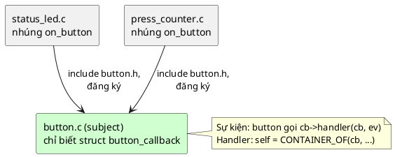

# 05 — Callback Pattern

📖 Bài giảng chi tiết: [LECTURE.md](LECTURE.md). File này là ghi chú tóm tắt, bám theo chương *Callback Pattern* của sách.

## Overview

Callback = **struct callback (node + con trỏ hàm nhận chính struct đó) nhúng trong object observer**. Subject (bị theo dõi) giữ một danh sách các struct callback và gọi từng cái khi trạng thái đổi. Handler dùng `CONTAINER_OF` để từ con trỏ callback lấy lại `self` của observer. Subject không bao giờ biết kiểu của observer.

📖 Sách gọi là "Callback" thay vì "Observer" vì trong embedded phải nghĩ kỹ callback chạy ở **ngữ cảnh** nào (ISR hay thread).

## Use Cases

- Một object báo tin cho **nhiều** object khác (một-nhiều), mỗi instance có state riêng.
- Driver tầng thấp báo sự kiện lên tầng cao: nút nhấn, byte UART, timer hết hạn, ADC xong.
- Kết hợp **work queue**: callback chỉ nộp việc, việc nặng chạy tuần tự sau, tránh tạo thêm thread.

## Benefits

- **Decoupling:** struct callback là cấu trúc dữ liệu **duy nhất** subject và observer cùng biết.
- **One-to-many:** thêm node vào struct callback là có danh sách, không cần `malloc`.
- **Scalability:** thêm observer không sửa subject.
- **Type safety:** `CONTAINER_OF` thay cho `void *user_data`.
- Dễ test subject bằng observer giả (spy).

## Drawbacks

- Chi phí báo tin O(n), mỗi observer một lời gọi gián tiếp.
- **Lockup:** một observer chậm làm mọi observer sau phải chờ.
- Thêm độ phức tạp (danh sách, vòng đời đăng ký/gỡ).
- Thứ tự báo tin không nên dựa vào.
- Khó lần theo luồng code khi debug.

## Implementation

Xem [inc/button.h](inc/button.h), [src/button.c](src/button.c), [inc/status_led.h](inc/status_led.h), [src/status_led.c](src/status_led.c), [src/press_counter.c](src/press_counter.c), [inc/container_of.h](inc/container_of.h), [inc/slist.h](inc/slist.h), [main.c](main.c).

| Thành phần | Trong code mẫu |
|---|---|
| Struct callback | `struct button_callback { struct slist_node node; void (*handler)(struct button_callback *cb, enum button_event event); }` |
| Subject | `struct button` giữ `struct slist callbacks` |
| Observer | `struct status_led` nhúng `struct button_callback on_button` |
| Lấy lại `self` | `CONTAINER_OF(cb, struct status_led, on_button)` |
| Báo tin | Duyệt **SAFE**, gọi `cb->handler(cb, event)` |

## Best Practices

- Luôn dùng struct cho callback; luôn truyền con trỏ callback vào handler.
- Không phát minh `void *user_data`; dùng `CONTAINER_OF`.
- Handler `static`, ngắn, không block; việc nặng dời sang work queue.
- Đăng ký là việc cuối của `init`, gỡ là việc đầu của `deinit`.

## Common Pitfalls

- Callback ra khỏi phạm vi sống (observer trên stack quên gỡ) → crash.
- Dữ liệu global trong handler → mọi instance dùng chung state.
- Đăng ký trùng → danh sách vòng tròn, treo cứng.
- Handler tự gỡ mình trong vòng lặp thường → observer phía sau bị bỏ qua.
- Gọi `printf`/chờ mutex trong handler chạy ở ISR.

## Alternatives

- **Event Bus:** có hàng đợi sự kiện toàn cục (callback thì không có).
- **MVC:** controller làm adapter, đăng ký callback với view.
- **Command Request:** yêu cầu có thể xếp hàng, bên gửi không biết kiểu bên nhận.
- **Virtual API** (bài 7): khi cần cả bộ thao tác đa hình chứ không chỉ thông báo.

## Quiz

1. Vấn đề chính được giải quyết bằng cơ chế callback là gì?
2. Observer/Callback Pattern giúp giữ tổ chức code hướng đối tượng trong C như thế nào?
3. Chuyện gì xảy ra nếu bạn gửi sự kiện bằng lời gọi trực tiếp? Nó ảnh hưởng gì tới cấu trúc code?
4. Vì sao ta luôn bọc callback trong một struct? Nếu không thì thiết kế bị ảnh hưởng xấu thế nào?
5. Vì sao dùng `CONTAINER_OF` để lấy ngữ cảnh, thay vì biến global hay để subject truyền thẳng vào callback?

(Đáp án và 7 câu thêm trong [LECTURE.md](LECTURE.md#23-quiz-có-đáp-án).)

## Câu hỏi còn thắc mắc

-
