# Bài giảng 06 — Inheritance Pattern

> **Về nguồn:** Bài này bám theo chương *Inheritance Pattern* trong sách của Martin Schröder (bản 0.38.0, file `00_Document/Martin-Schroder-Design-Patterns-Inheritance-Pattern-0.38.0.pdf`).
> - 📖 đánh dấu nội dung **theo sách** (dịch và diễn giải lại).
> - 💡 đánh dấu phần **giải thích thêm**, không có trong sách.
> - 🔬 đánh dấu **thí nghiệm thật**: chương trình đã được build bằng gcc/g++ 16.2 (MSYS2 UCRT64, Windows 64-bit) và chạy; output in trong bài là output thật.

Code mẫu đi kèm: [inc/gpio_pin.h](inc/gpio_pin.h), [src/gpio_pin.c](src/gpio_pin.c), [inc/led.h](inc/led.h), [src/led.c](src/led.c), [inc/led_group.h](inc/led_group.h), [src/led_group.c](src/led_group.c), [inc/sensor_trait.h](inc/sensor_trait.h), [inc/power_trait.h](inc/power_trait.h), [inc/tmp36_sensor.h](inc/tmp36_sensor.h), [src/tmp36_sensor.c](src/tmp36_sensor.c), [inc/battery_monitor.h](inc/battery_monitor.h), [src/battery_monitor.c](src/battery_monitor.c), [inc/slist.h](inc/slist.h), [src/slist.c](src/slist.c), [inc/container_of.h](inc/container_of.h), [main.c](main.c). Ghi chú ngắn: [README.md](README.md).
Các bài trước: [01 — Object](../01_ObjectPattern/LECTURE.md), [02 — Opaque](../02_OpaquePattern/LECTURE.md), [03 — Singleton](../03_SingletonPattern/LECTURE.md), [04 — Factory](../04_FactoryPattern/LECTURE.md), [05 — Callback](../05_CallbackPattern/LECTURE.md). Bài sau: [07 — Virtual API](../07_VirtualApiPattern/LECTURE.md).

---

## Mục lục

**Phần A — Kiến thức nền**

1. [Bối cảnh: bài 5 đã dùng kế thừa mà chưa gọi tên](#1-bối-cảnh-bài-5-đã-dùng-kế-thừa-mà-chưa-gọi-tên)
2. [Kế thừa trong OOP là gì, và C++ làm gì dưới nắp capo](#2-kế-thừa-trong-oop-là-gì-và-c-làm-gì-dưới-nắp-capo)
3. [Struct lồng struct nằm thế nào trong bộ nhớ](#3-struct-lồng-struct-nằm-thế-nào-trong-bộ-nhớ)
4. [Upcast, downcast và quy tắc "member đầu tiên"](#4-upcast-downcast-và-quy-tắc-member-đầu-tiên)
5. [Con trỏ hàm trong struct: hành vi gắn theo instance](#5-con-trỏ-hàm-trong-struct-hành-vi-gắn-theo-instance)

**Phần B — Pattern**

6. [Vấn đề: ba cách làm "trước khi có pattern"](#6-vấn-đề-ba-cách-làm-trước-khi-có-pattern)
7. [Ý tưởng cốt lõi: kế thừa bằng cách chứa (containment)](#7-ý-tưởng-cốt-lõi-kế-thừa-bằng-cách-chứa-containment)
8. [Ba đặc điểm nhận dạng và lý do của từng cái](#8-ba-đặc-điểm-nhận-dạng-và-lý-do-của-từng-cái)
9. [Kế thừa đơn và method wrapper (delegator)](#9-kế-thừa-đơn-và-method-wrapper-delegator)
10. [Kế thừa list node: cấu trúc dữ liệu dùng chung](#10-kế-thừa-list-node-cấu-trúc-dữ-liệu-dùng-chung)
11. [Đa kế thừa](#11-đa-kế-thừa)
12. [Trait: kế thừa hành vi](#12-trait-kế-thừa-hành-vi)
13. [Trait và Virtual API: cái giá của con trỏ hàm trong từng instance](#13-trait-và-virtual-api-cái-giá-của-con-trỏ-hàm-trong-từng-instance)

**Phần C — Đọc code**

14. [Đọc code mẫu từng dòng](#14-đọc-code-mẫu-từng-dòng)
15. [Theo dõi demo chạy từng bước](#15-theo-dõi-demo-chạy-từng-bước)
16. [Các quyết định thiết kế và phương án khác](#16-các-quyết-định-thiết-kế-và-phương-án-khác)

**Phần D — Thực tế và tổng kết**

17. [Inheritance Pattern trong thực tế](#17-inheritance-pattern-trong-thực-tế)
18. [Unit test với kế thừa và trait](#18-unit-test-với-kế-thừa-và-trait)
19. [Trade-off](#19-trade-off)
20. [Khi nào không nên dùng](#20-khi-nào-không-nên-dùng)
21. [Lỗi hay gặp](#21-lỗi-hay-gặp)
22. [Quy trình refactor sang kế thừa](#22-quy-trình-refactor-sang-kế-thừa)
23. [Câu hỏi thường gặp (FAQ)](#23-câu-hỏi-thường-gặp-faq)
24. [Tóm tắt và checklist](#24-tóm-tắt-và-checklist)
25. [Quiz (có đáp án)](#25-quiz-có-đáp-án)
26. [Bài tập](#26-bài-tập)

---

# Phần A — Kiến thức nền

C không có từ khóa `class`, `extends` hay `virtual`. Toàn bộ bài này dựa trên ba thứ bạn đã biết: **struct nằm liền trong bộ nhớ**, **`offsetof`/`CONTAINER_OF`** (bài 5) và **con trỏ hàm** (bài 5). Phần A ghép chúng lại thành một cách nhìn mới: kế thừa không phải là cú pháp, mà là **bố cục dữ liệu cộng với quy ước**.

## 1. Bối cảnh: bài 5 đã dùng kế thừa mà chưa gọi tên

### 1.1. Nhìn lại bằng code: hai kiểu quan hệ giữa các struct

Ở [bài 1, mục 6](../01_ObjectPattern/LECTURE.md#6-object-chứa-object-gỡ-rối-dependency), GPS **giữ con trỏ** tới UART:

```c
struct gps {
	struct uart *uart;   /* GPS DÙNG một UART; UART sống độc lập ở chỗ khác */
	uint8_t fix_quality;
};
```

Ở [bài 5](../05_CallbackPattern/LECTURE.md), ta làm một việc khác hẳn: **nhúng** struct này vào struct kia:

```c
struct button_callback {
	struct slist_node node;    /* callback CHỨA một node danh sách */
	void (*handler)(struct button_callback *cb, enum button_event event);
};

struct status_led {
	const char *name;
	struct button *btn;                /* dùng: con trỏ */
	struct button_callback on_button;  /* chứa: nhúng nguyên struct */
	bool on;
};
```

Hai dòng trong `struct status_led` thể hiện hai quan hệ khác nhau:

| Dòng | Quan hệ | Hệ quả |
|---|---|---|
| `struct button *btn;` | **Dùng** (has-a qua con trỏ, association) | Button sống ở chỗ khác, có vòng đời riêng; nhiều LED có thể trỏ chung một button |
| `struct button_callback on_button;` | **Chứa** (containment) | Callback **là một phần** của LED: sinh ra, chết đi cùng LED; có thể đi ngược từ callback về LED bằng `CONTAINER_OF` |

Chính quan hệ thứ hai cho phép `struct button_callback` **được đối xử như một `struct slist_node`** (xếp vào danh sách), và `struct status_led` **được đối xử như một `struct button_callback`** (đăng ký với button). 📖 Sách nói thẳng ở chương này: *"Bạn đã thấy khái niệm cơ bản của kế thừa trong module về Callback Pattern"*. Bài 5 đã dùng kế thừa mà chưa gọi tên nó.

### 1.2. Một dự án lớn dần: thiếu quy tắc kế thừa gây hại ra sao

💡 *Tình huống minh họa (không phải ví dụ trong sách), nhưng rất điển hình trong các dự án firmware.*

#### Tháng 1: mỗi module tự viết danh sách của mình

Firmware cho một bộ thu thập dữ liệu có module timer phần mềm. `timer.c` tự viết danh sách liên kết: `struct timer { struct timer *next; ... }` cùng các hàm `timer_list_append`, `timer_list_remove`. Viết cẩn thận, chạy đúng.

#### Tháng 3: copy-paste danh sách sang module khác

Module gửi lệnh AT cho modem cần một hàng đợi. Cách nhanh nhất: copy code danh sách từ `timer.c`, đổi `timer` thành `msg`. Trong lúc "sửa cho phù hợp", một dòng cập nhật `tail` bị mất. 🔬 Mục 6.1 chạy lại đúng lỗi này: lệnh `AT+CREG?` biến mất khỏi hàng đợi mà không có lỗi nào. Giờ project có **hai** bản danh sách, giống nhau 95%, và không ai biết bản nào đúng.

#### Tháng 4: logic GPIO lặp lại ở khắp nơi

Driver LED, driver relay, chân bật nguồn cảm biến: mỗi cái tự ghi thanh ghi GPIO. Mỗi cái tự xử lý chuyện "chân active-low" (mức 0 mới là bật) theo cách riêng, một cái thì quên luôn.

#### Tháng 6: thử "hướng đối tượng" bằng con trỏ

Ai đó đề xuất: *"tạo `struct gpio_pin` chung, LED giữ con trỏ tới nó"*. `struct led { struct gpio_pin *pin; }`. Giờ mỗi LED cần **hai** object (LED và chân), hai lần cấp phát, hai vòng đời. Một lần copy-paste quên đổi con trỏ, hai LED trỏ chung một chân: bật LED này thì LED kia cũng sáng (🔬 mục 6.2).

#### Tháng 8: board rev B đảo cực LED

Board mới nối LED lỗi lên VCC: active-low. `gpio_pin.c` được nâng cấp để hiểu active-low. Nhưng vài chỗ trong `led.c` vẫn ghi thẳng `self->pin.level = 1` (viết hồi "mức 1 = sáng"). Trên board mới, `led_on()` làm LED **tắt** (🔬 mục 6.3). Lỗi không nằm trong `gpio_pin.c` vừa sửa, mà trong code **dựa vào chi tiết bên trong** của nó.

#### Tháng 10: sáu loại cảm biến, `switch` khắp nơi

Mỗi chỗ cần "đọc mọi cảm biến" hay "tắt nguồn mọi thiết bị trước khi ngủ" đều có một `switch (sensor->type)`. Thêm loại cảm biến thứ bảy là đi sửa năm file.

#### Nhìn lại

| Tháng | Chuyện gì xảy ra | Gốc rễ | Phần nào của bài chữa |
|---|---|---|---|
| 3 | Hai bản danh sách, một bản sai | Không **tái sử dụng** được code chung | Kế thừa list node (mục 10) |
| 4 | Logic active-low lặp lại, không nhất quán | Không có **base class** chung | Kế thừa đơn (mục 9) |
| 6 | Hai LED dùng chung một chân | "Kế thừa" bằng **con trỏ** | Quy tắc containment (mục 8) |
| 8 | Base đổi, derived hỏng | Derived **đụng thẳng vào dữ liệu** của base | Method wrapper (mục 9) |
| 10 | `switch (type)` khắp nơi | Không đối xử chung được các kiểu khác nhau | Trait (mục 12) |

### 1.3. Đọc kỹ định nghĩa của sách

📖 Sách mở đầu:

> *"This pattern is used to implement inheritance where one object inherits the data fields and methods of another object."*
>
> *Pattern này dùng để cài đặt kế thừa, trong đó một object **thừa hưởng các trường dữ liệu và các method** của một object khác.*

| Vế | Nghĩa là gì | Trong code mẫu |
|---|---|---|
| *"one object inherits"* | Có hai vai: object **dẫn xuất** (derived, "lớp con") và object **cơ sở** (base, "lớp cha") | `struct led` (derived), `struct gpio_pin` (base) |
| *"the data fields"* | Derived **có** mọi field của base | `struct led` có `pin.port`, `pin.active_low`, `pin.level` |
| *"and methods"* | Derived **dùng lại** được các hàm của base | `led_on()` gọi `gpio_pin_set_active()` |
| *"of another object"* | Base là một object hoàn chỉnh theo Object Pattern, tự đứng được | `struct gpio_pin` có `init`, API riêng, dùng độc lập được |

📖 Câu quan trọng nhất của chương, ngay sau đó:

> *"Whether a programming language provides language support for inheritance or not, we still have to use the concept of inheritance to organize our software. **Inheritance is not a language feature - it is an element of software architecture** that spans all programming languages. Language features just add syntactical convenience when implementing these architectural features in code."*
>
> *Dù ngôn ngữ có hỗ trợ kế thừa hay không, ta vẫn phải dùng khái niệm kế thừa để tổ chức phần mềm. Kế thừa không phải là tính năng của ngôn ngữ, mà là một thành phần của kiến trúc phần mềm, có mặt ở mọi ngôn ngữ. Tính năng ngôn ngữ chỉ thêm sự tiện lợi về cú pháp.*

💡 Nghĩa là: câu hỏi không phải "C có kế thừa không?" mà là "quan hệ giữa các object của tôi có phải là kế thừa không, và tôi thể hiện nó **nhất quán** thế nào?". 📖 Chương Introduction cũng nói đúng tinh thần đó: *"C khá hạn chế về cú pháp để biểu diễn kế thừa, nên ta chủ yếu xem các **quy tắc khái niệm** mà ta tuân theo để giữ quan hệ kế thừa giữa các object luôn rõ ràng, giúp lập trình viên dễ suy luận về cấu trúc firmware"*.

📖 Sách liệt kê ba nội dung của chương:
- **Kế thừa đơn giản** dùng "containment": object cha chứa object base. (💡 Chữ "parent object" trong sách ở đây chỉ object **chứa**, tức là derived.)
- **Những cạm bẫy của cách làm "thông thường"**: các biến thể thiết kế phải tránh.
- **Ứng dụng thực tế**: phần tử danh sách, khi ta muốn xếp các item tùy ý vào một danh sách liên kết.

### 1.4. Inheritance trong bức tranh các pattern

📖 Introduction xếp Inheritance ngay sau Callback, trong nhóm **Structural Patterns**, và mô tả là *"xem qua"* (*"briefly look"*). Đúng vậy: chương sách ngắn, và tác giả tự nhận ở phần kết: *"Tôi chưa bao quát hết mọi sắc thái của pattern này... có thể sẽ cập nhật module này trong tương lai"*. Bài giảng này bổ sung khá nhiều thí nghiệm 🔬 để lấp chỗ trống đó.

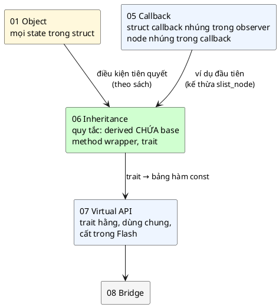

| Quan hệ | Cách viết trong C | Đi ngược về object chứa? | Bài |
|---|---|---|---|
| **Dùng** (association) | `struct uart *uart;` | Không | 01 |
| **Kế thừa dữ liệu + method** | `struct gpio_pin pin;` (nhúng) | Có, `CONTAINER_OF` | **06** |
| **Kế thừa list node** (cấu trúc dữ liệu chung) | `struct slist_node node;` (nhúng) | Có | 05, **06** |
| **Kế thừa hành vi** (trait) | `struct sensor_trait sensor;` (nhúng, chỉ chứa con trỏ hàm) | Có | **06** |
| **Interface trừu tượng** (Virtual API) | `const struct serial_ops *ops;` (con trỏ tới bảng hằng) | Có (từ handle) | 07 |

### 1.5. Câu hỏi bài này sẽ trả lời

1. "Kế thừa" trong OOP thật ra là gì ở mức **bộ nhớ**? C++ làm gì mà C phải tự làm? (Mục 2–4)
2. Vì sao derived phải **chứa** base, không được **trỏ tới** base? (Mục 8)
3. Vì sao derived phải có **hàm bọc** riêng, không được sửa thẳng dữ liệu base? (Mục 9)
4. Làm sao để một thuật toán (danh sách) chạy cho **mọi kiểu** dữ liệu mà vẫn an toàn kiểu? (Mục 10)
5. **Trait** là gì, và vì sao nó dẫn tới Virtual API ở bài 7? (Mục 12–13)

---

## 2. Kế thừa trong OOP là gì, và C++ làm gì dưới nắp capo

### 2.1. Ba ý nghĩa của "kế thừa"

💡 Trong các ngôn ngữ hướng đối tượng, khi viết `class Led : public GpioPin`, ta có ba thứ cùng lúc:

| Ý nghĩa | Diễn đạt | Ví dụ |
|---|---|---|
| **Tái sử dụng dữ liệu** | Led **có** mọi field của GpioPin | Led có `active_low`, `level` mà không khai báo lại |
| **Tái sử dụng hành vi** | Led **gọi được** mọi method của GpioPin | `led.set_active(true)` |
| **Thay thế được (is-a)** | Chỗ nào cần GpioPin thì đưa Led vào được | `void blink(GpioPin &p)` nhận được một `Led` |

Thêm vào đó, với hàm `virtual`, lớp con **ghi đè** (override) được hành vi, và code gọi qua base sẽ chạy bản của lớp con: **đa hình** (polymorphism). C++ làm phần đa hình bằng một bảng con trỏ hàm ẩn (vtable). Đó là chủ đề của trait (mục 12) và Virtual API (bài 7).

📖 Sách tóm tắt vai trò bằng một best practice: *"vai trò **chính** của kế thừa là **tái sử dụng code**. Vai trò **thứ hai** là giữ chức năng **phân cấp** để dễ bảo trì hơn"*.

### 2.2. 🔬 Thí nghiệm: C++ tự làm "CONTAINER_OF" cho bạn

Kế thừa trong C++ (không `virtual`) nằm trong bộ nhớ thế nào? Mình viết một lớp kế thừa **hai** base và in địa chỉ:

```cpp
// C++ làm sẵn việc "CONTAINER_OF" khi ép kiểu giữa base và derived
#include <cstdint>
#include <cstdio>

struct BaseOne {
	uint32_t x;
};

struct BaseTwo {
	uint32_t x;
};

struct Derived : BaseOne, BaseTwo {
	uint32_t own;
};

int main()
{
	Derived d;
	d.own = 333;
	BaseTwo *b2 = &d;                         // upcast: compiler tự cộng offset
	Derived *back = static_cast<Derived *>(b2); // downcast: compiler tự trừ offset

	std::printf("&d = %p, (BaseTwo *)&d = %p, chênh %d byte\n", (void *)&d, (void *)b2,
		    (int)((char *)b2 - (char *)&d));
	std::printf("static_cast ngược lại = %p, own = %u\n", (void *)back, (unsigned)back->own);
	return 0;
}
```

Build: `g++ -std=c++11 -Wall -Wextra -Werror -pedantic i2_cpp.cpp`. Output thật:

```
&d = 0000004b419ffae4, (BaseTwo *)&d = 0000004b419ffae8, chênh 4 byte
static_cast ngược lại = 0000004b419ffae4, own = 333
```

Đọc kết quả:
- Phần `BaseTwo` của `d` nằm ở **offset 4**: ngay sau phần `BaseOne` (4 byte). C++ đặt các base **liền nhau bên trong** derived, y như C đặt các struct nhúng.
- Khi gán `BaseTwo *b2 = &d;`, compiler **tự cộng 4**. Khi `static_cast<Derived *>(b2)`, compiler **tự trừ 4**. Đó chính xác là `&d.base_two` và `CONTAINER_OF(b2, struct derived, base_two)` trong C (🔬 mục 4.2 làm lại bằng C, ra cùng con số).

📖 Sách viết đúng điều này: *"C thường chỉ thêm các tính năng cú pháp giúp cách làm này đơn giản hơn. Ở cốt lõi, điều quan trọng là triết lý chứ không phải tính năng ngôn ngữ."* (Bản 0.38.0 in là *"compared to the same approach in for example C. In fact, C often just adds syntax..."*; theo ngữ cảnh, chữ "C" thứ hai và thứ ba gần như chắc chắn là lỗi đánh máy của "C++".) Và một ví dụ một dòng:

```
C++:  Base::do_something();
C:    base_do_something(&self->base);
```

---

## 3. Struct lồng struct nằm thế nào trong bộ nhớ

### 3.1. Struct nhúng nằm "phẳng" bên trong

Khi một struct chứa một struct khác (không phải con trỏ), compiler đặt **toàn bộ** các byte của struct con vào giữa struct cha, như thể ta viết các field của nó ra tại chỗ. Không có con trỏ, không có cấp phát riêng.

`struct led` trong code mẫu:

```c
struct gpio_pin {
	const char *port;
	uint8_t pin;
	bool active_low;
	bool level;
};

struct led {
	struct gpio_pin pin;
	struct slist_node node;
	const char *name;
};
```

🔬 In địa chỉ từng field so với đầu `struct led`:

```
sizeof(struct gpio_pin) = 16, sizeof(struct slist_node) = 8, sizeof(struct led) = 32
led.pin.port       @ +0
led.pin.pin        @ +8
led.pin.active_low @ +9
led.pin.level      @ +10
led.node           @ +16
led.name           @ +24
(void *)&led == (void *)&led.pin ? có
```

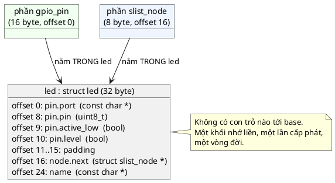

Những điều cần thấy:
- `struct gpio_pin` chiếm **16 byte** dù dữ liệu chỉ có 11 byte: 5 byte padding ở cuối để kích thước chia hết cho căn lề của nó (8, do có con trỏ). Khi nhúng vào `struct led`, 16 byte đó được giữ nguyên, nên `node` bắt đầu ở 16.
- `&led` và `&led.pin` là **cùng một địa chỉ**: `pin` là member đầu tiên.
- Một `struct led` = **một** khối nhớ 32 byte. Khai báo `static struct led status;` là có đủ cả LED lẫn chân GPIO của nó, trong `.bss`.

💡 Đây cũng là lý do derived phải **thấy định nghĩa đầy đủ** của base (base không thể opaque với derived, xem [bài 2](../02_OpaquePattern/LECTURE.md)): compiler cần biết `sizeof(struct gpio_pin)` để xếp chỗ cho `struct led`.

---

## 4. Upcast, downcast và quy tắc "member đầu tiên"

### 4.1. Hai chiều chuyển đổi

💡 Mượn từ ngữ của OOP:

| Chiều | Nghĩa | Trong C | An toàn? |
|---|---|---|---|
| **Upcast** (derived → base) | "Coi LED như một chân GPIO" | `&led->pin` | **Luôn an toàn**: chỉ là lấy địa chỉ một member |
| **Downcast** (base → derived) | "Biết chân GPIO này nằm trong một LED, lấy lại LED" | `CONTAINER_OF(pin, struct led, pin)` | **Chỉ đúng nếu** base đó thật sự nằm trong một derived kiểu đó |

Upcast là việc hằng ngày: mỗi lần `led_on()` gọi `gpio_pin_set_active(&self->pin, true)`, nó upcast. Downcast là việc của callback (bài 5) và của thuật toán chung (mục 10): code chung chỉ cầm base, code riêng lấy lại derived.

### 4.2. 🔬 Thí nghiệm: ép kiểu thẳng chỉ đúng với member đầu tiên

💡 Chuẩn C bảo đảm: *con trỏ tới một struct, ép kiểu phù hợp, trỏ tới member đầu tiên của nó, và ngược lại* (không có padding ở đầu struct). Vì vậy với base nằm **đầu tiên**, ép kiểu thẳng `(struct derived *)base_ptr` cho kết quả đúng. Với base ở vị trí khác thì sao?

```c
/* Ép kiểu "con trỏ base -> con trỏ derived" chỉ đúng với base nằm ĐẦU struct */
#include "container_of.h"

#include <stdint.h>
#include <stdio.h>

struct base_one {
	uint32_t x;
};

struct base_two {
	uint32_t x;
};

struct derived {
	struct base_one base_one;
	struct base_two base_two;
	uint32_t own;
};

int main(void)
{
	struct derived d = { { 111 }, { 222 }, 333 };
	struct base_one *b1 = &d.base_one; /* "upcast": luôn an toàn, chỉ là lấy địa chỉ member */
	struct base_two *b2 = &d.base_two;

	printf("&d          = %p\n", (void *)&d);
	printf("&d.base_one = %p (offset %u)\n", (void *)b1, (unsigned)offsetof(struct derived, base_one));
	printf("&d.base_two = %p (offset %u)\n", (void *)b2, (unsigned)offsetof(struct derived, base_two));

	struct derived *from_b1_cast = (struct derived *)b1;
	struct derived *from_b2_cast = (struct derived *)b2; /* SAI: b2 không nằm ở đầu */
	struct derived *from_b2_co = CONTAINER_OF(b2, struct derived, base_two);

	printf("ép kiểu từ b1      -> own = %u\n", (unsigned)from_b1_cast->own);
	printf("ép kiểu từ b2      -> own = %u  (đọc ở &d + 12, ngoài object: rác)\n", (unsigned)from_b2_cast->own);
	printf("CONTAINER_OF từ b2 -> own = %u\n", (unsigned)from_b2_co->own);
	return 0;
}
```

Output thật:

```
&d          = 0000003382BFFB2C
&d.base_one = 0000003382BFFB2C (offset 0)
&d.base_two = 0000003382BFFB30 (offset 4)
ép kiểu từ b1      -> own = 333
ép kiểu từ b2      -> own = 2193619756  (đọc ở &d + 12, ngoài object: rác)
CONTAINER_OF từ b2 -> own = 333
```

Đọc kết quả:
- `base_two` ở offset 4, giống hệt C++ ở mục 2.2.
- Ép kiểu thẳng từ `b1` (offset 0) cho `own = 333`: đúng.
- Ép kiểu thẳng từ `b2` coi `&d + 4` là đầu struct, nên `own` (offset 8) bị đọc ở `&d + 12`: **ra ngoài object `d`** (chỉ 12 byte). Giá trị là rác trên stack, mỗi lần chạy một khác. Đây là hành vi không xác định.
- `CONTAINER_OF` trừ đúng 4 byte, nên đúng.

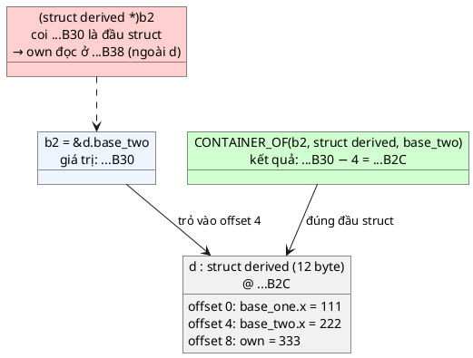

**Kết luận thực hành:** luôn dùng `CONTAINER_OF` để downcast, kể cả khi base đang nằm đầu tiên. Ép kiểu thẳng là một **giả định ngầm** về vị trí, và giả định đó vỡ ngay khi ai đó thêm một field lên đầu struct, hoặc khi struct có hai base (chỉ một cái được ở đầu).

💡 `CONTAINER_OF` đã được giải thích từ gốc ở [bài 5, mục 4](../05_CallbackPattern/LECTURE.md#4-offsetof-và-container_of-đi-ngược-từ-member-về-struct), kể cả bản có kiểm tra kiểu mà code mẫu dùng lại.

---

## 5. Con trỏ hàm trong struct: hành vi gắn theo instance

Ở [bài 5, mục 2](../05_CallbackPattern/LECTURE.md#2-hàm-cũng-có-địa-chỉ-con-trỏ-hàm-từ-gốc), ta đã thấy con trỏ hàm là một biến chứa địa chỉ code. Đặt con trỏ hàm **vào struct** nghĩa là: **mỗi instance tự mang theo hành vi của nó**.

```c
struct sensor_trait {
	int (*read)(struct sensor_trait *self, int32_t *value);
};
```

- Một `struct tmp36_sensor` gán `read = tmp36_sensor_read`.
- Một `struct battery_monitor` gán `read = battery_monitor_read`.
- Code chung chỉ cầm `struct sensor_trait *` và gọi `self->read(self, &v)`: **cùng một dòng code**, chạy **hai hàm khác nhau** tùy instance.

Đó là đa hình, làm bằng tay. Bài 5 dùng đúng kỹ thuật này cho **thông báo** (một sự kiện, nhiều người nghe). Mục 12 dùng nó cho **hành vi** (một thao tác, nhiều cách cài đặt). Bài 7 sẽ tối ưu nó (bảng hàm `const` dùng chung).

---

# Phần B — Pattern

## 6. Vấn đề: ba cách làm "trước khi có pattern"

Mục này chạy thật ba lỗi ở tình huống mục 1.2.

### 6.1. Không tái sử dụng: mỗi module một danh sách

```c
/*
 * "Trước khi có pattern": mỗi module tự viết danh sách liên kết của riêng mình.
 * timer.c viết đúng; msg_queue.c (copy rồi sửa) quên cập nhật tail khi gỡ phần tử cuối.
 */
#include <stddef.h>
#include <stdio.h>

/* ---- timer.c ---- */
struct timer {
	struct timer *next;
	const char *name;
};
struct timer_list {
	struct timer *head;
	struct timer *tail;
};

static void timer_list_append(struct timer_list *l, struct timer *t)
{
	t->next = NULL;
	if (l->tail) {
		l->tail->next = t;
	} else {
		l->head = t;
	}
	l->tail = t;
}

/* ---- msg_queue.c: copy từ timer.c rồi "sửa cho phù hợp" ---- */
struct msg {
	struct msg *next;
	const char *text;
};
struct msg_queue {
	struct msg *head;
	struct msg *tail;
};

static void msg_queue_append(struct msg_queue *q, struct msg *m)
{
	m->next = NULL;
	if (q->tail) {
		q->tail->next = m;
	} else {
		q->head = m;
	}
	q->tail = m;
}

static void msg_queue_remove(struct msg_queue *q, struct msg *m)
{
	struct msg *prev = NULL;

	for (struct msg *it = q->head; it; prev = it, it = it->next) {
		if (it == m) {
			if (prev) {
				prev->next = it->next;
			} else {
				q->head = it->next;
			}
			/* QUÊN: if (q->tail == it) q->tail = prev; */
			return;
		}
	}
}

int main(void)
{
	struct timer_list timers = { NULL, NULL };
	struct timer t1 = { NULL, "blink" };
	struct msg_queue q = { NULL, NULL };
	struct msg a = { NULL, "AT" }, b = { NULL, "AT+CSQ" }, c = { NULL, "AT+CREG?" };

	timer_list_append(&timers, &t1);

	msg_queue_append(&q, &a);
	msg_queue_append(&q, &b);
	msg_queue_remove(&q, &b);   /* gỡ phần tử cuối */
	msg_queue_append(&q, &c);   /* c được nối vào sau b (đã gỡ!), không vào hàng đợi */

	printf("hàng đợi gửi modem:");
	for (struct msg *m = q.head; m; m = m->next) {
		printf(" [%s]", m->text);
	}
	printf("\n(mong đợi: [AT] [AT+CREG?])\n");
	return 0;
}
```

🔬 Output thật:

```
hàng đợi gửi modem: [AT]
(mong đợi: [AT] [AT+CREG?])
```

Sau khi gỡ `b`, `tail` vẫn trỏ vào `b`. Lần append sau nối `c` vào sau `b`, một node **không còn nằm trong hàng đợi**. Lệnh `AT+CREG?` biến mất, không lỗi, không cảnh báo.

📖 Đây đúng là điều sách gọi là lợi ích **Clean design**: *"khi ta dùng lại cùng một chức năng ở nhiều nơi, nhìn code là biết ngay điều gì sẽ xảy ra. Ngược lại là viết lại, ví dụ, cùng thuật toán danh sách ở nhiều object khác nhau trong firmware, dẫn tới **không bao giờ biết điều gì sẽ xảy ra** với một cài đặt như vậy"*.

Giải pháp (mục 10): **một** danh sách, viết và test **một lần** (`slist`), mọi struct cần xếp hàng thì **kế thừa** `struct slist_node`.

### 6.2. "Kế thừa" bằng con trỏ

```c
/* "Kế thừa" bằng con trỏ tới base: hai LED vô tình dùng chung một chân */
#include "gpio_pin.h"

#include <stdio.h>

struct led_ptr {
	struct gpio_pin *pin; /* TRỎ tới base thay vì CHỨA base */
	const char *name;
};

static void led_ptr_on(struct led_ptr *self)
{
	gpio_pin_set_active(self->pin, true);
}

int main(void)
{
	static struct gpio_pin pa5;
	struct led_ptr status = { &pa5, "LED_STATUS" };
	struct led_ptr error = { &pa5, "LED_ERROR" }; /* copy-paste quên đổi chân */

	gpio_pin_init(&pa5, "PA", 5, false);
	led_ptr_on(&status);
	printf("bật LED_STATUS -> LED_ERROR đang %s\n", gpio_pin_is_active(error.pin) ? "ON (!)" : "OFF");
	printf("sizeof(struct led_ptr) = %u, nhưng gpio_pin thật nằm ở chỗ khác (%u byte nữa)\n",
	       (unsigned)sizeof(struct led_ptr), (unsigned)sizeof(struct gpio_pin));
	return 0;
}
```

🔬 Output thật:

```
bật LED_STATUS -> LED_ERROR đang ON (!)
sizeof(struct led_ptr) = 16, nhưng gpio_pin thật nằm ở chỗ khác (16 byte nữa)
```

Ba vấn đề của con trỏ tới base:
1. **Hai object, hai vòng đời.** Ai cấp phát `pa5`? Ai giải phóng? LED chết thì chân còn sống không? Bài 2 đã cho thấy quản lý vòng đời tốn kém thế nào.
2. **Chia sẻ ngầm.** Không gì ngăn hai LED trỏ chung một chân. Với containment, mỗi LED **có** chân của riêng nó; muốn chia sẻ thì phải cố ý làm, và nó hiện rõ trong code.
3. **Không đi ngược được.** Từ `struct gpio_pin *` không có cách nào lấy lại `struct led_ptr`: chân không nằm **trong** LED. 🔬 Với macro `CONTAINER_OF` có kiểm tra kiểu của code mẫu, thử làm vậy bị chặn ngay:

```c
#include "container_of.h"
#include "gpio_pin.h"

struct led_ptr {
	struct gpio_pin *pin;
	const char *name;
};

struct led_ptr *led_from_pin(struct gpio_pin *pin)
{
	/* Không thể đi ngược: pin không nằm BÊN TRONG struct led_ptr */
	return CONTAINER_OF(pin, struct led_ptr, pin);
}
```

```
container_of.h:18:36: error: comparison of distinct pointer types lacks a cast [-Werror=compare-distinct-pointer-types]
i3b_co_ptr.c:12:16: note: in expansion of macro 'CONTAINER_OF'
```

(Tham số `pin` có kiểu `struct gpio_pin *`. Member `pin` của `struct led_ptr` **cũng** là `struct gpio_pin *`, nên địa chỉ của member đó có kiểu `struct gpio_pin **`. Hai kiểu khác nhau, compiler báo. Dù có ép cho qua, phép trừ offset cũng chỉ ra một địa chỉ vô nghĩa ngay trước object `gpio_pin`, vì chân GPIO đó không nằm bên trong LED nào.)

📖 Đó là lý do đặc điểm đầu tiên của sách nói rõ: *"Derived object **never** references the base class data through a pointer"*.

💡 Lưu ý: giữ con trỏ tới object khác **không sai**, đó là quan hệ "dùng" (GPS dùng UART, bài 1). Nó chỉ không phải là **kế thừa**. Câu hỏi để phân biệt: *"chân GPIO này có phải là một phần của LED, sinh ra và chết đi cùng LED không?"* Có: chứa. Không: con trỏ.

### 6.3. Đụng thẳng vào dữ liệu của base: fragile base class

```c
/*
 * Fragile base class: led_on_direct() được viết hồi gpio_pin chưa có
 * active_low, khi "level = 1" còn đồng nghĩa với "bật". Base đổi, nó hỏng.
 */
#include "gpio_pin.h"

#include <stdio.h>

struct led {
	struct gpio_pin pin;
};

static void led_on_direct(struct led *self)
{
	self->pin.level = true; /* đụng thẳng vào dữ liệu của base */
}

static void led_on_delegate(struct led *self)
{
	gpio_pin_set_active(&self->pin, true); /* nhờ base làm */
}

static void show(const char *how, const struct led *led)
{
	printf("  %-16s mức chân = %d -> LED %s\n", how, gpio_pin_level(&led->pin),
	       gpio_pin_is_active(&led->pin) ? "SÁNG" : "TẮT");
}

int main(void)
{
	struct led a, b;

	printf("LED active-high (PA5):\n");
	gpio_pin_init(&a.pin, "PA", 5, false);
	gpio_pin_init(&b.pin, "PA", 5, false);
	led_on_direct(&a);
	led_on_delegate(&b);
	show("led_on_direct", &a);
	show("led_on_delegate", &b);

	printf("LED active-low (PB0), board rev B:\n");
	gpio_pin_init(&a.pin, "PB", 0, true);
	gpio_pin_init(&b.pin, "PB", 0, true);
	led_on_direct(&a);
	led_on_delegate(&b);
	show("led_on_direct", &a);
	show("led_on_delegate", &b);
	return 0;
}
```

🔬 Output thật:

```
LED active-high (PA5):
  led_on_direct    mức chân = 1 -> LED SÁNG
  led_on_delegate  mức chân = 1 -> LED SÁNG
LED active-low (PB0), board rev B:
  led_on_direct    mức chân = 1 -> LED TẮT
  led_on_delegate  mức chân = 0 -> LED SÁNG
```

Trên board cũ hai cách cho cùng kết quả, nên không ai thấy khác biệt. Trên board mới, cách ghi thẳng `level` làm LED **tắt** khi được bảo **bật**. Cách nhờ base (`gpio_pin_set_active`) đúng ở cả hai board, vì quy tắc active-low nằm **một chỗ** trong base.

📖 Sách gọi tên vấn đề này ở phần Common Pitfalls: **Fragile base class**: *"nếu thay đổi ở base class làm thay đổi hành vi của derived class, thì việc kiểm tra kỹ các kỳ vọng đặt lên derived class trở nên đặc biệt quan trọng"*. Và ở phần nhược điểm: **Violation of encapsulation**: *"kế thừa theo định nghĩa nghĩa là mọi dữ liệu của base class tự động thuộc về và có thể bị derived class sửa. Nếu derived class truy cập trực tiếp dữ liệu của base class thì có thể gây ra hiệu ứng ngoài ý muốn."*

### 6.4. Trước và sau

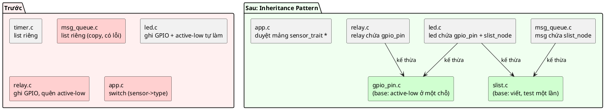

---

## 7. Ý tưởng cốt lõi: kế thừa bằng cách chứa (containment)

📖 *"Kế thừa trong C chủ yếu được cài đặt qua **containment**, nghĩa là một object kế thừa object khác thì đơn giản là **chứa** base class."*

```c
struct my_object {
	struct base_one base_one;
	struct base_two base_two;
};
```

📖 *"Ở đây ta có thể nói `struct my_object` kế thừa các base object, và ta có thể **chuyển tiếp** (forward) mọi thao tác thực hiện trên instance của `struct my_object` sang cài đặt của các base object."*

Ba quy tắc tạo nên pattern:

1. **Chứa, không trỏ.** Base là một member nhúng (mục 6.2).
2. **Upcast bằng `&self->base`, downcast bằng `CONTAINER_OF`.** Không ép kiểu thẳng (mục 4.2).
3. **Derived có API riêng, bên trong gọi API của base.** Không sửa thẳng dữ liệu base (mục 6.3, mục 9).

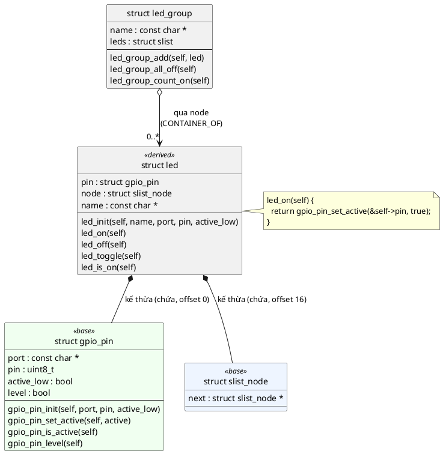

💡 Hình thoi đặc (`*--`) là **chứa**: base là một phần của derived. Hình thoi rỗng (`o-->`) là **dùng/tham chiếu**: nhóm LED không sở hữu LED nào, chỉ xâu chúng lại qua node.

---

## 8. Ba đặc điểm nhận dạng và lý do của từng cái

📖 Sách mở đầu phần *Defining Characteristics*: *"C không hỗ trợ trực tiếp kế thừa ở mức ngôn ngữ, nên ta phải dùng **quy ước** khi làm việc với kế thừa trong C."* Ba quy ước:

### 1. Derived chứa dữ liệu của base (containment of base class data)

📖 *"Derived class đơn giản là chứa dữ liệu của base class và dùng các method của base class để thao tác trên dữ liệu đó. **Derived object không bao giờ tham chiếu dữ liệu base class qua con trỏ.**"*

**Tại sao:**
- Một khối nhớ, một lần cấp phát, một vòng đời (mục 3). Hợp với cấp phát tĩnh của embedded.
- Downcast được bằng `CONTAINER_OF` (mục 4); với con trỏ thì không (🔬 mục 6.2).
- Không có chia sẻ ngầm giữa các instance (🔬 mục 6.2).

### 2. Derived gắn chặt với dữ liệu base (tightly coupled)

📖 *"Derived class **có thể** truy cập trực tiếp dữ liệu base class, và dù ta luôn cố dùng method của base class để thao tác base class, pattern kế thừa **không cấm** truy cập trực tiếp."*

**Tại sao lại là một "đặc điểm":** đây là sự thật của containment trong C, không phải lựa chọn. Để nhúng được base, derived **phải** thấy định nghĩa đầy đủ của base (mục 3), nên compiler không có cách nào ngăn `self->pin.level = 1`. Pattern chỉ có thể dựa vào **quy ước**. 💡 Khác với Opaque (bài 2), ở đây ta chấp nhận lộ field để đổi lấy containment. Vì vậy quy ước số 3 mới quan trọng.

### 3. Derived phải cung cấp method wrapper

📖 *"Nếu muốn thao tác dữ liệu base class, ta phải luôn định nghĩa **tường minh** các method của derived object, rồi các method đó hoặc **ủy quyền** (delegate) thao tác cho method của base class, hoặc sửa dữ liệu trực tiếp. **Ta không bao giờ sửa dữ liệu base class trực tiếp.**"*

💡 Câu này đọc lần đầu có vẻ mâu thuẫn ("hoặc sửa dữ liệu trực tiếp... không bao giờ sửa trực tiếp"). Cách hiểu hợp lý: **code bên ngoài** không bao giờ đụng vào `led.pin.level`; mọi thao tác đi qua method của derived (`led_on`). Bên trong method đó, derived **nên** gọi method của base; trường hợp hiếm phải tự sửa dữ liệu base thì ít nhất nó nằm gọn trong một hàm của derived, dễ tìm khi base thay đổi.

**Tại sao:** chống fragile base class (🔬 mục 6.3). Người dùng LED chỉ biết `led_on()`; người viết `led.c` chỉ dựa vào API của `gpio_pin`; người viết `gpio_pin.c` tự do đổi cách lưu trữ bên trong.

---

## 9. Kế thừa đơn và method wrapper (delegator)

### 9.1. Base: `struct gpio_pin`

Base là một object Object Pattern hoàn chỉnh, tự đứng được (relay, chân bật nguồn cảm biến... đều dùng được nó):

```c
struct gpio_pin {
	const char *port;
	uint8_t pin;
	bool active_low;
	bool level; /* Mức điện thật trên chân (mô phỏng thanh ghi ODR) */
};

int gpio_pin_init(struct gpio_pin *self, const char *port, uint8_t pin, bool active_low);
int gpio_pin_set_active(struct gpio_pin *self, bool active);
bool gpio_pin_is_active(const struct gpio_pin *self);
bool gpio_pin_level(const struct gpio_pin *self);
```

Quy tắc active-low nằm **đúng một chỗ**:

```c
int gpio_pin_set_active(struct gpio_pin *self, bool active)
{
	if (!self) {
		return -EINVAL;
	}

	/* Chỉ một chỗ duy nhất biết quy tắc đảo mức: lớp dẫn xuất không phải lo */
	self->level = active != self->active_low;
	return 0;
}
```

`active != active_low` là phép XOR cho kiểu `bool`:

| `active` | `active_low` | `level` | Ý nghĩa |
|---|---|---|---|
| true | false | 1 | LED nối xuống GND: mức 1 là sáng |
| false | false | 0 | |
| true | true | 0 | LED nối lên VCC: mức 0 là sáng |
| false | true | 1 | |

### 9.2. Derived: `struct led` và các delegator

```c
int led_init(struct led *self, const char *name, const char *port, uint8_t pin, bool active_low)
{
	if (!self || !name) {
		return -EINVAL;
	}

	memset(self, 0, sizeof(*self));
	self->name = name;
	/* Khởi tạo lớp dẫn xuất = khởi tạo từng base, rồi tới phần riêng */
	return gpio_pin_init(&self->pin, port, pin, active_low);
}

int led_on(struct led *self)
{
	if (!self) {
		return -EINVAL;
	}

	/* Không ghi self->pin.level trực tiếp: quy tắc active-low thuộc về base */
	return gpio_pin_set_active(&self->pin, true);
}
```

📖 Best practice **Use delegator methods**: *"khi cần truy cập dữ liệu hay chức năng của base class, và thuộc tính đó cũng có thể coi là thuộc tính của derived class, hãy tạo một method của derived class rồi **ủy quyền** cho base class"*. "Bật" là thuộc tính của LED (người dùng nghĩ "bật LED", không nghĩ "set active chân PB0"), nên LED có `led_on()`.

💡 Để ý delegator **đổi tên** theo ngôn ngữ của derived: `gpio_pin_set_active(true)` thành `led_on()`, `gpio_pin_is_active()` thành `led_is_on()`. Đây là chỗ "derived phơi ra một interface phong phú hơn" mà sách nói ở phần Use Cases.

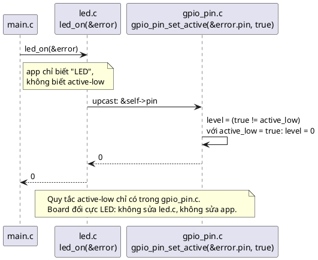

### 9.3. 🔬 Delegator tốn bao nhiêu?

📖 Nhược điểm chính sách nêu: *"nếu muốn kế thừa **toàn bộ** API của kiểu khác, ta phải tạo wrapper trong kiểu kế thừa, chỉ để chuyển tiếp lời gọi sang method của base class... vì C không hỗ trợ kế thừa ở mức ngôn ngữ nên compiler và linker không làm hộ"*. Viết thì tốn công. Còn chạy thì tốn gì?

Mã máy của `led_on` khi dịch `src/led.c` với `-O2` (`objdump -dr`):

```
0000000000000040 <led_on>:
  40:	test   %rcx,%rcx                ; self == NULL ?
  43:	je     4f <led_on+0xf>
  45:	mov    $0x1,%edx                ; tham số 2: active = true
  4a:	jmp    4f <led_on+0xf>
			4b: IMAGE_REL_AMD64_REL32	gpio_pin_set_active
  4f:	mov    $0xffffffea,%eax         ; return -EINVAL (-22)
  54:	ret
```

- Dòng `4a` là **`jmp`**, không phải `call`. Dòng relocation bên dưới cho biết đích nhảy thật là `gpio_pin_set_active` (linker sẽ điền địa chỉ). Đây là **tail call**: wrapper không quay lại, nên không tốn thêm stack frame.
- `%rcx` (tham số 1 = `self`) được **chuyển nguyên** sang `gpio_pin_set_active` mà **không cộng gì**: `&self->pin` bằng `self` vì `pin` ở offset 0. Nếu `pin` ở offset khác, sẽ có thêm đúng một lệnh `add`.
- Tổng chi phí wrapper: một phép kiểm tra `NULL`, một lệnh gán, một `jmp`.

Với **LTO** (`-flto`, đã giới thiệu ở [bài 2, mục 16](../02_OpaquePattern/LECTURE.md#16-trade-off)), compiler inline xuyên file. Mình build một `main` gọi `led_init`, `led_on`, `led_is_on`:

```c
#include "led.h"
int main(void)
{
	static struct led status;
	led_init(&status, "S", "PA", 5, false);
	led_on(&status);
	return led_is_on(&status) ? 0 : 1;
}
```

Build: `gcc -std=c99 -O2 -flto -Iinc i8_main.c src/led.c src/gpio_pin.c`. Trong mã máy của `main` (trích):

```
   140002042:	movb   $0x5,0x4fdf(%rip)        # 140007028 <status.0+0x8>
   140002049:	movb   $0x1,0x4fda(%rip)        # 14000702a <status.0+0xa>
```

Không còn lời gọi `led_on` hay `gpio_pin_set_active` nào: `led_init` + `led_on` thu gọn thành vài lệnh ghi thẳng vào `status`, trong đó `movb $0x1` vào `status + 0xa` (offset 10 = `pin.level`, xem bảng ở mục 3) chính là "bật LED". **Wrapper biến mất hoàn toàn.** Cái giá thật của delegator là **công viết và đọc code**, không phải tốc độ.

📖 Sách gọi phần công đó là pitfall **Code duplication**: *"nếu base class có nhiều method và bạn viết rất nhiều wrapper trong derived class, bạn có rất nhiều hàm chỉ chuyển tiếp lời gọi. Về bản chất, đó là **trọng lượng chết** (dead weight)."* 💡 Cách cân bằng: chỉ viết wrapper cho thao tác **có nghĩa** với derived (LED cần `on/off/toggle/is_on`, không cần `set_pin_number`).

---

## 10. Kế thừa list node: cấu trúc dữ liệu dùng chung

### 10.1. Ý tưởng

📖 *"Công dụng chính của kế thừa trong C là sắp xếp dữ liệu thành các cấu trúc phức tạp hơn, để ta **tổng quát hóa được các thuật toán** chạy trên cấu trúc dữ liệu của mình. Ví dụ: danh sách, cây AVL, v.v."* Và: *"ta dùng Inheritance Pattern để tạo cấu trúc dữ liệu tổng quát như danh sách trong C. Nhờ vậy ta dùng lại chức năng thao tác danh sách và thậm chí xếp các struct tùy ý vào danh sách (như đã thấy ở Callback Pattern) chỉ bằng cách 'kế thừa' từ một list node."*

📖 Các kiểu danh sách sách in (của Zephyr):

```c
struct _snode {
	struct _snode *next;
};

typedef struct _snode sys_snode_t;

struct _slist {
	sys_snode_t *head;
	sys_snode_t *tail;
};

typedef struct _slist sys_slist_t;
```

Code mẫu dùng bản tương đương tự viết: `struct slist_node`, `struct slist` ([inc/slist.h](inc/slist.h)), y hệt bài 5.

### 10.2. ⚠️ Lỗi đánh máy trong ví dụ của sách

📖 Đoạn "Usage example" của sách:

```c
struct my_object {
    sys_snode_t node;
};

sys_slist_t list;
struct my_object obj1;
struct my_object obj2;

sys_slist_init(&list);
sys_slist_append(&list, &obj1.list);
sys_slist_append(&list, &obj2.list);
```

Member tên là `node`, nhưng lời gọi dùng `&obj1.list`. 🔬 Mình dựng lại với các kiểu đúng như sách định nghĩa (đặt trong một hàm để dịch được):

```
i6_book_list.c:25:38: error: 'struct my_object' has no member named 'list'
i6_book_list.c:26:38: error: 'struct my_object' has no member named 'list'
```

(Hai lỗi phụ `variable 'obj1' set but not used` xuất hiện theo sau vì `-Werror`.) Đúng phải là `&obj1.node`, `&obj2.node`.

### 10.3. Duyệt danh sách: downcast bằng `CONTAINER_OF`

📖 *"Ta duyệt danh sách bằng cách đi qua các item và dùng `CONTAINER_OF` để lấy con trỏ tới object bao ngoài từ con trỏ tới list item."*

```c
sys_snode_t *node;
SYS_SLIST_FOR_EACH_NODE(&list, node){
    struct my_object *self = CONTAINER_OF(node, struct my_object, node);
    ...
}
```

Trong code mẫu, `struct led_group` là một thuật toán viết **một lần** trên danh sách LED:

```c
int led_group_all_off(struct led_group *self)
{
	struct slist_node *node;
	struct slist_node *next;

	if (!self) {
		return -EINVAL;
	}

	SLIST_FOR_EACH_NODE_SAFE(&self->leds, node, next) {
		/* Từ phần "slist_node" đi ngược ra cả struct led */
		struct led *led = CONTAINER_OF(node, struct led, node);

		led_off(led);
		printf("  [%s] tắt %s\n", self->name, led->name);
	}
	return 0;
}
```

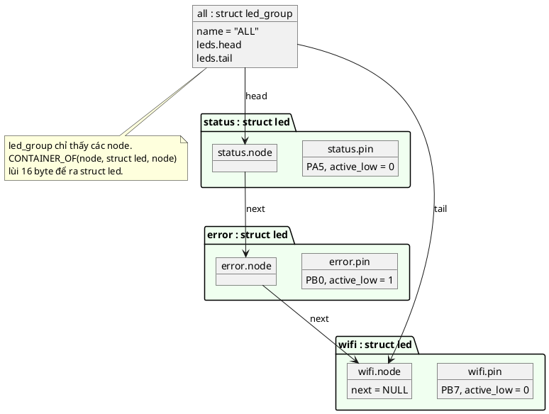

### 10.4. Quy tắc "một danh sách, một kiểu"

📖 *"Rất quan trọng: ta phải đảm bảo danh sách chỉ chứa item của **một kiểu** cụ thể. Nếu không, khi duyệt danh sách ta không có cách nào biết mình đang cầm item nào."*

🔬 Chuyện gì xảy ra nếu lỡ thêm node của một kiểu khác (một gói tin UART cũng "kế thừa" `slist_node`) vào danh sách LED:

```c
/* Danh sách chỉ được chứa MỘT kiểu: lỡ thêm node của kiểu khác thì sao? */
#include "container_of.h"
#include "led.h"
#include "slist.h"

#include <stdint.h>
#include <stdio.h>

struct uart_msg {               /* một kiểu khác cũng "kế thừa" slist_node */
	uint8_t data[4];
	struct slist_node node;
};

int main(void)
{
	static struct led status;
	static struct uart_msg msg = { { 'A', 'T', '\r', '\n' }, { NULL } };
	struct slist leds;

	led_init(&status, "LED_STATUS", "PA", 5, false);
	slist_init(&leds);
	slist_append(&leds, &status.node);
	slist_append(&leds, &msg.node); /* nhầm: compiler không biết node này thuộc kiểu nào */

	for (struct slist_node *n = leds.head; n; n = n->next) {
		struct led *led = CONTAINER_OF(n, struct led, node);

		printf("led: port=%p pin=%u active_low=%u\n", (const void *)led->pin.port,
		       (unsigned)led->pin.pin, (unsigned)led->pin.active_low);
	}
	return 0;
}
```

Output thật:

```
led: port=00007FF779CE4010 pin=5 active_low=0
led: port=0000000000000000 pin=65 active_low=84
```

Đọc dòng thứ hai như một thám tử:
- Trong `struct uart_msg`, `node` ở offset 8 (sau 4 byte `data` + 4 byte padding). Trong `struct led`, `node` ở offset 16.
- `CONTAINER_OF` lùi 16 byte từ `&msg.node`, tức là ra `&msg − 8`: **8 byte trước** `msg`.
- `led->pin.port` đọc 8 byte trước `msg` (tình cờ toàn 0, nên `NULL`).
- `led->pin.pin` đọc byte ở `&msg − 8 + 8` = `msg.data[0]` = `'A'` = **65**. `led->pin.active_low` đọc `msg.data[1]` = `'T'` = **84**.

Compiler **không thể** bắt lỗi này: `slist_append` nhận `struct slist_node *`, và `&msg.node` đúng là một `struct slist_node *`. Kiểm tra kiểu của `CONTAINER_OF` (bài 5, mục 4.5) chỉ kiểm tra `n` có phải con trỏ tới `struct slist_node` không, và nó đúng là vậy. Nếu sau đó gọi `led_off(led)`, chương trình sẽ **ghi** vào `msg.data[2]`, phá gói tin UART.

💡 Cách phòng: bọc danh sách trong một struct có kiểu riêng với API nhận đúng kiểu, như `led_group_add(struct led_group *, struct led *)`. Bên ngoài không ai gọi `slist_append` trực tiếp trên `all.leds`, nên không thể đưa nhầm `struct uart_msg` vào. Đây cũng chính là cách `button_add_callback` ở bài 5 nhận `struct button_callback *` chứ không nhận `struct slist_node *`.

---

## 11. Đa kế thừa

### 11.1. Ví dụ của sách

📖 *"Không có gì ngăn ta nhúng nhiều kiểu khác nhau vào struct của mình, và điều đó có tác dụng như **đa kế thừa đơn giản** trong C."* 🔬 Code của sách, chỉ đổi `printk` (Zephyr) thành `printf` và `void main(void)` thành `int main(void)`:

```c
/* Ví dụ đa kế thừa của sách, đổi printk -> printf và void main -> int main */
#include <stdint.h>
#include <stdio.h>
#include <string.h>

struct base_one {
	uint32_t x;
};

struct base_two {
	uint32_t x;
};

void base_one_init(struct base_one *self)
{
	memset(self, 0, sizeof(*self));
}

void base_one_do_something(struct base_one *self)
{
	(void)self;
	printf("%s\n", __func__);
}

void base_two_init(struct base_two *self)
{
	memset(self, 0, sizeof(*self));
}

struct derived {
	struct base_one base_one;
	struct base_two base_two;
};

void derived_init(struct derived *self)
{
	base_one_init(&self->base_one);
	base_two_init(&self->base_two);
}

void derived_do_something(struct derived *self)
{
	printf("%s\n", __func__);
	base_one_do_something(&self->base_one);
}

int main(void)
{
	struct derived derived;

	derived_init(&derived);
	derived_do_something(&derived);
	return 0;
}
```

Output thật:

```
derived_do_something
base_one_do_something
```

💡 Vì sao phải đổi `void main(void)`? 🔬 Trên PC, gcc với `-Wall` báo `warning: return type of 'main' is not 'int' [-Wmain]`, và `-Werror` biến nó thành lỗi. Chuẩn C yêu cầu `main` trả `int` trong môi trường có hệ điều hành; các bản Zephyr cũ cho phép `void main(void)` vì firmware không có ai nhận giá trị trả về. (`__func__` là biến chuẩn C99 chứa tên hàm hiện tại.)

Ba điều rút ra từ ví dụ:
- `derived_init` khởi tạo **từng base** bằng chính hàm `init` của base đó, theo thứ tự khai báo.
- `derived_do_something` làm việc của nó rồi **ủy quyền** cho `base_one_do_something(&self->base_one)`: đúng mẫu `Base::do_something()` của C++ (mục 2.2).
- Hai base đều có field tên `x`, nhưng không xung đột: `self->base_one.x` và `self->base_two.x` là hai tên khác nhau. 💡 C++ trong trường hợp này phải viết `BaseOne::x` để phân biệt.

### 11.2. Quy ước đặt tên

📖 Câu hỏi quiz thứ 2 của sách hỏi *"quy ước đặt tên nào tốt để dễ bảo trì"*, nhưng chương không phát biểu thành một quy tắc riêng. 💡 Từ các ví dụ của sách, có thể rút ra:

| Thứ cần đặt tên | Quy ước | Ví dụ sách | Ví dụ code mẫu |
|---|---|---|---|
| Member chứa base | Tên trùng (hoặc gợi rõ) **kiểu base** | `struct base_one base_one;` | `struct gpio_pin pin;`, `struct slist_node node;` |
| Method của base | `<base>_<việc>(struct <base> *self, ...)` | `base_one_do_something(&self->base_one)` | `gpio_pin_set_active(&self->pin, ...)` |
| Method của derived | `<derived>_<việc>(struct <derived> *self, ...)` | `derived_do_something(self)` | `led_on(self)` |
| Hàm cài trait | `<derived>_<việc của trait>`, `static` | `derived_with_traits_do_x` | `tmp36_sensor_read` |

Lợi ích: nhìn `gpio_pin_set_active(&self->pin, ...)` là biết ngay đang gọi method nào **trên phần base nào** của object. Khi base thay đổi, `grep "&self->pin"` liệt kê mọi chỗ derived đụng vào base.

### 11.3. Đa kế thừa trong code mẫu

`struct led` kế thừa hai base với hai vai trò khác nhau:

```c
struct led {
	struct gpio_pin pin;    /* kế thừa DỮ LIỆU + METHOD: là một chân GPIO */
	struct slist_node node; /* kế thừa khả năng XẾP HÀNG: vào được led_group */
	const char *name;
};
```

`struct tmp36_sensor` kế thừa **ba** thứ: hai trait (mục 12) và một base class:

```c
struct tmp36_sensor {
	struct sensor_trait sensor;
	struct power_trait power;
	struct gpio_pin power_pin;
	uint16_t adc_mv;
};
```

Demo in ra: `offsetof(struct tmp36_sensor, sensor/power/power_pin) = 0/8/24`. Mỗi base một offset; mỗi lần downcast dùng đúng tên member của base đó.

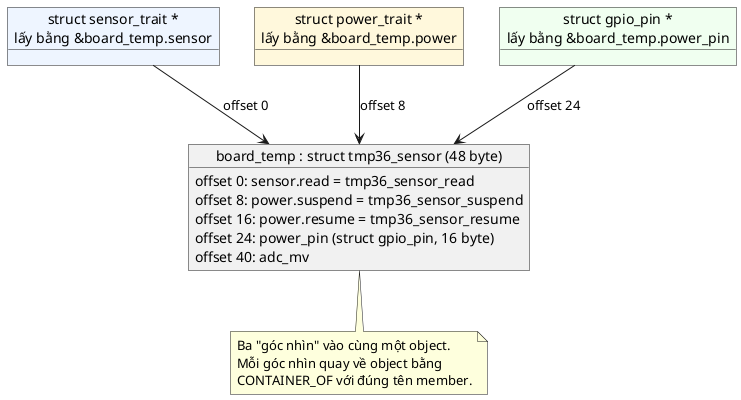

---

## 12. Trait: kế thừa hành vi

### 12.1. Trait là gì

📖 *"Trong C++ ta thường gọi hàm bị ghi đè là 'virtual function', và lớp chỉ phác thảo các hàm ảo với cài đặt NULL là 'abstract interface'. Trong thực tế, thứ ta thật sự đang cố cài đặt là **trait**."* 📖 *"Trait là một khái niệm mới hơn, được dùng nhiều trong các ngôn ngữ hiện đại như Rust. Cú pháp không quan trọng; điều quan trọng là ý định và mục đích của việc ta muốn có trait."*

📖 Định nghĩa của sách:

> *"A trait is defined as: a collection of behaviors that an object must implement in order to be treated as 'an object that has trait X' where X is typically a class that outlines the definitions of these behaviors - as function pointers."*
>
> *Trait là **một tập hành vi** mà một object phải cài đặt để được đối xử như "một object có trait X", trong đó X thường là một lớp phác thảo định nghĩa các hành vi đó, dưới dạng **con trỏ hàm**.*

| Vế | Nghĩa | Code mẫu |
|---|---|---|
| *"a collection of behaviors"* | Trait chỉ chứa **hành vi**, không chứa dữ liệu | `struct power_trait` chỉ có `suspend`, `resume` |
| *"that an object must implement"* | Kiểu dẫn xuất tự viết các hàm đó | `tmp36_sensor_suspend`, `tmp36_sensor_resume` |
| *"to be treated as 'an object that has trait X'"* | Code dùng chung đối xử với mọi object có trait như nhau | Vòng lặp `power_trait_suspend(power_devices[i])` |
| *"as function pointers"* | Hành vi lưu dưới dạng con trỏ hàm | `int (*suspend)(struct power_trait *self);` |

💡 Đối chiếu với bài 5: một struct callback **chính là một trait một hành vi** ("có thể nhận sự kiện nút"). Trait là cùng ý tưởng, tổng quát lên nhiều hành vi.

### 12.2. 🔬 Ví dụ trait của sách

Code của sách, chỉ đổi `printk` thành `printf`, `void main` thành `int main`, và thêm một dòng in địa chỉ:

```c
/* Ví dụ trait của sách, đổi printk -> printf, void main -> int main */
#include "container_of.h"

#include <stdio.h>

struct trait_x {
	void (*do_x)(struct trait_x *self);
};

struct trait_y {
	void (*do_y)(struct trait_y *self);
};

static inline void trait_x_do(struct trait_x *self)
{
	self->do_x(self);
}

static inline void trait_y_do(struct trait_y *self)
{
	self->do_y(self);
}

struct derived_with_traits {
	struct trait_x trait_x;
	struct trait_y trait_y;
};

static void derived_with_traits_do_x(struct trait_x *trait)
{
	struct derived_with_traits *self = CONTAINER_OF(trait, struct derived_with_traits, trait_x);
	printf("%p: %s\n", (void *)self, __func__);
}

static void derived_with_traits_do_y(struct trait_y *trait)
{
	struct derived_with_traits *self = CONTAINER_OF(trait, struct derived_with_traits, trait_y);
	printf("%p: %s\n", (void *)self, __func__);
}

void derived_with_traits_init(struct derived_with_traits *self)
{
	self->trait_x = (struct trait_x){ .do_x = derived_with_traits_do_x };
	self->trait_y = (struct trait_y){ .do_y = derived_with_traits_do_y };
}

int main(void)
{
	struct derived_with_traits dwt;
	derived_with_traits_init(&dwt);

	/* from now on we can treat them generically as either one of the traits! */
	struct trait_x *dwx = &dwt.trait_x;
	struct trait_y *dwy = &dwt.trait_y;

	printf("&dwt = %p, dwx = %p, dwy = %p\n", (void *)&dwt, (void *)dwx, (void *)dwy);
	trait_x_do(dwx);
	trait_y_do(dwy);
	return 0;
}
```

Output thật:

```
&dwt = 00000049813FFD00, dwx = 00000049813FFD00, dwy = 00000049813FFD08
00000049813FFD00: derived_with_traits_do_x
00000049813FFD00: derived_with_traits_do_y
```

Đọc kết quả:
- `dwx` trùng `&dwt` (trait_x ở offset 0); `dwy` lệch 8 byte (trait_y ở offset 8, sau một con trỏ hàm).
- Cả hai hàm in ra **cùng một địa chỉ** `self`: dù được gọi qua hai "góc nhìn" khác nhau, `CONTAINER_OF` đều quay về đúng object.
- `trait_x_do(dwx)` là **hàm bọc chung** (generic wrapper): code dùng trait gọi hàm này thay vì tự viết `dwx->do_x(dwx)`.
- `(struct trait_x){ .do_x = ... }` là compound literal C99, gán cả struct một lần, mọi field không ghi tên bằng 0.

📖 *"Trait cho phép nhiều derived class cài đặt các hành vi khác nhau cho những thao tác chung. Ta có thể có bao nhiêu cài đặt `do_x` cho trait X cũng được, bằng số class kế thừa trait đó, mà vẫn đối xử với mọi object cài trait X **như nhau**."*

### 12.3. Trait trong code mẫu: cảm biến và quản lý nguồn

Hai trait ([inc/sensor_trait.h](inc/sensor_trait.h), [inc/power_trait.h](inc/power_trait.h)):

```c
struct sensor_trait {
	int (*read)(struct sensor_trait *self, int32_t *value);
};

struct power_trait {
	int (*suspend)(struct power_trait *self);
	int (*resume)(struct power_trait *self);
};
```

Hai kiểu dẫn xuất:

| Kiểu | `sensor_trait` | `power_trait` | Base class khác |
|---|---|---|---|
| `struct tmp36_sensor` (cảm biến nhiệt analog, cấp nguồn qua GPIO) | Có | Có | `struct gpio_pin power_pin` |
| `struct battery_monitor` (đo áp pin qua cầu phân áp) | Có | **Không** (không tắt được) | |

Code dùng chung trong `main.c` chỉ biết trait:

```c
	const struct sensor_entry sensors[] = {
		{ "TEMP", "x0.1 °C", &temp->sensor },
		{ "BATTERY", "mV", &battery->sensor },
	};
	struct power_trait *power_devices[] = { &temp->power };
```

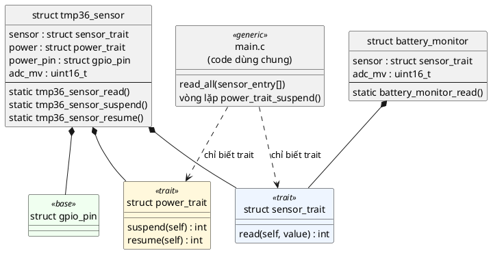

Luồng một lần đọc qua trait:

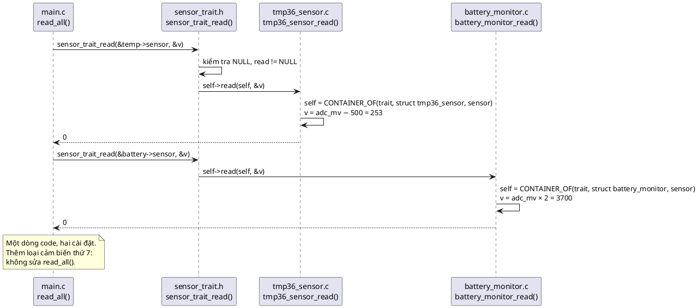

So với tình huống "Tháng 10" ở mục 1.2: không còn `switch (sensor->type)`. Thêm loại cảm biến mới = viết một file mới nhúng `struct sensor_trait`, thêm một dòng vào mảng `sensors[]`.

### 12.4. Hàm bọc chung (generic wrapper)

Sách viết `trait_x_do()` không kiểm tra gì. Code mẫu thêm kiểm tra:

```c
static inline int sensor_trait_read(struct sensor_trait *self, int32_t *value)
{
	if (!self || !value) {
		return -EINVAL;
	}
	if (!self->read) {
		return -ENOSYS; /* kiểu dẫn xuất chưa cài hành vi này */
	}
	return self->read(self, value);
}
```

- `-EINVAL`: lỗi của **người gọi** (truyền `NULL`).
- `-ENOSYS` ("function not implemented"): kiểu dẫn xuất **không cài** hành vi này. 💡 Cho phép một trait có hành vi tùy chọn: ví dụ một thiết bị chỉ `suspend` được mà không `resume` riêng.
- `static inline` trong header: mỗi file include có bản riêng, compiler có thể inline luôn, không tốn lời gọi hàm thêm. 💡 `inline` là từ khóa chuẩn từ C99.

📖 Best practice của sách về hàm cài trait: **Trait callbacks always static**: *"luôn cài các trait callback là hàm `static` bên trong file C của implementation. Điều này đảm bảo bạn không quên cập nhật chúng khi thay đổi implementation."* 💡 Một hàm `static` không có tên bên ngoài file, nên không ai gọi thẳng nó được: mọi lời gọi bắt buộc đi qua trait. Nếu bạn đổi chữ ký của trait mà quên sửa hàm cài, compiler báo lỗi ngay ở dòng gán con trỏ hàm trong `init`, ngay trong cùng file.

---

## 13. Trait và Virtual API: cái giá của con trỏ hàm trong từng instance

### 13.1. Khác biệt theo sách

📖 Phần Alternatives: *"**Virtual API Pattern**: pattern này xử lý interface **hoàn toàn trừu tượng**. Khác biệt là abstract interface là một cấu trúc dữ liệu dùng chung, **luôn hằng** và **dùng chung cho mọi instance** của một object, trong khi trait là một struct **chứa trong mỗi instance**, nơi con trỏ hàm **không nhất thiết luôn hằng**. Virtual API là cách vững chắc hơn và **tiết kiệm bộ nhớ hơn** để cài hàm thuần ảo trong C."*

📖 Chương *Virtual API* nhắc lại từ phía bên kia: Virtual API *"khác 'trait' trong Inheritance Pattern ở chỗ tiết kiệm bộ nhớ hơn nhiều, không cần lưu nhiều bản sao của bảng hàm ảo trong các instance"*.

### 13.2. 🔬 Thí nghiệm: RAM và Flash

Hai cách lưu cùng ba hành vi (`read`, `suspend`, `resume`) cho 50 cảm biến:

```c
/* Trait nhúng trong từng instance vs con trỏ tới bảng hàm const dùng chung */
#include <stdint.h>
#include <stdio.h>

#define N_SENSORS 50

/* Kiểu A: trait nhúng (bài này) - mỗi instance giữ bản sao con trỏ hàm */
struct sensor_trait {
	int (*read)(struct sensor_trait *self, int32_t *value);
};
struct power_trait {
	int (*suspend)(struct power_trait *self);
	int (*resume)(struct power_trait *self);
};
struct temp_a {
	struct sensor_trait sensor;
	struct power_trait power;
	uint16_t adc_mv;
};

/* Kiểu B: bảng hàm const dùng chung, instance chỉ giữ con trỏ (hướng bài 7) */
struct temp_b;
struct temp_ops {
	int (*read)(struct temp_b *self, int32_t *value);
	int (*suspend)(struct temp_b *self);
	int (*resume)(struct temp_b *self);
};
struct temp_b {
	const struct temp_ops *ops;
	uint16_t adc_mv;
};

static int b_read(struct temp_b *self, int32_t *value) { *value = self->adc_mv; return 0; }
static int b_suspend(struct temp_b *self) { (void)self; return 0; }
static int b_resume(struct temp_b *self) { (void)self; return 0; }

static const struct temp_ops temp_ops = { b_read, b_suspend, b_resume };

struct temp_a sensors_a[N_SENSORS];
struct temp_b sensors_b[N_SENSORS];

int main(void)
{
	for (int i = 0; i < N_SENSORS; i++) {
		sensors_b[i].ops = &temp_ops;
	}
	printf("sizeof(struct temp_a) = %u -> %d instance = %u byte RAM\n",
	       (unsigned)sizeof(struct temp_a), N_SENSORS, (unsigned)sizeof(sensors_a));
	printf("sizeof(struct temp_b) = %u -> %d instance = %u byte RAM + %u byte bảng ops (Flash)\n",
	       (unsigned)sizeof(struct temp_b), N_SENSORS, (unsigned)sizeof(sensors_b),
	       (unsigned)sizeof(temp_ops));
	return 0;
}
```

Output thật:

```
sizeof(struct temp_a) = 32 -> 50 instance = 1600 byte RAM
sizeof(struct temp_b) = 16 -> 50 instance = 800 byte RAM + 24 byte bảng ops (Flash)
```

Và `nm` trên file `.o` cho biết mỗi thứ nằm ở vùng nào:

```
0000000000000000 B sensors_a
0000000000000640 B sensors_b
0000000000000000 r temp_ops
```

- `B` = `.bss` (RAM). `r` = **read-only data** (`.rdata`/`.rodata`), trên vi điều khiển nằm trong **Flash**.
- Kiểu A: ba con trỏ hàm **lặp lại 50 lần** trong RAM. Kiểu B: mỗi instance chỉ một con trỏ (`ops`), bảng hàm có **đúng một bản** trong Flash.
- 💡 Trên Cortex-M (con trỏ 4 byte), tỉ lệ tương tự: kiểu A tốn 3 × 4 = 12 byte con trỏ hàm mỗi instance, kiểu B tốn 4. Trên một MCU 20 KB RAM, khác biệt này có ý nghĩa. (Con số Cortex-M là suy ra, không đo.)

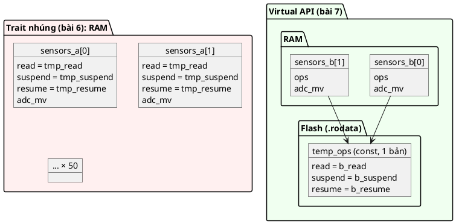

### 13.3. 🔬 Thí nghiệm: "không nhất thiết luôn hằng"

```c
#include <stdint.h>

struct sensor_trait {
	int (*read)(struct sensor_trait *self, int32_t *value);
};
struct temp_a {
	struct sensor_trait sensor;
};

struct temp_b;
struct temp_ops {
	int (*read)(struct temp_b *self, int32_t *value);
};
struct temp_b {
	const struct temp_ops *ops;
};

static int fake_read(struct sensor_trait *self, int32_t *value) { (void)self; *value = 999; return 0; }
static int fake_read_b(struct temp_b *self, int32_t *value) { (void)self; *value = 999; return 0; }

void tamper(struct temp_a *a, struct temp_b *b)
{
	a->sensor.read = fake_read;  /* trait nhúng: sửa được lúc chạy, compiler im lặng */
	b->ops->read = fake_read_b;  /* bảng const: compiler chặn */
}
```

Kết quả dịch:

```
i4b_overwrite.c:24:22: error: assignment of member 'read' in read-only object
```

Chỉ dòng thứ hai bị chặn. Con trỏ hàm trong trait nhúng là **dữ liệu RAM thường**: code nào cũng sửa được, và một lỗi ghi tràn bộ nhớ cũng phá được nó (lần gọi sau nhảy vào địa chỉ rác, như bài 5 mục 11.2). Bảng `const` nằm trong Flash: compiler chặn lúc build, và trên MCU, phần cứng cũng không cho ghi Flash bằng lệnh store thường.

💡 Tính "không hằng" đôi khi là **ưu điểm**: mỗi instance có thể có hành vi riêng, đổi được lúc chạy (ví dụ một cảm biến chuyển sang hàm `read` giả lập khi đang ở chế độ test). Callback của bài 5 cần đúng tính chất này: mỗi observer gán handler riêng. Còn khi mọi instance cùng kiểu luôn dùng cùng một bộ hàm, Virtual API (bài 7) là lựa chọn tốt hơn.

📖 Đây chính là câu hỏi quiz số 4 của sách (mục 25).

---

# Phần C — Đọc code

## 14. Đọc code mẫu từng dòng

Cấu trúc code mẫu:

| File | Vai trò | Quan hệ |
|---|---|---|
| [inc/container_of.h](inc/container_of.h) | Macro downcast có kiểm tra kiểu | Giống bài 5 |
| [inc/slist.h](inc/slist.h), [src/slist.c](src/slist.c) | **Base**: node danh sách + thuật toán danh sách | Giống bài 5 |
| [inc/gpio_pin.h](inc/gpio_pin.h), [src/gpio_pin.c](src/gpio_pin.c) | **Base**: chân GPIO output, biết active-low | |
| [inc/led.h](inc/led.h), [src/led.c](src/led.c) | **Derived**: LED = `gpio_pin` + `slist_node` | Kế thừa đơn + đa kế thừa |
| [inc/led_group.h](inc/led_group.h), [src/led_group.c](src/led_group.c) | Thuật toán trên danh sách LED | Downcast từ node |
| [inc/sensor_trait.h](inc/sensor_trait.h), [inc/power_trait.h](inc/power_trait.h) | **Trait** + hàm bọc chung `static inline` | |
| [inc/tmp36_sensor.h](inc/tmp36_sensor.h), [src/tmp36_sensor.c](src/tmp36_sensor.c) | Cài hai trait + chứa `gpio_pin` | Đa kế thừa |
| [inc/battery_monitor.h](inc/battery_monitor.h), [src/battery_monitor.c](src/battery_monitor.c) | Cài một trait | |
| [main.c](main.c) | Ba demo: kế thừa + delegator, list node, trait | |

### 14.1. [inc/gpio_pin.h](inc/gpio_pin.h) và [src/gpio_pin.c](src/gpio_pin.c): base class

```c
struct gpio_pin {
	const char *port;
	uint8_t pin;
	bool active_low;
	bool level; /* Mức điện thật trên chân (mô phỏng thanh ghi ODR) */
};
```
- Struct **public** (nằm trong header): bắt buộc, vì derived phải nhúng nó (mục 3). Base trong Inheritance Pattern không thể opaque với derived.
- `level` là mức **vật lý**, `active_low` quyết định mức nào là "bật". Tách hai khái niệm này chính là điều làm `led_on_direct` ở 🔬 mục 6.3 hỏng.
- 💡 Trên chip thật, `level` sẽ không phải một field mà là một bit trong thanh ghi ODR của port, ghi qua con trỏ `volatile` (bài 1, mục 7). Code mẫu mô phỏng bằng field để chạy trên PC.

```c
int gpio_pin_init(struct gpio_pin *self, const char *port, uint8_t pin, bool active_low)
{
	if (!self || !port || pin > 15) {
		return -EINVAL;
	}

	memset(self, 0, sizeof(*self));
	self->port = port;
	self->pin = pin;
	self->active_low = active_low;
	/* Khởi động ở trạng thái "không active": active-low thì phải kéo lên mức 1 */
	self->level = active_low;
	return 0;
}
```
- `pin > 15`: một port GPIO của STM32 có 16 chân (0..15). Kiểm tra sớm, trả `-EINVAL`.
- `self->level = active_low`: trạng thái ban đầu là **tắt** theo nghĩa logic. Với LED active-low, "tắt" nghĩa là mức 1. 💡 Đây là chi tiết thật trong firmware: cấu hình sai mức ban đầu làm LED (hay relay, hay motor!) bật lên một khoảnh khắc lúc khởi động.

```c
int gpio_pin_set_active(struct gpio_pin *self, bool active)
{
	if (!self) {
		return -EINVAL;
	}

	self->level = active != self->active_low;
	return 0;
}

bool gpio_pin_is_active(const struct gpio_pin *self)
{
	return self ? self->level != self->active_low : false;
}

bool gpio_pin_level(const struct gpio_pin *self)
{
	return self ? self->level : false;
}
```
- Ghi và đọc đều đi qua cùng một quy tắc XOR (bảng ở mục 9.1).
- `gpio_pin_level` trả mức vật lý: dùng cho demo và test, để thấy derived không cần biết tới nó.

### 14.2. [inc/led.h](inc/led.h) và [src/led.c](src/led.c): derived

```c
#include "gpio_pin.h"
#include "slist.h"
```
Derived include header của **mọi base** nó chứa. Đó là dependency tự nhiên của kế thừa: derived phụ thuộc base, base không biết derived.

```c
struct led {
	struct gpio_pin pin;
	struct slist_node node;
	const char *name;
};
```
- `pin` đặt **đầu tiên**: không bắt buộc, nhưng giúp `&self->pin` bằng `self`, nên delegator không tốn lệnh `add` nào (🔬 mục 9.3). Code vẫn **không dựa vào** điều đó: mọi downcast đều dùng `CONTAINER_OF`.
- `node` là base thứ hai: LED "là một" phần tử danh sách. 💡 Một LED chỉ nằm được trong **một** nhóm cùng lúc. Muốn một LED thuộc hai nhóm (ví dụ "nhóm trạng thái" và "nhóm tắt khi ngủ"), cần hai node: `struct slist_node group_node; struct slist_node sleep_node;`.
- Comment trong header ghi rõ quy ước: *"Không bao giờ là con trỏ: LED CHỨA base, không trỏ tới base."*

```c
int led_init(struct led *self, const char *name, const char *port, uint8_t pin, bool active_low)
{
	if (!self || !name) {
		return -EINVAL;
	}

	memset(self, 0, sizeof(*self));
	self->name = name;
	return gpio_pin_init(&self->pin, port, pin, active_low);
}
```
- `init` của derived **gọi `init` của base** (như constructor C++ gọi constructor lớp cha). 📖 Sách làm y hệt: `derived_init` gọi `base_one_init` và `base_two_init`.
- Không gọi gì cho `node`: `memset` đã đặt `next = NULL`, và `slist_append` tự đặt lại khi thêm vào nhóm.
- Trả thẳng mã lỗi của base: tham số sai (`pin = 20`) được `gpio_pin_init` phát hiện, `led_init` chuyển tiếp lên.

```c
int led_on(struct led *self)
{
	if (!self) {
		return -EINVAL;
	}

	return gpio_pin_set_active(&self->pin, true);
}

int led_toggle(struct led *self)
{
	if (!self) {
		return -EINVAL;
	}

	return gpio_pin_set_active(&self->pin, !gpio_pin_is_active(&self->pin));
}

bool led_is_on(const struct led *self)
{
	return self ? gpio_pin_is_active(&self->pin) : false;
}
```
- Mỗi method của LED là một delegator: kiểm tra `self`, upcast `&self->pin`, gọi method base.
- Phải tự kiểm tra `self` **trước** khi viết `&self->pin`: với `self == NULL`, `&self->pin` về lý thuyết là phép tính trên con trỏ `NULL` (hành vi không xác định), dù với offset 0 nó thường ra `NULL`.
- `led_toggle` được viết hoàn toàn bằng **hai method của base**: không đọc `self->pin.level` lần nào.
- `led_is_on` nhận `const struct led *` và truyền `&self->pin` (kiểu `const struct gpio_pin *`) cho `gpio_pin_is_active`, vốn cũng nhận con trỏ `const`. `const` đi xuyên qua kế thừa một cách tự nhiên.

### 14.3. [inc/led_group.h](inc/led_group.h) và [src/led_group.c](src/led_group.c): thuật toán chung

```c
struct led_group {
	const char *name;
	struct slist leds;
};

int led_group_add(struct led_group *self, struct led *led);
```
API nhận **`struct led *`**, không nhận `struct slist_node *`. Đây là hàng rào chống lỗi "hai kiểu trong một danh sách" (🔬 mục 10.4): bên ngoài chỉ đưa được LED vào nhóm.

```c
int led_group_add(struct led_group *self, struct led *led)
{
	if (!self || !led) {
		return -EINVAL;
	}

	if (slist_contains(&self->leds, &led->node)) {
		return -EALREADY;
	}

	slist_append(&self->leds, &led->node);
	return 0;
}
```
Upcast `&led->node` để đưa cho thuật toán danh sách. Kiểm tra trùng giống `button_add_callback` ở bài 5 (thêm hai lần thành vòng tròn).

```c
size_t led_group_count_on(const struct led_group *self)
{
	size_t count = 0;

	if (!self) {
		return 0;
	}

	for (const struct slist_node *node = self->leds.head; node; node = node->next) {
		const struct led *led = CONTAINER_OF(node, struct led, node);

		if (led_is_on(led)) {
			count++;
		}
	}
	return count;
}
```
- Vòng lặp **thường** (không SAFE) là đủ: thân vòng lặp không gỡ node nào.
- `CONTAINER_OF` với `node` là `const struct slist_node *`: macro bỏ mất `const` (bài 5, mục 12.1), nên mình gán kết quả vào `const struct led *` để giữ lại lời hứa "không sửa".
- `led_group_all_off` (đã đọc ở mục 10.3) dùng bản SAFE cho chắc, phòng khi sau này `led_off` có hiệu ứng phụ gỡ LED khỏi nhóm.

### 14.4. [inc/sensor_trait.h](inc/sensor_trait.h) và [inc/power_trait.h](inc/power_trait.h): trait

Đã đọc ở mục 12.3 và 12.4. Thêm hai chú ý:
- Header include `<errno.h>` vì hàm `static inline` trong header dùng `EINVAL`, `ENOSYS`. Header phải tự đủ.
- `struct power_trait` có **hai** con trỏ hàm: một trait có thể là một nhóm hành vi liên quan, không nhất thiết chỉ một.

### 14.5. [inc/tmp36_sensor.h](inc/tmp36_sensor.h) và [src/tmp36_sensor.c](src/tmp36_sensor.c)

```c
struct tmp36_sensor {
	struct sensor_trait sensor;
	struct power_trait power;
	struct gpio_pin power_pin;
	uint16_t adc_mv; /* Mô phỏng kết quả ADC; chip thật sẽ đọc thanh ghi ADC */
};
```
💡 TMP36 là cảm biến nhiệt analog có thật: điện áp ra = 500 mV + 10 mV/°C. Board cấp nguồn cho nó qua một chân GPIO để tiết kiệm điện khi ngủ: đó là `power_pin`, một **base class** (dữ liệu + method), khác với hai **trait** (chỉ hành vi).

```c
static int tmp36_sensor_read(struct sensor_trait *trait, int32_t *value)
{
	struct tmp36_sensor *self = CONTAINER_OF(trait, struct tmp36_sensor, sensor);

	if (!gpio_pin_is_active(&self->power_pin)) {
		return -EAGAIN; /* cảm biến đang tắt nguồn: không có số đo */
	}

	/* Đơn vị 0.1 °C: (mV - 500) / 10 °C = (mV - 500) * 0.1 °C */
	*value = (int32_t)self->adc_mv - 500;
	return 0;
}
```
- Tham số tên `trait`, không phải `self`: vì nó **chưa phải** `self`. Dòng `CONTAINER_OF` biến nó thành `self`. Quy ước đặt tên này giúp không nhầm hai con trỏ.
- Hàm cài trait **dùng base class khác** của cùng object (`self->power_pin`): các phần kế thừa phối hợp với nhau bên trong derived.
- `-EAGAIN` ("thử lại sau"): cảm biến tắt nguồn không phải lỗi lập trình, chỉ là chưa có dữ liệu.
- `(int32_t)self->adc_mv - 500`: ép sang kiểu có dấu **trước** khi trừ. 💡 Nếu không ép, `uint16_t` được nâng lên `int` nên vẫn đúng trên PC, nhưng viết rõ ra thì không ai phải nhớ quy tắc nâng kiểu. Ví dụ 753 mV ra 253, tức 25,3 °C. Dưới 500 mV ra số âm (nhiệt độ âm), nên kiểu có dấu là cần thiết.

```c
static int tmp36_sensor_suspend(struct power_trait *trait)
{
	struct tmp36_sensor *self = CONTAINER_OF(trait, struct tmp36_sensor, power);

	return gpio_pin_set_active(&self->power_pin, false);
}
```
`CONTAINER_OF` với member **`power`** (offset 8), khác với `tmp36_sensor_read` dùng member `sensor` (offset 0). Mỗi trait downcast bằng tên của chính nó.

```c
int tmp36_sensor_init(struct tmp36_sensor *self, const char *port, uint8_t pin)
{
	if (!self) {
		return -EINVAL;
	}

	memset(self, 0, sizeof(*self));
	self->sensor = (struct sensor_trait){ .read = tmp36_sensor_read };
	self->power = (struct power_trait){
		.suspend = tmp36_sensor_suspend,
		.resume = tmp36_sensor_resume,
	};

	int err = gpio_pin_init(&self->power_pin, port, pin, false);

	if (err) {
		return err;
	}
	return gpio_pin_set_active(&self->power_pin, true);
}
```
- Gán trait bằng compound literal, đúng kiểu sách làm. Dòng này chạy **cho mỗi instance**: đó là cái giá RAM ở mục 13.
- Khởi tạo base `power_pin` bằng `init` của nó, rồi bật nguồn cảm biến.

### 14.6. [inc/battery_monitor.h](inc/battery_monitor.h) và [src/battery_monitor.c](src/battery_monitor.c)

```c
static int battery_monitor_read(struct sensor_trait *trait, int32_t *value)
{
	struct battery_monitor *self = CONTAINER_OF(trait, struct battery_monitor, sensor);

	*value = (int32_t)self->adc_mv * 2;
	return 0;
}
```
💡 Pin Li-ion lên tới 4,2 V, vượt dải đo của ADC 3,3 V, nên board chia đôi điện áp bằng hai điện trở bằng nhau. Firmware nhân 2 để ra điện áp thật. `battery_monitor_init` gán trait bằng `self->sensor.read = battery_monitor_read;`: cách gán từng field, tương đương compound literal.

### 14.7. [main.c](main.c)

```c
struct sensor_entry {
	const char *name;
	const char *unit;
	struct sensor_trait *sensor;
};
```
Trait chỉ có hành vi, không có tên hay đơn vị. `main.c` ghép thêm thông tin hiển thị **bên cạnh** con trỏ trait. 💡 Đặt `name` vào trait sẽ biến trait thành dữ liệu, trái với định nghĩa "tập hành vi".

```c
static void read_all(const struct sensor_entry *entries, size_t count)
{
	for (size_t i = 0; i < count; i++) {
		int32_t value = 0;
		int err = sensor_trait_read(entries[i].sensor, &value);
		...
	}
}
```
`read_all` **không include** `tmp36_sensor.h` hay `battery_monitor.h` nếu tách ra file riêng: nó chỉ cần `sensor_trait.h`. Đây là sự tách rời mà trait mang lại.

```c
	struct power_trait *power_devices[] = { &temp->power };
	const size_t n_sensors = sizeof(sensors) / sizeof(sensors[0]);
```
- Chỉ TMP36 vào mảng `power_devices`. `battery_monitor` không có `power_trait` nên **không thể** bị đưa nhầm vào (không có member `power` để lấy địa chỉ). Compiler chặn hộ.
- `sizeof(mảng) / sizeof(phần_tử_đầu)`: đếm số phần tử lúc compile, thêm phần tử vào mảng không phải sửa con số.

```c
	static struct led status;
	...
	led_init(&error, "LED_ERROR", "PB", 0, true); /* LED nối lên VCC: mức 0 mới sáng */
```
Mọi object `static` (sống suốt chương trình, nằm trong `.bss`), nối dây ở một chỗ: 📖 best practice số một của chương, *"Always use Object Pattern"*.

---

## 15. Theo dõi demo chạy từng bước

Output đầy đủ của `make run`:

```
1. Kế thừa + delegator: struct led chứa struct gpio_pin
  LED_STATUS PA5 active_low=0 -> logic ON , mức điện trên chân = 1
  LED_ERROR  PB0 active_low=1 -> logic ON , mức điện trên chân = 0
  offsetof(struct led, pin) = 0, offsetof(struct led, node) = 16

2. Kế thừa slist_node: thuật toán danh sách viết một lần
  số LED đang sáng: 3
  [ALL] tắt LED_STATUS
  [ALL] tắt LED_ERROR
  [ALL] tắt LED_WIFI
  số LED đang sáng: 0
  thêm LED_STATUS vào nhóm lần 2: -EALREADY

3. Trait: đối xử chung với mọi kiểu có cùng trait
  TEMP     253 x0.1 °C
  BATTERY  3700 mV
  suspend mọi thiết bị có power_trait
  TEMP     -EAGAIN (đang tắt nguồn)
  BATTERY  3700 mV
  resume
  TEMP     253 x0.1 °C
  BATTERY  3700 mV
  offsetof(struct tmp36_sensor, sensor/power/power_pin) = 0/8/24
```

### Sau phần khởi tạo trong `main`

| Object | Trạng thái |
|---|---|
| `status` | `pin` = PA5, `active_low=0`, `level=0` (tắt) |
| `error` | `pin` = PB0, `active_low=1`, `level=1` (tắt, vì active-low) |
| `wifi` | `pin` = PB7, `active_low=0`, `level=0` (tắt) |
| `all` | danh sách: `status.node` → `error.node` → `wifi.node` |
| `board_temp` | trait đã gán; `power_pin` PC3 `level=1` (đã bật nguồn); `adc_mv=0` |
| `battery` | trait đã gán; `adc_mv=0` |

### Demo 1: kế thừa + delegator

| # | Lệnh | Đường đi | State sau lệnh |
|---|---|---|---|
| 1 | `led_on(&status)` | → `gpio_pin_set_active(&status.pin, true)` | `level = true != false = 1` |
| 2 | `led_on(&error)` | → `gpio_pin_set_active(&error.pin, true)` | `level = true != true = 0` |
| 3 | `print_led` × 2 | `led_is_on` → `gpio_pin_is_active` | Cả hai **logic ON**, nhưng mức chân **1** và **0** |

Đây là điểm chính của demo 1: `main.c` gọi **cùng một hàm** `led_on` cho hai LED đấu dây ngược nhau, và cả hai đều sáng. Kiến thức về active-low chỉ nằm trong `gpio_pin.c`.

### Demo 2: kế thừa list node

| # | Lệnh | Chi tiết | Kết quả |
|---|---|---|---|
| 4 | `led_toggle(&wifi)` | `is_active` = false → `set_active(true)` | `wifi.level = 1` |
| 5 | `led_group_count_on(&all)` | Duyệt 3 node, mỗi node `CONTAINER_OF` → `led_is_on` | 3 |
| 6 | `led_group_all_off(&all)` | Mỗi node → `led_off` | `status.level=0`, `error.level=1`, `wifi.level=0` |
| 7 | `led_group_count_on(&all)` | | 0 |
| 8 | `led_group_add(&all, &status)` | `slist_contains` thấy `status.node` | `-EALREADY`, danh sách không đổi |

Để ý bước 6: `error.level` thành **1** khi tắt (active-low). Thuật toán nhóm không biết, không cần biết.

### Demo 3: trait

| # | Lệnh | Chi tiết | Kết quả |
|---|---|---|---|
| 9 | `tmp36_sensor_sim_set_mv(temp, 753)`, `battery_monitor_sim_set_mv(battery, 1850)` | Giả lập ADC | |
| 10 | `read_all` | TEMP: `power_pin` active → 753 − 500 = 253. BATTERY: 1850 × 2 = 3700 | `253 x0.1 °C`, `3700 mV` |
| 11 | `power_trait_suspend(&temp->power)` | → `tmp36_sensor_suspend` → `CONTAINER_OF(..., power)` → `gpio_pin_set_active(&power_pin, false)` | `power_pin.level = 0` |
| 12 | `read_all` | TEMP: `power_pin` không active → `-EAGAIN`. BATTERY không bị ảnh hưởng | |
| 13 | `power_trait_resume` | → `power_pin.level = 1` | |
| 14 | `read_all` | Như bước 10 | |

💡 Bước 11 là một chuỗi ba tầng: **trait** (`power_trait`) → **cài đặt** (`tmp36_sensor_suspend`) → **base class** (`gpio_pin`). Ba kiểu kế thừa trong bài phối hợp trong một lời gọi.

---

## 16. Các quyết định thiết kế và phương án khác

### `pin` nằm ở offset 0 nhưng vẫn dùng `CONTAINER_OF`

Có thể ép kiểu thẳng `(struct led *)pin` vì `pin` ở đầu. Không làm vì: thứ tự field có thể đổi; `node` thì không bao giờ ở đầu được cùng lúc với `pin`; và `CONTAINER_OF` không tốn gì lúc chạy (bài 5, mục 4.4). Một quy tắc cho mọi trường hợp dễ nhớ hơn hai quy tắc.

### Tên member: `pin`, `node` thay vì `gpio_pin`, `slist_node`

Sách dùng tên trùng kiểu: `struct base_one base_one;`. Code mẫu chọn tên theo **vai trò** (`pin`, `node`, `power_pin`) vì `struct tmp36_sensor` có thể chứa **hai** `gpio_pin` (chân nguồn, chân chọn kênh), khi đó tên kiểu không còn đủ để phân biệt. Với base chỉ xuất hiện một lần, dùng tên kiểu như sách cũng rất tốt.

### Trait nhúng thay vì bảng `const`

Bài này cố ý dùng trait **nhúng** đúng như sách, để thấy rõ cái giá (🔬 mục 13). Bài 7 sẽ chuyển sang bảng `const` dùng chung.

### Hàm bọc chung `static inline` trong header

Phương án khác: hàm thường trong `sensor_trait.c`. Không chọn vì hàm bọc chỉ có vài dòng, và `static inline` cho phép compiler xóa luôn lời gọi. 💡 Bài 7 (sách) đặt hàm bọc trong một file `.c` riêng (`serial.c`) vì ở đó struct trait được giấu khỏi người dùng; khi trait phải public như ở đây, `static inline` gọn hơn.

### `-ENOSYS` cho hành vi chưa cài

Sách gọi thẳng `self->do_x(self)`, con trỏ `NULL` là crash. Code mẫu cho phép trait có hành vi để trống và báo `-ENOSYS`. Phương án khác: bắt buộc mọi hành vi phải cài (kiểm tra trong `init` bằng `assert`). 📖 Chương Virtual API của sách cảnh báo *"Overly specific interfaces"*: nếu bạn hay phải viết hàm giả cho một interface thì interface đó quá cụ thể.

### `led_group` thay vì để người dùng tự gọi `slist_append`

Bọc danh sách trong API có kiểu (`struct led *`) để chặn lỗi trộn kiểu (🔬 mục 10.4). Đổi lại phải viết thêm vài hàm.

### `struct led` không opaque

Không thể vừa opaque vừa nhúng được: `led_group` không cần biết bên trong LED, nhưng **bất kỳ ai muốn nhúng `struct led`** (ví dụ một `struct status_indicator` kế thừa LED) đều cần định nghĩa đầy đủ. 📖 Đây là cùng nhược điểm sách nêu ở chương Opaque: opaque phá vỡ cây dữ liệu phân cấp.

---

# Phần D — Thực tế và tổng kết

## 17. Inheritance Pattern trong thực tế

💡 Phần này là kiến thức chung về các thư viện thật, **không chạy** trong bài và không trích từ sách.

**Linux kernel: `struct list_head`.** Danh sách đôi intrusive dùng ở hầu hết mọi nơi trong kernel. Struct nào muốn vào danh sách thì chứa `struct list_head`; `list_entry(ptr, type, member)` chính là `container_of`; `list_for_each_entry` duyệt và downcast luôn. Một struct thường chứa **nhiều** `list_head` để nằm trong nhiều danh sách cùng lúc.

**Zephyr RTOS.**
- `sys_snode_t`, `sys_dnode_t`: node danh sách đơn/đôi, như sách trình bày.
- `struct k_work_delayable` **chứa** `struct k_work work` làm member đầu tiên: "việc trì hoãn được" kế thừa "việc". Hàm `k_work_delayable_from_work()` dùng `CONTAINER_OF` để downcast từ `struct k_work *` về `struct k_work_delayable *`. Đây là kế thừa đơn đúng nghĩa trong một RTOS thật.
- `struct gpio_callback` (bài 5) kế thừa `sys_snode_t`.

**FreeRTOS: `ListItem_t`.** FreeRTOS chọn cách khác: mỗi `ListItem_t` có một con trỏ ngược `pvOwner` (kiểu `void *`) trỏ về object chứa nó, thay vì dùng `CONTAINER_OF`. Task control block chứa **hai** list item (`xStateListItem`, `xEventListItem`) để cùng lúc nằm trong danh sách "sẵn sàng/chờ" và danh sách "chờ sự kiện": đa kế thừa list node. Cái giá: thêm một con trỏ mỗi item và mất kiểm tra kiểu ở chỗ ép `pvOwner`.

**STM32 HAL.** `UART_HandleTypeDef` chứa `UART_InitTypeDef Init` (nhúng cấu hình) và **trỏ** tới `USART_TypeDef *Instance` (thanh ghi). Hai quan hệ khác nhau, đúng như mục 1.1: cấu hình là một phần của handle; khối thanh ghi là tài nguyên phần cứng có sẵn, handle chỉ dùng nó.

**C++.** `class Led : public GpioPin` sinh ra đúng bố cục như `struct led { struct gpio_pin pin; ... }` (🔬 mục 2.2). Compiler viết hộ upcast, downcast và (với `virtual`) bảng hàm. 📖 Sách: *"Ở cốt lõi, điều quan trọng là triết lý chứ không phải tính năng ngôn ngữ."*

---

## 18. Unit test với kế thừa và trait

```c
#include "container_of.h"
#include "led.h"
#include "led_group.h"
#include "sensor_trait.h"
#include "tmp36_sensor.h"

#include <assert.h>
#include <errno.h>
#include <stdio.h>

/* 1. Lớp dẫn xuất phải giữ đúng hành vi của base (active-low) */
static void test_led_respects_active_low(void)
{
	struct led led;

	assert(led_init(&led, "T", "PB", 0, true) == 0);
	assert(!led_is_on(&led) && gpio_pin_level(&led.pin) == true);
	assert(led_on(&led) == 0);
	assert(led_is_on(&led) && gpio_pin_level(&led.pin) == false);
	assert(led_toggle(&led) == 0 && !led_is_on(&led));
}

/* 2. Thuật toán trên danh sách chạy đúng với mọi LED trong nhóm */
static void test_group(void)
{
	struct led a, b;
	struct led_group g;

	led_init(&a, "A", "PA", 1, false);
	led_init(&b, "B", "PA", 2, true);
	assert(led_group_init(&g, "G") == 0);
	assert(led_group_add(&g, &a) == 0 && led_group_add(&g, &b) == 0);
	assert(led_group_add(&g, &a) == -EALREADY);
	led_on(&a);
	led_on(&b);
	assert(led_group_count_on(&g) == 2);
	assert(led_group_remove(&g, &a) == 0);
	assert(led_group_count_on(&g) == 1);
	assert(led_group_remove(&g, &a) == -ENOENT);
}

/* 3. Trait giả (fake) để test code dùng chung mà không cần cảm biến thật */
struct fake_sensor {
	struct sensor_trait sensor;
	int32_t next_value;
	int calls;
};

static int fake_read(struct sensor_trait *trait, int32_t *value)
{
	struct fake_sensor *self = CONTAINER_OF(trait, struct fake_sensor, sensor);

	self->calls++;
	*value = self->next_value;
	return 0;
}

static void test_trait_wrapper(void)
{
	struct fake_sensor fake = { { fake_read }, 42, 0 };
	struct sensor_trait empty = { NULL };
	int32_t v = 0;

	assert(sensor_trait_read(&fake.sensor, &v) == 0 && v == 42 && fake.calls == 1);
	assert(sensor_trait_read(&empty, &v) == -ENOSYS);
	assert(sensor_trait_read(NULL, &v) == -EINVAL);
}

static void test_tmp36_suspend(void)
{
	struct tmp36_sensor t;
	int32_t v = 0;

	assert(tmp36_sensor_init(&t, "PC", 3) == 0);
	tmp36_sensor_sim_set_mv(&t, 500);
	assert(sensor_trait_read(&t.sensor, &v) == 0 && v == 0);
	assert(power_trait_suspend(&t.power) == 0);
	assert(sensor_trait_read(&t.sensor, &v) == -EAGAIN);
	assert(power_trait_resume(&t.power) == 0);
	assert(sensor_trait_read(&t.sensor, &v) == 0);
}

int main(void)
{
	test_led_respects_active_low();
	test_group();
	test_trait_wrapper();
	test_tmp36_suspend();
	printf("tất cả test đều qua\n");
	return 0;
}
```

Build: `gcc -std=c99 -Wall -Wextra -Werror -pedantic -Iinc test_inheritance.c src/*.c`

🔬 Output thật:

```
tất cả test đều qua
```

Ba kỹ thuật test đáng nhớ:
- **Test derived theo hợp đồng của base** (test 1): LED trên chân active-low phải đổi mức chân đúng. Đây là cách bắt fragile base class (📖 *"kiểm tra kỹ các kỳ vọng đặt lên derived class"*): khi base đổi, chạy lại test của **mọi** derived.
- **Fake trait** (test 3): một struct test chỉ nhúng trait và đếm số lần gọi. Code dùng chung (như `read_all`) test được mà không cần phần cứng, giống spy observer ở bài 5.
- **Test cài đặt qua trait** (test 4): gọi `sensor_trait_read(&t.sensor, ...)`, không gọi `tmp36_sensor_read` (vốn là `static`, không gọi được từ ngoài). Test đi đúng đường mà code thật đi.

💡 📖 Chương Virtual API của sách nhấn mạnh pitfall **Insufficient testing**: mọi yêu cầu của interface phải được kiểm chứng bằng unit test **cho từng cài đặt**. Với trait cũng vậy: `battery_monitor` cũng nên có test riêng cho `sensor_trait_read`.

---

## 19. Trade-off

| Tiêu chí | Copy-paste / viết lại | Kế thừa (containment) | Trait nhúng |
|---|---|---|---|
| **Tái sử dụng code** | Không | 📖 **Có**: vai trò chính | Có (code dùng chung chỉ viết một lần) |
| **RAM** | | Đúng bằng tổng các base, không con trỏ thêm | 💡 Mỗi instance thêm một con trỏ hàm cho mỗi hành vi (🔬 mục 13.2) |
| **Flash** | Lặp code | Một bản code base | Một bản mỗi cài đặt |
| **Tốc độ** | | Delegator gần như miễn phí: `jmp`, LTO xóa hẳn (🔬 mục 9.3) | Lời gọi gián tiếp, không inline được |
| **Đóng gói** | | 📖 **Yếu**: derived thấy và sửa được dữ liệu base (*"Violation of encapsulation"*) | Tốt hơn: code dùng chung chỉ thấy trait |
| **Viết code** | | 📖 Phải viết wrapper cho mọi method muốn lộ ra (*"Unnecessary code when wrapping"*) | Phải viết hàm cài + gán trong `init` |
| **Độ phức tạp** | Thấp lúc đầu, cao về sau | 📖 *"Added complexity"*, nhất là khi tự làm "virtual" bằng tay; trách nhiệm tuân theo quy ước nằm ở lập trình viên | Trung bình |
| **An toàn** | | Downcast sai kiểu không bị bắt (🔬 mục 10.4) | Con trỏ hàm có thể bị ghi đè (🔬 mục 13.3) |
| **Tính hằng** | | | 📖 Không nhất thiết hằng |

📖 Ba lợi ích sách nêu:
- **Clean design:** dùng lại cùng chức năng ở nhiều nơi nên nhìn code là biết điều gì sẽ xảy ra (🔬 mục 6.1 là phản ví dụ).
- **Clear expectations:** con người nắm khái niệm phân cấp tốt hơn nhiều so với hàng loạt chi tiết nhỏ phải nhớ cùng lúc; dữ liệu cấu trúc phân cấp thì kiến trúc dễ hiểu.
- **Simple high level architecture:** chia logic thành nhiều tầng trừu tượng, nên ở tầng ứng dụng chỉ còn phải làm việc với trừu tượng cấp cao (`led_on`, `sensor_trait_read`), không phải với thanh ghi.

---

## 20. Khi nào không nên dùng

📖 Ba phương án thay thế sách nêu:

- **Cải thiện chính base class:** *"đôi khi tốt hơn là thêm chức năng vào base class thay vì cố tạo derived class. Kế thừa trong C nên dùng chủ yếu khi bạn muốn **kết hợp nhiều chức năng** trong một object cấp cao hơn."* 💡 Ví dụ: nếu mọi chỗ dùng `gpio_pin` đều cần "nhấp nháy", hãy thêm `gpio_pin_toggle` vào base, đừng tạo `struct blinking_pin` chỉ để có một hàm.
- **Virtual API Pattern** (bài 7): khi cần interface **hoàn toàn trừu tượng**, nhiều instance cùng kiểu, bảng hàm hằng: tiết kiệm RAM hơn trait nhúng (mục 13).
- **Facade Pattern:** *"vì C không có cú pháp tách kế thừa khỏi composition, nhiều pattern trông giống nhau khi cài đặt. Một object kế thừa các hàm rồi ủy quyền lời gọi cho base class có thể trông rất giống facade. Khác biệt nằm ở **ý định** (ý định của Facade là **đơn giản hóa** interface, không giống ý định của ủy quyền trực tiếp)."*

💡 Thêm vài trường hợp nên dừng lại:
- **Quan hệ là "dùng", không phải "là một phần của".** GPS dùng UART: giữ con trỏ (bài 1), đừng nhúng.
- **Chưa có Object Pattern.** 📖 Sách nhắc tới hai lần: *"Đừng cố cài kế thừa trước khi có Object Pattern... dùng Object Pattern càng nhiều càng tốt, và rất có thể các quan hệ kế thừa đúng đắn sẽ tự hiện ra."*
- **Cây kế thừa sâu** (A chứa B chứa C chứa D): mỗi tầng một lớp wrapper, khó lần. Hai tầng thường là đủ trong firmware.
- **Base cần opaque** (giấu dependency vendor): containment bắt buộc lộ định nghĩa base. Khi đó dùng con trỏ tới object opaque và chấp nhận đó là quan hệ "dùng".

```plantuml
@startuml
set separator none
skinparam defaultFontName Segoe UI
start
:Module B muốn dùng lại\ndữ liệu/hành vi của A;
if (B chỉ DÙNG A, A sống độc lập?) then (có)
  :Giữ con trỏ tới A\n(association, bài 1); <<#F5F5F5>>
elseif (Thứ B cần thật ra mọi\nngười dùng A đều cần?) then (có)
  :Thêm vào chính A\n(improve base class); <<#FFF8C0>>
elseif (Chỉ cần đối xử chung\nnhiều kiểu theo hành vi?) then (có)
  if (Nhiều instance, hành vi\ncố định theo kiểu?) then (có)
    :Virtual API\n(bảng const, bài 7); <<#D0E8FF>>
  else (không)
    :Trait nhúng; <<#D0FFD0>>
  endif
else (B "là một" A,\ncần cả dữ liệu lẫn method)
  :Kế thừa: B CHỨA A\n+ method wrapper; <<#D0FFD0>>
endif
stop
@enduml
```

---

## 21. Lỗi hay gặp

| Lỗi | Hậu quả | Cách tránh |
|---|---|---|
| 📖 Derived sửa thẳng dữ liệu base (fragile base class) | Base đổi, derived hỏng âm thầm (🔬 mục 6.3) | Method wrapper gọi method base; test derived theo hợp đồng base |
| 📖 Viết wrapper cho mọi method của base | "Trọng lượng chết", nhiều code chỉ chuyển tiếp | Chỉ wrap thao tác có nghĩa với derived |
| 📖 Cài kế thừa trước khi có Object Pattern | Quan hệ sai, phải đập đi làm lại | Object Pattern trước, kế thừa sẽ tự lộ ra |
| 📖 Trộn nhiều kiểu trong một danh sách | `CONTAINER_OF` ra rác, đọc/ghi nhầm object (🔬 mục 10.4) | API thêm phần tử nhận đúng kiểu derived |
| "Kế thừa" bằng con trỏ tới base | Hai vòng đời, chia sẻ ngầm, không downcast được (🔬 mục 6.2) | Nhúng base |
| Ép kiểu thẳng thay `CONTAINER_OF` | Đúng với base đầu tiên, sai với mọi base khác (🔬 mục 4.2) | Luôn `CONTAINER_OF` |
| Quên gọi `init` của base trong `init` của derived | Base mang giá trị rác hoặc 0 sai (ví dụ `level` sai với active-low) | `derived_init` gọi `base_init` cho mọi base |
| Một node trong hai danh sách | Hai danh sách dính vào nhau | Mỗi danh sách một node riêng |
| Hàm cài trait không `static` | Bị gọi thẳng, bỏ qua trait; sửa trait dễ quên sửa hàm | 📖 *"Trait callbacks always static"* |
| Gọi thẳng `self->trait.fn(...)` khắp nơi | Không kiểm tra `NULL`, khó đổi cách gọi về sau | Dùng hàm bọc chung (`sensor_trait_read`) |
| Trait nhúng cho hàng trăm instance cùng kiểu | Tốn RAM lặp lại (🔬 mục 13.2) | Virtual API (bài 7) |
| Đặt dữ liệu (tên, cấu hình) vào trait | Trait không còn là "tập hành vi", khó dùng lại | Dữ liệu ở derived hoặc bên cạnh (như `sensor_entry`) |
| Cây kế thừa quá sâu | Khó lần, wrapper chồng wrapper | Ưu tiên ghép nhiều base nông (đa kế thừa) hơn một chuỗi sâu |

---

## 22. Quy trình refactor sang kế thừa

1. **Có Object Pattern trước.** Mọi module đã có `struct` + `self`? Nếu chưa, làm bài 1 trước (📖 sách nhấn mạnh).
2. **Tìm code lặp lại**: cùng một cấu trúc dữ liệu (danh sách, ring buffer) hay cùng một logic (GPIO active-low) xuất hiện ở nhiều module.
3. **Tách phần chung thành base**: một module Object Pattern hoàn chỉnh (`gpio_pin.c`, `slist.c`), có test riêng.
4. **Nhúng base vào từng derived**: thay các field lặp lại bằng một member `struct <base> <tên>;`. Đặt tên member theo kiểu hoặc vai trò.
5. **Viết lại method của derived thành delegator**: mọi chỗ derived đụng vào field của base chuyển thành lời gọi method của base. Dùng `grep "self->pin\."` để tìm chỗ còn sót.
6. **`derived_init` gọi `base_init`** cho mọi base.
7. **Thay mọi ép kiểu base → derived bằng `CONTAINER_OF`.**
8. **Với danh sách**: bọc trong API có kiểu (`led_group_add(struct led *)`), không để ai gọi thẳng `slist_append`.
9. **Với `switch (type)`**: rút hành vi chung thành trait; mỗi kiểu nhúng trait và cài hàm `static`; code dùng chung duyệt mảng con trỏ trait.
10. **Chạy test của base, rồi test của mọi derived** theo hợp đồng của base.

---

## 23. Câu hỏi thường gặp (FAQ)

**Hỏi: Kế thừa và composition (ghép) khác nhau thế nào, khi trong C cả hai đều là "nhúng struct"?**

📖 Sách thừa nhận: *"C không có cú pháp tách kế thừa khỏi composition, nên nhiều pattern trông giống nhau"*. Khác biệt nằm ở **ý định**: kế thừa là "B **là một** A, và B muốn được đối xử như A" (LED được đưa vào nơi cần `gpio_pin`, LED được xếp vào danh sách như một node). Composition là "B **có** một A để dùng bên trong, không ai bên ngoài cần coi B là A". Code giống hệt nhau; điều khác là bạn có upcast/downcast giữa chúng hay không.

**Hỏi: Có "override" (ghi đè method) trong C không?**

Với base class thường (`gpio_pin`): không. `led_on` là hàm mới của LED, không thay thế `gpio_pin_set_active`. Muốn **ghi đè thật**, tức là code chỉ cầm base mà gọi được hành vi của derived, base phải chứa con trỏ hàm: đó là trait (mục 12) hoặc Virtual API (bài 7).

**Hỏi: Derived có gọi được method của base trực tiếp không, ví dụ `gpio_pin_set_active(&led.pin, true)` từ `main.c`?**

Về kỹ thuật thì được (struct public). Nhưng 📖 quy ước số 3 của sách: bên ngoài dùng method của derived. Nếu `main.c` gọi thẳng method của base, `led.c` không còn kiểm soát được LED (ví dụ sau này LED cần ghi log mỗi lần bật).

**Hỏi: Một struct có thể vừa là base vừa là derived không?**

Có. Ví dụ `struct status_indicator { struct led led; uint16_t blink_ms; }` kế thừa LED, mà LED lại kế thừa `gpio_pin`. `status_indicator_on()` gọi `led_on(&self->led)`, `led_on` gọi `gpio_pin_set_active(&self->pin)`. Mỗi tầng chỉ biết tầng ngay dưới (Bài tập 3).

**Hỏi: Trait khác callback của bài 5 thế nào?**

Cùng cơ chế (struct chứa con trỏ hàm nhận chính struct đó, nhúng vào object, `CONTAINER_OF`), khác **mục đích**: callback là "báo cho tôi khi có chuyện xảy ra" (subject gọi observer), trait là "tôi biết làm việc X" (code dùng chung gọi object). Một struct callback có node danh sách vì subject cần giữ nhiều observer; trait thì thường không cần.

**Hỏi: Vì sao không đặt trait ở cuối struct?**

Vị trí không quan trọng với `CONTAINER_OF`. Code mẫu đặt trait đầu tiên cho dễ đọc ("TMP36 trước hết là một cảm biến"). Chỉ cần nhất quán trong project.

**Hỏi: `CONTAINER_OF` có bắt được lỗi trộn kiểu trong danh sách không?**

Không (🔬 mục 10.4). Nó chỉ kiểm tra con trỏ truyền vào có đúng **kiểu member** không (`struct slist_node *`), mà mọi node đều đúng kiểu đó. Nó không biết node **thật ra** nằm trong struct nào. Phòng lỗi này bằng thiết kế API (mục 10.4), không bằng compiler.

**Hỏi: Có nên `typedef struct gpio_pin gpio_pin_t;` cho gọn không?**

Như bài 2 (FAQ): sách và Linux giữ chữ `struct`. Với kế thừa còn thêm một lý do: `struct led { struct gpio_pin pin; }` cho thấy ngay `pin` là một **struct nhúng**, không phải số nguyên hay con trỏ.

---

## 24. Tóm tắt và checklist

**Một câu:** *Trong C, B kế thừa A nghĩa là B **chứa** A (không trỏ tới A), B có method riêng gọi method của A, ai cầm A muốn lấy lại B thì dùng `CONTAINER_OF`; kế thừa hành vi thì nhúng trait (struct chỉ chứa con trỏ hàm).*

**Vì sao nó chạy được:** struct nhúng nằm phẳng bên trong struct chứa, ở offset cố định; upcast là lấy địa chỉ member, downcast là trừ offset. C++ làm đúng việc này, chỉ là tự động (🔬 mục 2.2).

Checklist cho mỗi quan hệ kế thừa:

- [ ] Quan hệ thật sự là "là một / là một phần của", không phải "dùng"
- [ ] Base là module Object Pattern hoàn chỉnh, có test riêng
- [ ] Derived **chứa** base (member nhúng), không giữ con trỏ tới base
- [ ] Tên member gợi rõ base (`pin`, `node`, hoặc trùng tên kiểu)
- [ ] `derived_init` gọi `init` của mọi base
- [ ] Bên ngoài chỉ gọi method của derived; derived chỉ gọi method của base, không sửa thẳng field base
- [ ] Chỉ viết wrapper cho thao tác có nghĩa với derived
- [ ] Downcast luôn bằng `CONTAINER_OF`, không ép kiểu thẳng
- [ ] Danh sách chỉ chứa một kiểu; API thêm phần tử nhận đúng kiểu derived
- [ ] Mỗi danh sách object tham gia có một node riêng

Checklist cho trait:

- [ ] Trait chỉ chứa con trỏ hàm, không chứa dữ liệu
- [ ] Mỗi hàm trong trait nhận con trỏ tới chính trait làm tham số đầu
- [ ] Có hàm bọc chung kiểm tra `NULL` (`-EINVAL`, `-ENOSYS`)
- [ ] Hàm cài trait là `static`, dòng đầu là `CONTAINER_OF` với đúng tên member trait
- [ ] Cân nhắc Virtual API (bài 7) nếu nhiều instance cùng kiểu

---

## 25. Quiz (có đáp án)

Câu 1–4 là quiz gốc của sách. Câu 5–11 do Claude thêm.

**Câu 1.** 📖 Những lý do chính để dùng kế thừa trong kiến trúc phần mềm là gì?

<details><summary>Đáp án</summary>

📖 Vai trò **chính** là **tái sử dụng code**: viết một lần (danh sách, logic GPIO active-low), dùng lại ở mọi derived thay vì copy-paste (🔬 mục 6.1 cho thấy copy-paste sinh lỗi thế nào). Vai trò **thứ hai** là giữ chức năng **phân cấp** để dễ bảo trì: con người nắm cấu trúc phân cấp dễ hơn nhiều chi tiết rời rạc, và tầng ứng dụng chỉ làm việc với trừu tượng cấp cao (`led_on`, `sensor_trait_read`). Sách cũng nêu: tạo **cấu trúc dữ liệu tổng quát** (danh sách, cây AVL) chạy cho mọi kiểu, và **mở rộng** object khác với interface phong phú hơn.
</details>

**Câu 2.** 📖 Đa kế thừa được cài đặt trong C thế nào, và nên dùng quy ước đặt tên nào cho method để dễ bảo trì?

<details><summary>Đáp án</summary>

Bằng cách **nhúng nhiều struct base** vào derived: `struct derived { struct base_one base_one; struct base_two base_two; };`. Mỗi base nằm ở một offset riêng; upcast bằng `&self->base_two`, downcast bằng `CONTAINER_OF(p, struct derived, base_two)`. `derived_init` gọi `init` của từng base.

Chương sách không phát biểu quy ước thành một quy tắc riêng; 💡 từ ví dụ của sách có thể rút ra: member chứa base đặt **trùng tên kiểu base** (`struct base_one base_one`), method mang **tiền tố kiểu** của struct mà nó thao tác (`base_one_do_something`, `derived_do_something`), và derived ủy quyền bằng `<base>_<việc>(&self-><base>)`. Nhờ vậy nhìn một lời gọi là biết đang thao tác trên **phần base nào** của object, và hai base có field trùng tên (`x`) cũng không xung đột.
</details>

**Câu 3.** 📖 Trait mang lại lợi ích gì, và chúng liên quan thế nào tới đa kế thừa?

<details><summary>Đáp án</summary>

Trait cho phép **đối xử chung** với nhiều kiểu khác nhau theo **hành vi**: code dùng chung chỉ cầm `struct sensor_trait *` và gọi `sensor_trait_read`, chạy được với TMP36, battery monitor, hay kiểu thứ bảy viết sau này, không cần `switch (type)` và không include header của từng kiểu. Mỗi kiểu tự cài hành vi của mình (đa hình).

Liên quan tới đa kế thừa: mỗi trait là một **base** được nhúng vào derived, và một derived có thể nhúng **nhiều** trait (cùng với base class thường), tức là đa kế thừa. `struct tmp36_sensor` kế thừa `sensor_trait`, `power_trait` và `gpio_pin` cùng lúc; mỗi trait downcast về object bằng `CONTAINER_OF` với tên member của chính nó (🔬 ví dụ của sách ở mục 12.2: hai trait, cùng một `self`).
</details>

**Câu 4.** 📖 Trait nhúng trong derived struct có nhược điểm chính nào so với interface thuần ảo, vốn là hằng và chỉ được derived struct tham chiếu qua con trỏ?

<details><summary>Đáp án</summary>

(1) **Tốn bộ nhớ**: mỗi instance giữ **bản sao** của mọi con trỏ hàm trong RAM. 🔬 Mục 13.2: 50 cảm biến với 3 hành vi tốn 1600 byte RAM so với 800 byte RAM + 24 byte Flash khi dùng bảng `const` dùng chung. (2) **Không hằng**: con trỏ hàm trong trait là dữ liệu RAM thường, có thể bị sửa lúc chạy (cố ý hay do ghi tràn bộ nhớ), compiler không chặn; bảng `const` thì bị compiler chặn (🔬 mục 13.3: `assignment of member 'read' in read-only object`) và nằm trong Flash. (3) Mỗi `init` phải gán lại từng con trỏ hàm. 📖 Sách kết luận Virtual API là *"cách vững chắc hơn và tiết kiệm bộ nhớ hơn"* để cài hàm thuần ảo trong C.
</details>

**Câu 5.** Vì sao sách nói derived **không bao giờ** tham chiếu dữ liệu base qua con trỏ?

<details><summary>Đáp án</summary>

Với con trỏ: derived và base là **hai object** với hai vòng đời và hai lần cấp phát; nhiều derived có thể **ngầm chia sẻ** một base (🔬 mục 6.2: bật LED này, LED kia cũng sáng); và **không thể downcast** từ base về derived vì base không nằm trong derived (🔬 macro `CONTAINER_OF` có kiểm tra kiểu từ chối biên dịch). Containment cho một khối nhớ, một vòng đời, sở hữu rõ ràng, và `CONTAINER_OF` hoạt động. Con trỏ vẫn đúng cho quan hệ "dùng" (GPS dùng UART), nhưng đó không phải kế thừa.
</details>

**Câu 6.** Đoạn code sau chạy đúng hôm nay. Vì sao nó nguy hiểm?

```c
struct relay {
	struct gpio_pin pin;
	uint32_t switch_count;
};

void relay_close(struct relay *self)
{
	self->pin.level = 1;
	self->switch_count++;
}
```

<details><summary>Đáp án</summary>

`relay_close` sửa thẳng `self->pin.level`, dựa vào giả định "mức 1 là đóng relay". Đó là **chi tiết bên trong** của `gpio_pin`. Khi relay được nối active-low (hoặc base đổi cách lưu trạng thái), relay sẽ **mở** khi được bảo **đóng**: fragile base class (🔬 mục 6.3 cho thấy đúng hiện tượng với LED). Sửa: `gpio_pin_set_active(&self->pin, true);`. Lỗi này nguy hiểm hơn với relay so với LED, vì relay có thể điều khiển motor hay van.
</details>

**Câu 7.** Trong `struct derived { struct base_one a; struct base_two b; }`, con trỏ `struct base_two *p` trỏ vào `d.b`. Vì sao `(struct derived *)p` sai còn `CONTAINER_OF(p, struct derived, b)` đúng?

<details><summary>Đáp án</summary>

`b` nằm ở offset `sizeof(struct base_one)` (4 trong 🔬 mục 4.2), không phải 0. Ép kiểu thẳng không đổi địa chỉ, nên coi `&d + 4` là đầu của `d`: mọi field đọc lệch 4 byte, `own` bị đọc ở ngoài object (rác). `CONTAINER_OF` trừ đúng `offsetof(struct derived, b)` nên ra `&d`. Ép kiểu thẳng chỉ đúng với member đầu tiên, nhờ chuẩn C bảo đảm không có padding ở đầu struct. C++ `static_cast` tự trừ offset này (🔬 mục 2.2).
</details>

**Câu 8.** Một node của `struct uart_msg` lỡ được thêm vào danh sách LED. Compiler có báo không? Chuyện gì xảy ra khi duyệt?

<details><summary>Đáp án</summary>

Không báo: `slist_append` nhận `struct slist_node *`, và node của `uart_msg` đúng kiểu đó. Kiểm tra kiểu trong `CONTAINER_OF` cũng qua vì nó chỉ kiểm tra kiểu member. Khi duyệt, `CONTAINER_OF(n, struct led, node)` trừ offset của `node` trong **`struct led`** (16), trong khi node thật nằm ở offset 8 của `struct uart_msg`: ra địa chỉ 8 byte trước gói tin. 🔬 Mục 10.4: `pin=65 active_low=84`, chính là ký tự `'A'` và `'T'` của gói tin. Nếu sau đó gọi `led_off`, chương trình ghi đè dữ liệu UART. Phòng bằng API có kiểu (`led_group_add(struct led *)`).
</details>

**Câu 9.** `led_on()` chỉ gọi `gpio_pin_set_active()`. Có nên bỏ `led_on()` đi để "đỡ tốn" một lời gọi hàm không?

<details><summary>Đáp án</summary>

Không. 🔬 Mục 9.3 cho thấy với `-O2`, `led_on` chỉ là một phép kiểm tra `NULL` và một `jmp` (tail call); với LTO, nó **biến mất hoàn toàn**. Cái được lớn hơn nhiều: người dùng nói ngôn ngữ của LED (`led_on`, không phải "set active chân PB0"), `led.c` giữ quyền kiểm soát (sau này thêm log, giới hạn dòng, PWM mà không sửa người gọi), và dữ liệu base được bảo vệ khỏi truy cập trực tiếp (quy ước số 3 của sách).
</details>

**Câu 10.** Vì sao các hàm cài trait (`tmp36_sensor_read`, ...) nên là `static`?

<details><summary>Đáp án</summary>

📖 *"Trait callbacks always static"*: (1) hàm chỉ được gọi qua con trỏ hàm trong trait, nên không cần tên bên ngoài file; `static` chặn mọi lời gọi thẳng bỏ qua hàm bọc chung (và bỏ qua kiểm tra `NULL`, `-ENOSYS`). (2) Khi đổi chữ ký trait, compiler báo lỗi ở dòng gán con trỏ hàm trong `init`, ngay trong cùng file với hàm cài, nên không thể quên cập nhật. (3) Không làm "bẩn" không gian tên toàn cục với hàng chục hàm `xxx_read`.
</details>

**Câu 11.** Bạn có 200 node cảm biến không dây cùng một loại, mỗi node có `read`, `suspend`, `resume`, `get_rssi`. Nên dùng trait nhúng hay Virtual API? Vì sao?

<details><summary>Đáp án</summary>

**Virtual API** (bài 7). Cả 200 instance cùng kiểu, nên cùng một bộ 4 hàm; trait nhúng sẽ lặp 4 con trỏ hàm × 200 lần trong RAM (8 byte × 4 × 200 = 6400 byte trên PC 64-bit; 💡 4 byte × 4 × 200 = 3200 byte trên Cortex-M, con số suy ra, không đo), trong khi bảng `const` dùng chung chỉ tốn một con trỏ mỗi instance + một bảng duy nhất trong Flash (🔬 mục 13.2 cho cùng xu hướng với 50 instance). Bảng `const` còn không bị ghi đè lúc chạy. Trait nhúng chỉ đáng khi từng instance cần hành vi **riêng**, hoặc số instance rất ít.
</details>

---

## 26. Bài tập

### Bài 1: `struct relay` kế thừa `gpio_pin` (cơ bản)

Viết `inc/relay.h`, `src/relay.c`:
- `struct relay` chứa `struct gpio_pin pin` và đếm số lần đóng (`uint32_t cycles`), vì relay cơ khí có tuổi thọ giới hạn theo số lần đóng cắt.
- Delegator: `relay_close()`, `relay_open()`, `relay_is_closed()`. `relay_close` chỉ tăng `cycles` khi relay thật sự chuyển từ mở sang đóng.
- **Không** có dòng nào trong `relay.c` đọc/ghi `self->pin.level` (kiểm tra bằng `grep`).
- Test: relay active-low, đóng/mở 3 lần, kiểm tra `cycles == 3` và mức chân đúng.

### Bài 2: Refactor hàng đợi modem (refactor)

Lấy code ở 🔬 mục 6.1 (`timer_list` và `msg_queue` tự viết):
- Xóa cả hai cài đặt danh sách, cho `struct timer` và `struct msg` kế thừa `struct slist_node`.
- Viết `struct msg_queue` với API có kiểu: `msg_queue_push(struct msg_queue *, struct msg *)`, `struct msg *msg_queue_pop(struct msg_queue *)` (dùng `CONTAINER_OF`).
- Chạy lại kịch bản gỡ phần tử cuối rồi thêm phần tử mới: chứng minh lỗi mất `AT+CREG?` đã biến mất.
- **Câu hỏi suy nghĩ:** `msg_queue_pop` trả `NULL` khi hàng đợi rỗng. Có nên đổi sang `int msg_queue_pop(struct msg_queue *, struct msg **out)` trả `-EAGAIN` không? (Gợi ý: bài 9, Return Value Pattern.)

### Bài 3: Kế thừa hai tầng (nâng cao)

Viết `struct status_indicator` kế thừa `struct led` (tức là gián tiếp kế thừa `gpio_pin`):
- Thêm chế độ nhấp nháy: `status_indicator_set_blink(self, period_ms)` và `status_indicator_tick(self, now_ms)` gọi `led_toggle` khi tới hạn.
- `status_indicator_tick` chỉ được gọi method của **LED**, không được gọi method của `gpio_pin` (mỗi tầng chỉ biết tầng ngay dưới).
- Cho một `status_indicator` vào `led_group` của code mẫu (qua `&ind.led`), rồi gọi `led_group_all_off`. Hỏi: `led_group` có biết nó đang tắt một `status_indicator` không? Nếu bạn muốn `all_off` cũng **dừng nhấp nháy** thì cần gì? (Gợi ý: đây là lúc base cần một con trỏ hàm, tức là trait hoặc Virtual API.)

### Bài 4: Trait `printable` (nâng cao)

- Định nghĩa trait `struct printable_trait { int (*print)(struct printable_trait *self, char *buf, size_t len); };` với hàm bọc `printable_print()`.
- Cho `tmp36_sensor`, `battery_monitor` và `led` cùng cài trait này (in `"TEMP 25.3C"`, `"BAT 3700mV"`, `"LED_ERROR ON"`).
- Viết một hàm `dump_all(struct printable_trait **items, size_t n)` in mọi thứ trong hệ thống mà không include header của kiểu nào.
- Đo `sizeof` của ba struct trước và sau khi thêm trait. **Câu hỏi suy nghĩ:** với 20 LED trong hệ thống, trait này tốn bao nhiêu RAM? Bài 7 sẽ giảm con số đó thế nào?

### Bài 5: Một LED trong hai nhóm (nâng cao)

- Sửa `struct led` để một LED nằm được trong hai nhóm cùng lúc: nhóm "trạng thái" và nhóm "tắt khi ngủ".
- `led_group` cần biết dùng node nào. Hãy thiết kế sao cho vẫn an toàn kiểu (gợi ý: hai kiểu nhóm khác nhau, hoặc nhóm lưu offset của node, cân nhắc ưu nhược).
- So sánh với cách FreeRTOS làm cho task (hai `ListItem_t` + `pvOwner`, mục 17).

Làm xong bài nào thì gõ `/review-exercise 06_InheritancePattern` để Claude review.
