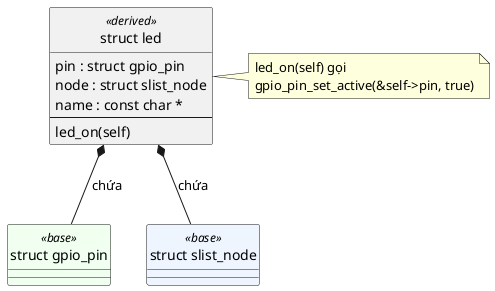

# 06 — Inheritance Pattern

📖 Bài giảng chi tiết: [LECTURE.md](LECTURE.md). File này là ghi chú tóm tắt, bám theo chương *Inheritance Pattern* của sách.

## Overview

Trong C, **B kế thừa A nghĩa là B chứa A** (member nhúng, không phải con trỏ). B có method riêng, bên trong ủy quyền cho method của A. Ai cầm con trỏ tới phần A muốn lấy lại B thì dùng `CONTAINER_OF`. 📖 *"Kế thừa không phải tính năng ngôn ngữ, mà là một thành phần của kiến trúc phần mềm"*: C chỉ thiếu cú pháp, nên ta dùng quy ước.

Ba quy ước của sách: (1) derived **chứa** dữ liệu base, không bao giờ trỏ tới base; (2) derived gắn chặt với base, pattern không cấm truy cập trực tiếp; (3) derived phải có **method wrapper**, không sửa thẳng dữ liệu base.

## Use Cases

- **Tái sử dụng code:** bọc base trong derived, thêm interface riêng, vẫn dùng lại cài đặt của base.
- **Cấu trúc dữ liệu tổng quát:** "kế thừa" list node để xếp struct bất kỳ vào danh sách (đã gặp ở bài 5).
- **Mở rộng object khác** với interface phong phú hơn.
- **Trait:** đối xử chung với nhiều kiểu theo hành vi (struct chỉ chứa con trỏ hàm).

## Benefits

- **Clean design:** cùng một chức năng dùng lại ở mọi nơi, nhìn code là biết điều gì xảy ra.
- **Clear expectations:** dữ liệu phân cấp, dễ nắm.
- **Simple high level architecture:** tầng ứng dụng chỉ làm việc với trừu tượng cấp cao.

## Drawbacks

- Phải viết **wrapper** cho mọi method muốn lộ ra (C không làm hộ).
- **Vi phạm đóng gói:** derived thấy và sửa được dữ liệu base.
- **Thêm độ phức tạp:** trách nhiệm tuân theo quy ước nằm ở lập trình viên.
- Trait nhúng tốn RAM cho mỗi instance và không hằng.

## Implementation

Xem [inc/gpio_pin.h](inc/gpio_pin.h), [inc/led.h](inc/led.h), [src/led.c](src/led.c), [src/led_group.c](src/led_group.c), [inc/sensor_trait.h](inc/sensor_trait.h), [inc/power_trait.h](inc/power_trait.h), [src/tmp36_sensor.c](src/tmp36_sensor.c), [src/battery_monitor.c](src/battery_monitor.c), [main.c](main.c).

| Kỹ thuật | Trong code mẫu |
|---|---|
| Kế thừa đơn + delegator | `struct led` chứa `struct gpio_pin pin`; `led_on()` gọi `gpio_pin_set_active(&self->pin, true)` |
| Kế thừa list node | `struct led` chứa `struct slist_node node`; `led_group` downcast bằng `CONTAINER_OF(node, struct led, node)` |
| Đa kế thừa | `struct tmp36_sensor` chứa `sensor_trait`, `power_trait`, `gpio_pin` |
| Trait | `struct sensor_trait { int (*read)(struct sensor_trait *self, int32_t *value); }` + hàm bọc `sensor_trait_read()` |
| Upcast / downcast | `&self->pin` / `CONTAINER_OF(p, struct led, pin)` (không ép kiểu thẳng) |

## Best Practices

- **Luôn dùng Object Pattern trước**: kế thừa đúng sẽ tự lộ ra.
- Hiểu vai trò: chính là tái sử dụng code, phụ là giữ chức năng phân cấp.
- Dùng **delegator method** cho thuộc tính chung của base và derived.
- Hàm cài trait luôn là **`static`** trong file `.c`.

## Common Pitfalls

- **Fragile base class:** derived dựa vào chi tiết bên trong base, base đổi là hỏng.
- **Code duplication:** quá nhiều wrapper chỉ chuyển tiếp lời gọi ("trọng lượng chết").
- Cài kế thừa trước khi có Object Pattern.
- Trộn nhiều kiểu trong một danh sách → `CONTAINER_OF` ra rác.
- "Kế thừa" bằng con trỏ; ép kiểu thẳng thay `CONTAINER_OF`.

## Alternatives

- **Cải thiện chính base class** khi chức năng mới thật ra ai dùng base cũng cần.
- **Virtual API** (bài 7): interface trừu tượng, bảng hàm hằng dùng chung, tiết kiệm RAM hơn trait.
- **Facade:** trông giống ủy quyền, nhưng ý định là đơn giản hóa interface.

## Quiz

1. Những lý do chính để dùng kế thừa trong kiến trúc phần mềm là gì?
2. Đa kế thừa được cài đặt trong C thế nào, và nên dùng quy ước đặt tên nào cho method để dễ bảo trì?
3. Trait mang lại lợi ích gì, và chúng liên quan thế nào tới đa kế thừa?
4. Trait nhúng trong derived struct có nhược điểm chính nào so với interface thuần ảo, vốn là hằng và chỉ được tham chiếu qua con trỏ?

(Đáp án và 7 câu thêm trong [LECTURE.md](LECTURE.md#25-quiz-có-đáp-án).)

## Câu hỏi còn thắc mắc

-
