# Bài giảng 07 — Virtual API Pattern

> **Về nguồn:** Bài này bám theo chương *Virtual API Pattern* trong sách của Martin Schröder (bản 0.38.0, file `00_Document/Martin-Schroder-Design-Patterns-Virtual-API-Pattern-0.38.0.pdf`). Phần nhắc lại bài trước dựa trên các chương *Object*, *Opaque*, *Callback*, *Inheritance* của cùng bộ sách.
> - 📖 đánh dấu nội dung **theo sách** (dịch và diễn giải lại).
> - 💡 đánh dấu phần **giải thích thêm**, không có trong sách.
> - 🔬 đánh dấu **thí nghiệm thật**: chương trình đã được build bằng gcc 16.2 (MSYS2 UCRT64, Windows 64-bit) và chạy; output in trong bài là output thật. Những gì liên quan tới Cortex-M hay Zephyr mà không chạy được trên PC thì ghi rõ là **chưa chạy**.

Code mẫu đi kèm: [inc/serial.h](inc/serial.h), [src/serial_ops.h](src/serial_ops.h), [src/serial.c](src/serial.c), [src/container_of.h](src/container_of.h), [inc/uart.h](inc/uart.h) + [src/uart.c](src/uart.c), [inc/usb_cdc.h](inc/usb_cdc.h) + [src/usb_cdc.c](src/usb_cdc.c), [inc/mem_serial.h](inc/mem_serial.h) + [src/mem_serial.c](src/mem_serial.c), [inc/fifo.h](inc/fifo.h) + [src/fifo.c](src/fifo.c), [inc/gps.h](inc/gps.h) + [src/gps.c](src/gps.c), [main.c](main.c). Ghi chú ngắn: [README.md](README.md).

Bài trước liên quan: [01 — Object](../01_ObjectPattern/LECTURE.md), [02 — Opaque](../02_OpaquePattern/LECTURE.md), [05 — Callback](../05_CallbackPattern/LECTURE.md), [06 — Inheritance](../06_InheritancePattern/LECTURE.md). Bài sau dùng trực tiếp bài này: [08 — Bridge](../08_BridgePattern/LECTURE.md).

---

## Mục lục

**Phần A — Kiến thức nền**

1. [Bối cảnh: một API, nhiều implementation](#1-bối-cảnh-một-api-nhiều-implementation)
2. [Con trỏ hàm từ gốc](#2-con-trỏ-hàm-từ-gốc)
3. [Struct chứa con trỏ hàm: bảng hàm (vtable)](#3-struct-chứa-con-trỏ-hàm-bảng-hàm-vtable)
4. [Con trỏ cấp hai và cách đọc `const struct serial_ops **`](#4-con-trỏ-cấp-hai-và-cách-đọc-const-struct-serial_ops-)
5. [`CONTAINER_OF`: từ member lùi về object](#5-container_of-từ-member-lùi-về-object)
6. [`const` quyết định dữ liệu nằm ở Flash hay RAM](#6-const-quyết-định-dữ-liệu-nằm-ở-flash-hay-ram)
7. [Đa hình (polymorphism) và cách các ngôn ngữ làm nó](#7-đa-hình-polymorphism-và-cách-các-ngôn-ngữ-làm-nó)

**Phần B — Pattern**

8. [Vấn đề: `switch` theo loại cổng](#8-vấn-đề-switch-theo-loại-cổng)
9. [Ý tưởng cốt lõi: ba phần của Virtual API](#9-ý-tưởng-cốt-lõi-ba-phần-của-virtual-api)
10. [Ba đặc điểm nhận dạng và lý do của từng cái](#10-ba-đặc-điểm-nhận-dạng-và-lý-do-của-từng-cái)
11. [So với trait của bài 06: bộ nhớ và độ an toàn](#11-so-với-trait-của-bài-06-bộ-nhớ-và-độ-an-toàn)
12. [Vì sao handle phải là con trỏ cấp hai](#12-vì-sao-handle-phải-là-con-trỏ-cấp-hai)
13. [Type safety mà không cần `void *`](#13-type-safety-mà-không-cần-void-)

**Phần C — Đọc code**

14. [Đọc code mẫu từng dòng](#14-đọc-code-mẫu-từng-dòng)
15. [Đọc code của sách và các lỗi in](#15-đọc-code-của-sách-và-các-lỗi-in)
16. [Theo dõi demo chạy từng bước](#16-theo-dõi-demo-chạy-từng-bước)
17. [Các quyết định thiết kế và phương án khác](#17-các-quyết-định-thiết-kế-và-phương-án-khác)

**Phần D — Thực tế và tổng kết**

18. [Virtual API trong thực tế: Zephyr, Linux, C++, Rust](#18-virtual-api-trong-thực-tế-zephyr-linux-c-rust)
19. [Chi phí hiệu năng: đo thật hai lần gián tiếp](#19-chi-phí-hiệu-năng-đo-thật-hai-lần-gián-tiếp)
20. [Unit test: contract test và implementation giả](#20-unit-test-contract-test-và-implementation-giả)
21. [Trade-off](#21-trade-off)
22. [Khi nào không nên dùng](#22-khi-nào-không-nên-dùng)
23. [Lỗi hay gặp](#23-lỗi-hay-gặp)
24. [Quy trình refactor sang Virtual API](#24-quy-trình-refactor-sang-virtual-api)
25. [Câu hỏi thường gặp (FAQ)](#25-câu-hỏi-thường-gặp-faq)
26. [Tóm tắt và checklist](#26-tóm-tắt-và-checklist)
27. [Quiz (có đáp án)](#27-quiz-có-đáp-án)
28. [Bài tập](#28-bài-tập)

---

# Phần A — Kiến thức nền

Virtual API là pattern đầu tiên trong lộ trình mà **mọi** bài trước cùng góp mặt: Object cho `self` và cấp phát tĩnh, Opaque cho handle không nhìn thấy bên trong, Callback cho "struct chứa con trỏ hàm + `CONTAINER_OF`", Inheritance cho "chứa base bên trong derived". Phần A nhắc lại các mảnh đó bằng code, rồi đào sâu bốn thứ C mà pattern dựa vào: con trỏ hàm, con trỏ cấp hai, `CONTAINER_OF` và `const`.

## 1. Bối cảnh: một API, nhiều implementation

### 1.1. Nhìn lại các bài trước bằng code

#### Bài 01 — Object: GPS được "tiêm" một UART

Ở bài 01 (mục 6), module GPS không còn gọi thẳng "cái UART duy nhất" nữa mà nhận UART qua `init`:

```c
/* gps.h — kết quả của bài 01 */
struct uart;

struct gps {
	struct uart *uart;   /* GPS dùng UART nào thì do người tạo GPS quyết định */
	uint8_t fix_quality;
};

int gps_init(struct gps *self, struct uart *uart);
int gps_send_cmd(struct gps *self, const char *cmd);
```

Bài 01 kết thúc bằng một câu hứa hẹn: *"`gps.c` vẫn phụ thuộc vào **đúng loại** `struct uart`. Nếu muốn GPS chạy được trên cả UART lẫn USB-CDC mà không sửa `gps.c`, ta cần **Virtual API** (bài 07)."* Bài này trả món nợ đó.

Chữ quan trọng là **loại**. Dependency injection của bài 01 cho phép đổi **instance** (UART1 hay UART2), nhưng không cho đổi **loại** (UART hay USB): kiểu của field là `struct uart *`, và `gps.c` gọi `uart_write()`, một hàm cụ thể.

#### Bài 02 — Opaque: cầm handle mà không thấy bên trong

Bài 02 dạy rằng caller có thể làm việc trọn vẹn với một con trỏ tới **incomplete type** (`struct uart;`) mà không bao giờ thấy field. 📖 Chương Opaque của sách nói thêm ở mục *Alternatives*: *"một abstract interface, theo định nghĩa, đã đóng vai trò một opaque object: nó là một struct chỉ chứa con trỏ hàm, và mỗi hàm lấy lại được dữ liệu riêng của implementation bằng macro `CONTAINER_OF`"*. Đó chính là bài hôm nay.

#### Bài 05 — Callback: struct chứa con trỏ hàm, owner lấy lại bằng `CONTAINER_OF`

📖 Chương Callback yêu cầu luôn bọc callback trong một **struct**, truyền chính struct đó vào hàm callback, và để observer lấy lại object của mình bằng `CONTAINER_OF` thay vì `void *user_data`:

```c
struct button_callback {
	void (*cb)(struct button_callback *cb);
};

struct button {
	struct button_callback *cb;
};

static void button_press(struct button *self)
{
	if (self->cb) {
		self->cb->cb(self->cb); /* truyền chính struct callback vào */
	}
}

struct led_ctrl {
	uint8_t pin;
	struct button_callback on_press; /* struct callback nằm TRONG observer */
};

static void led_ctrl_on_press(struct button_callback *cb)
{
	struct led_ctrl *self = CONTAINER_OF(cb, struct led_ctrl, on_press);

	printf("toggle LED on pin %u\n", (unsigned)self->pin);
}
```

Hai ý sẽ quay lại nguyên vẹn trong Virtual API:
1. Hàm được gọi nhận **con trỏ tới chính thứ chứa con trỏ hàm** (ở đây là `struct button_callback *`).
2. Từ con trỏ đó, hàm lùi về object bao ngoài bằng `CONTAINER_OF`. Không có `void *`.

#### Bài 06 — Inheritance: trait nhúng trong từng instance

📖 Chương Inheritance giới thiệu **trait**: *"một tập hành vi mà object phải hiện thực để được coi là 'object có trait X'"*, biểu diễn bằng struct con trỏ hàm, **nhúng thẳng** vào object và được điền trong `init`:

```c
struct serial_trait {
	int (*write)(struct serial_trait *self, const uint8_t *data, size_t len);
};

static inline int serial_trait_write(struct serial_trait *self, const uint8_t *data, size_t len)
{
	return self->write(self, data, len);
}

struct uart {
	struct serial_trait serial; /* bản copy bảng hàm nằm trong MỖI object */
	const char *name;
};

static int uart_trait_write(struct serial_trait *trait, const uint8_t *data, size_t len)
{
	struct uart *self = CONTAINER_OF(trait, struct uart, serial);

	printf("[%s] %.*s\n", self->name, (int)len, (const char *)data);
	return (int)len;
}

static void uart_init(struct uart *self, const char *name)
{
	self->serial = (struct serial_trait){ .write = uart_trait_write };
	self->name = name;
}
```

Trait đã cho ta đa hình: code nào cầm `struct serial_trait *` đều gọi được `serial_trait_write()` mà không biết bên dưới là UART hay gì khác. Nhưng ngay chương đó, sách đã nêu câu hỏi quiz: *"trait nhúng trong struct derived có nhược điểm chính gì so với interface ảo thuần, vốn là hằng và chỉ được tham chiếu từ struct derived qua một con trỏ?"* Bài này trả lời câu đó.

🔬 Đoạn recap ở trên (gộp chung vào một file, thêm `main`) build sạch với `-std=c99 -Wall -Wextra -Werror -pedantic` và in ra:

```
toggle LED on pin 13
[UART1] hello
sizeof(struct uart) = 16
```

Trong `main` của thí nghiệm có thêm một dòng `uart1.serial.write = NULL;`. Compiler **không cản**: trait nằm trong RAM, field là public, ai cũng ghi đè được. Giữ dòng này trong đầu, mục 1.2 sẽ cho thấy nó gây hại thế nào.

#### Tổng hợp: mỗi bài để lại một mảnh

| Bài | Mảnh để lại | Còn thiếu gì |
|---|---|---|
| 01 Object | `self`, `init`, dependency injection, cấp phát tĩnh | Chỉ đổi được *instance*, không đổi được *loại* |
| 02 Opaque | Handle không nhìn thấy bên trong | Chưa có cách gọi "hàm của loại nào đó" qua handle |
| 05 Callback | Struct con trỏ hàm + `CONTAINER_OF` | Một callback, không phải một **bộ API** |
| 06 Inheritance | Trait: bộ API qua con trỏ hàm | Mỗi instance một bản copy, nằm trong RAM, sửa được |

Virtual API ghép bốn mảnh lại và vá đúng cột cuối.

### 1.2. Một dự án lớn dần: thiếu interface chung gây hại ra sao

💡 *Tình huống minh họa (không phải ví dụ trong sách), nhưng rất điển hình.*

#### Tháng 1: một cổng, mọi thứ ổn

Team 3 người làm firmware cho **bộ định vị xe tải**: MCU Cortex-M4, module GPS nối qua UART2, cổng debug qua UART1. Code theo bài 01: `struct gps` giữ `struct uart *`. Ngoài `gps.c` còn `logger.c` (ghi log ra UART1) và `shell.c` (dòng lệnh để kỹ thuật viên cấu hình thiết bị qua UART1).

#### Tháng 3: thêm USB-CDC

Khách hàng muốn cắm cáp USB vào là cấu hình được, không cần cáp chuyển USB-UART. Team thêm driver `usb_cdc`. Shell và logger giờ phải chạy được trên **UART1 hoặc USB**, tùy cái nào đang cắm. Cách nhanh nhất:

```c
enum port_type { PORT_UART, PORT_USB };

struct shell {
	enum port_type type;
	struct uart *uart;     /* dùng khi type == PORT_UART */
	struct usb_cdc *usb;   /* dùng khi type == PORT_USB */
};
```

và một `switch (self->type)` trong mọi hàm gửi/nhận. Đoạn `switch` này được **chép** sang `logger.c`. `gps.c` chưa cần nên chưa sửa.

#### Tháng 5: unit test trên CI

Team dựng CI chạy unit test trên PC. Muốn test `shell.c` thì cần một cổng giả ghi dữ liệu vào RAM. Thêm `PORT_MEM` vào enum, thêm `case PORT_MEM` vào hai cái `switch`. Hệ quả:
- `shell.c` và `logger.c` giờ `#include "mem_serial.h"`, tức là **code test nằm trong firmware sản xuất**.
- Mỗi lần ai sửa `mem_serial.h`, cả `shell.c` lẫn `logger.c` build lại.

#### Tháng 7: thêm BLE

Bản cao cấp có Bluetooth (BLE Nordic UART Service). Thêm `PORT_BLE`, thêm `case` vào... **hai trong ba** chỗ. `shell.c` có một hàm phụ `shell_send_prompt()` cũng `switch` theo loại cổng, người sửa không biết. Hàm đó rơi vào nhánh `default: return -EINVAL;`. Triệu chứng: qua BLE, shell nhận lệnh bình thường nhưng **không bao giờ hiện dấu nhắc**. Mất hai ngày mới tìm ra.

#### Tháng 8: chuyển sang trait (bài 06)

Trưởng nhóm quyết định dẹp mọi `switch`: mỗi driver chứa một `struct serial_trait` với 4 con trỏ hàm (`write`, `read`, `flush`, `set_baud`), điền trong `init`. Code sạch hơn hẳn. Nhưng:
- Firmware có thêm **modem 4G dùng CMUX**: một UART vật lý chia thành 4 kênh ảo, mỗi kênh là một "cổng serial". Tổng cộng 12 object cổng. 💡 Trên Cortex-M mỗi con trỏ 4 byte, mỗi trait 16 byte, 12 trait là 192 byte RAM chỉ để chứa **12 bản copy giống hệt nhau** của vài bảng hàm. Với MCU 32 KB RAM thì chưa chết, nhưng là lãng phí thuần túy.
- Một "bản sửa nhanh" trong `shell.c` để bật chế độ echo: `uart1.serial.write = shell_echo_write;`. Compiler cho qua vì trait là field public nằm trong RAM. Từ đó **mọi module** ghi ra UART1 (kể cả logger) đều đi qua hàm echo của shell. Lỗi xuất hiện ở logger, nguyên nhân nằm ở shell.

#### Tháng 9: chuyển sang Virtual API

- Bảng hàm thành `static const`, mỗi loại driver **một bảng duy nhất**, nằm trong **Flash**. Mỗi object chỉ còn một con trỏ: 12 object × 4 byte = 48 byte RAM.
- Định nghĩa bảng hàm chuyển vào header private. `shell.c` không còn nhìn thấy field `write` nên **không thể** viết `...->write = shell_echo_write` nữa: compiler báo lỗi.
- `gps.c`, `shell.c`, `logger.c` chỉ include `serial.h`. Thêm cổng mới (tháng 11: RS-485) không phải sửa và không phải build lại các file đó.

#### Nhìn lại

| Tháng | Chuyện gì xảy ra | Nguyên nhân gốc |
|---|---|---|
| 3 | `switch` theo loại cổng, chép sang nhiều file | Không có interface chung |
| 5 | Code test lọt vào firmware, build lại dây chuyền | Code dùng phụ thuộc vào **mọi** implementation |
| 7 | Quên một `case`, shell câm trên BLE | Kiến thức "có những loại cổng nào" rải ở nhiều nơi |
| 8 | RAM lãng phí cho bản copy bảng hàm | Trait nhúng trong từng instance |
| 8 | Ghi đè con trỏ hàm, lỗi lan sang module khác | Bảng hàm nằm trong RAM và nhìn thấy được |

Ba dòng đầu là lý do cần **một interface chung**. Hai dòng cuối là lý do interface đó phải được làm **theo cách của bài này** chứ không dừng ở trait.

### 1.3. Đọc kỹ định nghĩa của sách

📖 Câu mở đầu chương:

> *"The virtual api pattern provides a way to implement abstract interfaces in a memory efficient and type safe way."*
>
> *Virtual API pattern cung cấp một cách hiện thực **abstract interface** sao cho **tiết kiệm bộ nhớ** và **an toàn kiểu**.*

| Vế | Nghĩa là gì |
|---|---|
| *"abstract interfaces"* | Một **bộ thao tác** (write, read...) được định nghĩa mà **không gắn với implementation nào**. 📖 Sách nói nó *"tương ứng với 'Abstract Interface' trong các ngôn ngữ như C++"*, tức class chỉ có hàm `virtual ... = 0` |
| *"memory efficient"* | Bảng hàm **không bị nhân bản** theo số instance (mục 11) |
| *"type safe"* | Không có `void *`, không ép kiểu mù; nhầm object thì **compiler báo** (mục 13) |

📖 Câu thứ hai nói rõ pattern khác gì bài 06:

> *"It differs from 'traits' as described in 'Inheritance Pattern' by being much more memory efficient without requiring multiple copies of the virtual function table to be stored in instances of an object."*
>
> *Nó khác "trait" của Inheritance Pattern ở chỗ tiết kiệm bộ nhớ hơn nhiều, vì không cần lưu nhiều bản copy của **bảng hàm ảo** (virtual function table) trong các instance.*

Chữ **"virtual function table"** (bảng hàm ảo, thường viết tắt **vtable**) là thuật ngữ của C++. Sách dùng nó để nói: cái mà trait của bài 06 nhúng vào mỗi object chính là một vtable, và Virtual API sẽ đưa nó ra ngoài thành **một bản duy nhất**.

Viết gọn thành công thức:

> **Virtual API = trait (bài 06) chuyển thành bảng `static const` dùng chung + mỗi object chỉ giữ một con trỏ tới bảng + caller chỉ cầm handle `const struct ops **` và gọi qua API chung**

### 1.4. Virtual API trong bức tranh các pattern

📖 Sách xếp Callback, Inheritance, Virtual API và Bridge vào nhóm **Structural Patterns** (pattern về cách các object **ghép nối** với nhau). 📖 Phần Introduction gọi Virtual API là *"một thứ tuyệt đối cần thiết trong hệ embedded, nơi ta thường muốn có nhiều implementation của driver và thuật toán, tất cả được đối xử như nhau và truy cập qua cùng một API"*, và nói rõ Bridge (bài 08) *"dùng Virtual API rất nhiều"*.

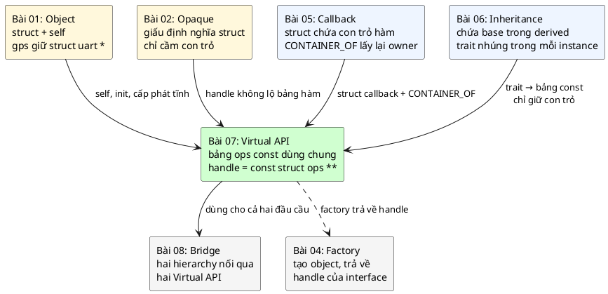

| | Callback (05) | Trait (06) | **Virtual API (07)** | Bridge (08) |
|---|---|---|---|---|
| Số hàm trong struct | Thường 1 | Một bộ | **Một bộ** | Hai bộ (hai interface) |
| Bảng hàm nằm ở đâu | Trong observer | Trong **mỗi** object (RAM) | **Một bảng `const`** (Flash) | Như Virtual API, ở cả hai đầu |
| Ai đổi được con trỏ hàm lúc chạy | Observer | Bất kỳ ai thấy struct | **Không ai** (const + giấu định nghĩa) | Không ai |
| Hướng gọi | Subject → observer (thông báo) | User → object | User → object | User → hierarchy A → hierarchy B |
| Mục đích | Báo sự kiện, gỡ dependency ngược | Tái sử dụng hành vi | **Nhiều implementation, một API** | Cho hai hierarchy tiến hóa độc lập |

💡 Chương Factory (bài 04) của sách cũng dùng chính kỹ thuật này: factory tạo ra một object cụ thể rồi trả về handle kiểu `struct shape_api **` để caller gọi hàm ảo `draw` mà không biết đó là hình tròn hay hình vuông. Factory là chỗ **tạo** object, Virtual API là cách **dùng** chúng.

### 1.5. Câu hỏi bài này sẽ trả lời

1. Làm sao gọi "hàm `write` của **loại** cổng này" khi code gọi không biết đó là loại gì? (Mục 2–3, 9)
2. Vì sao handle là `const struct serial_ops **`, hai dấu sao, chứ không phải một? (Mục 4, 12)
3. Từ handle, implementation tìm lại object của nó bằng cách nào mà không cần `void *`? (Mục 5, 13)
4. "Tiết kiệm bộ nhớ" và "bảng nằm trong Flash" có thật không? Đo được không? (Mục 6, 11)
5. Mỗi lời gọi tốn thêm bao nhiêu? (Mục 19)
6. Test thế nào để mọi implementation thật sự tuân theo cùng một hợp đồng? (Mục 20)

---

## 2. Con trỏ hàm từ gốc

### 2.1. Hàm cũng nằm ở một địa chỉ

Sau khi compile và link, mỗi hàm là một dãy lệnh máy nằm trong vùng code (`.text`, trên MCU là Flash). Dãy đó bắt đầu ở một **địa chỉ**. Lời gọi hàm bình thường như `uart_send("a")` được dịch thành lệnh "nhảy tới địa chỉ cố định X và nhớ đường về". Địa chỉ X được linker điền vào lúc build, nên lệnh này gọi là **gọi trực tiếp** (direct call).

**Con trỏ hàm** là một biến chứa địa chỉ đó. Gọi qua con trỏ hàm là "đọc địa chỉ trong biến, rồi nhảy tới địa chỉ vừa đọc", gọi là **gọi gián tiếp** (indirect call). Địa chỉ nhảy tới chỉ biết **lúc chạy**, nên cùng một dòng code có thể chạy những hàm khác nhau.

💡 Ở mức lệnh máy:

| | x86-64 (PC) | ARM Cortex-M (Thumb-2) |
|---|---|---|
| Gọi trực tiếp | `call uart_send` | `bl uart_send` |
| Gọi gián tiếp | `call *%rax` (địa chỉ trong thanh ghi) | `blx r3` |

### 2.2. 🔬 Thí nghiệm: con trỏ hàm chỉ là một con số

```c
/* E0: con trỏ hàm chỉ là một địa chỉ trong vùng code */
#include <stdint.h>
#include <stdio.h>

static int uart_send(const char *msg)
{
	printf("  uart_send(\"%s\")\n", msg);
	return 1;
}

static int usb_send(const char *msg)
{
	printf("  usb_send(\"%s\")\n", msg);
	return 2;
}

/* Kiểu "con trỏ tới hàm nhận const char *, trả int" */
typedef int (*send_fn)(const char *msg);

static const char rodata_str[] = "hang so";
static int data_var = 42;

int main(void)
{
	send_fn fn;
	int local = 0;

	printf("dia chi uart_send  = %p\n", (void *)(uintptr_t)uart_send);
	printf("dia chi usb_send   = %p\n", (void *)(uintptr_t)usb_send);
	printf("dia chi rodata_str = %p\n", (const void *)rodata_str);
	printf("dia chi data_var   = %p\n", (void *)&data_var);
	printf("dia chi local      = %p\n", (void *)&local);
	printf("sizeof(send_fn)    = %u\n", (unsigned)sizeof(send_fn));

	fn = uart_send; /* tên hàm tự chuyển thành địa chỉ hàm */
	local = fn("a");
	fn = usb_send;  /* cùng một dòng gọi, khác hàm được chạy */
	local += fn("b");
	printf("tong gia tri tra ve = %d\n", local);
	return 0;
}
```

Output thật:

```
dia chi uart_send  = 00007FF72F6714D0
dia chi usb_send   = 00007FF72F6714FA
dia chi rodata_str = 00007FF72F674038
dia chi data_var   = 00007FF72F673000
dia chi local      = 0000007A2C7FFA84
sizeof(send_fn)    = 8
  uart_send("a")
  usb_send("b")
tong gia tri tra ve = 3
```

Và bảng section của chính file `.exe` đó (`objdump -h`):

```
  0 .text         000011d0  0000000140001000  ...
  1 .data         000000a0  0000000140003000  ...
  2 .rdata        00000ad8  0000000140004000  ...
  5 .bss          000000f8  0000000140007000  ...
```

Đọc kết quả:
- Windows nạp chương trình ở một địa chỉ gốc ngẫu nhiên (ASLR), lần chạy này là `0x7FF72F670000`. Cộng offset của từng section: `.text` bắt đầu ở `...1000`, `.data` ở `...3000`, `.rdata` ở `...4000`.
- `uart_send` = `...14D0` và `usb_send` = `...14FA`: cả hai nằm trong **`.text`**. Con trỏ hàm trỏ vào vùng code.
- `rodata_str` (hằng) nằm ở `...4038`, trong **`.rdata`**. `data_var` (biến có giá trị đầu) ở `...3000`, đầu **`.data`**. Biến cục bộ `local` ở một vùng hoàn toàn khác: **stack**.
- `sizeof(send_fn) = 8`: con trỏ hàm trên PC 64-bit là 8 byte. 💡 Trên Cortex-M là 4 byte (chưa chạy, vì không có toolchain ARM trong môi trường này).
- Dòng `fn(...)` xuất hiện hai lần trong code, nhưng lần đầu chạy `uart_send`, lần sau chạy `usb_send`. **Đây là toàn bộ nền móng của đa hình trong C.**

💡 Vì sao phải ép `(void *)(uintptr_t)uart_send` khi in? Chuẩn C **không** cho chuyển trực tiếp con trỏ hàm sang `void *` (trên một số kiến trúc, địa chỉ code và địa chỉ dữ liệu khác kích thước hoặc khác không gian địa chỉ). `-pedantic` sẽ cảnh báo nếu ép thẳng. Đi qua `uintptr_t` là cách gcc chấp nhận để in ra xem. Đây cũng là lý do sâu xa khiến `void *` **không** chứa được con trỏ hàm một cách chuẩn mực.

### 2.3. Đọc cú pháp con trỏ hàm

Cú pháp con trỏ hàm của C nổi tiếng khó đọc. Cách đọc: **bắt đầu từ tên, đi sang phải, gặp dấu đóng ngoặc thì quay sang trái**.

```c
int (*write)(serial_t serial, const uint8_t *data, size_t len);
```

1. `write` — tên.
2. Bên phải là `)`, quay sang trái: `*` → "`write` là **con trỏ**".
3. Ra khỏi ngoặc, bên phải là `(serial_t, const uint8_t *, size_t)` → "tới **hàm** nhận ba tham số đó".
4. Bên trái cùng là `int` → "hàm đó **trả `int`**".

Cặp ngoặc quanh `*write` là bắt buộc. Thiếu nó:

```c
int *write(serial_t serial, const uint8_t *data, size_t len);
```

thì nghĩa là "`write` là một **hàm** trả `int *`", một khai báo hàm bình thường chứ không phải con trỏ.

`typedef` giúp đặt tên cho kiểu con trỏ hàm, như `send_fn` ở trên. Code mẫu của bài **không** typedef con trỏ hàm mà viết thẳng trong struct, giống sách, để nhìn vào struct là thấy ngay chữ ký.

---

## 3. Struct chứa con trỏ hàm: bảng hàm (vtable)

### 3.1. Gom nhiều con trỏ hàm thành một bảng

Một con trỏ hàm thay được **một** hành vi. Một interface có nhiều hành vi (`write`, `read`...), nên ta gom chúng vào một struct:

```c
struct serial_ops {
	int (*write)(serial_t serial, const uint8_t *data, size_t len);
	int (*read)(serial_t serial, uint8_t *data, size_t len);
};
```

📖 Chương Callback gọi struct kiểu này là **ops**, viết tắt của *operations*. Mỗi implementation điền vào struct này các hàm của riêng nó, tạo thành một **bảng hàm**:

```c
static const struct serial_ops uart_serial_ops = {
	.write = uart_serial_write,
	.read = uart_serial_read,
};
```

Cú pháp `.write = ...` là **designated initializer** (khởi tạo theo tên field), có từ C99. Nó có hai lợi ích:
- Thứ tự field không quan trọng, thêm field mới vào giữa struct không làm lệch các dòng khởi tạo cũ.
- 💡 Field nào **không được nhắc tới** sẽ được khởi tạo bằng 0, với con trỏ là `NULL`. Chuẩn C bảo đảm điều này. Mục 17 dùng nó để làm "hàm tùy chọn".

### 3.2. Bảng hàm, gọi theo kiểu C++: vtable

💡 Trong C++, khi một class có hàm `virtual`, compiler **tự động** làm đúng hai việc mà ta sắp làm bằng tay:
1. Sinh ra một bảng con trỏ hàm cho mỗi class, gọi là **vtable**, đặt trong vùng chỉ đọc.
2. Thêm vào mỗi object một con trỏ ẩn trỏ tới vtable của class đó, gọi là **vptr**.

Lời gọi `p->write(...)` trong C++ được dịch thành "đọc vptr trong object, đọc ô `write` trong vtable, nhảy tới đó". Virtual API trong C là phiên bản viết tay của đúng cơ chế đó: `struct serial_ops` là vtable, field `const struct serial_ops *serial` trong mỗi object là vptr.

### 3.3. Nơi mọi thứ nằm trong bộ nhớ

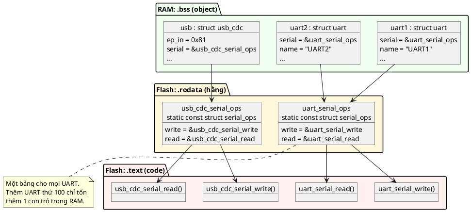

Ba tầng, ba vùng nhớ:
- **Code** (`.text`, Flash): các hàm implementation.
- **Bảng hàm** (`.rodata`, Flash): mỗi **loại** driver một bảng.
- **Object** (`.bss`, RAM): mỗi **instance** một object, chứa con trỏ tới bảng của loại mình.

Mục 6 sẽ chứng minh bằng `nm`/`objdump` rằng bảng thật sự nằm ở vùng chỉ đọc.

---

## 4. Con trỏ cấp hai và cách đọc `const struct serial_ops **`

### 4.1. Đọc từ phải sang trái

Handle của interface có kiểu:

```c
typedef const struct serial_ops **serial_t;
```

Đọc kiểu con trỏ từ **phải sang trái**:

| Đoạn | Đọc là |
|---|---|
| `**` (cái gần tên nhất) | `serial_t` là **con trỏ** |
| `*` (cái còn lại) | tới một **con trỏ** |
| `const struct serial_ops` | tới một `struct serial_ops` **không được sửa** |

Tức là: *con trỏ tới (con trỏ tới bảng ops hằng)*. Cụ thể trong code mẫu:
- Bảng `uart_serial_ops` là `const struct serial_ops`.
- Field `uart1.serial` là `const struct serial_ops *`, tức con trỏ tới bảng.
- Handle `&uart1.serial` là `const struct serial_ops **`, tức con trỏ tới **field** đó.

### 4.2. `const` nằm ở đâu thì khóa cái gì

Vị trí của `const` quyết định cái gì bị khóa. Đây là chỗ hay nhầm, nên liệt kê đủ:

| Khai báo field | Bảng ops | Field (con trỏ) | Ghi chú |
|---|---|---|---|
| `struct serial_ops *serial;` | Sửa được | Sửa được | Không có `const` nào: tệ nhất |
| `const struct serial_ops *serial;` | **Không** sửa được | Sửa được | **Code mẫu và sách dùng cách này** |
| `struct serial_ops * const serial;` | Sửa được | **Không** sửa được | Hiếm khi có ích |
| `const struct serial_ops * const serial;` | Không | Không | 📖 Chương Factory dùng cách này cho `struct shape` |

Vì sao code mẫu để field **không** const? Vì `uart_init()` phải gán `self->serial = &uart_serial_ops;` **sau** khi `memset` object. Field const thì chỉ gán được lúc khởi tạo biến, không gán được trong `init`. Thứ thật sự cần khóa là **bảng**, và nó được khóa bằng chữ `const` đứng đầu.

### 4.3. Vì sao con trỏ cấp hai không làm mất `const`

💡 Một chi tiết tinh tế: `CONTAINER_OF` (mục 5) ép handle sang `char *` để làm phép trừ. Handle là `const struct serial_ops **`, tức con trỏ tới một ô **không const** (ô đó là field `serial`, chứa một con trỏ). Chỉ cái mà ô đó trỏ tới (bảng) mới là const. Nên ép handle sang `char *` **không** bỏ `const` của ai cả, và object tìm lại được là `struct uart *` không const, sửa được bình thường. Nếu handle là `const struct serial_ops * const *` (field const), việc ép sang `char *` sẽ bỏ mất một `const`, và gcc với `-Wcast-qual` sẽ cảnh báo.

---

## 5. `CONTAINER_OF`: từ member lùi về object

### 5.1. Bài toán

Hàm `uart_serial_write()` được gọi với tham số là handle, tức **địa chỉ của field `serial`** nằm bên trong một `struct uart`. Nhưng hàm cần cả object `struct uart` để biết `name`, `baudrate`, buffer... Làm sao đi từ địa chỉ một field về địa chỉ đầu struct?

Câu trả lời: field nằm ở một **khoảng cách cố định** so với đầu struct, và compiler biết khoảng cách đó lúc build. Chỉ cần **lùi lại** đúng khoảng đó.

### 5.2. `offsetof` và phép trừ

`offsetof(type, member)` (trong `<stddef.h>`) trả về số byte từ đầu `type` tới `member`. Từ đó:

> **địa chỉ object = địa chỉ member − offsetof(type, member)**

```c
#define CONTAINER_OF(ptr, type, member)                                                      \
	((void)sizeof((ptr) == &((type *)0)->member),                                            \
	 (type *)(void *)((char *)(ptr) - offsetof(type, member)))
```

Bỏ qua dòng `sizeof` (giải thích ở 5.4), phần làm việc là:

1. `(char *)(ptr)`: ép sang `char *` để phép trừ tính bằng **byte**. Nếu để nguyên kiểu `const struct serial_ops **` thì `ptr - 8` nghĩa là lùi 8 **phần tử** (mỗi phần tử 8 byte), tức 64 byte, sai.
2. `- offsetof(type, member)`: lùi đúng khoảng cách.
3. `(void *)` rồi `(type *)`: đổi sang kiểu object. Đi qua `void *` để gcc không cảnh báo căn lề khi ép từ `char *`.

### 5.3. 🔬 Thí nghiệm: in địa chỉ thật

Code mẫu cố ý đặt field `serial` ở **đầu** `struct uart` nhưng ở **giữa** `struct usb_cdc`. Chương trình sau dùng chính code của bài (build kèm `src/uart.c`, `src/usb_cdc.c`, `src/fifo.c` với `-Iinc -Isrc`):

```c
/* E2: CONTAINER_OF tính địa chỉ thế nào. Build kèm src/ của bài 07 với -Iinc -Isrc */
#include "container_of.h"
#include "uart.h"
#include "usb_cdc.h"

#include <stdio.h>

int main(void)
{
	static struct uart uart1;
	static struct usb_cdc usb;

	uart_init(&uart1, "UART1", 115200);
	usb_cdc_init(&usb, 0x81);

	serial_t h_uart = uart_to_serial(&uart1);
	serial_t h_usb = usb_cdc_to_serial(&usb);

	printf("offsetof(struct uart, serial)    = %u\n", (unsigned)offsetof(struct uart, serial));
	printf("offsetof(struct usb_cdc, serial) = %u\n", (unsigned)offsetof(struct usb_cdc, serial));
	printf("sizeof(struct uart)    = %u\n", (unsigned)sizeof(struct uart));
	printf("sizeof(struct usb_cdc) = %u\n\n", (unsigned)sizeof(struct usb_cdc));

	printf("&uart1          = %p\n", (void *)&uart1);
	printf("h_uart          = %p  (= &uart1.serial)\n", (void *)h_uart);
	printf("*h_uart (ops)   = %p\n", (const void *)*h_uart);
	printf("CONTAINER_OF    = %p\n\n", (void *)CONTAINER_OF(h_uart, struct uart, serial));

	printf("&usb            = %p\n", (void *)&usb);
	printf("h_usb           = %p  (= &usb.serial)\n", (void *)h_usb);
	printf("*h_usb (ops)    = %p\n", (const void *)*h_usb);
	printf("CONTAINER_OF    = %p\n", (void *)CONTAINER_OF(h_usb, struct usb_cdc, serial));
	printf("h_usb - &usb    = %ld byte\n", (long)((char *)h_usb - (char *)&usb));
	return 0;
}
```

Output thật:

```
offsetof(struct uart, serial)    = 0
offsetof(struct usb_cdc, serial) = 8
sizeof(struct uart)    = 64
sizeof(struct usb_cdc) = 64

&uart1          = 00007FF7C42C7020
h_uart          = 00007FF7C42C7020  (= &uart1.serial)
*h_uart (ops)   = 00007FF7C42C41C0
CONTAINER_OF    = 00007FF7C42C7020

&usb            = 00007FF7C42C7060
h_usb           = 00007FF7C42C7068  (= &usb.serial)
*h_usb (ops)    = 00007FF7C42C4200
CONTAINER_OF    = 00007FF7C42C7060
h_usb - &usb    = 8 byte
```

Đọc từng dòng:
- Với `uart1`, field `serial` ở offset 0, nên handle **trùng** địa chỉ object. `CONTAINER_OF` trừ 0, kết quả không đổi.
- Với `usb`, handle là `...7068`, **lớn hơn** địa chỉ object `...7060` đúng 8 byte. `CONTAINER_OF` trừ 8 và ra `...7060`, đúng địa chỉ `usb`.
- `*h_uart` = `...41C0` và `*h_usb` = `...4200`: địa chỉ hai bảng ops, nằm ở vùng **thấp hơn hẳn** các object (`...70xx`). Đó là vùng `.rdata` (mục 6), còn object nằm trong `.bss`.

Bố cục `struct usb_cdc` (PC 64-bit) và phép tính:

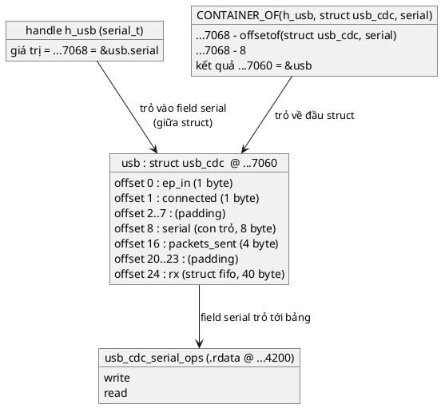

💡 **Vì sao không ép thẳng `(struct uart *)serial`?** Với `struct uart` (field ở offset 0) thì ép thẳng cho đúng địa chỉ, nhưng chỉ **tình cờ**. Với `struct usb_cdc` (offset 8) ép thẳng sẽ trỏ lệch 8 byte, đọc `ep_in` ra rác. `CONTAINER_OF` đúng với **mọi** vị trí của field, và sống sót khi ai đó thêm field mới lên đầu struct. Đây là lý do sách luôn dùng `CONTAINER_OF`, không dùng ép kiểu.

### 5.4. Dòng `sizeof`: biến `CONTAINER_OF` thành an toàn kiểu

Bản `CONTAINER_OF` "ngây thơ" chỉ có phép trừ. Nó không biết `ptr` có thật sự là con trỏ tới `member` hay không. Code mẫu thêm vế:

```c
(void)sizeof((ptr) == &((type *)0)->member)
```

- `&((type *)0)->member` là biểu thức có kiểu "con trỏ tới `member`". Nó nằm **bên trong `sizeof`**, mà `sizeof` **không tính** biểu thức bên trong (chỉ xem kiểu), nên không có truy cập địa chỉ 0 nào xảy ra lúc chạy. Không sinh ra lệnh máy nào.
- `(ptr) == ...`: so sánh hai con trỏ khác kiểu là vi phạm ràng buộc của C, gcc báo `comparison of distinct pointer types lacks a cast`. Với `-Werror` đó là lỗi build.
- `(void)` và dấu phẩy: bỏ kết quả của vế đầu, giá trị của cả biểu thức là vế sau.

🔬 Thí nghiệm: cố tình gõ nhầm tên member (`rx` là `struct fifo`, không phải con trỏ tới bảng ops):

```c
/* e6_checked.c — cố tình sai */
#include "container_of.h"
#include "serial_ops.h"
#include "uart.h"

/* Nhầm tên member: rx là struct fifo, không phải con trỏ tới bảng ops */
struct uart *wrong_member(serial_t serial)
{
	return CONTAINER_OF(serial, struct uart, rx);
}
```

```
src/container_of.h:18:29: error: comparison of distinct pointer types lacks a cast [-Werror=compare-distinct-pointer-types]
e6_checked.c:8:16: note: in expansion of macro 'CONTAINER_OF'
cc1.exe: all warnings being treated as errors
```

Cùng đoạn code đó với bản ngây thơ `((type *)(void *)((char *)(ptr) - offsetof(type, member)))`: **build sạch, exit 0**. Lúc chạy nó sẽ trừ sai offset và trả về một con trỏ rác.

⚠️ Giới hạn của kiểm tra này: nó chỉ so **kiểu của member** với kiểu của `ptr`. Nếu bạn nhầm **kiểu struct bao ngoài** nhưng member cùng tên, cùng kiểu (ví dụ viết `CONTAINER_OF(serial, struct usb_cdc, serial)` trong `uart.c`), compiler **không** bắt được, vì `usb_cdc.serial` cũng là `const struct serial_ops *`. Bài 08 có một thí nghiệm cho thấy chính sách mắc lỗi này trong code mẫu của chương Bridge.

💡 Zephyr và Linux kernel dùng cùng ý tưởng nhưng viết bằng phần mở rộng GNU (`__typeof__`, `__builtin_types_compatible_p`). Bản của bài này chỉ dùng C99 chuẩn nên build được với `-pedantic`.

---

## 6. `const` quyết định dữ liệu nằm ở Flash hay RAM

### 6.1. Nhắc lại bản đồ bộ nhớ

Bài 02 (mục 6) đã có bảng các vùng nhớ. Hai dòng liên quan trực tiếp:

| Vùng | Nằm ở | Chứa |
|---|---|---|
| `.rodata` | **Flash** | Hằng số chỉ đọc, kể cả `static const struct ...` |
| `.data` | **RAM** (giá trị đầu chép từ Flash lúc khởi động) | Biến `static`/global có giá trị đầu khác 0 |

Một bảng ops **có** `const` thì vào `.rodata`: chỉ tốn Flash. Một bảng ops **quên** `const` thì vào `.data`: tốn **cả RAM lẫn Flash** (Flash giữ bản gốc để chép sang RAM lúc khởi động), và sửa được lúc chạy.

### 6.2. 🔬 Thí nghiệm: `nm` và `objdump` trên file `.o`

```c
/* E3: bảng ops const nằm ở section nào, bảng không const nằm ở đâu */
#include <stddef.h>
#include <stdint.h>

struct serial_ops {
	int (*write)(const struct serial_ops **self, const uint8_t *data, size_t len);
	int (*read)(const struct serial_ops **self, uint8_t *data, size_t len);
};

static int dummy_write(const struct serial_ops **self, const uint8_t *data, size_t len)
{
	(void)self;
	(void)data;
	return (int)len;
}

static int dummy_read(const struct serial_ops **self, uint8_t *data, size_t len)
{
	(void)self;
	(void)data;
	(void)len;
	return 0;
}

/* Virtual API: const, khởi tạo lúc compile */
const struct serial_ops ops_const = {
	.write = dummy_write,
	.read = dummy_read,
};

/* Sai: quên const */
struct serial_ops ops_mutable = {
	.write = dummy_write,
	.read = dummy_read,
};

/* Object: chỉ có con trỏ vptr, chưa khởi tạo -> .bss */
struct uart {
	const struct serial_ops *serial;
	uint32_t baudrate;
} uart_obj;
```

`gcc -std=c99 -Wall -Wextra -Werror -pedantic -O2 -c e3_sections.c`, rồi `nm e3.o`:

```
0000000000000000 b .bss
0000000000000000 d .data
0000000000000000 p .pdata
0000000000000000 r .rdata
0000000000000000 r .rdata$zzz
0000000000000000 t .text
0000000000000000 r .xdata
0000000000000010 t dummy_read
0000000000000000 t dummy_write
0000000000000000 R ops_const
0000000000000000 D ops_mutable
0000000000000000 B uart_obj
```

Chữ cái ở cột giữa là loại section của symbol: **`R`** = read-only data, **`D`** = data (RAM có giá trị đầu), **`B`** = bss (RAM xóa về 0), **`t`** = text (code). Chữ thường là symbol `static` (chỉ thấy trong file), chữ hoa là symbol global.

- `ops_const` → **`R`**: vùng chỉ đọc.
- `ops_mutable` → **`D`**: RAM.
- `uart_obj` → **`B`**: RAM, xóa về 0 lúc khởi động.

Và với chính `src/uart.c` của bài (`nm uart.o | grep ops`):

```
0000000000000020 r uart_serial_ops
```

`r` thường: chỉ đọc, và `static` (không lộ tên ra ngoài file).

⚠️ **Tên section khác nhau theo định dạng file.** Trên Windows (định dạng PE/COFF), vùng chỉ đọc tên là **`.rdata`**, như output ở trên. Trên Linux và trên firmware ARM (định dạng ELF), nó tên là **`.rodata`**. Cùng một khái niệm. 💡 Trên firmware Cortex-M (chưa chạy), linker script đặt `.rodata` vào Flash ngay sau `.text`, nên `arm-none-eabi-nm` sẽ cho thấy địa chỉ của `uart_serial_ops` nằm trong dải Flash (thường bắt đầu `0x0800....` trên STM32), còn object nằm trong dải RAM (`0x2000....`).

💡 Một ngoại lệ nên biết: khi build **thư viện động trên Linux** với `-fPIC`, bảng chứa con trỏ phải được loader sửa địa chỉ lúc nạp, nên gcc đặt nó vào `.data.rel.ro` (RAM, được khóa chỉ đọc sau khi nạp) thay vì `.rodata`. Firmware bare-metal không dùng `-fPIC` nên không gặp chuyện này.

### 6.3. 🔬 Thí nghiệm: bảng `const` không sửa được

**Cách 1: gán trực tiếp.** Compiler chặn ngay:

```c
static const struct serial_ops uart_ops = { .write = real_write };

void hijack(void)
{
	uart_ops.write = evil_write; /* sửa bảng hàm lúc chạy */
}
```

```
e10_const_assign.c:25:24: error: assignment of member 'write' in read-only object
```

**Cách 2: ép bỏ `const`.** Compiler cho qua (ép kiểu là "tôi biết mình đang làm gì"), nhưng lúc chạy thì sao?

```c
#include <stdio.h>

struct serial_ops {
	int (*write)(const struct serial_ops **serial, const char *msg);
};

static int real_write(const struct serial_ops **serial, const char *msg)
{
	(void)serial;
	printf("real_write: %s\n", msg);
	return 0;
}

static int evil_write(const struct serial_ops **serial, const char *msg)
{
	(void)serial;
	(void)msg;
	return -1;
}

static const struct serial_ops uart_ops = { .write = real_write };

int main(void)
{
	struct serial_ops *p = (struct serial_ops *)&uart_ops; /* ép bỏ const: compiler cho qua */

	setvbuf(stdout, NULL, _IONBF, 0);
	printf("truoc khi ghi\n");
	p->write = evil_write; /* undefined behavior: ghi vào object const */
	printf("sau khi ghi (khong in ra neu crash)\n");
	return 0;
}
```

Build sạch. Chạy, chương trình in đúng một dòng:

```
truoc khi ghi
```

rồi shell báo `Segmentation fault` (mã thoát 139). Dòng "sau khi ghi" không bao giờ được in. Hệ điều hành đánh dấu trang nhớ chứa `.rdata` là chỉ đọc, nên lệnh ghi bị CPU chặn và chương trình bị giết. 💡 Trên Cortex-M (chưa chạy): ghi vào Flash bằng lệnh store thông thường không sửa được Flash; tùy chip, lệnh ghi bị bỏ qua hoặc gây **BusFault/HardFault**. Dù trường hợp nào, bảng hàm cũng không bị thay đổi. Đây là một lớp bảo vệ **vật lý** mà trait trong RAM của bài 06 không có.

---

## 7. Đa hình (polymorphism) và cách các ngôn ngữ làm nó

### 7.1. Định nghĩa

💡 **Đa hình** (polymorphism) nghĩa là *một đoạn code gọi, nhiều hành vi được chạy tùy đối tượng*. 📖 Sách dùng đúng chữ này ở mục Use Cases: *"có thể đối xử với mọi implementation như nhau (polymorphism)"*.

Có hai kiểu quyết định "chạy hàm nào":

| | Static dispatch (quyết định lúc build) | Dynamic dispatch (quyết định lúc chạy) |
|---|---|---|
| Cách làm trong C | `#ifdef`, chọn file `.c` khi link, `switch` trên hằng | Con trỏ hàm |
| Ví dụ | Build cho board A link `uart_stm32.c`, board B link `uart_nrf.c` | Cùng firmware, cổng là UART hoặc USB tùy cáp cắm |
| Chi phí | Gọi trực tiếp, compiler inline được | Một hoặc vài lần gọi gián tiếp |
| Nhiều loại cùng lúc trong một firmware? | **Không** | **Có** |

Virtual API là **dynamic dispatch**. Nếu firmware của bạn chỉ có đúng một loại cổng cho mỗi bản build, static dispatch (chọn file `.c` lúc link) rẻ hơn và đủ dùng (mục 22).

### 7.2. C++, Rust và C đặt con trỏ bảng hàm ở đâu

💡 Ba ngôn ngữ, ba lựa chọn khác nhau về **chỗ đặt con trỏ tới bảng hàm**:

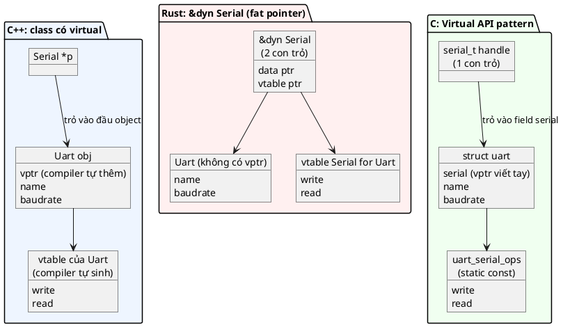

| | C++ | Rust `&dyn Trait` | C Virtual API |
|---|---|---|---|
| Con trỏ tới bảng nằm ở | Trong object (vptr ẩn) | Trong **con trỏ** (fat pointer 2 word) | Trong object (field viết tay) |
| Handle to bao nhiêu | 1 word | 2 word | 1 word |
| Một object có nhiều interface? | Nhiều vptr (đa kế thừa) | Mỗi `&dyn` tự mang vtable | Nhiều field `const struct xxx_ops *`, mỗi field một handle |
| Ai sinh bảng | Compiler | Compiler | Lập trình viên |

Điểm đáng chú ý ở cột C: handle trỏ vào **field vptr**, không trỏ vào đầu object. Nhờ vậy một object có thể implement **nhiều** interface bằng nhiều field (ví dụ một driver vừa là `serial` vừa là `power_mgmt`), mỗi interface một handle riêng, và `CONTAINER_OF` với member tương ứng đưa về cùng một object. Đây là điều mà cách "ép con trỏ object sang con trỏ interface" không làm được khi có hơn một interface.

---

# Phần B — Pattern

## 8. Vấn đề: `switch` theo loại cổng

### 8.1. Code "trước khi có pattern"

Đây là `gps.c` sau "tháng 5" trong tình huống ở mục 1.2, khi GPS phải chạy được trên UART, USB và cổng giả cho test:

```c
/* Giả lập các header driver mà gps.c buộc phải include */
struct uart;
struct usb_cdc;
struct mem_serial;
int uart_write(struct uart *self, const uint8_t *data, size_t len);
int usb_cdc_write(struct usb_cdc *self, const uint8_t *data, size_t len);
int mem_serial_write(struct mem_serial *self, const uint8_t *data, size_t len);

/* gps.h */
enum gps_port_type {
	GPS_PORT_UART,
	GPS_PORT_USB,
	GPS_PORT_MEM, /* thêm cho unit test */
};

struct gps {
	enum gps_port_type port_type;
	struct uart *uart;     /* chỉ dùng khi port_type == GPS_PORT_UART */
	struct usb_cdc *usb;   /* chỉ dùng khi port_type == GPS_PORT_USB */
	struct mem_serial *mem;
};

/* gps.c */
static int gps_port_write(struct gps *self, const uint8_t *data, size_t len)
{
	switch (self->port_type) {
	case GPS_PORT_UART:
		return uart_write(self->uart, data, len);
	case GPS_PORT_USB:
		return usb_cdc_write(self->usb, data, len);
	case GPS_PORT_MEM:
		return mem_serial_write(self->mem, data, len);
	}
	return -EINVAL;
}

int gps_send_raw(struct gps *self, const uint8_t *data, size_t len)
{
	return gps_port_write(self, data, len);
}
```

(🔬 Đoạn này build sạch với `-c`. Phần đầu chỉ là khai báo thay cho các header driver thật.)

### 8.2. Đau ở đâu

| # | Vấn đề | Hệ quả |
|---|---|---|
| 1 | `gps.c` phụ thuộc **mọi** driver | Sửa header của bất kỳ driver nào, `gps.c` build lại. Code test (`mem_serial`) nằm trong firmware |
| 2 | Thêm loại cổng = sửa `gps.c` | Và mọi module khác có `switch` tương tự (logger, shell...). Mỗi chỗ là một cơ hội quên |
| 3 | `struct gps` chứa con trỏ cho **mọi** loại | Lãng phí, và luôn có field "không dùng" có thể bị đọc nhầm |
| 4 | Không test `gps.c` một mình được | Muốn test phải kéo theo khai báo của mọi driver |
| 5 | Kiến thức "có những loại cổng nào" bị chép ở nhiều nơi | Vi phạm nguyên tắc "một sự thật, một chỗ" |

💡 gcc có cờ `-Wswitch` (bật sẵn trong `-Wall`) cảnh báo khi `switch` trên `enum` thiếu `case`. Nó bắt được lỗi "quên `case`" **nếu** `switch` không có `default` và biến có kiểu `enum`. Nhưng nó không giải quyết được vấn đề 1, 3, 4, 5, và hễ ai thêm `default:` cho "an toàn" là mất luôn cảnh báo đó.

### 8.3. Trước và sau

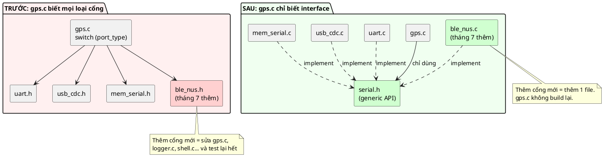

Để ý **chiều mũi tên** ở hình bên phải: các driver trỏ **vào** `serial.h`, không phải `gps.c` trỏ ra các driver. 💡 Đây là thứ thường gọi là **đảo ngược dependency** (dependency inversion): cả code dùng lẫn code implement đều phụ thuộc vào một interface trừu tượng nằm ở giữa, không bên nào phụ thuộc trực tiếp vào bên kia. 📖 Sách nói gọn: *"bây giờ bạn phụ thuộc vào trait chung thay vì vào implementation cụ thể"*.

---

## 9. Ý tưởng cốt lõi: ba phần của Virtual API

📖 Sách chia pattern thành **ba phần**, và nhấn mạnh rằng thiếu một phần thì pattern mất chức năng chính:

| Phần | Sách gọi là | Trong code mẫu | Ai nhìn thấy |
|---|---|---|---|
| 1 | **Generic API** | [inc/serial.h](inc/serial.h) + [src/serial.c](src/serial.c) | **Mọi người** (public) |
| 2 | **API interface** (trait) | [src/serial_ops.h](src/serial_ops.h) | Chỉ generic API và các implementation ("project private") |
| 3 | **Implementation** | `uart.c`, `usb_cdc.c`, `mem_serial.c` | Header implementation public để cấp phát; bên trong private |

### 9.1. Phần 1: Generic API

📖 *"Phần này được lộ ra ngoài thư viện. Nó **không chứa cấu trúc dữ liệu nào**. Mọi hàm thao tác trên con trỏ tới con trỏ của struct API, nghĩa là struct đó chỉ cần được **khai báo** chứ không cần được **định nghĩa** trong interface public."*

```c
struct serial_ops;                                  /* chỉ khai báo */
typedef const struct serial_ops **serial_t;

int serial_write(serial_t serial, const uint8_t *data, size_t len);
int serial_read(serial_t serial, uint8_t *data, size_t len);
```

Đây chính là kỹ thuật **incomplete type** của bài 02. Người dùng cầm `serial_t` nhưng không biết bên trong `struct serial_ops` có gì.

📖 Sách gọi `serial.c` là một API *"delegator"* (ủy quyền) *"nhẹ"*: mỗi hàm chỉ chuyển lời gọi sang implementation:

```c
return (*serial)->write(serial, data, len);
```

📖 Và nhấn mạnh vai trò của nó: *"mọi code khác trong kiến trúc phần mềm cần một thiết bị serial sẽ luôn dùng interface public ổn định này, bất kể implementation thật là gì. Interface này có thể được viết tài liệu và đóng vai trò một **hợp đồng** (contract) ổn định."*

### 9.2. Phần 2: API interface (trait)

📖 *"Phần này giống cách ta làm trait ở chương Inheritance. Khác biệt là struct API **chỉ được chia sẻ giữa generic API và các implementation**. Nó là API 'project private', không lộ ra ngoài, vì ta muốn **chủ động ngăn** code khác thay đổi nó, việc đó sẽ phá vỡ pattern."*

```c
struct serial_ops {
	int (*write)(serial_t serial, const uint8_t *data, size_t len);
	int (*read)(serial_t serial, uint8_t *data, size_t len);
};
```

Trong code mẫu, file này nằm trong `src/`. Makefile chỉ có `-Iinc`, nên `main.c` có muốn include cũng không tìm thấy (mục 13 có thí nghiệm). Cùng kỹ thuật "header private nằm trong `src/`" như `uart_hw.h` của bài 02.

### 9.3. Phần 3: Implementation

📖 *"Đây là implementation cụ thể. Nó **chỉ phụ thuộc vào API chung**, mọi khía cạnh khác của implementation đều được giấu. Bạn sẽ phải dùng Opaque Pattern ở đây, hoặc có cách nào khác để đăng ký con trỏ interface để ứng dụng truy vấn được (ví dụ duy trì danh sách mọi implementation đánh chỉ số bằng chuỗi hay enum, hoặc qua cấp phát động)."*

Code mẫu chọn cách đơn giản nhất cho firmware: **header implementation định nghĩa struct** (Object Pattern) để `main.c` cấp phát tĩnh, kèm một hàm đổi object thành handle:

```c
struct uart {
	const struct serial_ops *serial; /* "vptr": trỏ tới bảng hàm const dùng chung */
	const char *name;
	uint32_t baudrate;
	struct fifo rx;
};

int uart_init(struct uart *self, const char *name, uint32_t baudrate);
serial_t uart_to_serial(struct uart *self);
```

📖 Sách làm đúng như vậy với `serial_impl.h` (struct `serial_impl` có một field `const struct serial_ops *serial`, hàm `serial_impl_init` và `serial_impl_to_serial`). 📖 Sách cũng nói hàm "to_serial" *"không cần thiết nếu toàn bộ implementation là opaque, vì khi đó bạn tạo object bên trong và chỉ xuất ra con trỏ tới interface"*. Mục 17 bàn về hai lựa chọn này.

### 9.4. Ba phần ghép lại

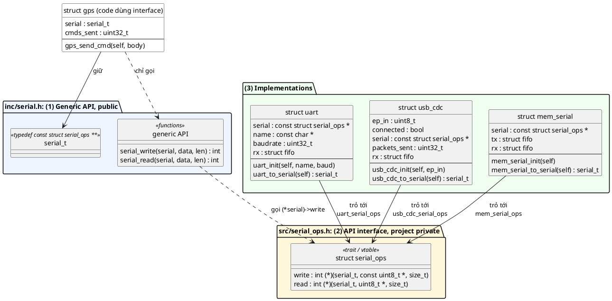

Và ai include cái gì (mũi tên là `#include`):

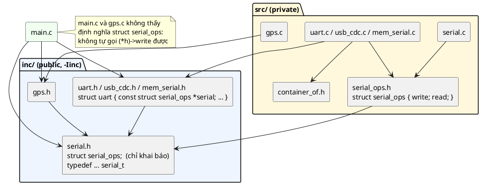

🔬 `gcc -MM` liệt kê đúng các file mà một file `.c` phụ thuộc. Với code mẫu:

```
gps.o: src/gps.c inc/gps.h inc/serial.h
uart.o: src/uart.c inc/uart.h inc/fifo.h inc/serial.h src/container_of.h \
 src/serial_ops.h inc/serial.h
```

`gps.c` chỉ phụ thuộc `gps.h` và `serial.h`: không `uart.h`, không `usb_cdc.h`, không `serial_ops.h`. Sửa bất kỳ driver nào, `gps.o` **không** build lại.

---

## 10. Ba đặc điểm nhận dạng và lý do của từng cái

📖 Sách liệt kê ba đặc điểm (*Defining Characteristics*):

### 10.1. Trait object hằng và các hàm thao tác trên nó

📖 *"Constant trait objects and methods that operate on them: đây là các hàm ảo chung, có thể được hiện thực ở các class dẫn xuất. Chúng tương ứng với 'Abstract Interface' trong các ngôn ngữ như C++."*

Trong code: `struct serial_ops` (trait) + `serial_write`/`serial_read` (các hàm thao tác trên nó).

**Tại sao "hằng":** bảng hàm của một loại driver **không bao giờ cần đổi lúc chạy**. Hàm `write` của UART luôn là `uart_serial_write`. Đã không cần đổi thì phải để compiler **cấm** đổi (mục 6.3), và được thưởng thêm: nằm trong Flash, không tốn RAM.

### 10.2. Implementation của abstract interface

📖 *"Mọi kiểu implement một abstract interface đều làm việc đó bằng cách hiện thực các hàm ảo trong trait mà kiểu đó kế thừa."*

Trong code: `uart.c` định nghĩa `uart_serial_write`, `uart_serial_read` và gom vào `uart_serial_ops`.

**Tại sao:** đây là chỗ hành vi **khác nhau** được đặt. Mọi khác biệt giữa UART, USB, RAM nằm gọn ở đây, không rò ra code dùng.

### 10.3. Trait được lưu dưới dạng con trỏ trong class dẫn xuất

📖 *"Trait object luôn là hằng và được lưu dưới dạng con trỏ. Nó cũng được truyền dưới dạng **con trỏ tới con trỏ** vào mọi callback của trait. Chủ yếu là để bảo đảm ta mở rộng được tới **nhiều instance** mà không nhân bản bảng con trỏ hàm qua mọi instance."*

Trong code: `const struct serial_ops *serial;` trong `struct uart`, và mọi hàm ops nhận `serial_t` (tức `const struct serial_ops **`).

**Tại sao lưu con trỏ:** một con trỏ thay vì cả bảng, đo được ở mục 11. **Tại sao truyền con trỏ cấp hai:** để implementation lần ra được **object nào** đang được gọi, chứng minh ở mục 12.

---

## 11. So với trait của bài 06: bộ nhớ và độ an toàn

### 11.1. 🔬 Thí nghiệm: đo RAM

Giả sử interface serial có 4 thao tác (`write`, `read`, `flush`, `set_baud`), và firmware có 100 cổng (con số lớn để thấy rõ xu hướng):

```c
/* E1: trait nhúng trong từng instance (bài 06) so với con trỏ tới bảng const (bài 07) */
#include <stddef.h>
#include <stdint.h>
#include <stdio.h>

/* Kiểu bài 06: struct trait chứa thẳng các con trỏ hàm, mỗi instance một bản */
struct serial_trait {
	int (*write)(struct serial_trait *self, const uint8_t *data, size_t len);
	int (*read)(struct serial_trait *self, uint8_t *data, size_t len);
	int (*flush)(struct serial_trait *self);
	int (*set_baud)(struct serial_trait *self, uint32_t baud);
};

struct uart_trait_style {
	struct serial_trait serial; /* 4 con trỏ hàm nằm trong RAM của MỖI instance */
	uint32_t baudrate;
};

/* Kiểu bài 07: bảng const dùng chung, instance chỉ giữ một con trỏ */
struct serial_ops {
	int (*write)(const struct serial_ops **self, const uint8_t *data, size_t len);
	int (*read)(const struct serial_ops **self, uint8_t *data, size_t len);
	int (*flush)(const struct serial_ops **self);
	int (*set_baud)(const struct serial_ops **self, uint32_t baud);
};

struct uart_vapi_style {
	const struct serial_ops *serial; /* 1 con trỏ, bảng nằm trong Flash */
	uint32_t baudrate;
};

#define N 100

int main(void)
{
	printf("sizeof(struct uart_trait_style) = %u\n", (unsigned)sizeof(struct uart_trait_style));
	printf("sizeof(struct uart_vapi_style)  = %u\n", (unsigned)sizeof(struct uart_vapi_style));
	printf("sizeof(struct serial_ops)       = %u (một bảng, trong Flash)\n",
	       (unsigned)sizeof(struct serial_ops));
	printf("%d instance kiểu trait: RAM = %u byte\n", N,
	       (unsigned)(N * sizeof(struct uart_trait_style)));
	printf("%d instance kiểu virtual API: RAM = %u byte, Flash thêm %u byte\n", N,
	       (unsigned)(N * sizeof(struct uart_vapi_style)), (unsigned)sizeof(struct serial_ops));
	return 0;
}
```

Output thật:

```
sizeof(struct uart_trait_style) = 40
sizeof(struct uart_vapi_style)  = 16
sizeof(struct serial_ops)       = 32 (một bảng, trong Flash)
100 instance kiểu trait: RAM = 4000 byte
100 instance kiểu virtual API: RAM = 1600 byte, Flash thêm 32 byte
```

Phân tích (PC 64-bit, con trỏ 8 byte):
- Kiểu trait: 4 con trỏ × 8 = 32 byte + `baudrate` 4 byte + 4 byte padding = 40 byte **mỗi instance**.
- Kiểu Virtual API: 1 con trỏ 8 byte + 4 + 4 padding = 16 byte mỗi instance, cộng **một** bảng 32 byte trong Flash cho cả chương trình.
- Phần tiết kiệm = (số con trỏ hàm − 1) × kích thước con trỏ × số instance. Interface càng nhiều thao tác, càng nhiều instance, tiết kiệm càng lớn.

💡 Trên Cortex-M (con trỏ 4 byte, chưa chạy): trait 4 × 4 + 4 = 20 byte/instance; Virtual API 4 + 4 = 8 byte/instance. 100 instance: 2000 byte so với 800 byte RAM. Với MCU 20 KB RAM, 1,2 KB là 6% RAM.

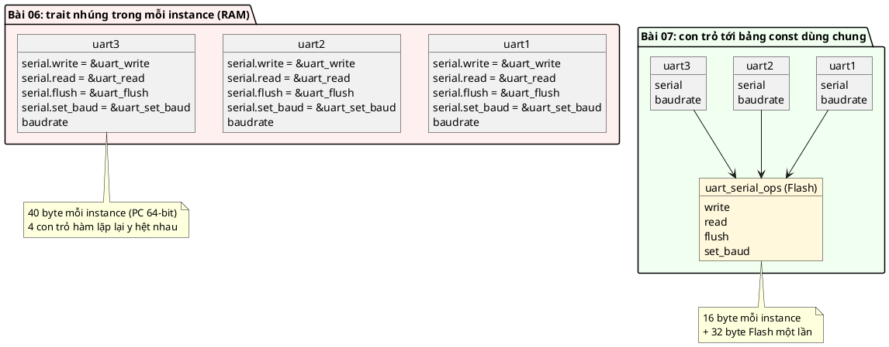

### 11.2. So sánh đầy đủ

| Tiêu chí | Trait (bài 06) | Virtual API (bài 07) |
|---|---|---|
| Bảng hàm nằm ở | Trong mỗi object (RAM) | Một bảng `static const` (Flash) |
| RAM mỗi instance | N con trỏ hàm | 1 con trỏ |
| Sửa con trỏ hàm lúc chạy | Được (field public trong RAM) | Không (const, và định nghĩa bị giấu) |
| Mỗi instance có hành vi riêng? | **Được**: hai object cùng loại có thể trỏ tới hai hàm khác | Không: cùng loại = cùng bảng |
| Caller thấy bảng hàm? | Thấy, gọi thẳng `self->write(...)` được | Không, bắt buộc qua `serial_write()` |
| Kiểu tham số của hàm ops | `struct serial_trait *` | `const struct serial_ops **` |
| Độ phức tạp | Thấp | 📖 Cao hơn: ba phần, phải theo đúng khuôn |

Dòng "mỗi instance có hành vi riêng" là chỗ trait **thắng**: nếu bạn thật sự cần đổi hành vi của **một** object lúc chạy (ví dụ một callback do người dùng đăng ký), thì đó là Callback/trait, không phải Virtual API. 📖 Chương Inheritance diễn đạt sự khác biệt này: *"abstract interface là một cấu trúc dữ liệu chia sẻ, luôn là hằng, dùng chung cho mọi instance; còn trait là cấu trúc nằm trong từng instance, các con trỏ hàm không nhất thiết luôn là hằng"*.

---

## 12. Vì sao handle phải là con trỏ cấp hai

### 12.1. Câu hỏi

Hàm `serial_write()` cần hai thông tin: **gọi hàm nào** (nằm trong bảng ops) và **cho object nào** (để implementation biết UART1 hay UART2). Có hai lựa chọn cho handle:

- **A.** Handle = con trỏ tới **bảng**: `const struct serial_ops *`. Một dấu sao.
- **B.** Handle = con trỏ tới **field chứa con trỏ tới bảng**: `const struct serial_ops **`. Hai dấu sao.

### 12.2. 🔬 Thí nghiệm

```c
/* E8: vì sao handle là con trỏ CẤP HAI. Nếu handle trỏ thẳng vào bảng ops thì sao? */
#include <stddef.h>
#include <stdint.h>
#include <stdio.h>

struct serial_ops {
	int (*write)(const struct serial_ops **serial, const char *msg);
};

struct uart {
	const struct serial_ops *serial;
	const char *name;
};

#define CONTAINER_OF(ptr, type, member) ((type *)(void *)((char *)(ptr) - offsetof(type, member)))

static int uart_write(const struct serial_ops **serial, const char *msg)
{
	struct uart *self = CONTAINER_OF(serial, struct uart, serial);

	printf("  [%s] %s\n", self->name, msg);
	return 0;
}

static const struct serial_ops uart_ops = { .write = uart_write };

int main(void)
{
	struct uart uart1 = { &uart_ops, "UART1" };
	struct uart uart2 = { &uart_ops, "UART2" };

	/* Phương án A (sai): handle = con trỏ tới bảng ops */
	const struct serial_ops *a1 = uart1.serial;
	const struct serial_ops *a2 = uart2.serial;
	printf("A: handle uart1 = %p, handle uart2 = %p -> %s\n", (const void *)a1, (const void *)a2,
	       a1 == a2 ? "GIONG NHAU, khong phan biet duoc instance" : "khac nhau");

	/* Phương án B (đúng): handle = địa chỉ của field serial bên trong từng object */
	const struct serial_ops **b1 = &uart1.serial;
	const struct serial_ops **b2 = &uart2.serial;
	printf("B: handle uart1 = %p, handle uart2 = %p -> %s\n", (void *)b1, (void *)b2,
	       b1 == b2 ? "giong nhau" : "KHAC NHAU, moi instance mot handle");
	(*b1)->write(b1, "qua handle b1");
	(*b2)->write(b2, "qua handle b2");
	return 0;
}
```

Output thật:

```
A: handle uart1 = 00007FF7CB7A4020, handle uart2 = 00007FF7CB7A4020 -> GIONG NHAU, khong phan biet duoc instance
B: handle uart1 = 000000EDA09FF790, handle uart2 = 000000EDA09FF780 -> KHAC NHAU, moi instance mot handle
  [UART1] qua handle b1
  [UART2] qua handle b2
```

- **Phương án A:** cả hai UART dùng chung **một** bảng, nên con trỏ tới bảng của chúng **bằng nhau** (`...4020`, nằm trong `.rdata`). Hàm `write` nhận được con trỏ đó không có cách nào biết đang phục vụ UART nào. Bảng là của **loại**, không phải của **instance**.
- **Phương án B:** handle là địa chỉ field `serial` **bên trong từng object** (`...F790` và `...F780`, trên stack, cách nhau 16 byte đúng bằng `sizeof(struct uart)`). Từ đó: `*handle` cho ra bảng (gọi hàm nào), `CONTAINER_OF(handle, ...)` cho ra object (cho ai).

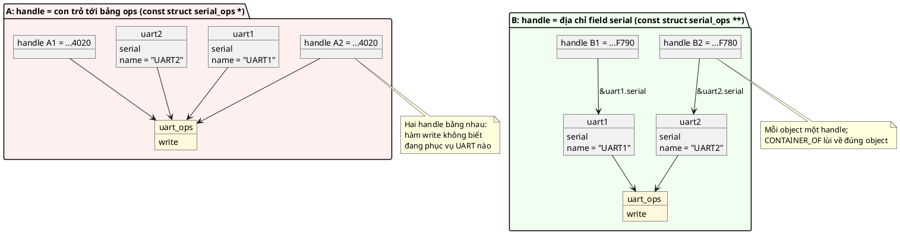

📖 Đó chính là đáp án quiz số 2 của sách: *"vì virtual API không đổi sau lúc compile, chỉ cần lưu một con trỏ tới API trong object implementation"*. Con trỏ cấp hai là cái giá nhỏ để có được điều đó: bảng dùng chung, nhưng handle vẫn riêng cho từng instance.

💡 Nói cách khác, một handle `serial_t` mang **hai** thông tin trong **một** con trỏ: địa chỉ của nó cho biết object (qua `CONTAINER_OF`), nội dung ô nó trỏ tới cho biết bảng hàm (qua `*handle`). Rust làm điều tương tự bằng fat pointer **hai** word (mục 7.2). C gói được vào một word nhờ đặt vptr bên trong object.

📖 Chương Bridge cảnh báo: *"một thay đổi đơn giản như đổi 'con trỏ tới con trỏ' thành con trỏ thường sẽ khiến bạn **không thể** dùng `CONTAINER_OF` trên handle"*. Thí nghiệm trên là bằng chứng.

---

## 13. Type safety mà không cần `void *`

📖 Sách liệt kê type safety là một trong ba lợi ích chính: *"Không có con trỏ `void *` nào, không có phép ép kiểu nào có thể dẫn tới kết quả sai. Thay vào đó ta dùng `CONTAINER_OF` và giữ cấu trúc callback luôn là hằng từ lúc compile."* Mục này kiểm chứng từng ý bằng compiler thật.

### 13.1. 🔬 Truyền nhầm object vào API chung: compiler bắt

```c
/* e5_typesafe.c — cố tình sai hai dòng đầu */
#include "serial.h"
#include "uart.h"
#include "usb_cdc.h"

void wrong_calls(struct uart *uart, struct usb_cdc *usb)
{
	const uint8_t msg[] = "hi";

	serial_write(uart, msg, 2);         /* quên uart_to_serial() */
	serial_write(uart->serial, msg, 2); /* quên dấu & */
	serial_write(&usb->serial, msg, 2); /* đúng: &usb->serial chính là handle */
}
```

```
e5_typesafe.c:9:22: error: passing argument 1 of 'serial_write' from incompatible pointer type [-Wincompatible-pointer-types]
inc/serial.h:34:27: note: expected 'serial_t' {aka 'const struct serial_ops **'} but argument is of type 'struct uart *'
e5_typesafe.c:10:26: error: passing argument 1 of 'serial_write' from incompatible pointer type [-Wincompatible-pointer-types]
inc/serial.h:34:27: note: expected 'serial_t' {aka 'const struct serial_ops **'} but argument is of type 'const struct serial_ops *'
```

Cả hai lỗi gõ nhầm phổ biến nhất đều bị bắt. Dòng thứ ba đúng nên không có thông báo. 💡 Từ gcc 14, `-Wincompatible-pointer-types` là **lỗi mặc định** trong C, kể cả không có `-Werror`.

### 13.2. 🔬 So sánh: interface kiểu `void *dev`

Rất nhiều thư viện C dùng `void *` làm "object của bất kỳ loại nào". Cùng tình huống nhầm, nhưng với `void *`:

```c
/* E5b: interface kiểu "void *dev" quen thuộc: compiler không bắt được truyền nhầm object */
#include <stdint.h>
#include <stdio.h>

struct dev_api {
	int (*write)(void *dev, const char *msg);
};

struct uart {
	const char *name;
	uint32_t baudrate;
};

struct usb_cdc {
	uint32_t packets_sent;
	uint8_t ep_in;
};

static int uart_write(void *dev, const char *msg)
{
	struct uart *self = dev; /* tin mù quáng rằng dev là struct uart */

	printf("[%s @ %lu] %s\n", self->name, (unsigned long)self->baudrate, msg);
	return 0;
}

static const struct dev_api uart_api = { .write = uart_write };

int main(void)
{
	struct uart uart1 = { "UART1", 115200 };
	struct usb_cdc usb = { 7, 0x81 };

	setvbuf(stdout, NULL, _IONBF, 0); /* in ngay, không mất output khi crash */
	uart_api.write(&uart1, "dung object");
	/* Nhầm: truyền usb cho API của uart. Compiler im lặng vì mọi con trỏ đều thành void * */
	printf("sizeof(struct usb_cdc) = %u, sizeof(struct uart) = %u\n", (unsigned)sizeof(usb),
	       (unsigned)sizeof(uart1));
	uart_api.write(&usb, "nham object");
	return 0;
}
```

Build với `-Wall -Wextra -Werror -pedantic`: **sạch, không một cảnh báo**. Chạy:

```
[UART1 @ 115200] dung object
sizeof(struct usb_cdc) = 8, sizeof(struct uart) = 16
[
```

rồi shell báo `Segmentation fault` (mã thoát 139). `uart_write` đọc 8 byte đầu của `usb` (`packets_sent = 7`, `ep_in = 0x81` và padding) như thể đó là con trỏ `name`, rồi `printf("%s")` đi theo con trỏ rác đó. Trên MCU, lỗi tương tự thường không crash ngay mà in rác hoặc ghi đè bộ nhớ, khó tìm hơn nhiều.

📖 Đây là lý do Introduction của sách nhấn mạnh làm Virtual API *"mà không dùng các thực hành không an toàn như con trỏ generic (`void`)"*, và chương Callback gọi `void *user_data` là dấu hiệu *"người viết chưa thật sự hiểu cách hiện thực đúng"*.

### 13.3. 🔬 Code dùng không thể bỏ qua API chung

Vì `struct serial_ops` chỉ được khai báo trong `serial.h`, code bên ngoài không thể tự gọi qua bảng:

```c
/* e4_bypass.c — cố tình sai */
#include "uart.h"

int bypass(struct uart *uart)
{
	serial_t h = uart_to_serial(uart);

	/* Thử gọi thẳng qua bảng hàm, bỏ qua serial_write() */
	return (*h)->write(h, (const unsigned char *)"x", 1);
}
```

```
e4_bypass.c: In function 'bypass':
e4_bypass.c:8:20: error: invalid use of undefined type 'const struct serial_ops'
    8 |         return (*h)->write(h, (const unsigned char *)"x", 1);
      |                    ^~
```

Và thử include thẳng header private từ ngoài `src/`:

```
e4_include.c:1:10: fatal error: serial_ops.h: No such file or directory
    1 | #include "serial_ops.h"
      |          ^~~~~~~~~~~~~~
```

Đây là lợi ích thứ ba sách nêu, **opaque handles**: 📖 *"người dùng chỉ làm việc với handle opaque đại diện cho abstract API, không cần gọi trực tiếp các hàm bên trong. Người dùng không thể vô tình sửa nội dung handle vì không có cấu trúc dữ liệu nào nhìn thấy được."* Cũng nhờ vậy mà bản sửa "`uart1.serial.write = shell_echo_write`" ở mục 1.2 không còn viết được.

### 13.4. Tổng kết: mỗi kiểu lỗi bị chặn ở đâu

| Lỗi | Trait (bài 06) | `void *` | Virtual API |
|---|---|---|---|
| Truyền object thay vì handle | Compiler bắt | **Im lặng**, crash lúc chạy | Compiler bắt |
| Ghi đè con trỏ hàm | **Im lặng** | Tùy | Compiler bắt (định nghĩa bị giấu + const) |
| Gọi thẳng qua bảng, bỏ qua kiểm tra | Được | Được | Compiler bắt |
| Nhầm tên member trong `CONTAINER_OF` | Bắt được nếu dùng bản có kiểm tra kiểu | Không áp dụng | Bắt được (mục 5.4) |
| Nhầm **kiểu struct** trong `CONTAINER_OF` (member cùng kiểu) | Không bắt | Không bắt | **Không bắt** (giới hạn còn lại, xem bài 08) |

---

# Phần C — Đọc code

## 14. Đọc code mẫu từng dòng

Thứ tự đọc theo đúng ba phần của pattern: generic API → API interface → implementation → code dùng.

### 14.1. Generic API, phần public: [inc/serial.h](inc/serial.h)

```c
#include <stddef.h>
#include <stdint.h>
```
Chỉ cần `size_t` và `uint8_t`. Header public không include gì của driver.

```c
struct serial_ops;
```
Khai báo trước (bài 02, mục 3). `struct serial_ops` là **incomplete type** với mọi file chỉ include `serial.h`.

```c
typedef const struct serial_ops **serial_t;
```
Kiểu handle. 📖 Sách khuyên typedef handle *"vì kiểu handle thực chất khai báo một kiểu mới và được dùng lặp lại ở nhiều chỗ"*, và đề nghị thêm nó vào danh sách ngoại lệ của checkpatch (công cụ kiểm tra style của Linux/Zephyr vốn cấm typedef). Mục 17 bàn vì sao điều này không mâu thuẫn với FAQ bài 02.

```c
/*
 * Hợp đồng chung mà MỌI implementation phải tuân theo:
 * serial_write: nhận tối đa len byte để gửi đi, không chặn (non-blocking).
 *   Trả về số byte đã nhận (0..len; có thể ít hơn len khi buffer đầy),
 *   hoặc mã lỗi âm: -EINVAL, -ENOTCONN, -ENOSYS.
 * serial_read: chép tối đa len byte đã nhận được vào data, không chặn.
 *   Trả về số byte đã chép (0 = chưa có gì), hoặc mã lỗi âm như trên.
 */
int serial_write(serial_t serial, const uint8_t *data, size_t len);
int serial_read(serial_t serial, uint8_t *data, size_t len);
```
Khối comment này **là phần quan trọng nhất của file**. 📖 Best practice đầu tiên của sách: *"Trait ops phải được định nghĩa kỹ lưỡng: mọi implementation phải theo hướng dẫn rõ ràng, và hành vi của mọi implementation phải như nhau."* Các câu hỏi mà hợp đồng phải trả lời:
- Chặn hay không chặn? (Ở đây: không chặn.)
- Ghi thiếu có được không? Trả về gì? (Được; trả số byte thật sự nhận.)
- Lỗi nào có thể xảy ra, mỗi lỗi nghĩa là gì?
- `len = 0` thì sao? `data = NULL` thì sao?

💡 Giá trị trả về ở đây là "**≥ 0 = số byte, < 0 = mã lỗi**", giống `write()` của POSIX. Nó mở rộng quy ước "0 = OK, âm = lỗi" của repo: giá trị không âm mang thêm thông tin. Bài 09 (Return Value) sẽ bàn kỹ khi nào nên làm vậy.

💡 Tên tham số là `serial` chứ không phải `self`: với code dùng interface, handle **chính là** object (nhìn qua lăng kính interface), nên vẫn đứng đầu như `self`. Tên `self` để dành cho object cụ thể mà implementation lấy ra bằng `CONTAINER_OF`.

### 14.2. API interface, phần private: [src/serial_ops.h](src/serial_ops.h)

```c
#include "serial.h"

struct serial_ops {
	int (*write)(serial_t serial, const uint8_t *data, size_t len);
	int (*read)(serial_t serial, uint8_t *data, size_t len);
};
```
- Include `serial.h` để có `serial_t`. Kiểu `serial_t` được typedef **trước** khi `struct serial_ops` được định nghĩa, điều đó hợp lệ vì typedef một con trỏ tới incomplete type không cần biết bên trong.
- Mỗi hàm nhận `serial_t`, đúng như 📖 đặc điểm thứ ba: trait được *"truyền dưới dạng con trỏ tới con trỏ vào mọi callback"*.
- Chữ ký của hàm ops **giống hệt** hàm generic tương ứng. Không bắt buộc, nhưng giúp generic API chỉ cần chuyển tiếp nguyên tham số.

### 14.3. [src/container_of.h](src/container_of.h)

Đã giải thích ở mục 5. Nằm trong `src/` vì chỉ implementation cần nó.

### 14.4. Generic API, phần implementation: [src/serial.c](src/serial.c)

```c
#include "serial.h"
#include "serial_ops.h"

#include <errno.h>
```
`serial.c` là một trong số ít file được include `serial_ops.h`. 📖 Sách chú thích ngay trong code: *"ở đây ta CÓ quyền truy cập API nên dùng trực tiếp được"*.

```c
int serial_write(serial_t serial, const uint8_t *data, size_t len)
{
	if (!serial || !*serial || (!data && len > 0)) {
		return -EINVAL;
	}
```
Ba kiểm tra, mỗi cái chặn một kiểu crash:
- `!serial`: handle `NULL` (caller quên khởi tạo `gps.serial`).
- `!*serial`: handle trỏ vào một object **chưa `init`**, field `serial` vẫn là 0 (ví dụ object `static` mới được xóa về 0 lúc khởi động). Không có kiểm tra này thì dòng sau đọc `NULL->write` và crash.
- `!data && len > 0`: con trỏ dữ liệu `NULL` mà đòi ghi. `len == 0` với `data == NULL` thì cho qua, vì "ghi 0 byte" không cần dữ liệu.

💡 Kiểm tra đặt **ở đây một lần**, mọi implementation đều được hưởng. Nếu để mỗi implementation tự kiểm tra, chắc chắn sẽ có cái quên. 📖 Sách không có các kiểm tra này trong code mẫu (generic API của sách chỉ có một dòng `return`), đây là phần mình thêm.

```c
	if (!(*serial)->write) {
		return -ENOSYS;
	}
```
Cho phép implementation **không** hỗ trợ một thao tác bằng cách để ô đó `NULL` (mục 17 có thí nghiệm). `ENOSYS` = "function not implemented".

```c
	/* Lần gián tiếp thứ hai: nhảy vào hàm của implementation cụ thể */
	return (*serial)->write(serial, data, len);
}
```
Dòng trung tâm của cả pattern. Phân tích từng ký hiệu:
- `*serial`: đọc field `serial` trong object, ra con trỏ tới bảng ops. (Lần gián tiếp 1.)
- `->write`: đọc ô `write` trong bảng, ra địa chỉ hàm.
- `(serial, data, len)`: gọi hàm đó, truyền **chính handle** vào. (Lần gián tiếp 2.)

`serial_read` y hệt, chỉ khác ô `read`.

### 14.5. Implementation 1: [inc/uart.h](inc/uart.h) + [src/uart.c](src/uart.c)

**Header:**

```c
#include "fifo.h"
#include "serial.h"

struct uart {
	const struct serial_ops *serial; /* "vptr": trỏ tới bảng hàm const dùng chung */
	const char *name;
	uint32_t baudrate;
	struct fifo rx;                   /* byte nhận được từ ngắt RX, chờ serial_read */
};
```
- Struct định nghĩa trong header (Object Pattern) để `main.c` khai báo `static struct uart uart1;`: cấp phát tĩnh, RAM biết lúc build.
- Field `serial` có kiểu con trỏ tới `struct serial_ops`, một incomplete type ở đây. Ai include `uart.h` cũng thấy field này, nhưng **không đọc được bảng** qua nó (thí nghiệm 13.3).
- `struct fifo rx`: chứa trực tiếp một object `fifo`. 📖 Đây là Inheritance Pattern dạng **containment** (bài 06): UART "kế thừa" khả năng làm hàng đợi byte mà không tự viết lại.

```c
int uart_init(struct uart *self, const char *name, uint32_t baudrate);
serial_t uart_to_serial(struct uart *self);
void uart_isr_rx_byte(struct uart *self, uint8_t byte);
```
- `uart_to_serial`: cầu nối từ "thế giới cụ thể" (`struct uart *`) sang "thế giới interface" (`serial_t`). Chỉ code nối dây (`main.c`, `board.c`) gọi hàm này.
- `uart_isr_rx_byte`: mô phỏng ngắt RX. Trên chip thật đây là thân của `USART2_IRQHandler`.

**Implementation:**

```c
#include "uart.h"
#include "container_of.h"
#include "serial_ops.h"
```
`uart.h` đứng đầu (thói quen ở bài 02: lộ lỗi header thiếu include ngay tại file của chính module).

```c
static void uart_hw_tx_byte(uint8_t byte)
{
	if (byte == '\r') {
		printf("\\r");
	} else if (byte == '\n') {
		printf("\\n");
	} else if (isprint(byte)) {
		putchar(byte);
	} else {
		printf("\\x%02X", (unsigned)byte);
	}
}
```
Mô phỏng thanh ghi TX. In `\r`, `\n` và byte nhị phân dưới dạng nhìn thấy được, để output demo đọc được (bài 08 sẽ gửi dữ liệu nhị phân qua đây). Trên chip thật: chờ cờ TXE rồi ghi `USART2->DR = byte`.

```c
static int uart_serial_write(serial_t serial, const uint8_t *data, size_t len)
{
	/* serial trỏ vào field self->serial, lùi lại offset của field là ra self */
	struct uart *self = CONTAINER_OF(serial, struct uart, serial);
```
- **`static`**: 📖 Best practice của chương Inheritance: *"callback của trait luôn là static, nằm trong file C implementation"*. Hàm chỉ được gọi qua bảng, không ai gọi thẳng; tên không đụng với `usb_cdc_serial_write`.
- Dòng `CONTAINER_OF` là dòng đầu tiên của **mọi** hàm ops. Từ đây trở đi hàm làm việc với `self` y như một hàm Object Pattern bình thường.

```c
	printf("[%s @ %lu] tx: \"", self->name, (unsigned long)self->baudrate);
	for (size_t i = 0; i < len; i++) {
		uart_hw_tx_byte(data[i]);
	}
	printf("\"\n");
	/* UART gửi chặn từng byte nên luôn nhận đủ len byte */
	return (int)len;
}
```
- `(unsigned long)self->baudrate` với `%lu`: `uint32_t` không có format riêng trong C99 ngoài `PRIu32`; ép lên `unsigned long` (ít nhất 32 bit) là cách an toàn và dễ đọc.
- `return (int)len`: đúng hợp đồng "trả số byte đã nhận". 💡 Ép `size_t` sang `int` mất dữ liệu nếu `len > INT_MAX`; với cổng serial trên MCU điều đó không xảy ra, nhưng một hợp đồng chặt chẽ hơn sẽ giới hạn `len` hoặc trả về qua tham số con trỏ (bài 09).

```c
static int uart_serial_read(serial_t serial, uint8_t *data, size_t len)
{
	struct uart *self = CONTAINER_OF(serial, struct uart, serial);

	return (int)fifo_get(&self->rx, data, len);
}
```
Đọc từ FIFO mà ngắt RX đã đổ vào. Hết dữ liệu thì `fifo_get` trả 0, đúng hợp đồng "0 = chưa có gì, không chặn".

```c
/* Một bảng duy nhất cho mọi instance UART, nằm trong Flash vì là const */
static const struct serial_ops uart_serial_ops = {
	.write = uart_serial_write,
	.read = uart_serial_read,
};
```
- `static`: tên bảng không lộ ra ngoài file. Không ai khác cần biết tên nó, vì cách duy nhất để lấy được bảng là qua `uart_init`.
- `const`: vào `.rodata` (mục 6).
- Đặt **sau** các hàm ops để không phải khai báo trước chúng.

```c
int uart_init(struct uart *self, const char *name, uint32_t baudrate)
{
	if (!self || !name || baudrate == 0) {
		return -EINVAL;
	}

	memset(self, 0, sizeof(*self));
	self->serial = &uart_serial_ops;
	self->name = name;
	self->baudrate = baudrate;
	fifo_init(&self->rx);
	return 0;
}
```
- `memset` trước, gán `serial` sau. Thứ tự này quan trọng: `memset` sau sẽ xóa mất vptr.
- `self->serial = &uart_serial_ops;` là dòng "**gắn loại**" cho object. Trước dòng này object chưa là "một serial" (field là `NULL`, generic API trả `-EINVAL`). Sau dòng này, mọi handle trỏ vào nó sẽ dẫn tới code UART.
- 📖 Code của sách làm đúng hai bước này: `memset(self, 0, sizeof(*self)); self->serial = &_ops;`.

```c
serial_t uart_to_serial(struct uart *self)
{
	return self ? &self->serial : NULL;
}
```
`&self->serial`: địa chỉ của **field**, kiểu `const struct serial_ops **`, đúng bằng `serial_t`. Không ép kiểu nào cả: compiler tự kiểm tra kiểu khớp.

```c
void uart_isr_rx_byte(struct uart *self, uint8_t byte)
{
	fifo_put(&self->rx, &byte, 1);
}
```
⚠️ Trên chip thật, hàm này chạy trong **ngắt**, còn `uart_serial_read` chạy trong vòng lặp chính. Cả hai cùng sửa `rx.count`: đó là một **race condition**. Demo chạy tuần tự trên PC nên không lộ ra. Driver thật cần tắt ngắt quanh `fifo_get` hoặc dùng ring buffer một-người-ghi-một-người-đọc. Đây là nội dung của bài 11 (Spinlock).

### 14.6. Implementation 2: [inc/usb_cdc.h](inc/usb_cdc.h) + [src/usb_cdc.c](src/usb_cdc.c)

```c
#define USB_CDC_MAX_PACKET 8

struct usb_cdc {
	uint8_t ep_in;                   /* địa chỉ endpoint IN, ví dụ 0x81 */
	bool connected;                  /* host đã mở cổng (DTR) chưa */
	const struct serial_ops *serial;
	uint32_t packets_sent;
	struct fifo rx;
};
```
- `serial` **cố ý** không đứng đầu, để thấy `CONTAINER_OF` không phụ thuộc vị trí (thí nghiệm 5.3: offset 8).
- 💡 USB Full Speed cho gói bulk tối đa 64 byte. Demo để 8 cho output ngắn mà vẫn thấy việc chia gói.

```c
static int usb_cdc_serial_write(serial_t serial, const uint8_t *data, size_t len)
{
	struct usb_cdc *self = CONTAINER_OF(serial, struct usb_cdc, serial);

	/* Hợp đồng của serial_write: đường truyền chưa sẵn sàng thì trả -ENOTCONN */
	if (!self->connected) {
		return -ENOTCONN;
	}
```
Đây là hành vi **khác** UART: USB chỉ gửi được khi host đã mở cổng. Nhưng cách báo lỗi **nằm trong hợp đồng** (`-ENOTCONN`), nên code dùng xử lý được mà không cần biết bên dưới là USB.

```c
	for (size_t off = 0; off < len; off += USB_CDC_MAX_PACKET) {
		size_t n = len - off < USB_CDC_MAX_PACKET ? len - off : USB_CDC_MAX_PACKET;

		printf("[USB ep 0x%02X] packet %lu: ", (unsigned)self->ep_in,
		       (unsigned long)self->packets_sent);
		for (size_t i = 0; i < n; i++) {
			printf("%02X ", (unsigned)data[off + i]);
		}
		printf("\n");
		self->packets_sent++;
	}
	return (int)len;
}
```
- `len - off < MAX ? len - off : MAX`: gói cuối có thể ngắn hơn 8 byte.
- In dạng hex vì đó là thứ bạn thấy trong một USB analyzer (Wireshark + USBPcap).
- Trên chip thật: mỗi vòng lặp là một lần nạp endpoint IN và chờ host lấy gói.

`usb_cdc_serial_read`, `usb_cdc_init`, `usb_cdc_to_serial` cùng khuôn với UART. `usb_cdc_set_connected` và `usb_cdc_host_send` mô phỏng sự kiện mà USB stack báo lên.

### 14.7. Implementation 3: [inc/mem_serial.h](inc/mem_serial.h) + [src/mem_serial.c](src/mem_serial.c)

```c
struct mem_serial {
	const struct serial_ops *serial;
	struct fifo tx;
	struct fifo rx;
};
```
Cổng giả cho **test**: ghi vào thì dữ liệu nằm lại trong `tx` để test đọc ra; test muốn "nhận" gì thì nạp vào `rx`.

```c
static int mem_serial_write(serial_t serial, const uint8_t *data, size_t len)
{
	struct mem_serial *self = CONTAINER_OF(serial, struct mem_serial, serial);

	/* Buffer đầy thì nhận một phần: đúng hợp đồng "có thể ít hơn len" */
	return (int)fifo_put(&self->tx, data, len);
}
```
Implementation duy nhất trong ba cái có thể **ghi thiếu**. Nhờ vậy test kiểm tra được nhánh "ghi thiếu" của code dùng (mục 20) mà không cần phần cứng thật bị đầy buffer.

💡 `mem_serial` là một **test double** (cụ thể là *fake*: implementation thật sự chạy được, chỉ là đơn giản hóa). Không có Virtual API, muốn có fake bạn phải `#ifdef TEST` trong code thật hoặc thay file lúc link. Với Virtual API, fake chỉ là "một implementation nữa".

### 14.8. [inc/fifo.h](inc/fifo.h) + [src/fifo.c](src/fifo.c)

Hàng đợi byte kích thước cố định 32, dùng chung cho ba driver. Hai chi tiết:

```c
	/* memcpy với con trỏ NULL là undefined behavior kể cả khi n = 0 */
	if (n == 0) {
		return 0;
	}
```
Generic API cho phép `serial_write(h, NULL, 0)`. Nếu không chặn, `fifo_put` sẽ gọi `memcpy(dst, NULL, 0)`, về chuẩn C99 là undefined behavior dù không chép byte nào.

```c
	memmove(self->buf, &self->buf[n], self->count - n);
```
`memmove` chứ không phải `memcpy` vì vùng nguồn và đích **chồng lên nhau**. 💡 Dồn dữ liệu kiểu này tốn O(n) mỗi lần đọc; driver thật dùng **ring buffer** (con trỏ đầu/cuối quay vòng), O(1).

### 14.9. Code dùng interface: [inc/gps.h](inc/gps.h) + [src/gps.c](src/gps.c)

```c
#include "serial.h"

struct gps {
	serial_t serial;  /* cổng được "tiêm" vào qua gps_init (dependency injection) */
	uint32_t cmds_sent;
};
```
So với bài 01 (`struct uart *uart`), thay đổi duy nhất là **kiểu của field**: từ "con trỏ tới một UART" thành "handle của bất kỳ cổng serial nào". Dependency injection của bài 01 vẫn nguyên vẹn, nhưng giờ tiêm được **mọi loại**.

```c
static uint8_t gps_nmea_checksum(const char *body)
{
	uint8_t sum = 0;

	while (*body) {
		sum ^= (uint8_t)*body++;
	}
	return sum;
}
```
Checksum NMEA 0183: XOR mọi ký tự giữa `$` và `*`. 🔬 Với `"PMTK220,1000"` (lệnh đặt chu kỳ cập nhật 1000 ms của chip GPS MediaTek), demo tính ra `1F`, khớp với giá trị thường thấy trong datasheet và các thư viện GPS.

```c
	len = snprintf(line, sizeof(line), "$%s*%02X\r\n", body, (unsigned)gps_nmea_checksum(body));
	if (len < 0 || (size_t)len >= sizeof(line)) {
		return -EMSGSIZE;
	}
```
`snprintf` trả về độ dài **lẽ ra** cần, kể cả khi bị cắt. So với `sizeof(line)` để phát hiện lệnh quá dài.

```c
	/* Lời gọi ảo: chạy code của UART, USB hay RAM tùy handle đã được tiêm vào */
	ret = serial_write(self->serial, (const uint8_t *)line, (size_t)len);
	if (ret < 0) {
		return ret;
	}
	if (ret != len) {
		/* Hợp đồng cho phép ghi thiếu; lệnh GPS bị cắt thì coi như lỗi */
		return -EIO;
	}
	self->cmds_sent++;
	return 0;
}
```
- Lỗi từ cổng (ví dụ `-ENOTCONN`) được **chuyển nguyên** lên trên.
- Ghi thiếu được xử lý vì hợp đồng nói nó có thể xảy ra. Đây là ví dụ cụ thể của việc code dùng **dựa vào hợp đồng**, không dựa vào implementation: `gps.c` không biết UART không bao giờ ghi thiếu, nên nó xử lý mọi trường hợp hợp đồng cho phép.

### 14.10. [main.c](main.c): nơi nối dây

```c
static struct uart uart1;
static struct usb_cdc usb;
static struct mem_serial mem;
static struct gps gps;
```
Mọi object cấp phát tĩnh. `main.c` (hay `board.c` trong dự án thật) là **nơi duy nhất** biết các kiểu cụ thể.

```c
static void broadcast(serial_t *ports, size_t count, const char *msg)
```
Hàm này minh họa đúng câu 📖 Use Case của sách: *"đối xử với một tập implementation y như nhau trong code ứng dụng, mà không đưa từng loại implementation vào làm dependency"*. Nó lặp qua một mảng handle của **ba loại khác nhau** bằng cùng một dòng `serial_write`.

```c
	ports[0] = uart_to_serial(&uart1);
	ports[1] = usb_cdc_to_serial(&usb);
	ports[2] = mem_serial_to_serial(&mem);
```
Đổi object cụ thể thành handle, đúng một lần. Từ đây trở đi chỉ còn `serial_t`.

```c
	gps_init(&gps, ports[0]);
	gps_send_cmd(&gps, "PMTK220,1000");
	gps_init(&gps, ports[1]);
	...
```
Cùng một object `gps`, cùng `gps.c`, lần lượt chạy trên ba loại cổng. Trong dự án thật bạn không đổi cổng của GPS giữa chừng; demo làm vậy để chứng minh `gps.c` không quan tâm.

---

## 15. Đọc code của sách và các lỗi in

📖 Code mẫu trong chương gồm 5 mảnh: `serial_ops.h`, `serial.h`, `serial.c`, header implementation, file implementation và đoạn Usage. 🔬 Mình ghép **nguyên văn** cả 5 mảnh vào một file, chỉ thêm hai thứ sách lấy từ Zephyr mà không định nghĩa (`printk` thay bằng `printf`, và một `CONTAINER_OF` bản thường), rồi build với `-std=c99 -Wall -Wextra -pedantic`:

```
e7_book_verbatim.c:8:40: error: initialization of 'struct serial *' from incompatible pointer type 'struct serial_impl *' [-Wincompatible-pointer-types]
e7_book_verbatim.c:45:20: warning: unused variable 'self' [-Wunused-variable]
e7_book_verbatim.c:51:56: warning: unused parameter 'handle' [-Wunused-parameter]
e7_book_verbatim.c:51:70: warning: unused parameter 'data' [-Wunused-parameter]
e7_book_verbatim.c:52:1: warning: unused parameter 'size' [-Wunused-parameter]
e7_book_verbatim.c:59:5: error: request for member 'read' in something not a structure or union
```

Hai lỗi và vài chỗ đáng chú ý:

| # | Dòng trong sách | Vấn đề | Sửa |
|---|---|---|---|
| 1 | `struct serial *self = CONTAINER_OF(handle, struct serial_impl, serial);` | Kiểu biến `struct serial *` không khớp kiểu `CONTAINER_OF` trả về (`struct serial_impl *`). Lỗi gõ nhầm, và chính **type safety** mà sách ca ngợi đã bắt được nó | `struct serial_impl *self = ...` |
| 2 | `.write = serial_impl_write` `.read = serial_impl_read` | **Thiếu dấu phẩy** giữa hai designated initializer | Thêm `,` |
| 3 | `printk("write: %s", data);` | `data` + `size` không bảo đảm có `'\0'` ở cuối; `%s` có thể đọc lố | `printk("write: %.*s", (int)size, data);` |
| 4 | `return size;` | Ép ngầm `size_t` sang `int`. Không có cảnh báo với `-Wall -Wextra`, nhưng có với `-Wconversion` | `return (int)size;` và ghi rõ giới hạn trong hợp đồng |
| 5 | `serial_read` trả `-1` | Không theo quy ước mã lỗi errno | `return -ENOSYS;` (hoặc để ô `read` `NULL`) |
| 6 | Generic API không kiểm tra gì | Handle `NULL` hay object chưa init → crash | Thêm kiểm tra như [src/serial.c](src/serial.c) |
| 7 | Hàm `serial_impl_read` có tham số không dùng | Cảnh báo `-Wunused-parameter` | `(void)handle;` ... |

🔬 Sau khi sửa đúng **hai** lỗi đầu (bằng `sed`, không đụng gì khác), chương trình build được (còn 4 cảnh báo unused) và chạy ra đúng output mà sách mong đợi:

```
write: Hello World!
```

💡 Kết luận: **ý tưởng và cấu trúc** trong sách đúng và chạy được; code in trong sách là bản phác thảo có lỗi gõ. Code mẫu của bài này giữ nguyên cấu trúc (ba phần, `const struct ops **`, `CONTAINER_OF`, `memset` rồi gán ops, hàm `to_serial`) và sửa các điểm trên.

---

## 16. Theo dõi demo chạy từng bước

Output đầy đủ của `make run`:

```
1) broadcast, USB not connected yet:
[UART1 @ 115200] tx: "ping\r\n"
  port 0 -> 6
  port 1 -> -126 (-ENOTCONN)
  port 2 -> 6
  mem captured 6 bytes: "ping"
2) broadcast after host opens the USB port:
[UART1 @ 115200] tx: "ping\r\n"
  port 0 -> 6
[USB ep 0x81] packet 0: 70 69 6E 67 0D 0A 
  port 1 -> 6
  port 2 -> 6
  mem captured 6 bytes: "ping"
3) gps.c does not know which port it uses:
[UART1 @ 115200] tx: "$PMTK220,1000*1F\r\n"
[USB ep 0x81] packet 1: 24 50 4D 54 4B 32 32 30 
[USB ep 0x81] packet 2: 2C 31 30 30 30 2A 31 46 
[USB ep 0x81] packet 3: 0D 0A 
  mem captured 18 bytes: "$PMTK220,1000*1F"
4) read through the same interface:
  port 0 read -> 2 "OK"
  port 1 read -> 2 "hi"
  port 2 read -> 0 ""
```

💡 `-126` là giá trị của `-ENOTCONN` trên MinGW/UCRT. Trên Linux (glibc) `ENOTCONN` là 107. Giá trị số của errno **khác nhau giữa các nền tảng**, nên code luôn so với hằng `-ENOTCONN`, không so với số.

### 16.1. Khởi tạo

| # | Lệnh | Trạng thái sau lệnh |
|---|---|---|
| 1 | `uart_init(&uart1, "UART1", 115200)` | `uart1.serial = &uart_serial_ops`, `rx.count = 0` |
| 2 | `usb_cdc_init(&usb, 0x81)` | `usb.serial = &usb_cdc_serial_ops`, `connected = false`, `packets_sent = 0` |
| 3 | `mem_serial_init(&mem)` | `mem.serial = &mem_serial_ops`, `tx.count = rx.count = 0` |
| 4 | `ports[0..2] = ..._to_serial(...)` | `ports = { &uart1.serial, &usb.serial, &mem.serial }` |

### 16.2. Bước 1: broadcast khi USB chưa kết nối

| Port | Dispatch tới | Kết quả | In ra |
|---|---|---|---|
| 0 | `uart_serial_write` | 6 | `[UART1 @ 115200] tx: "ping\r\n"` rồi `port 0 -> 6` |
| 1 | `usb_cdc_serial_write` | `connected == false` → `-ENOTCONN` | `port 1 -> -126 (-ENOTCONN)` |
| 2 | `mem_serial_write` | `fifo_put` 6 byte, `mem.tx.count = 6` | `port 2 -> 6` |

`print_mem_tx` lấy 6 byte ra (`mem.tx.count` về 0), in bỏ 2 byte `\r\n` cuối: `"ping"`.

Để ý: dòng `[UART1 ...]` in **trước** `port 0 -> 6`, vì `uart_serial_write` in ngay trong lúc được gọi, còn `broadcast` in sau khi nhận giá trị trả về.

### 16.3. Bước 2: sau khi host mở cổng USB

`usb_cdc_set_connected(&usb, true)`. Lần này port 1 gửi được: 6 byte vừa một gói (`70 69 6E 67 0D 0A` là mã ASCII của `p i n g \r \n`), `packets_sent` từ 0 lên 1.

### 16.4. Bước 3: cùng `gps.c`, ba loại cổng

| # | Lệnh | Bên trong | Kết quả |
|---|---|---|---|
| 1 | `gps_init(&gps, ports[0])` | `gps.serial = &uart1.serial`, `cmds_sent = 0` | |
| 2 | `gps_send_cmd(&gps, "PMTK220,1000")` | checksum = `0x1F`, `line` = `$PMTK220,1000*1F\r\n` (18 byte) → `serial_write` → `uart_serial_write` | In dòng UART, trả 18, `cmds_sent = 1` |
| 3 | `gps_init(&gps, ports[1])` | `gps.serial = &usb.serial`, `cmds_sent` **về 0** (init `memset` lại) | |
| 4 | `gps_send_cmd(...)` | → `usb_cdc_serial_write`: 18 byte = gói 8 + 8 + 2 | In packet 1, 2, 3 (`packets_sent` 1 → 4) |
| 5 | `gps_init(&gps, ports[2])` | `gps.serial = &mem.serial`, `cmds_sent = 0` | |
| 6 | `gps_send_cmd(...)` | → `mem_serial_write`: 18 byte vào `mem.tx` | `cmds_sent = 1` |
| 7 | `print_mem_tx()` | Lấy 18 byte | `mem captured 18 bytes: "$PMTK220,1000*1F"` |

Đọc hex của gói USB: `24` = `$`, `50 4D 54 4B` = `PMTK`, ..., `2A` = `*`, `31 46` = `1F`, `0D 0A` = `\r\n`.

Luồng gọi của bước 4 (qua USB), chi tiết tới từng lần gián tiếp:

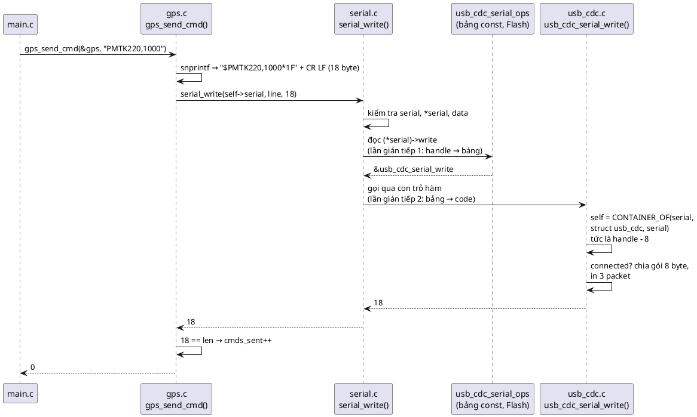

### 16.5. Bước 4: đọc qua cùng interface

| # | Lệnh | Trạng thái |
|---|---|---|
| 1 | `uart_isr_rx_byte(&uart1, 'O')`, `'K'` | `uart1.rx = "OK"`, `count = 2` |
| 2 | `usb_cdc_host_send(&usb, "hi", 2)` | `usb.rx = "hi"`, `count = 2` |
| 3 | `serial_read(ports[0], rx, 16)` | → `uart_serial_read` → `fifo_get` trả 2: `"OK"` |
| 4 | `serial_read(ports[1], rx, 16)` | → `usb_cdc_serial_read`: đã connected → trả 2: `"hi"` |
| 5 | `serial_read(ports[2], rx, 16)` | → `mem_serial_read`: `mem.rx` rỗng → trả **0**, đúng hợp đồng "không chặn" |

### 16.6. Bộ nhớ ở cuối demo

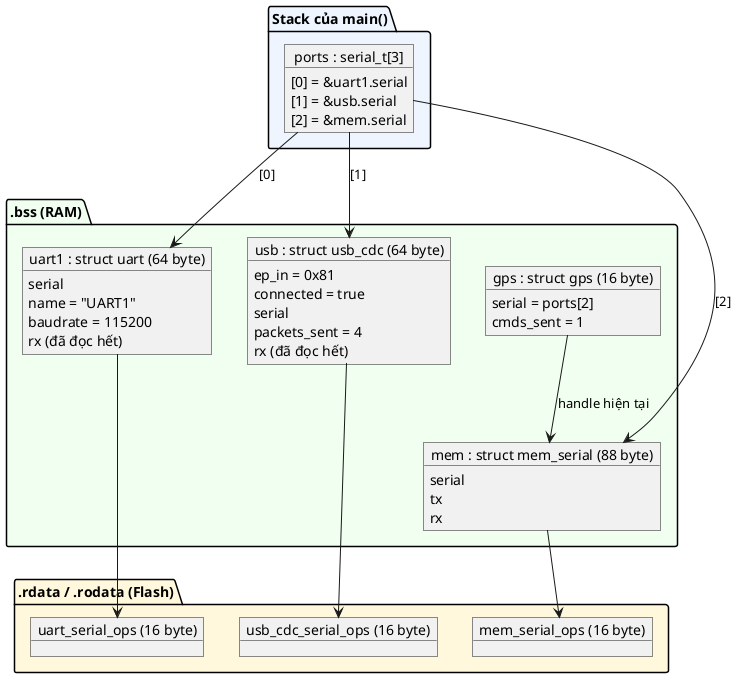

(🔬 Kích thước lấy từ `sizeof` thật trên PC 64-bit: `struct fifo` 40, `struct uart` 64, `struct usb_cdc` 64, `struct mem_serial` 88, `struct gps` 16, `struct serial_ops` 16, `serial_t` 8.)

---

## 17. Các quyết định thiết kế và phương án khác

### 17.1. Generic API là hàm trong `.c` hay `static inline` trong header?

📖 Chương Virtual API đặt generic API trong `serial.c` (vì chỉ ở đó mới thấy `struct serial_ops`). 📖 Nhưng chương Bridge của cùng sách lại viết `static inline void physics_object_position(...)` **trong header**, cùng chỗ với định nghĩa struct ops.

| | Hàm trong `.c` (code mẫu) | `static inline` trong header |
|---|---|---|
| Struct ops có bị giấu? | **Có** | Không: header phải định nghĩa struct để hàm inline đọc được |
| Chi phí gọi | Một lời gọi hàm thật + một lần gọi gián tiếp | Compiler inline, chỉ còn lần gọi gián tiếp |
| Chỗ đặt kiểm tra tham số | Một chỗ, không phình code | Bị nhân bản vào mọi nơi gọi |

Code mẫu chọn cách của chương Virtual API vì lợi ích "opaque handle" (13.3). Mục 19 cho thấy cái giá thật sự rất nhỏ: ở `-O2` gcc biến lời gọi vào implementation thành một lệnh **nhảy** (tail call).

### 17.2. Kiểm tra tham số ở generic API

Phương án khác là không kiểm tra gì (như sách) để nhanh nhất. Code mẫu chọn kiểm tra vì generic API là **cửa ngõ duy nhất**: một chỗ kiểm tra bảo vệ mọi implementation, kể cả những cái sẽ được viết sau này bởi người chưa đọc kỹ hợp đồng.

### 17.3. Thao tác tùy chọn: ô `NULL` → `-ENOSYS`

📖 Sách cảnh báo ở *Common Pitfalls*: interface quá cụ thể buộc bạn *"viết hàm giả (dummy) vì một thao tác của interface không có nghĩa với implementation của bạn"*. Một cách giảm bớt là cho phép bỏ trống ô đó. 🔬 Ví dụ một cổng debug chỉ ghi được (ITM/SWO trên Cortex-M):

```c
/* Implementation chỉ ghi được (ví dụ cổng debug ITM/SWO): không khai báo .read */
#include "container_of.h"
#include "serial.h"
#include "serial_ops.h"

#include <errno.h>
#include <stdio.h>

struct itm_port {
	const struct serial_ops *serial;
	unsigned stimulus;
};

static int itm_write(serial_t serial, const uint8_t *data, size_t len)
{
	struct itm_port *self = CONTAINER_OF(serial, struct itm_port, serial);

	printf("[ITM stim %u] %.*s\n", self->stimulus, (int)len, (const char *)data);
	return (int)len;
}

/* .read bị bỏ qua: chuẩn C bảo đảm member không được nhắc tới trong initializer là NULL */
static const struct serial_ops itm_ops = {
	.write = itm_write,
};

int main(void)
{
	struct itm_port itm = { &itm_ops, 0 };
	uint8_t buf[4];

	printf("write -> %d\n", serial_write(&itm.serial, (const uint8_t *)"boot", 4));
	printf("read  -> %d (-ENOSYS = %d)\n", serial_read(&itm.serial, buf, sizeof(buf)), -ENOSYS);
	return 0;
}
```

Output thật (build kèm `src/serial.c`):

```
[ITM stim 0] boot
write -> 4
read  -> -40 (-ENOSYS = -40)
```

Đánh đổi: generic API phải kiểm tra `NULL` ở mỗi lời gọi (vài chu kỳ), và hợp đồng phải ghi rõ thao tác nào được phép thiếu. Nếu **mọi** implementation đều phải có `read`, đừng làm vậy: để `NULL` thành lỗi lập trình và crash sớm thì tốt hơn che giấu.

### 17.4. Typedef handle: có mâu thuẫn với bài 02 không?

FAQ bài 02 khuyên **tránh** typedef cả con trỏ (`typedef struct uart *uart_handle_t;`), vì `const uart_handle_t h` nghĩa là *con trỏ hằng* chứ không phải *object hằng*, dễ hiểu nhầm. 📖 Chương này lại **khuyên** typedef `serial_t`. Không mâu thuẫn, vì:
- Code dùng **không bao giờ dereference** `serial_t` (không thể, struct bị giấu), nên câu hỏi "`const` khóa cái gì" gần như không phát sinh.
- Kiểu đầy đủ `const struct serial_ops **` dài, dễ gõ sai vị trí `const`, và xuất hiện ở mọi chữ ký hàm ops.
- 📖 Sách gọi đây là một **ngoại lệ có chủ đích** cho riêng kiểu handle.

### 17.5. Struct implementation public (Object) hay opaque?

| | Public trong header (code mẫu) | Opaque, chỉ xuất handle |
|---|---|---|
| Cấp phát | `static struct uart uart1;` ở caller: tĩnh, đơn giản | Module tự cấp phát (pool, X-macro... như bài 02) |
| Caller thấy field? | Thấy (quy ước "đừng đụng") | Không |
| Cần hàm `to_serial`? | Có | 📖 Không: hàm tạo trả thẳng `serial_t` |

Code mẫu chọn Object vì đơn giản và tĩnh. 📖 Lợi ích "Decoupling" của sách ghi: *"nếu dùng thêm Opaque Pattern, ta đạt được tách rời interface hoàn toàn"*. Đó là bước nâng cấp tự nhiên khi driver được phát hành như thư viện. Bài tập 4 yêu cầu làm điều này.

### 17.6. Hàm `uart_to_serial()` hay viết thẳng `&uart1.serial`?

Hai cách cho cùng kết quả (13.1 có dòng `serial_write(&usb->serial, ...)` hợp lệ). Hàm `to_serial` tốt hơn vì: caller không cần biết tên field; đổi tên field hay chuyển sang opaque không phải sửa caller; có chỗ kiểm tra `NULL`.

### 17.7. Một object, nhiều interface

Mục 7.2 đã nói handle trỏ vào field chứ không phải đầu object, nên một object có thể implement nhiều interface. 🔬 Thí nghiệm: một modem vừa là `serial` (gửi lệnh AT) vừa là `power` (cho vào chế độ ngủ):

```c
/* E13: một object implement HAI interface: serial và power (quản lý năng lượng) */
#include "container_of.h"
#include "serial.h"
#include "serial_ops.h"

#include <stdio.h>

/* Interface thứ hai, viết gọn trong một file cho thí nghiệm */
struct power_ops;
typedef const struct power_ops **power_t;
struct power_ops {
	int (*suspend)(power_t pm);
};

static int power_suspend(power_t pm)
{
	return (*pm)->suspend(pm);
}

struct modem {
	const char *name;
	const struct serial_ops *serial; /* interface 1 */
	const struct power_ops *power;   /* interface 2 */
	int sleeping;
};

static int modem_write(serial_t serial, const uint8_t *data, size_t len)
{
	struct modem *self = CONTAINER_OF(serial, struct modem, serial);

	printf("  [%s] AT: %.*s\n", self->name, (int)len, (const char *)data);
	return (int)len;
}

static int modem_suspend(power_t pm)
{
	struct modem *self = CONTAINER_OF(pm, struct modem, power);

	self->sleeping = 1;
	printf("  [%s] suspend\n", self->name);
	return 0;
}

static const struct serial_ops modem_serial_ops = { .write = modem_write };
static const struct power_ops modem_power_ops = { .suspend = modem_suspend };

int main(void)
{
	struct modem m = { "MODEM", &modem_serial_ops, &modem_power_ops, 0 };
	serial_t s = &m.serial;
	power_t p = &m.power;

	printf("&m = %p, serial handle = %p, power handle = %p\n", (void *)&m, (void *)s, (void *)p);
	serial_write(s, (const uint8_t *)"AT+CSQ", 6);
	power_suspend(p);
	printf("sleeping = %d\n", m.sleeping);
	return 0;
}
```

Output thật:

```
&m = 000000479A7FFB30, serial handle = 000000479A7FFB38, power handle = 000000479A7FFB40
  [MODEM] AT: AT+CSQ
  [MODEM] suspend
sleeping = 1
```

Hai handle khác nhau (`+8` và `+16` so với `&m`), mỗi cái đi qua bảng của interface tương ứng, và cả hai `CONTAINER_OF` đều về đúng `&m`. Code quản lý năng lượng chỉ cần `power_t`, code giao tiếp chỉ cần `serial_t`, không bên nào biết `struct modem`.

### 17.8. Vị trí field vptr trong struct

Không quan trọng về đúng/sai (nhờ `CONTAINER_OF`). 💡 Đặt **đầu struct** là quy ước phổ biến (C++ cũng đặt vptr ở đầu object): nhìn struct là thấy ngay "object này implement interface nào", và debugger hiển thị nó đầu tiên. Code mẫu đặt đầu ở `uart`/`mem_serial` và giữa ở `usb_cdc` chỉ để chứng minh tính độc lập vị trí.

---

# Phần D — Thực tế và tổng kết

## 18. Virtual API trong thực tế: Zephyr, Linux, C++, Rust

### 18.1. Zephyr RTOS: device API, và điều sách phê bình

📖 Ở mục *Common Pitfalls*, sách lấy Zephyr làm ví dụ của lỗi **"áp dụng Virtual API không nhất quán"**: *"Zephyr hiện thực device theo cách không có liên kết trực tiếp giữa handle và API (không có cách nào biết một handle device chung có implement một API cụ thể hay không). Đổi cách này giờ không dễ, vì toàn bộ code Zephyr dùng cách cũ. Nên tiếc là ta phải làm việc với handle `struct device` không an toàn kiểu. Đừng để điều này xảy ra trong dự án của bạn."*

💡 Cụ thể (rút gọn từ Zephyr, **không chạy** trong repo này): mọi driver, dù là UART, I2C hay SPI, đều được đại diện bằng cùng một kiểu `struct device`, trong đó bảng hàm là `const void *api`:

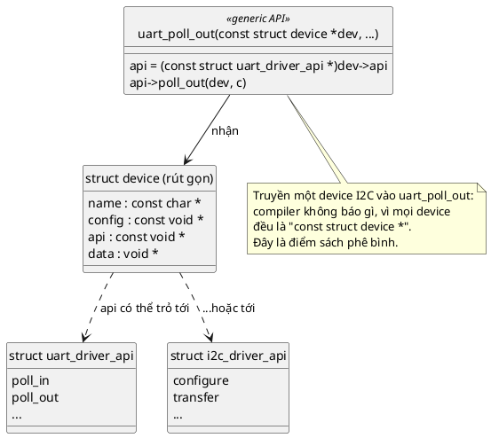

Generic API của Zephyr (như `uart_poll_out(const struct device *dev, unsigned char c)`) ép `dev->api` sang `const struct uart_driver_api *` rồi gọi. Nó **có** đủ ba phần của pattern (generic API, bảng `const` dùng chung, implementation), nhưng handle là `const struct device *` cho **mọi** loại thiết bị, nên lỗi "đưa nhầm device I2C vào hàm UART" chỉ lộ ra lúc chạy, đúng như thí nghiệm `void *` ở mục 13.2. Còn ở code mẫu của bài, `serial_t` chỉ có thể là handle của một **serial**.

💡 Theo hiểu biết của mình (chưa kiểm chứng trong repo này), các bản Zephyr gần đây đã bổ sung cơ chế kiểm tra loại API **lúc chạy** cho device. Nhưng đó vẫn là kiểm tra lúc chạy, không phải lỗi build như cách làm của bài.

📖 Bài 02 đã trích sách: Zephyr dùng **opaque object** cho mọi device. Cộng hai điều lại: Zephyr là ví dụ tốt về Opaque và về việc tách bảng hàm `const` dùng chung, nhưng là ví dụ chưa tốt về type safety của handle.

### 18.2. Linux kernel: `struct file_operations`

💡 Mỗi driver ký tự trong Linux định nghĩa một `static const struct file_operations` (các ô `open`, `read`, `write`, `release`...), và mỗi `struct file` giữ con trỏ `const struct file_operations *f_op`. Hàm chung của VFS gọi `file->f_op->read(file, ...)`. Đó là đúng Virtual API: bảng `const` dùng chung, mỗi object một con trỏ.

Khác biệt: Linux truyền **con trỏ object** (`struct file *`) vào hàm ops chứ không truyền con trỏ tới vptr, và dữ liệu riêng của driver thường được gắn qua `file->private_data`, một **`void *`**. Nên phần "lấy lại dữ liệu riêng" vẫn có một chỗ không an toàn kiểu. Kernel cũng dùng `container_of` rất rộng rãi ở những chỗ khác (ví dụ lấy `struct my_device` từ `struct cdev` nhúng bên trong).

### 18.3. C++ và Rust

Đã so sánh ở mục 7.2. 📖 Sách có nhắc tới C++ ("Abstract Interface") và Rust ("traits") để định vị pattern. 💡 Thêm một điểm thực tế: nhiều dự án embedded C++ **tắt RTTI và exception** nhưng vẫn dùng `virtual` thoải mái, vì cơ chế vtable của C++ có chi phí giống hệt Virtual API trong C. Khi bạn đọc firmware C++ như mbed OS (class `FileHandle` với các hàm `read`/`write` là `virtual`), bạn đang nhìn thấy đúng pattern này, chỉ là compiler viết hộ.

### 18.4. Bạn đã dùng nó mà có thể chưa để ý

- 💡 **`FILE *` của thư viện C chuẩn** trong nhiều implementation (ví dụ newlib, thư viện C phổ biến trên MCU): `printf` ghi ra UART hay ra semihosting tùy hàm `_write` bạn cung cấp. Đó là static dispatch (chọn lúc link). Một số implementation khác (như `fopencookie` của glibc) cho phép đăng ký bảng hàm đọc/ghi lúc chạy, tức dynamic dispatch.
- 💡 **Stack giao thức mạng** như lwIP: mỗi `struct netif` giữ con trỏ hàm `output`/`linkoutput` để cùng stack TCP/IP chạy trên Ethernet, Wi-Fi, PPP qua modem.
- 💡 **Hệ thống file**: FatFs dùng các hàm `disk_read`/`disk_write` do bạn cung cấp (static dispatch, chọn lúc link), còn LittleFS nhận một `struct lfs_config` chứa con trỏ hàm `read`/`prog`/`erase` (dynamic dispatch, một firmware gắn được nhiều loại Flash).

---

## 19. Chi phí hiệu năng: đo thật hai lần gián tiếp

📖 Sách nêu ở *Drawbacks*: *"luôn phải gọi các hàm interface qua **hai lần gián tiếp**: lần đầu khi gọi hàm wrapper chung, lần thứ hai khi hàm đó gọi implementation. Tuy nhiên đáng chú ý là chi phí này rất nhỏ so với mọi thứ bạn có khả năng làm trong hàm implementation, nên nó thường là cái giá hợp lý cho sự linh hoạt."*

### 19.1. 🔬 Xem lệnh máy thật của `serial_write`

`gcc -std=c99 -Wall -Wextra -Werror -pedantic -O2 -c src/serial.c`, rồi `objdump -d --no-show-raw-insn`:

```
0000000000000000 <serial_write>:
   0:	test   %rcx,%rcx
   3:	je     28 <serial_write+0x28>
   5:	mov    (%rcx),%rax
   8:	test   %rax,%rax
   b:	je     28 <serial_write+0x28>
   d:	test   %rdx,%rdx
  10:	jne    17 <serial_write+0x17>
  12:	test   %r8,%r8
  15:	jne    28 <serial_write+0x28>
  17:	mov    (%rax),%rax
  1a:	test   %rax,%rax
  1d:	je     2e <serial_write+0x2e>
  1f:	rex.W jmp *%rax
  22:	nopw   0x0(%rax,%rax,1)
  28:	mov    $0xffffffea,%eax
  2d:	ret
  2e:	mov    $0xffffffd8,%eax
  33:	ret
```

Đọc từng nhóm (quy ước gọi hàm Windows x64: tham số 1–4 nằm trong `rcx`, `rdx`, `r8`, `r9`):

| Địa chỉ | Lệnh | Tương ứng dòng C |
|---|---|---|
| `0`–`3` | `test %rcx,%rcx` / `je` | `!serial` → nhảy tới trả `-EINVAL` |
| `5` | `mov (%rcx),%rax` | `*serial`: đọc vptr từ object (**gián tiếp 1**) |
| `8`–`b` | `test %rax,%rax` / `je` | `!*serial` |
| `d`–`15` | kiểm tra `rdx` (`data`) và `r8` (`len`) | `!data && len > 0` |
| `17` | `mov (%rax),%rax` | `->write`: đọc ô `write` trong bảng (offset 0) |
| `1a`–`1d` | `test` / `je 2e` | `!(*serial)->write` → trả `-ENOSYS` |
| `1f` | **`jmp *%rax`** | Gọi implementation (**gián tiếp 2**) |
| `28` | `mov $0xffffffea,%eax` | `return -EINVAL;` (0xffffffea = −22) |
| `2e` | `mov $0xffffffd8,%eax` | `return -ENOSYS;` (0xffffffd8 = −40 trên MinGW) |

Điểm thú vị nhất là lệnh ở `1f`: **`jmp`**, không phải `call`. Vì lời gọi implementation là việc cuối cùng của hàm và tham số không đổi, gcc làm **tail call**: nhảy thẳng sang implementation, để implementation `ret` trực tiếp về `gps_send_cmd`. Không có khung stack thêm, không có `ret` thêm. Toàn bộ chi phí của tầng generic API ở `-O2` là: **2 lần đọc bộ nhớ** (vptr, ô `write`), vài phép so sánh với 0, và **1 lần nhảy gián tiếp**.

💡 Nếu bỏ kiểm tra tham số (như sách), thân hàm chỉ còn 3 lệnh: `mov (%rcx),%rax`, `mov (%rax),%rax`, `jmp *%rax`.

### 19.2. Trên Cortex-M thì sao (chưa chạy)

💡 Không có toolchain ARM trong môi trường này nên không đo được. Về nguyên tắc, cùng đoạn code trên Cortex-M3/M4 thành dạng `ldr r3, [r0]` (đọc vptr), `ldr r3, [r3]` (đọc ô `write`), `bx r3` (nhảy). Mỗi lần nhảy gián tiếp làm đứt pipeline 3 tầng của lõi, tốn thêm vài chu kỳ; nếu bảng và code nằm trong Flash có **wait state** (ví dụ STM32F4 chạy 168 MHz cần 5 wait state), các lần đọc có thể chậm hơn tùy bộ đệm Flash (ART accelerator). Tổng cộng cỡ **chục chu kỳ** mỗi lời gọi.

So sánh: gửi **một** byte UART ở 115200 baud mất khoảng 87 µs, tức hơn **14 000 chu kỳ** ở 168 MHz. Chi phí dispatch không đáng kể với driver I/O. Nó chỉ đáng lo ở vòng lặp cực nóng, ví dụ gọi hàm ảo cho **từng mẫu** ADC trong một bộ lọc chạy ở hàng trăm kHz. Ở đó, hãy gọi ảo một lần cho **cả khối** mẫu (`process(handle, samples, 256)`), không phải 256 lần.

💡 Một chi phí khác ít người để ý: compiler **không inline** được qua con trỏ hàm (trừ khi nó chứng minh được con trỏ trỏ tới đâu). Nghĩa là các tối ưu xuyên hàm (hằng số lan truyền, bỏ code chết) dừng lại ở ranh giới interface.

---

## 20. Unit test: contract test và implementation giả

📖 Sách nêu ở *Common Pitfalls*: *"Kiểm thử không đủ: **toàn bộ** yêu cầu của interface phải luôn được kiểm chứng bằng unit test **cho từng implementation**. Không làm vậy sẽ bỏ sót bug xuất hiện khi bạn cập nhật interface mà quên cập nhật hết các implementation."*

Có hai loại test khác nhau, và Virtual API làm cả hai trở nên dễ.

### 20.1. Contract test: một bộ test, chạy lên mọi implementation

Ý tưởng: viết các yêu cầu của hợp đồng trong `serial.h` thành test **một lần**, rồi gọi nó với handle của từng implementation. Để thấy giá trị, thí nghiệm thêm một implementation "mới" do đồng nghiệp viết, đọc hợp đồng không kỹ: trả `0` khi thành công thay vì số byte.

```c
/*
 * Contract test: MỘT bộ test chạy lên MỌI implementation của interface serial.
 * Build: gcc -std=c99 -Wall -Wextra -Werror -pedantic -Iinc -Isrc test_contract.c src/fifo.c
 *        src/serial.c src/uart.c src/usb_cdc.c src/mem_serial.c src/gps.c
 */
#include "container_of.h"
#include "gps.h"
#include "mem_serial.h"
#include "serial.h"
#include "serial_ops.h"
#include "uart.h"
#include "usb_cdc.h"

#include <errno.h>
#include <stdio.h>

/* Một implementation "mới" do đồng nghiệp viết, đọc hợp đồng không kỹ: trả 0 khi thành công */
struct spi_bridge {
	const struct serial_ops *serial;
	size_t bytes;
};

static int spi_bridge_write(serial_t serial, const uint8_t *data, size_t len)
{
	struct spi_bridge *self = CONTAINER_OF(serial, struct spi_bridge, serial);

	(void)data;
	self->bytes += len;
	return 0; /* SAI hợp đồng: phải trả số byte đã nhận */
}

static int spi_bridge_read(serial_t serial, uint8_t *data, size_t len)
{
	(void)serial;
	(void)data;
	(void)len;
	return 0;
}

static const struct serial_ops spi_bridge_ops = {
	.write = spi_bridge_write,
	.read = spi_bridge_read,
};

static int failures;

#define CHECK(cond)                                                                          \
	do {                                                                                     \
		if (!(cond)) {                                                                       \
			printf("    FAIL: %s\n", #cond);                                                 \
			failures++;                                                                      \
		}                                                                                    \
	} while (0)

/* Các yêu cầu của hợp đồng trong serial.h, viết một lần cho mọi implementation */
static void serial_contract_test(const char *name, serial_t port)
{
	const uint8_t msg[] = { 'a', 'b', 'c' };
	uint8_t buf[8];
	int before = failures;

	printf("  %s\n", name);
	CHECK(serial_write(port, msg, 3) == 3); /* ghi đủ khi còn chỗ: trả về 3 */
	CHECK(serial_write(port, msg, 0) == 0); /* len = 0: không lỗi, trả 0 */
	CHECK(serial_write(port, NULL, 3) == -EINVAL);
	CHECK(serial_read(port, buf, sizeof(buf)) >= 0); /* không chặn, không lỗi */
	CHECK(serial_write(NULL, msg, 3) == -EINVAL);
	printf("    %s\n", failures == before ? "PASS" : "-> vi pham hop dong");
}

int main(void)
{
	static struct uart uart1;
	static struct usb_cdc usb;
	static struct mem_serial mem;
	static struct spi_bridge spi = { &spi_bridge_ops, 0 };
	struct gps gps;

	uart_init(&uart1, "T", 9600);
	usb_cdc_init(&usb, 0x81);
	usb_cdc_set_connected(&usb, true);
	mem_serial_init(&mem);

	serial_contract_test("uart", uart_to_serial(&uart1));
	serial_contract_test("usb_cdc", usb_cdc_to_serial(&usb));
	serial_contract_test("mem_serial", mem_serial_to_serial(&mem));
	serial_contract_test("spi_bridge", &spi.serial);

	/* Hậu quả nếu không có contract test: gps.c (không đổi dòng nào) báo lỗi khó hiểu */
	gps_init(&gps, &spi.serial);
	printf("  gps_send_cmd over spi_bridge -> %d (-EIO = %d)\n", gps_send_cmd(&gps, "PMTK000"),
	       -EIO);
	printf("%d failure(s)\n", failures);
	return failures ? 1 : 0;
}
```

Output thật (mã thoát 1 vì có test hỏng):

```
  uart
[T @ 9600] tx: "abc"
[T @ 9600] tx: ""
    PASS
  usb_cdc
[USB ep 0x81] packet 0: 61 62 63 
    PASS
  mem_serial
    PASS
  spi_bridge
    FAIL: serial_write(port, msg, 3) == 3
    -> vi pham hop dong
  gps_send_cmd over spi_bridge -> -5 (-EIO = -5)
1 failure(s)
```

- Ba implementation của bài qua hết. Implementation mới bị bắt **ngay** với thông báo chỉ thẳng yêu cầu bị vi phạm.
- Dòng cuối cho thấy chuyện gì xảy ra nếu **không** có contract test: `gps.c` (đúng, không sửa gì) nhận `0` từ một lần ghi 15 byte, kết luận "ghi thiếu" và trả `-EIO`. Người debug sẽ đi tìm lỗi trong `gps.c`, trong khi lỗi nằm ở `spi_bridge`.
- 💡 Thêm implementation mới = thêm **một dòng** `serial_contract_test(...)`. Thêm yêu cầu mới vào hợp đồng = thêm **một dòng** `CHECK` và mọi implementation được kiểm tra lại.

💡 Dòng `[T @ 9600] tx: ""` là kết quả của `serial_write(port, msg, 0)`: UART in ra một lần gửi rỗng. Hợp đồng chỉ đòi trả 0, nên đây không phải lỗi, nhưng là một ví dụ về chuyện "hợp đồng chưa nói hết": có nên coi `len = 0` là no-op hoàn toàn không? Đó là quyết định của người viết interface, và nên ghi vào comment.

### 20.2. Test code dùng interface bằng implementation giả

`gps.c` chỉ biết `serial_t`, nên test nó bằng `mem_serial` mà không cần UART thật và không sửa dòng nào của `gps.c`:

```c
/* Test gps.c trên PC bằng cổng giả mem_serial: không UART, không sửa gps.c */
#include "gps.h"
#include "mem_serial.h"

#include <assert.h>
#include <errno.h>
#include <stdio.h>
#include <string.h>

static void test_cmd_is_framed_with_checksum(void)
{
	static struct mem_serial mem;
	struct gps gps;
	uint8_t out[FIFO_SIZE];
	size_t n;

	mem_serial_init(&mem);
	assert(gps_init(&gps, mem_serial_to_serial(&mem)) == 0);
	assert(gps_send_cmd(&gps, "PMTK220,1000") == 0);

	n = mem_serial_take_tx(&mem, out, sizeof(out));
	assert(n == strlen("$PMTK220,1000*1F\r\n"));
	assert(memcmp(out, "$PMTK220,1000*1F\r\n", n) == 0);
	assert(gps.cmds_sent == 1);
}

static void test_partial_write_is_reported(void)
{
	static struct mem_serial mem;
	struct gps gps;
	const uint8_t filler[28] = { 0 };

	mem_serial_init(&mem);
	gps_init(&gps, mem_serial_to_serial(&mem));
	/* Lấp gần đầy buffer 32 byte: lệnh 18 byte chỉ ghi được 4 byte */
	assert(serial_write(mem_serial_to_serial(&mem), filler, sizeof(filler)) == 28);
	assert(gps_send_cmd(&gps, "PMTK220,1000") == -EIO);
	assert(gps.cmds_sent == 0);
}

int main(void)
{
	test_cmd_is_framed_with_checksum();
	test_partial_write_is_reported();
	printf("test_gps: all passed\n");
	return 0;
}
```

Build: `gcc -std=c99 -Wall -Wextra -Werror -pedantic -Iinc test_gps.c src/fifo.c src/serial.c src/mem_serial.c src/gps.c` (không cần `uart.c`, `usb_cdc.c`). Output thật:

```
test_gps: all passed
```

Test thứ hai kiểm tra nhánh "ghi thiếu" của `gps.c`, một nhánh **không thể** kích hoạt với UART thật của demo (UART luôn ghi đủ). 💡 Test này cũng lộ ra một câu hỏi thiết kế: khi ghi thiếu, 4 byte đầu của lệnh **đã** vào buffer và sẽ được gửi đi, thành một lệnh cụt. `gps.c` báo lỗi nhưng không thu hồi được 4 byte đó. Driver thật có thể cần thao tác "kiểm tra còn đủ chỗ không" trước khi ghi, hoặc hợp đồng "ghi tất cả hoặc không gì cả". Thiết kế hợp đồng là phần khó nhất của pattern này.

---

## 21. Trade-off

| Tiêu chí | `switch` theo loại | Trait (bài 06) | **Virtual API** |
|---|---|---|---|
| Code dùng phụ thuộc vào | Mọi implementation | Interface | **Interface** |
| Thêm implementation | Sửa mọi `switch` | Thêm file | **Thêm file** |
| RAM mỗi instance | Không thêm (nhưng struct dùng to ra) | N con trỏ hàm | **1 con trỏ** |
| Bảng hàm | Không có | RAM, sửa được | **Flash, const, bị giấu** |
| Type safety | Có | Có | **Có** |
| Chi phí gọi | Một `switch` + gọi trực tiếp (inline được) | 1 gián tiếp | 2 gián tiếp (📖); thực tế ở `-O2`: tail call |
| Compiler inline qua ranh giới? | Được | Không | Không |
| Test bằng implementation giả | Phải sửa code thật | Dễ | **Dễ** |
| Độ phức tạp | Thấp lúc đầu, tăng theo số loại | Trung bình | 📖 Cao hơn trait: ba phần, theo đúng khuôn |
| Đổi hành vi một instance lúc chạy | Không | **Được** | Không |

📖 Ba nhược điểm sách nêu:
- **Complexity:** *"phức tạp hơn trait ở bài Inheritance. Lập trình viên phải theo một mô hình hiện thực chính xác, thiếu nó pattern mất chức năng chính."*
- **Inflexibility:** *"interface phải hằng và tương đối chung. Nếu object không mô tả được đủ bằng một interface chung, có thể bạn cần nhiều interface song song."* (Mục 17.7 cho thấy C làm điều đó được.)
- **Performance overhead:** hai lần gián tiếp, nhỏ (mục 19).

---

## 22. Khi nào không nên dùng

📖 Pitfall đầu tiên của sách là **lạm dụng**: *"nếu mọi thứ trong phần mềm đều qua abstract interface, bạn sẽ có những interface phải cập nhật thường xuyên, và mỗi lần cập nhật interface lại phải làm lại một phần các implementation. Hãy dành abstract interface cho những chỗ mà đa hình có ý nghĩa (tức là xử lý nhiều thứ bằng cùng một tập thao tác)."*

💡 Không cần Virtual API khi:
- **Chỉ có đúng một implementation** và không có kế hoạch có cái thứ hai. Một interface với một implementation là chi phí không có lợi ích. Ngoại lệ: bạn cần một implementation giả để **test**, và đó đã là cái thứ hai.
- **Mỗi bản build chỉ dùng một implementation** (board A dùng `uart_stm32.c`, board B dùng `uart_nrf.c`, không bao giờ cả hai). Static dispatch rẻ hơn: một `uart.h` chung, chọn file `.c` trong Makefile. Compiler vẫn inline được, không có con trỏ hàm nào.
- **Interface chưa ổn định.** 📖 Best practice: *"giữ trait hằng: pattern này dựa vào việc interface hiếm khi thay đổi, nên hãy nghĩ trước khi thiết kế và giữ nó cố định"*. Nếu bạn còn đang mò xem driver cần thao tác gì, viết implementation cụ thể trước, rút interface ra khi đã có hai cái thật (📖 sách khuyên chung: *"viết cho chạy trước, rồi refactor theo pattern"*).
- **Vòng lặp cực nóng** với thao tác rất nhỏ (mục 19.2).
- **Chỉ có một callback**, không phải một bộ API: dùng Callback Pattern (bài 05). 📖 Sách xếp Callback là *alternative* đầu tiên: *"phiên bản đơn giản hơn của abstract interface, thay vì định nghĩa API chung, ta làm việc với danh sách callback"*.
- **Nhiều-tới-nhiều, bất đồng bộ:** 📖 *alternative* thứ hai là **Event Bus**: *"tên hàm và dữ liệu được mã hóa thành event và publish lên bus. Phức tạp hơn nhiều so với abstract interface, thường hợp với kịch bản publish-subscribe nhiều-nhiều."*

```plantuml
@startuml
set separator none
skinparam defaultFontName Segoe UI
start
:Có nhiều cách hiện thực một hành vi;
if (Nhiều implementation cùng tồn tại\ntrong MỘT firmware, chọn lúc chạy?) then (có)
  if (Chỉ là một sự kiện / một hàm\nđể thông báo?) then (có)
    :Callback (bài 05); <<#D0E8FF>>
  else (không, một bộ thao tác)
    if (Mỗi instance cần hành vi riêng,\nđổi được lúc chạy?) then (có)
      :Trait (bài 06); <<#FFF8DC>>
    else (không)
      :Virtual API (bài 07); <<#D0FFD0>>
    endif
  endif
else (không, mỗi bản build một cái)
  if (Cần implementation giả để test?) then (có)
    :Virtual API, hoặc\nthay file .c lúc link test; <<#D0FFD0>>
  else (không)
    :Static dispatch:\nchọn file .c trong Makefile; <<#FFE0E0>>
  endif
endif
stop
@enduml
```

---

## 23. Lỗi hay gặp

| Lỗi | Hậu quả | Cách tránh |
|---|---|---|
| Quên `const` trên bảng ops | Bảng vào RAM (`.data`), tốn RAM, sửa được lúc chạy (mục 6.2) | Luôn `static const struct xxx_ops` |
| Định nghĩa struct ops trong header public | Code dùng gọi thẳng `(*h)->write`, ghi đè được, mất lợi ích opaque handle | Struct ops trong header private (`src/`) |
| Ép kiểu `(struct uart *)handle` thay vì `CONTAINER_OF` | Đúng tình cờ khi vptr ở offset 0, sai ngay khi ai thêm field lên đầu | Luôn `CONTAINER_OF` |
| `CONTAINER_OF` sai **kiểu struct** (member cùng tên, cùng kiểu) | Compiler không bắt, đọc nhầm field (bài 08 có thí nghiệm) | Mỗi hàm ops nằm cạnh struct của nó; review kỹ; contract test |
| `memset` sau khi gán `self->serial` | Xóa mất vptr, generic API trả `-EINVAL` (hoặc crash nếu không kiểm tra) | `memset` trước, gán ops sau |
| Dùng object trước khi `init` | `*handle == NULL` → crash ở `(*handle)->write` | Generic API kiểm tra `!*serial` |
| Handle một sao (`const struct ops *`) | Không phân biệt được instance (mục 12) | Handle hai sao |
| Hợp đồng mơ hồ (chặn hay không? ghi thiếu?) | Mỗi implementation hiểu một kiểu, code dùng sai với vài loại | Viết hợp đồng thành comment ở generic API + contract test |
| 📖 Không test **từng** implementation theo hợp đồng | Bug khi đổi interface mà quên một implementation | Contract test (mục 20.1) |
| 📖 Interface quá cụ thể | Nhiều implementation phải viết hàm giả | Interface chung; thao tác tùy chọn thì để `NULL` → `-ENOSYS` |
| 📖 Áp dụng không nhất quán (mỗi module một kiểu interface) | Không thể đổi cách làm sau này mà không phá cả code base (bài học Zephyr) | Một khuôn duy nhất cho cả dự án: `xxx_ops`, `xxx_t`, `xxx_write()` |
| Hàm ops không `static` | Tên lộ ra ngoài, có người gọi thẳng bỏ qua generic API | 📖 Callback của trait luôn `static` |
| Gọi hàm ops từ ISR khi implementation có thể chặn | Treo trong ngắt | Ghi rõ trong hợp đồng: thao tác nào gọi được từ ISR |
| Race giữa ISR và hàm ops (như `fifo` trong demo) | Mất byte, hỏng `count` | Critical section / ring buffer lock-free (bài 11) |

---

## 24. Quy trình refactor sang Virtual API

Xuất phát từ code có `switch (port_type)` như mục 8:

1. **Liệt kê các thao tác** mà code dùng gọi trên "cổng" (ví dụ `write`, `read`). Chỉ lấy những thao tác **mọi** loại cổng đều có nghĩa.
2. **Viết hợp đồng** cho từng thao tác: chặn hay không, trả về gì, lỗi nào. Viết thành comment trước khi viết code.
3. Tạo `inc/serial.h`: `struct serial_ops;`, `typedef const struct serial_ops **serial_t;`, các hàm generic.
4. Tạo `src/serial_ops.h` với định nghĩa struct ops, và `src/serial.c` với các hàm delegator (kèm kiểm tra tham số).
5. Với **từng** driver: thêm field `const struct serial_ops *serial;`, viết các hàm ops `static` (dòng đầu luôn là `CONTAINER_OF`), một bảng `static const`, gán bảng trong `init` sau `memset`, thêm hàm `xxx_to_serial()`.
6. Viết **contract test** và cho mọi driver qua.
7. Trong code dùng: đổi field `enum port_type` + các con trỏ cụ thể thành **một** `serial_t`; xóa `switch`; thay `uart_write(...)` bằng `serial_write(...)`; xóa `#include` của các driver.
8. Ở chỗ nối dây (`main.c`/`board.c`): gọi `xxx_to_serial()` và truyền handle vào `init` của code dùng.
9. Kiểm tra bằng `gcc -MM`: code dùng không còn phụ thuộc header driver nào.
10. Viết test cho code dùng bằng implementation giả.

---

## 25. Câu hỏi thường gặp (FAQ)

**Hỏi: Virtual API có phải là "lập trình hướng đối tượng trong C" không?**

Đúng một phần: nó là cơ chế **đa hình** (polymorphism), một trong các trụ cột của OOP. 📖 Sách nhấn mạnh tinh thần chung: pattern là về **ý đồ**, không về cú pháp; ngôn ngữ có hỗ trợ sẵn (C++, Rust) chỉ làm nó gọn hơn.

**Hỏi: Sao không đặt con trỏ hàm thẳng trong object cho đơn giản (trait)?**

Được, và đó là bài 06. Đổi lại: tốn RAM theo số instance (mục 11), con trỏ hàm sửa được lúc chạy, và caller thấy bảng hàm. Dùng trait khi cần hành vi riêng **từng instance**; dùng Virtual API khi hành vi theo **loại**.

**Hỏi: Có cần generic API không, hay gọi `(*h)->write(h, ...)` luôn cho nhanh?**

📖 Quiz số 4 của sách hỏi đúng câu này. Generic API cho ta: một tập thao tác **có tài liệu**, dùng như hàm bình thường thay vì dereference con trỏ ở khắp nơi; chỗ duy nhất kiểm tra tham số; và cho phép giấu định nghĩa struct ops. Ở `-O2` nó chỉ tốn một lệnh `jmp` (mục 19).

**Hỏi: Hàm ops có nên nhận `struct uart *` luôn cho tiện không?**

Không được, vì bảng ops là **chung** cho mọi loại: kiểu của ô `write` phải giống nhau ở mọi implementation. Nếu UART muốn `int (*)(struct uart *, ...)` còn USB muốn `int (*)(struct usb_cdc *, ...)`, chúng không cùng nằm trong một `struct serial_ops` được. Kiểu chung duy nhất mà vẫn an toàn là chính handle; `CONTAINER_OF` đổi nó sang kiểu cụ thể **bên trong** implementation, nơi kiểu cụ thể được biết.

**Hỏi: Một implementation có thể có nhiều bảng ops không?**

Được. Ví dụ UART có hai chế độ (polling và DMA) với hai bảng `uart_poll_ops`, `uart_dma_ops`; `init` chọn bảng theo cấu hình. Đây là cách đổi hành vi **của cả object** một cách có kiểm soát (gán con trỏ tới bảng khác, bảng vẫn const), không phải sửa từng con trỏ hàm.

**Hỏi: Có cách nào biết một handle là UART hay USB không?**

Có thể so `*handle == &uart_serial_ops` **bên trong** `uart.c`. Nhưng nếu code dùng cần biết điều đó, gần như chắc chắn interface đang thiếu một thao tác, hoặc code đó không nên dùng interface. Hỏi "mày là loại gì" để `switch` là quay lại đúng vấn đề của mục 8.

**Hỏi: Virtual API có thread-safe không?**

Bản thân cơ chế dispatch thì có: bảng là const, không ai ghi. Còn **implementation** có thread-safe hay không là chuyện của từng implementation, và nên ghi trong hợp đồng. Các bài 10–14 bàn về chuyện này.

**Hỏi: Virtual API và Factory khác nhau thế nào?**

Virtual API là cách **dùng** nhiều implementation qua một handle. Factory (bài 04) là cách **tạo** object từ dữ liệu cấu hình mà caller không cần biết kiểu cụ thể, và 📖 trong sách, factory trả về chính một handle Virtual API.

---

## 26. Tóm tắt và checklist

**Một câu:** *Mỗi loại implementation có một bảng hàm `static const` (Flash); mỗi object giữ một con trỏ tới bảng của loại mình; caller cầm handle là địa chỉ của con trỏ đó (`const struct ops **`) và chỉ gọi qua generic API; implementation lấy lại object bằng `CONTAINER_OF`.*

**Vì sao nó chạy được:**
- `*handle` → bảng hàm → biết **gọi hàm nào** (theo loại).
- `CONTAINER_OF(handle, ...)` → object → biết **cho ai** (theo instance).
- Bảng const + định nghĩa bị giấu → không ai sửa, không ai gọi vòng.
- Không có `void *` ở đâu cả → nhầm object là lỗi build.

Checklist cho mỗi interface:

- [ ] `inc/xxx.h`: chỉ `struct xxx_ops;`, `typedef const struct xxx_ops **xxx_t;`, các hàm generic
- [ ] Hợp đồng viết rõ trong comment: chặn/không chặn, giá trị trả về, lỗi, ghi thiếu, `len = 0`, gọi từ ISR được không
- [ ] `src/xxx_ops.h`: định nghĩa struct ops, **không** nằm trong `inc/`
- [ ] Mọi hàm ops nhận `xxx_t` làm tham số đầu, không nhận `void *`
- [ ] Generic API kiểm tra handle, `*handle`, tham số; ô `NULL` → `-ENOSYS` nếu cho phép thao tác tùy chọn
- [ ] Mỗi implementation: field `const struct xxx_ops *xxx;`, hàm ops `static`, dòng đầu là `CONTAINER_OF`
- [ ] Mỗi implementation đúng **một** bảng `static const struct xxx_ops`
- [ ] `init`: `memset` trước, gán bảng sau
- [ ] Có hàm `xxx_to_yyy()` (hoặc implementation opaque trả thẳng handle)
- [ ] `CONTAINER_OF` có kiểm tra kiểu
- [ ] Contract test chạy lên **mọi** implementation
- [ ] Code dùng chỉ include `xxx.h` (kiểm bằng `gcc -MM`)

---

## 27. Quiz (có đáp án)

Câu 1–4 là quiz gốc của sách (trắc nghiệm). Câu 5–12 do Claude thêm.

**Câu 1.** 📖 Virtual API pattern khác trait object ở Inheritance Pattern thế nào?
1. Không khác gì cả.
2. Trait object i) không phải hằng và ii) tốn bộ nhớ nếu lưu trong từng instance.
3. Virtual API hoàn toàn không giống trait.

<details><summary>Đáp án</summary>

**2.** Trait nhúng **cả bảng** con trỏ hàm vào mỗi instance: tốn RAM tỉ lệ với số instance × số thao tác (thí nghiệm mục 11: 40 so với 16 byte/instance), và các con trỏ hàm nằm trong RAM nên không phải hằng, ai thấy struct cũng sửa được. Virtual API vẫn là trait về mặt khái niệm (đáp án 3 sai), nhưng bảng là `static const` dùng chung, mỗi instance chỉ giữ một con trỏ.
</details>

**Câu 2.** 📖 Việc định nghĩa handle là con trỏ tới con trỏ giúp ta tiết kiệm bộ nhớ thế nào, nhất là khi có nhiều instance?
1. Vì virtual API không đổi sau lúc compile, chỉ cần lưu một con trỏ tới API trong object implementation.
2. Nó giúp lấy lại con trỏ tới object implementation dễ hơn.
3. Nó cho phép mỗi instance có một API object riêng, giúp giữ hai thứ gắn với nhau theo cách an toàn kiểu.

<details><summary>Đáp án</summary>

**1.** Bảng hàm cố định từ lúc compile nên chỉ cần **một** bản; mỗi object lưu một con trỏ tới nó. Handle hai sao là thứ cho phép điều đó mà vẫn phân biệt được instance: địa chỉ handle chỉ ra object (qua `CONTAINER_OF`), nội dung handle chỉ ra bảng. Đáp án 2 là một hệ quả thật (mục 12) nhưng không phải lý do tiết kiệm bộ nhớ. Đáp án 3 mô tả ngược lại: mỗi instance có API **riêng** chính là cách tốn bộ nhớ của trait.
</details>

**Câu 3.** 📖 Vì sao điều quan trọng là virtual API không chứa bất kỳ chi tiết đặc thù implementation nào?
1. Vì nó sẽ nhân bản các chi tiết đó giữa virtual API và implementation.
2. Vì khi đó mọi implementation đều phải hiện thực các chi tiết đó, và nếu chúng không có nghĩa, ta sẽ có rất nhiều code vô dụng.
3. Vì ta không thể truyền chi tiết đặc thù qua một API chung.

<details><summary>Đáp án</summary>

**2.** Mỗi ô trong bảng ops là một thao tác **mọi** implementation phải cung cấp. Thêm một thao tác chỉ có nghĩa với UART (ví dụ `set_parity`) thì USB-CDC và `mem_serial` phải viết hàm giả. Đây chính là pitfall 📖 "overly specific interfaces". Thao tác đặc thù nên nằm trong API riêng của implementation (`uart_set_parity(struct uart *, ...)`), gọi từ chỗ nối dây biết kiểu cụ thể.
</details>

**Câu 4.** 📖 Vì sao cần có generic API bên cạnh trait object?
1. Vì generic API cung cấp một tập thao tác rõ ràng trên con trỏ tới API object. Ta viết tài liệu cho nó và dùng như hàm bình thường thay vì phải dereference con trỏ mỗi lần.
2. Vì không thể hiện thực hàm ảo nếu không có API bổ sung.
3. Vì API thực hiện tính toán sơ bộ trước khi chuyển dữ liệu cho implementation.

<details><summary>Đáp án</summary>

**1.** Generic API là **hợp đồng có tài liệu**, gọi như hàm bình thường (`serial_write(h, ...)` thay vì `(*h)->write(h, ...)`). Nó cũng là thứ cho phép giấu định nghĩa struct ops (mục 13.3) và là chỗ duy nhất kiểm tra tham số. Đáp án 2 sai: về kỹ thuật vẫn gọi được `(*h)->write` trực tiếp nếu thấy struct (trait của bài 06 làm vậy). Đáp án 3 sai: generic API là lớp ủy quyền mỏng, không phải nơi xử lý dữ liệu.
</details>

**Câu 5.** Đoạn code sau có lỗi gì? Hậu quả lúc chạy?

```c
int uart_init(struct uart *self, const char *name, uint32_t baudrate)
{
	self->serial = &uart_serial_ops;
	memset(self, 0, sizeof(*self));
	self->name = name;
	self->baudrate = baudrate;
	return 0;
}
```

<details><summary>Đáp án</summary>

`memset` chạy **sau** khi gán vptr nên xóa mất nó: `self->serial == NULL`. Mọi lời gọi `serial_write(uart_to_serial(&uart1), ...)` sẽ trả `-EINVAL` (nhờ kiểm tra `!*serial` ở generic API), hoặc crash ở `(*serial)->write` nếu generic API không kiểm tra như code của sách. Sửa: `memset` trước, gán `serial` sau.
</details>

**Câu 6.** Bảng ops quên chữ `const`. Chương trình vẫn chạy đúng. Vậy có vấn đề gì không?

<details><summary>Đáp án</summary>

Có ba vấn đề: (1) Bảng vào `.data` thay vì `.rodata`, tức **tốn RAM** (và vẫn tốn Flash để giữ giá trị đầu); thí nghiệm mục 6.2 cho thấy `D` thay vì `R`. (2) Bất kỳ code nào trong file đó (hoặc ngoài file nếu bảng không `static`) có thể ghi đè con trỏ hàm lúc chạy, và lỗi đó ảnh hưởng **mọi** instance cùng loại. (3) Mất lớp bảo vệ phần cứng: ghi nhầm vào bảng const sẽ bị chặn (crash ngay, dễ tìm), còn bảng trong RAM thì âm thầm bị sửa.
</details>

**Câu 7.** Vì sao hàm `uart_serial_write` dùng `CONTAINER_OF(serial, struct uart, serial)` thay vì `(struct uart *)serial`, dù với `struct uart` cả hai cho cùng địa chỉ?

<details><summary>Đáp án</summary>

Ép thẳng chỉ đúng khi field vptr nằm ở **offset 0**, một sự tình cờ của bố cục hiện tại. Ai đó thêm một field lên đầu struct (như `struct usb_cdc` có `ep_in` đứng trước, offset 8) thì ép thẳng trỏ lệch, đọc rác, mà compiler không báo gì. `CONTAINER_OF` trừ đúng `offsetof` của field nên đúng với mọi bố cục, và bản có kiểm tra kiểu còn bắt được lỗi nhầm member. Ngoài ra, một object có nhiều interface (mục 17.7) thì chỉ một vptr có thể ở offset 0.
</details>

**Câu 8.** `main.c` viết `(*h)->write(h, data, 3);` với `h` kiểu `serial_t`. Compiler báo gì, và vì sao đó là điều tốt?

<details><summary>Đáp án</summary>

`error: invalid use of undefined type 'const struct serial_ops'` (thí nghiệm 13.3). `main.c` chỉ include `serial.h`, nơi `struct serial_ops` chỉ được khai báo, nên compiler không biết offset của `write`. Điều tốt: code dùng **bắt buộc** đi qua `serial_write()`, nơi có kiểm tra tham số; và không ai ngoài implementation có thể đọc hay sửa bảng hàm. Đây là lợi ích "opaque handles" của sách.
</details>

**Câu 9.** Một đồng nghiệp đề xuất: "bỏ `serial_ops.h` đi, đặt `struct serial_ops` thẳng vào `serial.h` và viết `serial_write` là `static inline` trong header cho nhanh". Đánh giá đề xuất này.

<details><summary>Đáp án</summary>

Được gì: compiler inline generic API vào chỗ gọi, tiết kiệm một lời gọi hàm (chương Bridge của sách cũng viết kiểu này). Mất gì: định nghĩa struct ops lộ ra mọi file, code dùng có thể gọi thẳng `(*h)->write` hay đọc bảng; kiểm tra tham số bị nhân bản vào mọi chỗ gọi. Thí nghiệm mục 19 cho thấy ở `-O2`, bản trong `.c` chỉ tốn thêm một lời gọi + một lệnh `jmp`, nên với driver I/O, lợi ích tốc độ không đáng so với mất opaque handle. Có thể chấp nhận cho interface nội bộ cực nóng, ít người dùng.
</details>

**Câu 10.** Firmware của bạn có 2 board: board A chỉ có UART STM32, board B chỉ có UART nRF52. Không bao giờ có cả hai trong một bản build. Có nên dùng Virtual API cho `uart` không?

<details><summary>Đáp án</summary>

Thường là **không cần**. Đây là trường hợp static dispatch: một `uart.h` chung, hai file `uart_stm32.c` và `uart_nrf.c`, Makefile chọn file theo board. Không có con trỏ hàm, compiler inline được. Virtual API chỉ đáng khi nhiều implementation **cùng tồn tại** trong một firmware (UART + USB + BLE), hoặc khi bạn cần implementation giả để test code dùng mà không muốn đổi file lúc link. 📖 Sách cảnh báo lạm dụng abstract interface.
</details>

**Câu 11.** `CONTAINER_OF` trong code mẫu có vế `(void)sizeof((ptr) == &((type *)0)->member)`. Biểu thức `&((type *)0)->member` có truy cập địa chỉ 0 lúc chạy không? Vế này để làm gì?

<details><summary>Đáp án</summary>

Không. Biểu thức nằm trong `sizeof`, mà `sizeof` không tính toán biểu thức (trừ VLA), chỉ lấy kiểu, nên không sinh lệnh máy nào. Vế này bắt compiler so sánh kiểu của `ptr` với kiểu "con trỏ tới `member`": nếu khác, gcc báo `comparison of distinct pointer types lacks a cast`, `-Werror` thành lỗi build (thí nghiệm 5.4). Giới hạn: nó không phát hiện nhầm **kiểu struct** khi member cùng tên và cùng kiểu.
</details>

**Câu 12.** Một implementation mới trả `0` khi ghi thành công (thay vì số byte). Nó vẫn build sạch. Lỗi này lộ ra ở đâu, và làm sao bắt được sớm?

<details><summary>Đáp án</summary>

Nó lộ ra ở **code dùng**, xa chỗ sai: `gps_send_cmd` thấy `0 != 18`, coi là ghi thiếu, trả `-EIO` (thí nghiệm 20.1). Người debug dễ nghi `gps.c`. Bắt sớm bằng **contract test**: một bộ test viết theo hợp đồng của `serial.h`, chạy lên mọi implementation. Implementation mới chỉ cần thêm một dòng gọi bộ test và sẽ bị báo `FAIL: serial_write(port, msg, 3) == 3` ngay. 📖 Sách gọi việc thiếu loại test này là pitfall "insufficient testing".
</details>

---

## 28. Bài tập

### Bài 1: Thêm một implementation (cơ bản)

Thêm `inc/rs485.h` + `src/rs485.c`: cổng RS-485 bán song công, có thêm field `de_pin` (chân Driver Enable).
- `write`: in `[RS485 DE=1]`, in dữ liệu như UART, rồi `[RS485 DE=0]` (mô phỏng bật/tắt bộ phát quanh mỗi lần gửi).
- `read`: như UART.
- Thêm vào mảng `ports` trong `main.c`. **Không sửa** `gps.c`, `serial.c`, `serial_ops.h`.
- Viết contract test cho nó (copy `serial_contract_test` từ mục 20.1).
- Dùng `gcc -MM` để chứng minh `gps.c` không phụ thuộc `rs485.h`.

### Bài 2: Refactor `switch` sang Virtual API (refactor)

Cho đoạn code sau. Refactor theo quy trình mục 24, tạo interface `struct temp_sensor_ops` với thao tác `read_mdeg(handle, int32_t *out)` (đọc nhiệt độ theo đơn vị mili-độ C):

```c
enum sensor_type { SENSOR_NTC, SENSOR_TMP117 };

struct sensor {
	enum sensor_type type;
	uint8_t adc_channel;   /* chỉ dùng cho NTC */
	uint8_t i2c_addr;      /* chỉ dùng cho TMP117 */
};

int sensor_read_mdeg(struct sensor *self, int32_t *out)
{
	switch (self->type) {
	case SENSOR_NTC:
		*out = 25000 + self->adc_channel; /* giả lập */
		return 0;
	case SENSOR_TMP117:
		*out = 24500 + self->i2c_addr;    /* giả lập */
		return 0;
	}
	return -EINVAL;
}
```

Yêu cầu: một hàm `thermostat_update(temp_sensor_t sensor)` chỉ biết interface; test nó bằng một implementation giả `fake_sensor` trả giá trị do test đặt.

### Bài 3: Thao tác tùy chọn và hợp đồng (trung bình)

Thêm thao tác `flush(serial_t)` vào interface: "chờ tới khi mọi byte đã gửi xong; trả 0 hoặc mã lỗi".
- UART: in `[UART1] flushed`. USB: trả `-ENOTCONN` nếu chưa kết nối. `mem_serial`: **không** hiện thực (để `NULL`).
- Viết hợp đồng cho `flush` trong `serial.h`, nói rõ khi nào được trả `-ENOSYS`.
- Mở rộng contract test để chấp nhận `-ENOSYS` cho `flush` nhưng **không** chấp nhận cho `write`.
- **Câu hỏi suy nghĩ:** sau khi thêm `flush`, có implementation nào phải sửa không? Điều đó nói gì về pitfall "giữ trait hằng" của sách?

### Bài 4: Implementation opaque (nâng cao)

Chuyển `usb_cdc` sang **Opaque** (bài 02) với pool tĩnh 2 phần tử:
- `inc/usb_cdc.h` chỉ còn `serial_t usb_cdc_open(uint8_t ep_in);` và `void usb_cdc_close(serial_t *serial);` cùng hai hàm mô phỏng sự kiện (giờ nhận `serial_t`).
- `struct usb_cdc` chỉ định nghĩa trong `usb_cdc.c`. Không còn `usb_cdc_to_serial`.
- **Câu hỏi suy nghĩ:** `usb_cdc_set_connected(serial_t, bool)` nhận handle của interface chung. Nếu ai đó truyền handle của UART vào thì sao? Làm sao implementation phát hiện được? (Gợi ý: so `*serial` với địa chỉ bảng ops của chính nó.)

### Bài 5: Đo bằng `nm` (nhỏ)

Build `src/usb_cdc.c` thành `.o`, chạy `nm`. Sau đó xóa chữ `const` trên `usb_cdc_serial_ops`, build lại, chạy `nm` lần nữa. Ghi lại chữ cái thay đổi thế nào và giải thích theo mục 6.

Làm xong bài nào thì gõ `/review-exercise 07_VirtualApiPattern` để Claude review.
