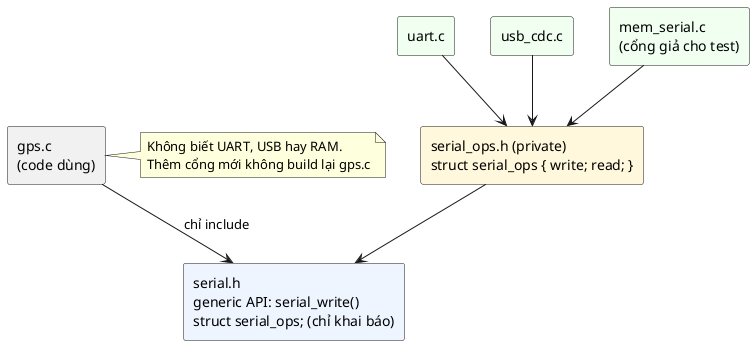

# 07 — Virtual API Pattern

📖 Bài giảng chi tiết: [LECTURE.md](LECTURE.md). File này là ghi chú tóm tắt, bám theo chương *Virtual API Pattern* của sách.

## Overview

Virtual API = cách hiện thực **abstract interface** trong C sao cho **tiết kiệm bộ nhớ** và **an toàn kiểu**. Khác trait của bài 06 ở chỗ bảng hàm không bị nhân bản vào từng instance: mỗi loại implementation có **một** bảng `static const` (nằm trong Flash), mỗi object chỉ giữ một con trỏ tới bảng, và caller cầm handle `const struct ops **` (địa chỉ của con trỏ đó).

Ba phần (📖): **Generic API** (public, không có struct nào) → **API interface** (struct ops, "project private") → **Implementation** (hàm ops `static`, một bảng `static const`, lấy lại object bằng `CONTAINER_OF`).

## Use Cases

- **Device driver:** nhiều implementation của cùng một API (UART, USB-CDC, RS-485, BLE...), đối xử như nhau.
- **Plugin:** thư viện trả về một abstract interface; implementation đổi được miễn trait giữ nguyên.
- **Abstract data type:** xử lý một tập object khác loại bằng cùng một tập thao tác.
- Phụ thuộc vào **trait chung** thay vì vào implementation cụ thể.

## Benefits

- **Decoupling:** interface chỉ là con trỏ hàm; cộng thêm Opaque thì tách rời hoàn toàn.
- **Type safety:** không `void *`, không ép kiểu mù; nhầm object là lỗi build (🔬 có thí nghiệm).
- **Opaque handle:** caller không thấy bảng hàm, không gọi vòng, không sửa được.
- 💡 Bảng `const` nằm trong Flash: 1 con trỏ RAM mỗi instance thay vì N con trỏ hàm (🔬 40 → 16 byte/instance với 4 thao tác trên PC).
- 💡 Test code dùng bằng implementation giả mà không sửa code thật.

## Drawbacks

- **Phức tạp hơn trait:** phải theo đúng khuôn ba phần.
- **Kém linh hoạt:** interface phải hằng và đủ chung; có khi cần nhiều interface song song.
- **Hai lần gián tiếp:** nhỏ (🔬 ở `-O2` generic API thành 2 lần đọc + 1 lệnh `jmp`), nhưng compiler không inline qua ranh giới.

## Implementation

Xem [inc/serial.h](inc/serial.h), [src/serial_ops.h](src/serial_ops.h), [src/serial.c](src/serial.c), [src/container_of.h](src/container_of.h), [src/uart.c](src/uart.c), [src/usb_cdc.c](src/usb_cdc.c), [src/mem_serial.c](src/mem_serial.c), [src/gps.c](src/gps.c), [main.c](main.c).

| Thành phần | Code |
|---|---|
| Handle | `typedef const struct serial_ops **serial_t;` |
| Generic API | `return (*serial)->write(serial, data, len);` (kèm kiểm tra tham số) |
| Bảng ops | `static const struct serial_ops uart_serial_ops = { .write = ..., .read = ... };` |
| Gắn loại cho object | `memset(self, 0, ...); self->serial = &uart_serial_ops;` |
| Lấy handle | `serial_t uart_to_serial(struct uart *self) { return &self->serial; }` |
| Lấy lại object | `struct uart *self = CONTAINER_OF(serial, struct uart, serial);` |

## Best Practices

- Định nghĩa trait ops **kỹ lưỡng**: hợp đồng rõ ràng, mọi implementation hành xử như nhau.
- **Typedef kiểu handle** cho gọn (ngoại lệ có chủ đích).
- **Giữ trait hằng:** nghĩ trước khi thiết kế, rồi hạn chế thay đổi.
- 💡 Bảng ops luôn `static const`; hàm ops luôn `static`; `memset` trước rồi mới gán ops.
- 💡 `CONTAINER_OF` có kiểm tra kiểu; không bao giờ ép `(struct uart *)handle`.

## Common Pitfalls

- **Lạm dụng abstract interface** ở chỗ không cần đa hình.
- **Thiếu test:** mọi yêu cầu của interface phải được kiểm cho **từng** implementation (contract test).
- **Interface quá cụ thể:** buộc implementation viết hàm giả.
- **Áp dụng không nhất quán:** bài học `struct device` của Zephyr (handle không an toàn kiểu).
- 💡 Quên `const` (bảng vào RAM), struct ops lộ trong header public, `CONTAINER_OF` nhầm kiểu struct.

## Alternatives

- **Callback** (bài 05): phiên bản đơn giản hơn, làm việc với danh sách callback thay vì một API chung.
- **Event Bus:** mã hóa tên hàm + dữ liệu thành event; phức tạp hơn, hợp với publish-subscribe nhiều-nhiều.
- 💡 **Trait** (bài 06) khi cần hành vi riêng từng instance; **static dispatch** (chọn file `.c` lúc link) khi mỗi bản build chỉ có một implementation.

## Quiz

1. Virtual API pattern khác trait object ở Inheritance Pattern thế nào?
2. Việc định nghĩa handle là con trỏ tới con trỏ giúp tiết kiệm bộ nhớ thế nào, nhất là khi có nhiều instance?
3. Vì sao virtual API không được chứa bất kỳ chi tiết đặc thù implementation nào?
4. Vì sao cần generic API bên cạnh trait object?

(Đáp án và 8 câu thêm trong [LECTURE.md](LECTURE.md#27-quiz-có-đáp-án).)

## Câu hỏi còn thắc mắc

-
