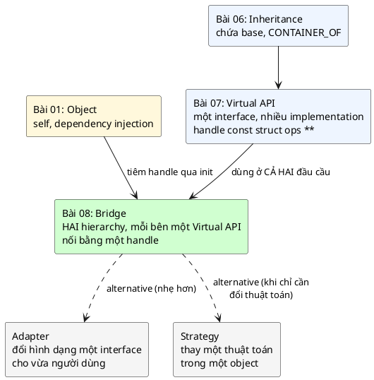
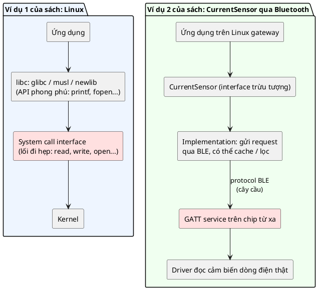
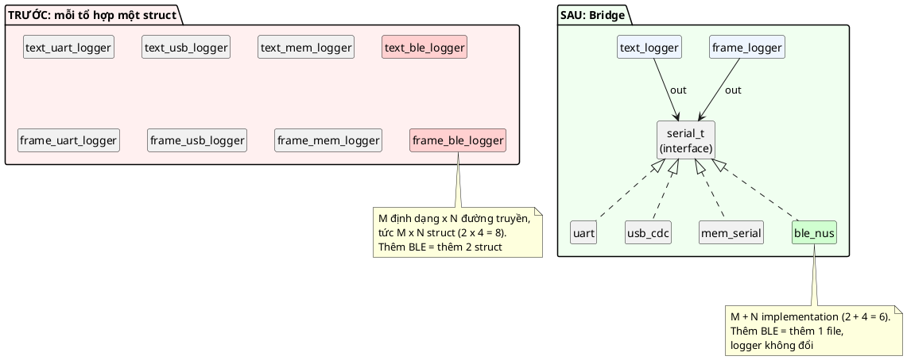
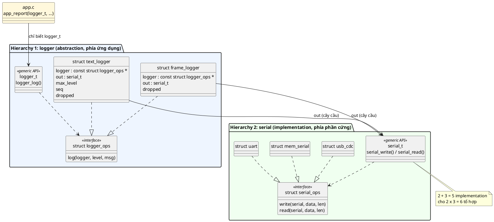
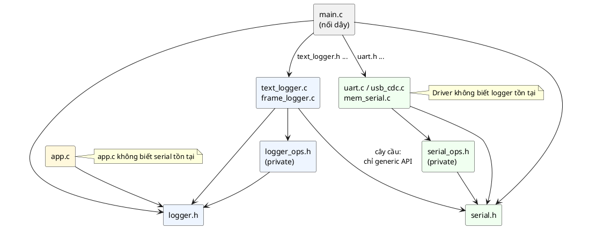
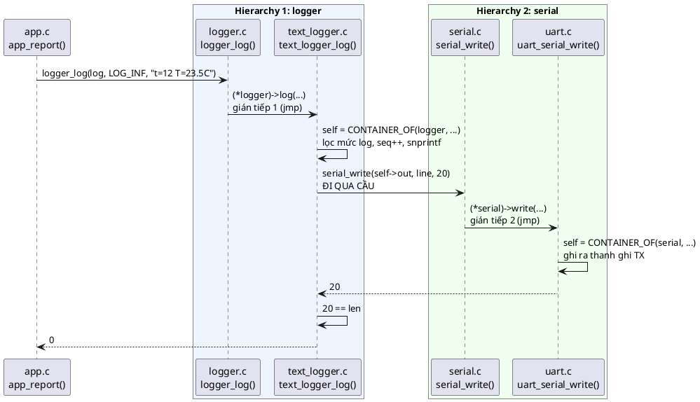
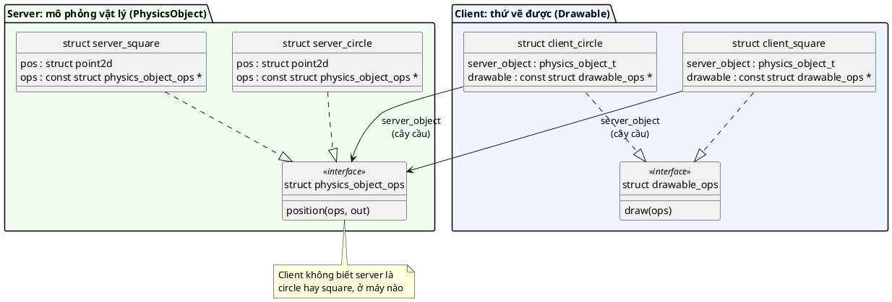
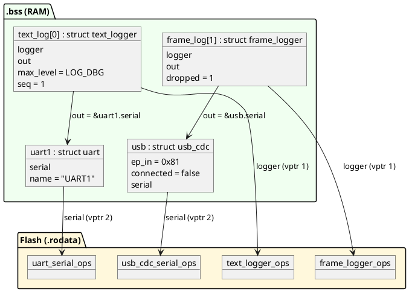

# Bài giảng 08 — Bridge Pattern

> **Về nguồn:** Bài này bám theo chương *Bridge Pattern* trong sách của Martin Schröder (bản 0.38.0, file `00_Document/Martin-Schroder-Design-Patterns-Bridge-Pattern-0.38.0.pdf`). Bridge xây trực tiếp trên bài 07, nên bài này dùng lại toàn bộ interface `serial` của bài 07.
> - 📖 đánh dấu nội dung **theo sách** (dịch và diễn giải lại).
> - 💡 đánh dấu phần **giải thích thêm**, không có trong sách.
> - 🔬 đánh dấu **thí nghiệm thật**: chương trình đã được build bằng gcc 16.2 (MSYS2 UCRT64, Windows 64-bit) và chạy; output in trong bài là output thật. Phần Rust, Zephyr, QEMU trong sách **không chạy** được ở đây (không có toolchain), được ghi rõ khi nhắc tới.

Code mẫu đi kèm:
- Hierarchy **logger** (mới): [inc/logger.h](inc/logger.h), [src/logger_ops.h](src/logger_ops.h), [src/logger.c](src/logger.c), [inc/text_logger.h](inc/text_logger.h) + [src/text_logger.c](src/text_logger.c), [inc/frame_logger.h](inc/frame_logger.h) + [src/frame_logger.c](src/frame_logger.c).
- Hierarchy **serial** (chép nguyên từ bài 07): [inc/serial.h](inc/serial.h), [src/serial_ops.h](src/serial_ops.h), [src/serial.c](src/serial.c), `uart`, `usb_cdc`, `mem_serial`, `fifo`, [src/container_of.h](src/container_of.h).
- Ứng dụng: [inc/app.h](inc/app.h) + [src/app.c](src/app.c), [main.c](main.c).

Ghi chú ngắn: [README.md](README.md). Bài trước: [07 — Virtual API](../07_VirtualApiPattern/LECTURE.md) (**đọc bài 07 trước**, bài này giả định bạn đã quen `const struct ops **`, `CONTAINER_OF`, generic API).

---

## Mục lục

**Phần A — Kiến thức nền**

1. [Bối cảnh: khi phía "dùng" cũng có nhiều loại](#1-bối-cảnh-khi-phía-dùng-cũng-có-nhiều-loại)
2. [Hierarchy trong C là gì](#2-hierarchy-trong-c-là-gì)
3. [Hai chiều biến đổi và bùng nổ tổ hợp](#3-hai-chiều-biến-đổi-và-bùng-nổ-tổ-hợp)
4. [Chứa (has-a) thay vì là (is-a)](#4-chứa-has-a-thay-vì-là-is-a)
5. [Cây cầu là một "lối đi hẹp"](#5-cây-cầu-là-một-lối-đi-hẹp)

**Phần B — Pattern**

6. [Vấn đề: một logger biết mọi định dạng và mọi đường truyền](#6-vấn-đề-một-logger-biết-mọi-định-dạng-và-mọi-đường-truyền)
7. [Ý tưởng cốt lõi: hai Virtual API nối bằng một handle](#7-ý-tưởng-cốt-lõi-hai-virtual-api-nối-bằng-một-handle)
8. [Ba đặc điểm nhận dạng và lý do của từng cái](#8-ba-đặc-điểm-nhận-dạng-và-lý-do-của-từng-cái)
9. [Dữ liệu chảy qua cầu: đếm từng bước](#9-dữ-liệu-chảy-qua-cầu-đếm-từng-bước)
10. [Các use case của sách](#10-các-use-case-của-sách)

**Phần C — Đọc code**

11. [Ví dụ shapes của sách: chạy thật và một lỗi ẩn](#11-ví-dụ-shapes-của-sách-chạy-thật-và-một-lỗi-ẩn)
12. [Đọc code mẫu từng dòng](#12-đọc-code-mẫu-từng-dòng)
13. [Theo dõi demo chạy từng bước](#13-theo-dõi-demo-chạy-từng-bước)
14. [Các quyết định thiết kế và phương án khác](#14-các-quyết-định-thiết-kế-và-phương-án-khác)

**Phần D — Thực tế và tổng kết**

15. [Bridge trong thực tế](#15-bridge-trong-thực-tế)
16. [Test xuyên cầu](#16-test-xuyên-cầu)
17. [Trade-off](#17-trade-off)
18. [Khi nào không nên dùng, và các lựa chọn khác](#18-khi-nào-không-nên-dùng-và-các-lựa-chọn-khác)
19. [Lỗi hay gặp](#19-lỗi-hay-gặp)
20. [Quy trình refactor sang Bridge](#20-quy-trình-refactor-sang-bridge)
21. [Câu hỏi thường gặp (FAQ)](#21-câu-hỏi-thường-gặp-faq)
22. [Tóm tắt và checklist](#22-tóm-tắt-và-checklist)
23. [Quiz (có đáp án)](#23-quiz-có-đáp-án)
24. [Bài tập](#24-bài-tập)

---

# Phần A — Kiến thức nền

Bridge không thêm kỹ thuật C mới nào so với bài 07. Mọi viên gạch (`const struct ops **`, bảng `static const`, `CONTAINER_OF`, generic API) đã có. Cái mới là **cách sắp xếp**: dùng Virtual API ở **hai** chỗ và nối chúng lại. Vì vậy Phần A tập trung vào tư duy: hierarchy là gì, vì sao hai chiều biến đổi gây bùng nổ, và vì sao "chứa một handle" giải quyết được.

## 1. Bối cảnh: khi phía "dùng" cũng có nhiều loại

### 1.1. Nhìn lại bài 07 bằng code

Bài 07 kết thúc với một interface và nhiều implementation:

```c
/* serial.h — generic API của bài 07 */
struct serial_ops;
typedef const struct serial_ops **serial_t;

int serial_write(serial_t serial, const uint8_t *data, size_t len);
int serial_read(serial_t serial, uint8_t *data, size_t len);
```

```c
/* gps.h — code dùng interface ở bài 07 */
struct gps {
	serial_t serial;  /* cổng được "tiêm" vào qua gps_init (dependency injection) */
	uint32_t cmds_sent;
};
```

Ba implementation (`uart`, `usb_cdc`, `mem_serial`) nằm **một phía**. Phía còn lại, `gps`, chỉ có **một** loại. Bài 07 giải xong bài toán "một cách dùng, nhiều cách hiện thực":

| Bài 07 đã giải | Bằng cách |
|---|---|
| `gps.c` không phụ thuộc driver nào | `gps.c` chỉ include `serial.h` |
| Thêm cổng mới không sửa `gps.c` | Thêm một implementation của `serial_ops` |
| Test `gps.c` không cần phần cứng | Implementation giả `mem_serial` |
| Bảng hàm không tốn RAM theo số instance | `static const`, mỗi object một con trỏ |

Câu hỏi của bài này: **chuyện gì xảy ra khi phía "dùng" cũng có nhiều loại?** Không phải một `gps`, mà là nhiều kiểu "người dùng cổng serial" khác nhau, mỗi kiểu lại phải chạy được trên mọi cổng, và ứng dụng muốn đối xử với tất cả các kiểu đó như nhau.

### 1.2. Một dự án lớn dần: logger qua thời gian

💡 *Tình huống minh họa (không phải ví dụ trong sách), tiếp nối bộ định vị xe tải của bài 07.*

#### Tháng 1: một logger, một cổng

Firmware ghi log dạng chữ ra UART1: `"12 [I] t=12 T=23.5C\r\n"`. Một file `logger.c`, gọi thẳng `uart_write`. Kỹ thuật viên cắm cáp, mở terminal, đọc được ngay.

#### Tháng 3: thêm USB, áp dụng bài 07

Có USB-CDC, team áp dụng bài 07: logger giữ một `serial_t` thay vì `struct uart *`. Một logger chạy được trên UART lẫn USB. Mọi thứ ổn, vì lúc này chỉ có **một chiều biến đổi**: đường truyền.

#### Tháng 5: chiều biến đổi thứ hai xuất hiện

Đội phân tích dữ liệu muốn thu log từ **hàng trăm xe** qua modem 4G. Log dạng chữ quá tốn băng thông (tiền SIM tính theo MB), lại không có cơ chế phát hiện byte hỏng. Họ yêu cầu thêm **log dạng frame nhị phân** có CRC, để tool trên server giải mã. Nhưng log chữ vẫn phải giữ cho kỹ thuật viên.

Giờ "logger" có **hai loại** (text, frame), và "đường truyền" có **ba loại** (UART, USB, modem). Cách nhanh nhất mà một thành viên làm: thêm `enum log_format` vào `struct logger`, và một `switch (self->format)` bên cạnh `serial_t`:

```c
struct logger {
	enum log_format format;  /* TEXT hay FRAME */
	serial_t out;
	uint32_t seq;
};
```

Code ứng dụng (`app.c`) gọi `logger_log(&logger, ...)`, vẫn ổn. Nhưng `logger.c` giờ chứa **mọi** định dạng.

#### Tháng 7: định dạng thứ ba, và ai đó muốn đổi định dạng theo đường truyền

Thêm định dạng **JSON** cho bản tích hợp với hệ thống của khách. `logger.c` có ba nhánh `switch`, mỗi nhánh 30–50 dòng. Mỗi định dạng có field riêng (text cần `seq`, frame cần `node_id`, JSON cần buffer escape), tất cả dồn vào **một** `struct logger`. Người sửa nhánh JSON phải build lại và test lại cả nhánh text và frame, vì chúng cùng một file, cùng một struct.

Một người khác, không thích `switch`, đi hướng ngược lại: tạo **mỗi tổ hợp một struct** (`text_uart_logger`, `frame_modem_logger`...). Tới tháng 7 có 3 × 3 = **9** struct, phần định dạng text bị chép ở 3 nơi.

#### Tháng 9: sửa một lỗi CRC

Phát hiện CRC của frame tính sai khi payload dài hơn 16 byte. Với phương án "mỗi tổ hợp một struct", hàm CRC bị chép trong `frame_uart_logger.c`, `frame_usb_logger.c`, `frame_modem_logger.c`. Sửa 2 trong 3, quên 1. Xe nào log qua đường truyền thứ ba vẫn gửi frame hỏng, server âm thầm vứt bỏ.

#### Tháng 10: chuyển sang Bridge

- **Hierarchy logger:** một interface `logger_t` với generic API `logger_log()`. Mỗi định dạng là một implementation riêng (`text_logger.c`, `frame_logger.c`, `json_logger.c`), mỗi cái có struct riêng với đúng field nó cần.
- **Hierarchy serial:** giữ nguyên bài 07.
- **Cây cầu:** mỗi logger **giữ một `serial_t`**, được tiêm vào lúc `init`, và chỉ nói chuyện với đường truyền qua `serial_write()`.

Kết quả: 3 định dạng + 3 đường truyền = **6 file**, ráp được **9 tổ hợp**. Hàm CRC chỉ có ở một chỗ. `app.c` chỉ biết `logger_t`. Driver không biết logger tồn tại.

#### Nhìn lại

| Tháng | Chuyện gì xảy ra | Nguyên nhân gốc |
|---|---|---|
| 3 | Ổn | Chỉ một chiều biến đổi, bài 07 là đủ |
| 5–7 | `switch` theo định dạng phình to, mọi định dạng chung một struct | Chiều biến đổi thứ hai bị nhét vào **bên trong** một implementation |
| 7 | 9 struct cho 9 tổ hợp, code chép lặp | Hai chiều bị **nhân** với nhau thay vì **cộng** |
| 9 | Sửa lỗi ở 2/3 bản copy | Hệ quả của code chép lặp |

📖 Đây chính là tình huống sách mô tả ở mục *Use Cases*: *"Bridge lý tưởng khi các yêu cầu cho abstraction và implementation có khả năng **thay đổi độc lập** với nhau"*, và *"khi có nhiều implementation có thể có cho một abstraction và implementation cần được chọn **động lúc chạy**"*.

### 1.3. Đọc kỹ định nghĩa của sách

📖 Câu mở đầu chương:

> *"The bridge design pattern is a structural design pattern used to decouple an abstract implementation of controller from the implementations of the object being controlled - making it possible to have multiple implementations of the controlling object as well as multiple implementations of the controlled object. This allows the two hierarchies of abstractions to evolve separately."*
>
> *Bridge là một structural pattern dùng để **tách** phần hiện thực trừu tượng của **bên điều khiển** khỏi các hiện thực của **đối tượng bị điều khiển**, nhờ đó có thể có **nhiều hiện thực của bên điều khiển** đồng thời **nhiều hiện thực của bên bị điều khiển**. Điều này cho phép **hai hierarchy** trừu tượng **tiến hóa riêng rẽ**.*

| Vế | Nghĩa là gì | Trong code mẫu |
|---|---|---|
| *"structural design pattern"* | Pattern về cách **ghép nối** các object (cùng nhóm với Callback, Inheritance, Virtual API) | |
| *"controller"* (bên điều khiển) | Phía ra lệnh, phía gần ứng dụng | Logger: quyết định gửi **cái gì** (định dạng) |
| *"object being controlled"* (bên bị điều khiển) | Phía thực thi lệnh, gần phần cứng | Serial: quyết định gửi **bằng cách nào** |
| *"multiple implementations of the controlling object"* | Bên điều khiển **cũng** có nhiều loại | `text_logger`, `frame_logger` |
| *"as well as multiple implementations of the controlled object"* | Bên bị điều khiển có nhiều loại (chuyện của bài 07) | `uart`, `usb_cdc`, `mem_serial` |
| *"two hierarchies"* | Hai họ object, mỗi họ có interface và các implementation riêng | Họ logger, họ serial |
| *"evolve separately"* | Thêm/sửa ở một họ **không** buộc sửa họ kia | Thêm `json_logger` không đụng driver; thêm `ble_nus` không đụng logger |

Chữ quan trọng nhất là "**as well as**": Virtual API (bài 07) chỉ cần nhiều implementation **một phía**. Bridge xuất hiện khi **cả hai phía** đều có nhiều implementation.

Viết gọn thành công thức:

> **Bridge = Virtual API ở phía điều khiển + Virtual API ở phía bị điều khiển + mỗi object phía điều khiển giữ một handle của phía bị điều khiển**

### 1.4. Bridge trong bức tranh các pattern

📖 Phần Introduction: *"Khi đã có Virtual API, ta sẵn sàng xây các abstraction cao hơn, vì chúng phụ thuộc vào các abstraction đơn giản ở tầng dưới. Ta xem Bridge Pattern phức tạp hơn, **dùng Virtual API rất nhiều**, nhưng cho phép bắc cầu giữa **hai hierarchy độc lập** của object, sao cho interface trở nên rất đơn giản."*



| | Virtual API (07) | **Bridge (08)** | Adapter | Strategy |
|---|---|---|---|---|
| Số hierarchy | 1 | **2** | 0 hoặc 1 | 1 (các thuật toán) |
| Mục đích | Một API, nhiều implementation | Hai họ object tiến hóa độc lập | Đổi interface có sẵn cho vừa nhu cầu | Thay hành vi/thuật toán của một object |
| Ai biết ai | Code dùng biết interface | Họ A biết **interface** của họ B; họ B không biết họ A | Adapter biết cả hai interface | Object biết interface của strategy |
| 📖 Quan hệ | Viên gạch của Bridge | Xây trên Virtual API | *"Nhẹ hơn nhiều"* | *"Khi thuật toán là mối quan tâm chính"* |

📖 Sách tóm tắt khác biệt Virtual API và Bridge ở quiz: *"Bridge có mục đích **tách các hierarchy**, còn abstract interface là cách **tách interface khỏi implementation**."*

💡 Chương Factory của sách cũng nhắc Bridge như một lựa chọn thay thế, mô tả nó là việc *"mở rộng" một object bằng các hàm định nghĩa trong một file C riêng, với API riêng mà header public không phụ thuộc vào implementation của object cụ thể*. Cách diễn đạt khác, nhưng cùng ý: thêm một tầng (logger) "phía trên" một họ object (serial) mà không làm hai bên phụ thuộc chi tiết của nhau.

### 1.5. Câu hỏi bài này sẽ trả lời

1. "Hai hierarchy" trong C cụ thể là gì? (Mục 2)
2. Vì sao hai chiều biến đổi lại "nhân" thành M × N, và Bridge biến nó thành M + N thế nào? (Mục 3, 7)
3. Cây cầu nằm ở đâu trong code? Nó tốn bao nhiêu RAM và bao nhiêu bước gọi? (Mục 7, 9)
4. Code mẫu của sách có chạy thật không? (Mục 11: có, nhưng có một lỗi ẩn chỉ lộ ra khi đổi bố cục struct.)
5. Test thế nào khi một lời gọi đi xuyên qua hai hierarchy? (Mục 16)
6. Khi nào Bridge là **thừa**? (Mục 18)

---

## 2. Hierarchy trong C là gì

### 2.1. Từ bài 06 và 07

💡 Trong ngôn ngữ hướng đối tượng, *hierarchy* (cây phân cấp) là một class gốc cùng các class dẫn xuất từ nó. C không có class, nhưng bài 06 và 07 đã cho ta đủ để dựng cùng cấu trúc:

| Thành phần của hierarchy | Trong C (theo bài 07) | Ví dụ họ serial | Ví dụ họ logger |
|---|---|---|---|
| "Class gốc trừu tượng" | Struct ops + generic API | `struct serial_ops`, `serial_write()` | `struct logger_ops`, `logger_log()` |
| "Class dẫn xuất" | Struct implementation chứa vptr | `struct uart`, `struct usb_cdc` | `struct text_logger`, `struct frame_logger` |
| "Con trỏ tới class gốc" | Handle `const struct ops **` | `serial_t` | `logger_t` |
| "Hàm virtual override" | Hàm ops `static` + `CONTAINER_OF` | `uart_serial_write` | `text_logger_log` |

Vậy **một hierarchy = một interface Virtual API + các implementation của nó**. Bài 07 có một hierarchy. Bài 08 có hai.

### 2.2. Thuật ngữ gốc của Bridge

💡 Bridge là một trong 23 pattern của cuốn *Design Patterns* (Gamma, Helm, Johnson, Vlissides, 1994, thường gọi là "GoF"). Sách của Schröder dùng chữ *controller / controlled* và *client / server*; tài liệu khác thường dùng thuật ngữ GoF. Bảng đối chiếu để bạn đọc được cả hai:

| GoF | Sách (Schröder) | Code mẫu bài này |
|---|---|---|
| **Abstraction** (interface phía người dùng) | Controlling abstraction / client interface | `logger_t` + `logger_log()` |
| **Refined Abstraction** (các biến thể của abstraction) | Client side objects | `text_logger`, `frame_logger` |
| **Implementor** (interface phía hiện thực) | Interface of the object being controlled / server interface | `serial_t` + `serial_write()` |
| **Concrete Implementor** | Server side objects | `uart`, `usb_cdc`, `mem_serial` |
| Tham chiếu từ Abstraction tới Implementor | **The bridge** | Field `serial_t out` |

⚠️ Chữ "implementation" bị dùng theo hai nghĩa, dễ nhầm: (1) **"implementation" của một interface** (theo nghĩa bài 07: `text_logger` là một implementation của `logger_ops`); (2) **"Implementation hierarchy"** của Bridge, tức **họ phía bị điều khiển** (họ serial). Trong bài này, khi nói "phía implementation" là nghĩa (2); khi nói "một implementation của X" là nghĩa (1).

---

## 3. Hai chiều biến đổi và bùng nổ tổ hợp

### 3.1. Hai chiều

Một "logger gửi log qua đường truyền" thay đổi theo **hai chiều độc lập**:
- **Định dạng** (cái gì được gửi): text, frame nhị phân, JSON...
- **Đường truyền** (gửi bằng cách nào): UART, USB, modem, BLE, RAM giả cho test...

"Độc lập" nghĩa là: chọn định dạng nào **không ràng buộc** việc chọn đường truyền nào. Text qua USB, frame qua UART, JSON qua modem... mọi tổ hợp đều có nghĩa.

### 3.2. Nhân hay cộng

Nếu mỗi tổ hợp là một struct riêng, số struct = **M × N** (M định dạng, N đường truyền). Nếu mỗi chiều là một hierarchy riêng, số implementation = **M + N**:

| M định dạng | N đường truyền | Mỗi tổ hợp một struct (M × N) | Bridge (M + N) |
|---|---|---|---|
| 2 | 3 | 6 | **5** |
| 3 | 3 | 9 | **6** |
| 3 | 5 | 15 | **8** |
| 4 | 6 | 24 | **10** |

Chênh lệch tăng rất nhanh. Nhưng con số chưa phải vấn đề lớn nhất. Vấn đề lớn nhất là **mỗi kiến thức bị chép bao nhiêu lần**: với M × N, cách định dạng text bị chép N lần, cách gửi qua UART bị chép M lần. Mỗi bản chép là một chỗ có thể sửa thiếu (tháng 9 ở mục 1.2).

💡 Với M = 1 hoặc N = 1 thì M × N và M + N gần như bằng nhau: đó là lúc **không cần** Bridge (mục 18).

---

## 4. Chứa (has-a) thay vì là (is-a)

💡 Có hai cách để "text logger qua UART" có được khả năng gửi qua UART:

| | "Là" (is-a) | "Chứa" (has-a) |
|---|---|---|
| Ý tưởng | `text_uart_logger` **là một** UART có thêm khả năng định dạng text | `text_logger` **có một** đường truyền (bất kỳ) |
| Trong C | Struct chứa trực tiếp `struct uart` (containment cố định, bài 06) | Struct chứa **handle** `serial_t` (bài 07) |
| Đổi đường truyền | Phải tạo struct mới | Truyền handle khác vào `init` |
| Số struct | M × N | M + N |

Bài 06 dùng containment **cố định** (`struct fifo rx;` nằm trong `struct uart`): chỗ đó đúng, vì UART **luôn** cần đúng một FIFO, không có chiều biến đổi nào. Bridge dùng containment **qua handle**: struct chứa một con trỏ tới **interface**, không phải tới một kiểu cụ thể. Chính lựa chọn này cắt đứt phép nhân.

💡 Nguyên tắc nổi tiếng *"favor composition over inheritance"* (ưu tiên kết hợp hơn kế thừa) của GoF xuất phát chính từ những tình huống như vậy. Và kỹ thuật "tiêm handle qua `init`" chính là **dependency injection** của bài 01 (mục 6), chỉ khác là thứ được tiêm giờ là một handle Virtual API.

---

## 5. Cây cầu là một "lối đi hẹp"

📖 Sách nhấn mạnh một tính chất mà nhiều tài liệu khác bỏ qua: *"Có lẽ một trong những khác biệt lớn nhất giữa bridge và abstract interface là bridge là một **'lối đi hẹp'** (thin pathway) từ hệ này sang hệ khác. Giống như interface system call của Linux là một lối đi rất hạn chế giữa bên trong kernel và mọi phần mềm khác chạy trên hệ thống."*

📖 Sách mô tả cấu trúc: implementation cung cấp interface trừu tượng cần bắc cầu (system call), rồi **phía trên** đó ta có một implementation khác với abstraction riêng, cung cấp **interface phong phú** cho người dùng (các thư viện C khác nhau trên system call: musl, glibc, newlib).



Ánh xạ sang code mẫu:

| | Linux | Code mẫu |
|---|---|---|
| Interface phong phú phía người dùng | libc (`printf`, `fprintf`...) | `logger_log(level, msg)`, lọc mức log, đánh số `seq`, định dạng, CRC |
| Lối đi hẹp | `write(fd, buf, len)` | `serial_write(serial, data, len)`: chỉ "đây là các byte" |
| Phía bên kia | Kernel, driver | `uart`, `usb_cdc`, `mem_serial` |

Lối đi càng hẹp thì hai bên càng ít ràng buộc nhau. `serial_write` không biết gì về log level, CRC hay số thứ tự; nó chỉ chở byte. Nhờ vậy cùng một `serial_t` có thể dùng cho logger, cho GPS (bài 07), cho shell, cho bất kỳ thứ gì cần chở byte.

📖 Ở mục *Pitfalls*, sách nói interface của cầu nên theo tinh thần **"means, not policy"** (cung cấp **phương tiện**, không áp đặt **chính sách**): *"interface nên đơn giản, chung chung, cung cấp phương tiện giao tiếp với implementation ở bên kia cầu mà không áp đặt quá nhiều quy tắc."* Ví dụ: `serial_write` cung cấp phương tiện "gửi byte"; còn chính sách "gửi lại khi lỗi", "bỏ log khi đầy", "lọc mức log" thuộc về phía logger.

---

# Phần B — Pattern

## 6. Vấn đề: một logger biết mọi định dạng và mọi đường truyền

### 6.1. Code "trước khi có pattern"

Phiên bản xấu nhất: hai chiều biến đổi nhét chung vào một struct, hai `switch` lồng nhau (không áp dụng cả bài 07):

```c
/* Giả lập các header driver mà logger.c buộc phải include */
struct uart;
struct usb_cdc;
struct mem_serial;
int uart_write(struct uart *self, const uint8_t *data, size_t len);
int usb_cdc_write(struct usb_cdc *self, const uint8_t *data, size_t len);
int mem_serial_write(struct mem_serial *self, const uint8_t *data, size_t len);

enum log_level { LOG_ERR, LOG_WRN, LOG_INF, LOG_DBG };
enum log_format { LOG_FMT_TEXT, LOG_FMT_FRAME };
enum log_port { LOG_PORT_UART, LOG_PORT_USB, LOG_PORT_MEM };

struct logger {
	enum log_format format;  /* chiều biến đổi thứ nhất */
	enum log_port port;      /* chiều biến đổi thứ hai */
	struct uart *uart;
	struct usb_cdc *usb;
	struct mem_serial *mem;
	uint32_t seq;
};

static int logger_port_write(struct logger *self, const uint8_t *data, size_t len)
{
	switch (self->port) {
	case LOG_PORT_UART:
		return uart_write(self->uart, data, len);
	case LOG_PORT_USB:
		return usb_cdc_write(self->usb, data, len);
	case LOG_PORT_MEM:
		return mem_serial_write(self->mem, data, len);
	}
	return -EINVAL;
}

int logger_log(struct logger *self, enum log_level level, const char *msg)
{
	uint8_t buf[64];
	int len;
	size_t n;

	switch (self->format) {
	case LOG_FMT_TEXT:
		len = snprintf((char *)buf, sizeof(buf), "%lu [%c] %s\r\n",
			       (unsigned long)++self->seq, "EWID"[level], msg);
		if (len < 0 || (size_t)len >= sizeof(buf)) {
			return -EMSGSIZE;
		}
		return logger_port_write(self, buf, (size_t)len);
	case LOG_FMT_FRAME:
		n = strlen(msg);
		if (n > sizeof(buf) - 4) {
			return -EMSGSIZE;
		}
		buf[0] = 0xA5;
		buf[1] = (uint8_t)n;
		buf[2] = (uint8_t)level;
		memcpy(&buf[3], msg, n);
		buf[3 + n] = 0; /* (CRC bỏ qua cho gọn) */
		return logger_port_write(self, buf, n + 4);
	}
	return -EINVAL;
}
```

(🔬 Build sạch với `-c`, kèm `<errno.h>`, `<stdint.h>`, `<stdio.h>`, `<string.h>`.)

### 6.2. Đau ở đâu

| # | Vấn đề | Hệ quả |
|---|---|---|
| 1 | `logger.c` phụ thuộc mọi driver **và** chứa mọi định dạng | Sửa bất kỳ chiều nào cũng build lại và test lại cả file |
| 2 | `struct logger` chứa field của mọi định dạng **và** mọi đường truyền | Phình to; field `seq` vô nghĩa với frame, con trỏ `usb` vô nghĩa khi dùng UART |
| 3 | Thêm định dạng = sửa `logger_log`; thêm đường truyền = sửa `logger_port_write` | Hai đội (người làm định dạng, người làm driver) cùng sửa một file, xung đột merge |
| 4 | Không thể dùng lại "phần gửi byte" cho module khác (GPS, shell) | Mỗi module tự viết `switch (port)` của mình |

Phiên bản thứ hai, "mỗi tổ hợp một struct", tránh được `switch` nhưng rơi vào bùng nổ M × N và chép code (mục 3). Hai phương án sai theo hai hướng ngược nhau:



---

## 7. Ý tưởng cốt lõi: hai Virtual API nối bằng một handle

### 7.1. Ba quyết định

1. **Tách mỗi chiều biến đổi thành một hierarchy**, mỗi hierarchy là một Virtual API đầy đủ theo bài 07:
   - Họ **logger**: `logger.h` (generic API) + `logger_ops.h` (private) + `text_logger`, `frame_logger`.
   - Họ **serial**: y nguyên bài 07.
2. **Mỗi implementation phía logger giữ một handle `serial_t out`**, nhận qua `init`. Đó là cây cầu.
3. **Phía logger chỉ đi qua cầu bằng generic API** `serial_write()`. Không include header của driver nào, không include `serial_ops.h`.

📖 Sách yêu cầu đúng như vậy ở đặc điểm thứ nhất: *"cả hai interface phải là abstract interface (tức là **phải dùng Virtual API pattern**)"*.

### 7.2. Class diagram



Cách đọc: mũi tên nét đứt tam giác rỗng (`..|>`) là "implement interface". Mũi tên liền (`-->`) là "giữ handle / gọi". Để ý **không có mũi tên nào** đi từ họ serial sang họ logger: driver không biết logger tồn tại. Và mũi tên duy nhất đi từ họ logger sang họ serial chạm vào **generic API** (`serial_t`), không chạm vào `struct uart` hay `struct serial_ops`.

### 7.3. Ai include cái gì



🔬 `gcc -MM -Iinc` trên code mẫu (output thật, rút các dòng quan trọng):

```
app.o: src/app.c inc/app.h inc/logger.h
text_logger.o: src/text_logger.c inc/text_logger.h inc/logger.h \
 inc/serial.h src/container_of.h src/logger_ops.h inc/logger.h
frame_logger.o: src/frame_logger.c inc/frame_logger.h inc/logger.h \
 inc/serial.h src/container_of.h src/logger_ops.h inc/logger.h
logger.o: src/logger.c inc/logger.h src/logger_ops.h
uart.o: src/uart.c inc/uart.h inc/fifo.h inc/serial.h src/container_of.h \
 src/serial_ops.h inc/serial.h
serial.o: src/serial.c inc/serial.h src/serial_ops.h
```

Đọc từng dòng:
- `app.o` chỉ phụ thuộc `app.h` và `logger.h`. **Không có `serial.h`**: ứng dụng hoàn toàn không biết có khái niệm "đường truyền".
- `text_logger.o` phụ thuộc `serial.h` (generic API của họ bên kia) nhưng **không** `serial_ops.h`, **không** `uart.h`. Đó là "lối đi hẹp" của mục 5, được compiler chứng nhận.
- `uart.o` **không** có bất kỳ header logger nào.
- Chỉ `main.c` (không liệt kê ở đây) include cả hai họ, vì nó là nơi nối dây.

📖 Sách kết luận phần C: *"Việc chúng giao tiếp qua interface ảo bảo đảm ta tách được giao tiếp khỏi implementation, nghĩa là ai dùng abstract interface trong code của mình **không bao giờ cần include** các header định nghĩa chi tiết implementation."* Danh sách trên là bằng chứng cụ thể.

---

## 8. Ba đặc điểm nhận dạng và lý do của từng cái

📖 Sách: *"Đặc điểm nhận dạng chính của Bridge là ở một đầu có một **abstract interface** cho abstraction điều khiển, và ở đầu kia có **nhiều implementation trừu tượng** của các object bị điều khiển bởi cùng abstraction đó."* Cụ thể ba điểm:

### 8.1. Tách abstraction và implementation ở cả hai đầu

📖 *"Decoupling of abstractions and implementations: việc này được làm cả ở interface hướng tới người dùng, và ở chỗ implementation điều khiển giao tiếp với object bị điều khiển. **Cả hai interface phải là abstract interface** (tức là phải dùng Virtual API pattern)."*

Trong code: interface hướng tới người dùng là `logger_t`; chỗ "implementation điều khiển giao tiếp với object bị điều khiển" là `text_logger_log()` gọi `serial_write(self->out, ...)`.

**Tại sao cả hai đều phải là Virtual API:** nếu chỉ phía serial là Virtual API (như bài 07), `app.c` phải biết `struct text_logger` cụ thể: đổi sang frame logger là sửa `app.c`. Nếu chỉ phía logger là Virtual API, mỗi logger phải biết `struct uart` cụ thể: quay về M × N. Chỉ khi **cả hai** đều trừu tượng thì hai chiều mới thật sự độc lập.

### 8.2. Dữ liệu chảy qua "cây cầu"

📖 *"Data flows through a 'bridge': class được mở rộng bằng cách điều khiển một interface ở một đầu cầu, và interface đó điều khiển một implementation ở đầu kia. Vì vậy mới gọi là pattern 'cầu'."*

Trong code: bản tin đi `app → logger_log → text_logger_log → serial_write → uart_serial_write`. Mục 9 đếm từng bước.

**Tại sao quan trọng:** dòng chảy có **hướng** (từ abstraction sang implementation) và đi qua **một chỗ hẹp duy nhất** (`serial_write`). Muốn biết hai họ tương tác thế nào, chỉ cần đọc một chỗ.

### 8.3. Hai hierarchy phân biệt

📖 *"Two distinct hierarchies: pattern rõ ràng nhất khi bạn thấy hai hierarchy khác nhau, **ghép lỏng** qua một 'cây cầu' mà dữ liệu chảy qua. Các hierarchy ghép lỏng là hệ quả tích cực của Bridge, và thật ra chính là điều Bridge muốn đạt được ngay từ đầu."*

Trong code: họ logger và họ serial, mỗi họ một thư mục con logic (`logger*.{h,c}` và `serial*.{h,c}` + driver), không họ nào include `ops.h` của họ kia.

**Tại sao "ghép lỏng" là mục tiêu:** hai họ thường do **hai nhóm người** phát triển với **hai nhịp độ** khác nhau (người làm định dạng log theo yêu cầu khách; người làm driver theo phần cứng). Ghép lỏng cho phép mỗi nhóm thay đổi mà không chờ nhóm kia.

---

## 9. Dữ liệu chảy qua cầu: đếm từng bước

### 9.1. Sequence diagram

Lời gọi `app_report(text_log[0], 12, 23500)` (text logger trên UART):



Để ý hai mũi tên trả về: `uart_serial_write` trả **thẳng** về `text_logger_log` (không qua `serial_write`), và `text_logger_log` trả thẳng về `app_report` (không qua `logger_log`). Đó không phải vẽ tắt: thí nghiệm dưới đây cho thấy gcc thật sự làm vậy.

### 9.2. 🔬 Lệnh máy thật

Bài 07 (mục 19) đã cho thấy `serial_write` ở `-O2` kết thúc bằng `jmp *%rax`. `logger_log` của bài này cùng khuôn (`objdump -d` trên `logger.o`, build `-O2`):

```
0000000000000000 <logger_log>:
   0:	test   %rcx,%rcx
   3:	je     28 <logger_log+0x28>
   5:	mov    (%rcx),%rax
   8:	test   %rax,%rax
   b:	je     28 <logger_log+0x28>
   d:	test   %r8,%r8
  10:	je     28 <logger_log+0x28>
  12:	cmp    $0x3,%edx
  15:	ja     28 <logger_log+0x28>
  17:	mov    (%rax),%rax
  1a:	test   %rax,%rax
  1d:	je     2e <logger_log+0x2e>
  1f:	rex.W jmp *%rax
  ...
  28:	mov    $0xffffffea,%eax
  2d:	ret
  2e:	mov    $0xffffffd8,%eax
  33:	ret
```

`cmp $0x3,%edx` / `ja` là kiểm tra `level > LOG_DBG` (`LOG_DBG` = 3). Lệnh `1f` là **tail call** vào `text_logger_log`. Còn trong `text_logger_log`, lời gọi `serial_write` là một `call` thật (vì sau khi nó trả về, hàm còn phải so `ret` với `len`).

| Bước | Từ → tới | Loại | Gián tiếp? |
|---|---|---|---|
| 1 | `app_report` → `logger_log` | `call` | Không |
| 2 | `logger_log` → `text_logger_log` | `jmp` (tail call) | **Có** (qua bảng logger) |
| 3 | `text_logger_log` → `serial_write` | `call` | Không |
| 4 | `serial_write` → `uart_serial_write` | `jmp` (tail call) | **Có** (qua bảng serial) |

📖 Đây là nhược điểm *"Additional indirection"* của sách: *"mỗi thao tác đi qua nhiều interface, có nguy cơ có nhiều hàm rất 'nhẹ' chỉ đơn giản gọi tiếp sang hàm khác"*. Đo thật: 4 bước, 2 lần gián tiếp, 2 trong 4 bước là tail call không tốn khung stack. So với `snprintf` (hàng trăm tới hàng nghìn lệnh) và việc gửi 20 byte ở 115200 baud (khoảng 1,7 ms), chi phí cầu không đáng kể.

### 9.3. RAM của cây cầu

🔬 `sizeof` trên PC 64-bit: `struct text_logger` = 32 byte, `struct frame_logger` = 24 byte, `serial_t` = 8 byte, `logger_t` = 8 byte. Bản thân cây cầu là **một con trỏ** (field `out`) trong mỗi object phía logger: 8 byte trên PC, 💡 4 byte trên Cortex-M. Bảng ops của cả hai họ nằm trong Flash như bài 07.

---

## 10. Các use case của sách

### 10.1. OpenGL trong game thập niên 90

📖 Sách mở đầu phần Use Cases bằng một ví dụ lịch sử: thời đầu game 3D, mỗi card đồ họa đi kèm thư viện OpenGL riêng, có hàm có hàm thiếu. Giải pháp là định nghĩa một bộ **con trỏ hàm OpenGL toàn cục** mà game dùng, rồi lúc chạy nạp thư viện của card, **lần lượt resolve từng symbol**, hàm nào thiếu thì điền bằng workaround hoặc hàm rỗng. 📖 *"Ví dụ này minh họa dạng **thô sơ nhất** của Bridge, cho phép phần cứng và driver đồ họa tiến hóa độc lập với game."*

💡 Để ý chữ "thô sơ": con trỏ hàm toàn cục, không có object, không có handle. Đó chính là kiểu "raw function pointer tùy tiện" mà Introduction của sách cảnh báo. Ý tưởng là Bridge, nhưng cách làm thì không phải cách sách khuyên dùng trong C hiện đại.

### 10.2. Bốn tình huống điển hình

📖 Sách liệt kê:

| Tình huống (📖) | Ý chính | Ví dụ sách đưa |
|---|---|---|
| **Abstraction và implementation cần thay đổi** | Yêu cầu hai phía thay đổi độc lập. Bảng hàm ảo truyền được **qua ranh giới DLL** | Định nghĩa implementation ở một đơn vị biên dịch, xuất abstraction, dùng ở thư viện khác |
| **Nhiều implementation** | Implementation chọn **động lúc chạy** | Engine Quake 3 tiến hóa riêng với game DLL; game gọi engine qua interface trừu tượng được xuất ra |
| **Truy cập phần cứng/dịch vụ nền tảng** | Trừu tượng hóa dịch vụ, cho phép implementation khác trên nền tảng khác | System call Linux + thư viện C |
| **Kiến trúc plug-in** | Thêm implementation mới không ảnh hưởng phần còn lại | Game Quake cũ là "plugin" (DLL) của engine (file chạy chính) |

### 10.3. CurrentSensor qua Bluetooth

📖 Ví dụ embedded nhất của chương: một interface trừu tượng `CurrentSensor` cho code chạy trên **Linux gateway**. Implementation cụ thể đọc giá trị qua **Bluetooth** bằng giao thức request-response. Cảm biến thật nối với một chip ở **đầu kia** kết nối Bluetooth. 📖 *"Cây cầu bắt đầu ở interface trừu tượng CurrentSensor, rồi implementation cụ thể gửi request qua Bluetooth, rồi GATT service trên chip, cuối cùng giao tiếp với implementation thật đọc cảm biến dòng điện."*

📖 Và điểm hay: *"implementation phía ta có thể chọn **cache** giá trị, **lọc** nó, hay chỉ cập nhật theo chu kỳ cố định. Với ứng dụng thì không quan trọng... trong khi vẫn bảo đảm các implementation ở bên kia cầu thay đổi tự do **miễn là giao thức của cầu vẫn tương thích**."*

Trong code mẫu, tính năng "lọc mức log" của `text_logger` đúng là loại tính năng này: nó nằm **phía bên này cầu**, đường truyền không biết và không cần biết (mục 13, bước 2).

### 10.4. Vật lý và hình ảnh trong game

📖 Ở mục *Benefits*: *"trong một game, mỗi object có một **physics body** và một **mesh body**; ta có thể tách hai hierarchy này và dùng Bridge giữa chúng để giữ chúng riêng biệt, thậm chí **trên các máy khác nhau**."* Đây là ví dụ sách dùng cho phần code (mục 11).

---

# Phần C — Đọc code

## 11. Ví dụ shapes của sách: chạy thật và một lỗi ẩn

### 11.1. Kịch bản của sách

📖 Sách dựng một kịch bản client/server:
- **Server** (hierarchy vật lý): `server_circle`, `server_square`, implement interface `PhysicsObject` (thao tác: lấy vị trí).
- **Client** (hierarchy hình ảnh): `client_circle`, `client_square`, implement interface `Drawable` (thao tác: vẽ).
- **Cầu:** mỗi object client nhận handle `PhysicsObject` của object server tương ứng lúc tạo. Khi `draw`, client hỏi server vị trí rồi vẽ.

📖 Sách nói rõ đây là bản đơn giản hóa: *"Trong thực tế, server sẽ tự dựng hierarchy riêng, và các object server phía client sẽ có một kiểu cài đặt RPC. Ta không lo chuyện đó ở đây nên thiết lập liên kết giữa các object khi tạo chúng."*



📖 Sách viết ví dụ bằng **Rust trước, C sau**, và nói thẳng mục đích: *"làm cho bạn hoàn toàn độc lập với ngôn ngữ... Pattern giống như những tập hợp ý nghĩa. Trong ngôn ngữ nói cũng vậy: ý nghĩa vẫn thế, chỉ là mỗi ngôn ngữ diễn đạt khác nhau."* Bản Rust được build cho Cortex-M3 giả lập bằng `west build -b qemu_cortex_m3 samples/design-patterns/bridge/ -t run` trong SDK của tác giả (**không chạy** được ở đây: không có Rust, Zephyr, QEMU). Sách in output mong đợi:

```
server: get position for circle
client: drawing circle at position
server: get position for square
client: drawing square at position
```

💡 Một chi tiết đáng để ý ở bản Rust: client được viết là `struct Circle<P: server::PhysicsObject> { physics: P }`, tức dùng **generic**. Rust sinh code riêng cho từng kiểu `P` lúc compile (monomorphization), nên bản Rust thật ra là **static dispatch**, không có vtable. Bản C dùng con trỏ hàm nên là **dynamic dispatch**. Cùng ý đồ Bridge, hai cơ chế khác nhau. Muốn bản Rust có dispatch lúc chạy giống bản C thì phải dùng `Box<dyn PhysicsObject>` hay `&dyn PhysicsObject`.

### 11.2. 🔬 Bản C của sách, ghép nguyên văn

Mình ghép nguyên văn toàn bộ code C của chương (`point2d`, `physics_object_ops`, hai server object, `drawable_ops`, hai client object, đoạn Usage bọc trong `main`), chỉ thêm `#define printk printf` và một `CONTAINER_OF` bản thường (sách dùng của Zephyr, không định nghĩa). Build `-std=c99 -Wall -Wextra -pedantic`:

```
f1_book_bridge.c:32:10: warning: unused parameter 'out' [-Wunused-parameter]
f1_book_bridge.c:52:10: warning: unused parameter 'out' [-Wunused-parameter]
```

Chỉ hai cảnh báo, không lỗi. Chạy:

```
server: get position for circle (0, 0)
client: drawing circle at position
server: get position for square (0, 0)
client: drawing square at position
```

Khớp với output sách in (bản C in thêm tọa độ). Khác với chương Virtual API (mục 15 bài 07), code C của chương Bridge build được ngay. Nhưng hai cảnh báo kia và một chỗ không có cảnh báo nào đáng được soi kỹ.

### 11.3. Ba vấn đề trong code của sách

| # | Chỗ | Vấn đề |
|---|---|---|
| 1 | `server_circle_position(..., struct point2d *out)` | **Không bao giờ ghi vào `out`**. Client nhận `pos = {0}` dù server có tọa độ gì. Đó là nguồn của cảnh báo `unused parameter 'out'`. Hàm "lấy vị trí" mà không trả vị trí |
| 2 | `printk("... (%d, %d)\n", self->pos.x, self->pos.y)` | `pos.x` là `uint32_t`, `%d` cho `int`. 🔬 `-Wall -Wextra` không báo; thêm `-Wformat-signedness` thì gcc báo `format '%d' expects argument of type 'int', but argument 2 has type 'uint32_t'` |
| 3 | Trong `server_square_position`: `struct server_circle *self = CONTAINER_OF(ops, struct server_circle, ops);` | **Sai kiểu struct**: hàm của hình vuông lại lùi về một `struct server_circle`. Không có cảnh báo nào |

Vấn đề 3 là thú vị nhất, vì nó chạy **đúng** trong thí nghiệm trên. Tại sao?

### 11.4. 🔬 Lỗi `CONTAINER_OF` sai kiểu: đúng do tình cờ

Trong code của sách, `struct server_circle` và `struct server_square` có **bố cục giống hệt nhau** (`struct point2d pos;` rồi `const struct physics_object_ops *ops;`). `offsetof(struct server_circle, ops)` bằng `offsetof(struct server_square, ops)`, nên phép trừ cho ra đúng địa chỉ, và field `pos` cũng nằm cùng chỗ. Lỗi bị che hoàn toàn. Thêm vào đó, mọi tọa độ đều bằng 0 (do `memset`), nên kể cả đọc sai chỗ cũng có thể in ra 0.

Thí nghiệm: giữ nguyên code sách, chỉ (a) thêm **một field** vào đầu `struct server_square` (một thay đổi hoàn toàn hợp lý: hình vuông cần độ dài cạnh), và (b) gán tọa độ khác 0:

```c
struct server_square {
    uint32_t side;           /* F2: field mới thêm vào đầu struct */
    struct point2d pos;
    const struct physics_object_ops *ops;
};
...
s_circle.pos.x = 1; s_circle.pos.y = 2;
s_square.side = 10; s_square.pos.x = 3; s_square.pos.y = 4;
```

Build: vẫn chỉ hai cảnh báo `unused parameter`. Chạy:

```
server: get position for circle (1, 2)
client: drawing circle at position
server: get position for square (4, 0)
client: drawing square at position
```

Hình vuông có tọa độ (3, 4) nhưng in ra **(4, 0)**. Phân tích bố cục (PC 64-bit):

| | `struct server_circle` | `struct server_square` (sau khi thêm `side`) |
|---|---|---|
| offset 0 | `pos.x` | `side` |
| offset 4 | `pos.y` | `pos.x` |
| offset 8 | `ops` | `pos.y` |
| offset 12 | | (padding) |
| offset 16 | | `ops` |

Handle `&s_square.ops` = địa chỉ `s_square` + 16. `CONTAINER_OF(ops, struct server_circle, ops)` trừ đi `offsetof(struct server_circle, ops)` = **8**, ra địa chỉ `s_square` + 8. Rồi đọc nó như một `server_circle`: `pos.x` ở +8 tức `s_square.pos.y` = **4**, `pos.y` ở +12 tức byte padding = **0** (do `memset`). Đúng là `(4, 0)`.

Có kiểm tra kiểu trong `CONTAINER_OF` (bản của bài 07) có cứu được không? 🔬 Thay macro bằng bản có vế `sizeof((ptr) == &((type *)0)->member)`, build với `-Werror`: **build sạch**, output **y hệt** `(4, 0)`. Lý do: kiểm tra so kiểu của `ptr` (`const struct physics_object_ops **`) với kiểu của `&server_circle.ops` (cũng `const struct physics_object_ops **`). Hai kiểu khớp, dù **struct bao ngoài** sai. Đây đúng là giới hạn bài 07 (mục 5.4) đã báo trước.

Bài học:
- 💡 `CONTAINER_OF` với sai kiểu struct là lỗi **không compiler nào bắt được** khi member cùng tên cùng kiểu. Nó có thể nằm im nhiều năm và chỉ lộ ra khi ai đó đổi bố cục struct ở một file hoàn toàn khác.
- 💡 Cách phòng: mỗi hàm ops đặt **ngay dưới** struct của nó; lấy tên struct trong `CONTAINER_OF` từ đúng chữ ký `static ... <tên struct>_xxx(...)` (quy ước đặt tên tiền tố của repo giúp nhìn ra ngay `server_square_position` đi với `struct server_circle` là lạ); và test với dữ liệu **khác 0**, khác nhau giữa các implementation. Test với toàn số 0 như ví dụ của sách không phát hiện được gì.
- 📖 Đây cũng là minh họa cho pitfall sách tự nêu: *"implementation C này rất mạnh. Nếu bạn thử thay đổi nó theo bất kỳ cách nào, bạn sẽ dễ tự làm mình rối."* Và nó cho thấy vì sao sách khuyên test kỹ **xuyên suốt chuỗi** từ đầu cầu này tới đầu kia (mục 16).

### 11.5. 🔬 Bản C đã sửa

Sửa cả ba vấn đề (giữ nguyên cấu trúc của sách), thêm `side` vào `server_square` để chứng minh `CONTAINER_OF` đúng kiểu chịu được bố cục khác:

```c
/* F3: ví dụ shapes của sách sau khi sửa (CONTAINER_OF đúng kiểu, điền out, format đúng) */
#include <stddef.h>
#include <stdint.h>
#include <stdio.h>
#include <string.h>

#define CONTAINER_OF(ptr, type, member)                                                      \
	((void)sizeof((ptr) == &((type *)0)->member),                                            \
	 (type *)(void *)((char *)(ptr) - offsetof(type, member)))

/* ===== Hierarchy 1 (server): vật thể vật lý ===== */
struct point2d {
	uint32_t x, y;
};

struct physics_object_ops {
	void (*position)(const struct physics_object_ops **ops, struct point2d *out);
};

typedef const struct physics_object_ops **physics_object_t;

static inline void physics_object_position(physics_object_t obj, struct point2d *out)
{
	(*obj)->position(obj, out);
}

struct server_circle {
	struct point2d pos;
	const struct physics_object_ops *ops;
};

static void server_circle_position(physics_object_t ops, struct point2d *out)
{
	struct server_circle *self = CONTAINER_OF(ops, struct server_circle, ops);

	printf("server: get position for circle (%u, %u)\n", (unsigned)self->pos.x,
	       (unsigned)self->pos.y);
	*out = self->pos;
}

static const struct physics_object_ops circle_ops = { .position = server_circle_position };

static void server_circle_init(struct server_circle *self, uint32_t x, uint32_t y)
{
	memset(self, 0, sizeof(*self));
	self->ops = &circle_ops;
	self->pos.x = x;
	self->pos.y = y;
}

struct server_square {
	uint32_t side; /* thêm vào để bố cục khác server_circle */
	struct point2d pos;
	const struct physics_object_ops *ops;
};

static void server_square_position(physics_object_t ops, struct point2d *out)
{
	/* Sửa lỗi của sách: đúng kiểu struct server_square */
	struct server_square *self = CONTAINER_OF(ops, struct server_square, ops);

	printf("server: get position for square (%u, %u)\n", (unsigned)self->pos.x,
	       (unsigned)self->pos.y);
	*out = self->pos;
}

static const struct physics_object_ops square_ops = { .position = server_square_position };

static void server_square_init(struct server_square *self, uint32_t x, uint32_t y)
{
	memset(self, 0, sizeof(*self));
	self->ops = &square_ops;
	self->side = 10;
	self->pos.x = x;
	self->pos.y = y;
}

/* ===== Hierarchy 2 (client): vật thể vẽ được ===== */
struct drawable_ops {
	void (*draw)(const struct drawable_ops **ops);
};

typedef const struct drawable_ops **drawable_t;

static inline void drawable_draw(drawable_t d)
{
	(*d)->draw(d);
}

struct client_circle {
	physics_object_t server_object; /* cây cầu sang hierarchy server */
	const struct drawable_ops *drawable;
};

static void client_circle_draw(drawable_t ops)
{
	struct client_circle *self = CONTAINER_OF(ops, struct client_circle, drawable);
	struct point2d pos = { 0, 0 };

	physics_object_position(self->server_object, &pos);
	printf("client: drawing circle at (%u, %u)\n", (unsigned)pos.x, (unsigned)pos.y);
}

static const struct drawable_ops circle_draw_ops = { .draw = client_circle_draw };

static void client_circle_init(struct client_circle *self, physics_object_t server_object)
{
	memset(self, 0, sizeof(*self));
	self->server_object = server_object;
	self->drawable = &circle_draw_ops;
}

struct client_square {
	physics_object_t server_object;
	const struct drawable_ops *drawable;
};

static void client_square_draw(drawable_t ops)
{
	struct client_square *self = CONTAINER_OF(ops, struct client_square, drawable);
	struct point2d pos = { 0, 0 };

	physics_object_position(self->server_object, &pos);
	printf("client: drawing square at (%u, %u)\n", (unsigned)pos.x, (unsigned)pos.y);
}

static const struct drawable_ops square_draw_ops = { .draw = client_square_draw };

static void client_square_init(struct client_square *self, physics_object_t server_object)
{
	memset(self, 0, sizeof(*self));
	self->server_object = server_object;
	self->drawable = &square_draw_ops;
}

int main(void)
{
	struct server_circle s_circle;
	struct server_square s_square;
	struct client_circle circle;
	struct client_square square;

	server_circle_init(&s_circle, 1, 2);
	server_square_init(&s_square, 3, 4);
	client_circle_init(&circle, &s_circle.ops);
	client_square_init(&square, &s_square.ops);
	drawable_draw(&circle.drawable);
	drawable_draw(&square.drawable);
	return 0;
}
```

Build với `-std=c99 -Wall -Wextra -Werror -pedantic -Wformat-signedness`: sạch. Output thật:

```
server: get position for circle (1, 2)
client: drawing circle at (1, 2)
server: get position for square (3, 4)
client: drawing square at (3, 4)
```

Giờ dữ liệu thật sự **chảy qua cầu**: tọa độ từ server tới tay client.

💡 Để ý cách viết của sách ở đây khác chương Virtual API: generic API (`physics_object_position`, `drawable_draw`) là `static inline` **trong header**, cùng chỗ định nghĩa struct ops. Bài 07 (mục 17.1) đã so sánh hai cách. Code mẫu của bài này giữ cách của chương Virtual API (generic API trong `.c`, struct ops private) cho cả hai họ.

📖 Sách kết thúc phần C bằng nhận xét: *"Ta có hai hierarchy object riêng biệt trong C có thể tiến hóa riêng, và thậm chí có thể duy trì trong **hai thư viện khác nhau**."* Và về phong cách đặt tên: *"C không có namespace, nên ta tiền tố mọi hàm bằng thứ mà thông thường sẽ là tên namespace."* (Đó chính là quy ước `server_`, `client_` hay `uart_`, `text_logger_` của repo này.)

---

## 12. Đọc code mẫu từng dòng

Phía serial chép nguyên từ bài 07, đã đọc kỹ ở [bài 07, mục 14](../07_VirtualApiPattern/LECTURE.md#14-đọc-code-mẫu-từng-dòng). Mục này chỉ đọc phần mới: họ logger, ứng dụng và chỗ nối dây.

### 12.1. Generic API của họ logger: [inc/logger.h](inc/logger.h)

```c
struct logger_ops;

typedef const struct logger_ops **logger_t;
```
Cùng khuôn với `serial.h` của bài 07: struct ops chỉ khai báo, handle là con trỏ cấp hai. 📖 Bài 07 nhấn mạnh việc áp dụng Virtual API **nhất quán**: họ thứ hai dùng đúng cùng khuôn với họ thứ nhất, người đọc code không phải học lại.

```c
enum log_level {
	LOG_ERR = 0,
	LOG_WRN,
	LOG_INF,
	LOG_DBG,
};
```
Mức log thuộc về **phía logger**: nó là khái niệm của abstraction, đường truyền không biết. Giá trị tăng dần theo độ "ồn", để lọc bằng một phép so sánh `level > max_level`.

```c
int logger_log(logger_t logger, enum log_level level, const char *msg);
```
Và quan trọng không kém là thứ **không có** ở đây: `logger.h` **không include `serial.h`**. Interface phía ứng dụng không nhắc gì tới đường truyền. Nhờ vậy `app.o` không phụ thuộc họ serial (mục 7.3).

Comment hợp đồng nói rõ `logger_log` có thể trả **mã lỗi của đường truyền** (ví dụ `-ENOTCONN`). Đó là một quyết định thiết kế: lỗi bên kia cầu được báo nguyên vẹn về ứng dụng (mục 14.3).

### 12.2. [src/logger_ops.h](src/logger_ops.h) và [src/logger.c](src/logger.c)

```c
struct logger_ops {
	int (*log)(logger_t logger, enum log_level level, const char *msg);
};
```
Bảng hàm ảo của họ logger, private trong `src/`.

```c
int logger_log(logger_t logger, enum log_level level, const char *msg)
{
	if (!logger || !*logger || !msg || level > LOG_DBG) {
		return -EINVAL;
	}
	if (!(*logger)->log) {
		return -ENOSYS;
	}
	return (*logger)->log(logger, level, msg);
}
```
Delegator y hệt `serial_write`, thêm kiểm tra `level > LOG_DBG`: nhờ đó `text_logger_level_char()` có thể dùng `level` làm chỉ số mảng mà không sợ đọc lố. Kiểm tra một lần ở cửa ngõ, mọi logger được hưởng.

### 12.3. Logger thứ nhất: [inc/text_logger.h](inc/text_logger.h) + [src/text_logger.c](src/text_logger.c)

```c
#include "logger.h"
#include "serial.h"

struct text_logger {
	const struct logger_ops *logger; /* vptr của hierarchy logger */
	serial_t out;                    /* cây cầu: handle tới hierarchy serial */
	enum log_level max_level;        /* lọc mức log: tính năng riêng phía abstraction */
	uint32_t seq;                    /* số thứ tự bản tin, nhảy cóc nghĩa là có bản bị mất */
	uint32_t dropped;
};
```
Struct này đứng **ở giữa hai họ**:
- `logger`: vptr, làm nó trở thành **một implementation của họ logger**.
- `out`: handle, làm nó trở thành **người dùng của họ serial**. **Đây là cây cầu**, toàn bộ nó chỉ là một con trỏ.
- `max_level`, `seq`, `dropped`: state riêng của định dạng text. `frame_logger` không có `max_level` hay `seq`. Mỗi implementation chỉ mang đúng field nó cần, khác hẳn struct "gộp tất cả" ở mục 6.

Header include `serial.h` vì field `out` có kiểu `serial_t`. Nó **không** include `uart.h` hay bất kỳ driver nào.

```c
static char text_logger_level_char(enum log_level level)
{
	static const char names[] = { 'E', 'W', 'I', 'D' };

	return names[level];
}
```
`static const` để mảng nằm trong Flash. An toàn khi dùng `level` làm chỉ số vì `logger_log` đã chặn giá trị ngoài khoảng.

```c
static int text_logger_log(logger_t logger, enum log_level level, const char *msg)
{
	struct text_logger *self = CONTAINER_OF(logger, struct text_logger, logger);
	char line[TEXT_LOGGER_LINE_MAX];
	int len;
	int ret;

	/* Lọc ở phía abstraction: bản tin bị lọc không bao giờ đi qua cầu */
	if (level > self->max_level) {
		return 0;
	}
```
- `CONTAINER_OF(..., struct text_logger, logger)`: đúng tên struct của chính file này (bài học mục 11.4).
- Lọc trả `0` (thành công): theo hợp đồng của `logger.h`, "logger chủ động bỏ qua vì mức log bị lọc" không phải lỗi. Ứng dụng không cần biết console đang lọc ở mức nào.

```c
	self->seq++;
	len = snprintf(line, sizeof(line), "%lu [%c] %s\r\n", (unsigned long)self->seq,
		       text_logger_level_char(level), msg);
	if (len < 0 || (size_t)len >= sizeof(line)) {
		self->dropped++;
		return -EMSGSIZE;
	}
```
`seq` tăng **trước** khi biết bản tin có gửi được không. Cố ý: nếu bản tin bị mất, người đọc log thấy số thứ tự **nhảy cóc** (ví dụ 41, 43), biết ngay có bản tin bị mất. 💡 Đây là kỹ thuật phổ biến trong giao thức truyền thông.

```c
	/* Đi qua cầu: chỉ dùng generic API của hierarchy serial */
	ret = serial_write(self->out, (const uint8_t *)line, (size_t)len);
	if (ret < 0) {
		self->dropped++;
		return ret;
	}
	if (ret != len) {
		self->dropped++;
		return -EIO;
	}
	return 0;
}
```
**Dòng `serial_write(self->out, ...)` là cây cầu đang được dùng.** Logger không biết `self->out` là UART, USB hay RAM. Nó chỉ biết hợp đồng của `serial_write` (bài 07): trả số byte, có thể ghi thiếu, có thể trả lỗi âm. Hai nhánh xử lý đúng hai trường hợp hợp đồng cho phép.

```c
int text_logger_init(struct text_logger *self, serial_t out, enum log_level max_level)
{
	if (!self || !out) {
		return -EINVAL;
	}

	memset(self, 0, sizeof(*self));
	self->logger = &text_logger_ops;
	self->out = out;
	self->max_level = max_level;
	return 0;
}
```
`init` làm hai việc của hai họ: gắn **loại** (`self->logger = &text_logger_ops`, Virtual API) và **bắc cầu** (`self->out = out`, dependency injection). 📖 Đúng như sách: *"ta cung cấp con trỏ tới interface PhysicsObject của server khi tạo mỗi object client cụ thể."* Kiểm tra `!out` vì logger không có đường truyền là vô nghĩa.

### 12.4. Logger thứ hai: [inc/frame_logger.h](inc/frame_logger.h) + [src/frame_logger.c](src/frame_logger.c)

```c
/* Khung: [0xA5][len][level][payload: len byte][crc8 của len..payload] */
#define FRAME_LOGGER_SOF 0xA5u
#define FRAME_LOGGER_MAX_PAYLOAD 24
```
Định dạng khung nhị phân. `SOF` (start of frame) để bên nhận tìm được đầu khung trong dòng byte. 💡 Một khung thật thường cần thêm cơ chế xử lý khi byte `0xA5` xuất hiện trong payload (byte stuffing, hay COBS); demo bỏ qua cho gọn.

```c
uint8_t frame_logger_crc8(const uint8_t *data, size_t len)
{
	uint8_t crc = 0;

	for (size_t i = 0; i < len; i++) {
		crc ^= data[i];
		for (int bit = 0; bit < 8; bit++) {
			crc = (crc & 0x80u) ? (uint8_t)((crc << 1) ^ 0x07u) : (uint8_t)(crc << 1);
		}
	}
	return crc;
}
```
CRC-8 đa thức `0x07` (x⁸ + x² + x + 1), giá trị đầu 0, tính từng bit. Hàm này **public** để bên giải mã (test, tool) dùng chung. 🔬 Mục 16 kiểm nó bằng "check value" chuẩn: CRC của chuỗi `"123456789"` phải bằng `0xF4`. 💡 Firmware thật thường dùng bảng tra 256 byte (`static const`, nằm trong Flash) để nhanh gấp nhiều lần.

```c
static int frame_logger_log(logger_t logger, enum log_level level, const char *msg)
{
	struct frame_logger *self = CONTAINER_OF(logger, struct frame_logger, logger);
	uint8_t frame[FRAME_LOGGER_MAX_PAYLOAD + 4];
	size_t n = strlen(msg);
	size_t total;
	int ret;

	if (n > FRAME_LOGGER_MAX_PAYLOAD) {
		self->dropped++;
		return -EMSGSIZE;
	}

	frame[0] = FRAME_LOGGER_SOF;
	frame[1] = (uint8_t)n;
	frame[2] = (uint8_t)level;
	memcpy(&frame[3], msg, n);
	/* CRC phủ len, level và payload: bên nhận phát hiện được byte hỏng trên đường truyền */
	frame[3 + n] = frame_logger_crc8(&frame[1], n + 2);
	total = n + 4;

	ret = serial_write(self->out, frame, total);
```
Dựng khung trong một buffer trên stack (28 byte), rồi qua cầu **một lần**. 💡 Gửi cả khung trong một lời gọi (thay vì gửi từng phần SOF, len, payload...) quan trọng: nếu hai logger dùng chung một cổng, gửi từng phần có thể bị chen giữa. Phần đuôi xử lý `ret` giống `text_logger`.

So hai logger: khác hoàn toàn về **định dạng** và **state**, giống hoàn toàn về **cách dùng cầu**. Đó là "hai họ tiến hóa độc lập" ở mức code.

### 12.5. Ứng dụng: [inc/app.h](inc/app.h) + [src/app.c](src/app.c)

```c
#include "logger.h"

int app_report(logger_t log, uint32_t uptime_s, int32_t temp_mdeg);
```
Ứng dụng chỉ biết `logger_t`.

```c
int app_report(logger_t log, uint32_t uptime_s, int32_t temp_mdeg)
{
	char msg[32];
	enum log_level level = temp_mdeg > 70000 ? LOG_WRN : LOG_INF;
	/* Firmware tránh số thực: tách dấu, phần nguyên và một chữ số lẻ từ mili-độ */
	const char *sign = temp_mdeg < 0 ? "-" : "";
	uint32_t mag = temp_mdeg < 0 ? (uint32_t)(-(int64_t)temp_mdeg) : (uint32_t)temp_mdeg;

	snprintf(msg, sizeof(msg), "t=%lu T=%s%lu.%luC", (unsigned long)uptime_s, sign,
		 (unsigned long)(mag / 1000), (unsigned long)((mag % 1000) / 100));
	return logger_log(log, level, msg);
}
```
- Quyết định **nội dung** và **mức** log (trên 70 °C là cảnh báo). Không quyết định định dạng hay đường truyền.
- 💡 Nhiệt độ dạng mili-độ `int32_t`: tránh `float` (nhiều MCU không có FPU, và `printf("%f")` kéo theo thư viện số thực vài KB Flash). `-(int64_t)temp_mdeg` để đổi dấu an toàn cả khi `temp_mdeg == INT32_MIN`.

### 12.6. Nối dây: [main.c](main.c)

```c
static struct uart uart1;
static struct usb_cdc usb;
static struct mem_serial mem;

/* 2 loại logger x 3 transport = 6 tổ hợp, từ 2 + 3 implementation */
static struct text_logger text_log[3];
static struct frame_logger frame_log[3];
static struct text_logger console;
```
Mọi object cấp phát tĩnh. `main.c` là file **duy nhất** include header của cả hai họ.

```c
	for (size_t i = 0; i < 3; i++) {
		text_logger_init(&text_log[i], transports[i], LOG_DBG);
		frame_logger_init(&frame_log[i], transports[i]);
		...
		app_report(text_logger_to_logger(&text_log[i]), 12, 23500);
		...
		app_report(frame_logger_to_logger(&frame_log[i]), 12, 23500);
```
Vòng lặp ráp **mọi tổ hợp** từ 2 loại logger × 3 transport. Cùng một `app_report` chạy cho cả 6. Thêm transport thứ tư = thêm một phần tử vào `transports[]`, không sửa logger nào.

```c
	usb_plugged = false; /* trên board thật: đọc chân VBUS */
	text_logger_init(&console, usb_plugged ? transports[1] : transports[0], LOG_INF);
```
Chọn **implementation lúc chạy**, 📖 use case "Multiple implementations" của sách. Trên board thật, VBUS là chân báo có điện từ cáp USB.

---

## 13. Theo dõi demo chạy từng bước

Output đầy đủ của `make run`:

```
1) 2 logger types x 3 transports, same app code:
 text  -> uart
[UART1 @ 115200] tx: "1 [I] t=12 T=23.5C\r\n"
 frame -> uart
[UART1 @ 115200] tx: "\xA5\x0C\x02t=12 T=23.5CW"
 text  -> usb
[USB ep 0x81] packet 0: 31 20 5B 49 5D 20 74 3D 
[USB ep 0x81] packet 1: 31 32 20 54 3D 32 33 2E 
[USB ep 0x81] packet 2: 35 43 0D 0A 
 frame -> usb
[USB ep 0x81] packet 3: A5 0C 02 74 3D 31 32 20 
[USB ep 0x81] packet 4: 54 3D 32 33 2E 35 43 57 
 text  -> mem
  [mem] captured 20 bytes: 31 20 5B 49 5D 20 74 3D 31 32 20 54 3D 32 33 2E 35 43 0D 0A
 frame -> mem
  [mem] captured 16 bytes: A5 0C 02 74 3D 31 32 20 54 3D 32 33 2E 35 43 57
2) pick the transport at runtime (USB unplugged -> UART):
[UART1 @ 115200] tx: "1 [W] t=13 T=71.2C\r\n"
  LOG_DBG on an INF console -> 0 (dropped by the logger, never crosses the bridge)
3) an error on the far side reaches the app unchanged:
  frame logger over unplugged USB -> -126 (-ENOTCONN), dropped=1
```

### 13.1. Bước 1: sáu tổ hợp

Mỗi `app_report(..., 12, 23500)` tạo bản tin `"t=12 T=23.5C"` (12 ký tự), mức `LOG_INF` (23,5 °C < 70 °C).

| Tổ hợp | Logger tạo ra | Transport làm gì | Thấy trong output |
|---|---|---|---|
| text → uart | `"1 [I] t=12 T=23.5C\r\n"` (20 byte) | In escape `\r\n` | Một dòng `[UART1 ...]` |
| frame → uart | 16 byte nhị phân | In byte không in được dạng `\xNN` | `\xA5\x0C\x02t=12 T=23.5CW` |
| text → usb | 20 byte | Chia gói 8 + 8 + 4 | packet 0, 1, 2 |
| frame → usb | 16 byte | Chia gói 8 + 8 | packet 3, 4 (`packets_sent` tiếp tục đếm) |
| text → mem | 20 byte | Giữ lại trong `tx` | `dump_mem` in 20 byte hex |
| frame → mem | 16 byte | Giữ lại | `dump_mem` in 16 byte hex |

Giải mã khung frame (giống nhau ở cả ba transport, vì định dạng không phụ thuộc đường truyền):

| Byte | Giá trị | Nghĩa |
|---|---|---|
| 0 | `A5` | SOF |
| 1 | `0C` | len = 12 |
| 2 | `02` | level = `LOG_INF` |
| 3–14 | `74 3D 31 32 20 54 3D 32 33 2E 35 43` | `"t=12 T=23.5C"` |
| 15 | `57` | CRC-8 của byte 1–14 |

💡 CRC lần này bằng `0x57`, tình cờ là mã ASCII của chữ `W`, nên UART in nó ra như một chữ cái thay vì `\x57`. Không phải lỗi, chỉ là trùng hợp.

💡 Mọi text logger đều in `seq = 1` vì mỗi logger có **bộ đếm riêng**. Đó là state của **instance** logger, không phải của transport.

### 13.2. Bước 2: chọn transport lúc chạy, lọc ở phía abstraction

| # | Lệnh | Trạng thái |
|---|---|---|
| 1 | `usb_cdc_set_connected(&usb, false)` | `usb.connected = false` |
| 2 | `text_logger_init(&console, transports[0], LOG_INF)` | `console.out = &uart1.serial`, `max_level = LOG_INF`, `seq = 0` |
| 3 | `app_report(console, 13, 71200)` | 71,2 °C > 70 → `LOG_WRN`. `WRN (1) <= INF (2)`: qua bộ lọc. `seq = 1`. In `"1 [W] t=13 T=71.2C\r\n"` |
| 4 | `logger_log(console, LOG_DBG, "filtered out")` | `DBG (3) > INF (2)`: bị lọc, trả `0`, **không** gọi `serial_write`, không in gì ra UART |

Dòng 4 là ví dụ cụ thể của 📖 *"implementation phía ta có thể chọn lọc"* (mục 10.3): tính năng thuộc abstraction, đường truyền không bị ảnh hưởng.

### 13.3. Bước 3: lỗi bên kia cầu về tới ứng dụng

`frame_log[1]` vẫn giữ `out = &usb.serial`, mà USB vừa bị rút:

| # | Ở đâu | Chuyện gì xảy ra |
|---|---|---|
| 1 | `app_report` → `logger_log` → `frame_logger_log` | Dựng khung 16 byte |
| 2 | `serial_write(self->out, ...)` → `usb_cdc_serial_write` | `connected == false` → trả `-ENOTCONN` |
| 3 | `frame_logger_log` | `ret < 0` → `dropped = 1`, trả nguyên `-ENOTCONN` |
| 4 | `app_report` | Trả nguyên giá trị của `logger_log` |
| 5 | `main` | In `-126 (-ENOTCONN), dropped=1` |

Lỗi sinh ra ở tầng sâu nhất của họ serial, đi ngược qua cầu, qua họ logger, về tới ứng dụng **không bị đổi**. Ứng dụng có thể quyết định (ví dụ chuyển console sang UART) mà vẫn không biết gì về USB.

### 13.4. Bộ nhớ



Mỗi object phía logger có **hai** con trỏ quan trọng: `logger` (trỏ tới bảng của họ mình, quyết định "mình là loại logger gì") và `out` (trỏ vào **field vptr của một object họ bên kia**, quyết định "mình gửi qua đâu"). Cây cầu, vẽ ra, chỉ là mũi tên `out`.

---

## 14. Các quyết định thiết kế và phương án khác

### 14.1. Bắc cầu lúc `init`, không đổi được về sau

Code mẫu theo sách: handle `out` được đặt một lần trong `init`. Muốn đổi transport (bước 2) thì `init` lại một logger.

Phương án khác: thêm `text_logger_set_output(self, serial_t out)` để đổi lúc chạy. Hữu ích khi console phải tự chuyển USB ↔ UART theo cáp cắm. Đánh đổi: phải nghĩ tới chuyện đổi cầu **trong lúc** một bản tin đang được gửi (nếu có nhiều thread hoặc ISR), tức là cần đồng bộ (bài 11–13). Bài tập 2 yêu cầu làm và suy nghĩ về điều này.

### 14.2. Field cầu nằm trong từng logger, hay trong một "base" chung?

Code mẫu: mỗi logger tự khai báo `serial_t out`. Phương án khác (💡 gần với GoF hơn): một struct "base" chung cho mọi logger, chứa `const struct logger_ops *ops; serial_t out;`, mỗi logger **chứa** base đó (Inheritance, bài 06), và generic API có thêm `logger_set_output()` làm việc trên base.

| | Field riêng (code mẫu) | Base chung |
|---|---|---|
| Đơn giản | **Có** | Thêm một tầng struct |
| Mọi logger bắt buộc có cầu? | Không (một logger có thể không cần transport, ví dụ logger ghi vào Flash nội) | Có |
| Thao tác chung trên cầu (`set_output`) | Mỗi logger tự viết | Viết một lần |
| `CONTAINER_OF` | `CONTAINER_OF(logger, struct text_logger, logger)` | `CONTAINER_OF(logger, struct text_logger, base.ops)` |

💡 Chương Factory của sách dùng đúng kiểu base chung lồng nhau (`CONTAINER_OF(shape, struct shape_circle, shape.api)`), nên cả hai cách đều có tiền lệ trong sách.

### 14.3. Lỗi bên kia cầu: báo nguyên vẹn hay dịch lại?

Code mẫu trả nguyên mã lỗi của transport (`-ENOTCONN`) lên ứng dụng. Phương án khác: logger "dịch" mọi lỗi transport thành một mã chung (`-EIO`) để ứng dụng không phụ thuộc vào tập lỗi của họ serial.

- Báo nguyên vẹn: ứng dụng có đủ thông tin để phản ứng (rút USB → chuyển UART). Đánh đổi: hợp đồng của `logger.h` phải nhắc tới lỗi của serial, tức là hai họ hơi dính nhau ở **tập mã lỗi**.
- Dịch lại: hai họ tách sạch hơn, nhưng ứng dụng mất thông tin.

Vì repo dùng một tập mã lỗi errno chung cho mọi module (quy ước của bài 09), báo nguyên vẹn là hợp lý. Và bộ đếm `dropped` cho phép chẩn đoán lúc chạy mà không cần ứng dụng kiểm tra từng lời gọi.

### 14.4. Lọc mức log ở đâu?

Lọc trong `text_logger` (phía abstraction) để bản tin bị lọc **không tốn** công định dạng và không chiếm đường truyền. Nếu lọc ở transport thì transport phải hiểu "mức log", vi phạm "means, not policy" (mục 5). Nếu lọc ở ứng dụng thì mọi chỗ gọi phải lặp lại logic lọc.

### 14.5. Generic API trong `.c` hay `static inline`?

Code mẫu: trong `.c`, cả hai họ, như chương Virtual API. Ví dụ shapes của sách (mục 11): `static inline` trong header. Đã so sánh ở [bài 07, mục 17.1](../07_VirtualApiPattern/LECTURE.md#171-generic-api-là-hàm-trong-c-hay-static-inline-trong-header). Với Bridge, lời gọi đi qua **hai** generic API nên câu hỏi chi phí có vẻ đáng quan tâm hơn; thí nghiệm mục 9.2 cho thấy cả hai lớp đều thành `jmp` ở `-O2`.

### 14.6. "Nửa cầu": chỉ một phía là Virtual API

Hai phương án "gần đúng" hay gặp:
- **Logger dùng `serial_t`, nhưng ứng dụng cầm `struct text_logger *` cụ thể.** Đây chỉ là Virtual API (bài 07) ở phía serial. Đổi định dạng là sửa ứng dụng.
- **Logger là Virtual API, nhưng mỗi logger giữ `struct uart *` cụ thể.** Đổi đường truyền là viết logger mới: quay lại M × N.

📖 Sách yêu cầu **cả hai** interface là abstract (mục 8.1). Không phải lúc nào cũng cần cả hai, nhưng khi chỉ có một thì đó là Virtual API, không phải Bridge.

### 14.7. Vòng đời của đối tượng bên kia cầu

Logger giữ **con trỏ** tới object transport (qua `out`). Transport phải sống **lâu hơn** logger. Trong code mẫu mọi object đều `static` nên không có vấn đề. 📖 Chương Callback cảnh báo đúng lỗi này với callback: *"struct callback không bao giờ được ra khỏi scope"*. Với Bridge cũng vậy: nếu transport nằm trên stack của một hàm đã return, `out` thành con trỏ treo.

### 14.8. Nhiều logger dùng chung một transport

Code mẫu có `text_log[0]` và `frame_log[0]` cùng ghi ra UART1, và `console` cũng ghi ra UART1. Chạy tuần tự thì không sao. Nếu hai logger được gọi từ **hai thread** hay từ thread và ISR, các khung có thể xen kẽ nhau ở mức byte. Transport (hoặc một lớp bọc quanh nó) cần khóa (bài 13, Mutex). Đây là một ví dụ của việc "hai hierarchy tách nhau về code, nhưng **dùng chung tài nguyên lúc chạy**".

---

# Phần D — Thực tế và tổng kết

## 15. Bridge trong thực tế

### 15.1. Các ví dụ sách nêu

📖 Đã trình bày ở mục 10: OpenGL thời đầu (dạng thô), Quake 3 (engine và game DLL tiến hóa riêng), system call Linux + libc, kiến trúc plug-in, CurrentSensor qua Bluetooth, physics/mesh trong game. 📖 Sách nhấn mạnh Bridge *"thật sự tỏa sáng"* trong kiến trúc **client/server**, nơi một phần của cùng hierarchy được xử lý ở server.

### 15.2. Ví dụ embedded quen thuộc (💡, không chạy trong repo)

| Hệ thống | Hierarchy 1 (abstraction) | Hierarchy 2 (implementation) | Cây cầu |
|---|---|---|---|
| **Logging của Zephyr** | Phần tạo và định dạng log (log text, dictionary...) | **Log backend**: UART, RTT, file system, mạng... | Interface backend: mỗi backend là một struct có bảng hàm `const` |
| **lwIP** (stack TCP/IP) | Các giao thức: TCP, UDP, ICMP... chạy trên IP | Giao diện mạng (`struct netif`): Ethernet, Wi-Fi, PPP qua modem | Con trỏ hàm `output`/`linkoutput` trong `netif` |
| **Hệ thống file trên MCU** | Hệ thống file: FAT, LittleFS | Thiết bị khối: SPI Flash, SD card, Flash nội | Các hàm đọc/ghi/xóa khối mà hệ thống file gọi |
| **Bộ định vị của bài này** | Logger: text, frame | Serial: UART, USB, RAM | `serial_t out` |

Điểm chung: hai bên đều có **nhiều** lựa chọn, được ghép tự do (FAT trên SD, FAT trên SPI Flash, LittleFS trên SPI Flash...), và giao tiếp qua một interface **hẹp** chỉ nói về "khối" hay "gói" hay "byte".

💡 Bài 07 đã có `struct device` của Zephyr: trong Zephyr, nhiều subsystem (sensor, display, logging...) đóng vai **hierarchy phía trên**, còn driver thiết bị là **hierarchy phía dưới**, ghép qua device API. Nhận xét của sách về type safety của `struct device` (bài 07, mục 18.1) vẫn áp dụng.

---

## 16. Test xuyên cầu

📖 Best practice thứ ba của sách: *"Thorough testing: mã hóa mọi yêu cầu thành **integration test** và **system test**, và bảo đảm bạn kiểm chứng toàn bộ chuỗi lệnh hoạt động đúng như mong đợi **từ đầu cầu này sang đầu cầu kia**."*

Bridge làm việc test dễ hơn theo một cách cụ thể: mỗi họ có thể được test **với implementation giả của họ kia**.

| Loại test | Test cái gì | Dùng gì ở họ kia |
|---|---|---|
| Unit test họ serial | Mỗi transport đúng hợp đồng `serial.h` | Không cần họ logger. Contract test ở [bài 07, mục 20](../07_VirtualApiPattern/LECTURE.md#20-unit-test-contract-test-và-implementation-giả) |
| Unit test họ logger | Định dạng, lọc, xử lý lỗi | `mem_serial` (transport giả) |
| Integration test xuyên cầu | Ứng dụng → logger → transport → giải mã ngược | `mem_serial` để bắt byte; `usb_cdc` thật (mô phỏng) để thử lỗi |

🔬 Test thật cho code mẫu:

```c
/*
 * Test cho bài 08, ba tầng:
 *  1. Thuật toán riêng của một phía cầu (CRC) kiểm bằng giá trị chuẩn.
 *  2. Integration test xuyên cầu: app -> logger -> serial giả, giải mã ngược và kiểm tra.
 *  3. Lỗi từ phía bên kia cầu đi về tới app.
 * Build: gcc -std=c99 -Wall -Wextra -Werror -pedantic -Iinc test_bridge.c src/app.c
 *        src/fifo.c src/frame_logger.c src/logger.c src/mem_serial.c src/serial.c src/text_logger.c
 *        src/usb_cdc.c
 */
#include "app.h"
#include "frame_logger.h"
#include "mem_serial.h"
#include "text_logger.h"
#include "usb_cdc.h"

#include <assert.h>
#include <errno.h>
#include <stdio.h>
#include <string.h>

static void test_crc8_check_value(void)
{
	/* "Check value" chuẩn của CRC-8 (đa thức 0x07, init 0, không đảo bit) cho chuỗi "123456789" */
	assert(frame_logger_crc8((const uint8_t *)"123456789", 9) == 0xF4);
}

static void test_frame_end_to_end(void)
{
	static struct mem_serial mem;
	static struct frame_logger flog;
	uint8_t buf[FIFO_SIZE];
	size_t n;

	mem_serial_init(&mem);
	frame_logger_init(&flog, mem_serial_to_serial(&mem));
	assert(app_report(frame_logger_to_logger(&flog), 12, 23500) == 0);

	/* Giải mã như tool trên PC sẽ làm */
	n = mem_serial_take_tx(&mem, buf, sizeof(buf));
	assert(n >= 4);
	assert(buf[0] == FRAME_LOGGER_SOF);
	assert(buf[1] == n - 4);                      /* len khớp số byte thật */
	assert(buf[2] == LOG_INF);
	assert(memcmp(&buf[3], "t=12 T=23.5C", buf[1]) == 0);
	assert(buf[n - 1] == frame_logger_crc8(&buf[1], (size_t)buf[1] + 2));
}

static void test_text_filter_never_crosses_bridge(void)
{
	static struct mem_serial mem;
	static struct text_logger tlog;
	uint8_t buf[FIFO_SIZE];

	mem_serial_init(&mem);
	text_logger_init(&tlog, mem_serial_to_serial(&mem), LOG_WRN);
	assert(logger_log(text_logger_to_logger(&tlog), LOG_DBG, "noise") == 0);
	assert(mem_serial_take_tx(&mem, buf, sizeof(buf)) == 0); /* không byte nào ra đường truyền */
	assert(logger_log(text_logger_to_logger(&tlog), LOG_ERR, "boom") == 0);
	assert(mem_serial_take_tx(&mem, buf, sizeof(buf)) == strlen("1 [E] boom\r\n"));
}

static void test_error_crosses_bridge_back(void)
{
	static struct usb_cdc usb;
	static struct frame_logger flog;

	usb_cdc_init(&usb, 0x81); /* chưa connected */
	frame_logger_init(&flog, usb_cdc_to_serial(&usb));
	assert(app_report(frame_logger_to_logger(&flog), 1, 20000) == -ENOTCONN);
	assert(frame_logger_dropped(&flog) == 1);
}

int main(void)
{
	test_crc8_check_value();
	test_frame_end_to_end();
	test_text_filter_never_crosses_bridge();
	test_error_crosses_bridge_back();
	printf("test_bridge: all passed\n");
	return 0;
}
```

Output thật:

```
test_bridge: all passed
```

Ghi chú về từng test:
- `test_crc8_check_value`: "check value" là giá trị chuẩn mà mọi bản CRC cùng tham số phải cho ra với chuỗi `"123456789"`. Test kiểu này bắt được lỗi **thuật toán**, điều mà test "giải mã bằng chính hàm CRC đó" (test thứ hai) không bắt được, vì nếu hàm sai thì cả bên gửi lẫn bên kiểm đều sai giống nhau.
- `test_frame_end_to_end`: đi trọn chuỗi `app_report → logger_log → frame_logger_log → serial_write → mem_serial_write`, rồi **giải mã ngược** từ byte thu được. Đây là integration test xuyên cầu mà sách nói tới.
- `test_text_filter_never_crosses_bridge`: kiểm một thuộc tính **phía abstraction** (lọc) bằng cách quan sát **phía implementation** (không byte nào tới `mem`).
- `test_error_crosses_bridge_back`: lỗi đi ngược chiều.
- 💡 Rút kinh nghiệm từ mục 11.4: dữ liệu test là giá trị khác 0 và khác nhau (12, 23500), không phải toàn số 0.

---

## 17. Trade-off

📖 **Benefits** theo sách:
- **Cầu nối giữa hai hierarchy object:** hai biểu diễn của cấu trúc dữ liệu phức tạp với interface ghép lỏng giữa chúng. 📖 *"Lợi ích nổi bật nhất là nó cho bạn một quy trình để nối hai hierarchy object có liên hệ lỏng lẻo **mà không trộn lẫn** các object đó."*
- **Tách dependency:** implementation cụ thể của một hierarchy không phải kéo theo dependency của hierarchy kia.
- **Tách mối quan tâm (separation of concerns):** hai hierarchy biểu diễn hai phần khác nhau của cùng hệ thống, mỗi bên tiến hóa độc lập.

📖 **Drawbacks** theo sách:
- **Tăng độ phức tạp:** thay vì một hierarchy và dependency trộn lẫn, phải duy trì **hai** hierarchy và các liên kết giữa chúng.
- **Thêm gián tiếp:** mỗi thao tác đi qua nhiều interface, có nguy cơ nhiều hàm "nhẹ" chỉ gọi tiếp.
- **Tăng thời gian phát triển:** thêm struct và hàm phải viết.

📖 Và nhận xét cân bằng của sách: *"Ở chỗ thật sự cần một cây cầu (như kiến trúc client/server), Bridge tỏa sáng. Các nhược điểm chỉ xuất hiện khi bạn dùng pattern ở chỗ không thật sự cần."*

Bảng so sánh có số liệu đo được ở bài này và bài 07:

| Tiêu chí | Một logger `switch` hai chiều (mục 6) | Mỗi tổ hợp một struct | **Bridge** |
|---|---|---|---|
| Số implementation cho M × N tổ hợp | 1 file khổng lồ | M × N | **M + N** |
| Kiến thức bị chép | Không chép, nhưng dồn một chỗ | Định dạng chép N lần, transport chép M lần | **Không chép** |
| Ứng dụng phụ thuộc | Mọi driver (qua `logger.h`) | Struct tổ hợp cụ thể | **Chỉ `logger.h`** (🔬 `gcc -MM`) |
| Thêm định dạng | Sửa file chung | Thêm N struct | **Thêm 1 file** |
| Thêm transport | Sửa file chung | Thêm M struct | **Thêm 1 file** |
| RAM thêm cho cầu | 0 | 0 | **1 con trỏ mỗi logger** (🔬 8 byte PC, 4 byte Cortex-M) |
| Bước gọi mỗi bản tin | 2 `switch` + gọi trực tiếp | Gọi trực tiếp | **4 bước, 2 gián tiếp, 2 tail call** (🔬 mục 9.2) |
| Test từng phía bằng đồ giả | Khó | Khó | **Dễ** |

---

## 18. Khi nào không nên dùng, và các lựa chọn khác

### 18.1. Dấu hiệu Bridge là thừa

📖 Best practice đầu tiên của sách: *"Dùng Bridge khi thật sự có ý nghĩa phải tách hai hierarchy ở quy mô lớn... nó thêm code vào implementation, nên tránh dùng khi nó không đem lại lợi ích về đơn giản hóa bảo trì."* 📖 Pitfall **over-engineering**: *"Bridge nên được dùng dè dặt, chỉ khi thật sự cần để đạt sự tách biệt hoàn toàn các mối quan tâm, như trong kịch bản client/server."*

💡 Cụ thể, không cần Bridge khi:
- **Chỉ một chiều biến đổi** (M = 1 hoặc N = 1). Một loại logger, nhiều transport? Đó là bài 07. Nhiều loại logger, một transport cố định? Cũng là bài 07, áp dụng ở phía logger.
- **Hai chiều không độc lập**: nếu định dạng frame **chỉ** dùng qua modem và text **chỉ** dùng qua UART, thì thật ra chỉ có 2 tổ hợp, không phải 2 × 2.
- **Bên "kia cầu" chỉ có một và sẽ mãi chỉ có một**: một bộ điều khiển động cơ luôn nói chuyện với đúng một loại driver PWM của một chip.

📖 Sách kết luận phần Alternatives bằng một hình ảnh: *"Hãy nhớ rằng công dụng chính của cây cầu là nối **hai mảnh đất**. Đất trong code của bạn là các **hierarchy** object. Nếu đó không phải điều bạn đang cố làm, có lẽ đó là dấu hiệu nên cân nhắc pattern khác."*

### 18.2. Các lựa chọn khác

📖 Sách nêu hai pattern thay thế:
- **Adapter:** *"nhẹ hơn rất nhiều, mục đích chính là **thay đổi interface** của một class cho hợp nhu cầu người dùng. Nó không phải một cây cầu hoàn chỉnh nên không tách được hoàn toàn hai hierarchy. Có thể coi là lựa chọn thay thế khi việc **chuyển đổi dữ liệu** là chính."* 💡 Ví dụ: thư viện bên ngoài có hàm `ext_uart_send(int port, char *buf, int n)`; bạn viết một implementation `serial_ops` bọc nó để dùng được như một `serial_t`. Đó là Adapter: một lớp vỏ đổi hình dạng interface, không tạo ra hai hierarchy.
- **Strategy:** *"tập trung vào việc tách hành vi của object ra và làm chúng hoán đổi được. Hữu ích khi chỉ cần hành vi hoán đổi được, object được cấu hình dùng chiến lược này hay chiến lược khác. Có thể coi là lựa chọn thay thế khi **hiện thực một thuật toán** là mối quan tâm chính."* 💡 Ví dụ: bộ lọc nhiễu cho cảm biến có thể là trung bình trượt, trung vị hay Kalman; cảm biến giữ một handle tới "chiến lược lọc". Về code C, Strategy trông giống hệt một nửa Bridge (một object giữ handle Virtual API), khác ở **ý đồ**: Strategy thay **thuật toán** của một object; Bridge nối **hai họ** object.

```plantuml
@startuml
set separator none
skinparam defaultFontName Segoe UI
start
:Cần tách phần dùng khỏi phần hiện thực;
if (Chỉ MỘT chiều biến đổi?\n(nhiều driver, một cách dùng)) then (có)
  :Virtual API (bài 07); <<#D0E8FF>>
elseif (Chỉ cần đổi hình dạng một\ninterface có sẵn cho vừa?) then (có)
  :Adapter; <<#F5F5F5>>
elseif (Chỉ cần thay một thuật toán\nbên trong một object?) then (có)
  :Strategy; <<#F5F5F5>>
else (HAI chiều độc lập,\nmỗi chiều nhiều implementation)
  :Bridge (bài 08); <<#D0FFD0>>
endif
stop
@enduml
```

💡 Lưu ý: trong C, Bridge, Strategy và Adapter đều được viết bằng **cùng một kỹ thuật** (Virtual API + giữ handle). 📖 Chương Inheritance của sách cũng nói điều tương tự về Facade: *"vì C không có cú pháp tách kế thừa khỏi kết hợp, nhiều pattern trông giống nhau khi hiện thực. Khác biệt nằm ở **ý đồ**."* Tên pattern là để **giao tiếp ý đồ** với người đọc code.

---

## 19. Lỗi hay gặp

| Lỗi | Hậu quả | Cách tránh |
|---|---|---|
| 📖 Dùng Bridge khi chỉ có một chiều biến đổi | Thêm code, thêm tầng, không lợi ích | Đếm M và N trước; M hoặc N bằng 1 thì dùng Virtual API |
| 📖 Interface của cầu quá phức tạp ("policy" thay vì "means") | Họ bên kia phải hiểu khái niệm của họ bên này (ví dụ transport phải biết log level) | Interface cầu hẹp và chung: "gửi byte", "đọc khối" |
| 📖 Đổi "con trỏ tới con trỏ" thành con trỏ thường | Không dùng được `CONTAINER_OF` trên handle (bài 07, mục 12) | Giữ khuôn `const struct ops **` cho cả hai họ |
| `CONTAINER_OF` sai kiểu struct (như code sách) | Chạy đúng tình cờ, sai khi bố cục struct đổi; compiler không bắt (🔬 mục 11.4) | Hàm ops ngay dưới struct của nó; test với dữ liệu khác 0 |
| Hàm "lấy giá trị" không ghi vào tham số ra (như code sách) | Bên kia cầu nhận giá trị mặc định, lỗi im lặng | Bật `-Wextra` (`unused parameter` là manh mối); test giá trị khác 0 |
| Phía abstraction include header driver cụ thể | Thành "nửa cầu", quay về M × N | Kiểm `gcc -MM`: logger chỉ được phụ thuộc `serial.h` |
| Ứng dụng cầm kiểu logger cụ thể thay vì `logger_t` | Đổi định dạng phải sửa ứng dụng | Ứng dụng chỉ include `logger.h` |
| Transport bị hủy trước logger | `out` thành con trỏ treo | Transport sống lâu hơn mọi logger dùng nó; ưu tiên cấp phát tĩnh |
| Nhiều logger chung transport, gọi từ nhiều thread | Khung xen kẽ ở mức byte | Gửi cả khung trong một lời gọi; khóa transport (bài 13) |
| Nuốt lỗi của transport | Ứng dụng không biết log bị mất | Trả lỗi lên, hoặc ít nhất đếm `dropped` |
| Test chỉ từng phía, không test xuyên cầu | Hai phía đúng riêng nhưng ghép sai (ví dụ hiểu khác nhau về ghi thiếu) | 📖 Integration test "từ đầu cầu này sang đầu cầu kia" (mục 16) |

---

## 20. Quy trình refactor sang Bridge

Xuất phát từ một module có hai chiều biến đổi trộn lẫn (như mục 6):

1. **Gọi tên hai chiều.** Viết ra: chiều 1 là gì (định dạng), chiều 2 là gì (đường truyền). Kiểm tra chúng **độc lập** (mọi tổ hợp đều có nghĩa). Nếu không độc lập, dừng: có thể không cần Bridge.
2. **Chiều gần phần cứng trước:** nếu chưa có, làm Virtual API cho nó theo [quy trình bài 07, mục 24](../07_VirtualApiPattern/LECTURE.md#24-quy-trình-refactor-sang-virtual-api) (ở đây: `serial`). Viết contract test.
3. **Xác định lối đi hẹp:** phía trên cần gì từ phía dưới? Chỉ những thao tác "means" (gửi byte). Nếu thấy cần thêm thao tác mang khái niệm của phía trên, đặt nó ở phía trên.
4. **Làm Virtual API cho chiều còn lại** (`logger`): `logger.h` (không include `serial.h`), `logger_ops.h`, `logger.c`.
5. **Tách mỗi nhánh `switch` của chiều 1 thành một implementation** (`text_logger.c`, `frame_logger.c`), mỗi cái có struct với đúng field nó cần, cộng một field `serial_t out`.
6. Trong mỗi implementation, **thay mọi lời gọi driver cụ thể bằng `serial_write(self->out, ...)`**, xử lý đủ các trường hợp của hợp đồng serial.
7. **Ứng dụng**: đổi kiểu từ `struct logger *` sang `logger_t`, chỉ include `logger.h`.
8. **Nối dây** ở `main.c`/`board.c`: tạo transport, tạo logger với handle transport, đưa `logger_t` cho ứng dụng.
9. **Kiểm tra dependency** bằng `gcc -MM`: ứng dụng không phụ thuộc `serial.h`; logger không phụ thuộc driver; driver không phụ thuộc logger.
10. **Test**: unit test từng phía (với đồ giả của phía kia) và integration test xuyên cầu.

---

## 21. Câu hỏi thường gặp (FAQ)

**Hỏi: Bridge khác Virtual API ở đâu, nếu code trông giống nhau?**

Virtual API là **kỹ thuật** cho một interface có nhiều implementation. Bridge là **cách sắp xếp** dùng kỹ thuật đó ở **hai** chỗ và nối chúng. 📖 *"Bridge có mục đích tách các hierarchy, còn abstract interface là cách tách interface khỏi implementation."* Nếu bạn chỉ thấy một interface và các implementation của nó, đó là Virtual API.

**Hỏi: Cây cầu ở đâu trong code? Có file nào tên "bridge" không?**

Không có file nào. Cây cầu là **field `serial_t out`** trong mỗi logger và dòng `serial_write(self->out, ...)`. Toàn bộ "cầu" là một con trỏ và một lời gọi qua generic API. Đó cũng là lý do sách gọi nó là "lối đi hẹp".

**Hỏi: Phía nào là "abstraction", phía nào là "implementation"?**

Phía **gần ứng dụng** và **ra lệnh** là abstraction (logger: quyết định gửi gì). Phía **gần phần cứng** và **thực thi** là implementation (serial: quyết định gửi thế nào). Mũi tên gọi đi từ abstraction sang implementation, không bao giờ ngược lại (lỗi trả về theo chiều ngược là giá trị trả về, không phải lời gọi).

**Hỏi: Implementation có cần biết về abstraction không, ví dụ để báo sự kiện ngược lên?**

Không qua cầu. Nếu phía dưới cần báo lên (ví dụ "USB vừa được cắm"), dùng **Callback** (bài 05): phía dưới định nghĩa struct callback, phía trên đăng ký. Như vậy phía dưới vẫn không include header nào của phía trên.

**Hỏi: Một logger có thể ghi ra hai transport cùng lúc không?**

Có hai cách: logger giữ **mảng** `serial_t`; hoặc tạo một implementation `serial` đặc biệt kiểu "tee" chứa hai handle `serial_t` và ghi vào cả hai. Cách thứ hai hay hơn vì không đụng vào họ logger: một implementation mới của họ serial, đúng tinh thần "hai họ tiến hóa độc lập" (Bài tập 3).

**Hỏi: Bridge có phải là "lớp HAL" không?**

Một HAL (lớp trừu tượng phần cứng) là phía implementation của rất nhiều Bridge: driver UART của STM32 hay nRF là các concrete implementor của interface UART. Nhưng HAL một mình chỉ là Virtual API (hoặc static dispatch). Bridge xuất hiện khi phía **trên** HAL cũng có nhiều loại (nhiều giao thức, nhiều định dạng) được ghép tự do với nhiều driver.

**Hỏi: Có cần `init` lại logger khi transport được `init` lại không?**

Không, miễn là object transport vẫn ở cùng địa chỉ. Handle trỏ vào **field** `serial` trong object transport; `uart_init` gán lại field đó nhưng địa chỉ field không đổi. Nhưng trong lúc transport đang `init` (field tạm thời bị `memset` về 0), lời gọi qua cầu sẽ nhận `-EINVAL` từ generic API.

---

## 22. Tóm tắt và checklist

**Một câu:** *Khi một hệ thống thay đổi theo hai chiều độc lập, mỗi chiều thành một hierarchy Virtual API riêng; mỗi object phía abstraction giữ một handle của phía implementation (tiêm qua `init`) và chỉ nói chuyện qua generic API của nó. M × N tổ hợp từ M + N implementation.*

**Vì sao nó chạy được:**
- Mỗi họ là một Virtual API đầy đủ (bài 07): bảng `const`, handle `const struct ops **`, `CONTAINER_OF`.
- Cây cầu là một handle, không phải một kiểu cụ thể: đổi đầu bên kia không đụng đầu bên này.
- Lối đi hẹp ("means, not policy"): phía dưới không cần hiểu khái niệm của phía trên.

Checklist:

- [ ] Gọi tên được **hai** chiều biến đổi độc lập, mỗi chiều có ≥ 2 implementation (hiện tại hoặc chắc chắn sắp có)
- [ ] Mỗi họ là một Virtual API đầy đủ: `xxx.h` public, `xxx_ops.h` private, generic API trong `.c`
- [ ] Header generic API phía abstraction **không** include header của họ implementation
- [ ] Mỗi implementation phía abstraction có field `yyy_t out` (cầu), gán trong `init`
- [ ] Phía abstraction chỉ gọi phía kia qua generic API (`serial_write`), không include driver, không include `serial_ops.h`
- [ ] Interface cầu hẹp: chỉ "means", không mang khái niệm của phía trên
- [ ] Lỗi từ phía kia được trả lên (hoặc đếm), không nuốt im lặng
- [ ] Mỗi `CONTAINER_OF` dùng đúng struct của file chứa nó
- [ ] Object phía implementation sống lâu hơn object phía abstraction
- [ ] `gcc -MM`: ứng dụng ↛ họ implementation; họ implementation ↛ họ abstraction
- [ ] Unit test từng họ với đồ giả của họ kia + integration test xuyên cầu, dữ liệu test khác 0

---

## 23. Quiz (có đáp án)

Câu 1–5 là quiz gốc của sách (câu 5 là câu hỏi mở). Câu 6–12 do Claude thêm.

**Câu 1.** 📖 Đặc điểm nhận dạng chính của Bridge là gì?
1. Nó định nghĩa một cây cầu giữa hai hierarchy object, cả hai đều có thể tiến hóa độc lập.
2. Nó bắc cầu hai API với nhau.
3. Nó định nghĩa một giao thức giao tiếp giữa hai object phức tạp.

<details><summary>Đáp án</summary>

**1.** Điểm cốt lõi là **hai hierarchy** (mỗi bên nhiều implementation) và việc chúng **tiến hóa độc lập**. Đáp án 2 thiếu: nối hai API thì Adapter cũng làm được, nhưng không tạo ra hai họ tiến hóa độc lập. Đáp án 3 mô tả một hệ quả có thể có (cầu có "giao thức" của nó, như ví dụ Bluetooth), không phải định nghĩa.
</details>

**Câu 2.** 📖 Bridge tách abstraction và implementation bằng cách nào?
1. Nó không dùng để tách.
2. Nó dùng một interface phía client mà ứng dụng tương tác, và một interface object phía server, nối với object phía server qua cầu. Virtual API pattern được dùng cho các interface.
3. Nó dùng kết nối mạng để tách mọi abstraction.

<details><summary>Đáp án</summary>

**2.** Hai interface, cả hai là Virtual API (📖 đặc điểm 1: *"cả hai interface phải là abstract interface"*). Trong code mẫu: `logger_t` là interface phía client, `serial_t` là interface phía server, field `out` là cầu. Đáp án 3 lẫn một **ví dụ** (Bluetooth, client/server qua mạng) với **cơ chế**: Bridge trong code mẫu chạy hoàn toàn trong một firmware, không có mạng nào.
</details>

**Câu 3.** 📖 Vai trò của abstraction trong Bridge là gì?
1. Để đơn giản hóa design pattern.
2. Để giữ interface đơn giản.
3. Để tách hai hierarchy implementation càng nhiều càng tốt.

<details><summary>Đáp án</summary>

**3.** Abstraction (các interface trừu tượng ở hai đầu) tồn tại để **hai họ không phụ thuộc chi tiết của nhau**: logger không biết UART, UART không biết logger (🔬 `gcc -MM` ở mục 7.3). Interface đơn giản (đáp án 2) là một **nguyên tắc tốt** ("means, not policy") giúp đạt mục tiêu đó, nhưng không phải vai trò chính.
</details>

**Câu 4.** 📖 Bridge và abstract interface khác nhau thế nào?
1. Bridge có mục đích tách các hierarchy, còn abstract interface là cách tách interface khỏi implementation.
2. Abstract interface xây trên Bridge.
3. Không khác gì.

<details><summary>Đáp án</summary>

**1.** Abstract interface (Virtual API, bài 07) là viên gạch; Bridge dùng **hai** viên gạch đó để nối hai họ. Đáp án 2 ngược chiều: **Bridge** xây trên abstract interface, không phải ngược lại (📖 Introduction: Bridge *"dùng Virtual API rất nhiều"*).
</details>

**Câu 5.** 📖 Bạn có thể dùng Bridge để đơn giản hóa kiến trúc phần mềm của dự án hiện tại như thế nào?

<details><summary>Gợi ý trả lời</summary>

Câu hỏi mở, không có đáp án duy nhất. Cách tự trả lời:
1. Tìm các module có **hai** `switch`/`#ifdef` theo hai tiêu chí khác nhau (ví dụ theo loại giao thức **và** theo loại cổng), hoặc các nhóm file đặt tên kiểu `<A>_<B>.c` lặp lại theo hai chiều.
2. Kiểm tra hai chiều có độc lập không (mọi tổ hợp đều có nghĩa).
3. Đếm M và N. Nếu một trong hai bằng 1, Virtual API là đủ.
4. Nếu đáng làm: làm Virtual API cho chiều gần phần cứng trước, rồi chiều kia, theo mục 20.
Ví dụ điển hình trong firmware: giao thức (Modbus RTU, giao thức riêng, AT command) × cổng (RS-485, UART, USB, TCP); hệ thống file × thiết bị lưu trữ; định dạng hiển thị × loại màn hình.
</details>

**Câu 6.** Có 4 định dạng log và 5 loại đường truyền. Phương án "mỗi tổ hợp một struct" cần bao nhiêu struct? Bridge cần bao nhiêu implementation? Ngoài số lượng, khác biệt quan trọng hơn là gì?

<details><summary>Đáp án</summary>

4 × 5 = **20** struct so với 4 + 5 = **9** implementation. Khác biệt quan trọng hơn: với 20 struct, cách định dạng mỗi loại bị **chép 5 lần** và cách gửi qua mỗi đường truyền bị **chép 4 lần**; sửa một lỗi phải sửa ở mọi bản chép (tình huống "tháng 9" ở mục 1.2). Với Bridge, mỗi kiến thức nằm ở **đúng một chỗ**.
</details>

**Câu 7.** Code mẫu của sách có `server_square_position` dùng `CONTAINER_OF(ops, struct server_circle, ops)`. Vì sao chương trình vẫn in đúng? Khi nào nó sẽ sai? Bản `CONTAINER_OF` có kiểm tra kiểu có bắt được không?

<details><summary>Đáp án</summary>

In đúng vì `struct server_circle` và `struct server_square` có **bố cục giống hệt** (`pos` rồi `ops`), nên `offsetof(..., ops)` bằng nhau và `pos` cùng chỗ; thêm nữa mọi tọa độ đều là 0. Nó sai ngay khi bố cục hai struct khác nhau: 🔬 thêm `uint32_t side` vào đầu `server_square` làm hình vuông (3, 4) in ra (4, 0). Bản có kiểm tra kiểu **không** bắt được, vì nó chỉ so kiểu của `ptr` với kiểu của member `ops`, mà hai struct có member `ops` cùng kiểu. Phòng bằng quy ước (hàm ops ngay dưới struct của nó, tên hàm có tiền tố đúng struct) và test với dữ liệu khác 0.
</details>

**Câu 8.** Một đồng nghiệp viết `text_logger.c` với `#include "uart.h"` và gọi `uart_write()` cho nhanh, vì "dự án mình chỉ dùng UART". Ứng dụng vẫn cầm `logger_t`. Đây có phải Bridge không? Hậu quả?

<details><summary>Đáp án</summary>

Không, đây là "nửa cầu" (mục 14.6): chỉ phía logger là Virtual API. Logger bị trói vào UART. Thêm USB thì phải viết `text_usb_logger`, quay về M × N. Test logger trên PC cũng phải kéo theo driver UART (hoặc giả lập nó). Nếu dự án **thật sự** chỉ có UART thì Bridge vốn không cần, và đây chỉ là Virtual API phía logger, chấp nhận được. Nhưng khi đó đừng gọi nó là Bridge, và khi transport thứ hai xuất hiện thì refactor sang `serial_t` ngay.
</details>

**Câu 9.** Vì sao `logger.h` không include `serial.h`, trong khi `text_logger.h` lại include nó?

<details><summary>Đáp án</summary>

`logger.h` là interface phía **ứng dụng**. Ứng dụng không được biết có khái niệm "đường truyền", nên header của nó không nhắc tới `serial`. Nhờ vậy `app.o` chỉ phụ thuộc `logger.h` (🔬 `gcc -MM`). `text_logger.h` là header của một **implementation** phía logger, struct của nó có field `serial_t out` (cây cầu), nên cần kiểu `serial_t`. Nó chỉ cần `serial.h` (generic API của họ kia), không cần `serial_ops.h` hay header driver nào.
</details>

**Câu 10.** Tính năng "lọc mức log" được đặt trong `text_logger`. Nếu chuyển nó vào `uart.c` thì sai ở đâu?

<details><summary>Đáp án</summary>

`uart.c` thuộc họ serial, nhiệm vụ là chở byte ("means"). Muốn lọc theo mức log thì UART phải hiểu "mức log" là gì, tức là họ serial phụ thuộc vào khái niệm của họ logger: vi phạm "means, not policy", hai họ không còn độc lập. Thêm nữa, GPS hay shell cũng dùng UART, chúng không có "mức log". Và bản tin bị lọc ở UART vẫn tốn công định dạng. Lọc ở phía abstraction thì bản tin không bao giờ qua cầu (🔬 test `test_text_filter_never_crosses_bridge`).
</details>

**Câu 11.** Bridge, Strategy và Adapter trong C đều được viết bằng "Virtual API + giữ một handle". Vậy làm sao phân biệt chúng khi đọc code?

<details><summary>Đáp án</summary>

Phân biệt bằng **ý đồ** và **cấu trúc tổng thể**, không phải bằng cú pháp. **Adapter**: một lớp vỏ đổi interface có sẵn sang interface khác, thường là một implementation duy nhất bọc một thư viện. **Strategy**: một object giữ handle tới **thuật toán** có thể hoán đổi; chỉ phía thuật toán có nhiều loại. **Bridge**: **cả hai phía** đều là hierarchy có nhiều implementation, ghép tự do M × N. 📖 Sách và chương Inheritance đều nhấn mạnh trong C nhiều pattern trông giống nhau, khác biệt nằm ở ý đồ.
</details>

**Câu 12.** Trong demo, `frame_log[1]` ghi qua USB đã bị rút và nhận `-ENOTCONN`. Mô tả đường đi của mã lỗi này và giải thích vì sao code mẫu chọn trả nguyên nó lên ứng dụng.

<details><summary>Đáp án</summary>

`usb_cdc_serial_write` thấy `connected == false`, trả `-ENOTCONN` → `serial_write` (tail call nên trả thẳng) → `frame_logger_log` thấy `ret < 0`, tăng `dropped`, trả nguyên `-ENOTCONN` → `logger_log` (tail call) → `app_report` trả nguyên → `main` in `-126 (-ENOTCONN)`. Lý do giữ nguyên: ứng dụng có đủ thông tin để phản ứng (ví dụ chuyển console sang UART) mà vẫn không cần biết USB; repo dùng một tập mã lỗi errno chung nên mã lỗi không làm hai họ dính chặt hơn. Phương án dịch mọi lỗi thành `-EIO` tách sạch hơn nhưng làm mất thông tin (mục 14.3).
</details>

---

## 24. Bài tập

### Bài 1: Thêm một định dạng (cơ bản)

Thêm `json_logger` vào họ logger: bản tin dạng `{"seq":1,"lvl":"I","msg":"t=12 T=23.5C"}\r\n`.
- File mới `inc/json_logger.h` + `src/json_logger.c`. **Không sửa** file nào của họ serial, không sửa `app.c`.
- Thêm `json_logger` vào vòng lặp ở `main.c` để có 3 × 3 = 9 tổ hợp.
- Dùng `gcc -MM` chứng minh `json_logger.o` không phụ thuộc driver nào.
- **Câu hỏi suy nghĩ:** nếu `msg` chứa dấu `"`, JSON bị hỏng. Việc escape thuộc về phía nào của cầu? Vì sao?

### Bài 2: Đổi cầu lúc chạy (trung bình)

Thêm `int text_logger_set_output(struct text_logger *self, serial_t out);`.
- Trong `main.c`: console bắt đầu trên UART; khi "cắm USB" (`usb_cdc_set_connected(&usb, true)`), chuyển console sang USB; khi rút, chuyển về UART. Ghi log ở mỗi trạng thái.
- **Câu hỏi suy nghĩ:** nếu `set_output` được gọi từ ngắt VBUS trong khi thread chính đang ở giữa `text_logger_log` (đã đọc `self->out`, chưa gọi `serial_write`), chuyện gì xảy ra? Có cần đồng bộ không? Ghi lại câu trả lời, bài 11–13 sẽ quay lại.

### Bài 3: Transport "tee" (trung bình)

Viết một implementation mới của **họ serial**: `struct serial_tee` chứa hai `serial_t` (`a`, `b`), `write` ghi vào cả hai.
- Hợp đồng: nếu một bên lỗi, trả gì? Nếu hai bên ghi được số byte khác nhau, trả gì? Viết thành comment trước khi code.
- Dùng nó để một `frame_logger` ghi đồng thời ra UART và `mem_serial`. Không sửa `frame_logger.c`.
- Chạy contract test của bài 07 lên `serial_tee`.
- **Câu hỏi suy nghĩ:** đây là thay đổi ở họ nào? Họ kia có biết không? Điều đó minh họa câu nào trong định nghĩa của sách?

### Bài 4: CurrentSensor qua đường truyền (nâng cao, theo ví dụ của sách)

Hiện thực ví dụ CurrentSensor của sách ở quy mô nhỏ, tất cả chạy trên PC:
- Họ **sensor** (abstraction): `struct current_sensor_ops { int (*read_ma)(current_sensor_t, int32_t *out); }`, generic API `current_sensor_read_ma()`.
- `local_current_sensor`: implementation đọc trực tiếp (giả lập giá trị).
- `remote_current_sensor`: implementation giữ một `serial_t`; `read_ma` gửi request `"R\n"` qua `serial_write`, rồi đọc phản hồi `"<số>\n"` bằng `serial_read`, parse ra số. Có **cache**: nếu lần đọc trước cách chưa tới N lần gọi thì trả giá trị cache, không gửi request.
- Dùng `mem_serial` làm "đường truyền": test nạp sẵn phản hồi vào `rx`, rồi kiểm tra request trong `tx`.
- Một hàm ứng dụng `overcurrent_check(current_sensor_t s, int32_t limit_ma)` chạy được với cả hai implementation.
- **Câu hỏi suy nghĩ:** tính năng cache nằm ở phía nào của cầu? Ứng dụng có biết không? So sánh với câu 📖 *"implementation phía ta có thể chọn cache giá trị, lọc nó..."*.

### Bài 5: Tìm và sửa lỗi của sách (nhỏ)

Lấy code C nguyên văn của chương Bridge (mục 11.2). Không nhìn bản sửa ở mục 11.5:
- Bật `-Wall -Wextra -Wformat-signedness` và sửa mọi cảnh báo.
- Thêm một field vào `struct server_circle` (không phải `server_square`), gán tọa độ khác 0 cho cả hai server. Dự đoán output **trước khi chạy**, rồi chạy để kiểm tra dự đoán. Giải thích bằng bảng offset như mục 11.4.

Làm xong bài nào thì gõ `/review-exercise 08_BridgePattern` để Claude review.
