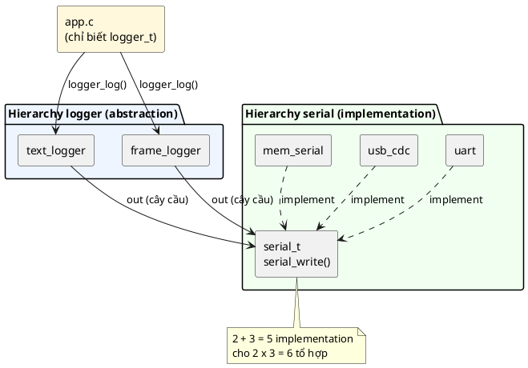

# 08 — Bridge Pattern

📖 Bài giảng chi tiết: [LECTURE.md](LECTURE.md). File này là ghi chú tóm tắt, bám theo chương *Bridge Pattern* của sách. Đọc [bài 07](../07_VirtualApiPattern/LECTURE.md) trước.

## Overview

Bridge tách **bên điều khiển** (abstraction) khỏi **bên bị điều khiển** (implementation) khi **cả hai bên đều có nhiều implementation**, để **hai hierarchy tiến hóa riêng rẽ**. Mỗi hierarchy là một Virtual API (bài 07); mỗi object phía abstraction giữ **một handle** của phía implementation (cây cầu), nhận qua `init`.

Công thức: **Bridge = Virtual API phía điều khiển + Virtual API phía bị điều khiển + một handle nối hai bên.** M × N tổ hợp từ M + N implementation.

## Use Cases

- **Abstraction và implementation thay đổi độc lập** (bảng hàm ảo đi được qua ranh giới DLL).
- **Nhiều implementation, chọn lúc chạy** (engine Quake 3 và game DLL).
- **Trừu tượng hóa phần cứng / dịch vụ nền tảng** (system call Linux + libc).
- **Kiến trúc plug-in.**
- Client/server: CurrentSensor trên Linux gateway đọc qua Bluetooth; physics body và mesh body trong game.
- Cầu là một **lối đi hẹp** ("thin pathway"); phía trên cung cấp interface phong phú.

## Benefits

- Nối hai hierarchy object mà **không trộn lẫn** chúng.
- **Tách dependency:** một bên không kéo theo dependency của bên kia (🔬 `gcc -MM`: `app.c` không thấy `serial.h`, driver không thấy logger).
- **Tách mối quan tâm:** mỗi hierarchy tiến hóa độc lập.
- 💡 Không chép code: mỗi định dạng, mỗi driver nằm ở đúng một chỗ.
- 💡 Test từng phía bằng đồ giả của phía kia.

## Drawbacks

- **Phức tạp hơn:** hai hierarchy và liên kết giữa chúng.
- **Thêm gián tiếp:** nhiều hàm "nhẹ" chỉ gọi tiếp (🔬 4 bước mỗi bản tin, 2 gián tiếp, 2 là tail call).
- **Tốn thời gian phát triển hơn.**
- Chỉ có hại khi dùng ở chỗ không cần.

## Implementation

Xem [inc/logger.h](inc/logger.h), [src/logger.c](src/logger.c), [src/text_logger.c](src/text_logger.c), [src/frame_logger.c](src/frame_logger.c), [src/app.c](src/app.c), [main.c](main.c). Họ serial chép từ bài 07.

| Thành phần | Code |
|---|---|
| Handle phía abstraction | `typedef const struct logger_ops **logger_t;` (`logger.h` **không** include `serial.h`) |
| Cây cầu | Field `serial_t out;` trong `struct text_logger` / `struct frame_logger` |
| Bắc cầu | `text_logger_init(&log, uart_to_serial(&uart1), LOG_INF);` |
| Đi qua cầu | `serial_write(self->out, line, len);` (chỉ generic API, không include driver) |
| Ứng dụng | `app_report(logger_t log, ...)` chỉ biết `logger_t` |

## Best Practices

- Dùng khi **thật sự** cần tách hai hierarchy ở quy mô lớn; không dùng khi không đáng.
- **Xác định các hierarchy cần tách:** độc lập, và Bridge thật sự làm đơn giản tương tác.
- **Định nghĩa interface rõ ràng** ở cả hai đầu.
- **Test kỹ** bằng integration/system test, kiểm chứng cả chuỗi từ đầu cầu này sang đầu kia.
- 💡 Tính năng của abstraction (lọc, cache, định dạng) đặt phía abstraction; interface cầu chỉ "means".

## Common Pitfalls

- 📖 Đổi "con trỏ tới con trỏ" thành con trỏ thường: mất `CONTAINER_OF`. Đừng "đơn giản hóa" khuôn C này.
- 📖 **Over-engineering:** dùng khi không cần.
- 📖 **Interface phức tạp:** phải là "means, not policy".
- 🔬 Code C của sách có `CONTAINER_OF` **sai kiểu struct** (`server_square` dùng `struct server_circle`): chạy đúng tình cờ vì bố cục giống nhau, sai khi thêm field; compiler không bắt được.
- 💡 "Nửa cầu" (chỉ một phía trừu tượng), transport chết trước logger, nhiều logger chung transport không khóa.

## Alternatives

- **Adapter:** nhẹ hơn nhiều, đổi interface cho vừa nhu cầu; không tách hoàn toàn hai hierarchy. Hợp khi chuyển đổi dữ liệu là chính.
- **Strategy:** tách hành vi thành thứ hoán đổi được. Hợp khi thuật toán là mối quan tâm chính.
- 💡 **Virtual API** (bài 07) khi chỉ có một chiều biến đổi.

## Quiz

1. Đặc điểm nhận dạng chính của Bridge là gì?
2. Bridge tách abstraction và implementation bằng cách nào?
3. Vai trò của abstraction trong Bridge là gì?
4. Bridge và abstract interface khác nhau thế nào?
5. Bạn có thể dùng Bridge để đơn giản hóa kiến trúc dự án hiện tại thế nào?

(Đáp án và 7 câu thêm trong [LECTURE.md](LECTURE.md#23-quiz-có-đáp-án).)

## Câu hỏi còn thắc mắc

-
