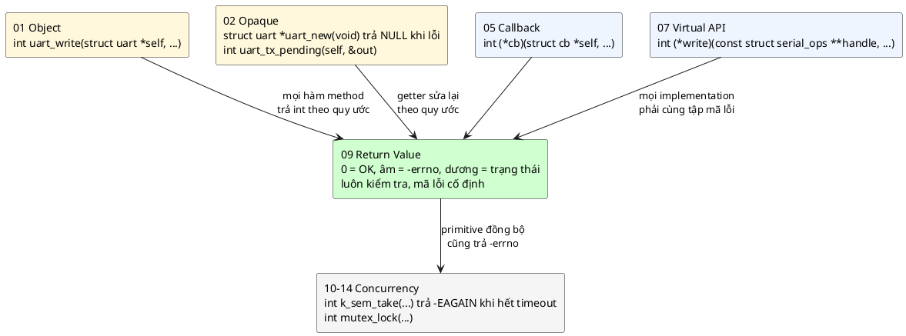
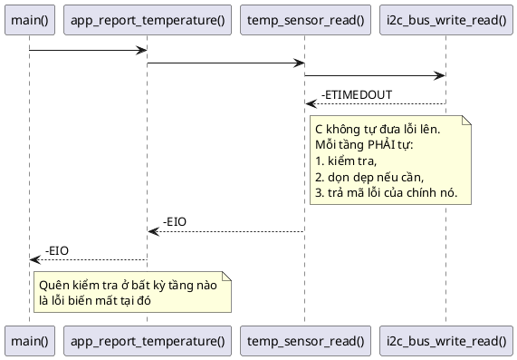
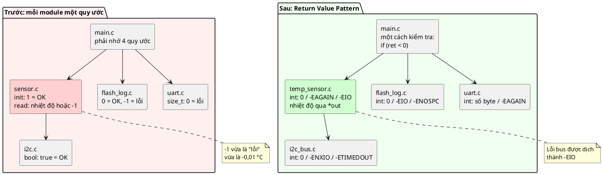
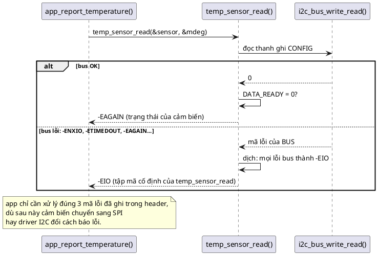
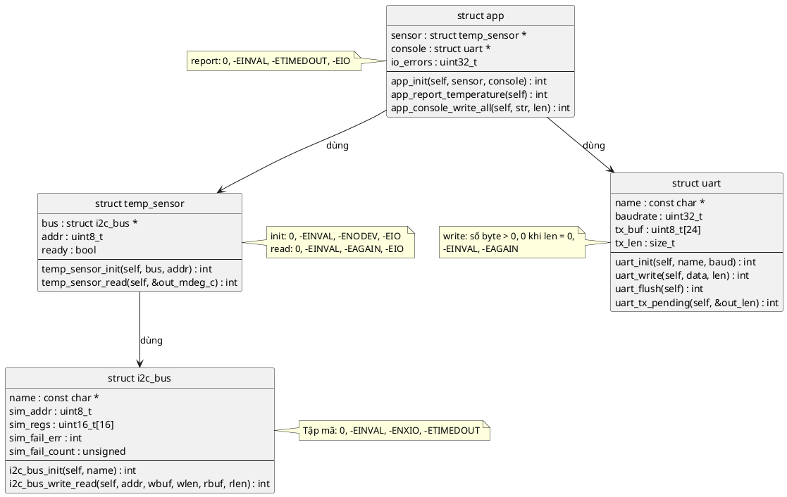
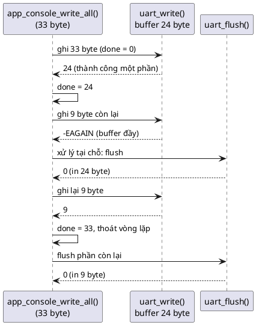

# Bài giảng 09 — Return Value Pattern

> **Về nguồn:** Bài này bám theo chương *Return Value Pattern* trong sách của Martin Schröder (bản 0.38.0, file `00_Document/Martin-Schroder-Design-Patterns-Return-Value-Pattern-0.38.0.pdf`).
> - 📖 đánh dấu nội dung **theo sách** (dịch và diễn giải lại).
> - 💡 đánh dấu phần **giải thích thêm**, không có trong sách.
> - 🔬 đánh dấu **thí nghiệm thật**: chương trình đã được build bằng gcc 16.2 (MSYS2 UCRT64, Windows 64-bit) và chạy; output in trong bài là output thật.

Code mẫu đi kèm: [inc/must_check.h](inc/must_check.h), [inc/i2c_bus.h](inc/i2c_bus.h), [inc/temp_sensor.h](inc/temp_sensor.h), [inc/uart.h](inc/uart.h), [inc/app.h](inc/app.h), [inc/errstr.h](inc/errstr.h), các file trong [src/](src/), [main.c](main.c). Ghi chú ngắn: [README.md](README.md).
Bài trước: [08 — Bridge Pattern](../08_BridgePattern/LECTURE.md). Bài sau: [10 — Concurrency Pattern](../10_ConcurrencyPattern/LECTURE.md).
Liên quan trực tiếp: [01 — Object](../01_ObjectPattern/LECTURE.md) (quy tắc 6: hàm trả `int`), [02 — Opaque](../02_OpaquePattern/LECTURE.md) (getter trả `0` khi `NULL`, mục 13).

---

## Mục lục

**Phần A — Kiến thức nền**

1. [Bối cảnh: mỗi người một kiểu báo lỗi](#1-bối-cảnh-mỗi-người-một-kiểu-báo-lỗi)
2. [Một hàm C có những đường nào để trả kết quả](#2-một-hàm-c-có-những-đường-nào-để-trả-kết-quả)
3. [Số có dấu, không dấu và cái bẫy chuyển kiểu ngầm](#3-số-có-dấu-không-dấu-và-cái-bẫy-chuyển-kiểu-ngầm)
4. [`errno.h`: bộ từ vựng lỗi dùng chung](#4-errnoh-bộ-từ-vựng-lỗi-dùng-chung)
5. [C không có exception: chuyện gì xảy ra khi lỗi ở tầng sâu](#5-c-không-có-exception-chuyện-gì-xảy-ra-khi-lỗi-ở-tầng-sâu)

**Phần B — Pattern**

6. [Vấn đề: code khi chưa có quy ước](#6-vấn-đề-code-khi-chưa-có-quy-ước)
7. [Ý tưởng cốt lõi: một trục số cho mọi hàm](#7-ý-tưởng-cốt-lõi-một-trục-số-cho-mọi-hàm)
8. [Ba quy tắc implementation và lý do của từng cái](#8-ba-quy-tắc-implementation-và-lý-do-của-từng-cái)
9. [Chọn mã errno nào cho tình huống nào](#9-chọn-mã-errno-nào-cho-tình-huống-nào)
10. [Best practices của sách, giải thích từng điều](#10-best-practices-của-sách-giải-thích-từng-điều)
11. [Kiểm tra giá trị trả về: các kiểu viết và cách bắt compiler ép](#11-kiểm-tra-giá-trị-trả-về-các-kiểu-viết-và-cách-bắt-compiler-ép)

**Phần C — Đọc code**

12. [Đọc code mẫu từng dòng](#12-đọc-code-mẫu-từng-dòng)
13. [Theo dõi demo chạy từng bước](#13-theo-dõi-demo-chạy-từng-bước)
14. [Các quyết định thiết kế và phương án khác](#14-các-quyết-định-thiết-kế-và-phương-án-khác)

**Phần D — Thực tế và tổng kết**

15. [Return Value trong thực tế: Linux, Zephyr, HAL, CMSIS](#15-return-value-trong-thực-tế-linux-zephyr-hal-cmsis)
16. [Unit test cho hợp đồng giá trị trả về](#16-unit-test-cho-hợp-đồng-giá-trị-trả-về)
17. [Trade-off](#17-trade-off)
18. [Các phương án thay thế và khi nào không dùng](#18-các-phương-án-thay-thế-và-khi-nào-không-dùng)
19. [Lỗi hay gặp](#19-lỗi-hay-gặp)
20. [Quy trình refactor một module sang Return Value](#20-quy-trình-refactor-một-module-sang-return-value)
21. [Câu hỏi thường gặp (FAQ)](#21-câu-hỏi-thường-gặp-faq)
22. [Tóm tắt và checklist](#22-tóm-tắt-và-checklist)
23. [Quiz (có đáp án)](#23-quiz-có-đáp-án)
24. [Bài tập](#24-bài-tập)

---

# Phần A — Kiến thức nền

Return Value Pattern nhìn qua thì rất đơn giản: "0 là OK, âm là lỗi". Nhưng để áp dụng **đúng** và **nhất quán**, bạn cần hiểu C trả kết quả ra sao, số có dấu và không dấu chuyển đổi thế nào, `errno.h` thật ra là gì, và vì sao C không có exception. Phần A đi qua từng thứ đó.

## 1. Bối cảnh: mỗi người một kiểu báo lỗi

### 1.1. Nhìn lại: các bài trước đã dùng quy ước này mà chưa giải thích

Từ bài 1, mọi hàm trong repo đều trả `int` theo kiểu `0` = OK, `-EINVAL` = lỗi. Bài giảng 01 (quy tắc 6) đã ghi:

```c
int tmp102_read_temp(struct tmp102 *self, int16_t *out_centi_deg);
```

> *"giá trị trả về luôn dành cho **trạng thái** (0 = OK, âm = lỗi), còn dữ liệu thật đi qua tham số con trỏ. Nếu trả thẳng `int16_t` thì làm sao phân biệt "nhiệt độ −1 độ" với "lỗi −1"? Đây là tiền đề của bài 09 (Return Value)."*

Bài 1 cũng chọn cho `uart_write` cách **"ghi hết hoặc không ghi gì"**, trả `-ENOSPC` khi không đủ chỗ, và nhắc rằng cách khác (*ghi một phần rồi trả số byte đã ghi*) cũng hợp lệ nếu ghi rõ trong API. Bài này sẽ dùng chính cách khác đó, vì nó minh họa vế "số dương" của pattern.

Bài 2 thì để lại một món nợ. Getter của driver UART opaque:

```c
size_t uart_tx_pending(const struct uart *self)
{
	return self ? self->tx_len : 0;
}
```

Bài giảng 02 (mục 13) đã chỉ ra: `0` vừa có nghĩa "buffer rỗng" vừa có nghĩa "bạn truyền `NULL`", caller **không phân biệt được**. Và kết luận: *"Phương án 3 (trả mã lỗi, dữ liệu qua con trỏ) chính là quy ước của bài 9 (Return Value Pattern)."* Bài này trả món nợ đó: trong code mẫu, getter được viết lại thành

```c
int uart_tx_pending(const struct uart *self, size_t *out_len);
```

Vậy là ta đã **dùng** quy ước này suốt 8 bài, nhưng chưa bao giờ trả lời: tại sao lại là số âm? Tại sao `errno`? Có được trả số dương không? Có được chuyển thẳng mã lỗi của hàm con lên trên không? Có bắt buộc kiểm tra mọi giá trị trả về không? Bài này trả lời tất cả.

### 1.2. Một dự án lớn dần: thiếu quy ước gây hại ra sao

💡 *Tình huống minh họa (không phải ví dụ trong sách), nhưng rất điển hình.*

#### Tháng 1: ba người, ba quy ước

Một team làm bộ ghi nhiệt độ cho kho lạnh: cảm biến nhiệt trên I2C, ghi log vào flash, gửi lên gateway qua UART. Mỗi người viết một module:

| Người | Module | Quy ước họ chọn | Lý do họ nghĩ là hợp lý |
|---|---|---|---|
| A | `i2c.c` | `bool`: `true` = thành công | "Thành công là đúng, thất bại là sai, rất tự nhiên" |
| B | `sensor.c` | `sensor_init()` trả `1` = OK; `sensor_read()` trả nhiệt độ, `-1` = lỗi | "Đọc nhiệt độ thì trả nhiệt độ, tiện" |
| C | `flash_log.c` | `0` = OK, `-1` = lỗi | "Giống POSIX" |
| D | `uart.c` | `size_t` số byte đã gửi, `0` = lỗi | "Giống `fwrite`" |

Mỗi quy ước, xét riêng, đều có lý. Vấn đề là chúng **ở chung một project**.

#### Tháng 2: lỗi "copy kiểu kiểm tra"

Người E viết `main.c`, gọi cả bốn module. Anh copy kiểu kiểm tra từ dòng trên xuống dòng dưới:

```c
if (!sensor_init()) { ... }       /* đúng: sensor_init trả 1 khi OK */
if (!flash_log_write(t)) { ... }  /* SAI: flash_log_write trả 0 khi OK, nên nhánh lỗi chạy khi THÀNH CÔNG */
```

Compiler không báo gì: cả hai đều là `int`. Code review cũng khó bắt, vì hai dòng trông "giống nhau một cách đáng tin".

#### Tháng 4: báo động giả ở −0,01 °C

Kho lạnh chạy ở quanh 0 °C. `sensor_read()` trả nhiệt độ theo đơn vị 0,01 °C, và `-1` khi lỗi. Một đêm nhiệt độ xuống đúng **−0,01 °C**, tức giá trị `-1`. Firmware báo "sensor error", gateway gửi cảnh báo hỏng cảm biến, kỹ thuật viên phải xuống kho lúc 2 giờ sáng. Cảm biến hoàn toàn bình thường.

Lỗi này nằm ở **thiết kế API**: kênh dữ liệu và kênh lỗi dùng chung một con số. Mục 6 sẽ chạy lại đúng tình huống này bằng code thật.

#### Tháng 6: lỗi bị "dịch sai nghĩa" khi đi lên

Team thêm retry: nếu cảm biến chưa đo xong thì thử lại. Người B sửa `sensor_read()` thành trả mã lỗi, và để tiện, **chuyển thẳng** mã lỗi của tầng I2C lên. Một thời gian sau, driver I2C được thay bằng driver của Linux/Zephyr, nơi `-EAGAIN` có nghĩa là *"mất quyền điều khiển bus"* (arbitration lost). Tầng trên thấy `-EAGAIN`, hiểu là *"cảm biến chưa sẵn sàng"*, cứ thế retry, rồi báo "cảm biến không có dữ liệu". Nguyên nhân thật (nhiễu trên bus I2C) bị che mất. Mục 8.3 có thí nghiệm 🔬 tái hiện đúng lỗi này.

#### Tháng 9: không ai kiểm tra giá trị trả về

Sau vài lần như trên, mọi người bắt đầu ngại giá trị trả về: "trả cái gì thì cũng chẳng chắc, thôi bỏ qua". Code đầy những dòng `uart_send(msg);` không kiểm tra. Khi buffer UART đầy, một nửa log biến mất mà không ai biết.

#### Nhìn lại

| Tháng | Chuyện gì xảy ra | Nguyên nhân gốc |
|---|---|---|
| 2 | Nhánh lỗi chạy khi thành công | **Không có quy ước chung** cho "thành công" là gì |
| 4 | Báo động giả ở −0,01 °C | **Dữ liệu và trạng thái dùng chung kênh** trả về |
| 6 | Lỗi bus bị hiểu thành "chưa sẵn sàng" | **Chuyển thẳng mã lỗi** của tầng dưới lên |
| 9 | Mất log âm thầm | **Không kiểm tra** giá trị trả về |

Return Value Pattern trả lời đúng bốn nguyên nhân này, theo thứ tự: một quy ước duy nhất; giá trị trả về chỉ dành cho trạng thái; mã lỗi của mỗi hàm là cố định; và luôn kiểm tra.

### 1.3. Đọc kỹ định nghĩa của sách

📖 Mở đầu chương, sách viết:

> *"The return value pattern standardizes the way we communicate with the caller through return values."*
>
> *Return Value Pattern chuẩn hóa cách ta giao tiếp với caller thông qua giá trị trả về.*

> *"Since the C programming language does not have exceptions, return values are our standard way to communicate a result of an operation."*
>
> *Vì C không có exception, giá trị trả về là cách chuẩn để báo kết quả của một thao tác.*

> *"We must therefore have a standardized set of return codes and we must follow a clear pattern with our return values to make sure that we can have clear expectations of how a function would behave and what value it will return in case of an error."*

Từng vế:

| Vế | Nghĩa là gì |
|---|---|
| *"standardizes"* | Trọng tâm không phải là một kỹ thuật lập trình, mà là một **quy ước chung** cho cả project. Áp dụng ở 90% số hàm thì giá trị giảm đi rất nhiều |
| *"communicate with the caller"* | Giá trị trả về là **kênh liên lạc** từ hàm được gọi về caller. Kênh này phải mang nghĩa rõ ràng |
| *"does not have exceptions"* | C không có cơ chế nào khác tự động đưa lỗi lên trên. Nếu hàm không trả lỗi ra, lỗi **biến mất** (mục 5) |
| *"a standardized set of return codes"* | Không tự đặt mã lỗi riêng, mà dùng một **bộ từ vựng chung**: sách chọn `errno.h` |
| *"clear expectations"* | Đây là mục tiêu cuối cùng: nhìn chữ ký hàm là biết nó trả gì, **không cần mở tài liệu** (sách nói rõ điều này ở phần Benefits) |

📖 Phần **Definition** của sách gồm bốn ý, cũng là bốn vế của pattern:

| # | Sách viết | Diễn giải |
|---|---|---|
| 1 | *"Signed integer return value"* | Trả trạng thái dưới dạng `int` **có dấu** |
| 2 | *"Zero means no error"* | `0` luôn nghĩa là thao tác thành công, không có gì đặc biệt cần báo |
| 3 | *"Negative value means error"* | Số âm là lỗi, và **giá trị** của nó cho biết lỗi gì |
| 4 | *"Positive value means status"* | Số dương nghĩa là thao tác **ít nhất thành công một phần**, và ý nghĩa của nó do từng hàm định nghĩa. Ví dụ: số phần tử đã đọc/ghi được |

Viết gọn:

> **Return Value = `int` có dấu: âm là lỗi (−errno), 0 là OK, dương là "thành công, kèm thông tin"**

### 1.4. Return Value trong bức tranh các pattern

📖 Trong chương Introduction, sách nói về pattern này: *"so important for having a clear convention around return values. It saves time and impacts all code because return values need to be always checked and if expectations are different each time then it opens up possibility for huge errors."*

Khác với Object hay Opaque (quy định cách **tổ chức dữ liệu**), hay Virtual API (quy định cách **gọi qua interface**), Return Value quy định **hợp đồng ở mọi chỗ gọi hàm**. Nó là lớp "keo" mà mọi pattern khác dùng chung:



💡 Có một liên hệ đặc biệt quan trọng với **Virtual API** (bài 7): khi nhiều implementation cùng đứng sau một API (ví dụ cảm biến trên I2C và cảm biến trên SPI), caller chỉ viết code xử lý lỗi **một lần**. Điều đó chỉ đúng nếu mọi implementation trả **cùng một tập mã lỗi** cho cùng một tình huống. Quy tắc "mã lỗi cố định" ở mục 8.3 chính là thứ giữ cho Virtual API dùng được trong thực tế.

⚠️ **Một chỗ chính sách chưa nhất quán:** trong ví dụ của chương *Virtual API*, 📖 sách viết implementation `serial_impl_read()` trả `-1` và `serial_impl_write()` trả thẳng `size` (kiểu `size_t`) qua `int`. Theo đúng Return Value Pattern của chính sách, `read` chưa được implement nên trả `-ENOSYS`, còn `write` nên chặn số trả về để không tràn `int` (mục 3.3). 💡 Đây là ví dụ cho thấy quy ước chỉ có giá trị khi **mọi chỗ** đều theo, kể cả code minh họa.

### 1.5. Câu hỏi bài này sẽ trả lời

1. Một hàm C có những cách nào để báo kết quả, và vì sao chọn giá trị trả về `int`? (Mục 2)
2. Vì sao phải là số **có dấu**, và cái bẫy nào chờ khi trộn với `size_t`? (Mục 3)
3. `errno.h` là gì, có giống nhau trên mọi nền tảng không? (Mục 4)
4. Không có exception thì lỗi ở tầng sâu đi lên bằng cách nào? (Mục 5)
5. Nên **chuyển thẳng** mã lỗi của hàm con lên hay **dịch** nó? (Mục 8.3)
6. Làm sao để compiler bắt lỗi "quên kiểm tra"? (Mục 11)

---

## 2. Một hàm C có những đường nào để trả kết quả

Một hàm C có đúng **bốn** đường để đưa thông tin về cho caller:

| Đường | Ví dụ | Ưu | Nhược |
|---|---|---|---|
| **Giá trị trả về** | `int f(void)` | Rẻ nhất (một thanh ghi), compiler có thể ép kiểm tra | Chỉ một giá trị |
| **Tham số con trỏ** (out parameter) | `int f(int32_t *out)` | Trả được nhiều giá trị, struct lớn | Caller phải cấp bộ nhớ |
| **Biến toàn cục** | `errno` của thư viện C | Không cần đổi chữ ký hàm | Dễ bị ghi đè, khó dùng với thread/ISR |
| **Hiệu ứng phụ** | ghi ra UART, đổi trạng thái object | Tự nhiên với hàm hành vi | Caller phải tự đi kiểm tra |

Return Value Pattern chọn: **giá trị trả về cho trạng thái, tham số con trỏ cho dữ liệu**. Để hiểu vì sao, hãy xem giá trị trả về thật sự là gì ở mức máy.

### 2.1. Giá trị trả về chỉ là một thanh ghi

💡 Mỗi kiến trúc CPU có một **ABI** (Application Binary Interface): quy ước về việc tham số đi qua thanh ghi nào, giá trị trả về nằm ở đâu. Với `int`:

| Kiến trúc | Giá trị trả về `int` nằm ở |
|---|---|
| ARM Cortex-M (AAPCS) | Thanh ghi `r0` |
| x86-64 Windows (code demo chạy ở đây) | Thanh ghi `eax` |
| RISC-V | Thanh ghi `a0` |

Nghĩa là trả về một `int` gần như **miễn phí**: hàm đặt số vào `r0` rồi return, caller đọc `r0`. Không có bộ nhớ nào được cấp phát, không có bảng tra nào.

### 2.2. 🔬 Trả struct thì sao?

Sách khuyên **không trả struct** (mục 10). Để thấy compiler làm gì khi ta trả struct, mình dịch đoạn sau với `gcc -O2 -S` và đọc assembly:

```c
#include <stdint.h>

struct reading {
	int32_t mdeg_c;
	int32_t humidity;
	int32_t status;
};

int read_int(void)
{
	return -5;
}

struct reading read_struct(void)
{
	struct reading r = { 25000, 40000, 0 };
	return r;
}

int read_out(struct reading *out)
{
	out->mdeg_c = 25000;
	out->humidity = 40000;
	out->status = 0;
	return 0;
}
```

Assembly thật (x86-64 Windows, cú pháp Intel, đã bỏ các dòng chỉ thị):

```
read_int:
	mov	eax, -5
	ret
read_struct:
	movabs	rdx, 171798691865000
	mov	DWORD PTR 8[rcx], 0
	mov	rax, rcx
	mov	QWORD PTR [rcx], rdx
	ret
read_out:
	movabs	rax, 171798691865000
	mov	DWORD PTR 8[rcx], 0
	mov	QWORD PTR [rcx], rax
	xor	eax, eax
	ret
```

Đọc từng hàm:
- `read_int`: đúng một lệnh đặt `-5` vào `eax`. Đó là toàn bộ chi phí.
- `read_struct`: struct 12 byte không vừa thanh ghi, nên **caller phải cấp sẵn bộ nhớ** và truyền địa chỉ vào một tham số ẩn (`rcx`). Hàm ghi vào đó (`[rcx]`, `8[rcx]`). (Số `171798691865000` là hai số `25000` và `40000` ghép thành một số 64-bit để ghi một lần.)
- `read_out`: **y hệt** `read_struct`, chỉ khác là con trỏ được viết ra tường minh, và còn **thêm** `xor eax, eax` để trả về `0` (trạng thái OK).

Kết luận: trả struct **thực chất là một out parameter trá hình**, nhưng mất đi kênh trạng thái. Viết `int read_out(struct reading *out)` tốn đúng như vậy mà còn báo được lỗi. 💡 Trên Cortex-M (AAPCS), struct lớn hơn 4 byte cũng được trả qua một con trỏ ẩn trong `r0` theo cách tương tự.

### 2.3. Biến toàn cục `errno` và vì sao firmware tránh nó

Thư viện C chuẩn (và POSIX) dùng một cách khác: hàm trả `-1` (hoặc `NULL`), còn **lý do** lỗi được ghi vào một biến toàn cục tên `errno`:

```c
FILE *f = fopen("log.txt", "r");
if (!f) {
	printf("fopen failed: %d\n", errno);   /* lý do nằm ở biến toàn cục */
}
```

💡 Cách này có ba vấn đề trong firmware:
1. **Bị ghi đè:** bất kỳ hàm nào gọi giữa lúc lỗi xảy ra và lúc đọc `errno` (kể cả `printf`) đều có thể đổi nó.
2. **Thread và ISR:** nếu hai thread cùng dùng một biến `errno`, lỗi của thread này đè lên thread kia. Thư viện C hiện đại phải biến `errno` thành *thread-local* (mỗi thread một bản), việc mà RTOS nhỏ phải hỗ trợ riêng. ISR thì dùng chung với thread đang bị ngắt.
3. **Hai bước, dễ quên bước hai:** kiểm tra giá trị trả về rồi còn phải nhớ đọc `errno`.

📖 Sách chọn cách gọn hơn: dùng **các hằng số** trong `errno.h`, nhưng trả thẳng chúng (với dấu âm) qua giá trị trả về. Không có biến toàn cục nào. 💡 Đây cũng là cách Linux kernel và Zephyr làm (mục 15).

---

## 3. Số có dấu, không dấu và cái bẫy chuyển kiểu ngầm

### 3.1. Vì sao phải là `int` có dấu

Pattern cần **ba vùng** trên một trục số: âm, không, dương. Kiểu không dấu (`unsigned`, `size_t`, `uint32_t`) chỉ có hai vùng: không và dương. Vì vậy kiểu trả về **bắt buộc** là kiểu có dấu.

💡 Máy tính biểu diễn số âm theo kiểu **bù 2** (two's complement): `-x` được lưu dưới dạng `2^N - x`. Với `int` 32-bit:

| Giá trị | Biểu diễn hex | Ghi chú |
|---|---|---|
| `0` | `0x00000000` | OK |
| `24` | `0x00000018` | Thành công, 24 byte |
| `-5` (`-EIO`) | `0xFFFFFFFB` | Bit cao nhất = 1: số âm |
| `-22` (`-EINVAL`) | `0xFFFFFFEA` | |

Kiểm tra "có phải lỗi không" chỉ là kiểm tra **bit dấu**: trên Cortex-M, `if (ret < 0)` dịch thành một lệnh so sánh với 0 và một lệnh nhảy theo cờ N (negative). Rất rẻ.

### 3.2. 🔬 Cái bẫy: hứng giá trị trả về bằng `size_t`

`uart_write` trả số byte (dương) hoặc lỗi (âm). Một người quen kiểu `fwrite` viết:

```c
#include <stdio.h>
#include <string.h>

#include "uart.h"

int main(void)
{
	struct uart console;

	if (uart_init(&console, "console", 115200) < 0) {
		return 1;
	}
	console.tx_len = UART_TX_BUF_SIZE; /* giả lập buffer đầy */

	size_t n = uart_write(&console, (const uint8_t *)"x", 1); /* SAI: kiểu không dấu */

	if (n < 0) {
		printf("error detected\n");
	} else {
		printf("n = %zu bytes?!\n", n);
	}
	return 0;
}
```

Build với `-Wall -Wextra` (chưa bật `-Werror`) và chạy:

```
size_t_ret.c: In function 'main':
size_t_ret.c:17:15: warning: comparison of unsigned expression in '< 0' is always false [-Wtype-limits]
   17 |         if (n < 0) {
      |               ^
n = 18446744073709551605 bytes?!
```

Chuyện gì đã xảy ra:
1. `uart_write` trả `-11` (`-EAGAIN`, buffer đầy).
2. Gán `-11` vào `size_t` (không dấu, 64-bit): C chuyển đổi theo quy tắc **modulo 2^64**, ra `2^64 - 11 = 18446744073709551605`.
3. `n < 0` với `n` không dấu **luôn sai**. Nhánh lỗi không bao giờ chạy.
4. Nếu code tiếp tục dùng `n` để dịch con trỏ (`buf += n`), nó sẽ nhảy ra khỏi bộ nhớ.

Điểm đáng sợ: chỉ `-Wextra` mới có cảnh báo này (`-Wtype-limits`). 🔬 Mình build lại chỉ với `-Wall`: **không có cảnh báo nào**, exit code 0. Đây là lý do repo dùng `-Wall -Wextra -Werror`.

**Quy tắc rút ra:** biến hứng giá trị trả về luôn là `int`. Chỉ sau khi đã kiểm tra `ret >= 0`, mới chuyển sang `size_t`:

```c
int ret = uart_write(...);
if (ret < 0) {
	return ret == -EAGAIN ? ... : -EIO;
}
done += (size_t)ret;   /* an toàn: đã biết ret >= 0 */
```

### 3.3. Giới hạn của `int`: hàm đọc/ghi được bao nhiêu byte?

💡 Nếu `uart_write` nhận `size_t len` và trả số byte qua `int`, thì khi `len > INT_MAX` sẽ không trả được. POSIX giải quyết bằng kiểu `ssize_t` (`size_t` có dấu), nhưng `ssize_t` **không có trong C99**, chỉ có trong POSIX. Trong firmware, buffer hiếm khi vượt vài KB, nên cách thực tế là:
- Đảm bảo số trả về luôn bị chặn bởi kích thước buffer nội bộ (như code mẫu: tối đa `UART_TX_BUF_SIZE` = 24), hoặc
- Từ chối `len > INT_MAX` bằng `-EINVAL`.

Code mẫu ghi rõ trong comment: *"n <= UART_TX_BUF_SIZE nên ép sang int không bao giờ tràn"*.

---

## 4. `errno.h`: bộ từ vựng lỗi dùng chung

### 4.1. `errno.h` thật ra chứa gì

`errno.h` định nghĩa các **macro hằng số**: `EINVAL`, `EIO`, `ENOMEM`... Mỗi macro là một số nguyên **dương** đại diện cho một loại lỗi. Pattern trả về giá trị **âm** của chúng: `return -EINVAL;`.

💡 Một sự thật ít người để ý: **chuẩn C chỉ bắt buộc ba macro**: `EDOM`, `EILSEQ`, `ERANGE`. Toàn bộ phần còn lại (`EIO`, `EINVAL`, `ETIMEDOUT`...) đến từ **POSIX**. Hầu hết toolchain embedded (newlib, picolibc, thư viện C của Zephyr) đều cung cấp chúng, nhưng con số cụ thể **do từng thư viện tự chọn**.

### 4.2. 🔬 Con số khác nhau giữa các nền tảng

Mình in giá trị của toàn bộ 81 mã trong bảng errno của sách, trên toolchain MSYS2 UCRT64 (Windows). Một phần kết quả thật:

```
EPERM=1 ENOENT=2 ESRCH=3 EINTR=4 EIO=5 ENXIO=6 ... EAGAIN=11 ENOMEM=12 ... EBUSY=16 ...
ENODEV=19 ... EINVAL=22 ... ENOSPC=28 ... ENOSYS=40 ...
EHOSTUNREACH=110 ... ETIMEDOUT=138 ... ENOTSUP=129 ... ECANCELED=105
ENOTBLK=MISSING EPFNOSUPPORT=MISSING ESHUTDOWN=MISSING EHOSTDOWN=MISSING
ESOCKTNOSUPPORT=MISSING ETOOMANYREFS=MISSING
```

Hai điều đáng chú ý:

1. **6 mã trong bảng của sách không tồn tại** trên toolchain này (`ENOTBLK`, `EPFNOSUPPORT`, `ESHUTDOWN`, `EHOSTDOWN`, `ESOCKTNOSUPPORT`, `ETOOMANYREFS`). Dùng chúng là lỗi build.
2. Trên Windows/UCRT, `ETIMEDOUT` = **138** và `EHOSTUNREACH` = **110**. 💡 Trên Linux, `ETIMEDOUT` = **110**. Nghĩa là con số `-110` đọc trong log Linux là "timeout", nhưng cùng con số đó trên bản build Windows lại là "không tìm được đường tới host".

**Quy tắc rút ra:**
- Trong code, **luôn dùng tên macro** (`-ETIMEDOUT`), không bao giờ viết số (`-110`).
- Trong log, **in tên** chứ không in số. Đó là lý do code mẫu có hàm `errstr()` (mục 12), và nó dùng `switch` trên macro chứ không trên con số.
- Chỉ dùng những mã mà toolchain của bạn có. Các mã phổ biến trong mục 9 đều có mặt ở mọi toolchain mình biết.

### 4.3. 🔬 Mô tả trong sách và `strerror()` thật

📖 Bảng errno của sách ghi mô tả kiểu cũ, ví dụ `EAGAIN` = *"No more contexts"*, `ESRCH` = *"No such context"*, `ENOMEM` = *"Not enough core"*. 🔬 Thư viện C trên máy này (`strerror()`) mô tả khác:

```
EAGAIN    =  11  strerror: "Resource temporarily unavailable"
ESRCH     =   3  strerror: "No such process"
ENOMEM    =  12  strerror: "Not enough space"
EIO       =   5  strerror: "Input/output error"
ENXIO     =   6  strerror: "No such device or address"
ETIMEDOUT = 138  strerror: "timed out"
EINVAL    =  22  strerror: "Invalid argument"
```

💡 Mô tả trong sách giống bảng của các bản Unix rất cũ và một số thư viện C nhúng. Cách hiểu thông dụng ngày nay của `EAGAIN` là *"tài nguyên tạm thời chưa sẵn sàng, thử lại sau"*, và đó cũng là nghĩa code mẫu dùng. Điều quan trọng không phải câu chữ, mà là **team thống nhất nghĩa** của từng mã trong ngữ cảnh firmware (📖 sách cũng nói: nghĩa của mỗi mã *"can be further defined and described in more detail ... in the context of the application"*).

---

## 5. C không có exception: chuyện gì xảy ra khi lỗi ở tầng sâu

### 5.1. Exception làm gì (ở ngôn ngữ có nó)

💡 Trong C++ hay Python, khi một hàm ở tầng sâu gặp lỗi, nó **ném** (throw) một exception. Runtime tự động:
1. Thoát khỏi hàm hiện tại, rồi hàm gọi nó, rồi hàm gọi hàm đó... (**stack unwinding**),
2. Trên đường đi, **gọi destructor** của mọi object cục bộ, nhờ đó lock được nhả, file được đóng,
3. Dừng lại ở hàm đầu tiên có khối `catch` phù hợp.

Không có `catch` nào thì chương trình dừng. Tức là: **lỗi không thể bị lờ đi một cách âm thầm**.

### 5.2. C có gì

C không có cơ chế nào như vậy. Nếu `i2c_bus_write_read()` thất bại mà không trả lỗi ra, hoặc caller không kiểm tra, thì lỗi **biến mất**. Chương trình tiếp tục với dữ liệu rác.

📖 Sách nói thẳng: C *"does not support exceptions with stack unwinding like C++ so the easiest way is to pass status code through return value"*.

Hình dung một chuỗi gọi ba tầng trong code mẫu:



Return Value Pattern chính là **"exception làm bằng tay"**: mỗi tầng tự làm ba việc mà runtime C++ làm hộ.

### 5.3. 🔬 `setjmp`/`longjmp`: thứ gần exception nhất trong C, và vì sao đừng dùng

C có cặp `setjmp`/`longjmp` (trong `<setjmp.h>`): `setjmp` ghi lại "vị trí hiện tại", `longjmp` nhảy thẳng về đó từ bất kỳ độ sâu nào. Nghe như exception, nhưng **thiếu bước 2**: không có gì được dọn dẹp trên đường nhảy.

```c
#include <setjmp.h>
#include <stdbool.h>
#include <stdio.h>

struct bus {
	bool locked; /* giả lập một lock bảo vệ bus I2C */
};

static jmp_buf on_error;

static void bus_lock(struct bus *self)
{
	self->locked = true;
}

static void bus_unlock(struct bus *self)
{
	self->locked = false;
}

static void sensor_read_raw(struct bus *bus)
{
	bus_lock(bus);
	/* ... giao tiếp I2C thất bại giữa chừng ... */
	longjmp(on_error, 1); /* "ném exception": nhảy thẳng về setjmp */
	bus_unlock(bus);      /* không bao giờ chạy tới */
}

int main(void)
{
	static struct bus bus;

	if (setjmp(on_error) == 0) {
		sensor_read_raw(&bus);
	} else {
		printf("caught error via longjmp\n");
	}
	printf("bus.locked after error = %d  -> every later bus_lock() would deadlock\n",
	       bus.locked);
	return 0;
}
```

Output thật:

```
caught error via longjmp
bus.locked after error = 1  -> every later bus_lock() would deadlock
```

Lỗi đã được "bắt", nhưng bus vẫn bị khóa vĩnh viễn. Với một mutex thật (bài 13), mọi thread khác muốn dùng bus I2C sẽ treo mãi mãi. Và gcc **không cảnh báo gì** về dòng `bus_unlock(bus)` không bao giờ chạy.

📖 Sách liệt kê long jump trong phần Alternatives và kết luận: *"Do not use long jump because it does not give you an easy way of cleaning up resources. Instead it is better to panic or reboot if an exception occurs."*

---

# Phần B — Pattern

## 6. Vấn đề: code khi chưa có quy ước

### 6.1. 🔬 Bốn module, bốn quy ước

Đây là tình huống ở mục 1.2 viết thành code chạy được (gộp vào một file cho gọn):

```c
#include <stdbool.h>
#include <stdint.h>
#include <stdio.h>

/* ---- Mỗi module tự đặt quy ước riêng ---- */

/* Người A viết: true = thành công */
static bool i2c_read_reg(uint8_t addr, uint8_t reg, uint16_t *out)
{
	(void)addr;
	(void)reg;
	*out = 0xFFFF; /* giả lập: cảm biến đang đo -0.01 °C */
	return true;
}

/* Người B viết: 1 = thành công, 0 = thất bại */
static int sensor_init(void)
{
	return 1;
}

/* Người B viết: trả nhiệt độ theo 0.01 °C, hoặc -1 nếu lỗi */
static int16_t sensor_read_centi(void)
{
	uint16_t raw;

	if (!i2c_read_reg(0x48, 0x00, &raw)) {
		return -1;
	}
	return (int16_t)raw; /* 0xFFFF = -1 = -0.01 °C */
}

/* Người C viết: 0 = thành công, -1 = lỗi */
static int flash_log_write(int16_t centi)
{
	(void)centi;
	return 0;
}

int main(void)
{
	/* Người D dùng cả ba, nhớ nhầm một chỗ là hỏng */
	if (!sensor_init()) {
		printf("sensor init failed\n");
	}

	int16_t t = sensor_read_centi();

	if (t == -1) {
		printf("sensor error! (but the sensor is fine, it reads -0.01 C)\n");
	}

	if (flash_log_write(t)) {
		printf("flash write failed\n");
	}
	if (!flash_log_write(t)) {
		printf("flash write failed?! (copied the check style from sensor_init)\n");
	}
	return 0;
}
```

Output thật (build sạch với `-Wall -Wextra -Werror -pedantic`):

```
sensor error! (but the sensor is fine, it reads -0.01 C)
flash write failed?! (copied the check style from sensor_init)
```

Mọi thứ đều chạy "đúng như code viết", không có cảnh báo nào, nhưng cả hai dòng output đều **sai sự thật**.

### 6.2. Năm vấn đề

#### Vấn đề 1: "Thành công" có nhiều nghĩa

`true`, `1`, `0`, "số byte > 0"... Caller phải **nhớ** quy ước của từng hàm. 📖 Sách gọi đây là cạm bẫy nghiêm trọng nhất: *"The most serious pitfall with return values is not defining their meaning. If every function returns values that can be potentially mixed up with other values then you can never really know what to expect."*

#### Vấn đề 2: Dữ liệu và lỗi dùng chung một kênh

`sensor_read_centi()` trả nhiệt độ **hoặc** `-1`. Nhưng `-1` cũng là một nhiệt độ hợp lệ. Mọi "giá trị đặc biệt" (magic value) như `-1`, `0xFFFF`, `INT16_MIN` đều có nguy cơ này, chỉ là sớm hay muộn.

#### Vấn đề 3: Lỗi không có lý do

`-1` chỉ nói "hỏng". Hỏng vì cảm biến không có mặt? Bus treo? Chưa đo xong? Caller không biết nên **không xử lý được**: không biết nên retry, khởi động lại cảm biến, hay báo hỏng phần cứng.

#### Vấn đề 4: Compiler không giúp được gì

`bool`, `int` và `size_t` chuyển qua lại ngầm. `if (x)` và `if (!x)` đều hợp lệ với mọi kiểu. Không có công cụ nào biết hàm nào trả "1 là OK" và hàm nào trả "0 là OK".

#### Vấn đề 5: Người dùng thôi kiểm tra

Khi giá trị trả về không đáng tin, người ta bỏ qua nó. Lỗi bắt đầu biến mất âm thầm (tháng 9 ở mục 1.2).

### 6.3. Toàn cảnh



---

## 7. Ý tưởng cốt lõi: một trục số cho mọi hàm

### 7.1. Ba vùng trên trục số

📖 Theo phần *Definition* và *Error convention* của sách, mọi hàm "không tầm thường" trả về một `int`, và caller đọc nó theo đúng một cách:

| Giá trị | Nghĩa (📖 theo sách) | Ví dụ trong code mẫu |
|---|---|---|
| **< 0** | Lỗi. Giá trị là **−errno**, cho biết lỗi gì | `-EINVAL`, `-EIO`, `-EAGAIN` |
| **0** | Thành công, không có gì thêm để báo | `temp_sensor_init()` thành công |
| **> 0** | Thành công **ít nhất một phần**. Nghĩa do từng hàm định nghĩa và **phải được ghi trong tài liệu** của hàm | `uart_write()` trả số byte đã nhận |

Caller luôn đọc theo cùng một trình tự:

```plantuml
@startuml
set separator none
skinparam defaultFontName Segoe UI
start
:int ret = some_function(self, ...);
if (ret < 0 ?) then (đúng)
  :Lỗi: -ret là mã errno;
  if (Xử lý được tại đây?\n(retry, flush, dùng giá trị mặc định)) then (được)
    :Xử lý, tiếp tục; <<#D0FFD0>>
  else (không)
    :Trả mã lỗi CỦA HÀM MÌNH\nlên caller; <<#FFE0E0>>
  endif
elseif (ret == 0 ?) then (đúng)
  :Thành công hoàn toàn; <<#D0FFD0>>
else (ret > 0)
  :Thành công một phần:\nret mang nghĩa do hàm định nghĩa\n(ví dụ số byte đã ghi); <<#D0E8FF>>
endif
stop
@enduml
```

### 7.2. Vì sao dữ liệu đi qua con trỏ

Vế "giá trị trả về chỉ dành cho trạng thái" giải quyết vấn đề 2 (dữ liệu và lỗi dùng chung kênh). So sánh:

```c
/* Trước: dữ liệu và lỗi chung một kênh */
int16_t sensor_read_centi(void);                                   /* -1 là lỗi hay -0,01 °C? */

/* Sau: hai kênh tách biệt */
int temp_sensor_read(struct temp_sensor *self, int32_t *out_mdeg_c);  /* trạng thái | dữ liệu */
```

Với chữ ký mới, **mọi** giá trị `int32_t` đều là nhiệt độ hợp lệ, và **mọi** giá trị trả về đều là trạng thái. Không còn giá trị nào mang hai nghĩa.

📖 Sách đưa đúng quy tắc này vào cả Best Practices (*"Use parameters for complex return values"*) lẫn Pitfalls (*"Returning structs"*): khi cần trả về một giá trị phức tạp, trả `0` để báo thành công và ghi giá trị đó vào struct mà caller truyền con trỏ vào.

### 7.3. Mẫu code tối thiểu của sách

📖 Sách đưa khung:

```c
int my_object_method(struct my_object *self)
{
	if (there_is_error) {
		return -ERRNOCODE;
	}
	return 0;
}
```

(Bản PDF hiển thị tham số là `'self`, rõ ràng là lỗi trích xuất của dấu `*`.) Khung này kết hợp hai pattern: **Object** (tham số đầu tiên là `self`) và **Return Value** (trả `int`, âm khi lỗi, `0` khi xong).

---

## 8. Ba quy tắc implementation và lý do của từng cái

📖 Phần *Implementation* của sách nêu ba quy tắc. Đây là phần quan trọng nhất của bài.

### 8.1. Quy tắc 1: Mọi hàm không tầm thường đều trả mã trạng thái `int`

📖 *"Every non-trivial function must return integer status code: C does not support exceptions with stack unwinding like C++ so the easiest way is to pass status code through return value."*

📖 Phần *Use Cases* nói rõ "không tầm thường" là gì:
- *Every function that can fail*: hàm nào **có thể thất bại** thì phải trả mã lỗi âm khi thất bại.
- *Every function that has status to report*: hàm nào **thành công theo ít nhất hai cách** (ví dụ ghi hết hay ghi một phần).

**Tại sao:** vì C không có kênh nào khác để đưa lỗi lên (mục 5). Hàm có thể thất bại mà trả `void` thì lỗi bị nuốt ngay trong hàm đó.

💡 **Hàm "tầm thường" là hàm nào?** Mình hiểu là những hàm **không thể thất bại** khi được gọi đúng hợp đồng:
- Hàm thuần tính toán: `static inline uint16_t be16_to_cpu(const uint8_t *p)`.
- Predicate trả `bool` mà không thể sai: `bool ring_is_empty(const struct ring *self)` (nếu đã quy ước `self` không bao giờ `NULL`, xem FAQ).
- Hàm giải phóng: `void uart_free(struct uart **self)` ở bài 2. Giải phóng thì không có gì để thất bại.

Nếu phân vân, cứ trả `int`: thêm một mã trả về sau này sẽ phá chữ ký hàm, còn có sẵn từ đầu thì không mất gì.

### 8.2. Quy tắc 2: Giá trị trả về phải được kiểm tra

📖 *"Return values must be checked: every call of a function that has a return value must be checked when the function is called."* Và trong Best Practices: *"Always check return codes: not doing so must be configured to be an error in your lint setup."*

**Tại sao:** quy tắc 1 vô nghĩa nếu caller không đọc. Hàm đã cẩn thận trả `-EIO`, nhưng `temp_sensor_read(&s, &t);` không kiểm tra thì `t` chứa rác và chương trình chạy tiếp như không có gì.

📖 Sách nhắc tới **PC-Lint**: công cụ phân tích tĩnh báo lỗi khi bỏ qua giá trị trả về. 💡 Không có PC-Lint, gcc và clang có sẵn một cơ chế miễn phí làm đúng việc này: thuộc tính `warn_unused_result`. Code mẫu bọc nó trong macro `MUST_CHECK` ([inc/must_check.h](inc/must_check.h)). Mục 11 có thí nghiệm đầy đủ.

### 8.3. Quy tắc 3: Mã lỗi luôn cố định, không chuyển thẳng mã của hàm con

📖 *"Error codes are always constant: upon getting an error code, we try to handle the error and if we can not handle it we always return a well defined error code to the caller."*

📖 Best Practices nói cụ thể hơn: *"If a function that your function calls fails then return a negative errno code that best describes the state of your object but do not directly return the return code of the function you have called. Instead return an error code that is constant for your function."*

Ba ý trong câu này:

| Ý | Nghĩa |
|---|---|
| *"try to handle the error"* | Trước tiên, **thử xử lý**: retry, flush rồi ghi lại, dùng giá trị dự phòng... |
| *"best describes the state of your object"* | Không xử lý được thì trả mã mô tả **trạng thái của object mình**, không phải của object tầng dưới |
| *"constant for your function"* | Mỗi hàm có một **tập mã lỗi cố định**, ghi trong tài liệu. Tập này không đổi khi tầng dưới đổi |

#### Ví dụ trong code mẫu

`temp_sensor_read` gọi `i2c_bus_write_read`, hàm có thể trả `-EINVAL`, `-ENXIO`, `-ETIMEDOUT`. Nhưng tập mã của `temp_sensor_read` (ghi trong [inc/temp_sensor.h](inc/temp_sensor.h)) chỉ gồm:

```
0        thành công
-EINVAL  tham số sai hoặc chưa init
-EAGAIN  cảm biến chưa đo xong, gọi lại sau
-EIO     lỗi giao tiếp I2C (bất kể bus báo lỗi gì bên dưới)
```



#### 🔬 Thí nghiệm: chuyện gì xảy ra nếu chuyển thẳng mã lỗi

💡 Trong Linux (tài liệu `Documentation/i2c/fault-codes.rst`), driver I2C dùng `-EAGAIN` cho trường hợp *"mất quyền điều khiển bus"* (arbitration lost, khi hai master cùng phát). Mình sửa `temp_sensor_read` thành phiên bản "chuyển thẳng":

```c
	int ret = read_reg16(self, TEMP_SENSOR_REG_CONFIG, &cfg);

	if (ret < 0) {
		return ret; /* SAI: chuyển thẳng mã lỗi của bus lên trên */
	}
```

rồi cho bus giả trả `-EAGAIN` ba lần liên tiếp. Chương trình thử nghiệm:

```c
#include <errno.h>
#include <stdio.h>

#include "app.h"
#include "errstr.h"

int main(void)
{
	static struct i2c_bus bus;
	static struct temp_sensor sensor;
	static struct uart console;
	static struct app app;

	if (i2c_bus_init(&bus, "I2C1") < 0 || uart_init(&console, "console", 115200) < 0) {
		return 1;
	}
	i2c_bus_sim_attach(&bus, 0x48);
	i2c_bus_sim_set_reg(&bus, TEMP_SENSOR_REG_DEVICE_ID, TEMP_SENSOR_DEVICE_ID);
	i2c_bus_sim_set_reg(&bus, TEMP_SENSOR_REG_CONFIG, TEMP_SENSOR_CFG_DATA_READY);
	if (temp_sensor_init(&sensor, &bus, 0x48) < 0 || app_init(&app, &sensor, &console) < 0) {
		return 1;
	}

	/* Linux I2C dùng -EAGAIN cho "mất quyền điều khiển bus" (arbitration lost) */
	i2c_bus_sim_fail_next(&bus, -EAGAIN, 3);
	int ret = app_report_temperature(&app);

	printf("app_report_temperature() -> %s, io_errors=%lu\n", errstr(ret),
	       (unsigned long)app.io_errors);
	return 0;
}
```

Output thật, với `temp_sensor.c` của repo (dịch mã lỗi):

```
  app: sensor read failed: EIO (io_errors=1)
app_report_temperature() -> EIO, io_errors=1
```

Output thật, với phiên bản chuyển thẳng:

```
  app: attempt 1 -> EAGAIN, retry
  app: attempt 2 -> EAGAIN, retry
  app: attempt 3 -> EAGAIN, retry
app_report_temperature() -> ETIMEDOUT, io_errors=0
```

Phiên bản chuyển thẳng gây ra **ba** hậu quả:
1. Lỗi bus bị hiểu thành *"cảm biến chưa đo xong"*, nên app retry vô ích.
2. Kết quả cuối là `-ETIMEDOUT` (*"cảm biến không có dữ liệu"*): **chẩn đoán sai**. Kỹ thuật viên sẽ đi thay cảm biến, trong khi lỗi nằm ở bus.
3. Bộ đếm `io_errors` vẫn là 0: hệ thống giám sát từ xa không thấy có lỗi I/O nào.

Đây chính là ý của 📖 câu quiz số 3 trong sách: chuyển thẳng mã lỗi làm nó *"non-constant and thus may interfere with expectations up the call stack"*.

💡 **Ngoại lệ hợp lý:** trong code mẫu, hàm `static read_reg16()` lại **được** trả thẳng mã của bus. Lý do: nó là hàm private, chỉ có hai hàm trong cùng file gọi, và chính hai hàm đó làm việc dịch. Quy tắc "mã lỗi cố định" áp dụng cho **ranh giới API public** của module.

💡 **Linux kernel làm khác.** Trong kernel, rất phổ biến kiểu `ret = foo(); if (ret) return ret;`, tức là chuyển thẳng. Đó là một lựa chọn khác, có lý của nó (giữ được thông tin chi tiết). Lời khuyên của sách nghiêng về **tính dự đoán được** của API. Mục 14 so sánh hai cách kỹ hơn.

---

## 9. Chọn mã errno nào cho tình huống nào

📖 Sách nhấn mạnh: dù lỗi gặp phải không khớp hoàn toàn với mã errno nào, *"it is still better to return the generic errno code rather than have to deal with custom error status. In 99.9% of cases you will therefore be returning a generic errno code (and often printing out the error to log)"*. Và: *"in most cases this is not an issue since we simply treat a negative code as a generic error."*

💡 Bảng dưới đây là gợi ý của mình cho các tình huống firmware hay gặp (không phải bảng của sách; sách chỉ liệt kê mã và mô tả gốc). Điều quan trọng nhất: **team thống nhất và ghi lại** bảng này cho project của mình.

| Mã | Tình huống firmware điển hình | Caller thường làm gì |
|---|---|---|
| `-EINVAL` | Tham số sai: `NULL`, giá trị ngoài miền, baudrate = 0 | Lỗi lập trình: sửa code. Không retry |
| `-EIO` | Lỗi giao tiếp với phần cứng nói chung (I2C/SPI/UART) | Đếm lỗi, retry có giới hạn, khởi động lại peripheral |
| `-ENXIO` | Không thiết bị nào trả lời địa chỉ (I2C NACK địa chỉ) | Kiểm tra phần cứng, địa chỉ |
| `-ENODEV` | Thiết bị không có mặt hoặc sai loại (ID không khớp) | Vô hiệu hóa tính năng, báo lỗi phần cứng |
| `-ETIMEDOUT` | Chờ quá lâu: bus treo, cảm biến không phản hồi, chờ semaphore hết giờ | Retry hoặc reset |
| `-EAGAIN` | **Tạm thời** chưa được: buffer đầy, dữ liệu chưa sẵn sàng | Thử lại sau, không phải lỗi thật |
| `-EBUSY` | Tài nguyên đang được dùng: DMA đang chạy, peripheral đang bận | Chờ rồi thử lại |
| `-EALREADY` | Thao tác đã đang chạy (gọi `start` hai lần) | Thường bỏ qua được |
| `-EINPROGRESS` | Thao tác bất đồng bộ đã bắt đầu, kết quả báo sau (qua callback) | Chờ callback |
| `-ENOMEM` | Hết bộ nhớ: `malloc`, pool hết slot | Giảm tải, báo lỗi |
| `-ENOSPC` | Hết chỗ **lâu dài**: flash log đầy, buffer không bao giờ đủ cho gói này | Xóa bớt, từ chối |
| `-ENOTSUP` | Tính năng/giá trị không được hỗ trợ (baudrate không chia được) | Chọn cấu hình khác |
| `-ENOSYS` | Hàm chưa được implement (thường gặp trong Virtual API: implementation không có method này) | Dùng cách khác |
| `-EBADMSG` | Dữ liệu nhận được hỏng: sai CRC, sai checksum | Bỏ gói, yêu cầu gửi lại |
| `-EPROTO` | Lỗi giao thức: thiết bị trả lời không đúng định dạng | Reset phiên giao tiếp |
| `-ERANGE` / `-EOVERFLOW` | Kết quả vượt miền biểu diễn (đọc ADC tràn thang đo) | Báo giá trị không hợp lệ |
| `-EACCES` / `-EPERM` | Không được phép: flash bị khóa ghi, chưa xác thực | Mở khóa, xác thực |
| `-ECANCELED` | Thao tác bị hủy trước khi xong | Thường là bình thường |

💡 Phân biệt vài cặp dễ nhầm:
- **`-EAGAIN` và `-EBUSY`**: `EAGAIN` là "lần này chưa được, gọi lại là có thể được" (không có ai giữ tài nguyên). `EBUSY` là "có **người khác** đang dùng".
- **`-EAGAIN` và `-ENOSPC`**: buffer UART đầy trong code mẫu là `-EAGAIN`, vì flush xong là có chỗ. Bài 1 dùng `-ENOSPC` cho "gói này không bao giờ vừa buffer", nghĩa là thử lại cũng vô ích. Hai lựa chọn khác nhau vì **hành vi của hàm** khác nhau (mục 14).
- **`-ENXIO` và `-ENODEV`**: `ENXIO` là mức **bus** ("không ai ở địa chỉ này"). `ENODEV` là mức **driver** ("không có cảm biến"). Code mẫu dịch cái trước thành cái sau trong `temp_sensor_init`.

---

## 10. Best practices của sách, giải thích từng điều

📖 Sách liệt kê sáu điều trong *Best Practices*:

| # | Sách viết | Giải thích |
|---|---|---|
| 1 | *Always check return codes* | Mục 8.2 và 11. Cấu hình công cụ để **bỏ qua là lỗi build** |
| 2 | *Always return errno* | Thất bại thì trả **−errno**, không tự chế mã (`-1`, `-100`, `ERR_SENSOR_FAIL`) |
| 3 | *Error status always well defined* | Mục 8.3: không chuyển thẳng mã của hàm con, trả mã cố định của hàm mình |
| 4 | *Zero means success* | Thành công mà không cần báo gì thêm thì **luôn** trả `0`. Không trả `1`, không trả `true` |
| 5 | *Partial success always uses positive numbers* | Cần báo "xử lý được bao nhiêu" thì trả số dương |
| 6 | *Use parameters for complex return values* | Giá trị phức tạp (struct, nhiều giá trị) đi qua con trỏ; giá trị trả về chỉ báo struct đó có hợp lệ không |

Vài điểm cần nói thêm:

**Về điều 2: vì sao không tự chế mã lỗi.** 📖 Phần Pitfalls giải thích: errno được chọn *"because they are defined as macros and they are ubiquitous - they are available everywhere - they are standardized. This means we always can deduce what the problem may be by looking at the errno code."* 💡 Mã tự chế như `SENSOR_ERR_NOT_READY = 3` buộc mọi tầng trên phải include header của module đó để hiểu, tức là **thêm dependency**, đúng thứ mà Object và Opaque cố gắng gỡ bỏ.

**Về điều 5: số dương phải có nghĩa cụ thể.** 📖 Sách: *"the meaning of positive values must always be documented in documentation of the function that returns them."* Trong [inc/uart.h](inc/uart.h), comment của `uart_write` ghi rõ `> 0` là số byte đã nhận.

💡 Hệ quả quan trọng: với hàm **có thể** trả số dương, caller **không được** viết `if (ret)` để kiểm tra lỗi. 🔬 Mình thử:

```c
#include <stdio.h>
#include <string.h>

#include "uart.h"

int main(void)
{
	struct uart console;
	const char *msg = "hello";

	if (uart_init(&console, "console", 115200)) {
		return 1;
	}

	/* SAI: coi mọi giá trị khác 0 là lỗi, trong khi uart_write trả số byte (> 0) khi thành công */
	if (uart_write(&console, (const uint8_t *)msg, strlen(msg))) {
		printf("if (ret)     : treated as ERROR, but 5 bytes were queued\n");
	}

	/* ĐÚNG: chỉ số âm mới là lỗi */
	int ret = uart_write(&console, (const uint8_t *)msg, strlen(msg));
	if (ret < 0) {
		printf("if (ret < 0) : error\n");
	} else {
		printf("if (ret < 0) : ok, %d bytes queued\n", ret);
	}
	return 0;
}
```

Output thật:

```
if (ret)     : treated as ERROR, but 5 bytes were queued
if (ret < 0) : ok, 5 bytes queued
```

Vì vậy code mẫu **luôn** viết `if (ret < 0)`, kể cả với hàm chỉ trả `0` hoặc âm. Nếu một ngày hàm đó bắt đầu trả số dương, code của caller không hỏng.

**Về điều 6: out parameter.** 💡 Thêm hai quy ước nhỏ mà code mẫu theo:
- **Lỗi thì không đụng vào `*out`.** Comment của `temp_sensor_read` ghi: *"Khi trả lỗi, `*out_mdeg_c` không bị thay đổi."* Nhờ vậy caller có thể khởi tạo `*out` bằng giá trị mặc định trước khi gọi. Test ở mục 16 kiểm tra đúng điều này.
- **Đặt tên `out_...`** để người đọc biết ngay đây là tham số đầu ra.

---

## 11. Kiểm tra giá trị trả về: các kiểu viết và cách bắt compiler ép

### 11.1. Năm kiểu xử lý một giá trị trả về

💡 Khi nhận được `ret < 0`, caller có năm lựa chọn. Code mẫu dùng cả năm:

| Kiểu | Khi nào | Ví dụ trong code mẫu |
|---|---|---|
| **Dịch rồi trả lên** | Không xử lý được tại đây | `temp_sensor_read`: lỗi bus thành `-EIO` |
| **Xử lý tại chỗ rồi tiếp tục** | Biết cách khắc phục | `app_console_write_all`: `-EAGAIN` thì flush rồi ghi tiếp |
| **Retry có giới hạn** | Lỗi tạm thời | `app_report_temperature`: `-EAGAIN` thử lại tối đa 3 lần |
| **Ghi log + trả lên** | Lỗi cần con người biết | `app_report_temperature`: in log và tăng `io_errors` khi `-EIO` |
| **Dừng hẳn** | Không thể chạy tiếp | `main`: `i2c_bus_init` lỗi thì `return 1` (trên MCU: panic, xem mục 18) |

### 11.2. Dọn dẹp tài nguyên khi lỗi: kiểu `goto` cleanup

Khi một hàm đã chiếm vài tài nguyên rồi mới gặp lỗi, nó phải **trả lại theo thứ tự ngược** trước khi return. Đây là việc mà destructor của C++ làm tự động (mục 5.1). Trong C, cách phổ biến nhất (Linux kernel, Zephyr đều dùng) là `goto` tới nhãn cleanup:

```c
#include <errno.h>
#include <stdio.h>

#include "i2c_bus.h"
#include "temp_sensor.h"
#include "uart.h"

struct board {
	struct i2c_bus bus;
	struct uart console;
	struct temp_sensor sensor;
};

/* Giả lập: bật/tắt nguồn cho cảm biến qua một chân GPIO */
static int sensor_power_on(void)
{
	printf("  power on\n");
	return 0;
}

static void sensor_power_off(void)
{
	printf("  power off (cleanup)\n");
}

int board_init(struct board *self)
{
	int ret;

	if (!self) {
		return -EINVAL;
	}

	if (i2c_bus_init(&self->bus, "I2C1") < 0 ||
	    uart_init(&self->console, "console", 115200) < 0) {
		return -EIO;
	}

	ret = sensor_power_on();
	if (ret < 0) {
		return -EIO;
	}

	ret = temp_sensor_init(&self->sensor, &self->bus, 0x48);
	if (ret < 0) {
		goto err_power_off; /* đã bật nguồn thì phải tắt trước khi báo lỗi */
	}

	return 0;

err_power_off:
	sensor_power_off();
	/* Tập mã lỗi của board_init: giữ -ENODEV vì nó có ích cho caller, còn lại là -EIO */
	return ret == -ENODEV ? -ENODEV : -EIO;
}

int main(void)
{
	static struct board board;
	int ret = board_init(&board); /* bus giả chưa gắn thiết bị nào -> -ENODEV */

	printf("board_init -> %s\n", ret == -ENODEV ? "-ENODEV" : ret == 0 ? "0" : "other");
	return 0;
}
```

🔬 Output thật:

```
  power on
  power off (cleanup)
board_init -> -ENODEV
```

💡 Vì sao `goto` ở đây không "xấu"? `goto` bị chê khi nhảy lung tung tạo code rối. Ở đây nó chỉ nhảy **xuôi xuống** tới các nhãn dọn dẹp ở cuối hàm, mỗi nhãn trả một tài nguyên. Có nhiều tài nguyên thì có nhiều nhãn, xếp **ngược thứ tự chiếm**: chiếm A, B, C thì nhãn là `err_c`, `err_b`, `err_a`. So với `longjmp` (mục 5.3), nó giữ được việc dọn dẹp, và chỉ nhảy trong **một** hàm.

### 11.3. 🔬 Bắt compiler ép quy tắc "luôn kiểm tra"

Code mẫu đặt `MUST_CHECK` trước mọi hàm public trả mã lỗi:

```c
#if defined(__GNUC__) || defined(__clang__)
#define MUST_CHECK __attribute__((warn_unused_result))
#else
#define MUST_CHECK
#endif
```

Thí nghiệm:

```c
#include <errno.h>
#include <stdint.h>

#define MUST_CHECK __attribute__((warn_unused_result))

MUST_CHECK int sensor_read(int32_t *out);

int sensor_read(int32_t *out)
{
	if (!out) {
		return -EINVAL;
	}
	*out = 25000;
	return 0;
}

int main(void)
{
	int32_t t;

	sensor_read(&t);          /* quên kiểm tra */
	(void)sensor_read(&t);    /* cố tình bỏ qua bằng cast void */
	return 0;
}
```

Output của gcc 16.2 với `-std=c99 -Wall -Wextra -pedantic`:

```
unused.c:21:9: warning: ignoring return value of 'sensor_read' declared with attribute 'warn_unused_result' [-Wunused-result]
   21 |         sensor_read(&t);          /* quên kiểm tra */
      |         ^~~~~~~~~~~~~~~
unused.c:22:15: warning: ignoring return value of 'sensor_read' declared with attribute 'warn_unused_result' [-Wunused-result]
   22 |         (void)sensor_read(&t);    /* cố tình bỏ qua bằng cast void */
      |               ^~~~~~~~~~~~~~~
```

Thêm `-Werror` (như Makefile của repo):

```
unused.c:21:9: error: ignoring return value of 'sensor_read' declared with attribute 'warn_unused_result' [-Werror=unused-result]
unused.c:22:15: error: ignoring return value of 'sensor_read' declared with attribute 'warn_unused_result' [-Werror=unused-result]
cc1.exe: all warnings being treated as errors
```

Ba điều rút ra:

1. Thuộc tính này biến quy tắc 2 của sách thành **lỗi build**, đúng như sách yêu cầu (*"must be configured to be an error"*), mà không cần PC-Lint.
2. ⚠️ **Với gcc, cast `(void)` không tắt được cảnh báo này.** Đây là hành vi cố ý của gcc. (💡 Theo tài liệu của clang, clang thì chấp nhận cast `(void)`; mình không chạy thử clang.) Nếu thật sự muốn bỏ qua, phải viết một phép kiểm tra rỗng, và **comment lý do**:

   ```c
   #include "uart.h"

   void log_best_effort(struct uart *console, const uint8_t *msg, size_t len)
   {
   	/* Bỏ qua lỗi có chủ đích: log chỉ là "cố gắng", mất một dòng log không sao */
   	if (uart_write(console, msg, len) < 0) {
   		/* cố tình không làm gì */
   	}
   }
   ```

   🔬 Đoạn này build sạch với `-Werror`. Cái hay là chỗ "cố tình bỏ qua" **nhìn thấy được** khi review, khác hẳn một dòng gọi trơn.

3. 💡 Chuẩn **C23** có thuộc tính chuẩn `[[nodiscard]]` làm cùng việc. 🔬 Mình thử cùng chương trình với `[[nodiscard]]` và `-std=c23`: gcc cảnh báo dòng gọi trơn, nhưng **chấp nhận** cast `(void)`:

   ```
   nodiscard.c:19:9: warning: ignoring return value of 'sensor_read', declared with attribute 'nodiscard' [-Wunused-result]
      19 |         sensor_read(&t);          /* quên kiểm tra */
   ```

   Repo dùng C99 nên giữ `__attribute__((warn_unused_result))`. Toolchain embedded cũ (IAR, Keil ARMCC 5) không có thuộc tính này, nên macro rỗng đi ở nhánh `#else`: code vẫn build, chỉ mất phần kiểm tra.

💡 Các công cụ khác làm cùng việc: PC-Lint / PC-lint Plus (sách nhắc), cppcheck, clang-tidy (`bugprone-unused-return-value`), và quy tắc MISRA C:2012 Rule 17.7 (*giá trị trả về của hàm không phải `void` phải được dùng*).


---

# Phần C — Đọc code

## 12. Đọc code mẫu từng dòng

### 12.1. Kiến trúc của code mẫu

Code mẫu là một "ngăn xếp" bốn tầng, đúng kiểu firmware thật: driver bus ở dưới cùng, driver cảm biến, rồi tầng ứng dụng, rồi `main`. Mọi struct theo **Object Pattern** (bài 1): struct nằm trong header, caller cấp phát tĩnh.



Mỗi ghi chú trong sơ đồ là **tập mã cố định** của hàm, chép từ comment trong header. Nhìn vào là thấy quy tắc 3 (mục 8.3): mỗi tầng có từ vựng riêng, và từ vựng thu hẹp dần khi đi lên.

💡 Vì sao không dùng Opaque như bài 2? Để code mẫu tập trung vào giá trị trả về, và để test (mục 16) dễ tiêm lỗi vào bus giả. Return Value độc lập với cách giấu struct: áp dụng y hệt cho module opaque.

### 12.2. [inc/must_check.h](inc/must_check.h)

```c
#if defined(__GNUC__) || defined(__clang__)
#define MUST_CHECK __attribute__((warn_unused_result))
#else
#define MUST_CHECK
#endif
```

- `__GNUC__` là macro do gcc (và cả clang, để tương thích) tự định nghĩa. Chỉ khi compiler hiểu cú pháp `__attribute__` mới dùng nó.
- Nhánh `#else` định nghĩa `MUST_CHECK` thành **rỗng**: trên compiler khác, `MUST_CHECK int f(void);` thành `int f(void);`. Code vẫn build, chỉ mất phần kiểm tra. Đây là cách viết code **portable** với tính năng riêng của một compiler.
- Đặt macro trong header riêng để mọi module dùng chung, không mỗi file định nghĩa lại.

### 12.3. [inc/errstr.h](inc/errstr.h) và [src/errstr.c](src/errstr.c)

```c
const char *errstr(int ret)
{
	if (ret >= 0) {
		return "OK";
	}

	switch (-ret) {
	case EINVAL:
		return "EINVAL";
	/* ... các mã khác ... */
	default:
		return "E???";
	}
}
```

- Nhận **đúng giá trị trả về** của các hàm khác (âm hoặc không âm), nên caller viết được `errstr(temp_sensor_read(...))`.
- `ret >= 0` đều in `"OK"`: số dương là thành công (một phần).
- `switch (-ret)` với các `case EINVAL:`... dùng **tên macro**. Như đã thấy ở mục 4.2, con số khác nhau giữa các nền tảng, nhưng code này đúng ở mọi nơi.
- 💡 Vì sao không dùng `strerror()`? Trên MCU, `strerror()` kéo theo cả bảng chuỗi mô tả của thư viện C (thường vài KB Flash), và mô tả của nó dài. Một bảng tên ngắn chỉ chứa những mã project thật sự dùng là đủ cho log.

### 12.4. [inc/i2c_bus.h](inc/i2c_bus.h) và [src/i2c_bus.c](src/i2c_bus.c)

**Struct:**

```c
struct i2c_bus {
	const char *name;
	uint8_t sim_addr;
	uint16_t sim_regs[I2C_BUS_SIM_NREGS];
	int sim_fail_err;         /* lỗi sẽ trả cho các lần truyền kế tiếp (0 = không lỗi) */
	unsigned sim_fail_count;  /* còn bao nhiêu lần truyền bị lỗi */
};
```

Trên chip thật, struct này chứa con trỏ tới thanh ghi peripheral I2C. Trên PC, nó chứa một **thiết bị giả**: địa chỉ `sim_addr` và 16 thanh ghi 16-bit. Hai field `sim_fail_*` là **móc tiêm lỗi** (fault injection): đặt `sim_fail_err = -ETIMEDOUT, sim_fail_count = 1` thì lần truyền tới sẽ "thất bại" với mã đó. Nhờ vậy demo và test chạy được mọi nhánh lỗi mà không cần phần cứng hỏng thật.

**Comment hợp đồng trong header:**

```c
/*
 * Ghi wlen byte rồi đọc rlen byte (kiểu "write register pointer, read data").
 *
 * Trả về:
 *   0           thành công
 *   -EINVAL     tham số sai
 *   -ENXIO      không thiết bị nào ACK địa chỉ addr
 *   -ETIMEDOUT  bus bị treo (SCL bị giữ thấp quá lâu)
 */
MUST_CHECK int i2c_bus_write_read(struct i2c_bus *self, uint8_t addr, const uint8_t *wbuf,
				  size_t wlen, uint8_t *rbuf, size_t rlen);
```

Mỗi hàm public trong code mẫu đều có khối **"Trả về:"** liệt kê **đầy đủ** tập mã. Đây là phần quan trọng nhất của header: nó là **hợp đồng** giữa module và caller. 📖 Sách yêu cầu điều này cho số dương (*"must always be documented"*); 💡 mình áp dụng cho cả số âm, vì caller chỉ viết `switch` xử lý lỗi được khi biết hết các trường hợp.

**Thân hàm `i2c_bus_write_read`:**

```c
	if (!self || (wlen && !wbuf) || (rlen && !rbuf) || addr > 0x7F) {
		return -EINVAL;
	}
```
- Kiểm tra tham số **trước tiên**, trả `-EINVAL`.
- `(wlen && !wbuf)`: con trỏ `NULL` chỉ là lỗi khi có dữ liệu cần ghi. Gọi với `wlen = 0, wbuf = NULL` là hợp lệ.
- `addr > 0x7F`: địa chỉ I2C 7-bit chỉ từ 0 đến 127.

```c
	if (self->sim_fail_count > 0) {
		self->sim_fail_count--;
		return self->sim_fail_err;
	}
```
Móc tiêm lỗi. Trên phần cứng thật, đây là chỗ đọc thanh ghi trạng thái và thấy cờ timeout hay cờ arbitration lost.

```c
	if (self->sim_addr == 0 || addr != self->sim_addr) {
		return -ENXIO;
	}
```
💡 Trên bus I2C, sau khi master gửi địa chỉ, thiết bị có địa chỉ đó phải kéo SDA xuống ở bit thứ 9 (ACK). Không ai kéo thì master thấy **NACK**: không có thiết bị nào ở địa chỉ đó. Mã `ENXIO` (*"No such device or address"*) mô tả đúng chuyện này, và cũng là mã Linux dùng cho trường hợp này.

```c
	uint16_t value = self->sim_regs[wbuf[0]];

	for (size_t i = 0; i < rlen; i++) {
		rbuf[i] = (i % 2 == 0) ? (uint8_t)(value >> 8) : (uint8_t)(value & 0xFF);
	}
	return 0;
```
Thiết bị giả trả dữ liệu 16-bit **big-endian** (byte cao trước), giống TMP117 thật.

### 12.5. [inc/temp_sensor.h](inc/temp_sensor.h) và [src/temp_sensor.c](src/temp_sensor.c)

**Header:** hai hàm, mỗi hàm một khối "Trả về:". Chú ý câu cuối của `temp_sensor_read`:

```c
 * Khi trả lỗi, *out_mdeg_c không bị thay đổi.
```

Đây là một phần của hợp đồng (mục 10, điều 6), và được test kiểm tra (mục 16).

**Hàm private `read_reg16`:**

```c
static int read_reg16(struct temp_sensor *self, uint8_t reg, uint16_t *out)
{
	uint8_t raw[2];
	int ret = i2c_bus_write_read(self->bus, self->addr, &reg, 1, raw, sizeof(raw));

	if (ret < 0) {
		return ret;
	}

	*out = (uint16_t)((raw[0] << 8) | raw[1]);
	return 0;
}
```
- Hàm này **cũng** theo Return Value (trả `int`, dữ liệu qua `out`), dù là private.
- Nó trả **thẳng** mã của bus. Như đã nói ở mục 8.3, điều này chấp nhận được vì nó `static`, và hai hàm gọi nó trong cùng file sẽ dịch mã.
- `(raw[0] << 8) | raw[1]`: ghép hai byte big-endian. 💡 `raw[0]` là `uint8_t` nhưng được **nâng lên `int`** trước khi dịch (integer promotion), nên `<< 8` không mất bit. Ép về `uint16_t` cho rõ ý.

**`temp_sensor_init`:**

```c
	ret = read_reg16(self, TEMP_SENSOR_REG_DEVICE_ID, &id);
	if (ret == -ENXIO) {
		/* Trong ngữ cảnh init, "không ai ACK" nghĩa là "không có cảm biến" */
		return -ENODEV;
	}
	if (ret < 0) {
		return -EIO;
	}
```
Đây là chỗ dịch mã **có chọn lọc**: `-ENXIO` của bus mang một nghĩa cụ thể trong lúc init (cảm biến không có mặt), nên được dịch thành `-ENODEV`. Mọi lỗi bus khác thành `-EIO`. Đọc ID trước khi làm gì khác là thói quen tốt của driver cảm biến: phát hiện sớm hàn nhầm chip, nhầm địa chỉ.

```c
	if (id != TEMP_SENSOR_DEVICE_ID) {
		return -ENODEV;
	}

	self->ready = true;
	return 0;
```
ID sai cũng là `-ENODEV`: có chip trả lời nhưng **không phải loại ta cần**. `self->ready` chỉ thành `true` khi mọi bước đều qua.

**`temp_sensor_read`:**

```c
	if (!self || !out_mdeg_c || !self->ready) {
		return -EINVAL;
	}
```
Gọi `read` trên cảm biến chưa init thành công cũng là `-EINVAL`: đó là lỗi của caller (vi phạm thứ tự gọi).

```c
	if (read_reg16(self, TEMP_SENSOR_REG_CONFIG, &cfg) < 0) {
		return -EIO;
	}
```
Mọi lỗi bus thành `-EIO`. Chú ý: không lưu mã của bus vào biến, vì **không cần**: dù là gì, kết quả cũng là `-EIO`.

```c
	if (!(cfg & TEMP_SENSOR_CFG_DATA_READY)) {
		return -EAGAIN;
	}
```
Cảm biến đo theo chu kỳ; bit `DATA_READY` (bit 13 của thanh ghi cấu hình, phỏng theo TMP117) báo đã có kết quả mới. Chưa có thì `-EAGAIN`: **không phải lỗi thật**, gọi lại sau là được.

```c
	*out_mdeg_c = (int32_t)(int16_t)raw * 125 / 16;
	return 0;
```
- `(int16_t)raw`: thanh ghi chứa số có dấu bù 2 (nhiệt độ âm). 💡 Chuyển `uint16_t` lớn hơn 32767 sang `int16_t` là *implementation-defined* theo chuẩn C99; gcc (và các compiler ARM phổ biến) lấy theo modulo, tức `0xFFB0` thành `-80`.
- `* 125 / 16`: mỗi LSB là 7,8125 m°C = 125/16 m°C.
- Chỉ ghi `*out_mdeg_c` ở **dòng cuối cùng**, sau khi mọi bước có thể lỗi đã qua. Đó là cách đảm bảo "lỗi thì không đụng vào `*out`".

🔬 Vì sao không viết `* 78125 / 10000` cho giống datasheet? Mình thử với giá trị lớn nhất `0x7FFF`:

```c
#include <stdint.h>
#include <stdio.h>

int main(void)
{
	volatile uint16_t raw = 0x7FFF; /* giá trị dương lớn nhất: 255.99 °C */
	int32_t bad = (int32_t)(int16_t)raw * 78125 / 10000;
	int32_t good = (int32_t)(int16_t)raw * 125 / 16;

	printf("raw * 78125 / 10000 = %ld m°C\n", (long)bad);
	printf("raw * 125 / 16      = %ld m°C\n", (long)good);
	return 0;
}
```

Output thật (cả `-O0` lẫn `-O2`):

```
raw * 78125 / 10000 = -173504 m°C
raw * 125 / 16      = 255992 m°C
```

`32767 × 78125 = 2 559 859 375`, vượt `INT32_MAX` (2 147 483 647): **tràn số có dấu**, là undefined behavior; trên máy này nó quay vòng thành số âm. Cảm biến đo 256 °C mà báo −173 °C, và hàm vẫn trả `0` (OK). Đây là lời nhắc rằng Return Value chỉ báo được những lỗi mà code **phát hiện** ra; một phép tính sai thì không mã trả về nào cứu được. Test phải chạy cả giá trị biên.

### 12.6. [inc/uart.h](inc/uart.h) và [src/uart.c](src/uart.c)

**`uart_write`:**

```c
	if (!self || (len && !data)) {
		return -EINVAL;
	}

	if (len == 0) {
		return 0;
	}
```
`len == 0` trả `0`: không có gì để ghi, và cũng không có lỗi. Trường hợp này là lý do comment ghi *"0 chỉ khi len == 0"*.

```c
	size_t space = UART_TX_BUF_SIZE - self->tx_len;

	if (space == 0) {
		/* Không nhận được byte nào: phải là lỗi, vì trả 0 sẽ bị hiểu là "xong" */
		return -EAGAIN;
	}
```
Đây là một quyết định thiết kế đáng chú ý. Nếu buffer đầy mà trả `0` ("đã nhận 0 byte"), một vòng lặp kiểu `done += ret` sẽ **lặp vô hạn** mà không biết vì sao. Trả `-EAGAIN` buộc caller nhận ra và xử lý (flush). 💡 POSIX `write()` ở chế độ non-blocking cũng làm y hệt: trả `-1` với `errno = EAGAIN` khi không ghi được byte nào.

```c
	size_t n = len < space ? len : space;

	memcpy(&self->tx_buf[self->tx_len], data, n);
	self->tx_len += n;
	/* n <= UART_TX_BUF_SIZE nên ép sang int không bao giờ tràn */
	return (int)n;
```
Nhận `min(len, space)` byte, trả số đó. Đây là vế **"số dương = thành công một phần"** của pattern.

**`uart_tx_pending` (bản sửa của bài 2):**

```c
int uart_tx_pending(const struct uart *self, size_t *out_len)
{
	if (!self || !out_len) {
		return -EINVAL;
	}

	*out_len = self->tx_len;
	return 0;
}
```

So với bài 2:

| | Bài 2 | Bài 9 |
|---|---|---|
| Chữ ký | `size_t uart_tx_pending(const struct uart *self)` | `int uart_tx_pending(const struct uart *self, size_t *out_len)` |
| `self == NULL` | Trả `0`, **giống hệt** "buffer rỗng" | Trả `-EINVAL`, **khác** "buffer rỗng" |
| Caller | `size_t n = uart_tx_pending(u);` | `if (uart_tx_pending(u, &n) < 0) { ... }` |

Cái giá: gọi dài hơn một chút. Đổi lại, lỗi của caller không còn bị che giấu. Đúng như bảng ba phương án ở bài giảng 02, mục 13.

### 12.7. [inc/app.h](inc/app.h) và [src/app.c](src/app.c)

**`app_console_write_all`:** biến "thành công một phần" thành "thành công trọn vẹn".

```c
	while (done < len) {
		int ret = uart_write(self->console, (const uint8_t *)str + done, len - done);

		if (ret == -EAGAIN) {
			if (uart_flush(self->console) < 0) {
				return -EIO;
			}
			continue;
		}
		if (ret < 0) {
			return -EIO;
		}
		done += (size_t)ret;
	}
```
- `int ret`: hứng bằng `int`, **không** bằng `size_t` (mục 3.2).
- `-EAGAIN` được **xử lý tại chỗ**: flush rồi thử lại. Đây là ý *"we try to handle the error"* của 📖 sách.
- Mọi lỗi khác thành `-EIO`: tập mã của hàm này là `0`, `-EINVAL`, `-EIO`.
- `done += (size_t)ret`: chỉ chuyển sang `size_t` **sau khi** đã chắc `ret > 0`.



**`app_report_temperature`:**

```c
	int ret = -EAGAIN;
	/* ... */
	for (int attempt = 1; attempt <= APP_READ_RETRIES && ret == -EAGAIN; attempt++) {
		ret = temp_sensor_read(self->sensor, &mdeg);
		if (ret == -EAGAIN) {
			printf("  app: attempt %d -> %s, retry\n", attempt, errstr(ret));
		}
	}
```
- Khởi tạo `ret = -EAGAIN` để vòng lặp chạy ít nhất một lần.
- Vòng lặp dừng khi hết lượt **hoặc** khi `ret` khác `-EAGAIN` (thành công hay lỗi thật đều dừng). Retry chỉ dành cho lỗi **tạm thời**; retry một lỗi `-EINVAL` là vô nghĩa.
- 💡 Trên firmware thật, giữa các lần thử sẽ có một khoảng chờ, và đó là lúc bài 10 (Concurrency) trở nên quan trọng: chờ mà không chặn cả hệ thống.

```c
	if (ret == -EAGAIN) {
		return -ETIMEDOUT;
	}
	if (ret < 0) {
		self->io_errors++;
		printf("  app: sensor read failed: %s (io_errors=%lu)\n", errstr(ret),
		       (unsigned long)self->io_errors);
		return -EIO;
	}
```
- Hết lượt mà vẫn `-EAGAIN`: dịch thành `-ETIMEDOUT`. Với caller của `app_report_temperature`, "cảm biến chưa sẵn sàng sau 3 lần" là **hết thời gian chờ**, không còn là "thử lại sau".
- Lỗi thật: **log + đếm + trả mã**. 📖 Sách (phần Alternatives) nói logging *"should always combine this method with status return code"*. Log cho con người đọc; `io_errors` cho hệ thống giám sát; mã trả về cho code phía trên quyết định.

```plantuml
@startuml
set separator none
skinparam defaultFontName Segoe UI
start
:ret = -EAGAIN, attempt = 1;
while (attempt <= 3 và ret == -EAGAIN?) is (đúng)
  :ret = temp_sensor_read(sensor, &mdeg);
  :attempt++;
endwhile (sai)
if (ret == -EAGAIN?) then (vẫn chưa có dữ liệu)
  :return -ETIMEDOUT; <<#FFE0E0>>
  stop
elseif (ret < 0?) then (lỗi thật)
  :io_errors++, ghi log;
  :return -EIO; <<#FFE0E0>>
  stop
else (ret == 0)
  :định dạng chuỗi nhiệt độ bằng snprintf;
  if (snprintf lỗi hoặc bị cắt?) then (có)
    :return -EIO; <<#FFE0E0>>
    stop
  endif
  :return app_console_write_all(...); <<#D0FFD0>>
  stop
endif
@enduml
```

```c
	const char *sign = mdeg < 0 ? "-" : "";
	int32_t abs_mdeg = mdeg < 0 ? -mdeg : mdeg;
	int n = snprintf(line, sizeof(line), "T=%s%ld.%03ld C\n", sign, (long)(abs_mdeg / 1000),
			 (long)(abs_mdeg % 1000));

	if (n < 0 || (size_t)n >= sizeof(line)) {
		return -EIO;
	}
```
- Tách dấu riêng: `-625 / 1000` bằng `0` trong C (chia số nguyên cắt về phía 0), in thẳng sẽ ra `T=0.625` thay vì `T=-0.625`.
- 💡 `snprintf` của thư viện C **cũng theo** một quy ước rất gần: trả số âm khi lỗi, trả số ký tự (dương) khi thành công, và nếu kết quả `>=` kích thước buffer thì chuỗi đã **bị cắt**. Kiểm tra cả hai trường hợp là cách dùng đúng `snprintf`. Quy ước "âm = lỗi, dương = số lượng" không phải do sách nghĩ ra, mà đã có sẵn trong thư viện chuẩn.

### 12.8. [main.c](main.c)

```c
static void show(const char *what, int ret)
{
	printf("%-44s -> %4d (%s)\n", what, ret, errstr(ret));
}
```
In cả số lẫn tên. Số ở đây chỉ để bạn **thấy** chúng khác Linux (`ETIMEDOUT` = −138); log thật chỉ cần tên.

```c
	static struct i2c_bus bus;
	static struct temp_sensor sensor;
	static struct uart console;
	static struct app app;
```
`static` trong `main`: object nằm ở `.bss` thay vì stack, giống cách firmware cấp phát object sống suốt chương trình (bài 2, mục 6).

```c
	if (i2c_bus_init(&bus, "I2C1") < 0 || uart_init(&console, "console", 115200) < 0) {
		printf("board init failed\n");
		return 1;
	}
```
`main` cũng kiểm tra mọi giá trị trả về, vì nếu không, `MUST_CHECK` + `-Werror` sẽ không cho build. Lỗi lúc khởi động là lỗi không thể chạy tiếp, nên dừng ngay. Trên MCU, đây là chỗ gọi `panic()` (mục 18).

Phần còn lại của `main` chạy 6 kịch bản, được theo dõi chi tiết ở mục 13.

---

## 13. Theo dõi demo chạy từng bước

Output đầy đủ của `make run`:

```
== 1. Normal path ==
temp_sensor_init(0x48)                       ->    0 (OK)
  [console tx 11 B] "T=25.000 C\n"
app_report_temperature()                     ->    0 (OK)
  [console tx 11 B] "T=-0.625 C\n"
app_report_temperature() below zero          ->    0 (OK)

== 2. Sensor not ready (-EAGAIN, handled by retry) ==
  app: attempt 1 -> EAGAIN, retry
  app: attempt 2 -> EAGAIN, retry
  app: attempt 3 -> EAGAIN, retry
app_report_temperature()                     -> -138 (ETIMEDOUT)

== 3. Bus errors are translated, not forwarded ==
temp_sensor_read() while bus says ETIMEDOUT  ->   -5 (EIO)
temp_sensor_read() while bus says ENXIO      ->   -5 (EIO)
  app: sensor read failed: EIO (io_errors=1)
app_report_temperature()                     ->   -5 (EIO)

== 4. Init failures ==
temp_sensor_init(0x49): nobody ACKs          ->  -19 (ENODEV)
temp_sensor_init(0x48): wrong chip ID        ->  -19 (ENODEV)
temp_sensor_init(0x48): bus stuck            ->   -5 (EIO)
temp_sensor_init(0x48): bus ok again         ->    0 (OK)

== 5. Invalid arguments vs. real zero ==
temp_sensor_read(NULL, &mdeg)                ->  -22 (EINVAL)
uart_tx_pending(NULL, &pending)              ->  -22 (EINVAL)
uart_tx_pending(&console, &pending)          ->    0 (OK)
                                                pending = 0

== 6. Positive value = partial success ==
uart_write(33 bytes) into 24-byte buffer     ->   24 (24 of 33 bytes accepted)
uart_write(again) while buffer full          ->  -11 (EAGAIN)
  [console tx 24 B] "boot: sensor=TMP117 addr"
  [console tx 24 B] "boot: sensor=TMP117 addr"
  [console tx  9 B] "=0x48 ok\n"
app_console_write_all(33 bytes)              ->    0 (OK)
```

### Kịch bản 1: đường đi bình thường

| # | Lệnh | Bên trong | Trả về |
|---|---|---|---|
| 1 | `temp_sensor_init(&sensor, &bus, 0x48)` | `read_reg16(ID)`: bus OK, `id = 0x0117` khớp. `ready = true` | `0` |
| 2 | `app_report_temperature(&app)` | Lần thử 1: `CONFIG` có `DATA_READY`, `raw = 3200`, `3200 × 125 / 16 = 25000` m°C | |
| 3 | | `snprintf` ra `"T=25.000 C\n"` (11 ký tự, `n = 11`) | |
| 4 | | `app_console_write_all`: `uart_write` nhận 11 byte (trả `11`), flush in dòng `[console tx 11 B]` | `0` |
| 5 | Đặt `TEMP = (uint16_t)-80` = `0xFFB0` | `(int16_t)0xFFB0 = -80`, `-80 × 125 / 16 = -625` m°C | |
| 6 | `app_report_temperature(&app)` | `sign = "-"`, `abs_mdeg = 625`, in `"T=-0.625 C\n"` | `0` |

### Kịch bản 2: cảm biến chưa sẵn sàng

| # | Lệnh | Bên trong | Trả về |
|---|---|---|---|
| 1 | Đặt `CONFIG = 0` | Bit `DATA_READY` = 0 | |
| 2 | `app_report_temperature` | Lần thử 1, 2, 3: `temp_sensor_read` trả `-EAGAIN`, in `attempt N -> EAGAIN, retry` | |
| 3 | | Hết lượt, `ret` vẫn là `-EAGAIN`: dịch thành `-ETIMEDOUT` | `-138` |

`io_errors` **không** tăng: chưa sẵn sàng không phải lỗi I/O.

### Kịch bản 3: lỗi bus được dịch

| # | Lệnh | Bus trả | `temp_sensor_read` trả | Ghi chú |
|---|---|---|---|---|
| 1 | Tiêm `-ETIMEDOUT` × 1, gọi `temp_sensor_read` | `-ETIMEDOUT` | `-EIO` | Dịch |
| 2 | Tiêm `-ENXIO` × 1, gọi `temp_sensor_read` | `-ENXIO` | `-EIO` | Cùng kết quả, dù lỗi bus khác |
| 3 | Tiêm `-ETIMEDOUT` × 1, gọi `app_report_temperature` | `-ETIMEDOUT` | `-EIO` | App: không retry (không phải `-EAGAIN`), `io_errors = 1`, log, trả `-EIO` |

### Kịch bản 4: init thất bại

| # | Tình huống | Bus trả khi đọc ID | `temp_sensor_init` trả |
|---|---|---|---|
| 1 | Địa chỉ `0x49`, không ai ở đó | `-ENXIO` | `-ENODEV` (dịch có chọn lọc) |
| 2 | Thanh ghi ID = `0x1234` | `0`, `id = 0x1234` | `-ENODEV` (sai loại chip) |
| 3 | Tiêm `-ETIMEDOUT` × 1 | `-ETIMEDOUT` | `-EIO` |
| 4 | Bus bình thường trở lại | `0`, `id = 0x0117` | `0` |

Chú ý: sau dòng 1–3, `sensor.ready` là `false`. Nếu `main` gọi `temp_sensor_read` lúc đó, nó sẽ nhận `-EINVAL`. Dòng 4 khôi phục trạng thái tốt.

### Kịch bản 5: tham số sai và số 0 thật

| # | Lệnh | Trả về | `pending` |
|---|---|---|---|
| 1 | `temp_sensor_read(NULL, &mdeg)` | `-EINVAL` | |
| 2 | `uart_tx_pending(NULL, &pending)` | `-EINVAL` | Không đổi (vẫn là 0 từ khai báo) |
| 3 | `uart_tx_pending(&console, &pending)` | `0` | `0` (buffer rỗng thật) |

Dòng 2 và 3 cho thấy đúng điểm mà bài 2 không làm được: "lỗi" và "rỗng" giờ là **hai kết quả khác nhau**.

### Kịch bản 6: thành công một phần

| # | Lệnh | `tx_len` trước | Trả về | `tx_len` sau | Output |
|---|---|---|---|---|---|
| 1 | `uart_write(msg, 33)` | 0 | `24` | 24 | |
| 2 | `uart_write(msg, 1)` | 24 | `-EAGAIN` | 24 | |
| 3 | `uart_flush` | 24 | `0` | 0 | `[console tx 24 B] "boot: sensor=TMP117 addr"` |
| 4 | `app_console_write_all(msg, 33)`: `uart_write(33)` | 0 | `24` | 24 | |
| 5 | `uart_write(9)` | 24 | `-EAGAIN` | 24 | |
| 6 | flush (xử lý tại chỗ) | 24 | `0` | 0 | `[console tx 24 B] "boot: sensor=TMP117 addr"` |
| 7 | `uart_write(9)` | 0 | `9` | 9 | |
| 8 | `done = 33`, flush cuối | 9 | `0` | 0 | `[console tx  9 B] "=0x48 ok\n"` |
| 9 | | | `app_console_write_all` trả `0` | | |

---

## 14. Các quyết định thiết kế và phương án khác

### 14.1. Dịch mã lỗi ở ranh giới module, hay chuyển thẳng?

| | Dịch (sách khuyên, code mẫu dùng) | Chuyển thẳng (Linux kernel hay dùng) |
|---|---|---|
| Tập mã của hàm | **Cố định**, ghi được đầy đủ trong header | Là hợp của mọi mã của mọi hàm con, **thay đổi** khi hàm con đổi |
| Caller viết `switch` xử lý lỗi | Được, và không bao giờ cũ | Có thể gặp mã lạ, nghĩa bị lẫn (🔬 mục 8.3) |
| Thông tin chi tiết | **Mất**: chỉ còn `-EIO`, không biết bus lỗi gì | Giữ được |
| Đổi tầng dưới (I2C → SPI) | Caller không phải sửa | Caller có thể phải sửa |

💡 Cách lấy lại thông tin chi tiết mà không phá tập mã cố định: **log tại chỗ dịch**. Ví dụ `temp_sensor_read` có thể in `"i2c: ETIMEDOUT"` trước khi trả `-EIO`. Code mẫu chỉ log ở tầng app cho output gọn; firmware thật thường log ở cả tầng driver (với mức log `DEBUG`).

### 14.2. `-ENODEV` hay `-ENXIO` khi init không thấy thiết bị?

Cả hai đều hợp lý. Code mẫu chọn `-ENODEV` vì nó mô tả **trạng thái của object cảm biến** (📖 *"best describes the state of your object"*): với người dùng `temp_sensor_init`, câu hỏi là "có cảm biến không", không phải "có ai ở địa chỉ I2C này không". `-ENXIO` là từ vựng của tầng bus.

### 14.3. Buffer đầy: `-EAGAIN`, `-ENOSPC` hay `0`?

| Lựa chọn | Nghĩa | Khi nào hợp |
|---|---|---|
| `0` | "đã nhận 0 byte" | **Không nên**: caller vòng lặp `done += ret` sẽ lặp vô hạn, và `0` trùng với "thành công, không có gì báo" |
| `-EAGAIN` (code mẫu) | "tạm thời đầy, flush/chờ rồi thử lại" | API ghi một phần, buffer sẽ trống dần |
| `-ENOSPC` (bài 1) | "không đủ chỗ cho gói này" | API "tất cả hoặc không gì", khi gói lớn hơn chỗ trống |

Bài 1 và bài 9 chọn khác nhau vì **hành vi** của hai hàm khác nhau (ghi trọn gói và ghi một phần). Không có lựa chọn nào sai, miễn là ghi rõ trong header.

### 14.4. `int` thay vì `ssize_t` cho số byte

`ssize_t` không có trong C99 (mục 3.3). Dùng `int` và chặn số trả về bằng kích thước buffer. Nếu thật sự cần ghi nhiều hơn `INT_MAX` byte một lần (gần như không bao giờ trên MCU), hàm nên nhận thêm out parameter `size_t *out_written` và trả `0`/âm.

### 14.5. Retry nằm ở tầng app, không nằm trong driver

`temp_sensor_read` trả `-EAGAIN` ngay thay vì tự chờ và thử lại. Lý do:
- Driver không biết **ứng dụng muốn chờ bao lâu**. App đọc nhiệt độ mỗi phút có thể chờ lâu; app điều khiển vòng kín thì không.
- Nếu driver tự chờ bằng vòng lặp bận, nó chặn cả CPU. Chuyện chờ thế nào cho đúng là chủ đề của bài 10.

### 14.6. Mọi hàm public đều `MUST_CHECK`, kể cả `uart_flush`

`uart_flush` chỉ có thể trả `-EINVAL`. Có cần ép kiểm tra không? Code mẫu chọn **có**, vì: hôm nay chỉ có `-EINVAL`, nhưng khi `uart_flush` chuyển sang DMA thật, nó sẽ có `-EBUSY`, `-EIO`. Nếu từ đầu đã ép kiểm tra, mọi chỗ gọi đều đã sẵn nhánh xử lý lỗi. 📖 Đây là tinh thần *"The patterns should always be applied everywhere"* của chương Introduction.

### 14.7. In tên lỗi bằng bảng riêng, không bằng `strerror`

Đã giải thích ở mục 12.3: tiết kiệm Flash, chuỗi ngắn, và tên (`EIO`) dễ tìm kiếm trong log hơn câu mô tả.

### 14.8. Không có mã lỗi riêng của project

Code mẫu không định nghĩa `TEMP_SENSOR_ERR_NOT_READY` hay tương tự, dù có thể "rõ nghĩa hơn". 📖 Sách: *"it is still better to return the generic errno code rather than have to deal with custom error status"*. Mã riêng kéo theo dependency (mọi caller phải include header định nghĩa nó) và không ai ngoài module hiểu được.

---

# Phần D — Thực tế và tổng kết

## 15. Return Value trong thực tế: Linux, Zephyr, HAL, CMSIS

💡 Toàn bộ mục này là kiến thức chung (không trích từ sách), và mình **không chạy** code của các hệ thống này; chỉ có đoạn adapter HAL cuối mục là đã build thử với một enum giả lập.

### Linux kernel và Zephyr: đúng quy ước của sách

- **Linux kernel**: hàm trả `0` hoặc `-errno` (ví dụ `return -ENOMEM;`). Hàm trả con trỏ thì dùng bộ macro `ERR_PTR(-ENOMEM)` / `IS_ERR(p)` / `PTR_ERR(p)` để nhét mã lỗi vào chính giá trị con trỏ (các địa chỉ cuối cùng của không gian địa chỉ không bao giờ là con trỏ hợp lệ).
- **Zephyr RTOS**: API driver trả `0` hoặc `-errno`. Ví dụ `i2c_write_read()` trả `0` hoặc `-EIO`; `k_sem_take()` trả `0`, `-EBUSY` (không chờ mà semaphore đang bận) hoặc `-EAGAIN` (hết thời gian chờ). Code mẫu của sách viết theo phong cách Zephyr nên quy ước trùng khớp.

### POSIX / thư viện C: gần giống nhưng khác một chỗ quan trọng

`read()`, `write()` trả số byte (dương), `0` hoặc **`-1`**, và lý do nằm ở biến toàn cục `errno` (mục 2.3). Ý tưởng "dương = số lượng, âm = lỗi" giống hệt, chỉ khác là mã lỗi không nằm trong giá trị trả về. Khi bọc một hàm POSIX vào API theo quy ước của sách, viết: `return n < 0 ? -errno : n;`.

### FreeRTOS: quy ước riêng

`xQueueSend()` trả `pdPASS` (= 1) hoặc `errQUEUE_FULL`; nhiều hàm trả `pdTRUE`/`pdFALSE`. Tức là **1 = thành công**, ngược với quy ước của sách. Khi dùng FreeRTOS trong project theo Return Value Pattern, nên bọc trong một lớp mỏng dịch sang `-errno`.

### STM32 HAL: lỗi là số dương

```c
typedef enum {
	HAL_OK = 0x00,
	HAL_ERROR = 0x01,
	HAL_BUSY = 0x02,
	HAL_TIMEOUT = 0x03
} HAL_StatusTypeDef;
```

`0` vẫn là OK, nhưng lỗi là số **dương**. Trộn thẳng với code theo quy ước của sách sẽ hỏng: `if (ret < 0)` không bao giờ bắt được `HAL_TIMEOUT`. Cách làm đúng là **một lớp adapter duy nhất** ở ranh giới driver:

```c
#include <errno.h>
#include <stdint.h>

/* Giả lập kiểu trả về của STM32 HAL (giá trị giống bản thật: lỗi là số DƯƠNG) */
typedef enum {
	HAL_OK = 0x00,
	HAL_ERROR = 0x01,
	HAL_BUSY = 0x02,
	HAL_TIMEOUT = 0x03
} HAL_StatusTypeDef;

/* Lớp adapter: mọi chỗ gọi HAL đều đi qua đây, phần còn lại của project chỉ thấy errno */
static int hal_to_errno(HAL_StatusTypeDef st)
{
	switch (st) {
	case HAL_OK:
		return 0;
	case HAL_BUSY:
		return -EBUSY;
	case HAL_TIMEOUT:
		return -ETIMEDOUT;
	case HAL_ERROR:
	default:
		return -EIO;
	}
}

int main(void)
{
	return hal_to_errno(HAL_TIMEOUT) == -ETIMEDOUT ? 0 : 1;
}
```

🔬 Build sạch với `-Wall -Wextra -Werror -pedantic`, chạy trả exit code 0. Đây cũng là một ứng dụng của Opaque (bài 2): kiểu `HAL_StatusTypeDef` chỉ xuất hiện trong file `.c` của driver, không lọt ra header.

### CMSIS-Driver của ARM: số âm

`ARM_DRIVER_OK` = 0, `ARM_DRIVER_ERROR` = −1, `ARM_DRIVER_ERROR_BUSY` = −2, `ARM_DRIVER_ERROR_TIMEOUT` = −3... Cùng tinh thần "0 = OK, âm = lỗi", nhưng dùng bộ mã riêng thay vì errno.

### AUTOSAR Classic

`Std_ReturnType` với `E_OK` = 0, `E_NOT_OK` = 1. Chỉ có "được/không được"; chi tiết lỗi báo qua DET/DEM (các module báo lỗi riêng). Nếu bạn làm AUTOSAR, đây là ví dụ của phương án "trạng thái tối giản + logging" ở mục 18.

| Hệ thống | Thành công | Lỗi | Lý do lỗi |
|---|---|---|---|
| **Sách / Zephyr / Linux kernel** | `0` (hoặc dương) | **âm** | Trong giá trị trả về (`-errno`) |
| POSIX | `0` hoặc dương | `-1` | Biến toàn cục `errno` |
| FreeRTOS | `pdPASS` = 1 | `pdFAIL`, `errQUEUE_FULL` | Trong giá trị trả về |
| STM32 HAL | `HAL_OK` = 0 | **dương** (1, 2, 3) | Trong giá trị trả về, chỉ 3 loại |
| CMSIS-Driver | `0` | âm | Bộ mã riêng của ARM |
| AUTOSAR | `E_OK` = 0 | `E_NOT_OK` = 1 | Module DET/DEM |

Bài học: bạn **không chọn được** quy ước của thư viện bên ngoài, nhưng chọn được quy ước của **code mình**. Mỗi thư viện ngoài nên được bọc một lần, ở một chỗ.

---

## 16. Unit test cho hợp đồng giá trị trả về

Khối "Trả về:" trong header là một hợp đồng. Mỗi dòng của hợp đồng nên có ít nhất một test. Móc tiêm lỗi của bus giả giúp chạy được cả những nhánh lỗi "hiếm":

```c
#include <assert.h>
#include <errno.h>
#include <stdio.h>

#include "temp_sensor.h"
#include "uart.h"

static struct i2c_bus bus;
static struct temp_sensor sensor;

static void setup(void)
{
	assert(i2c_bus_init(&bus, "I2C-test") == 0);
	i2c_bus_sim_attach(&bus, 0x48);
	i2c_bus_sim_set_reg(&bus, TEMP_SENSOR_REG_DEVICE_ID, TEMP_SENSOR_DEVICE_ID);
	i2c_bus_sim_set_reg(&bus, TEMP_SENSOR_REG_CONFIG, TEMP_SENSOR_CFG_DATA_READY);
	i2c_bus_sim_set_reg(&bus, TEMP_SENSOR_REG_TEMP, 3200);
	assert(temp_sensor_init(&sensor, &bus, 0x48) == 0);
}

/* Mỗi mã trả về trong comment của header phải có ít nhất một test */
static void test_read_contract(void)
{
	int32_t t = 12345;

	setup();
	assert(temp_sensor_read(&sensor, &t) == 0 && t == 25000);

	t = 12345;
	assert(temp_sensor_read(NULL, &t) == -EINVAL);
	assert(temp_sensor_read(&sensor, NULL) == -EINVAL);

	i2c_bus_sim_set_reg(&bus, TEMP_SENSOR_REG_CONFIG, 0);
	assert(temp_sensor_read(&sensor, &t) == -EAGAIN);
	assert(t == 12345); /* hợp đồng: lỗi thì không đụng vào *out */
	i2c_bus_sim_set_reg(&bus, TEMP_SENSOR_REG_CONFIG, TEMP_SENSOR_CFG_DATA_READY);

	/* Bus báo gì thì temp_sensor_read cũng chỉ trả -EIO */
	const int bus_errors[] = { -ENXIO, -ETIMEDOUT, -EAGAIN, -EIO };

	for (unsigned i = 0; i < sizeof(bus_errors) / sizeof(bus_errors[0]); i++) {
		i2c_bus_sim_fail_next(&bus, bus_errors[i], 1);
		assert(temp_sensor_read(&sensor, &t) == -EIO);
		assert(t == 12345);
	}
}

static void test_uart_partial(void)
{
	struct uart u;
	uint8_t data[30] = { 0 };
	size_t pending = 99;

	assert(uart_init(&u, "U", 9600) == 0);
	assert(uart_write(&u, data, 0) == 0);
	assert(uart_write(&u, data, 30) == UART_TX_BUF_SIZE); /* nhận một phần */
	assert(uart_write(&u, data, 1) == -EAGAIN);           /* đầy hẳn */
	assert(uart_tx_pending(&u, &pending) == 0 && pending == UART_TX_BUF_SIZE);
	assert(uart_tx_pending(NULL, &pending) == -EINVAL);
}

int main(void)
{
	test_read_contract();
	test_uart_partial();
	printf("all return-value tests passed\n");
	return 0;
}
```

Build: `gcc -std=c99 -Wall -Wextra -Werror -pedantic -Iinc test_retval.c src/temp_sensor.c src/i2c_bus.c src/uart.c`

🔬 Output thật:

```
all return-value tests passed
```

Điểm đáng chú ý:
- Vòng lặp `bus_errors[]` là cách **kiểm tra quy tắc 3** (mã lỗi cố định): bốn lỗi bus khác nhau, kể cả `-EAGAIN` "nguy hiểm" ở mục 8.3, đều phải ra `-EIO`.
- `assert(t == 12345)` sau mỗi lỗi kiểm tra hợp đồng "lỗi thì không đụng vào `*out`".
- Test kiểm tra **đúng mã** (`== -EAGAIN`), không chỉ kiểm tra `< 0`. Nếu ai đó đổi `-EAGAIN` thành `-EBUSY`, test sẽ báo, vì đổi mã là **đổi hợp đồng**.

### 🔬 Cạm bẫy: đặt lời gọi hàm bên trong `assert`

Test ở trên đặt lời gọi trong `assert(...)`. Trong **file test** thì không sao. Nhưng nếu thói quen đó lọt vào **code firmware**:

```c
#include <assert.h>
#include <stdio.h>

#include "uart.h"

int main(void)
{
	struct uart u = { 0 };

	/* SAI: lời gọi hàm nằm TRONG assert */
	assert(uart_init(&u, "console", 115200) == 0);
	printf("u.name = %s\n", u.name ? u.name : "(null) -> uart_init was never called!");
	return 0;
}
```

Output thật, build bình thường và build với `-DNDEBUG` (cờ mà bản release thường bật):

```
u.name = console
u.name = (null) -> uart_init was never called!
```

Với `NDEBUG`, macro `assert(x)` biến thành **không có gì**, kéo theo cả lời gọi `uart_init` biến mất. Và vì lời gọi đã biến mất, `MUST_CHECK` cũng **không cảnh báo gì**. Quy tắc: `assert` chỉ dùng để kiểm tra, không bao giờ chứa lời gọi có tác dụng phụ.

---

## 17. Trade-off

📖 Sách nêu ba nhược điểm:

| Nhược điểm (📖) | Ý của sách | 💡 Cách giảm nhẹ |
|---|---|---|
| **Pressure on programmers** | Pattern đòi kỷ luật: giá trị trả về *"are often not understood and much less often checked"*. Với PC-Lint thì bỏ qua là lỗi lint, nhưng với người chưa quen viết code chất lượng cao thì khó theo | `MUST_CHECK` + `-Werror` (mục 11.3): compiler gánh phần kỷ luật |
| **Longer code** | Luôn kiểm tra thì thêm `if` và khối lệnh. Sách nói thẳng: *"There is no good way around this."* | Gom kiểm tra theo kiểu `if (a() < 0 \|\| b() < 0)` khi cùng cách xử lý; `goto` cleanup (mục 11.2) |
| **Limited level of detail** | Mã errno chung chung nên đôi khi không mô tả chính xác lỗi. Nhưng *"in most cases this is not an issue since we simply treat a negative code as a generic error"* | Log chi tiết tại chỗ phát hiện lỗi (mục 14.1); đếm lỗi theo loại |

Bảng so sánh đầy đủ:

| Tiêu chí | Không có quy ước | Return Value Pattern |
|---|---|---|
| **Đọc code** | Phải nhớ quy ước của từng hàm | Một cách đọc cho mọi hàm |
| **Phát hiện lỗi** | Magic value lẫn với dữ liệu thật | Trạng thái và dữ liệu tách kênh |
| **Compiler hỗ trợ** | Không | `warn_unused_result`, `-Wtype-limits` |
| **Độ dài code** | Ngắn hơn | Dài hơn (thêm `if`, out parameter) |
| **Chi phí runtime** | | Gần như bằng 0: một thanh ghi + một phép so sánh với 0 |
| **Flash** | | Thêm vài lệnh so sánh/nhảy cho mỗi chỗ gọi |
| **Chi tiết lỗi** | Tùy, thường rất ít (`-1`) | Mức errno; chi tiết hơn thì cần log |
| **Ghép thư viện ngoài** | Hỗn loạn | Bọc một lần bằng adapter (mục 15) |

---

## 18. Các phương án thay thế và khi nào không dùng

📖 Sách đưa bốn phương án thay thế:

| Phương án (📖) | Sách nói | Khi nào dùng |
|---|---|---|
| **Exceptions** | Chỉ có trong C++ hoặc Rust. Với C, mã trả về là cách duy nhất để báo "exception" lên caller | Không áp dụng cho C |
| **Logging** | Một cách khác để xử lý trạng thái là ghi log. *Luôn kết hợp* với mã trả về | Luôn, **cùng với** mã trả về (code mẫu: `app_report_temperature`) |
| **Panic** | Dùng assertion cho lỗi **chết người** (fatal); ứng dụng gọi hàm panic của hệ thống, hàm này **ghi lý do rồi reboot** thiết bị | Bất biến bị phá, trạng thái không thể phục hồi |
| **Long jump** | *Đừng dùng*: không có cách dễ để dọn dẹp tài nguyên. Panic hoặc reboot còn tốt hơn | Không dùng (🔬 mục 5.3) |

### Panic: cho những lỗi không ai xử lý được

Return Value dành cho lỗi mà **caller có thể làm gì đó**: retry, báo người dùng, chuyển chế độ. Có những lỗi mà không tầng nào xử lý được: con trỏ đã bị ghi đè, chỉ số vượt mảng "không thể xảy ra". Trả mã lỗi cho những thứ đó chỉ làm lỗi lan ra. 💡 Một hàm panic tối giản:

```c
#include <stdint.h>
#include <stdio.h>
#include <stdlib.h>

/*
 * Lỗi "không thể xảy ra" (bất biến bị phá) thì không trả mã lỗi, vì không caller
 * nào xử lý được. Trên MCU: lưu lý do vào vùng RAM không bị xóa khi reset,
 * rồi gọi NVIC_SystemReset(). Trên PC: in ra rồi thoát.
 */
static void panic(const char *file, int line, const char *reason)
{
	printf("PANIC at %s:%d: %s\n", file, line, reason);
	exit(1);
}

#define PANIC_IF(cond) \
	do { \
		if (cond) { \
			panic(__FILE__, __LINE__, #cond); \
		} \
	} while (0)

struct ring {
	uint8_t buf[8];
	uint8_t head;
};

static void ring_push(struct ring *self, uint8_t byte)
{
	/* head luôn < 8 nếu mọi code đều đúng; sai là bộ nhớ đã bị ghi đè */
	PANIC_IF(self->head >= sizeof(self->buf));
	self->buf[self->head] = byte;
	self->head = (uint8_t)((self->head + 1) % sizeof(self->buf));
}

int main(void)
{
	struct ring r = { { 0 }, 0 };

	ring_push(&r, 1);
	r.head = 200; /* giả lập RAM bị ghi đè */
	ring_push(&r, 2);
	return 0;
}
```

🔬 Output thật (exit code 1):

```
PANIC at panic.c:31: self->head >= sizeof(self->buf)
```

💡 `do { ... } while (0)` là cách viết macro nhiều câu lệnh cho an toàn khi dùng sau `if` không có ngoặc nhọn. `#cond` biến điều kiện thành chuỗi để in ra. Zephyr có sẵn `__ASSERT()`, `k_panic()`, `k_oops()` làm việc tương tự.

| Loại lỗi | Ví dụ | Cách xử lý |
|---|---|---|
| Lỗi **môi trường**, có thể xảy ra khi code đúng | Bus nhiễu, cảm biến chưa sẵn sàng, buffer đầy, hết bộ nhớ | **Return Value** |
| Lỗi **lập trình** của caller | Truyền `NULL`, gọi `read` trước `init` | `-EINVAL` (code mẫu), hoặc `assert` trong bản debug (bài 01, quy tắc 7) |
| Bất biến **bên trong** bị phá | Chỉ số vượt mảng, state machine ở trạng thái không tồn tại | **Panic** |

### Khi nào không cần Return Value

💡 Theo đúng phạm vi *"every non-trivial function"* của sách:
- **Predicate** không thể thất bại: `bool ring_is_empty(const struct ring *self)`. Trả `bool` rõ nghĩa hơn ép thành `int`. (Nếu `self` có thể `NULL`, xem FAQ.)
- **Hàm thuần tính toán**: `uint16_t crc16(const uint8_t *data, size_t len)`. Không có gì để thất bại, giá trị trả về là kết quả.
- **Hàm giải phóng**: `void uart_free(struct uart **self)`.
- **ISR**: chữ ký do phần cứng quy định là `void handler(void)`, không có caller nào nhận giá trị trả về. Lỗi trong ISR được báo qua cờ, bộ đếm, hoặc semaphore cho thread xử lý (bài 12).

---

## 19. Lỗi hay gặp

| Lỗi | Hậu quả | Cách tránh |
|---|---|---|
| Trả dữ liệu và lỗi chung một kênh (`int16_t read()` trả `-1` khi lỗi) | Giá trị hợp lệ bị hiểu là lỗi (🔬 mục 6: −0,01 °C) | Dữ liệu qua out parameter, giá trị trả về chỉ cho trạng thái |
| Kiểm tra bằng `if (ret)` với hàm có thể trả số dương | Thành công một phần bị coi là lỗi (🔬 mục 10) | Luôn `if (ret < 0)` |
| Hứng giá trị trả về bằng `size_t`/`unsigned` | `ret < 0` luôn sai, `-11` thành `18446744073709551605` (🔬 mục 3.2) | Hứng bằng `int`, chuyển sang `size_t` sau khi đã kiểm tra |
| Chuyển thẳng mã lỗi của hàm con qua ranh giới module | Nghĩa của mã bị lẫn, chẩn đoán sai (🔬 mục 8.3) | Dịch sang tập mã cố định của hàm mình |
| `return -1;` cho mọi lỗi | `-1` là `-EPERM` trên hầu hết nền tảng (🔬 `EPERM=1` ở mục 4.2): log ghi "Operation not permitted" | Chọn mã errno đúng (mục 9) |
| Trả errno **dương** (`return EINVAL;`) | Caller kiểm tra `< 0` coi đó là thành công | Luôn có dấu trừ: `return -EINVAL;` |
| Viết số errno trực tiếp (`-110`) | Sai nghĩa trên nền tảng khác (🔬 `ETIMEDOUT` = 138 trên Windows) | Luôn dùng tên macro |
| Dùng mã errno không có trên toolchain | Lỗi build khi đổi toolchain (🔬 6 mã trong bảng sách không có trên UCRT) | Chỉ dùng các mã phổ biến |
| Trả `0` khi không làm được gì (buffer đầy) | Caller tưởng xong, hoặc lặp vô hạn | Trả `-EAGAIN` |
| Ghi vào `*out` rồi mới phát hiện lỗi | Caller nhận nửa dữ liệu mới, nửa cũ | Chỉ ghi `*out` ở bước cuối cùng |
| Không ghi tài liệu cho số dương | Không ai biết `3` nghĩa là gì | 📖 *"must always be documented"*: khối "Trả về:" trong header |
| Log lỗi nhưng không trả mã lỗi | Code phía trên tiếp tục như thành công | 📖 Logging *luôn đi kèm* mã trả về |
| Dùng `setjmp`/`longjmp` để "ném lỗi" | Tài nguyên không được trả (🔬 mục 5.3: bus khóa vĩnh viễn) | Return Value + `goto` cleanup; lỗi fatal thì panic |
| Lời gọi hàm nằm trong `assert` | Biến mất khi build `-DNDEBUG` (🔬 mục 16) | Gọi hàm ra biến trước, rồi mới `assert` biến đó |
| Cast `(void)` để tắt `warn_unused_result` trên gcc | Vẫn cảnh báo (🔬 mục 11.3) | `if (f() < 0) { /* cố tình bỏ qua: lý do */ }` |
| Trộn thẳng HAL (lỗi dương) với code errno (lỗi âm) | `if (ret < 0)` bỏ sót `HAL_TIMEOUT` | Adapter `hal_to_errno()` ở ranh giới (mục 15) |

---

## 20. Quy trình refactor một module sang Return Value

1. **Liệt kê mọi hàm public** của module. Với từng hàm, hỏi: *nó có thể thất bại không? có nhiều kiểu thành công không?* Có thì nó là "không tầm thường".
2. **Tách dữ liệu ra khỏi giá trị trả về**: hàm nào đang trả dữ liệu (nhiệt độ, con trỏ, số đọc được) mà cũng có thể lỗi, thì đổi thành `int f(self, ..., T *out)`.
3. **Viết khối "Trả về:"** trong header cho từng hàm: liệt kê đủ `0`, các số dương (nếu có, kèm nghĩa), và từng mã âm. Đây là bước quan trọng nhất; làm trước khi sửa code.
4. **Sửa thân hàm**: mọi `return -1;`, `return false;`, `return 0xFFFF;` thành mã errno phù hợp (bảng ở mục 9).
5. **Dịch mã lỗi ở ranh giới**: chỗ nào đang `return ret;` từ hàm của module khác thì đổi thành mã trong tập cố định.
6. **Thêm `MUST_CHECK`** vào mọi khai báo trong header, rồi build lại với `-Werror`. Compiler sẽ liệt kê **mọi chỗ gọi chưa kiểm tra**: đó là danh sách việc tiếp theo.
7. **Sửa từng chỗ gọi**: hứng bằng `int`, kiểm tra `< 0`, quyết định xử lý tại chỗ / dịch / log / panic.
8. **Bọc thư viện ngoài** (HAL, FreeRTOS, POSIX) bằng adapter dịch sang `-errno`.
9. **Viết test cho từng dòng** của khối "Trả về:", dùng móc tiêm lỗi nếu cần (mục 16).
10. Tìm sót bằng `grep -n "return -1" src/` và `grep -n "size_t .* = .*_write(" src/`.

---

## 21. Câu hỏi thường gặp (FAQ)

**Hỏi: Hàm `bool ..._is_ready()` có vi phạm pattern không?**

Không, nếu nó **không thể thất bại**. Predicate trả `bool` là hàm "tầm thường" theo nghĩa của sách. Nhưng nếu `self` có thể là `NULL`, hoặc việc kiểm tra cần đọc phần cứng qua bus (có thể lỗi), thì `bool` không đủ: "không sẵn sàng" và "không đọc được" lại lẫn vào nhau. Khi đó dùng `int ..._is_ready(self)` trả `1` (sẵn sàng), `0` (chưa), âm (lỗi). Đây là cách dùng hợp lệ của vế "số dương".

**Hỏi: Hàm trả con trỏ (như `uart_new()` ở bài 2) thì sao? `NULL` không nói được lý do.**

Đúng, `NULL` chỉ nói "thất bại". Ba lựa chọn:
1. Giữ `NULL` nếu chỉ có **một** lý do thất bại (hết bộ nhớ). Đây là cách của bài 2 và của `malloc`.
2. Đổi sang kiểu Return Value: con trỏ qua out parameter, lý do qua giá trị trả về:

   ```c
   int uart_create(struct uart **out)
   {
   	if (!out) {
   		return -EINVAL;
   	}

   	struct uart *u = malloc(sizeof(*u));

   	if (!u) {
   		return -ENOMEM;
   	}
   	u->dummy = 0;
   	*out = u;
   	return 0;
   }
   ```

   (🔬 build và chạy thử với một `struct uart` giả có một field `dummy`.)
3. Kiểu Linux `ERR_PTR` (mục 15): mạnh nhưng dựa vào việc ép số nguyên âm thành con trỏ, là hành vi *implementation-defined*. Ít gặp ngoài kernel.

**Hỏi: Kiểm tra `self == NULL` bằng `-EINVAL` hay `assert`?**

Bài 01 (quy tắc 7) đã bàn: cả hai đều được, miễn **thống nhất** trong project. Code mẫu dùng `-EINVAL` vì nó đi được qua mọi bản build, và test kiểm tra được. Nhớ cạm bẫy `assert` + `NDEBUG` ở mục 16.

**Hỏi: Vì sao lỗi là số âm mà không phải số dương (như STM32 HAL)?**

Vì số dương đã được dành cho "thành công kèm thông tin" (số byte, số phần tử). Đặt lỗi ở vùng âm cho phép một hàm vừa trả số lượng vừa trả lỗi qua **cùng một** giá trị. HAL không có vế "số dương = trạng thái", nên dùng dương cho lỗi cũng được, nhưng mất khả năng đó.

**Hỏi: `return -1;` có sao không, dù sao cũng là số âm?**

Về mặt "âm = lỗi" thì đúng, nhưng `-1` **trùng** với `-EPERM` trên hầu hết nền tảng (🔬 `EPERM=1` trên máy này, và trên Linux). Ai đó in `errstr(-1)` sẽ thấy "Operation not permitted", một chẩn đoán sai. Và nó vi phạm 📖 *"Always return errno"*. Chính ví dụ Virtual API trong sách cũng mắc lỗi này (mục 1.4).

**Hỏi: Callback (bài 5) có nên trả `int` không?**

Có, nếu caller của callback cần biết kết quả (ví dụ callback xử lý một gói tin, trả `-EBADMSG` khi gói hỏng). Nếu callback chỉ là "thông báo" (notify) và không ai dùng kết quả, `void` là hợp lý. Điều quan trọng là **mọi implementation** của cùng một kiểu callback dùng cùng tập mã.

**Hỏi: Nếu một hàm vừa có lỗi muốn báo vừa có dữ liệu "một phần" muốn trả thì sao? Ví dụ đọc được 5/10 byte rồi bus lỗi.**

📖 Theo sách, số dương nghĩa là *"at least partially successful"*. Cách thông dụng (cũng là cách của POSIX `read()`): nếu đã đọc được ít nhất 1 byte thì **trả số byte** (5), lần gọi tiếp theo sẽ gặp lỗi và trả mã âm. Chỉ trả mã âm khi chưa làm được gì. Ghi rõ hành vi này trong khối "Trả về:".

**Hỏi: Có nên định nghĩa macro kiểu `RET_IF_ERR(x)` để code ngắn hơn không?**

💡 Nhiều project làm vậy, ví dụ `#define RET_IF_ERR(expr) do { int _r = (expr); if (_r < 0) return _r; } while (0)`. Nhưng chú ý: macro đó **chuyển thẳng** mã lỗi (vi phạm quy tắc 3 nếu dùng ở ranh giới module), và giấu lệnh `return` khỏi mắt người đọc. Nếu dùng, chỉ dùng bên trong module, và đặt tên nói rõ nó return.

**Hỏi: Pattern này tốn bao nhiêu Flash/RAM?**

RAM: gần như không (giá trị trả về nằm trong thanh ghi). Flash: mỗi chỗ kiểm tra thêm khoảng 2 lệnh (so sánh + nhảy) trên Cortex-M, cộng code xử lý lỗi. So với chi phí của một lỗi âm thầm lọt ra thực địa, đây là cái giá rất rẻ.

---

## 22. Tóm tắt và checklist

**Một câu:** *Mọi hàm có thể thất bại trả `int`: âm là `-errno` cố định của hàm đó, `0` là OK, dương là thành công kèm thông tin đã ghi trong tài liệu; dữ liệu đi qua con trỏ; và mọi giá trị trả về đều được kiểm tra.*

**Vì sao cần:** C không có exception, nên lỗi không tự đi lên. Không có quy ước chung thì mỗi chỗ gọi hàm là một chỗ có thể hiểu sai.

Checklist cho mỗi module:

- [ ] Mọi hàm public có thể thất bại đều trả `int`
- [ ] Dữ liệu trả về đi qua out parameter (`out_...`), không chung kênh với trạng thái
- [ ] Mỗi hàm có khối **"Trả về:"** trong header, liệt kê đủ `0`, nghĩa của số dương (nếu có), và từng mã âm
- [ ] Mã lỗi luôn là `-E...` (có dấu trừ, dùng tên macro), không `-1`, không số tự chế
- [ ] Ở ranh giới module, mã lỗi của hàm con được **dịch** sang tập mã cố định của hàm mình
- [ ] Lỗi thì không đụng vào `*out`
- [ ] Mọi khai báo public có `MUST_CHECK`; build với `-Wall -Wextra -Werror`
- [ ] Caller hứng bằng `int`, kiểm tra bằng `< 0`, không `if (ret)`
- [ ] Bỏ qua có chủ đích thì viết `if (f() < 0) { /* lý do */ }`
- [ ] Log lỗi luôn đi kèm trả mã lỗi; log in **tên** mã, không in số
- [ ] Tài nguyên được trả lại trên mọi đường lỗi (`goto` cleanup)
- [ ] Lỗi không thể phục hồi thì panic, không trả mã
- [ ] Thư viện ngoài (HAL, RTOS) được bọc bằng adapter dịch sang `-errno`
- [ ] Test cho từng dòng của khối "Trả về:"

---

## 23. Quiz (có đáp án)

Câu 1–4 là quiz gốc của sách (trắc nghiệm). Câu 5–12 do Claude thêm.

**Câu 1.** 📖 Hàm nên trả mã trạng thái nào khi thành công và không có thông tin gì khác cần báo?
1. Trả `1` để báo thành công.
2. Trả `0` để báo thành công.
3. Bất kỳ giá trị khác 0 nào cũng là thành công.

<details><summary>Đáp án</summary>

**2.** 📖 *"Zero means success: If your function succeeds and does not require reporting partial success then always return 0."* Phương án 1 là quy ước kiểu `bool`/FreeRTOS, phá vỡ tính thống nhất. Phương án 3 sai vì số âm khác 0 nhưng là lỗi.
</details>

**Câu 2.** 📖 Hàm nên trả gì khi thất bại?
1. Bất kỳ giá trị khác 0 nào cũng là thất bại.
2. Hàm phải trả mã errno âm khi thất bại.
3. Hàm phải luôn trả `-1` khi thất bại.

<details><summary>Đáp án</summary>

**2.** 📖 *"Always return errno: If your function fails then return a negative value using one of the predefined errno codes."* Phương án 1 sai vì số dương là thành công một phần. Phương án 3 sai vì `-1` không nói lý do, và còn trùng `-EPERM` (mục 19).
</details>

**Câu 3.** 📖 Vì sao không nên chuyển tiếp nguyên vẹn mã trạng thái của hàm mình gọi lên trên?
1. Vì chuyển tiếp làm mã lỗi không còn cố định, và có thể phá vỡ kỳ vọng của các tầng phía trên.
2. Vì có thể gây hỏng stack.
3. Vì mã đó không có ý nghĩa gì với caller.

<details><summary>Đáp án</summary>

**1.** 📖 Sách: trả *"an error code that is constant for your function"*. Thí nghiệm ở mục 8.3 cho thấy đúng điều này: `-EAGAIN` của bus (arbitration lost) bị tầng app hiểu là "cảm biến chưa sẵn sàng", dẫn tới retry vô ích và chẩn đoán sai. Phương án 3 có một phần sự thật (mã của tầng dưới thường không có nghĩa rõ ràng với caller), nhưng lý do chính là **tính cố định của hợp đồng**. Phương án 2 không liên quan.
</details>

**Câu 4.** 📖 Khi nào nên trả mã trạng thái dương?
1. Khi có lỗi.
2. Khi thao tác thành công.
3. Chỉ khi thao tác thành công và có nhiều cách để hàm thành công.

<details><summary>Đáp án</summary>

**3.** 📖 *"Partial success always uses positive numbers"*, và Use Cases: *"any function that may succeed in at least two ways"*. Thành công đơn thuần thì trả `0` (phương án 2 chưa đủ). Ví dụ trong code mẫu: `uart_write` thành công trọn vẹn hay một phần, nên trả số byte.
</details>

**Câu 5.** Đoạn code sau có lỗi gì? Sửa thế nào?

```c
size_t n = uart_write(&console, buf, len);
if (n < 0) {
	return -EIO;
}
buf += n;
```

<details><summary>Đáp án</summary>

`n` là `size_t` (không dấu), nên `n < 0` **luôn sai**. Khi `uart_write` trả `-EAGAIN` (−11), `n` thành `2^64 − 11` và `buf += n` nhảy con trỏ ra ngoài bộ nhớ. gcc chỉ cảnh báo (`-Wtype-limits`) khi bật `-Wextra` (🔬 mục 3.2). Sửa: `int ret = uart_write(...); if (ret < 0) { ... } buf += (size_t)ret;`.
</details>

**Câu 6.** Một đồng nghiệp viết `int16_t adc_read_mv(struct adc *self)` trả điện áp theo mV, và `-1` khi lỗi. Có vấn đề gì?

<details><summary>Đáp án</summary>

Dữ liệu và trạng thái dùng chung kênh. Nếu ADC đo được điện áp âm (ADC vi sai) thì `-1` mV là giá trị hợp lệ, bị hiểu là lỗi (giống ví dụ −0,01 °C ở mục 6). Ngay cả với ADC đơn cực, `-1` không nói được lý do lỗi. Sửa: `int adc_read_mv(struct adc *self, int16_t *out_mv);` trả `0`, `-EINVAL`, `-EIO`, `-ETIMEDOUT`...
</details>

**Câu 7.** Vì sao `temp_sensor_init` dịch `-ENXIO` thành `-ENODEV`, nhưng `temp_sensor_read` lại dịch `-ENXIO` thành `-EIO`?

<details><summary>Đáp án</summary>

Vì mã trả về mô tả **trạng thái của object trong ngữ cảnh của hàm đó** (📖 *"best describes the state of your object"*). Lúc init, không ai ACK nghĩa là cảm biến **không có mặt**: `-ENODEV`. Lúc read, cảm biến đã được xác nhận có mặt khi init, nên NACK lúc này là **lỗi giao tiếp** (nhiễu, lỏng dây): `-EIO`. Mỗi hàm có tập mã cố định riêng, ghi trong header.
</details>

**Câu 8.** Với gcc, dòng `(void)sensor_read(&t);` có tắt được cảnh báo của `__attribute__((warn_unused_result))` không? Nên viết thế nào khi thật sự muốn bỏ qua?

<details><summary>Đáp án</summary>

**Không** (🔬 mục 11.3: gcc 16.2 vẫn cảnh báo, và `-Werror` biến thành lỗi). Với `[[nodiscard]]` của C23 thì cast `(void)` được chấp nhận. Cách viết vừa build sạch vừa rõ ý: `if (sensor_read(&t) < 0) { /* cố tình bỏ qua: lý do ... */ }`.
</details>

**Câu 9.** Buffer UART đầy. `uart_write` nên trả `0` hay `-EAGAIN`? Vì sao?

<details><summary>Đáp án</summary>

`-EAGAIN`. Trả `0` ("đã nhận 0 byte") trùng nghĩa với "thành công, không có gì báo", và vòng lặp kiểu `done += ret` sẽ lặp vô hạn mà không biết vì sao. `-EAGAIN` buộc caller nhận ra và xử lý (flush rồi thử lại), như `app_console_write_all` làm. POSIX `write()` non-blocking cũng trả `EAGAIN` trong trường hợp này.
</details>

**Câu 10.** Vì sao sách khuyên không dùng `setjmp`/`longjmp` để báo lỗi, dù nó giống exception?

<details><summary>Đáp án</summary>

Vì `longjmp` nhảy qua mọi hàm ở giữa mà **không dọn dẹp** gì: lock không được nhả, nguồn không được tắt, buffer không được trả (🔬 mục 5.3: bus vẫn `locked = 1` sau khi "bắt" lỗi). Exception của C++ gọi destructor khi unwind; C thì không. 📖 Sách: *"it is better to panic or reboot if an exception occurs"*.
</details>

**Câu 11.** Phân loại cách xử lý cho từng lỗi sau: (a) cảm biến chưa đo xong; (b) caller truyền `NULL`; (c) chỉ số ghi của ring buffer bằng 200 trong khi mảng có 8 phần tử; (d) bus I2C bị nhiễu.

<details><summary>Đáp án</summary>

(a) `-EAGAIN`, caller retry có giới hạn. (b) `-EINVAL` (hoặc `assert` trong bản debug, tùy quy ước project). (c) **Panic**: bất biến bên trong bị phá, bộ nhớ đã hỏng, không tầng nào xử lý được (mục 18). (d) `-EIO` ở tầng driver; tầng app đếm lỗi, log, có thể retry hoặc reset bus.
</details>

**Câu 12.** Bạn dùng STM32 HAL trong một project theo Return Value Pattern. Viết `if (HAL_I2C_Master_Transmit(...) < 0)` có đúng không?

<details><summary>Đáp án</summary>

Sai. `HAL_StatusTypeDef` dùng số **dương** cho lỗi (`HAL_ERROR` = 1, `HAL_BUSY` = 2, `HAL_TIMEOUT` = 3), nên `< 0` không bao giờ đúng và mọi lỗi bị bỏ qua. Cách đúng: bọc mọi lời gọi HAL bằng một adapter `hal_to_errno()` ở ranh giới driver (mục 15), để phần còn lại của project chỉ thấy `-errno`.
</details>

---

## 24. Bài tập

### Bài 1: Driver EEPROM I2C (cơ bản)

Viết driver cho EEPROM I2C kiểu 24C02 (256 byte, ghi theo trang 8 byte), dùng lại `struct i2c_bus` của code mẫu (thêm vào bus giả một mảng nhớ 256 byte):
- `int eeprom_init(struct eeprom *self, struct i2c_bus *bus, uint8_t addr);`
- `int eeprom_read(struct eeprom *self, uint8_t mem_addr, uint8_t *buf, size_t len);` trả `0` hoặc âm.
- `int eeprom_write_page(struct eeprom *self, uint8_t mem_addr, const uint8_t *data, size_t len);` trả **số byte đã ghi** (dương): chỉ ghi tới hết trang hiện tại, giống EEPROM thật.
- Viết khối "Trả về:" cho từng hàm **trước** khi viết code.
- Đặt `MUST_CHECK` cho mọi hàm, build với `-Werror`.
- Viết test cho từng dòng của khối "Trả về:", kể cả trường hợp ghi vắt qua ranh giới trang.

### Bài 2: Refactor code "trước" (refactor)

Lấy chương trình ở mục 6.1 (bốn module, bốn quy ước) và refactor theo quy trình ở mục 20. Yêu cầu:
- Không còn hàm nào trả `bool`, `-1`, hay dữ liệu lẫn lỗi.
- `sensor_read` trả `int` và nhiệt độ qua out parameter; chạy lại với giá trị `0xFFFF` để chứng minh −0,01 °C không còn bị báo lỗi.
- Đếm xem có bao nhiêu chỗ gọi bị compiler báo khi bạn thêm `MUST_CHECK`.

**Câu hỏi suy nghĩ:** sau khi refactor, `main.c` dài hơn hay ngắn hơn? Phần dài thêm đó mua được gì?

### Bài 3: Áp dụng ngược vào bài 2 (refactor)

Trong thư mục **bài tập của bạn** (không sửa code mẫu của bài 02), sửa driver UART opaque của bài 2:
- `uart_tx_pending` thành `int uart_tx_pending(const struct uart *self, size_t *out_len)`.
- `uart_new` thành `int uart_create(struct uart **out)` trả `-ENOMEM` khi hết bộ nhớ.
- `uart_pool_put` trả `-EINVAL` khi con trỏ không thuộc pool (đây cũng là Bài tập 5 của bài 02).
- Thêm `MUST_CHECK` và sửa mọi chỗ gọi trong `main.c`.

### Bài 4: Adapter cho HAL giả (nâng cao)

Viết một "HAL giả" `hal_i2c_transmit()` trả `HAL_StatusTypeDef` (copy enum ở mục 15), rồi viết `i2c_bus_stm32.c` implement đúng API `i2c_bus_write_read()` của code mẫu bằng HAL giả đó, qua `hal_to_errno()`.
- Chạy lại toàn bộ test ở mục 16 với implementation mới. Chúng phải qua mà **không sửa một dòng test nào**.
- **Câu hỏi suy nghĩ:** nếu `temp_sensor_read` chuyển thẳng mã lỗi của bus (như phiên bản "sai" ở mục 8.3), test nào sẽ hỏng khi đổi implementation bus? Điều đó nói gì về quy tắc 3?

### Bài 5: Đọc một phần (nâng cao)

Thêm vào `temp_sensor` hàm `int temp_sensor_read_burst(struct temp_sensor *self, int32_t *out, size_t n);` đọc `n` mẫu liên tiếp.
- Nếu bus lỗi ở mẫu thứ `k > 0`: trả `k` (số mẫu đã đọc được, dương).
- Nếu lỗi ngay mẫu đầu: trả `-EIO`.
- Dùng `i2c_bus_sim_fail_next` để test cả hai trường hợp.
- **Câu hỏi suy nghĩ:** caller làm sao biết lỗi đã xảy ra ở mẫu `k`? Có cần gọi thêm lần nữa không? So sánh với cách `read()` của POSIX.

Làm xong bài nào thì gõ `/review-exercise 09_ReturnValuePattern` để Claude review.
