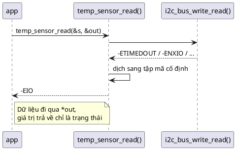

# 09 — Return Value Pattern

📖 Bài giảng chi tiết: [LECTURE.md](LECTURE.md). File này là ghi chú tóm tắt, bám theo chương *Return Value Pattern* của sách.

## Overview

C không có exception, nên giá trị trả về là kênh chuẩn để báo kết quả. Pattern chuẩn hóa kênh đó cho **mọi** hàm:

| Giá trị `int` | Nghĩa |
|---|---|
| `< 0` | Lỗi, giá trị là `-errno` (`-EINVAL`, `-EIO`, `-EAGAIN`...) |
| `0` | Thành công, không có gì thêm để báo |
| `> 0` | Thành công (ít nhất một phần), nghĩa do hàm định nghĩa và ghi trong tài liệu (ví dụ số byte đã ghi) |



## Use Cases

- Mọi hàm không tầm thường: có thể thất bại, hoặc thành công theo nhiều cách.
- Mọi hàm có thể thất bại phải trả mã lỗi âm khi thất bại.
- Mọi hàm có trạng thái cần báo (ví dụ ghi hết hay ghi một phần).

## Benefits

- Kỳ vọng thống nhất: không cần mở tài liệu mới biết hàm trả gì.
- Code sạch, dễ đọc: một cách kiểm tra `if (ret < 0)` cho mọi hàm.

## Drawbacks

- Áp lực kỷ luật lên lập trình viên: giá trị trả về hay bị bỏ qua (giảm nhẹ bằng `MUST_CHECK` + `-Werror`).
- Code dài hơn: thêm `if` sau mỗi lời gọi.
- Chi tiết lỗi hạn chế: errno là mã chung (bù bằng log tại chỗ).

## Implementation

Xem [inc/must_check.h](inc/must_check.h), [inc/temp_sensor.h](inc/temp_sensor.h), [src/temp_sensor.c](src/temp_sensor.c), [src/uart.c](src/uart.c), [src/app.c](src/app.c), [main.c](main.c).

Ba quy tắc của sách:
1. Mọi hàm không tầm thường trả mã trạng thái `int`.
2. Giá trị trả về **phải** được kiểm tra.
3. Mã lỗi luôn **cố định** cho mỗi hàm: không chuyển thẳng mã của hàm con, dịch sang mã mô tả trạng thái object của mình.

```c
MUST_CHECK int temp_sensor_read(struct temp_sensor *self, int32_t *out_mdeg_c);
/* 0, -EINVAL, -EAGAIN (chưa đo xong), -EIO (mọi lỗi bus) */

MUST_CHECK int uart_write(struct uart *self, const uint8_t *data, size_t len);
/* > 0 số byte đã nhận, 0 khi len == 0, -EINVAL, -EAGAIN (buffer đầy) */
```

## Best Practices

- Luôn kiểm tra giá trị trả về; cấu hình để bỏ qua là lỗi build (`__attribute__((warn_unused_result))`).
- Thất bại thì luôn trả `-errno` từ `errno.h`, không tự chế mã, không `-1`.
- Không chuyển thẳng mã lỗi của hàm được gọi; trả mã cố định của hàm mình.
- Thành công không cần báo gì thêm thì luôn trả `0`.
- Thành công một phần thì trả số dương, và ghi nghĩa của nó trong tài liệu.
- Giá trị phức tạp đi qua tham số con trỏ; không trả struct.

## Common Pitfalls

- Không định nghĩa rõ nghĩa của giá trị trả về (cạm bẫy nghiêm trọng nhất theo sách).
- Trả struct thay vì truyền con trỏ.
- Dữ liệu và lỗi chung một kênh (`-1` vừa là lỗi vừa là −0,01 °C).
- `if (ret)` với hàm trả số dương; hứng giá trị trả về bằng `size_t`.
- Viết số errno trực tiếp (`ETIMEDOUT` = 138 trên Windows, 110 trên Linux).

## Alternatives

- **Exceptions**: chỉ có ở C++/Rust.
- **Logging**: luôn kết hợp với mã trả về, không thay thế nó.
- **Panic**: cho lỗi fatal; ghi lý do rồi reboot.
- **Long jump**: đừng dùng, không dọn dẹp được tài nguyên.

## Quiz

1. Hàm nên trả mã trạng thái nào khi thành công và không có thông tin gì khác cần báo?
2. Hàm nên trả gì khi thất bại?
3. Vì sao không nên chuyển tiếp nguyên vẹn mã trạng thái của hàm mình gọi lên trên?
4. Khi nào nên trả mã trạng thái dương?

(Đáp án và 8 câu thêm trong [LECTURE.md](LECTURE.md#23-quiz-có-đáp-án).)

## Câu hỏi còn thắc mắc

-
