# Bài giảng 10 — Concurrency Pattern

> **Về nguồn:** Bài này bám theo chương *Concurrency Pattern* trong sách của Martin Schröder (bản 0.38.0, file `00_Document/Martin-Schroder-Design-Patterns-Concurrency-Pattern-0.38.0.pdf`), có tham khảo các chương Spinlock, Semaphore, Mutex, Conditional để giới thiệu nhóm bài 11–14.
> - 📖 đánh dấu nội dung **theo sách** (dịch và diễn giải lại).
> - 💡 đánh dấu phần **giải thích thêm**, không có trong sách.
> - 🔬 đánh dấu **thí nghiệm thật**: chương trình đã được build bằng gcc 16.2 (MSYS2 UCRT64, Windows 11 64-bit, CPU 16 luồng) và chạy; output in trong bài là output thật. Kết quả có yếu tố thời gian và luồng nên **chạy lại sẽ hơi khác**; bài ghi rõ khi nào mình chạy nhiều lần.

> ⚠️ **Giới hạn của mô phỏng trên PC.** Demo dùng thread của Windows (thư viện winpthreads), **không phải RTOS**. Những thứ PC **không tái hiện được**: ưu tiên thread kiểu RTOS (thread ưu tiên cao luôn chạy ngay), ngắt phần cứng thật chen ngang code, bộ điều khiển ngắt NVIC, hành vi của MCU một lõi (PC có 16 luồng chạy song song thật). Phần nói về Cortex-M và Zephyr là kiến thức chung, đánh dấu 💡, mình **không chạy** trên phần cứng.

Code mẫu đi kèm: [inc/systime.h](inc/systime.h), [inc/slow_sensor.h](inc/slow_sensor.h), [inc/heartbeat.h](inc/heartbeat.h), [inc/work_queue.h](inc/work_queue.h), [inc/sensor_task.h](inc/sensor_task.h), [inc/container_of.h](inc/container_of.h), các file trong [src/](src/), [main.c](main.c). Ghi chú ngắn: [README.md](README.md).
Bài trước: [09 — Return Value](../09_ReturnValuePattern/LECTURE.md). Bài sau: [11 — Spinlock](../11_SpinlockPattern/LECTURE.md).
Liên quan: [01 — Object](../01_ObjectPattern/LECTURE.md) (dữ liệu đi theo đường gọi hàm → dễ khóa), [02 — Opaque](../02_OpaquePattern/LECTURE.md) (pool chưa thread-safe), [05 — Callback](../05_CallbackPattern/LECTURE.md) (work item là một callback struct).

---

## Mục lục

**Phần A — Kiến thức nền**

1. [Bối cảnh: khi một vòng lặp không còn đủ](#1-bối-cảnh-khi-một-vòng-lặp-không-còn-đủ)
2. [CPU thật sự làm gì: thanh ghi và "ngữ cảnh"](#2-cpu-thật-sự-làm-gì-thanh-ghi-và-ngữ-cảnh)
3. [Phần cứng vốn đã song song](#3-phần-cứng-vốn-đã-song-song)
4. [Ngắt (interrupt): concurrency do phần cứng chuyển ngữ cảnh](#4-ngắt-interrupt-concurrency-do-phần-cứng-chuyển-ngữ-cảnh)
5. [Thread và scheduler: concurrency do phần mềm chuyển ngữ cảnh](#5-thread-và-scheduler-concurrency-do-phần-mềm-chuyển-ngữ-cảnh)
6. [Cái giá đầu tiên: data race](#6-cái-giá-đầu-tiên-data-race)

**Phần B — Pattern**

7. [Vấn đề: superloop polling](#7-vấn-đề-superloop-polling)
8. [Ý tưởng cốt lõi: ba thành phần và ba tầng](#8-ý-tưởng-cốt-lõi-ba-thành-phần-và-ba-tầng)
9. [Use cases và lợi ích, giải thích từng điều](#9-use-cases-và-lợi-ích-giải-thích-từng-điều)
10. [Best practices: tách theo time domain, ISR chỉ nạp phần cứng, dùng work queue](#10-best-practices-tách-theo-time-domain-isr-chỉ-nạp-phần-cứng-dùng-work-queue)
11. [Bức tranh nhóm Concurrency: bài 11–14](#11-bức-tranh-nhóm-concurrency-bài-1114)

**Phần C — Đọc code**

12. [Đọc code mẫu từng dòng](#12-đọc-code-mẫu-từng-dòng)
13. [Theo dõi demo chạy từng bước](#13-theo-dõi-demo-chạy-từng-bước)
14. [Các quyết định thiết kế và phương án khác](#14-các-quyết-định-thiết-kế-và-phương-án-khác)

**Phần D — Thực tế và tổng kết**

15. [Trên RTOS thật: Zephyr và FreeRTOS](#15-trên-rtos-thật-zephyr-và-freertos)
16. [Test code có concurrency](#16-test-code-có-concurrency)
17. [Trade-off](#17-trade-off)
18. [Các phương án thay thế và khi nào không dùng thread](#18-các-phương-án-thay-thế-và-khi-nào-không-dùng-thread)
19. [Lỗi hay gặp](#19-lỗi-hay-gặp)
20. [Quy trình refactor superloop sang time domain](#20-quy-trình-refactor-superloop-sang-time-domain)
21. [Câu hỏi thường gặp (FAQ)](#21-câu-hỏi-thường-gặp-faq)
22. [Tóm tắt và checklist](#22-tóm-tắt-và-checklist)
23. [Quiz (có đáp án)](#23-quiz-có-đáp-án)
24. [Bài tập](#24-bài-tập)

---

# Phần A — Kiến thức nền

📖 Sách nói rõ chương này là *"an introduction a preparation covering various forms of concurrency so that higher level patterns related to concurrency will be easier to understand"*: một bài **chuẩn bị** cho bốn bài sau. Vì vậy phần nền ở đây dài hơn các bài trước: muốn hiểu spinlock, semaphore, mutex, bạn phải hiểu CPU chuyển từ đoạn code này sang đoạn code khác **bằng cách nào**.

## 1. Bối cảnh: khi một vòng lặp không còn đủ

### 1.1. Nhìn lại: các bài trước đã "hứa" gì về concurrency

Từ bài 1 tới bài 9, mọi code mẫu chạy trên **một luồng duy nhất**: `main()` gọi hàm này, hàm này gọi hàm kia, lần lượt. Nhưng các bài trước đã nhiều lần nhắc tới concurrency như một việc "để sau":

**Bài 1 (Object)** nói mỗi object gom state của nó lại một chỗ. 📖 Chương Object của sách nêu lý do: *"thread synchronization is about "locking data - not code" and objects are essential for grouping data together so that we can have one clear lock for a group of variables"*. Tức là Object Pattern là **điều kiện tiên quyết** để khóa dữ liệu cho gọn. Bài này sẽ cho thấy vì sao cần khóa.

**Bài 2 (Opaque)** để lại một cảnh báo trong code pool:

```c
/*
 * Pool là state của bộ cấp phát, không phải state của object: mỗi phần tử
 * vẫn là một object độc lập. Chưa an toàn khi gọi từ nhiều thread (bài 11-13).
 */
static struct uart uart_pool[UART_POOL_SIZE];
static bool uart_pool_used[UART_POOL_SIZE];
```

*"Hai thread có thể cùng thấy slot 0 trống và cùng lấy nó."* Mục 6 của bài này sẽ cho bạn **thấy tận mắt** chuyện đó xảy ra, với một biến đếm đơn giản.

**Bài 5 (Callback)**: 📖 chương Callback của sách nói pattern này *"Used for patterns like the Work Queue"*, và khuyên *"defer operations to a dedicated work queue if they take longer time"*. Code mẫu của bài này xây đúng một work queue nhỏ, với work item là một callback struct tìm lại object bằng `CONTAINER_OF`.

**Bài 9 (Return Value)** để lại một câu hỏi bỏ ngỏ. `app_report_temperature` retry khi cảm biến trả `-EAGAIN`:

```c
for (int attempt = 1; attempt <= APP_READ_RETRIES && ret == -EAGAIN; attempt++) {
	ret = temp_sensor_read(self->sensor, &mdeg);
	/* ... */
}
```

Bài giảng 09 ghi chú: *"Trên firmware thật, giữa các lần thử sẽ có một khoảng chờ, và đó là lúc bài 10 (Concurrency) trở nên quan trọng: chờ mà không chặn cả hệ thống."* Câu hỏi là: **trong lúc chờ, CPU làm gì?** Nếu CPU đứng chờ, mọi việc khác (LED, nút bấm, giao tiếp) đều dừng theo. Bài này trả lời câu hỏi đó.

### 1.2. Một dự án lớn dần: superloop đi tới giới hạn

💡 *Tình huống minh họa (không phải ví dụ trong sách), nhưng rất điển hình.*

#### Tháng 1: superloop gọn gàng

Bộ điều khiển nhiệt độ cho tủ ấp trứng, chạy STM32 có 256 KB Flash. Firmware là một vòng lặp (phác thảo, các hàm chỉ để minh họa):

```c
for (;;) {
	led_heartbeat_poll();      /* LED nhịp tim nhấp nháy mỗi 50 ms */
	button_poll();             /* đọc nút bấm */
	if (time_to_sample()) {
		temp = sensor_read();  /* đọc cảm biến I2C nhanh: 0,2 ms */
	}
	heater_control(temp);      /* bật/tắt điện trở sưởi */
}
```

Mọi thứ nhanh, nên vòng lặp quay hàng nghìn lần mỗi giây, ai cũng được phục vụ kịp. Đơn giản, dễ hiểu, dễ debug.

#### Tháng 3: cảm biến chậm

Khách hàng yêu cầu cảm biến chống nước. Team chuyển sang **DS18B20** (1-Wire). 💡 Cảm biến này cần **750 ms** để đo ở độ phân giải 12-bit (375 ms ở 11-bit). Driver đơn giản nhất: ra lệnh đo, **chờ**, đọc kết quả.

Từ đó: mỗi lần đọc nhiệt độ, **cả vòng lặp đứng 375 ms**. LED nhịp tim giật cục. Người dùng bấm nút trong lúc đó thì không ai đọc, lần bấm bị mất. Mục 7 sẽ đo đúng hiện tượng này: LED đáng lẽ đảo 39 lần trong 2 giây, chỉ đảo được 12 lần.

#### Tháng 4: biến driver thành state machine

Để không chặn, team viết lại driver thành **state machine**: `start()` ra lệnh đo rồi về ngay, mỗi vòng lặp gọi `poll()` hỏi "xong chưa". Chạy được. Nhưng code đọc cảm biến, vốn là ba dòng tuần tự "ra lệnh, chờ, đọc", giờ thành một `switch` với 4 trạng thái và các biến lưu thời điểm. 📖 Sách gọi đúng tên cái giá này: biến code thành state machine *"making the sequential task much less obvious"*.

#### Tháng 6: thêm Modbus và Bluetooth

Thêm giao tiếp Modbus RS-485 (phải trả lời trong vài ms), thêm module Bluetooth (gửi lệnh AT, chờ "OK" tới 1 giây). Mỗi chuỗi thao tác có chờ đợi lại thành một state machine nữa. Vòng lặp chính giờ là 6 state machine đan vào nhau. Thêm một tính năng là phải xem lại thời gian của tất cả các cái còn lại.

#### Tháng 8: chuyển sang RTOS

Team chuyển sang Zephyr. Mỗi chuỗi thao tác tuần tự (đọc cảm biến, Bluetooth, Modbus) thành một **thread** hoặc một **work item**, viết lại kiểu tuần tự dễ đọc như tháng 1. Scheduler lo việc "ai chạy lúc nào". LED mượt trở lại.

#### Tháng 9: bug "ngẫu nhiên" xuất hiện

Thread Modbus đọc biến `temp` đúng lúc thread cảm biến đang ghi nó. Bộ đếm lỗi chung bị hụt. Pool buffer (như pool UART ở bài 2) thỉnh thoảng cấp **cùng một** buffer cho hai thread. Đây là cái giá của concurrency: **dữ liệu dùng chung cần đồng bộ**, chủ đề của bài 11–14.

#### Nhìn lại

| Tháng | Chuyện gì xảy ra | Bài học |
|---|---|---|
| 1 | Superloop chạy tốt | Mọi việc đều **nhanh** thì superloop đủ dùng |
| 3 | Một việc chậm làm cả hệ thống đứng | Superloop không có cách nào **chen** việc khác vào giữa một việc đang chạy |
| 4–6 | State machine làm code khó đọc, khó mở rộng | Tự tay quản lý "ai chạy lúc nào" ở mọi nơi trong code là gánh nặng |
| 8 | RTOS, code tuần tự trở lại | 📖 Concurrency *"take the decision making out of the code"* và giao cho scheduler |
| 9 | Race condition | Concurrency có giá: phải **đồng bộ** dữ liệu dùng chung |

### 1.3. Đọc kỹ định nghĩa của sách

📖 Câu mở đầu chương:

> *"Concurrency is a design tool that we use to enable our software to make the most use of CPU resources so that it can meet deadlines without having to worry about missing events while executing complex tasks."*
>
> *Concurrency là một công cụ thiết kế giúp phần mềm tận dụng tối đa CPU để kịp các deadline, mà không phải lo bỏ lỡ sự kiện trong lúc đang chạy những việc phức tạp.*

| Vế | Nghĩa là gì |
|---|---|
| *"a design tool"* | Concurrency là cách **tổ chức** phần mềm, không phải một tính năng bật/tắt |
| *"make the most use of CPU resources"* | CPU không được ngồi chờ khi còn việc khác để làm (tháng 3 ở trên: CPU đứng chờ cảm biến 375 ms) |
| *"meet deadlines"* | Mỗi việc có một hạn: LED phải đảo trong 50 ms, Modbus phải trả lời trong vài ms |
| *"without having to worry about missing events"* | Nút bấm, byte UART tới **bất kỳ lúc nào**, kể cả lúc CPU đang bận việc khác |
| *"while executing complex tasks"* | Việc phức tạp (đo cảm biến, gửi lệnh AT) không được làm bỏ lỡ việc gấp |

📖 Câu thứ hai:

> *"Concurrency is a way to manage what the processor is doing at any given time without having to make decisions about this everywhere in the code."*

Đây là ý quan trọng nhất của chương. Trong superloop (tháng 4–6), **mọi** đoạn code đều phải tự quyết định "mình chạy bao lâu rồi nhường". Với concurrency, quyết định đó được dời ra khỏi code ứng dụng. 📖 *"Threading, scheduling etc are all abstractions that take the decision making out of the code and place it on the hardware and software specifically designed to make these decisions - ie the RTOS scheduler driven by hardware timers and interrupts."*

📖 Phần *Defining Characteristics* định nghĩa chính xác hơn:

> *"Concurrency is the ability to respond to multiple incoming external and internal events quickly, with minimal delay and in some cases in parallel if the hardware allows it."*

và phân biệt hai trường hợp:

| Hệ thống | Concurrency nghĩa là (📖) |
|---|---|
| **Nhiều CPU vật lý** | Làm nhiều việc **cùng lúc thật**, và các pattern để làm điều đó an toàn |
| **Một CPU** (đa số MCU) | *"simply ensures that we can manage the CPU as a resource and load it with appropriate code at any given time so that it can do the actions necessary to satisfy all timing constraints"*: xếp đúng code vào CPU đúng lúc để kịp mọi ràng buộc thời gian |

💡 Phân biệt hai từ hay bị dùng lẫn:
- **Concurrency** (đồng thời): nhiều việc **đang dở dang** cùng một lúc, CPU xen kẽ giữa chúng. Một lõi vẫn có concurrency.
- **Parallelism** (song song): nhiều việc **chạy thật** ở cùng một thời điểm, cần nhiều lõi (hoặc phần cứng độc lập như DMA).

### 1.4. Concurrency trong bức tranh các pattern

📖 Chương Introduction giới thiệu bài này là nơi *"I cover the main overarching pattern of concurrency and how concurrency is designed to help you solve problems related to responsiveness"*. Nó là pattern **bao trùm**, mở đầu nhóm cuối cùng của sách:

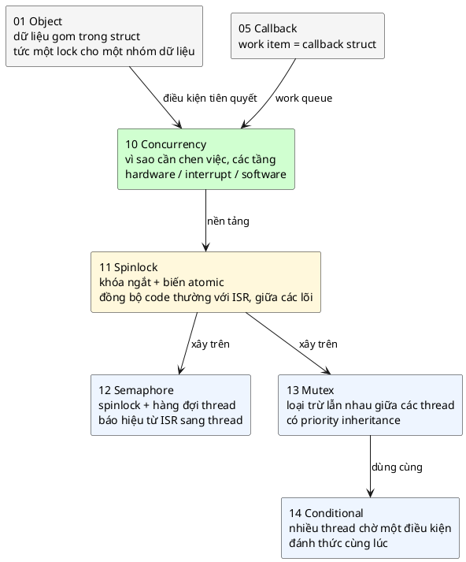

💡 Khác với các bài trước, bài này **không có một struct hay API cố định** gọi là "Concurrency Pattern". Nó là một cách nhìn: chia phần mềm thành các luồng thực thi theo thời gian, rồi dùng các primitive của bài 11–14 để chúng phối hợp an toàn.

📖 Ghi chú nhỏ về bản sách: chương có một tiêu đề *"Multiple Priorities"* nhưng không có nội dung bên dưới (bản 0.38.0). Mình nói về ưu tiên ở mục 4.4 và 10.4 dựa trên các phần khác của chương và kiến thức chung.

### 1.5. Câu hỏi bài này sẽ trả lời

1. Khi CPU "chuyển sang làm việc khác", cụ thể nó lưu và khôi phục **cái gì**? (Mục 2)
2. Ngắt làm được gì, và **vì sao ngắt thôi là chưa đủ**? (Mục 4)
3. Thread và scheduler xây trên ngắt như thế nào? (Mục 5)
4. Chia phần mềm thành thread theo tiêu chí nào? (Mục 10: *time domain*)
5. Concurrency phải trả giá gì? (Mục 6, 17)

---

## 2. CPU thật sự làm gì: thanh ghi và "ngữ cảnh"

### 2.1. CPU là một state machine đọc lệnh

📖 Sách: *"The CPU is just a state machine that fetches instructions from memory and runs them."*

💡 Vòng đời của CPU lặp mãi ba bước: **đọc lệnh** (fetch) tại địa chỉ trong thanh ghi PC, **giải mã**, **thực thi**, rồi PC tăng lên lệnh kế tiếp. Không có gì "song song" ở mức này: một lõi CPU chạy **một** dòng lệnh tại một thời điểm.

### 2.2. Thanh ghi: toàn bộ "trạng thái" của một dòng thực thi

📖 *"Each CPU core has a set of registers that define current state of the CPU core and which instruction it is going to fetch next. Context switching means to save and restore this state to control where the CPU will execute the next instruction."*

💡 Trên ARM Cortex-M (ví dụ STM32F4), các thanh ghi đó là:

| Thanh ghi | Vai trò |
|---|---|
| `R0`–`R3` | Tham số và giá trị trả về của hàm (bài 9: `int` trả về nằm ở `R0`) |
| `R4`–`R11` | Biến cục bộ mà hàm phải giữ nguyên cho caller |
| `R12` | Thanh ghi tạm |
| `SP` (R13) | **Stack pointer**: đỉnh stack hiện tại |
| `LR` (R14) | **Link register**: địa chỉ quay về sau khi hàm hiện tại return |
| `PC` (R15) | **Program counter**: địa chỉ lệnh sắp chạy |
| `xPSR` | Cờ trạng thái (kết quả phép so sánh: âm, bằng 0, tràn...) |

Kết hợp với **vùng stack** mà `SP` trỏ tới (chứa biến cục bộ và chuỗi các lời gọi hàm đang dở), bộ thanh ghi này mô tả **đầy đủ** "chương trình đang ở đâu, đang làm gì". Người ta gọi nó là **ngữ cảnh** (context).

### 2.3. Ý tưởng then chốt: lưu ngữ cảnh lại thì chạy tiếp được

Nếu chép toàn bộ thanh ghi ra RAM, cho CPU chạy một đoạn code khác, rồi chép lại đúng các giá trị cũ vào thanh ghi, thì CPU sẽ **tiếp tục đúng chỗ cũ** như chưa có gì xảy ra. Đoạn code bị tạm dừng không hề biết mình đã bị dừng.

📖 *"All concurrency uses this type of context switching."* Mọi dạng concurrency, từ ngắt tới thread tới async/await, đều là biến thể của thao tác này. Khác nhau ở chỗ **ai** lưu/khôi phục (phần cứng hay phần mềm) và **khi nào**.

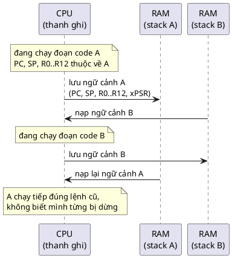

---

## 3. Phần cứng vốn đã song song

### 3.1. Kiến trúc tối giản

📖 *"Your hardware consists basically of a CPU core connected to memory that fetches and executes instructions from memory and reads/writes other memory locations which can be connected to other peripherals."*

📖 Sách minh họa bằng file mô tả nền tảng của **Renode** (phần mềm giả lập vi điều khiển): khi tạo một kiến trúc mới, ta tạo CPU, rồi bộ điều khiển ngắt, rồi các peripheral:

```
cpu: CPU.CortexM @ sysbus
	cpuType: "cortex-m3"
	nvic: nvic

nvic: IRQControllers.NVIC @ sysbus  0xE000E000
	priorityMask: 0xF0
	systickFrequency: 72000000
	IRQ -> cpu@0

exti: IRQControllers.EXTI @ sysbus 0x40010400
	[0-6] -> nvic@[6-10, 23, 40]

gpioPortA: GPIOPort.STM32F1GPIOPort @ sysbus <0x40010800, +0x400>
	[0-15] -> exti@[0-15]
```

Đọc từng khối:

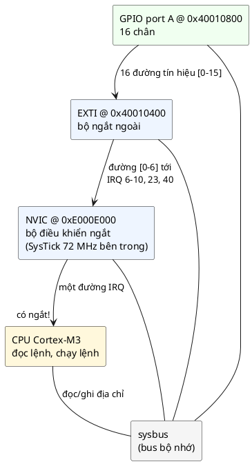

- `cpu`: lõi Cortex-M3, nối với NVIC.
- `nvic`: bộ điều khiển ngắt ở địa chỉ `0xE000E000`, có đồng hồ SysTick chạy 72 MHz. Nó có **một** đường `IRQ` vào CPU.
- `exti`: bộ ngắt ngoài, nhận tín hiệu từ chân GPIO và chuyển tới các số ngắt của NVIC.
- `gpioPortA`: 16 chân GPIO, mỗi chân nối tới một đường của EXTI.

📖 *"All other peripherals are connected to the memory bus and respond to memory read/write requests done by the CPU. In a simple CPU without separate clock domains, all peripherals are clocked by the same clock and run completely in parallel with each other and with the CPU."*

### 3.2. Điểm mấu chốt: chỉ có CPU là tuần tự

💡 Trong khi CPU chạy từng lệnh một, thì cùng lúc đó:
- UART đang dịch từng bit ra chân TX,
- ADC đang chuyển đổi điện áp,
- Timer đang đếm,
- DMA đang chép dữ liệu từ SPI vào RAM.

Tất cả **song song thật sự**, vì mỗi peripheral là một mạch điện riêng. 📖 Sách gọi đây là **hardware concurrency** và nói: *"Hardware, by its nature, is always concurrent - so is the rest of the physical world. However, when we are writing instructions for one or more calculators (processors) we are forced to work in a linear fashion."*

Vậy bài toán của concurrency là: **làm sao để một CPU tuần tự theo kịp một thế giới song song**. 📖 *"All concurrency that we implement in software is therefore always a way to mimic the concurrency of the real world."*

📖 Peripheral báo cho CPU bằng cách nào? *"When a peripheral needs to send an event to the CPU, it does so by signaling an interrupt line. The CPU state machine then jumps to the interrupt code and runs your C code."* Đó là ngắt, chủ đề của mục 4.

---

## 4. Ngắt (interrupt): concurrency do phần cứng chuyển ngữ cảnh

### 4.1. Chuyện gì xảy ra khi có ngắt

📖 *"When an interrupt signal (electrical level) arrives at an interrupt input of the CPU, the CPU can be configured to save all main registers to memory (to stack of currently running code) and branch off to a separate location (an interrupt handler). You can configure which function will run by placing it into hardware interrupt vector table."*

💡 Cụ thể trên Cortex-M:

1. Peripheral (ví dụ UART nhận xong một byte) bật cờ, NVIC thấy ngắt được phép và đủ ưu tiên.
2. Phần cứng **tự động đẩy 8 thanh ghi** lên stack hiện tại: `R0`–`R3`, `R12`, `LR`, `PC`, `xPSR`. Đó chính là "lưu ngữ cảnh" ở mục 2.3, nhưng do **phần cứng** làm, không cần một lệnh nào.
3. CPU đọc **bảng vector** (vector table: mảng địa chỉ hàm đặt ở đầu Flash), lấy địa chỉ của handler ứng với số ngắt, nhảy tới đó.
4. Handler (hàm C bình thường, ví dụ `USART2_IRQHandler`) chạy.
5. Handler return: phần cứng nhận ra giá trị đặc biệt trong `LR` (`EXC_RETURN`), **tự động khôi phục** 8 thanh ghi, code bị ngắt chạy tiếp.

💡 Trên Cortex-M3/M4, từ lúc có tín hiệu tới lệnh đầu tiên của handler mất khoảng **12 chu kỳ** (với bộ nhớ không có wait-state). Ở 72 MHz, đó là dưới 0,2 µs.

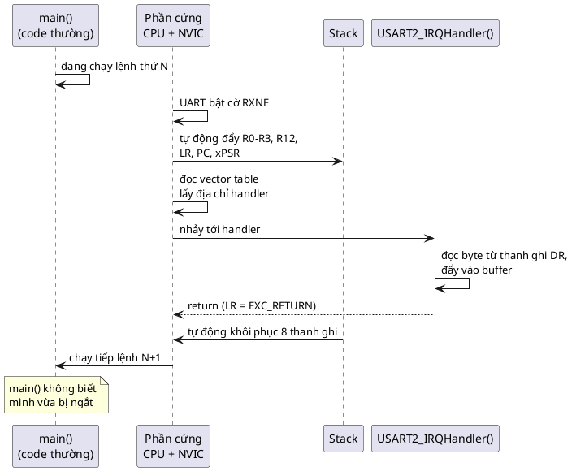

### 4.2. Ngắt là concurrency thật

Với ngắt, firmware đã có hai "luồng" chạy xen kẽ: `main()` và các handler. Byte UART tới lúc nào thì được xử lý lúc đó, kể cả khi `main()` đang bận. Đây là **interrupt concurrency** của sách.

### 4.3. Ưu tiên và lồng ngắt

📖 *"Interrupt controllers often support nested interrupts where preemption is controlled by interrupt priorities - interrupts with higher priority can interrupt other interrupts of lower priority and so on."*

💡 Trên NVIC, **số càng nhỏ càng ưu tiên** (0 là cao nhất). Các quy tắc:

| Tình huống | Kết quả |
|---|---|
| Ngắt ưu tiên **cao hơn** tới khi handler khác đang chạy | **Chen ngang** (preempt): handler đang chạy bị lưu ngữ cảnh, handler mới chạy, xong thì quay lại |
| Ngắt ưu tiên **thấp hơn hoặc bằng** tới | **Chờ** (pending): handler hiện tại chạy hết, rồi handler đang chờ mới chạy |
| Code thường (`main`, thread) | Có thể bị **mọi** ngắt chen ngang (📖 phần Spinlock của sách: *"Normal application code can be thought to run at lowest interrupt priority"*) |

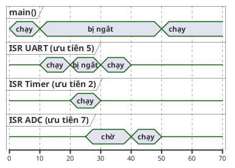

Đọc sơ đồ:
- t = 10: ngắt UART (ưu tiên 5) chen ngang `main()`.
- t = 20: ngắt Timer (ưu tiên 2, **cao hơn** 5) chen ngang chính ISR UART.
- t = 25: ngắt ADC (ưu tiên 7, **thấp hơn**) tới, nhưng không chen được ai: nó **chờ** (pending).
- t = 30: Timer xong, ISR UART chạy tiếp phần còn dở.
- t = 40: UART xong, lúc này mới tới lượt ADC.
- t = 50: không còn ngắt nào, `main()` chạy tiếp.

💡 Trên NVIC, khi một ngắt đã chuyển sang trạng thái **pending**, trạng thái đó được giữ lại (latch) cho tới khi handler được vào hoặc phần mềm xóa nó, kể cả khi tín hiệu gốc đã tắt. Chi tiết này liên quan tới câu quiz số 4 của sách (mục 23).

### 4.4. Giới hạn của ngắt: vì sao chưa đủ

📖 *"Interrupts provide a very crude way of multitasking where you can easily respond to events from the hardware but you can not easily implement complex operations. You can not execute sequences that must sleep from inside an interrupt"*.

Lý do (💡): handler chạy trên stack của code bị ngắt, và nó **phải return** thì code bị ngắt mới chạy tiếp được. Nếu handler "ngủ chờ" một thứ gì đó, toàn bộ phần bên dưới bị treo theo. Vì vậy mọi việc cần chờ IO đều phải **dời lại** (defer) tới sau khi handler return.

📖 Sách mô tả một cách dời việc chỉ bằng ngắt: dùng một ngắt timer ưu tiên thấp chạy các việc được xếp hàng, các ngắt ưu tiên cao đẩy việc sang đó. Nhưng: *"The problem with this approach is that we are very limited in how we can jump in the code. We can not for instance jump dynamically after an interrupt is finished to another location where more work needs to be done with the result obtained in the interrupt. We just don't have this functionality with hardware interrupt support. To obtain it we must implement a software scheduler."*

💡 Diễn giải: phần cứng chỉ biết hai cách chuyển ngữ cảnh: **vào** handler (theo bảng vector cố định) và **ra** khỏi handler (về đúng chỗ bị ngắt). Nó không biết "ra khỏi handler rồi nhảy tới **một chỗ khác** đang chờ kết quả này". Muốn có khả năng đó, phần mềm phải tự quản lý nhiều ngữ cảnh: đó là thread.

---

## 5. Thread và scheduler: concurrency do phần mềm chuyển ngữ cảnh

### 5.1. Thread là gì

💡 Một **thread** là một dòng thực thi có **ngữ cảnh riêng**: bộ thanh ghi riêng (được lưu khi không chạy) và **stack riêng**. RTOS giữ cho mỗi thread một struct quản lý (thường gọi là TCB, *thread control block*) chứa con trỏ stack đã lưu, độ ưu tiên, trạng thái.

📖 *"Software concurrency builds upon the interrupt concurrency and adds the ability to jump dynamically to any location in the software (switch context) in response to hardware events. Which location to jump to is controlled using synchronization primitives like mutexes and semaphores."*

### 5.2. Các trạng thái của thread

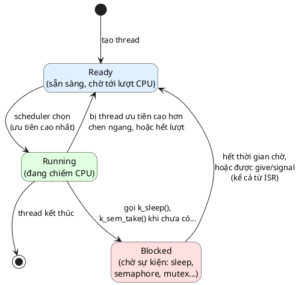

Điểm quan trọng nhất: thread ở trạng thái **Blocked không tốn CPU**. Khi mọi thread đều Blocked, CPU không có việc gì làm, và RTOS cho nó vào chế độ ngủ (`WFI`) tới khi có ngắt. 📖 *"implementing things like power saving modes becomes a simple matter of registering generic handlers that are called whenever no thread is ready to run and before the system executes WFE instruction"*.

### 5.3. Scheduler chuyển thread bằng cách nào

📖 *"Software concurrency: this level is supported by special interrupts (PendSV and SVC on arm) and is able to switch software contexts (threads) when instructed to do so either by a timer interrupt or by an explicit CPU instruction (you 'pend' the switch and then it happens when CPU considers it safe to do it)."*

💡 Trên Cortex-M, các RTOS phổ biến (Zephyr, FreeRTOS) làm như sau:
- **SysTick** là timer phát ngắt đều đặn (ví dụ 1000 lần/giây = 1 tick mỗi ms). Mỗi tick, kernel kiểm tra thread nào hết thời gian ngủ để chuyển về Ready.
- Khi cần đổi thread, kernel **không** đổi ngay mà đặt cờ chờ cho ngắt **PendSV** ("pend" một lần chuyển). PendSV được cấu hình ưu tiên **thấp nhất**, nên nó chỉ chạy khi mọi ngắt khác đã xong: đó là lúc *"CPU considers it safe"*.
- Handler PendSV làm phần việc mà phần cứng không làm: lưu `R4`–`R11` của thread cũ vào stack của nó, lưu `SP` vào TCB, nạp `SP` của thread mới, khôi phục `R4`–`R11` của nó. Khi PendSV return, phần cứng khôi phục 8 thanh ghi còn lại **từ stack của thread mới**, và CPU chạy tiếp thread mới.
- **SVC** (supervisor call) là lệnh để code chủ động gọi vào kernel, thường dùng để khởi động thread đầu tiên.

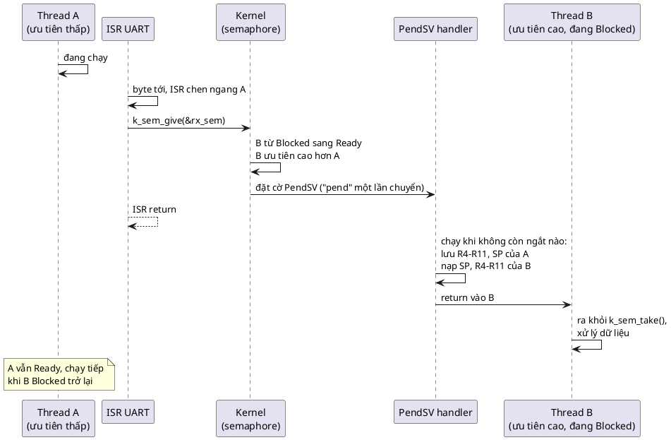

Đây chính là thứ mà ngắt đơn thuần không làm được (mục 4.4): ISR xong thì CPU không quay về A (chỗ bị ngắt) mà **nhảy tới B**, chỗ đang chờ kết quả. 📖 *"When one thread needs to wait for a signal, it waits for a semaphore. When another thread or interrupt code unblocks this semaphore - the thread that was waiting can be switched to immediately. We just don't get this kind of flexibility with hardware interrupts alone."* Cơ chế này là chủ đề chính của bài 12 (Semaphore).

### 5.4. Chọn thread nào chạy: preemptive và cooperative

💡 Hai chính sách lập lịch chính:

| | Preemptive (chen ngang) | Cooperative (hợp tác) |
|---|---|---|
| Khi nào đổi thread | Bất cứ lúc nào có thread ưu tiên cao hơn sẵn sàng (sau ngắt, sau tick) | Chỉ khi thread đang chạy **tự nhường** (sleep, chờ semaphore, yield) |
| Ưu | Thread gấp được phục vụ ngay | Không bị chen ngang giữa chừng, ít race hơn |
| Nhược | Phải đồng bộ dữ liệu dùng chung cẩn thận | Một thread "tham" là chặn tất cả |
| Ví dụ | Hầu hết thread ứng dụng trong Zephyr, FreeRTOS | Thread có ưu tiên âm trong Zephyr, ví dụ system work queue (mục 15) |

Các thread cùng mức ưu tiên có thể được chia lượt theo thời gian (**time slicing**) nếu RTOS bật tính năng đó.

### 5.5. 🔬 "Tick" của hệ điều hành: phần cứng quyết định độ mịn

📖 Phần *Hardware Support* của sách: *"the scheduler almost always relies on hardware timers to drive it ... at the core it is always the hardware that makes scheduling possible."*

Mình thấy rõ điều này ngay trên PC khi viết demo. Chương trình dưới đây ngủ 1 ms, 100 lần, bằng hai cách (hàm `systime_sleep_ms` của code mẫu dùng timer độ phân giải cao của Windows):

```c
#define _POSIX_C_SOURCE 200809L
#include <stdio.h>
#include <time.h>

#include "systime.h"

int main(void)
{
	struct timespec one_ms = { 0, 1000000L };
	uint32_t t0 = systime_ms();

	for (int i = 0; i < 100; i++) {
		nanosleep(&one_ms, NULL);
	}
	printf("nanosleep(1 ms)        x100: %u ms\n", (unsigned)(systime_ms() - t0));

	t0 = systime_ms();
	for (int i = 0; i < 100; i++) {
		systime_sleep_ms(1);
	}
	printf("systime_sleep_ms(1)    x100: %u ms\n", (unsigned)(systime_ms() - t0));
	return 0;
}
```

Output thật (chạy 2 lần):

```
nanosleep(1 ms)        x100: 1583 ms
systime_sleep_ms(1)    x100: 153 ms
nanosleep(1 ms)        x100: 1585 ms
systime_sleep_ms(1)    x100: 150 ms
```

`nanosleep(1 ms)` thực tế ngủ khoảng **15,8 ms**. Vì sao? 💡 Bộ lập lịch của Windows mặc định chạy theo ngắt timer **64 lần/giây**, tức một "tick" là **15,625 ms**. 🔬 Con số này lộ ra ngay trên máy: `clock_getres(CLOCK_PROCESS_CPUTIME_ID)` báo độ phân giải **15 625 000 ns** (thời gian CPU được cộng dồn theo từng tick), trong khi `CLOCK_MONOTONIC` có độ phân giải 100 ns. Một thread ngủ chỉ được đánh thức ở tick kế tiếp, nên mọi lần ngủ ngắn đều bị làm tròn lên khoảng 15,6 ms. Timer độ phân giải cao cho mỗi lần ngủ khoảng 1,5 ms.

💡 Trên RTOS, chuyện y hệt: Zephyr có `CONFIG_SYS_CLOCK_TICKS_PER_SEC`, FreeRTOS có `configTICK_RATE_HZ`. Tick 100 Hz thì `k_msleep(1)` ngủ tới 10 ms. Đây là lý do code mẫu phải viết `systime_sleep_ms` riêng: với `nanosleep`, LED 50 ms sẽ bị làm tròn thành khoảng 62 ms, và demo đo sai.

---

## 6. Cái giá đầu tiên: data race

Concurrency cho phép code bị chen ngang **bất cứ lúc nào**. Hệ quả: nếu hai luồng (thread–thread, hoặc thread–ISR) cùng sửa một biến, kết quả có thể sai.

### 6.1. `counter++` không phải một bước

📖 Chương Spinlock của sách phân tích đúng ví dụ này trên ARM: `data.foo += 5` luôn dịch thành ít nhất **ba lệnh**: *"load, add and store"*. 🔬 Mình xem gcc dịch `plain_counter++` (biến `volatile long`) trên x86-64 thế nào:

Với `-O0` (cách Makefile của demo build):

```
	mov	eax, DWORD PTR "plain_counter"[rip]
	add	eax, 1
	mov	DWORD PTR "plain_counter"[rip], eax
```

Ba lệnh: **đọc** vào thanh ghi, **cộng**, **ghi** lại. (Trên Windows, `long` là 32-bit nên là `DWORD`.)

Với `-O2`:

```
	add	DWORD PTR "plain_counter"[rip], 1
```

Chỉ **một** lệnh! Nhưng đừng vội mừng: trên x86, một lệnh cộng vào bộ nhớ **không có tiền tố `lock`** vẫn là đọc-sửa-ghi bên trong CPU, và lõi khác chen vào giữa được. So sánh với `atomic_fetch_add` (C11), gcc sinh ra:

```
	lock add	DWORD PTR "atomic_counter"[rip], 1
```

Tiền tố `lock` khóa đường truy cập bộ nhớ trong suốt lệnh đó: đây mới là thao tác **nguyên tử** (atomic).

### 6.2. Hai luồng chen nhau: mất một lần tăng

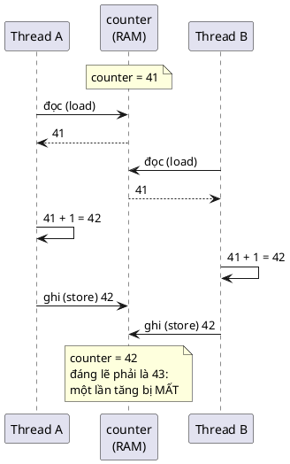

Trên MCU một lõi, kịch bản y hệt xảy ra khi **ngắt** chen vào giữa `load` và `store` của `main()` (đúng ví dụ ISR của chương Spinlock).

### 6.3. 🔬 Thí nghiệm: hai thread, mỗi thread tăng 1 000 000 lần

Demo 3 trong [main.c](main.c) chạy đúng thí nghiệm này. Mình chạy `./demo` **5 lần**:

```
  plain counter : 1110115 (lost 889885 updates)
  plain counter : 1133356 (lost 866644 updates)
  plain counter : 1043353 (lost 956647 updates)
  plain counter : 1077559 (lost 922441 updates)
  plain counter : 1040306 (lost 959694 updates)
```

Còn biến atomic thì **cả 5 lần** đều đúng `2000000`.

Gần **một nửa** số lần tăng bị mất, và con số mỗi lần mỗi khác. Hai thread chạy thật sự song song trên hai lõi, tranh nhau cùng một ô nhớ hàng triệu lần.

🔬 Bản build `-O2` (lệnh `add` một bước, chạy 3 lần): vẫn mất **571 742**, **657 878**, **638 221** lần tăng. Một lệnh máy không có nghĩa là nguyên tử.

### 6.4. 🔬 Trên một lõi: bug trốn rất kỹ

MCU thường chỉ có một lõi. Mình ép chương trình chỉ chạy trên **một lõi** (gọi `SetProcessAffinityMask(GetCurrentProcess(), 1)` ở đầu `main`) để gần với MCU hơn:

| Số lần tăng mỗi thread | Kết quả (chạy nhiều lần) |
|---|---|
| 1 000 000 | **6/6 lần đúng** `2000000`, mất 0 |
| 100 000 000 | 3/3 lần sai: mất **30 352 908**, **36 875 567**, **53 411 281** |

Giải thích:
- Với 1 triệu lần, mỗi thread chạy xong **trong một lượt** CPU của hệ điều hành (vài chục ms), không bị chen ngang giữa `load` và `store` lần nào. Bug **không lộ ra**.
- Với 100 triệu lần, thread bị chen ngang nhiều lần. Mỗi lần thread A bị dừng ngay sau `load` (giữ giá trị cũ trong thanh ghi), thread B chạy cả một lượt, tăng hàng triệu lần; rồi A chạy lại và **ghi đè** giá trị cũ + 1, xóa sạch mọi lần tăng của B trong lượt đó. **Một** lần chen ngang không may có thể mất hàng triệu lần tăng.

💡 Đây chính là kiểu bug firmware đáng sợ nhất: chạy trên bàn thử hàng giờ không sao, ra thực địa với tải khác một chút thì hỏng. Trên MCU, "lượt CPU" được thay bằng "khi nào ngắt tới", nên bug phụ thuộc vào thời điểm bấm nút, thời điểm gói tin tới...

### 6.5. `volatile` không phải là `atomic`

Biến trong demo được khai báo `volatile long`, và vẫn mất hơn một nửa số lần tăng. 💡 `volatile` chỉ bảo compiler: *"đừng tối ưu bỏ hay gộp các lần đọc/ghi biến này, vì nó có thể thay đổi ngoài tầm nhìn của bạn"* (thanh ghi phần cứng, biến ISR sửa). Nó **không** làm cho chuỗi đọc-cộng-ghi thành không thể chen ngang.

| | `volatile` | `_Atomic` / `atomic_*` (C11) | Khóa (bài 11–13) |
|---|---|---|---|
| Compiler không bỏ/gộp truy cập | Có | Có | Có (qua barrier) |
| Một phép `++` không bị chen ngang | **Không** | **Có** | Có |
| Nhiều biến cập nhật cùng lúc nhất quán | Không | **Không** (mỗi biến riêng lẻ) | **Có** |

Cột cuối là lý do vẫn cần bài 11–14: atomic chỉ bảo vệ **một** biến. Muốn cập nhật cả `temp` lẫn `timestamp` sao cho không ai đọc được "temp mới, timestamp cũ", phải khóa.

💡 Trên Cortex-M3/M4, `atomic_fetch_add` dịch thành vòng lặp `LDREX`/`STREX` (đọc độc quyền / ghi có điều kiện, thử lại nếu bị chen). Cortex-M0 không có hai lệnh này, nên thư viện phải tắt ngắt quanh phép tính: đó chính là ý tưởng của bài 11 (Spinlock).

---

# Phần B — Pattern

## 7. Vấn đề: superloop polling

### 7.1. Sách nói gì

📖 Phần *Benefits* mở đầu bằng việc mô tả cái đối lập với concurrency: *"The opposite of concurrency is a single, main loop, polling application. This application does not use interrupts, does not use task scheduling and is simply running one main loop over and over again at maximum speed to try to keep up with what is happening. This is horrible."*

💡 Sách nói rất mạnh. Công bằng mà nói, superloop (thường **có** dùng ngắt) vẫn là kiến trúc phổ biến và hợp lý cho MCU rất nhỏ hoặc firmware rất đơn giản (mục 18). Vấn đề chỉ lộ ra khi có **một việc chậm** hoặc **nhiều chuỗi thao tác có chờ đợi**. Thí nghiệm dưới đây cho thấy chính xác vấn đề đó.

### 7.2. 🔬 Thí nghiệm: một lần đọc cảm biến chậm làm đứng cả hệ thống

Demo 1 trong [main.c](main.c) là một superloop với hai việc:
- LED nhịp tim, đảo trạng thái mỗi **50 ms**.
- Đọc cảm biến chậm (phỏng theo DS18B20 11-bit: chờ **375 ms**) mỗi **500 ms**.

```c
	while (!systime_reached(now = systime_ms(), start + DEMO_MS)) {
		if (heartbeat_poll(&hb, now) < 0) {
			return -1;
		}
		if (systime_reached(now, next_sample)) {
			next_sample += SAMPLE_PERIOD_MS;
			if (slow_sensor_read(&sensor, &mdeg) == 0) { /* chặn 375 ms ngay tại đây */
				samples++;
			}
		}
		systime_sleep_ms(1); /* "WFI": nhường CPU tới tick kế tiếp */
	}
```

Output thật sau 2 giây:

```
== Demo 1: superloop, sensor read inside the loop ==
  LED timeline (1 char = 50 ms): .......###.......###.......###.......###
  toggles: 12 (expected ~39), late: 4, worst gap: 400 ms
  sensor samples: 4, last = 21875 m°C
```

Dòng `timeline` là bản đồ thời gian: mỗi ký tự là một ô 50 ms, `#` nghĩa là LED **có** đảo trong ô đó, `.` là **không**. Đọc: 7 ô (350 ms) LED đứng yên, rồi 3 ô có nhịp, rồi lại 7 ô đứng yên... Đúng nhịp đọc cảm biến 500 ms, mỗi lần chặn 375 ms. LED chỉ đảo **12** lần thay vì khoảng **39**, khoảng cách lớn nhất giữa hai lần đảo là **400 ms** thay vì 50 ms. Mình chạy 5 lần, cả 5 lần đều ra đúng các con số này.

Nếu thay LED bằng việc đọc nút bấm, nghĩa là mỗi giây có hơn 700 ms người dùng bấm nút mà firmware không biết.

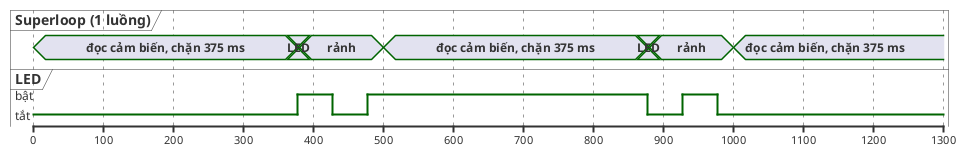

### 7.3. 🔬 Polling còn tốn điện

Vế thứ hai của chữ *"horrible"* là năng lượng. 📖 Sách: CPU load được đo bằng thời gian CPU nằm ở trạng thái "chờ sự kiện" (lệnh `WFE`/`WFI`), và *"This is impossible to achieve when your application must poll for changes."*

Mình đo trên PC: một "phần cứng giả" (thread khác) báo có dữ liệu sau đúng 1 giây. Cách 1: vòng lặp hỏi liên tục. Cách 2: ngủ chờ được đánh thức.

```c
#define _POSIX_C_SOURCE 200809L
#include <pthread.h>
#include <stdatomic.h>
#include <stdbool.h>
#include <stdio.h>
#include <time.h>

/* "Phần cứng" giả: sau 1 giây thì báo có dữ liệu */
static atomic_bool data_ready;
static pthread_mutex_t lock = PTHREAD_MUTEX_INITIALIZER;
static pthread_cond_t cond = PTHREAD_COND_INITIALIZER;

static double seconds(clockid_t id)
{
	struct timespec ts;

	clock_gettime(id, &ts);
	return (double)ts.tv_sec + (double)ts.tv_nsec / 1e9;
}

static void *fake_hardware(void *arg)
{
	struct timespec one_second = { 1, 0 };

	(void)arg;
	nanosleep(&one_second, NULL);
	pthread_mutex_lock(&lock);
	atomic_store(&data_ready, true);
	pthread_cond_signal(&cond); /* "ngắt": đánh thức người đang chờ */
	pthread_mutex_unlock(&lock);
	return NULL;
}

static void run(bool use_polling)
{
	pthread_t hw;
	double wall0 = seconds(CLOCK_MONOTONIC);
	double cpu0 = seconds(CLOCK_PROCESS_CPUTIME_ID);

	atomic_store(&data_ready, false);
	pthread_create(&hw, NULL, fake_hardware, NULL);

	if (use_polling) {
		while (!atomic_load(&data_ready)) {
			/* hỏi liên tục: CPU chạy hết công suất mà không làm gì có ích */
		}
	} else {
		pthread_mutex_lock(&lock);
		while (!atomic_load(&data_ready)) {
			pthread_cond_wait(&cond, &lock); /* ngủ, không tốn CPU, tới khi được đánh thức */
		}
		pthread_mutex_unlock(&lock);
	}
	pthread_join(hw, NULL);

	printf("%-8s wall = %.2f s, CPU time used = %.2f s\n", use_polling ? "polling" : "blocking",
	       seconds(CLOCK_MONOTONIC) - wall0, seconds(CLOCK_PROCESS_CPUTIME_ID) - cpu0);
}

int main(void)
{
	run(true);
	run(false);
	return 0;
}
```

Output thật (chạy 3 lần, kết quả gần như giống hệt; đây là lần đầu):

```
polling  wall = 1.01 s, CPU time used = 1.02 s
blocking wall = 1.00 s, CPU time used = 0.00 s
```

Cả hai cùng chờ 1 giây. Polling đốt **1 giây CPU trọn vẹn** (một lõi chạy 100% không làm gì có ích); blocking đốt **0** (dưới độ phân giải 15,6 ms của đồng hồ CPU). Trên MCU chạy pin, đó là khác biệt giữa "pin dùng một tuần" và "pin dùng một năm": CPU ngủ bằng `WFI` tiêu thụ ít hơn nhiều so với lúc chạy.

💡 Điều kiện chờ (`pthread_cond_wait`) là primitive của bài 14; ở đây chỉ dùng để minh họa "ngủ tới khi được đánh thức". Cách đánh thức thread từ ngắt trên MCU là semaphore (bài 12).

### 7.4. Tóm tắt vấn đề

| Vấn đề của superloop | Hậu quả |
|---|---|
| Một việc chậm chặn mọi việc khác | Bỏ lỡ sự kiện, trễ deadline (🔬 LED: 12/39 lần đảo) |
| Chờ bằng cách hỏi liên tục | Tốn CPU, tốn điện, không ngủ được (🔬 1,02 s CPU cho 1 s chờ) |
| Muốn không chặn thì phải viết state machine | Code tuần tự biến thành `switch`, khó đọc, khó mở rộng |
| Mọi đoạn code tự quyết định "chạy bao lâu" | Thêm tính năng là phải xem lại thời gian của tất cả |

---

## 8. Ý tưởng cốt lõi: ba thành phần và ba tầng

### 8.1. Ba thành phần của mọi hệ thống có concurrency

📖 *"A system that uses concurrency will always have the following parts:"*

| Thành phần (📖) | Sách viết | Trong code mẫu (PC) | Trên MCU với RTOS (💡) |
|---|---|---|---|
| **Scheduler** | Code có cái nhìn tổng quát về việc CPU đang làm, và có thể điều CPU tới chạy bất kỳ phần nào khác của phần mềm | Bộ lập lịch của Windows (qua winpthreads) | Kernel của Zephyr / FreeRTOS |
| **Hardware Support** | Scheduler *"almost always relies on hardware timers to drive it"*; phần cứng là thứ làm cho scheduling khả thi | Ngắt timer của PC, timer độ phân giải cao (mục 5.5) | SysTick, PendSV, SVC, NVIC |
| **Synchronization** | Các cấu trúc phần mềm để ứng dụng điều khiển việc scheduler làm tiếp theo: *"spinlocks, semaphores, mutexes, conditional variables and other higher level concepts"* | `pthread_mutex`, `pthread_cond`, C11 atomic | `k_spinlock`, `k_sem`, `k_mutex`, `k_condvar` |

📖 Sách nói thêm: ta tổ chức phần mềm để *"give hints to the system scheduler about which tasks should be run when. We do so using task priorities and synchronization primitives."* Ứng dụng không tự quyết định "giờ chạy cái gì"; nó chỉ **gợi ý** qua độ ưu tiên và qua việc chờ/báo hiệu.

### 8.2. Ba tầng concurrency

📖 Phần *Implementation* chia concurrency thành ba dạng chính, xếp chồng lên nhau:

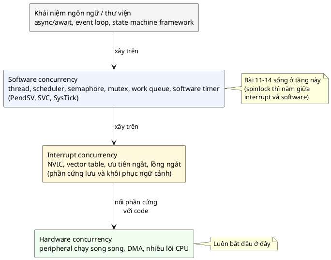

| Tầng (📖) | Ai chuyển ngữ cảnh | Sách nói |
|---|---|---|
| **Hardware concurrency** | Không cần: phần cứng song song thật | *"a direct consequence of the hardware being able to toggle unlimited number of signals on a single clock cycle"*. Hầu như vô hình với lập trình viên, nhưng tận dụng được (chạy nhiều DMA cùng lúc) thì hiệu năng tăng rất nhiều. Gồm cả nhiều lõi CPU chạy song song |
| **Interrupt concurrency** | **Phần cứng** (mục 4) | CPU lưu thanh ghi lên stack và nhảy tới handler trong vector table |
| **Software concurrency** | **Phần mềm** (scheduler, mục 5) | Dựa trên các ngắt đặc biệt (PendSV, SVC trên ARM), chuyển thread khi timer báo hoặc khi có lệnh. Mở rộng ra thread, primitive đồng bộ, async/await, work queue |

📖 *"Concurrency always starts at the hardware level, then goes through interrupts (which connect hardware level to code level through explicit hardware support - the vector table) and then continue into software based abstractions until it is completely abstracted away behind language concepts."*

📖 Sách cũng chỉ ra vì sao người làm embedded phải hiểu cả ba tầng: lập trình viên ứng dụng trên Linux thường *"do not have to deal with threads at all"*, *"However, when we deal with embedded systems, we are the people that make this kind of simplicity possible."* Tức là người viết firmware chính là người xây những tầng mà người khác được dùng mà không cần biết.

### 8.3. Áp dụng vào bài toán ở mục 7: tách theo thời gian

Ý tưởng: LED và cảm biến là hai **chuỗi thao tác độc lập về thời gian**. Đặt chúng vào hai luồng thực thi riêng, để khi luồng cảm biến chờ 375 ms thì luồng LED vẫn chạy.

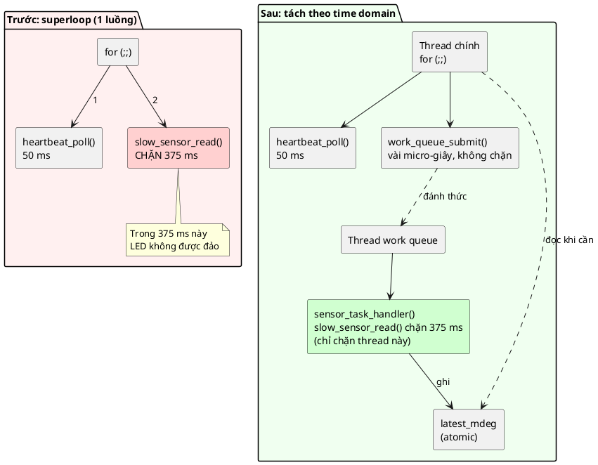

Code mẫu (demo 2) chính là phần "Sau". Kết quả 🔬 (chi tiết ở mục 13):

```
== Demo 2: same loop, sensor read moved to a work queue thread ==
  LED timeline (1 char = 50 ms): .#######################################
  toggles: 39 (expected ~39), late: 0, worst gap: 51 ms
  sensor samples: 4, last = 21875 m°C, work items run: 4, skipped (already pending): 0
```

LED đảo đủ **39** lần, không lần nào trễ, khoảng cách lớn nhất **51 ms**. Cảm biến vẫn đọc đủ **4** mẫu với cùng giá trị cuối `21875`. Không có dòng code nào trong driver cảm biến phải sửa: `slow_sensor_read` vẫn là hàm chặn, viết tuần tự đơn giản.

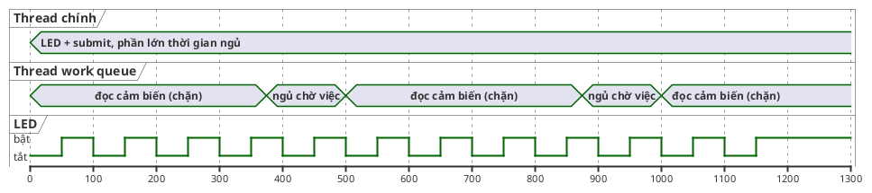

(Sơ đồ minh họa, lý tưởng hóa từ kết quả đo: thời điểm thật lệch vài ms.) So với sơ đồ ở mục 7.2: phần chặn 375 ms vẫn còn nguyên, nhưng giờ nó nằm trên **một luồng khác**, và LED không còn chờ nó.

---

## 9. Use cases và lợi ích, giải thích từng điều

### 9.1. Use cases

📖 Sách nêu bốn trường hợp cần concurrency:

| Use case (📖) | Sách viết | Ví dụ firmware (💡) |
|---|---|---|
| **Parking CPU while waiting for IO** | Phép tính cần một giá trị IO chưa có (việc có sẵn hay chưa được báo bằng tín hiệu điện): nên nạp CPU với một trạng thái khác, cho các phép tính khác chạy trong lúc chờ | Chờ DS18B20 đo xong 750 ms; chờ module modem trả "OK" |
| **Concurrent hardware operations** | Mỗi peripheral là một khối phần cứng độc lập; muốn tận dụng, cần cách *"jump between multiple code paths that execute operations in sequence on each piece of hardware"* | Vừa truyền SPI ra màn hình bằng DMA, vừa nhận UART, vừa đo ADC |
| **Multiple CPU cores** | Nhiều lõi cùng truy cập peripheral hay bộ nhớ chung thì cần đồng bộ bằng phần mềm | ESP32 (2 lõi), STM32H7 dual-core, nRF5340 |
| **Real-time timing constraints** | Phản ứng rất nhanh với sự kiện, khởi động chuỗi xử lý khi phần cứng báo, *"switch contexts quickly in response to hardware events without the need of running some code to completion"* | Nút dừng khẩn cấp phải ngắt động cơ trong 1 ms, dù CPU đang ghi log ra flash |

### 9.2. Lợi ích

📖 Sách nêu bốn lợi ích:

**1. Low power consumption with low CPU load.** 📖 CPU load đo bằng thời gian CPU nằm ở trạng thái chờ sự kiện, vào bằng lệnh `WFE`/`WFI`. Nhiều CPU còn cho cấu hình chế độ tiết kiệm năng lượng nào được vào khi chạy `WFE`. *"Concurrency eliminates need for polling and your application can be event based."* 🔬 Mục 7.3: polling 1,02 s CPU, blocking 0 s CPU cho cùng một lần chờ 1 giây.

**2. Separation of tasks by time domains.** 📖 Ứng dụng thường gồm các việc tuần tự với nhiều lần chờ IO. Ta có thể biến code thành state machine (làm việc tuần tự *"much less obvious"*), hoặc giữ code tuần tự nhưng tách các chuỗi thao tác sang nhiều thread. *"A time domain is simply a sequence of actions with delays in between that must be executed as a single block. Delays typically occur naturally by having to wait for IO to complete."* (Xem kỹ ở mục 10.1.)

**3. Basis for many other patterns.** 📖 Event processor, async/await dễ xây hơn nhiều khi có scheduler để tách hẳn các state machine ra chạy trên các thread riêng. 📖 Ở phần Software Concurrency: *"Things like async/await are based internally on a work queue and the work queue is executed by a thread and the thread is a context which can be switched in and out."*

**4. Timeouts and repetitive tasks.** 📖 Phần cứng chỉ có một số timer giới hạn. Cần concurrency để có *"flexible and unlimited delayed tasks"*. 💡 Ví dụ: một MCU có 4 timer phần cứng, nhưng firmware cần 30 timeout khác nhau (timeout Modbus, nhấp nháy LED, tự tắt màn hình, retry kết nối...). Kernel dùng **một** timer phần cứng (SysTick) để giả lập không giới hạn **software timer**. 📖 Phần Drawbacks gọi đây là *"the ability to instantiate infinite number of software timers using only one hardware timer"*.

---

## 10. Best practices: tách theo time domain, ISR chỉ nạp phần cứng, dùng work queue

📖 Sách nêu ba best practice. Đây là phần "cách làm" quan trọng nhất của bài.

### 10.1. Tách theo time domain

📖 *"when thinking about which tasks you want to split into multiple software threads, think of it in terms of which sequences of operations you would like to interleave. An interleaved sequence means that in code you write the code sequentially, but when you code is waiting for IO then other code can run (be interleaved) with your code."*

📖 *"the splitting of code into tasks should be primarily driven by the necessity to separate sequences of tasks into isolated blocks of code that can be maintained separately."*

💡 Cách áp dụng: liệt kê các **chuỗi thao tác có chờ đợi** trong firmware, rồi hỏi: *hai chuỗi này có cần chạy xen kẽ nhau không?* Ví dụ với tủ ấp trứng ở mục 1.2:

| Chuỗi thao tác | Chờ gì | Nhịp | Cần xen kẽ với |
|---|---|---|---|
| Đọc nhiệt độ: ra lệnh đo, chờ 375 ms, đọc, cập nhật | Cảm biến | 1 s | Mọi thứ khác |
| Bluetooth: gửi lệnh AT, chờ "OK", gửi dữ liệu | Module BT, tới 1 s | Khi có kết nối | Mọi thứ khác |
| Modbus: chờ khung tin, xử lý, trả lời | Byte UART | Bất kỳ lúc nào | Mọi thứ khác, và phải trả lời trong vài ms |
| LED nhịp tim, đọc nút | Không chờ gì đáng kể | 50 ms | |

Ba chuỗi đầu có những khoảng chờ dài và độc lập nhau: ba **time domain**. LED và nút bấm thì ngắn, không chờ gì: không cần thread riêng, chạy trong thread chính hoặc thành work item định kỳ là đủ.

Mỗi time domain giờ được viết **tuần tự** như code tháng 1: "ra lệnh, chờ, đọc". Lệnh "chờ" là một lời gọi chặn (`k_msleep`, `k_sem_take`) nhường CPU cho các domain khác.

### 10.2. Ngắt chỉ để nạp/xả phần cứng

📖 *"use interrupts only for operating on prepared data that needs to either be pumped out through the hardware or data needs to be received from hardware and placed into a prepared buffer. Interrupts are not for application logic."*

📖 *"Interrupts must only operate on the premise of responding to a hardware event and quickly preparing next operation if appropriate. If your task is above the lowest level of abstraction (ie a GPIO operating over an I2C gpio expander) then you need to defer this work into the system work queue or another thread."*

💡 Ví dụ của sách rất hay: một nút bấm nối qua **GPIO expander I2C** (chip mở rộng chân, như PCF8574). Chip báo ngắt khi có chân đổi trạng thái. Nhưng muốn biết **chân nào**, phải đọc chip qua I2C, mất vài trăm µs và có thể phải chờ bus. Việc đó **không** được làm trong ISR. ISR chỉ ghi nhận "expander báo có thay đổi" rồi đẩy việc đọc I2C sang work queue.

Phác thảo kiểu Zephyr (💡 minh họa, **không build** trên PC):

```c
/* ISR: chỉ ghi nhận sự kiện, không làm I2C */
static void expander_irq_handler(const struct device *port, struct gpio_callback *cb, uint32_t pins)
{
	struct keypad *self = CONTAINER_OF(cb, struct keypad, irq_cb);

	k_work_submit(&self->scan_work); /* an toàn khi gọi từ ISR, về ngay */
}

/* Work item: chạy trên thread của system work queue, được phép chờ I2C */
static void keypad_scan_work(struct k_work *work)
{
	struct keypad *self = CONTAINER_OF(work, struct keypad, scan_work);
	uint8_t pins;

	if (i2c_read(self->i2c, &pins, 1, self->addr) < 0) {
		return;
	}
	/* ... so với lần trước, phát sự kiện nút bấm ... */
}
```

| Việc | Ở đâu | Vì sao |
|---|---|---|
| Đọc byte từ thanh ghi UART vào buffer | ISR | Phải làm ngay, trước khi byte tiếp theo đè lên; chỉ vài lệnh |
| Nạp byte tiếp theo vào thanh ghi TX | ISR | "Bơm" dữ liệu đã chuẩn bị sẵn ra phần cứng |
| Phân tích khung tin Modbus | Thread / work queue | Logic ứng dụng, có thể dài |
| Đọc chip qua I2C/SPI | Thread / work queue | Phải chờ bus, không được chờ trong ISR |
| Ghi flash, in log | Thread / work queue | Chậm |

### 10.3. Dùng system work queue

📖 *"the system work queue provides a way of queuing cooperative blocks of operations which are then executed in sequence as part of the work queue thread loop. You can queue work from interrupts or from other threads. This is an excellent way to avoid creating unnecessary threads in your application."*

💡 Work queue là **một** thread chạy lần lượt các work item được xếp hàng. Ưu điểm so với "mỗi việc một thread":

| | Mỗi việc một thread | Work queue |
|---|---|---|
| RAM | Mỗi thread một stack riêng (thường 512 B – 2 KB trên MCU) | **Một** stack dùng chung cho mọi work item |
| Đồng bộ giữa các việc | Phải khóa nếu chúng dùng chung dữ liệu | Các work item **không bao giờ chạy chen nhau** (📖 chương Callback: *"ensure that all work queue items run in sequence without interrupting each other"*) |
| Gọi từ ISR | Phải dùng semaphore để đánh thức thread | `submit` trực tiếp |
| Nhược | | Một work item chạy lâu sẽ **làm trễ** mọi work item xếp sau nó |

Code mẫu xây một work queue tối giản (mục 12.6) để bạn thấy nó hoạt động bên trong thế nào. Trên RTOS thật, dùng work queue có sẵn của hệ thống (📖 *"Do not reinvent the scheduler"*, mục 19).

💡 Lưu ý về nhược điểm: `sensor_task_handler` của code mẫu chặn 375 ms trên thread work queue. Với **system** work queue dùng chung cho cả firmware, chặn 375 ms là quá lâu: mọi work item khác (kể cả việc quét bàn phím ở 10.2) phải chờ. Firmware thật nên cho việc chậm như vậy một **work queue riêng** hoặc một thread riêng, hoặc viết driver không chặn (mục 14.1). 📖 Chương Callback cũng khuyên đẩy việc tốn thời gian sang *"dedicated work queue"*.

### 10.4. Cách xếp độ ưu tiên

📖 Câu quiz số 3 của sách hỏi cách xếp ưu tiên *"for maximum flexibility"*. Sách không in đáp án, nhưng trong ba phương án chỉ có một phương án khớp với các best practice ở trên: ngắt cao nhất, system work queue là thread ưu tiên cao nhất, rồi tới main thread, rồi các thread khác.

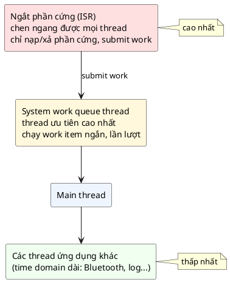

💡 Lý do của cách xếp này:
- **ISR cao nhất** vì đó là chỗ phản ứng với phần cứng, và nó rất ngắn (mục 10.2).
- **Work queue ngay dưới ISR** vì nó là "nửa sau" của ISR: việc được ISR đẩy sang cần được làm sớm, trước logic ứng dụng.
- Vì work queue ưu tiên cao như vậy, work item **phải ngắn**. Đây cũng là lý do việc chậm không nên nằm trong system work queue (mục 10.3).

---

## 11. Bức tranh nhóm Concurrency: bài 11–14

📖 Phần kết của chương: bài này *"is designed to pave the way towards understanding higher level software concurrency concepts such as spinlocks, semaphores, mutexes and conditional variables."* Dưới đây là bản đồ của bốn bài sau, theo nội dung các chương tương ứng của sách:

| Bài | Giải quyết | Dùng trong ISR? | Biết về thread? | Một câu từ sách |
|---|---|---|---|---|
| **11 Spinlock** | Đồng bộ dữ liệu giữa code thường và ISR, giữa các lõi | **Có** | Không | 📖 *"In single core systems, the spinlock simply works as a mechanism for momentarily disabling interrupts"* |
| **12 Semaphore** | **Báo hiệu**: từ ISR hoặc thread sang thread đang chờ | **Có** (give) | Có, có hàng đợi thread | 📖 *"instead of targeting mutual exclusion, the semaphore pattern is designed to solve the problem of signaling"* |
| **13 Mutex** | **Loại trừ lẫn nhau** giữa các thread | **Không** | Có, biết thread sở hữu, có priority inheritance | 📖 *"Unlike the semaphore and the spinlock, the mutex can not be used from interrupts"* |
| **14 Conditional** | Nhiều thread chờ một **điều kiện tùy ý**, đánh thức một hoặc tất cả | Signal được, không wait được | Có, luôn dùng cùng mutex | 📖 *"allows one or more threads to wait for a certain condition to be met before proceeding"* |

Liên hệ với những gì bài này đã chạm tới:
- Biến đếm mất lần tăng ở 🔬 mục 6 → bài 11 (khóa) và bài 13 (mutex) là cách sửa cho dữ liệu nhiều hơn một biến.
- Đánh thức thread khi ISR có dữ liệu (sơ đồ mục 5.3) → bài 12.
- `pthread_mutex` và `pthread_cond` bên trong work queue của code mẫu → bài 13 và 14. Ở bài này chúng là hộp đen.

---

# Phần C — Đọc code

## 12. Đọc code mẫu từng dòng

### 12.1. Kiến trúc của code mẫu

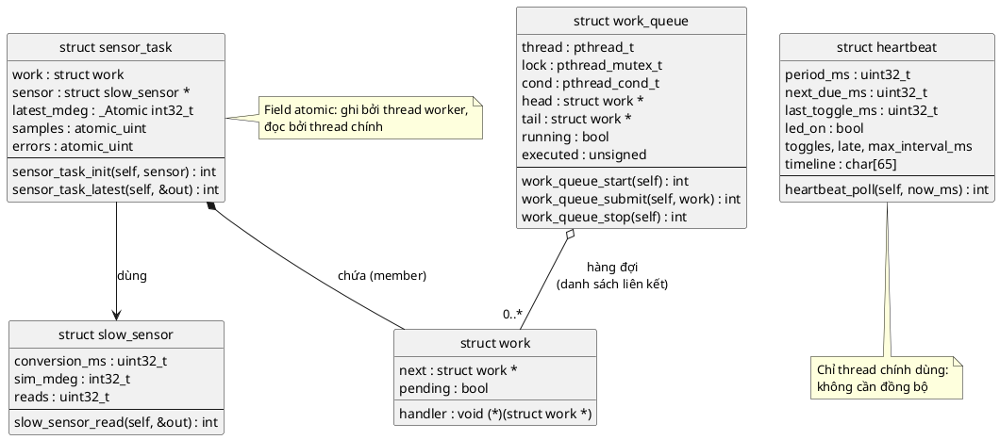

Mọi module theo các bài trước: **Object** (struct + hàm nhận `self`), **Return Value** (trả `int`, `0`/âm, có dùng số dương cho trạng thái), **Callback** (`struct work` với `CONTAINER_OF`).

### 12.2. [inc/systime.h](inc/systime.h) và [src/systime.c](src/systime.c)

```c
uint32_t systime_ms(void);
void systime_sleep_ms(uint32_t ms);
```

Lớp "port" mỏng, tách phần phụ thuộc nền tảng ra khỏi phần còn lại. Trên MCU với Zephyr, hai hàm này thay bằng `k_uptime_get_32()` và `k_msleep()`.

```c
static inline int systime_reached(uint32_t a, uint32_t b)
{
	return (int32_t)(a - b) >= 0;
}
```

💡 Đây là kỹ thuật so sánh thời gian **an toàn khi bộ đếm tràn**. Bộ đếm mili-giây 32-bit quay về 0 sau khoảng 49,7 ngày. Nếu viết `now >= deadline`, khi `deadline` vừa vượt qua `0xFFFFFFFF` và quay về số nhỏ, phép so sánh sai suốt một thời gian. Lấy **hiệu** rồi ép sang số có dấu thì đúng miễn là hai thời điểm cách nhau dưới khoảng 24,8 ngày. Test ở mục 16 kiểm tra đúng trường hợp tràn này. Firmware chạy liên tục nhiều tháng mà so sánh thời gian sai cách là một bug kinh điển: thiết bị "treo" sau đúng 49 ngày.

```c
#ifdef _WIN32
void systime_sleep_ms(uint32_t ms)
{
	static _Thread_local HANDLE timer;
	...
	due.QuadPart = -(LONGLONG)ms * 10000; /* âm = tương đối, đơn vị 100 ns */
	SetWaitableTimer(timer, &due, 0, NULL, NULL, FALSE);
	WaitForSingleObject(timer, INFINITE);
}
#else
void systime_sleep_ms(uint32_t ms)
{
	struct timespec req = { (time_t)(ms / 1000u), (long)(ms % 1000u) * 1000000L };

	while (nanosleep(&req, &req) != 0) {
		/* bị tín hiệu đánh thức sớm: ngủ tiếp phần còn lại */
	}
}
#endif
```

- Trên Windows: dùng timer độ phân giải cao, vì `nanosleep` bị làm tròn lên tick 15,6 ms (🔬 mục 5.5).
- `_Thread_local` (C11): mỗi thread có **một biến `timer` riêng**. Nếu hai thread dùng chung một timer, lần `SetWaitableTimer` của thread này sẽ đặt lại hạn của thread kia. Đây là một dạng "dữ liệu dùng chung" mà bạn phải nghĩ tới ngay khi có thread. (Timer không được đóng khi thread kết thúc; chấp nhận được cho demo.)
- Trên POSIX: `nanosleep` có thể về sớm nếu bị tín hiệu; vòng lặp ngủ tiếp phần còn lại.
- `#define _POSIX_C_SOURCE 200809L` ở đầu file: với `-std=c11` thuần, các hàm POSIX như `clock_gettime`, `nanosleep` bị ẩn đi; macro này bật chúng lên.

### 12.3. [inc/slow_sensor.h](inc/slow_sensor.h) và [src/slow_sensor.c](src/slow_sensor.c)

```c
int slow_sensor_read(struct slow_sensor *self, int32_t *out_mdeg_c)
{
	if (!self || !out_mdeg_c) {
		return -EINVAL;
	}

	/* Mô phỏng "ra lệnh đo rồi chờ": CPU (thread này) không làm được gì khác */
	systime_sleep_ms(self->conversion_ms);

	*out_mdeg_c = self->sim_mdeg;
	self->sim_mdeg += 125;
	self->reads++;
	return 0;
}
```

- Driver **cố tình viết kiểu chặn**, tuần tự, đơn giản nhất. Đây là kiểu code ta *muốn* viết (📖 *"keep our code sequential"*). Bài học của demo là: **không sửa driver**, chỉ sửa **chỗ gọi** nó.
- Theo Return Value (bài 9): trả `int`, dữ liệu qua `out_mdeg_c`.
- Giá trị giả tăng 125 m°C mỗi lần đọc để nhìn output biết đã đọc bao nhiêu lần: 4 lần đọc thì giá trị cuối là `21500 + 3 × 125 = 21875`.
- ⚠️ `self->sim_mdeg` và `self->reads` **không** được bảo vệ. Điều đó an toàn chỉ vì trong demo 2, **chỉ thread worker** gọi `slow_sensor_read`. Nếu hai thread cùng gọi nó trên cùng một object, ta có data race như mục 6. Ghi nhớ quy tắc: mỗi object có **một thread sở hữu**, hoặc có khóa.

### 12.4. [inc/heartbeat.h](inc/heartbeat.h) và [src/heartbeat.c](src/heartbeat.c)

```c
int heartbeat_poll(struct heartbeat *self, uint32_t now_ms)
```

Điểm thiết kế quan trọng: hàm **nhận thời gian qua tham số** thay vì tự gọi `systime_ms()`. Nhờ vậy nó là logic thuần, test được với thời gian giả mà không cần thread hay sleep (mục 16).

Giá trị trả về theo bài 9: `1` = vừa đảo LED (thành công theo cách thứ hai), `0` = chưa tới hạn, âm = lỗi.

```c
	if (!systime_reached(now_ms, self->next_due_ms)) {
		return 0;
	}

	uint32_t interval = now_ms - self->last_toggle_ms;
	uint32_t slot = (now_ms - self->start_ms) / self->period_ms;

	self->led_on = !self->led_on; /* trên MCU: gpio_pin_toggle() */
```

- `interval`: khoảng cách thật từ lần đảo trước. Ghi lại giá trị lớn nhất (`max_interval_ms`) và đếm số lần trễ hơn 1,5 chu kỳ (`late`).
- `slot`: ô thời gian 50 ms hiện tại, để đánh dấu `#` vào `timeline`.

```c
	/* Hẹn lần sau tính từ bây giờ, không cộng dồn: trễ rồi thì không "đảo bù" liên tục */
	self->next_due_ms = now_ms + self->period_ms;
```

Nếu viết `next_due_ms += period_ms`, sau khi bị chặn 375 ms, hạn kế tiếp vẫn ở **quá khứ** và vòng lặp sẽ đảo LED 7 lần liên tiếp để "bù", vô nghĩa với một LED. Với việc cần giữ **nhịp trung bình** (ví dụ lấy mẫu ADC đều 1 kHz) thì `+=` lại là lựa chọn đúng. Code mẫu dùng `+=` cho `next_sample` trong `main.c` vì lấy mẫu cảm biến cần giữ nhịp 500 ms.

### 12.5. [inc/container_of.h](inc/container_of.h)

```c
#define CONTAINER_OF(ptr, type, member) ((type *)((char *)(ptr) - offsetof(type, member)))
```

Đã gặp ở bài 5 (Callback). Work queue chỉ biết `struct work *`. Handler cần `struct sensor_task *` bao ngoài nó. Vì `work` là một member của `sensor_task`, địa chỉ của `sensor_task` = địa chỉ của `work` − offset của `work` trong struct. Ép sang `char *` để phép trừ tính theo byte.

### 12.6. [inc/work_queue.h](inc/work_queue.h) và [src/work_queue.c](src/work_queue.c)

**Hai struct:**

```c
struct work {
	void (*handler)(struct work *work);
	struct work *next;
	bool pending;
};
```

- `handler`: hàm sẽ chạy, nhận chính `struct work *` (để dùng `CONTAINER_OF`).
- `next`: con trỏ tới work kế tiếp trong hàng đợi. Hàng đợi là **danh sách liên kết xâm nhập** (intrusive linked list): nút danh sách nằm sẵn trong work item, nên `submit` **không cấp phát** gì. Đúng tinh thần "tránh `malloc`" của repo, và là cách Zephyr làm với `struct k_work`.
- `pending`: đang nằm trong hàng đợi chưa. Dùng để không xếp một work hai lần.

```c
struct work_queue {
	pthread_t thread;
	pthread_mutex_t lock;
	pthread_cond_t cond;
	struct work *head;
	struct work *tail;
	bool running;
	unsigned executed;
};
```

`head`, `tail`, `running` và field `pending` của mọi work được **cả hai thread** đọc/ghi (thread chính qua `submit`, thread worker khi lấy việc), nên mọi truy cập vào chúng đều nằm trong `lock`. `executed` thì chỉ thread worker ghi.

**Thread worker:**

```c
static void *work_queue_thread(void *arg)
{
	struct work_queue *self = arg;

	for (;;) {
		pthread_mutex_lock(&self->lock);
		while (!self->head && self->running) {
			pthread_cond_wait(&self->cond, &self->lock);
		}
```

- `arg` là `void *` vì đó là chữ ký bắt buộc của `pthread_create`. Đây là chỗ duy nhất trong code mẫu dùng `void *`, và chỉ để đi qua API của thư viện.
- Vòng `while` + `pthread_cond_wait`: khi hàng đợi rỗng, thread **ngủ hẳn** (trạng thái Blocked ở mục 5.2), không tốn CPU. `pthread_cond_wait` tự **nhả** `lock` trong lúc ngủ và **lấy lại** khi thức dậy. Vì sao phải là `while` chứ không phải `if` là nội dung của bài 14 (Conditional); tạm hiểu là: thức dậy rồi phải kiểm tra lại điều kiện.

```c
		if (!self->head) {
			pthread_mutex_unlock(&self->lock);
			return NULL;
		}
```

Ra khỏi vòng `while` mà hàng đợi vẫn rỗng thì chỉ có thể là `running == false`: thoát thread. Nếu `running == false` nhưng **còn** việc, thread vẫn chạy nốt: đó là hành vi "chạy nốt rồi dừng" ghi trong header.

```c
		struct work *work = self->head;

		self->head = work->next;
		if (!self->head) {
			self->tail = NULL;
		}
		work->next = NULL;
		work->pending = false;
		pthread_mutex_unlock(&self->lock);

		work->handler(work);
		self->executed++;
	}
```

- Lấy work đầu hàng (FIFO: vào trước làm trước), cập nhật `head`/`tail`.
- `pending = false` **trước khi** chạy handler: trong lúc handler đang chạy, `submit` lại cùng work đó sẽ xếp được nó vào hàng (để chạy thêm một lần sau). Zephyr có cùng ngữ nghĩa.
- **Nhả lock trước khi gọi handler.** Đây là quyết định quan trọng nhất của hàm. Handler của demo chạy 375 ms. Nếu giữ lock suốt thời gian đó, thread chính gọi `submit` sẽ bị **chặn** chờ lock tới 375 ms, và ta quay lại đúng vấn đề của demo 1. Quy tắc chung: **giữ khóa càng ngắn càng tốt, không bao giờ gọi việc chậm khi đang giữ khóa**. 📖 Chương Spinlock của sách nói cùng ý: *"lock data - not code"*.

**`work_queue_start`:**

```c
	if (pthread_mutex_init(&self->lock, NULL) != 0) {
		return -EAGAIN;
	}
	if (pthread_cond_init(&self->cond, NULL) != 0) {
		pthread_mutex_destroy(&self->lock);
		return -EAGAIN;
	}
	/* pthread trả mã lỗi DƯƠNG (kiểu POSIX): dịch sang quy ước âm của bài 09 */
	if (pthread_create(&self->thread, NULL, work_queue_thread, self) != 0) {
		pthread_cond_destroy(&self->cond);
		pthread_mutex_destroy(&self->lock);
		return -EAGAIN;
	}
```

- 💡 Các hàm `pthread_*` trả `0` khi thành công và **mã errno dương** khi lỗi (khác cả `-1 + errno` của `read()`). Đây đúng là tình huống "bọc thư viện ngoài bằng adapter" ở bài giảng 09, mục 15: ở ranh giới module, mọi lỗi thành `-EAGAIN` (*"tạm thời không tạo được tài nguyên"*).
- Mỗi bước thất bại thì **trả lại theo thứ tự ngược** những gì đã tạo, đúng kiểu dọn dẹp ở bài giảng 09, mục 11.2.

**`work_queue_submit`:**

```c
	pthread_mutex_lock(&self->lock);
	if (!self->running) {
		ret = -EINVAL;
	} else if (work->pending) {
		ret = 1;
	} else {
		work->pending = true;
		work->next = NULL;
		if (self->tail) {
			self->tail->next = work;
		} else {
			self->head = work;
		}
		self->tail = work;
		pthread_cond_signal(&self->cond);
	}
	pthread_mutex_unlock(&self->lock);
	return ret;
```

- Giá trị trả về dùng cả ba vùng của bài 9: `0` = đã xếp, **`1` = thành công theo cách thứ hai** (đã nằm sẵn trong hàng, không xếp thêm), âm = lỗi. Caller không cần coi `1` là lỗi: việc vẫn sẽ được làm.
- `pthread_cond_signal`: đánh thức thread worker nếu nó đang ngủ. Gọi trong lúc giữ lock là cách đơn giản và đúng.
- Cả thân hàm chỉ là vài phép gán con trỏ: chạy trong vài micro-giây, nên thread chính gần như không bị chặn.
- ⚠️ Hàm này dùng `pthread_mutex`, nên **không** gọi được từ ISR trên MCU (mutex không dùng trong ngắt, 📖 bài 13). `k_work_submit` của Zephyr gọi được từ ISR vì bên trong nó dùng spinlock (bài 11) thay vì mutex.

Toàn bộ tương tác giữa hai thread trong một chu kỳ lấy mẫu:

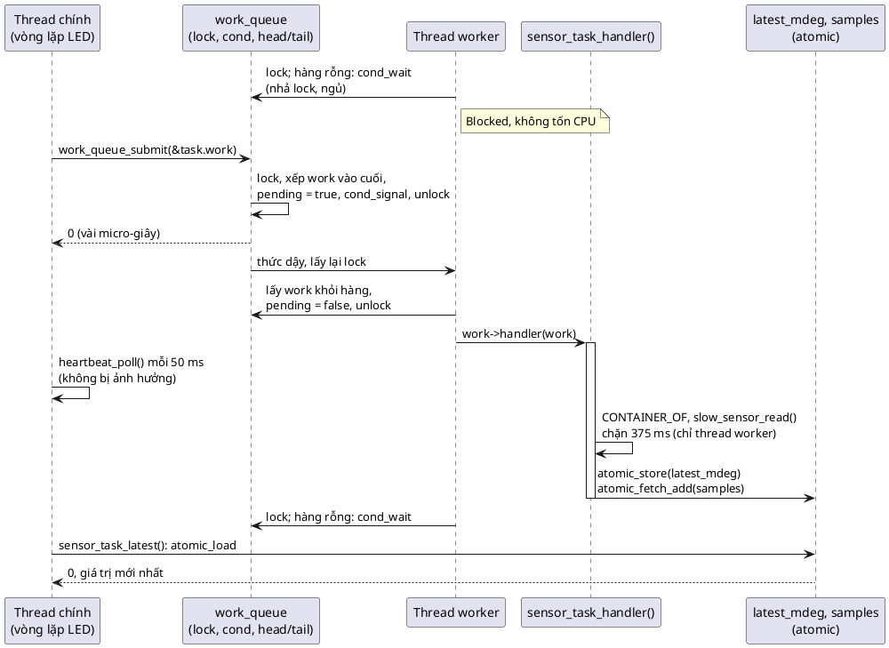

**`work_queue_stop`:**

```c
	pthread_mutex_lock(&self->lock);
	self->running = false;
	pthread_cond_signal(&self->cond);
	pthread_mutex_unlock(&self->lock);

	pthread_join(self->thread, NULL);
```

Đặt cờ dừng (trong lock), đánh thức worker, rồi `pthread_join` **chờ** thread worker kết thúc hẳn. Sau `join`, mọi thứ thread worker đã ghi (như `executed`) đều nhìn thấy được từ thread chính: `join` là một điểm đồng bộ.

### 12.7. [inc/sensor_task.h](inc/sensor_task.h) và [src/sensor_task.c](src/sensor_task.c)

```c
struct sensor_task {
	struct work work;
	struct slow_sensor *sensor;
	_Atomic int32_t latest_mdeg;
	atomic_uint samples;
	atomic_uint errors;
};
```

- `struct work work` là **member**, không phải con trỏ: cấp phát `sensor_task` là có luôn work item, không cần `malloc` lúc chạy.
- Ba field kết quả là **atomic** (C11 `<stdatomic.h>`): được thread worker ghi và thread chính đọc. Không cần khóa vì mỗi field là **một** giá trị độc lập.

```c
static void sensor_task_handler(struct work *work)
{
	struct sensor_task *self = CONTAINER_OF(work, struct sensor_task, work);
	int32_t mdeg;

	if (slow_sensor_read(self->sensor, &mdeg) < 0) {
		atomic_fetch_add(&self->errors, 1u);
		return;
	}
	/* Ghi giá trị trước, tăng bộ đếm sau: ai thấy samples > 0 thì đã có giá trị */
	atomic_store(&self->latest_mdeg, mdeg);
	atomic_fetch_add(&self->samples, 1u);
}
```

- Chạy trên **thread worker**. Được phép chặn 375 ms ở đây, vì nó chỉ chặn thread này.
- **Thứ tự** ghi có chủ đích: `latest_mdeg` trước, `samples` sau. Thread chính kiểm tra `samples > 0` rồi mới đọc `latest_mdeg`. 💡 Các thao tác atomic mặc định của C11 dùng thứ tự bộ nhớ mạnh nhất (`memory_order_seq_cst`), nên thread nào thấy `samples` đã tăng thì chắc chắn thấy `latest_mdeg` mới. Với biến thường, compiler và CPU được phép đảo thứ tự hai lần ghi này.
- ⚠️ Giới hạn: nếu sau này cần thêm `timestamp` đi cùng `latest_mdeg`, hai atomic riêng lẻ **không đủ**: thread chính có thể đọc được nhiệt độ mới với thời điểm cũ. Lúc đó cần mutex (bài 13). Đây đúng là bảng ở mục 6.5.

```c
int sensor_task_latest(struct sensor_task *self, int32_t *out_mdeg_c)
{
	...
	if (atomic_load(&self->samples) == 0) {
		return -EAGAIN;
	}
	*out_mdeg_c = atomic_load(&self->latest_mdeg);
	return 0;
}
```

Không chặn: chưa có mẫu nào thì trả `-EAGAIN` (bài 9) thay vì chờ.

### 12.8. [main.c](main.c)

**Demo 1** đã đọc ở mục 7.2. **Demo 2** khác demo 1 đúng ở một chỗ:

```c
		if (systime_reached(now, next_sample)) {
			next_sample += SAMPLE_PERIOD_MS;
			int ret = work_queue_submit(&wq, &task.work); /* không chặn */

			if (ret < 0) {
				return -1;
			}
			if (ret == 1) {
				already_pending++; /* lần đọc trước chưa xong: bỏ qua, không xếp chồng */
			}
		}
```

Thay vì gọi `slow_sensor_read` (chặn 375 ms), thread chính gọi `work_queue_submit` (vài µs) rồi quay lại lo LED. Xử lý giá trị trả về đúng ba vùng của bài 9.

```c
	static struct work_queue wq;
```

`static` để object work queue nằm ở `.bss`. Thread worker giữ con trỏ `self` tới nó trong suốt thời gian sống, nên object **phải sống lâu hơn thread**. Ở đây `work_queue_stop` + `join` được gọi trước khi hàm return, nên biến cục bộ cũng an toàn; `static` là thói quen phòng thủ cho object được thread khác tham chiếu.

```c
		systime_sleep_ms(1); /* "WFI": nhường CPU tới tick kế tiếp */
```

Cả hai demo đều ngủ 1 ms mỗi vòng. Đây là bản PC của việc MCU chạy `WFI` khi không có việc: không đốt CPU vô ích (🔬 mục 7.3). Nhờ vậy hai demo **chỉ khác nhau ở chỗ gọi cảm biến**, so sánh mới công bằng.

**Demo 3** (race) đã phân tích ở mục 6.3. Chú ý `run_pair` kiểm tra giá trị trả về của `pthread_create` (bài 9) và `join` thread đầu nếu thread thứ hai tạo không được, để không bỏ rơi thread nào.

---

## 13. Theo dõi demo chạy từng bước

Output đầy đủ của `make run` (lần chạy dùng cho bài giảng):

```
== Demo 1: superloop, sensor read inside the loop ==
  LED timeline (1 char = 50 ms): .......###.......###.......###.......###
  toggles: 12 (expected ~39), late: 4, worst gap: 400 ms
  sensor samples: 4, last = 21875 m°C

== Demo 2: same loop, sensor read moved to a work queue thread ==
  LED timeline (1 char = 50 ms): .#######################################
  toggles: 39 (expected ~39), late: 0, worst gap: 51 ms
  sensor samples: 4, last = 21875 m°C, work items run: 4, skipped (already pending): 0

== Demo 3: two threads, 1000000 increments each ==
  plain counter : 1070741 (lost 929259 updates)
  atomic counter: 2000000
```

🔬 Mình chạy thêm 5 lần: demo 1 và demo 2 ra **đúng y hệt** các con số trên ở cả 5 lần (riêng `worst gap` của demo 2 có một lần là 56 ms thay vì 51 ms). Demo 3 thay đổi mỗi lần: số lần tăng bị mất từ **866 644** đến **959 694**.

### Demo 1: superloop (t tính bằng ms từ lúc bắt đầu)

| t (xấp xỉ) | Việc đang làm | LED | Ghi chú |
|---|---|---|---|
| 0 | `next_sample = 0` đã tới: gọi `slow_sensor_read`, **chặn** | | `next_sample` thành 500 |
| 0 → 377 | Đứng trong `systime_sleep_ms(375)` | không đổi | Hạn đảo LED (t = 50) đã qua từ lâu |
| ~377 | `heartbeat_poll`: đã quá hạn, đảo LED | bật | `interval` = 377, `late` = 1; ô 7 = `#`; hạn kế = 427 |
| ~427, ~477 | Đảo LED đúng hạn | tắt, bật | Ô 8, 9 = `#` |
| ~500 | `next_sample = 500` tới: đọc cảm biến, chặn | | `next_sample` thành 1000 |
| ~877 | Đảo LED | tắt | `interval` = 877 − 477 = **400** = `worst gap`; `late` = 2 |
| ... | Lặp lại ở t ≈ 1000 và 1500 | | `late` = 3, 4 |
| 2000 | Hết giờ | | 12 lần đảo, 4 mẫu, giá trị cuối 21500 + 3 × 125 = 21875 |

`timeline` khớp đúng bảng: ô 0–6 là `.` (đang chặn), ô 7–9 là `###`, rồi 7 ô `.`...

### Demo 2: work queue

| t (xấp xỉ) | Thread chính | Thread worker | LED |
|---|---|---|---|
| 0 | `work_queue_start`; `submit` → `0` (đã xếp) | Thức dậy, lấy work, `pending = false`, chạy handler: chặn 375 ms | |
| 50, 100, ..., 350 | Đảo LED đúng hạn | Vẫn đang chặn trong `slow_sensor_read` | đều đặn |
| ~375 | | Handler xong: `latest_mdeg` = 21500, `samples` = 1; quay lại ngủ chờ việc | |
| 500 | `submit` → `0` (lần trước đã xong nên `pending` là `false`) | Thức dậy, đọc lần 2 | đều đặn |
| 1000, 1500 | `submit` → `0` | Đọc lần 3, 4 | đều đặn |
| 2000 | Hết giờ: `work_queue_stop`: `running = false`, signal, `join` | Lần đọc thứ 4 đã xong từ t ≈ 1875; thấy hàng rỗng + `running == false`: thoát | |
| | In: 39 lần đảo, 0 trễ, 4 mẫu, `executed` = 4, `already_pending` = 0 | | |

`already_pending` = 0 vì mỗi lần đọc mất 375 ms, ngắn hơn chu kỳ 500 ms. Nếu cảm biến chậm hơn chu kỳ (ví dụ 12-bit: 750 ms), sẽ có những lần `submit` trả `1` (Bài tập 2).

Ô 0 của `timeline` là `.` ở cả hai demo vì lần đảo đầu tiên đúng hạn rơi vào t = 50, tức ô 1.

### Demo 3: data race

| Bước | `plain_counter` | `atomic_counter` |
|---|---|---|
| Hai thread `inc_plain` chạy song song, mỗi thread 1 000 000 lần | Hai lõi tranh nhau đọc-cộng-ghi; mỗi lần chen nhau mất một (hoặc nhiều) lần tăng | |
| `join` cả hai | 1 070 741 (lần chạy này) | |
| Hai thread `inc_atomic` chạy song song | | Mỗi `atomic_fetch_add` là một lệnh `lock add` |
| `join` cả hai | | 2 000 000, luôn đúng |

---

## 14. Các quyết định thiết kế và phương án khác

### 14.1. Bốn cách giải bài toán "việc chậm chặn việc gấp"

| Cách | Ý tưởng | Ưu | Nhược |
|---|---|---|---|
| **Work queue** (code mẫu) | Đẩy việc chậm sang thread của hàng đợi | Một stack cho nhiều việc; việc trong hàng không chen nhau; driver giữ nguyên kiểu chặn | Việc chậm làm trễ các việc xếp sau (mục 10.3) |
| **Thread riêng** | Một thread chỉ để đọc cảm biến, vòng lặp `read`, `sleep(500)` | Không ảnh hưởng ai; ưu tiên riêng | Tốn một stack; dữ liệu dùng chung cần đồng bộ |
| **State machine không chặn** | Driver tách thành `start()` + `poll()` trả `-EAGAIN` | **Không cần RTOS**, không cần thread, ít RAM | Code tuần tự thành nhiều trạng thái; mọi driver phải viết lại |
| **Ngắt + DMA** | Phần cứng tự làm, ngắt báo khi xong | Nhanh nhất, CPU rảnh hoàn toàn | Chỉ khi phần cứng hỗ trợ; vẫn cần chỗ xử lý kết quả ngoài ISR |

🔬 Mình viết thử cách **state machine** với cùng cảm biến 375 ms, cùng LED 50 ms, không có thread nào:

```c
#include <errno.h>
#include <stdbool.h>
#include <stdint.h>
#include <stdio.h>

#include "heartbeat.h"
#include "systime.h"

/*
 * Cùng cảm biến 375 ms, nhưng driver viết kiểu không chặn: start() ra lệnh đo
 * rồi về ngay, poll() trả -EAGAIN cho tới khi đo xong. Không cần thread.
 */
struct nb_sensor {
	bool busy;
	uint32_t done_at_ms;
	int32_t sim_mdeg;
};

static int nb_sensor_start(struct nb_sensor *self, uint32_t now_ms)
{
	if (self->busy) {
		return -EBUSY;
	}
	self->busy = true;
	self->done_at_ms = now_ms + 375u;
	return 0;
}

static int nb_sensor_poll(struct nb_sensor *self, uint32_t now_ms, int32_t *out_mdeg_c)
{
	if (!self->busy) {
		return -EINVAL;
	}
	if (!systime_reached(now_ms, self->done_at_ms)) {
		return -EAGAIN; /* chưa xong: quay lại sau, KHÔNG đứng chờ ở đây */
	}
	self->busy = false;
	*out_mdeg_c = self->sim_mdeg;
	self->sim_mdeg += 125;
	return 0;
}

int main(void)
{
	struct heartbeat hb;
	struct nb_sensor sensor = { false, 0, 21500 };
	uint32_t now = systime_ms();
	uint32_t start = now;
	uint32_t next_sample = now;
	unsigned samples = 0;
	int32_t mdeg = 0;

	if (heartbeat_init(&hb, 50, now) < 0) {
		return 1;
	}

	while (!systime_reached(now = systime_ms(), start + 2000u)) {
		if (heartbeat_poll(&hb, now) < 0) {
			return 1;
		}
		if (systime_reached(now, next_sample) && nb_sensor_start(&sensor, now) == 0) {
			next_sample += 500u;
		}
		if (sensor.busy && nb_sensor_poll(&sensor, now, &mdeg) == 0) {
			samples++;
		}
		systime_sleep_ms(1);
	}

	printf("LED timeline (1 char = 50 ms): %.40s\n", hb.timeline);
	printf("toggles: %u, late: %u, worst gap: %u ms, samples: %u, last = %ld m°C\n",
	       (unsigned)hb.toggles, (unsigned)hb.late, (unsigned)hb.max_interval_ms, samples,
	       (long)mdeg);
	return 0;
}
```

Build: `gcc -std=c11 -Wall -Wextra -Werror -pedantic -Iinc state_machine.c src/heartbeat.c src/systime.c`. Output thật (2 lần chạy giống nhau):

```
LED timeline (1 char = 50 ms): .#######################################
toggles: 39, late: 0, worst gap: 51 ms, samples: 4, last = 21875 m°C
```

Kết quả **tốt y như work queue**, không cần thread nào. 📖 Sách cũng đưa state machine vào phần Alternatives (mục 18). Cái giá là driver: `slow_sensor_read` ba dòng tuần tự giờ thành hai hàm và một trạng thái `busy`/`done_at_ms`. Với một cảm biến thì chấp nhận được; với chuỗi "gửi lệnh AT, chờ OK, gửi tiếp, chờ phản hồi, xử lý lỗi, thử lại" thì state machine phình rất nhanh. Đó là lúc thread/work queue cho code dễ đọc hơn.

💡 Chú ý: `nb_sensor_poll` cũng dùng `-EAGAIN` của bài 9 đúng nghĩa *"chưa xong, quay lại sau"*.

### 14.2. Handler chạy ngoài lock

Đã giải thích ở mục 12.6. Nếu gọi `work->handler(work)` khi còn giữ `lock`, thread chính sẽ bị chặn tới 375 ms mỗi lần `submit`, và LED giật trở lại. Đây là lỗi rất phổ biến khi mới viết code có khóa.

### 14.3. `submit` trả `1` thay vì xếp chồng

Khi work đang chờ trong hàng mà bị `submit` lần nữa, có ba lựa chọn: xếp thêm một bản (không được: một `struct work` chỉ có một `next`, không thể nằm hai chỗ trong danh sách), trả lỗi, hoặc trả trạng thái "đã có sẵn". Code mẫu chọn cách cuối, giống ngữ nghĩa của Zephyr: việc đọc cảm biến sắp chạy rồi, đọc thêm lần nữa ngay sau đó là vô ích.

### 14.4. Atomic thay vì mutex cho kết quả

Kết quả là hai giá trị độc lập (`latest_mdeg`, `samples`), mỗi cái một atomic là đủ và rẻ hơn mutex. Quy tắc ngón tay cái: **một biến độc lập → atomic; nhiều biến phải nhất quán với nhau → mutex** (bài 13).

### 14.5. Vì sao không dùng `<threads.h>` của C11

C11 có thư viện thread chuẩn (`thrd_create`, `mtx_lock`...), nhưng đó là phần **tùy chọn** của chuẩn, và hỗ trợ trên các toolchain không đồng đều. pthread có mặt trên mọi PC (Windows qua winpthreads, Linux qua glibc), và 💡 Zephyr cũng có lớp tương thích POSIX. Trên MCU, bạn sẽ dùng API của RTOS (`k_thread_create`, `xTaskCreate`).

### 14.6. Một vòng lặp chính vẫn còn tồn tại

Demo 2 vẫn có vòng lặp `while` trong thread chính lo LED. Có thể đi xa hơn: LED thành một work item định kỳ (Zephyr: `k_work_delayable`), thread chính chỉ khởi tạo rồi ngủ. Code mẫu giữ vòng lặp để demo 1 và demo 2 khác nhau **đúng một dòng**, dễ so sánh.

---

# Phần D — Thực tế và tổng kết

## 15. Trên RTOS thật: Zephyr và FreeRTOS

💡 Toàn bộ mục này là kiến thức chung. Các đoạn code là **phác thảo, không build** trên PC (cần SDK của Zephyr/FreeRTOS); mình không chạy chúng trên phần cứng.

### 15.1. Bảng đối chiếu

| Khái niệm | Code mẫu (PC) | Zephyr | FreeRTOS |
|---|---|---|---|
| Thời gian | `systime_ms()` | `k_uptime_get_32()` | `xTaskGetTickCount()` |
| Ngủ | `systime_sleep_ms()` | `k_msleep()` | `vTaskDelay()` |
| Tạo thread | `pthread_create` | `K_THREAD_DEFINE` / `k_thread_create` | `xTaskCreate` / `xTaskCreateStatic` |
| Work item | `struct work` | `struct k_work` | (không có sẵn; dùng timer service task hoặc queue) |
| Submit | `work_queue_submit` | `k_work_submit` (gọi được từ ISR) | `xTimerPendFunctionCallFromISR` |
| Work queue hệ thống | `wq` tự tạo | System work queue, có sẵn | Timer service (daemon) task |
| Biến atomic | `<stdatomic.h>` | `atomic_t`, `atomic_inc()` | (dùng critical section) |
| Tick | Windows: 15,625 ms (🔬) | `CONFIG_SYS_CLOCK_TICKS_PER_SEC` | `configTICK_RATE_HZ` |

### 15.2. Demo 2 viết bằng Zephyr

```c
/* Phác thảo Zephyr, không build trên PC */
#include <zephyr/kernel.h>
#include <zephyr/drivers/gpio.h>

struct sensor_task {
	struct k_work work;
	const struct device *sensor;
	atomic_t latest_mdeg;
};

static struct sensor_task task;

static void sensor_work_handler(struct k_work *work)
{
	struct sensor_task *self = CONTAINER_OF(work, struct sensor_task, work);
	int32_t mdeg;

	if (slow_sensor_read(self->sensor, &mdeg) == 0) {
		atomic_set(&self->latest_mdeg, mdeg);
	}
}

/* Thread riêng cho LED: time domain 50 ms */
static void heartbeat_thread(void *p1, void *p2, void *p3)
{
	for (;;) {
		gpio_pin_toggle_dt(&led);
		k_msleep(50);
	}
}
K_THREAD_DEFINE(heartbeat_tid, 512, heartbeat_thread, NULL, NULL, NULL, 5, 0, 0);

int main(void)
{
	k_work_init(&task.work, sensor_work_handler);
	for (;;) {
		k_work_submit(&task.work); /* chạy trên system work queue */
		k_msleep(500);
	}
	return 0;
}
```

Các điểm đáng chú ý:
- Không có vòng lặp polling LED nữa: LED là một thread nhỏ (stack 512 byte) ngủ bằng `k_msleep(50)`. Khi mọi thread đều ngủ, kernel cho CPU vào `WFI`.
- `K_THREAD_DEFINE` tạo thread **lúc build** (stack cấp phát tĩnh), đúng tinh thần "cấp phát lúc compile" của bài 2.
- Trong Zephyr, system work queue mặc định có ưu tiên **cooperative** (số âm, `CONFIG_SYSTEM_WORKQUEUE_PRIORITY` mặc định −1), main thread ưu tiên 0: đúng thứ tự ở mục 10.4. Vì là cooperative, work item không bị thread khác chen ngang, nên càng phải ngắn. Với việc chặn 375 ms như cảm biến này, firmware thật nên tạo một work queue riêng (`k_work_queue_start`) như đã nói ở mục 10.3.

### 15.3. Những gì mô phỏng trên PC không tái hiện được

| Hiện tượng trên MCU | PC (demo) | Hệ quả cho bài học |
|---|---|---|
| Thread ưu tiên cao **luôn** chen ngang thread thấp ngay lập tức | Windows có ưu tiên nhưng không đảm bảo real-time; demo không đặt ưu tiên | Không thấy được "đảo ưu tiên" (priority inversion), bài 13 sẽ nói lý thuyết |
| Một lõi: chỉ một thread chạy tại một thời điểm | 16 luồng chạy song song thật | Race ở mục 6 lộ ra **nhanh hơn nhiều** so với MCU (mục 6.4 cho thấy trên một lõi bug trốn kỹ thế nào) |
| Ngắt phần cứng chen ngang code bất kỳ lúc nào | Không có ngắt; "phần cứng giả" là một thread | ISR chỉ được minh họa bằng sơ đồ và phác thảo |
| `WFI` giảm dòng tiêu thụ thật | Đo bằng thời gian CPU (🔬 mục 7.3) | Chỉ thấy được CPU rảnh, không đo được mA |
| Stack thread vài trăm byte, tràn là hỏng RAM | Stack mặc định cỡ MB (🔬 file `.exe` của demo khai báo `SizeOfStackReserve = 0x200000` = 2 MB cho thread chính) | Không cảm nhận được áp lực RAM của nhiều thread |

---

## 16. Test code có concurrency

### 16.1. Tách logic ra khỏi thread: test tất định

Lời khuyên quan trọng nhất: **viết phần logic sao cho không biết gì về thread và thời gian thật**, rồi test nó như code thường. `heartbeat_poll` nhận `now_ms` qua tham số chính là vì vậy:

```c
#include <assert.h>
#include <stdint.h>
#include <stdio.h>

#include "heartbeat.h"

/*
 * heartbeat_poll nhận thời gian qua tham số thay vì tự đọc đồng hồ, nên test
 * điều khiển được "thời gian" và chạy tất định, không cần thread hay sleep.
 */
int main(void)
{
	struct heartbeat hb;

	assert(heartbeat_init(&hb, 50, 1000) == 0);
	assert(heartbeat_poll(&hb, 1049) == 0);  /* chưa tới hạn */
	assert(heartbeat_poll(&hb, 1050) == 1);  /* đúng hạn */
	assert(hb.led_on && hb.late == 0);

	assert(heartbeat_poll(&hb, 1500) == 1);  /* bị chặn 450 ms */
	assert(hb.late == 1 && hb.max_interval_ms == 450);
	assert(heartbeat_poll(&hb, 1520) == 0);  /* hẹn lại từ 1500, không đảo bù */

	/* Bộ đếm ms tràn qua 0xFFFFFFFF vẫn đúng nhờ so sánh hiệu có dấu */
	assert(heartbeat_init(&hb, 50, 0xFFFFFFF0u) == 0);
	assert(heartbeat_poll(&hb, 0x00000010u) == 0); /* mới 32 ms */
	assert(heartbeat_poll(&hb, 0x00000022u) == 1); /* 50 ms */

	assert(heartbeat_poll(NULL, 0) < 0);
	printf("heartbeat tests passed\n");
	return 0;
}
```

Build: `gcc -std=c11 -Wall -Wextra -Werror -pedantic -Iinc test_heartbeat.c src/heartbeat.c`. 🔬 Output thật:

```
heartbeat tests passed
```

Test chạy trong vài micro-giây, kết quả **luôn giống nhau**, và kiểm tra được cả trường hợp bộ đếm tràn sau 49 ngày, thứ mà không ai chờ được trong test thật.

### 16.2. Test phần có thread: stress test và giới hạn của nó

Phần work queue thì phải test với thread thật. Cách thông dụng là **stress test**: chạy rất nhiều lần, nhiều thread, tải lớn, rồi kiểm tra bất biến (ví dụ: số work đã chạy = số lần submit trả `0`).

Nhưng 🔬 mục 6.4 đã cho thấy giới hạn: trên một lõi, với 1 000 000 lần tăng, **6/6 lần chạy đều đúng**, dù code có race. Test qua không chứng minh được là không có race. Vì vậy:
- Chạy stress test trên máy **nhiều lõi** (race lộ ra nhanh hơn), và với tải **lớn** hơn thực tế.
- Review code theo câu hỏi: *biến này có bị hơn một luồng (thread hoặc ISR) truy cập không? Nếu có, nó được bảo vệ bằng gì?*
- 💡 Dùng công cụ phát hiện race như ThreadSanitizer (`-fsanitize=thread`) trên Linux. 🔬 Trên toolchain MSYS2 UCRT64 này, nó **không dùng được**: link báo `cannot find -ltsan`.

---

## 17. Trade-off

📖 Sách: *"Concurrency has the main drawback of complexity followed by memory usage. Both of which are very easy to deal with."*

| Nhược điểm (📖) | Sách nói | 💡 Ghi chú thêm |
|---|---|---|
| **Complexity** | Phải lo primitive đồng bộ, thread và cả ngắt. *"But this is how our hardware works and this is also how our physical world works."* Độ phức tạp này là cần thiết để vượt qua giới hạn phần cứng bằng phần mềm (như tạo vô số software timer từ một hardware timer) | 🔬 Mục 6: chỉ một biến dùng chung không bảo vệ là mất gần nửa số lần tăng |
| **Memory** | Một scheduler real-time có thể implement trong **10–20 KB Flash**. Sách khuyên: MCU có **từ 128 KB Flash** thì nên dùng concurrency vì code sẽ đơn giản và phản hồi nhanh hơn; ít hơn thì scheduler chiếm quá nhiều chỗ của logic ứng dụng. *"Unless you are trying to write firmware for devices with ridiculously little space, you should always use an RTOS"* | Ngoài Flash còn **RAM**: mỗi thread một stack (thường 512 B – vài KB) cộng TCB. 10 thread × 1 KB = 10 KB RAM, đáng kể trên MCU 32 KB RAM. Work queue giúp tiết kiệm (mục 10.3) |
| **Performance** | Chuyển ngữ cảnh tốn thời gian; nhiều thread quá thì chậm vì chuyển ngữ cảnh liên tục. Phải quản lý ưu tiên để giảm số lần chuyển | Xem thí nghiệm dưới |

### 🔬 Chuyển ngữ cảnh tốn bao nhiêu (trên PC)

Hai thread chuyền lượt cho nhau 20 000 lần qua mutex + condition variable (mỗi vòng = 2 lần chuyển thread):

```c
#define _POSIX_C_SOURCE 200809L
#include <pthread.h>
#include <stdio.h>
#include <time.h>

#define ROUNDS 20000

static pthread_mutex_t lock = PTHREAD_MUTEX_INITIALIZER;
static pthread_cond_t cond = PTHREAD_COND_INITIALIZER;
static int turn; /* 0: lượt của main, 1: lượt của thread kia */

static void *pong(void *arg)
{
	(void)arg;
	for (int i = 0; i < ROUNDS; i++) {
		pthread_mutex_lock(&lock);
		while (turn != 1) {
			pthread_cond_wait(&cond, &lock);
		}
		turn = 0;
		pthread_cond_signal(&cond);
		pthread_mutex_unlock(&lock);
	}
	return NULL;
}

int main(void)
{
	pthread_t t;
	struct timespec t0, t1;

	pthread_create(&t, NULL, pong, NULL);
	clock_gettime(CLOCK_MONOTONIC, &t0);
	for (int i = 0; i < ROUNDS; i++) {
		pthread_mutex_lock(&lock);
		turn = 1;
		pthread_cond_signal(&cond);
		while (turn != 0) {
			pthread_cond_wait(&cond, &lock);
		}
		pthread_mutex_unlock(&lock);
	}
	clock_gettime(CLOCK_MONOTONIC, &t1);
	pthread_join(t, NULL);

	double us = ((double)(t1.tv_sec - t0.tv_sec) * 1e6 + (double)(t1.tv_nsec - t0.tv_nsec) / 1e3);
	printf("%d round trips: %.1f us per round trip (2 thread switches)\n", ROUNDS, us / ROUNDS);
	return 0;
}
```

Output thật (3 lần chạy):

```
20000 round trips: 26.3 us per round trip (2 thread switches)
20000 round trips: 34.6 us per round trip (2 thread switches)
20000 round trips: 38.7 us per round trip (2 thread switches)
```

Khoảng **13–19 µs** cho mỗi lần đánh thức và chuyển thread trên Windows (gồm cả việc đi vào kernel của hệ điều hành). So với **vài µs** của `work_queue_submit`, đó là chi phí đáng kể nếu một hệ thống chuyển thread hàng chục nghìn lần mỗi giây. 💡 Trên Cortex-M với RTOS, một lần chuyển ngữ cảnh thường chỉ cỡ vài trăm chu kỳ CPU (vài µs ở 100 MHz), nhưng nguyên tắc giống nhau: chuyển thread không miễn phí. Mình không đo con số này trên MCU.

### Bảng tổng hợp

| Tiêu chí | Superloop | Superloop + state machine | Thread / work queue (RTOS) |
|---|---|---|---|
| Việc chậm chặn việc gấp | **Có** (🔬 12/39) | Không | Không (🔬 39/39) |
| Code tuần tự, dễ đọc | Có | **Không** | Có |
| Flash cho scheduler | 0 | 0 | 📖 10–20 KB |
| RAM | Một stack | Một stack | Một stack **mỗi thread** |
| Tiêu thụ điện khi chờ | Tốn nếu polling | Tốn nếu polling | Thấp: ngủ `WFI` khi không có thread nào sẵn sàng |
| Race condition | Chỉ với ISR | Chỉ với ISR | Với ISR **và** giữa các thread |
| Thêm tính năng mới | Phải xem lại thời gian của mọi thứ | Thêm một state machine | Thêm một work item / thread |

---

## 18. Các phương án thay thế và khi nào không dùng thread

📖 Sách nêu hai phương án thay thế:

**1. Interrupt driven concurrency.** 📖 Bộ điều khiển ngắt đã cho phép lồng các việc có ưu tiên khác nhau, nên concurrency đơn giản có thể làm chỉ bằng ngắt. *"However, such concurrency is extremely limited because it does not gives us a way to jump to an arbitrary location at any given time."* (Mục 4.4.)

**2. State machines.** 📖 State machine chạy-tới-khi-xong (run to completion) là một hướng khác, có thể dùng cùng thread để phần mềm tin cậy hơn, *"because a state machine can be mathematically proven"*. Nhược điểm lớn nhất: state machine phải chạy tới khi xong; muốn chen ngang thì vẫn cần một scheduler thông thường. 🔬 Mục 14.1 cho thấy một state machine nhỏ giải được bài toán của demo mà không cần thread.

### Khi nào **không** cần thread

💡 Lời khuyên "luôn dùng RTOS" của sách là quan điểm của tác giả cho MCU từ 128 KB Flash. Superloop (có ngắt, có ngủ `WFI`) vẫn là lựa chọn tốt khi:
- MCU rất nhỏ (8–32 KB Flash, vài KB RAM): không đủ chỗ cho scheduler và nhiều stack.
- Mọi việc đều **ngắn** và không chờ IO lâu (đọc ADC, điều khiển PWM, đọc nút): superloop phục vụ kịp tất cả.
- Firmware cần chứng nhận an toàn, và mô hình "một luồng + ngắt" dễ phân tích thời gian xấu nhất hơn.
- Chỉ có **một** việc chậm: một state machine nhỏ (mục 14.1) rẻ hơn cả một RTOS.

Và khi đã có RTOS, **không** tạo thread mới khi:
- Việc ngắn, chạy thỉnh thoảng: dùng work item.
- Việc chỉ là "chuyển dữ liệu từ tầng này lên tầng kia": xem lỗi thứ hai ở mục 19.

---

## 19. Lỗi hay gặp

### 19.1. 📖 Tự viết scheduler

📖 *"Do not reinvent the scheduler: You should be using an existing scheduler/RTOS like Zephyr. Do not try to invent your own scheduling. This problem has been thoroughly solved many many times since the concept first appeared in 1980s. Any solution that you implement yourself will be a nightmare to maintain."*

💡 Work queue trong code mẫu là để **học** cơ chế bên trong. Trên firmware thật, dùng `k_work` của Zephyr: nó đã xử lý những thứ code mẫu bỏ qua (gọi từ ISR, hủy work, work có hẹn giờ, nhiều hàng đợi, ưu tiên).

### 19.2. 📖 Dùng thread làm tầng trừu tượng

📖 *"one of the worst misuses of software concurrency is using threads as ways of "layering abstractions". For example, you have a uart 'low level thread' which reads characters and places lines into a queue. Then you have your main application thread reading from that 'line queue'. This is abstraction layering and it is almost always a mistake. The intermediate thread is completely unnecessary and just wastes resources. Threads are for 'time domain separation' - not for layering abstractions."*

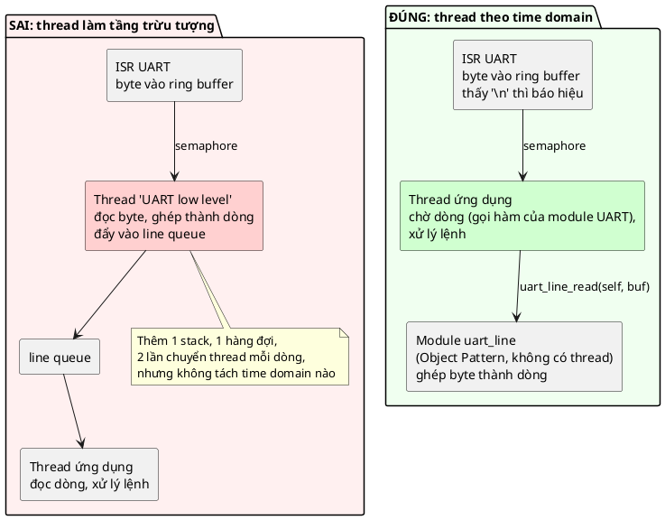

💡 Vì sao thread giữa là thừa: "ghép byte thành dòng" không có khoảng chờ nào **độc lập** với việc xử lý dòng. Thread ứng dụng đằng nào cũng phải chờ có dòng mới làm tiếp được. Tầng trừu tượng là việc của **module** (Object Pattern, bài 1: một `struct uart_line` với hàm `uart_line_read`), không phải việc của **thread**.

### 19.3. Các lỗi khác

| Lỗi | Hậu quả | Cách tránh |
|---|---|---|
| Biến dùng chung giữa thread/ISR không bảo vệ | Mất cập nhật (🔬 mục 6: mất ~900 000/2 000 000) | Atomic cho một biến; khóa cho nhiều biến (bài 11, 13) |
| Tin rằng `volatile` là đủ | Vẫn race (🔬 biến `volatile` trong demo vẫn mất) | `volatile` cho thanh ghi phần cứng; atomic/khóa cho đồng bộ |
| Tin rằng "một lệnh máy là nguyên tử" | 🔬 `add [mem], 1` ở `-O2` vẫn mất ~600 000 lần | Dùng `atomic_*` |
| Chạy việc chậm trong ISR (I2C, `printf`, ghi flash) | Chặn mọi ngắt ưu tiên thấp hơn và mọi thread | 📖 ISR chỉ nạp/xả phần cứng, phần còn lại đẩy sang work queue |
| Gọi API không an toàn cho ISR từ ISR (mutex, `malloc`, `printf`) | Treo, hỏng heap | Chỉ dùng API ghi rõ "ISR-safe" (`k_sem_give`, `k_work_submit`) |
| Gọi việc chậm khi đang giữ khóa | Thread khác bị chặn theo (mục 14.2) | Giữ khóa ngắn nhất có thể, *"lock data - not code"* |
| Việc chậm trong system work queue | Mọi work item khác bị trễ | Work queue riêng hoặc thread riêng (mục 10.3) |
| Quá nhiều thread | Tốn RAM cho stack, tốn thời gian chuyển ngữ cảnh (🔬 13–19 µs mỗi lần trên PC) | Một thread cho mỗi time domain, việc nhỏ dùng work item |
| Stack thread quá nhỏ | Tràn stack, ghi đè RAM khác, bug ngẫu nhiên | Đo mức dùng stack thật (Zephyr: `CONFIG_THREAD_ANALYZER`) |
| Đồng bộ bằng `sleep` ("chờ 10 ms chắc thread kia xong rồi") | Đúng trên bàn thử, sai khi tải thay đổi | Dùng semaphore/condition variable (bài 12, 14) |
| Polling một cờ trong vòng lặp bận | Tốn CPU, tốn điện (🔬 mục 7.3) | Chờ bằng primitive chặn |
| So sánh thời gian bằng `now >= deadline` | Sai khi bộ đếm tràn (sau ~49 ngày với ms 32-bit) | `(int32_t)(now - deadline) >= 0` (mục 12.2) |
| Test qua là tin không có race | 🔬 Một lõi, tải nhỏ: 6/6 lần đúng dù có race | Review luồng truy cập dữ liệu; stress test nhiều lõi |
| Truy cập object từ hai thread mà không có "chủ" | Race ẩn trong field tưởng vô hại (`self->reads` ở mục 12.3) | Mỗi object một thread sở hữu, hoặc có khóa riêng |

---

## 20. Quy trình refactor superloop sang time domain

1. **Liệt kê mọi việc** trong vòng lặp chính, kèm: mất bao lâu, có chờ IO không, deadline là bao nhiêu.
2. **Đo** trước khi sửa: ghi lại độ trễ xấu nhất của việc gấp (như `worst gap` của heartbeat). Không đo thì không biết refactor có hiệu quả không.
3. **Tìm các việc chặn** (chờ cảm biến, chờ phản hồi, `delay_ms`). Đó là ứng viên đầu tiên.
4. **Nhóm thành time domain** (mục 10.1): các chuỗi thao tác có chờ đợi và độc lập về thời gian.
5. Với mỗi time domain, chọn: **work item** (ngắn, thỉnh thoảng), **work queue riêng** (chậm, cần tuần tự với nhau), **thread riêng** (vòng đời dài, ưu tiên riêng), hoặc **state machine** (không có RTOS, chỉ một việc chậm).
6. **Làm gọn ISR**: chuyển mọi logic ứng dụng ra khỏi ISR, chỉ để lại phần nạp/xả phần cứng + báo hiệu.
7. **Tìm mọi dữ liệu dùng chung** giữa các luồng mới (thread–thread, thread–ISR). Với mỗi cái: một biến độc lập → atomic; nhiều biến → khóa; tốt nhất là đổi thiết kế để mỗi object chỉ có một thread sở hữu.
8. **Xếp ưu tiên** theo mục 10.4.
9. **Đo lại** độ trễ của việc gấp, so với bước 2.
10. Tách logic thuần (như `heartbeat_poll`) ra để **test tất định**; stress test phần có thread trên máy nhiều lõi.

---

## 21. Câu hỏi thường gặp (FAQ)

**Hỏi: MCU chỉ có một lõi thì làm sao có "đồng thời"?**

Đồng thời (concurrency) không cần song song (parallelism). Một lõi xen kẽ rất nhanh giữa các việc, và quan trọng hơn: khi một việc **chờ**, lõi làm việc khác. 📖 Với hệ một CPU, concurrency *"simply ensures that we can manage the CPU as a resource"*. Song song thật chỉ có ở phần cứng (peripheral, DMA) và ở MCU nhiều lõi.

**Hỏi: MCU một lõi thì có cần lo race condition không?**

Có. Ngắt có thể chen vào giữa chuỗi đọc-cộng-ghi bất cứ lúc nào, và scheduler preemptive có thể đổi thread ở đó. 🔬 Mục 6.4: trên một lõi race hiếm hơn nhưng mỗi lần xảy ra có thể mất cả triệu lần cập nhật. Chương Spinlock của sách bắt đầu đúng bằng ví dụ ISR và `main` cùng sửa một biến.

**Hỏi: Interrupt và thread khác nhau thế nào?**

| | Interrupt (ISR) | Thread |
|---|---|---|
| Ai kích hoạt | Phần cứng | Scheduler |
| Ai chuyển ngữ cảnh | Phần cứng (8 thanh ghi tự động) | Phần mềm (PendSV) |
| Stack | Dùng stack của ngắt / code bị ngắt | Stack riêng |
| Được ngủ/chờ không | **Không** | Có |
| Ưu tiên | Luôn cao hơn mọi thread | Do RTOS xếp |
| Dùng cho | Nạp/xả phần cứng, báo hiệu | Logic ứng dụng, chuỗi thao tác có chờ |

**Hỏi: Work queue và thread, chọn cái nào?**

Mặc định chọn **work item** trên system work queue cho việc ngắn (📖 *"an excellent way to avoid creating unnecessary threads"*). Chọn **thread riêng** khi việc có vòng đời dài với nhiều lần chờ (một phiên Bluetooth), cần ưu tiên riêng, hoặc chặn lâu (không được làm trễ system work queue).

**Hỏi: Có cần RTOS để có concurrency không?**

Không. Ngắt đã là concurrency (tầng 2). Superloop + ngắt + state machine cũng giải được nhiều bài toán (🔬 mục 14.1). RTOS cho thêm tầng 3: thread, chờ chặn, software timer không giới hạn. 📖 Sách khuyên dùng RTOS cho MCU từ 128 KB Flash.

**Hỏi: Vì sao `volatile` vẫn cần, nếu nó không làm phép tính thành nguyên tử?**

`volatile` dùng cho **thanh ghi phần cứng** và biến mà compiler không thấy được ai sửa (cờ do ISR đặt và vòng lặp đọc). Nó ngăn compiler tối ưu bỏ lần đọc. Nhưng chỉ `volatile` thì không đủ cho đồng bộ: dùng atomic hoặc khóa (mục 6.5).

**Hỏi: Thread ở trạng thái Blocked có tốn gì không?**

Không tốn CPU. Nó chỉ tốn RAM: stack và TCB của nó vẫn nằm đó. 🔬 Mục 7.3: chờ bằng `pthread_cond_wait` tốn 0,00 s CPU trong 1 giây chờ.

**Hỏi: Tại sao work item không được chạy lâu, trong khi thread thì được?**

Vì nhiều work item **dùng chung** một thread và chạy **lần lượt**. Một work item chạy 375 ms là mọi work item khác (của mọi module trong firmware) phải chờ 375 ms. Thread riêng thì chỉ chặn chính nó.

**Hỏi: Async/await có liên quan gì?**

📖 Sách nói async/await *"are based internally on a work queue and the work queue is executed by a thread"*. 💡 Nói cách khác, mỗi đoạn code giữa hai lần `await` là một work item, và runtime xếp hàng chúng. Hiểu work queue là hiểu được cơ chế bên dưới.

---

## 22. Tóm tắt và checklist

**Một câu:** *Concurrency là chia phần mềm thành các luồng thực thi theo thời gian (time domain), để scheduler (dựa trên ngắt và timer phần cứng) quyết định CPU chạy gì lúc nào, thay vì mọi đoạn code tự quyết; cái giá là phải đồng bộ dữ liệu dùng chung.*

**Vì sao nó chạy được:** mọi dạng concurrency đều là lưu và khôi phục ngữ cảnh (thanh ghi + stack). Ngắt làm việc đó bằng phần cứng nhưng chỉ nhảy được theo bảng vector cố định; scheduler làm bằng phần mềm (PendSV) nên nhảy được tới bất kỳ thread nào đang chờ.

Checklist khi thiết kế firmware có concurrency:

- [ ] Đã liệt kê các chuỗi thao tác có chờ đợi và nhóm thành **time domain**
- [ ] Mỗi thread ứng với một time domain, không có thread nào chỉ để "chuyển dữ liệu giữa hai tầng"
- [ ] Việc ngắn dùng work item, không tạo thread mới
- [ ] Việc chặn lâu không nằm trong system work queue
- [ ] ISR chỉ nạp/xả phần cứng và báo hiệu (submit work, give semaphore)
- [ ] ISR chỉ gọi API được ghi là an toàn cho ISR
- [ ] Ưu tiên: ISR > work queue > main > các thread khác
- [ ] Mọi dữ liệu dùng chung giữa các luồng đều đã được liệt kê và bảo vệ (atomic / khóa), hoặc có một thread sở hữu duy nhất
- [ ] Không giữ khóa khi làm việc chậm
- [ ] Không đồng bộ bằng `sleep`, không polling cờ bằng vòng lặp bận
- [ ] So sánh thời gian bằng hiệu có dấu
- [ ] Logic thuần tách khỏi thread để test tất định
- [ ] Dùng scheduler/work queue có sẵn của RTOS, không tự viết

---

## 23. Quiz (có đáp án)

Câu 1–4 là quiz gốc của sách (trắc nghiệm; sách không in đáp án, đáp án dưới đây là của mình kèm lý do). Câu 5–12 do Claude thêm.

**Câu 1.** 📖 Lý do chính khiến concurrency dựa trên ngắt không đủ linh hoạt để viết ứng dụng tầng cao là gì? Nó có những giới hạn nào?
1. Concurrency dựa trên ngắt chỉ nhảy tới chỗ khác khi nhận được sự kiện. Nó không nhảy được bằng một lệnh phần mềm.
2. Concurrency dựa trên ngắt chỉ phù hợp cho ngắt.
3. Ngắt không thể có độ ưu tiên.

<details><summary>Đáp án</summary>

**1.** Phần cứng chỉ chuyển ngữ cảnh khi có tín hiệu ngắt, và chỉ theo hai hướng cố định: vào handler theo bảng vector, rồi ra về đúng chỗ bị ngắt. 📖 *"We can not for instance jump dynamically after an interrupt is finished to another location where more work needs to be done"*. Ngoài ra không được ngủ/chờ trong ISR. Phương án 3 sai: NVIC có ưu tiên và lồng ngắt (mục 4.3). Phương án 2 không nói gì.
</details>

**Câu 2.** 📖 Software concurrency giúp tận dụng CPU tối đa mà không phải thay đổi lớn cấu trúc code bằng cách nào?
1. Cho phép code kích hoạt ngắt bất cứ lúc nào và làm việc trong handler.
2. Cho phép đưa mỗi CPU nhảy tới bất kỳ chỗ nào trong code khi cần, không phải chờ việc hiện tại chạy xong.
3. Ngăn CPU lãng phí chu kỳ bằng cách cho nó ngủ.

<details><summary>Đáp án</summary>

**2.** Scheduler lưu ngữ cảnh của thread đang chạy và nạp ngữ cảnh của bất kỳ thread nào khác (mục 5.3). Nhờ vậy code vẫn viết **tuần tự** (không phải biến thành state machine), và khi nó chờ IO, CPU nhảy sang chỗ khác. 📖 *"adds the ability to jump dynamically to any location in the software (switch context) in response to hardware events"*. Phương án 3 là một lợi ích phụ (ngủ khi không thread nào sẵn sàng), không phải cơ chế chính. Phương án 1 là mô tả của interrupt concurrency.
</details>

**Câu 3.** 📖 Thông thường nên xếp độ ưu tiên thế nào để linh hoạt nhất?
1. Main thread ưu tiên cao nhất, system work queue thấp nhất, ngắt ở giữa.
2. Ngắt cao nhất, system work queue là thread ưu tiên cao nhất, rồi main thread, rồi các thread khác.
3. System work queue cao nhất, rồi ngắt, rồi main thread, rồi các thread khác.

<details><summary>Đáp án</summary>

**2.** Ngắt luôn cao hơn mọi thread (phần cứng quyết định, nên phương án 1 và 3 không thể đúng: không thread nào chen ngang được ngắt). Work queue ngay dưới ngắt vì nó là "nửa sau" của ISR: việc ISR đẩy sang cần được làm sớm (mục 10.4). Hệ quả: work item phải ngắn.
</details>

**Câu 4.** 📖 Chuyện gì xảy ra với một interrupt handler đang chạy nếu một ngắt **ưu tiên thấp hơn** được kích hoạt?
1. Handler hiện tại bị chen ngang, ngắt kia chạy, rồi quay lại handler hiện tại.
2. Handler hiện tại chạy tới khi xong, rồi ngắt đang chờ mới chạy.
3. Nếu ngắt kia bị tắt tín hiệu trước khi handler hiện tại xong thì nó không bao giờ chạy.

<details><summary>Đáp án</summary>

**2.** Chỉ ngắt ưu tiên **cao hơn** mới chen ngang được (mục 4.3, sơ đồ timing: ngắt ADC ưu tiên 7 phải chờ). Ngắt thấp hơn chuyển sang trạng thái pending. 💡 Về phương án 3: trên NVIC của Cortex-M, khi ngắt đã vào trạng thái pending thì trạng thái đó được giữ lại (latch) cho tới khi handler được vào hoặc phần mềm xóa, nên tắt tín hiệu sau đó không làm mất ngắt. (Nếu tín hiệu tắt **trước** khi NVIC kịp ghi nhận thì là chuyện khác; và peripheral có thể tự xóa cờ của nó. Đây là chi tiết phụ thuộc phần cứng mà mình không kiểm chứng trên chip thật.)
</details>

**Câu 5.** Vì sao biến `volatile long plain_counter` trong demo 3 vẫn mất gần một nửa số lần tăng?

<details><summary>Đáp án</summary>

`volatile` chỉ ngăn compiler bỏ hoặc gộp các lần đọc/ghi; nó không làm chuỗi **đọc-cộng-ghi** thành không thể chen ngang. Hai thread trên hai lõi cùng đọc một giá trị, cùng cộng 1, cùng ghi: một lần tăng mất (mục 6.2). 🔬 Kể cả ở `-O2`, khi phép tăng là **một** lệnh `add [mem], 1`, vẫn mất khoảng 600 000 lần, vì lệnh đó không có tiền tố `lock`. Sửa: `atomic_fetch_add` (sinh ra `lock add`) hoặc khóa.
</details>

**Câu 6.** Một đồng nghiệp chạy test race trên board một lõi 100 lần, đều qua. Anh kết luận code không có race. Bạn trả lời thế nào?

<details><summary>Đáp án</summary>

Test qua không chứng minh được không có race. 🔬 Mục 6.4: trên một lõi với 1 000 000 lần tăng, 6/6 lần đều đúng; với 100 000 000 lần thì mất 30–53 triệu. Race chỉ lộ ra khi việc chen ngang rơi đúng vào giữa đọc và ghi, mà điều đó phụ thuộc thời điểm ngắt, tải, tốc độ... Phải review xem biến nào bị nhiều luồng truy cập và được bảo vệ bằng gì; chạy stress test trên máy nhiều lõi với tải lớn; dùng công cụ như ThreadSanitizer nếu có.
</details>

**Câu 7.** Vì sao thread worker phải **nhả lock trước khi gọi handler**?

<details><summary>Đáp án</summary>

Handler có thể chạy lâu (375 ms trong demo). Nếu giữ lock trong lúc đó, mọi thread gọi `work_queue_submit` (cần cùng lock) sẽ bị chặn tới khi handler xong, và thread chính lại không lo được LED: quay về đúng vấn đề của superloop. Nguyên tắc: giữ khóa ngắn nhất có thể, chỉ quanh phần **dữ liệu** dùng chung (hàng đợi), không quanh **code** chậm.
</details>

**Câu 8.** Firmware có nút bấm nối qua GPIO expander I2C (PCF8574). Expander kéo chân INT xuống khi có nút đổi trạng thái. Bạn đặt code đọc expander ở đâu?

<details><summary>Đáp án</summary>

ISR của chân INT chỉ ghi nhận sự kiện và `submit` một work item. Work item (trên work queue) mới đọc expander qua I2C, so với trạng thái trước, phát sự kiện nút bấm. Lý do: đọc I2C mất thời gian và có thể phải chờ bus, không được làm trong ISR. 📖 Đây đúng là ví dụ của sách: *"If your task is above the lowest level of abstraction (ie a GPIO operating over an I2C gpio expander) then you need to defer this work into the system work queue or another thread."*
</details>

**Câu 9.** Một team tạo ba thread cho UART: thread A đọc byte từ driver ghép thành dòng, đẩy vào queue; thread B đọc dòng, tách lệnh, đẩy vào queue thứ hai; thread C thực thi lệnh. Nhận xét?

<details><summary>Đáp án</summary>

Đây là lỗi "dùng thread làm tầng trừu tượng" mà 📖 sách gọi là *"one of the worst misuses of software concurrency"*. Ba bước đó không có khoảng chờ độc lập với nhau: không tách được time domain nào. Kết quả là thêm hai stack, hai queue, và nhiều lần chuyển thread cho mỗi dòng, mà không được gì. Đúng: ISR đưa byte vào ring buffer và báo hiệu khi có dòng; **một** thread (hoặc work item) gọi các module `uart_line`, `cmd_parser` (Object Pattern) để ghép dòng, tách lệnh, thực thi.
</details>

**Câu 10.** Vì sao `nanosleep(1 ms)` trên máy Windows dùng cho bài này ngủ khoảng 15,8 ms? Điều đó liên quan gì tới RTOS?

<details><summary>Đáp án</summary>

Bộ lập lịch của Windows mặc định chạy theo tick 15,625 ms (64 Hz). Thread ngủ chỉ được đánh thức ở tick kế tiếp, nên mọi lần ngủ ngắn bị làm tròn lên (🔬 mục 5.5: 100 lần ngủ 1 ms mất 1583 ms). RTOS cũng vậy: độ mịn của `k_msleep` phụ thuộc `CONFIG_SYS_CLOCK_TICKS_PER_SEC`. Đây là ý 📖 *"at the core it is always the hardware that makes scheduling possible"*: scheduler chỉ mịn bằng timer phần cứng điều khiển nó.
</details>

**Câu 11.** Trong `sensor_task`, `latest_mdeg` và `samples` là hai biến atomic riêng. Nếu thêm `timestamp_ms` (thời điểm đo), có nên làm nó atomic thứ ba không?

<details><summary>Đáp án</summary>

Không đủ. Mỗi atomic chỉ đảm bảo **một** biến không bị đọc dở. Thread chính có thể đọc `latest_mdeg` của lần đo mới và `timestamp_ms` của lần đo cũ (thread worker ghi xen giữa hai lần đọc). Khi nhiều biến phải **nhất quán với nhau**, cần khóa chúng cùng nhau (mutex, bài 13), hoặc gói chúng thành một struct và trao đổi qua cơ chế khác (hàng đợi message). Đây là dòng cuối của bảng ở mục 6.5.
</details>

**Câu 12.** Superloop của bạn chỉ có một việc chậm: đọc cảm biến 375 ms. MCU có 32 KB Flash. Bạn có chuyển sang RTOS không?

<details><summary>Đáp án</summary>

Không nhất thiết. 📖 Sách cho rằng scheduler tốn 10–20 KB Flash, quá nhiều cho MCU 32 KB, và khuyên RTOS cho MCU từ 128 KB. Với một việc chậm duy nhất, viết driver theo kiểu không chặn (state machine `start` + `poll` trả `-EAGAIN`) là đủ: 🔬 mục 14.1 cho kết quả 39/39 lần đảo LED, giống hệt work queue, không cần thread nào. Khi số chuỗi thao tác có chờ đợi tăng lên (Bluetooth, Modbus...) và state machine bắt đầu phình, lúc đó mới cân nhắc lại.
</details>

---

## 24. Bài tập

### Bài 1: Thêm nút bấm vào demo (cơ bản)

Thêm một module `struct button` (Object Pattern) giả lập nút bấm: mỗi 120 ms "người dùng" bấm một lần (dùng `systime_ms()` để quyết định). Hàm `int button_poll(struct button *self, uint32_t now_ms)` trả `1` nếu phát hiện một lần bấm mới.
- Gọi `button_poll` trong vòng lặp của cả demo 1 và demo 2, đếm số lần bấm phát hiện được.
- So sánh: demo 1 bỏ lỡ bao nhiêu lần bấm? Demo 2 thì sao? Ghi số liệu đo thật.
- **Câu hỏi suy nghĩ:** trên MCU thật, nút bấm thường được nối với ngắt EXTI. Khi đó demo 1 còn bỏ lỡ lần bấm không? Còn vấn đề gì khác?

### Bài 2: Cảm biến chậm hơn chu kỳ (cơ bản)

Đổi `SLOW_SENSOR_CONVERSION_MS` thành 750 (DS18B20 12-bit), giữ chu kỳ lấy mẫu 500 ms.
- Chạy lại demo 2. `skipped (already pending)` bằng bao nhiêu? Giải thích bằng một bảng thời gian giống mục 13.
- Có lần nào work bị xếp hai lần không? Vì sao không?
- **Câu hỏi suy nghĩ:** nếu đổi `work_queue_submit` thành luôn xếp thêm (bỏ cờ `pending`, cấp phát work mới mỗi lần), chuyện gì xảy ra sau vài phút?

### Bài 3: Sửa race bằng nhiều cách (refactor)

Trong một file riêng (scratch), lấy demo 3 và sửa biến đếm thường theo ba cách: (a) `atomic_long`, (b) `pthread_mutex` quanh `counter++`, (c) mỗi thread đếm vào biến cục bộ rồi cộng vào biến chung **một lần** cuối cùng (có khóa).
- Đo thời gian chạy của mỗi cách (dùng `clock_gettime`). Ghi số liệu thật.
- **Câu hỏi suy nghĩ:** cách (c) nhanh nhất vì sao? Nó liên quan gì tới lời khuyên "dữ liệu thuộc về một thread sở hữu"?

### Bài 4: Work item có hẹn giờ (nâng cao)

Mở rộng work queue với `struct delayed_work` và hàm `int work_queue_schedule(struct work_queue *self, struct delayed_work *dw, uint32_t delay_ms);`: work chỉ được chạy sau `delay_ms`.
- Gợi ý: thread worker dùng `pthread_cond_timedwait` để vừa chờ work mới vừa chờ hạn gần nhất.
- Dùng nó để biến LED nhịp tim thành một delayed work tự lên lịch lại mỗi 50 ms; thread chính chỉ còn khởi tạo rồi ngủ.
- Viết test cho phần tính "hạn gần nhất" theo kiểu tất định (truyền `now_ms` vào, như `heartbeat_poll`).
- **Câu hỏi suy nghĩ:** đây chính là "software timer" mà sách nói (📖 *"infinite number of software timers using only one hardware timer"*). Hardware timer ở đây là gì?

### Bài 5: Phân tích firmware của bạn (thiết kế)

Lấy một firmware bạn từng viết (hoặc đang làm). Lập bảng như mục 10.1: liệt kê các chuỗi thao tác, khoảng chờ, nhịp, deadline. Xác định các time domain, việc nào nên là work item, việc nào cần thread riêng, việc nào nên ở lại ISR. Liệt kê mọi dữ liệu dùng chung giữa các luồng và cách bạn sẽ bảo vệ chúng (sẽ dùng lại ở bài 11–14).

Làm xong bài nào thì gõ `/review-exercise 10_ConcurrencyPattern` để Claude review.
