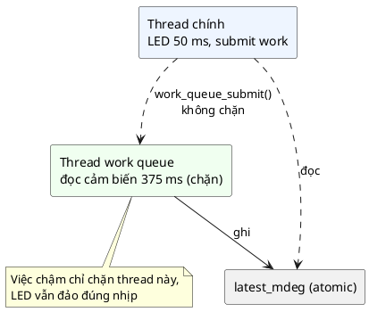

# 10 — Concurrency Pattern

📖 Bài giảng chi tiết: [LECTURE.md](LECTURE.md). File này là ghi chú tóm tắt, bám theo chương *Concurrency Pattern* của sách.

## Overview

Concurrency là công cụ thiết kế giúp phần mềm tận dụng CPU để kịp mọi deadline mà không bỏ lỡ sự kiện trong lúc làm việc phức tạp. Quyết định "CPU chạy gì lúc nào" được dời khỏi code ứng dụng, giao cho scheduler (chạy bằng timer và ngắt phần cứng).

Mọi hệ thống có concurrency gồm ba phần: **scheduler**, **hỗ trợ phần cứng** (timer, ngắt), **đồng bộ** (spinlock, semaphore, mutex, condition variable). Ba tầng: **hardware** → **interrupt** → **software** (thread, work queue, async/await).

## Use Cases

- Nhường CPU trong lúc chờ IO.
- Tận dụng các peripheral chạy song song.
- Nhiều lõi CPU dùng chung peripheral/bộ nhớ.
- Ràng buộc real-time: phản ứng nhanh với sự kiện phần cứng mà không phải chờ việc đang chạy xong.

## Benefits

- Tiêu thụ điện thấp: không polling, CPU ngủ `WFI` khi không có việc.
- Tách việc theo **time domain**: code vẫn viết tuần tự.
- Nền tảng cho các pattern khác (event processor, async/await).
- Timeout và việc định kỳ không giới hạn từ một timer phần cứng.

## Drawbacks

- Phức tạp: đồng bộ, thread, ngắt.
- Bộ nhớ: scheduler 10–20 KB Flash (sách khuyên RTOS cho MCU từ 128 KB Flash); mỗi thread một stack.
- Hiệu năng: chuyển ngữ cảnh tốn thời gian.

## Implementation

Xem [inc/work_queue.h](inc/work_queue.h), [src/work_queue.c](src/work_queue.c), [inc/sensor_task.h](inc/sensor_task.h), [src/sensor_task.c](src/sensor_task.c), [main.c](main.c).

| Demo | Kết quả đo (2 giây, LED 50 ms) |
|---|---|
| 1. Superloop, đọc cảm biến trong vòng lặp | LED đảo 12/39 lần, khoảng trống lớn nhất 400 ms |
| 2. Đọc cảm biến trên thread work queue | LED đảo 39/39 lần, khoảng trống lớn nhất 51 ms |
| 3. Hai thread tăng chung một biến 1 000 000 lần | Biến thường mất ~870 000–960 000 lần tăng; biến atomic đúng 2 000 000 |

## Best Practices

- Tách thread theo **time domain** (chuỗi thao tác có chờ đợi cần xen kẽ), không theo tầng trừu tượng.
- Ngắt chỉ để nạp/xả phần cứng; logic ứng dụng đẩy sang work queue hoặc thread.
- Dùng **system work queue** thay vì tạo thread không cần thiết.
- Ưu tiên: ngắt > system work queue > main thread > các thread khác.

## Common Pitfalls

- Tự viết scheduler thay vì dùng RTOS có sẵn.
- Dùng thread làm tầng trừu tượng (thread "UART low level" đẩy dòng sang thread ứng dụng).
- Dữ liệu dùng chung không bảo vệ; tin rằng `volatile` hay "một lệnh máy" là nguyên tử.
- Việc chậm trong ISR hoặc trong system work queue; giữ khóa khi làm việc chậm.

## Alternatives

- **Concurrency chỉ bằng ngắt**: đơn giản nhưng không nhảy được tới chỗ tùy ý.
- **State machine chạy-tới-khi-xong**: chứng minh được, không cần RTOS, nhưng không chen ngang được và làm code tuần tự khó đọc.

## Quiz

1. Lý do chính khiến concurrency dựa trên ngắt không đủ linh hoạt cho ứng dụng tầng cao là gì?
2. Software concurrency giúp tận dụng CPU mà không phải đổi lớn cấu trúc code bằng cách nào?
3. Nên xếp độ ưu tiên thế nào để linh hoạt nhất?
4. Chuyện gì xảy ra với interrupt handler đang chạy nếu một ngắt ưu tiên thấp hơn được kích hoạt?

(Đáp án và 8 câu thêm trong [LECTURE.md](LECTURE.md#23-quiz-có-đáp-án).)

## Câu hỏi còn thắc mắc

-
