# Bài giảng 11 — Spinlock Pattern

> **Về nguồn:** Bài này bám theo chương *Spinlock Pattern* trong sách của Martin Schröder (bản 0.38.0, file `00_Document/Martin-Schroder-Design-Patterns-Spinlock-Pattern-0.38.0.pdf`).
> - 📖 đánh dấu nội dung **theo sách** (dịch và diễn giải lại).
> - 💡 đánh dấu phần **giải thích thêm**, không có trong sách.
> - 🔬 đánh dấu **thí nghiệm thật**: chương trình đã được build bằng gcc 16.2 (MSYS2 UCRT64, Windows 11 64-bit, CPU 16 luồng) và chạy; output in trong bài là output thật. Kết quả của các thí nghiệm về race **thay đổi mỗi lần chạy**, nên bài ghi lại nhiều lần chạy.

Code mẫu đi kèm: [inc/spinlock.h](inc/spinlock.h), [inc/arch_irq.h](inc/arch_irq.h), [inc/rx_ring.h](inc/rx_ring.h), [src/rx_ring.c](src/rx_ring.c), [inc/sim_cpu.h](inc/sim_cpu.h), [src/sim_cpu.c](src/sim_cpu.c), [main.c](main.c). Ghi chú ngắn: [README.md](README.md).
Bài trước: [10 — Concurrency](../10_ConcurrencyPattern/LECTURE.md). Bài sau: [12 — Semaphore](../12_SemaphorePattern/LECTURE.md). Liên quan: [01 — Object](../01_ObjectPattern/LECTURE.md), [02 — Opaque](../02_OpaquePattern/LECTURE.md) (pool chưa có khóa), [09 — Return Value](../09_ReturnValuePattern/LECTURE.md).

---

## Mục lục

**Phần A — Kiến thức nền**

1. [Bối cảnh: tầng thấp nhất của concurrency](#1-bối-cảnh-tầng-thấp-nhất-của-concurrency)
2. [Ngắt hoạt động thế nào](#2-ngắt-hoạt-động-thế-nào)
3. [Một dòng C là mấy lệnh máy: read-modify-write](#3-một-dòng-c-là-mấy-lệnh-máy-read-modify-write)
4. [Race condition, critical section, atomicity](#4-race-condition-critical-section-atomicity)
5. [Lệnh atomic của CPU: test-and-set và compare-and-swap](#5-lệnh-atomic-của-cpu-test-and-set-và-compare-and-swap)
6. [Compiler và CPU tự sắp xếp lại lệnh: barrier, acquire, release](#6-compiler-và-cpu-tự-sắp-xếp-lại-lệnh-barrier-acquire-release)
7. [Mô phỏng vi điều khiển trên PC: làm được gì, không làm được gì](#7-mô-phỏng-vi-điều-khiển-trên-pc-làm-được-gì-không-làm-được-gì)

**Phần B — Pattern**

8. [Vấn đề: dữ liệu dùng chung giữa main và ISR](#8-vấn-đề-dữ-liệu-dùng-chung-giữa-main-và-isr)
9. [Bước 1: che ngắt, và vì sao cần "key"](#9-bước-1-che-ngắt-và-vì-sao-cần-key)
10. [Giới hạn của che ngắt: nhiều core](#10-giới-hạn-của-che-ngắt-nhiều-core)
11. [Spinlock = che ngắt + CAS](#11-spinlock--che-ngắt--cas)
12. [Đặc điểm nhận dạng và các quy tắc](#12-đặc-điểm-nhận-dạng-và-các-quy-tắc)
13. [Vì sao phải che ngắt TRƯỚC khi quay](#13-vì-sao-phải-che-ngắt-trước-khi-quay)

**Phần C — Đọc code**

14. [Đọc code mẫu từng dòng](#14-đọc-code-mẫu-từng-dòng)
15. [Theo dõi demo chạy từng bước](#15-theo-dõi-demo-chạy-từng-bước)
16. [Các quyết định thiết kế và phương án khác](#16-các-quyết-định-thiết-kế-và-phương-án-khác)

**Phần D — Thực tế và tổng kết**

17. [Spinlock trên phần cứng và RTOS thật](#17-spinlock-trên-phần-cứng-và-rtos-thật)
18. [Chi phí: thời gian, độ trễ ngắt, bộ nhớ](#18-chi-phí-thời-gian-độ-trễ-ngắt-bộ-nhớ)
19. [Test code có spinlock](#19-test-code-có-spinlock)
20. [Trade-off](#20-trade-off)
21. [Khi nào không nên dùng, và các lựa chọn khác](#21-khi-nào-không-nên-dùng-và-các-lựa-chọn-khác)
22. [Lỗi hay gặp](#22-lỗi-hay-gặp)
23. [Quy trình refactor: từ `__disable_irq()` sang spinlock](#23-quy-trình-refactor-từ-__disable_irq-sang-spinlock)
24. [Câu hỏi thường gặp (FAQ)](#24-câu-hỏi-thường-gặp-faq)
25. [Tóm tắt và checklist](#25-tóm-tắt-và-checklist)
26. [Quiz (có đáp án)](#26-quiz-có-đáp-án)
27. [Bài tập](#27-bài-tập)

---

# Phần A — Kiến thức nền

Spinlock là pattern **ngắn nhất** trong sách (phần code chỉ khoảng 20 dòng), nhưng lại dựa vào nhiều kiến thức nhất về phần cứng: ngắt, lệnh máy, lệnh atomic, cache, thứ tự bộ nhớ. Đọc kỹ Phần A thì Phần B chỉ còn là ghép các mảnh lại.

## 1. Bối cảnh: tầng thấp nhất của concurrency

### 1.1. Nhìn lại các bài trước bằng code

**Bài 1 (Object)** cho ta cách đóng gói state vào struct. Một ring buffer nhận UART theo Object Pattern trông như sau:

```c
struct rx_ring {
	uint8_t buf[RX_RING_SIZE];
	size_t head;      /* vị trí ISR sẽ ghi tiếp */
	size_t tail;      /* vị trí main sẽ đọc tiếp */
	size_t count;     /* số byte đang nằm trong ring */
	uint32_t overrun; /* số byte phải bỏ vì ring đầy */
};

int rx_ring_put(struct rx_ring *self, uint8_t byte);   /* ISR gọi */
int rx_ring_get(struct rx_ring *self, uint8_t *out);   /* main gọi */
```

Bài 1 giả định ngầm một điều: **tại mỗi thời điểm chỉ có một đoạn code chạm vào object**. Với ring buffer ở trên, giả định đó sai: ISR gọi `rx_ring_put` bất cứ lúc nào có byte đến, kể cả khi main đang ở giữa `rx_ring_get`.

**Bài 2 (Opaque)** có một pool tĩnh, và bài giảng 02 (mục 10.3) đã ghi rõ nhược điểm: *"Chưa an toàn khi gọi từ nhiều thread: hai thread có thể cùng thấy slot 0 trống và cùng lấy nó (bài 11–13 sẽ giải quyết)."*

```c
struct uart *uart_pool_get(void)
{
	for (size_t i = 0; i < UART_POOL_SIZE; i++) {
		if (!uart_pool_used[i]) {        /* (1) thấy slot trống */
			uart_pool_used[i] = true;    /* (2) đánh dấu đã dùng */
			return &uart_pool[i];
		}
	}
	return NULL;
}
```

Giữa (1) và (2) có một khe hở. Bài này lấp khe hở đó (🔬 mục 23 chạy thử: không khóa thì hơn nửa triệu lần hai bên cùng giữ một slot, có spinlock thì 0).

**Bài 10 (Concurrency)** vẽ bức tranh tổng quát: 📖 concurrency có ba tầng, **hardware concurrency** (mọi peripheral chạy song song), **interrupt concurrency** (phần cứng chen ngang code bằng ngắt), và **software concurrency** (scheduler chuyển qua lại giữa các thread). Bài 10 cũng nói một hệ concurrent luôn có ba phần: scheduler, hỗ trợ phần cứng, và *"synchronization: spinlocks, semaphores, mutexes, conditional variables"*.

Bài 11 là phần đầu tiên của "synchronization", và nằm đúng ở ranh giới giữa tầng ngắt và tầng phần mềm. 📖 Câu mở đầu của chương:

> *"The most basic form of concurrency that is above the pure concurrency in hardware is the interrupt driven concurrency. This is the first place where an action happening in hardware is forwarded to software. This is also the first place where we need to deal with concurrency in our software."*
>
> *Dạng concurrency cơ bản nhất nằm ngay trên concurrency thuần phần cứng là concurrency do ngắt. Đây là nơi đầu tiên một sự kiện ở phần cứng được chuyển sang phần mềm, và cũng là nơi đầu tiên phần mềm phải đối phó với concurrency.*

### 1.2. Một dự án lớn dần: ring buffer UART qua năm lần sửa

💡 *Tình huống minh họa (không phải ví dụ trong sách), nhưng mỗi bước đều là lỗi có thật trong các dự án firmware. Các con số "bao lâu mới lộ" được đo bằng thí nghiệm ở mục 8 và 15.*

#### Tháng 1: modem 4G, mọi thứ có vẻ ổn

Một team làm bộ thu thập dữ liệu gửi qua modem 4G. MCU nói chuyện với modem bằng lệnh AT qua UART 115200 baud. ISR của UART đẩy từng byte vào `struct rx_ring` ở trên, main loop đọc ra, ghép thành dòng, khi gặp `'\n'` thì xử lý lệnh (`OK`, `+CSQ: 23,0`, ...). Code viết theo Object Pattern, chạy trên bàn thử mấy ngày không lỗi.

```c
/* ISR của UART */
void USART2_IRQHandler(void)
{
	rx_ring_put(&modem_rx, (uint8_t)USART2->DR);
}

/* main loop */
for (;;) {
	uint8_t byte;
	while (rx_ring_get(&modem_rx, &byte) == 0) {
		at_parser_feed(&parser, byte);
	}
	do_other_work();
}
```

(Đoạn này là code cho chip STM32 thật, cần header CMSIS của ST để build; trên PC, phần tương đương chạy được là demo 2 trong [main.c](main.c).)

#### Tháng 3: "thỉnh thoảng modem trả lời chậm"

Ngoài hiện trường, cứ vài giờ thiết bị lại báo timeout chờ `OK` từ modem, rồi đột nhiên nhận được `OK` khi lệnh **tiếp theo** được gửi. Log cho thấy byte `'\n'` cuối của câu trả lời "kẹt" trong ring buffer: `count` nói ring rỗng, nhưng byte vẫn nằm trong `buf`. Nó chỉ được đọc ra khi có byte mới đến đẩy `count` lên.

Nguyên nhân (mục 3 và 8 sẽ giải thích chi tiết): `rx_ring_get` đọc `count` vào thanh ghi, ISR chen vào giữa và tăng `count`, rồi `rx_ring_get` ghi đè `count` bằng giá trị cũ trừ 1. Lần tăng của ISR **biến mất**. 🔬 Mục 15 tái hiện đúng hiện tượng này: chạy 20 000 byte ba lần, kẹt lần lượt 4, 2 và 1 byte. Nó hiếm đến mức chạy trên bàn mấy ngày không thấy.

#### Tháng 4: bản sửa thứ nhất, `volatile`

Một bạn đọc trên mạng rằng "biến dùng chung với ISR phải là `volatile`", và thêm `volatile` vào `count`. Bug vẫn còn. 💡 `volatile` chỉ bắt compiler **thật sự** đọc/ghi bộ nhớ mỗi lần code nhắc tới biến (không giữ trong thanh ghi qua nhiều câu lệnh). Nó **không** làm cho "đọc, sửa, ghi" thành một bước không thể chen ngang. 🔬 Mục 5 cho thấy một "lock" viết bằng biến `volatile` vẫn để hai bên cùng vào vùng găng hàng trăm nghìn lần.

#### Tháng 5: bản sửa thứ hai, tắt ngắt

Bạn khác bọc `rx_ring_get` bằng `__disable_irq()` / `__enable_irq()` (hai hàm CMSIS, thực chất là lệnh `cpsid i` / `cpsie i`). Bug kẹt byte hết hẳn. Hai tuần sau, một bug mới: thỉnh thoảng một **struct log** bị hỏng. Hóa ra hàm `log_event()` cũng có cặp `__disable_irq()`/`__enable_irq()` bên trong, và nó được gọi từ **giữa** một vùng đã tắt ngắt khác. `__enable_irq()` của hàm con **mở ngắt luôn cho cả hàm cha**, và nửa sau vùng găng của hàm cha chạy mà không được bảo vệ.

🔬 Tái hiện bằng bộ mô phỏng (file `naive_enable.c` trong thí nghiệm, dùng `arch_irq_lock()` và `arch_irq_unlock(0)` của bài này để đóng vai `__disable_irq()`/`__enable_irq()`):

```
outer section start : irq locked=1
after log_event()   : irq locked=0  <- outer section is now unprotected
```

Đây là lý do sách nhấn mạnh cái **key** (mục 9).

#### Tháng 8: chuyển sang chip hai nhân

Để thêm xử lý tín hiệu, team chuyển sang một MCU **hai nhân** (ví dụ RP2040 hai Cortex-M0+, ESP32 hai nhân Xtensa, STM32H7 hai nhân M7 + M4). Ngắt UART giờ được xử lý trên nhân 1, còn main loop chạy trên nhân 0. Bug kẹt byte **quay lại**, và nặng hơn trước. Vì tắt ngắt trên nhân 0 **không làm nhân 1 dừng lại**: hai nhân chạy song song thật, cùng đọc/ghi `count`.

🔬 Mục 10 đo trên PC: hai CPU giả lập, mỗi bên cộng 1 triệu lần, chỉ dùng che ngắt, mất từ 135 000 tới 180 000 lần cộng.

#### Nhìn lại

| Tháng | Chuyện gì xảy ra | Bài học |
|---|---|---|
| 3 | ISR chen vào giữa read-modify-write của `count` | Dữ liệu chung giữa main và ISR cần **vùng găng** (critical section) |
| 4 | `volatile` không chữa được | `volatile` không phải công cụ đồng bộ |
| 5 | `__enable_irq()` lồng nhau mở ngắt quá sớm | Phải **lưu và khôi phục** trạng thái ngắt (key) |
| 8 | Hai nhân: tắt ngắt không còn đủ | Cần thêm **biến atomic** để các nhân loại trừ nhau |

Ghép ba bài học cuối lại: *che ngắt có lưu key, cộng với một biến atomic*, ta được đúng định nghĩa spinlock của sách.

### 1.3. Đọc kỹ định nghĩa của sách

📖 Sách định nghĩa:

> *"The interrupt masking pattern (or spinlock) is a way of safely managing concurrency at the level of interrupts. It also extends to concurrency between processor cores - from which the name "spinlock" originates (a core spins in a tight loop while another core keeps a resource busy)."*
>
> *Pattern che ngắt (hay spinlock) là cách quản lý concurrency một cách an toàn ở mức ngắt. Nó cũng mở rộng ra concurrency giữa các nhân xử lý, và cái tên "spinlock" sinh ra từ đó (một nhân quay trong một vòng lặp chặt trong lúc nhân khác đang giữ tài nguyên).*

Từng vế:

| Vế | Nghĩa là gì |
|---|---|
| *"interrupt masking pattern (or spinlock)"* | Sách coi "che ngắt" và "spinlock" là **cùng một pattern**. Trên chip một nhân, spinlock **chính là** che ngắt |
| *"safely managing concurrency at the level of interrupts"* | Đối tượng phục vụ là ranh giới **code thường ↔ ISR**, không phải thread ↔ thread |
| *"extends to concurrency between processor cores"* | Khi có nhiều nhân, thêm một phần nữa để các nhân loại trừ nhau |
| *"a core spins in a tight loop"* | Nhân đến sau **không ngủ**, không nhường CPU cho ai: nó quay vòng đọc một biến cho tới khi được |

📖 Và câu then chốt cho chip một nhân:

> *"In single core systems, the spinlock simply works as a mechanism for momentarily disabling interrupts in order to avoid concurrency conflicts in code."*
>
> *Trên hệ một nhân, spinlock đơn giản là cơ chế tắt ngắt trong chốc lát để tránh xung đột concurrency trong code.*

Chữ quan trọng là **"momentarily"** (trong chốc lát). Toàn bộ phần "lỗi hay gặp" của chương xoay quanh việc giữ spinlock quá lâu.

Viết gọn thành công thức:

> **Spinlock = che ngắt trên CPU hiện tại (có lưu key) + giành một biến atomic (chỉ khi nhiều nhân)**

### 1.4. Spinlock trong nhóm Concurrency

📖 Sách nói spinlock là *"the foundation for higher levels of concurrency"* và *"a foundation for semaphores, mutexes and all other primitives"*. Bốn bài 11–14 xếp chồng lên nhau như sau:

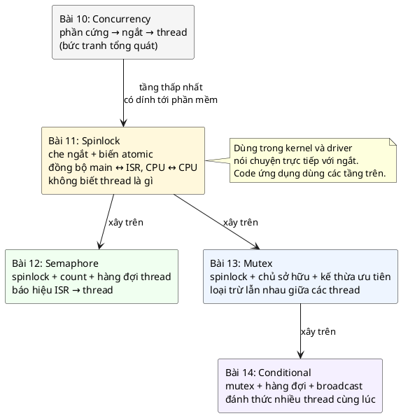

| | Spinlock (bài 11) | Semaphore (bài 12) | Mutex (bài 13) |
|---|---|---|---|
| Biết thread là gì? | **Không** | Có | Có |
| Dùng trong ISR? | **Có** | Chỉ give (và take không chờ) | Không |
| Người đến sau làm gì? | **Quay vòng** (không nhường CPU) | Ngủ trong hàng đợi | Ngủ trong hàng đợi |
| Che ngắt khi giữ? | **Có** | Chỉ trong chốc lát bên trong | Không |
| Mục đích | Bảo vệ dữ liệu chung với ISR / nhân khác | Báo hiệu | Bảo vệ dữ liệu chung giữa thread |

📖 Sách nói rõ phạm vi: *"You would never use spinlock in application code which does not directly interface with interrupts."* Trên Linux, spinlock *"exist (and make any kind of sense) only in the kernel"*. Code ứng dụng dùng các primitive tầng trên. Spinlock *"is almost never mentioned in materials on multi-threaded programming - even though it is always there"*.

💡 Với người làm firmware, "code nói chuyện trực tiếp với ngắt" lại rất nhiều: mọi driver có ISR đều thuộc loại này. Nên với dân embedded, spinlock không hề hiếm.

### 1.5. Câu hỏi bài này sẽ trả lời

1. Vì sao một dòng `x += 8;` lại có thể bị chen ngang? (mục 3)
2. Che ngắt giải quyết được gì, và vì sao phải có **key**? (mục 9)
3. Vì sao che ngắt **không đủ** khi có nhiều nhân, và CAS bù vào chỗ nào? (mục 10–11)
4. Vì sao thứ tự "che ngắt **rồi mới** quay" là bắt buộc? (mục 13)
5. Giữ spinlock lâu thì tốn gì? (mục 18)

---

## 2. Ngắt hoạt động thế nào

📖 Sách mở phần Implementation bằng việc ôn lại ngắt (exception): *"A modern CPU is able to automatically push registers to currently active stack and jump to the address specified in its interrupt vector table."*

### 2.1. Một lần ngắt, từng bước

💡 Trên Cortex-M3/M4, khi UART nhận một byte:

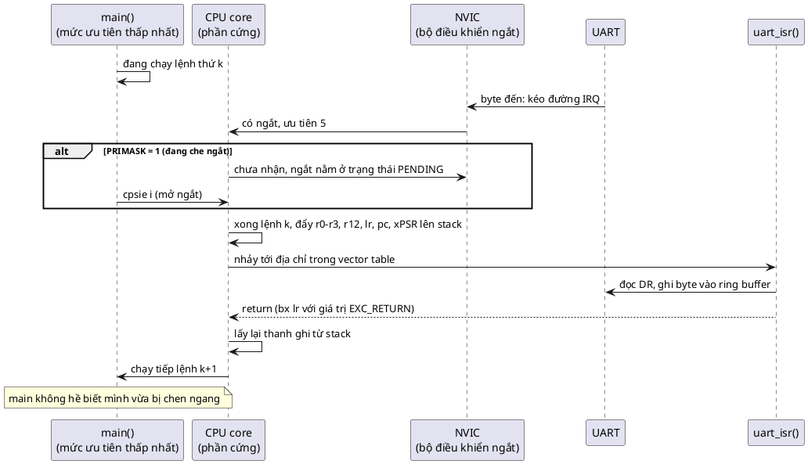

Ba điều cần nhớ:
1. **Ngắt chen vào giữa hai lệnh máy**, không phải giữa hai dòng C. Một dòng C thường là nhiều lệnh máy (mục 3).
2. **Phần cứng tự lưu và khôi phục thanh ghi.** Khi main chạy tiếp, mọi thanh ghi y như cũ. Nhưng **RAM** thì ISR có thể đã sửa.
3. **Ngắt bị che không mất**, nó chuyển sang trạng thái *pending* và chạy ngay khi được mở. 📖 *"Any exceptions that occur while exceptions are disabled will be handled once exceptions are enabled again if they are still pending by then."*

💡 Chú ý cụm *"if they are still pending by then"*: mỗi ngắt chỉ có **một bit pending**. UART nhận 3 byte trong lúc ngắt bị che thì vẫn chỉ có một lần ISR chạy, và nếu FIFO phần cứng chỉ chứa được 1 byte thì 2 byte đã mất (lỗi *overrun*). Đây là cái giá thật của việc che ngắt lâu (mục 18).

### 2.2. Ba công cụ phần cứng để "không bị chen ngang"

📖 Sách liệt kê ba tính năng gần như CPU nào cũng có:

| Tính năng | Tên trên ARM | Làm gì |
|---|---|---|
| Mặt nạ ngắt toàn cục | **PRIMASK** | 1 = không nhận ngắt nào (trừ vài exception hệ thống). Đặt bằng lệnh `cpsid i`, xóa bằng `cpsie i` |
| Mức ưu tiên ngắt | NVIC priority | 📖 Số **nhỏ** là ưu tiên **cao**. Ngắt ưu tiên 3 chỉ chạy sau khi các ngắt có số nhỏ hơn 3 đã xong |
| Ngưỡng ưu tiên | **BASEPRI** | 📖 Chặn các ngắt có ưu tiên **bằng hoặc thấp hơn** ngưỡng, các ngắt ưu tiên cao hơn vẫn chạy. Đặt 0 là tắt tính năng này |

📖 *"Normal application code can be thought to run at lowest interrupt priority."* Code thường giống như một "ngắt" có ưu tiên thấp nhất: ai cũng chen vào được.

📖 Dùng BASEPRI thay cho PRIMASK là cách *"an toàn để đồng bộ giữa code của ta và ngắt uart, mà vẫn giữ khả năng phản ứng nhanh với một ngắt khác cần xử lý ngay"*. Đổi lại, các ngắt ưu tiên cao hơn ngưỡng **không được** dùng chung dữ liệu với code thường, vì spinlock không chặn chúng. Sách gọi các ngắt tuân thủ quy tắc che ngắt là *"good citizens"*.

💡 Cortex-M0/M0+ (ARMv6-M) **không có BASEPRI**, chỉ có PRIMASK.

### 2.3. Vì sao chuyện này là "concurrency"

Trên chip một nhân, tại mỗi thời điểm chỉ có **một** lệnh máy được thực thi. Vậy sao gọi là concurrency? Vì hai **dòng chảy logic** (main và ISR) **xen kẽ** nhau ở mức lệnh máy, theo thời điểm do phần cứng quyết định, không do code quyết định. Với dữ liệu dùng chung, xen kẽ ở mức lệnh máy là đủ để hỏng (mục 3–4). Không cần hai nhân mới có race.

---

## 3. Một dòng C là mấy lệnh máy: read-modify-write

### 3.1. Ví dụ của sách

📖 Sách dùng ví dụ này:

```c
struct data {
	int foo;
};

static struct data data;

void interrupt_routine(void)
{
	data.foo += 5;
}

void data_user_code(struct data *self)
{
	self->foo += 8;
}
```

📖 Và disassembly ARM của `data_user_code` (build không tối ưu), phần cho dòng `self->foo += 8;`:

```
  40:   e51b3008        ldr     r3, [fp, #-8]
  44:   e5933000        ldr     r3, [r3]         ; đọc foo từ RAM vào r3
  48:   e2832008        add     r2, r3, #8       ; cộng trong thanh ghi
  4c:   e51b3008        ldr     r3, [fp, #-8]
  50:   e5832000        str     r2, [r3]         ; ghi kết quả về RAM
```

📖 *"We can see that the code that adds the numbers to the variable always involves at least three instructions: load, add and store."* Ngắt đến ở bất kỳ đâu giữa dòng 40 và 50, và nếu ISR cũng sửa `foo`, kết quả cuối cùng sai.

💡 Đây gọi là **read-modify-write** (RMW): đọc giá trị ra thanh ghi, sửa trong thanh ghi, ghi lại. Kiến trúc load/store như ARM **chỉ** tính toán được trong thanh ghi, nên mọi phép `+=`, `++`, `|=` trên biến trong RAM đều là ít nhất ba lệnh.

### 3.2. Chuyện gì xảy ra khi ISR chen vào giữa

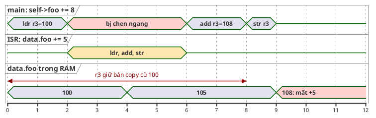

Main đã đọc 100 vào `r3` **trước** khi ISR chạy. ISR ghi 105 vào RAM, nhưng `r3` của main vẫn là 100 (phần cứng khôi phục nguyên thanh ghi, mục 2.1). Main cộng 8 thành 108 và ghi đè lên 105. Lần cộng 5 của ISR **biến mất** mà không ai báo lỗi. Đây gọi là **lost update**.

### 3.3. 🔬 Trên x86 thì sao? Một lệnh, nhưng chưa chắc đã an toàn

Mình build đúng đoạn code của sách bằng gcc trên PC (`gcc -O2 -S -masm=intel`):

```
"interrupt_routine":
	add	DWORD PTR "data"[rip], 5
	ret
"data_user_code":
	add	DWORD PTR [rcx], 8
	ret
```

Ở `-O2`, x86 làm `+= 8` bằng **một lệnh duy nhất** `add [mem], 8`, vì x86 cho phép cộng thẳng vào bộ nhớ. Còn ở `-O0`:

```
"data_user_code":
	...
	mov	eax, DWORD PTR [rax]      ; đọc
	lea	edx, 8[rax]               ; cộng
	mov	rax, QWORD PTR 16[rbp]
	mov	DWORD PTR [rax], edx      ; ghi
```

Lại là đọc, cộng, ghi tách rời, giống ARM.

Vậy với `-O2` trên x86 có an toàn không? Câu trả lời có **hai nửa**, và cả hai đều đã được đo:

1. 🔬 **Với ngắt trên cùng một nhân: an toàn.** Ngắt chỉ chen vào **giữa hai lệnh**, không chen vào giữa một lệnh. Chạy đúng code của sách trên bộ mô phỏng một nhân (mục 7), 10 000 ngắt, 3 lần:

    ```
    isr=10000 expected=640448272 actual=640448272 lost isr updates=0
    isr=10000 expected=784512240 actual=784512240 lost isr updates=0
    isr=10000 expected=652289624 actual=652289624 lost isr updates=0
    ```

2. 🔬 **Với hai nhân: không an toàn.** Lệnh `add [mem], 1` bên trong vẫn là đọc rồi ghi, chỉ là CPU làm giúp. Không có tiền tố `lock`, nhân kia chen vào giữa được. Mục 10 đo: mất từ 135 000 tới 180 000 trên 2 000 000 lần cộng.

💡 Bài học: **đừng dựa vào việc compiler "may mắn" sinh ra một lệnh**. Đổi cờ tối ưu, đổi compiler, đổi sang ARM là mất. Chuẩn C không hứa gì về chuyện `x += 8` là bao nhiêu lệnh.

Để demo trên PC giống Cortex-M, code mẫu ép PC làm đúng ba bước:

```c
/* Rào compiler: cấm gcc gộp load + store thành một lệnh "add [mem], n" của x86 */
#define COMPILER_BARRIER() __asm__ __volatile__("" ::: "memory")

static void add_like_cortex_m(int *p, int n)
{
	int v = *p;          /* ldr r3, [r2]      */
	COMPILER_BARRIER();
	v += n;              /* add r3, r3, #n    */
	*p = v;              /* str r3, [r2]      */
}
```

`COMPILER_BARRIER()` sẽ được giải thích ở mục 6. Ở đây chỉ cần biết: nó ngăn gcc gộp ba bước lại thành một lệnh.

---

## 4. Race condition, critical section, atomicity

Ba thuật ngữ dùng suốt bài:

- **Race condition** (tranh chấp): kết quả của chương trình phụ thuộc vào **thứ tự xen kẽ** giữa các dòng chảy, mà thứ tự đó không do code kiểm soát. Ví dụ ở mục 3.2: cùng một code, ngắt đến lúc này thì đúng, lúc kia thì sai.
- **Critical section** (vùng găng): đoạn code truy cập dữ liệu dùng chung, mà **trong lúc nó chạy không ai khác được chạm vào dữ liệu đó**. Trong `data_user_code`, vùng găng là ba lệnh `ldr, add, str`.
- **Atomic** (nguyên tử, không chia cắt được): một thao tác mà người khác chỉ có thể thấy "chưa xảy ra" hoặc "đã xong", không bao giờ thấy "đang làm dở".

Nhiệm vụ của spinlock: **biến một vùng găng thành một khối atomic** đối với mọi ngữ cảnh khác có chạm vào cùng dữ liệu.

💡 Ba điều kiện cần **cùng lúc** để có race:
1. Có dữ liệu **dùng chung** giữa ít nhất hai ngữ cảnh (main + ISR, hoặc hai nhân).
2. Ít nhất một bên **ghi**.
3. Các truy cập **không được sắp thứ tự** bởi cơ chế đồng bộ nào.

Phá được một điều kiện là hết race. Spinlock phá điều kiện 3. Các phương án ở mục 21 phá điều kiện 1 (mỗi bên một bản dữ liệu) hoặc biến truy cập thành atomic sẵn.

💡 Vì sao race khó tìm? Vì điều kiện thời gian rất hẹp. 🔬 Trong demo ring buffer (mục 15), cửa sổ nguy hiểm chỉ là 7 lệnh máy giữa lúc đọc và lúc ghi `count`. 20 000 ngắt, chỉ trúng 1 đến 4 lần. Chạy 3 lần, mỗi lần một kết quả khác. Bug kiểu này **qua được test**, rồi lộ ra ở hiện trường sau vài giờ.

---

## 5. Lệnh atomic của CPU: test-and-set và compare-and-swap

### 5.1. Thử tự làm lock bằng một biến thường

Ý tưởng tự nhiên nhất: một biến `locked`, ai thấy nó bằng 0 thì đặt thành 1 rồi vào.

```c
static volatile int locked;
static int counter;

static void naive_lock(void)
{
	while (locked) {
	}
	locked = 1; /* giữa lúc thấy 0 và lúc ghi 1, CPU kia cũng có thể thấy 0 */
}

static void naive_unlock(void)
{
	locked = 0;
}
```

🔬 Hai thread, mỗi thread 1 triệu lần `naive_lock(); counter++; naive_unlock();`, chạy 3 lần:

```
expected=2000000 actual=1000000 lost=1000000
expected=2000000 actual=1000000 lost=1000000
expected=2000000 actual=1000000 lost=1000000
```

Mất **đúng một nửa**, cả 3 lần. Con số đẹp đến đáng ngờ, nên mình xem assembly:

```
"worker":
	mov	edx, DWORD PTR "counter"[rip]     ; đọc counter MỘT LẦN, trước vòng lặp
	mov	eax, 1000000
.L2:
	mov	ecx, DWORD PTR "locked"[rip]
	test	ecx, ecx
	jne	.L2
	mov	DWORD PTR "locked"[rip], 1
	mov	DWORD PTR "locked"[rip], 0
	sub	eax, 1
	jne	.L2
	lea	eax, 1000000[rdx]                 ; counter + 1000000
	mov	DWORD PTR "counter"[rip], eax     ; ghi MỘT LẦN, sau vòng lặp
```

Compiler đã **kéo `counter++` ra khỏi vùng găng**: đọc một lần trước vòng lặp, cộng 1 000 000 một lần, ghi một lần sau vòng lặp. Hai thread cùng đọc 0, cùng ghi 1 000 000. `volatile` của `locked` không ngăn được việc này, vì `counter` không phải `volatile`, và compiler có quyền sắp xếp lại truy cập tới biến thường quanh biến `volatile`. Đây là **lỗi thứ nhất**: compiler không biết đây là lock (mục 6).

Cho `counter` cũng thành `volatile` để loại lỗi thứ nhất, 🔬 3 lần chạy:

```
expected=2000000 actual=1514595 lost=485405
expected=2000000 actual=1594067 lost=405933
expected=2000000 actual=1598705 lost=401295
```

Vẫn mất cả trăm nghìn. Đây là **lỗi thứ hai**: giữa lúc đọc `locked == 0` và lúc ghi `locked = 1`, thread kia cũng đọc được 0, và cả hai cùng vào vùng găng. Kiểm tra và đặt là **hai** thao tác tách rời. Mà ta cần chúng là **một** thao tác atomic.

### 5.2. Phần cứng cung cấp thao tác "kiểm tra và đặt" trong một bước

Mọi CPU đa nhân đều có lệnh làm "đọc, so sánh/sửa, ghi" như **một** thao tác mà các nhân khác không chen vào được:

| Thao tác | Ý nghĩa | C11 |
|---|---|---|
| **Test-and-set** | Đặt biến thành 1, trả về giá trị cũ. Cũ là 0 nghĩa là ta vừa giành được | `atomic_flag_test_and_set()`, `atomic_exchange(&x, 1)` |
| **Compare-and-swap (CAS)** | "Nếu x đang bằng `expected` thì đặt x = `desired`", trả về thành công hay không | `atomic_compare_exchange_strong/weak()` |
| Fetch-and-add | Cộng và trả về giá trị cũ | `atomic_fetch_add()` |

📖 Sách mô tả CAS: *"compare this value to expected value - ie zero - and set it to one if and only if it was still zero"*, và *"if we were to do this operation exactly at the same time on two CPU cores against the same memory location then on one CPU the operation would return new value stored and on the other it would return the value we are comparing against."* Hai nhân cùng CAS thì **đúng một** nhân thắng.

💡 Một chi tiết nhỏ: sách viết CAS *"return the new value if comparison was successful or the comparison value if the comparison was unsuccessful"*. Hàm `atomic_cas()` của Zephyr mà sách dùng thật ra trả về `bool` (thành công hay không), và `atomic_compare_exchange_*` của C11 cũng trả `bool`, đồng thời **ghi giá trị hiện tại vào `expected`** khi thất bại. Ý tưởng như nhau, chỉ khác cách báo kết quả. Code mẫu dùng C11.

### 5.3. 🔬 gcc biến các hàm C11 đó thành lệnh gì

File `atomics.c`, build `gcc -O2 -S -masm=intel`:

```c
bool try_cas(void)
{
	int expected = 0;
	return atomic_compare_exchange_strong_explicit(&locked, &expected, 1,
						       memory_order_acquire, memory_order_relaxed);
}
int swap_one(void) { return atomic_exchange(&locked, 1); }
bool tas(void) { return atomic_flag_test_and_set(&flag); }
void release_store(void) { atomic_store_explicit(&locked, 0, memory_order_release); }
void seqcst_store(void) { atomic_store(&locked, 0); }
void plain_inc(int *p) { *p += 1; }
void atomic_inc(atomic_int *p) { atomic_fetch_add(p, 1); }
```

```
"try_cas":
	xor	eax, eax
	mov	edx, 1
	lock cmpxchg	DWORD PTR "locked"[rip], edx
	sete	al
"swap_one":
	mov	eax, 1
	xchg	eax, DWORD PTR "locked"[rip]
"tas":
	mov	eax, 1
	xchg	al, BYTE PTR "flag"[rip]
"release_store":
	mov	DWORD PTR "locked"[rip], 0
"seqcst_store":
	xor	eax, eax
	xchg	eax, DWORD PTR "locked"[rip]
"plain_inc":
	add	DWORD PTR [rcx], 1
"atomic_inc":
	lock add	DWORD PTR [rcx], 1
```

Đọc từng dòng:
- `lock cmpxchg`: CAS phần cứng. Tiền tố **`lock`** khóa cache line chứa biến trong suốt lệnh, nhân khác không chen vào được.
- `xchg` với bộ nhớ: tráo đổi, **luôn ngầm có `lock`** trên x86. Đây là test-and-set.
- `release_store` chỉ là một `mov` thường: trên x86, mọi lệnh ghi đã có sẵn thứ tự "release" (mục 6), nên không tốn thêm gì.
- `seqcst_store` (mặc định của `atomic_store`) dùng `xchg` để có thêm một rào đầy đủ. Đắt hơn `mov`, nên code mẫu dùng `release` khi unlock.
- So sánh `plain_inc` và `atomic_inc`: **khác nhau đúng một tiền tố `lock`**. Đó là toàn bộ khác biệt giữa "mất cả trăm nghìn lần cộng" và "đúng tuyệt đối" ở mục 10.

### 5.4. 💡 Trên ARM Cortex-M: LDREX/STREX

ARM không có lệnh "khóa bus" như `lock` của x86. Cortex-M3/M4/M7 (ARMv7-M) dùng cặp lệnh **exclusive**:

```
retry:
	ldrex   r1, [r0]        ; đọc locked, và "đánh dấu độc quyền" địa chỉ này
	cmp     r1, #0
	bne     retry           ; đang bị giữ: thử lại
	mov     r1, #1
	strex   r2, r1, [r0]    ; CHỈ ghi nếu từ lúc ldrex chưa ai chạm vào địa chỉ này
	cmp     r2, #0          ; r2 = 0: ghi thành công; 1: thất bại, phải thử lại
	bne     retry
	dmb                     ; rào bộ nhớ (mục 6)
```

`strex` thất bại nếu giữa `ldrex` và `strex` có nhân khác ghi vào địa chỉ đó, **hoặc có một exception xảy ra** (ARMv7-M xóa trạng thái độc quyền khi vào/ra exception). Nhờ vậy cặp lệnh này đúng cả với ngắt lẫn với nhân khác. (💡 Không chạy thử được vì máy không có toolchain ARM; đoạn assembly trên là minh họa, không phải output của compiler.)

💡 Cortex-M0/M0+ (ARMv6-M) **không có** LDREX/STREX. Trên chip một nhân M0, "atomic" chỉ làm được bằng cách tắt ngắt. Chip hai nhân M0+ như RP2040 phải có phần cứng riêng: khối SIO của RP2040 có 32 **spinlock phần cứng**, đọc một thanh ghi là "thử giành", ghi là "thả".

---

## 6. Compiler và CPU tự sắp xếp lại lệnh: barrier, acquire, release

Lock không chỉ cần "kiểm tra và đặt" atomic. Nó còn cần một bảo đảm thứ hai, dễ bị quên: **mọi truy cập trong vùng găng phải nằm trong vùng găng**, không bị compiler hay CPU đẩy ra ngoài.

### 6.1. Compiler sắp xếp lại

Mục 5.1 đã cho thấy: gcc kéo `counter++` ra khỏi vùng găng. Compiler được phép làm vậy với mọi biến thường, miễn là **trong một thread đơn lẻ** kết quả không đổi. Nó không biết có ISR hay nhân khác.

Cách nói với compiler "đừng di chuyển truy cập bộ nhớ qua điểm này" gọi là **compiler barrier**:

```c
#define COMPILER_BARRIER() __asm__ __volatile__("" ::: "memory")
```

- `__asm__ __volatile__("")`: một đoạn assembly **rỗng**, không sinh lệnh máy nào.
- `"memory"` (clobber): nói với compiler "đoạn asm này có thể đọc/ghi **bất kỳ** ô nhớ nào". Compiler phải ghi hết các giá trị đang giữ trong thanh ghi ra RAM trước nó, và đọc lại từ RAM sau nó.

📖 Nhìn lại code `arch_irq_lock` trong sách:

```c
static ALWAYS_INLINE unsigned int arch_irq_lock(void){
    unsigned int key;

    __asm__ volatile("mrs %0, PRIMASK;"
      "cpsid i"
      : "=r" (key)
      :
      : "memory");
    return key;
}
```

(Code ARM của sách, cần compiler ARM để build. Máy dùng cho bài này không có `arm-none-eabi-gcc`, nên phần này không chạy thử được. Bản mô phỏng cho PC nằm ở mục 9.2.)

💡 Dòng cuối `: "memory"` chính là compiler barrier. Nếu thiếu nó, compiler có thể dời truy cập `self->foo` lên **trước** lệnh `cpsid i`, tức là ra ngoài vùng đã che ngắt, và việc che ngắt thành vô nghĩa. Chi tiết nhỏ này là lý do sách không viết `irq_lock` bằng C thường.

💡 Các hàm atomic của C11 (`atomic_compare_exchange_*`, `atomic_store_explicit` với `acquire`/`release`) **tự động** là compiler barrier theo đúng hướng cần thiết, nên code mẫu không phải rải `COMPILER_BARRIER()` trong spinlock.

### 6.2. CPU sắp xếp lại: store buffer

Kể cả khi compiler giữ nguyên thứ tự, **CPU** cũng có thể làm các lệnh ghi hiện ra với nhân khác theo thứ tự khác. Mỗi nhân có một **store buffer**: lệnh ghi được đẩy vào đó và nhân chạy tiếp ngay, việc ghi thật ra cache chung xảy ra sau.

🔬 Thí nghiệm kinh điển "store buffer litmus test": hai thread, `x` và `y` ban đầu bằng 0.

```c
/* thread A */          /* thread B */
x = 1;                  y = 1;
r1 = y;                 r2 = x;
```

Xen kẽ thế nào thì ít nhất một thread cũng phải thấy giá trị 1 của thread kia, nên `r1 == 0 && r2 == 0` "không thể" xảy ra. 200 000 lần thử, 3 lần chạy (có và không có `atomic_thread_fence(memory_order_seq_cst)` giữa lệnh ghi và lệnh đọc):

```
no fence  : r1 == 0 && r2 == 0 in 104 / 200000 rounds
with fence: r1 == 0 && r2 == 0 in 0 / 200000 rounds
no fence  : r1 == 0 && r2 == 0 in 81 / 200000 rounds
with fence: r1 == 0 && r2 == 0 in 0 / 200000 rounds
no fence  : r1 == 0 && r2 == 0 in 204 / 200000 rounds
with fence: r1 == 0 && r2 == 0 in 0 / 200000 rounds
```

Điều "không thể" xảy ra khoảng một lần trên 1000–2500 lần thử.

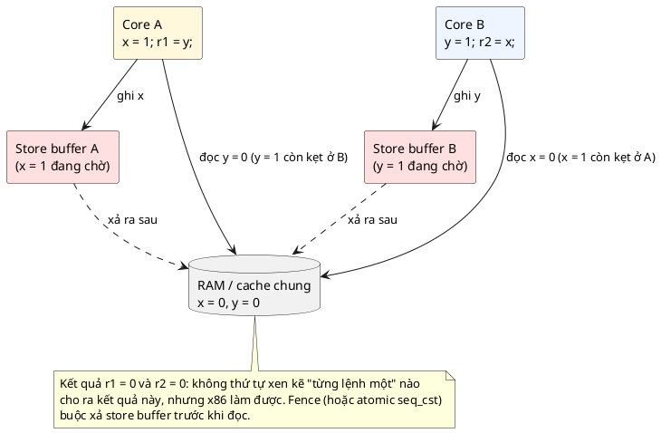

💡 Vì sao chuyện này quan trọng với lock? Vì các thuật toán lock "chỉ dùng biến thường" kinh điển (Dekker, Peterson) đều dựa trên giả định "ghi xong rồi mới đọc". Trên CPU hiện đại chúng **sai** nếu không có fence. Đó là lý do mọi lock thật đều dựa trên lệnh atomic của phần cứng.

### 6.3. Acquire và release: chỉ chặn đúng hướng cần chặn

Rào đầy đủ (`seq_cst`) đắt. Lock chỉ cần hai bảo đảm một chiều:

| Thao tác | Thứ tự bộ nhớ | Bảo đảm | Ví von |
|---|---|---|---|
| Giành lock (CAS thành công) | **acquire** | Mọi đọc/ghi **sau** nó không được chạy lên trước nó | Vào phòng rồi mới được đụng đồ |
| Thả lock (store 0) | **release** | Mọi đọc/ghi **trước** nó phải xong và hiện ra với nhân khác trước khi nhân khác thấy lock được thả | Dọn xong đồ rồi mới mở cửa |

Ghép lại: nhân B giành lock (acquire) **sau** khi nhân A thả (release) thì B chắc chắn thấy mọi thứ A đã ghi trong vùng găng. Đây chính là `memory_order_acquire` ở CAS và `memory_order_release` ở unlock trong [inc/spinlock.h](inc/spinlock.h).

💡 Trên Cortex-M **một nhân**, CPU không có store buffer kiểu đa nhân, nên với RAM thường chỉ cần compiler barrier. Trên chip **đa nhân**, phần cứng cần thêm lệnh `dmb` (data memory barrier); compiler tự chèn khi ta dùng atomic C11 với đúng thứ tự.

📖 Sách nói ở use case đa nhân: *"Atomic operations together with a memory barrier are the only way to ensure that a certain memory location is only modified by a single core and no other core."* Mục 5 là phần "atomic operations", mục 6 là phần "memory barrier".

---

## 7. Mô phỏng vi điều khiển trên PC: làm được gì, không làm được gì

PC không có PRIMASK, không có ngắt UART. Để demo chạy được bằng `make run`, bài này có một bộ mô phỏng nhỏ: [inc/sim_cpu.h](inc/sim_cpu.h), [src/sim_cpu.c](src/sim_cpu.c). Hiểu nó làm gì để đọc kết quả thí nghiệm cho đúng.

### 7.1. CPU giả lập và PRIMASK giả lập

- Một thread của PC gọi `sim_cpu_bind(id)` để **đóng vai CPU số `id`**.
- Mỗi CPU giả lập có biến `primask` riêng. `arch_irq_lock()` đọc giá trị cũ và đặt 1 trong một lệnh `atomic_exchange`, giống `mrs` + `cpsid i`.

### 7.2. Ngắt giả lập "chen ngang thật"

Đây là phần quan trọng nhất. Ở chế độ `preempt = true`, một thread "phần cứng" phát ngắt như sau:

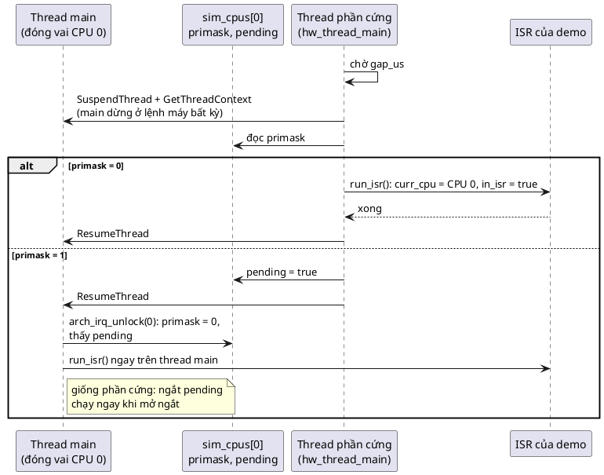

`SuspendThread` của Windows dừng thread main ở **một lệnh máy bất kỳ**, đúng như một ngắt thật. Trong lúc main đứng yên, ISR chạy (trên thread phần cứng nhưng "mượn" ngữ cảnh CPU 0). Xong thì main chạy tiếp, không biết gì. Nếu main đang che ngắt, ngắt thành *pending* và được chạy **ngay trong `arch_irq_unlock()`** của main, giống phần cứng.

Nhờ vậy, trên CPU 0 giả lập, main và ISR **không bao giờ chạy cùng lúc**, chỉ xen kẽ. Đây là mô hình MCU một nhân.

### 7.3. Những gì bộ mô phỏng KHÔNG tái hiện được

| Trên MCU thật | Trên bộ mô phỏng |
|---|---|
| Vào ngắt mất 12 chu kỳ (Cortex-M3/M4) | `SuspendThread` + `ResumeThread` mất vài chục µs (🔬 mục 18 đo được 16–50 µs tùy lần). Tần số ngắt tối đa vì vậy thấp hơn nhiều |
| Mỗi ngắt có một bit pending; ngắt đến lúc đang pending thì **gộp làm một** | Thread phần cứng chờ ngắt pending được xử lý rồi mới phát ngắt mới, nên **không mô phỏng việc gộp/mất ngắt** |
| Có nhiều mức ưu tiên, ngắt lồng ngắt | Chỉ một nguồn ngắt tại một thời điểm |
| Trên chip đa nhân, thứ tự bộ nhớ theo kiến trúc ARM (yếu hơn x86) | x86 có thứ tự mạnh hơn (chỉ có store buffer, mục 6.2). Một số lỗi thiếu barrier chỉ lộ trên ARM sẽ **không** lộ ở đây |
| ISR không được gọi hàm có khóa (malloc, printf) | Cũng phải tuân thủ: nếu main bị dừng khi đang giữ khóa của `printf` mà ISR lại gọi `printf`, chương trình treo |

Ở chế độ `preempt = false`, ISR chạy song song trên thread phần cứng, coi như được một **nhân khác** xử lý. Bài 12 dùng chế độ này.

💡 Phần `preempt` chỉ cài cho Windows (dùng `SuspendThread`). Trên Linux có thể làm tương tự bằng signal (`pthread_kill` + handler, `pthread_sigmask` đóng vai PRIMASK), nhưng bài này không viết phần đó vì không có môi trường để chạy thử.

---

# Phần B — Pattern

## 8. Vấn đề: dữ liệu dùng chung giữa main và ISR

📖 Sách tóm vấn đề trong một câu: *"Since both our application code and even our exception code can be preempted by a higher priority exception at any time, problems arise if exception code needs to share data with lower priority application code. This is true for any operation on data that requires more than one step - for example reading a memory location, adding a number to it and writing back the result."*

### 8.1. 🔬 Tái hiện ví dụ của sách

Demo 1 trong [main.c](main.c): main liên tục cộng 8 vào `data.foo`, ISR (chen ngang thật, mục 7) cộng 5, cả hai bằng `add_like_cortex_m()` (ba bước như Cortex-M). Phần cứng giả lập phát 10 000 ngắt, mỗi ngắt cách nhau ít nhất 20 µs. Cuối cùng so sánh `data.foo` với giá trị đúng `8 × (số lần main cộng) + 5 × (số lần ISR chạy)`:

```c
static void data_isr(void *arg)
{
	(void)arg;
	add_like_cortex_m(&data.foo, 5);
}
```

```c
	sim_irq_start(&cfg);
	while (!sim_irq_done()) {
		if (how == PROTECT_IRQ_LOCK) {
			unsigned int key = arch_irq_lock();
			add_like_cortex_m(&data.foo, 8);
			arch_irq_unlock(key);
		} else if (how == PROTECT_SPINLOCK) {
			struct spinlock_key key = spinlock_lock(&data_lock);
			add_like_cortex_m(&data.foo, 8);
			spinlock_unlock(&data_lock, key);
		} else {
			add_like_cortex_m(&data.foo, 8);
		}
		main_adds++;
	}
	sim_irq_wait(&handled);
```

Kết quả ba lần chạy `make run` (dòng `no lock`):

```
  no lock : isr=10000  expected= 783008272  actual= 783007372  lost isr updates=180
  no lock : isr=10000  expected= 785291424  actual= 785290899  lost isr updates=105
  no lock : isr=10000  expected= 671489504  actual= 671487059  lost isr updates=489
```

- `lost isr updates` = (giá trị đúng − giá trị thật) / 5: số lần cộng của ISR bị main ghi đè, đúng kịch bản ở mục 3.2.
- 180, 105, 489 trên 10 000: con số **khác nhau mỗi lần**. Đây là dấu hiệu nhận biết race.
- Không bao giờ mất lần cộng của **main**: ISR chạy trọn vẹn trong lúc main đứng yên, nên chỉ có main ghi đè ISR, không có chiều ngược lại.

### 8.2. Hai cách hỏng

Ví dụ trên là **lost update**. Với ring buffer (demo 2) còn có kiểu hỏng thứ hai: **dữ liệu không nhất quán**. `head`, `count` và `buf[]` phải thay đổi **cùng nhau**. Nếu `count` không còn khớp với số byte thật trong `buf`, bên đọc sẽ bỏ sót byte, và lâu dần bên ghi ghi đè lên byte chưa đọc. Chi tiết ở mục 15.3.

Cả hai cách hỏng có cùng thuốc chữa: biến đoạn đọc/sửa/ghi thành **vùng găng** không ai chen vào được.

---

## 9. Bước 1: che ngắt, và vì sao cần "key"

### 9.1. Ý tưởng

📖 *"The simple solution is to momentarily disable exceptions that also access the same data so that they will remain pending until we are done with this data."*

📖 Code của sách:

```c
void interrupt_routine(void){
    data.foo += 5;
}
void data_user_code(struct data *self){
    int tag = irq_lock();
    self->foo += 8;
    irq_unlock(tag);
}
```

(`irq_lock()`/`irq_unlock()` là API của Zephyr. Bản tương đương chạy được trên PC dùng `arch_irq_lock()`/`arch_irq_unlock()`, xem demo 1 ở mục 8.1.)

📖 Lập luận của sách đáng đọc kỹ: *"once we have locked the interrupts, the addition of 5 to the variable will never occur (if interrupt is executing then by definition interrupts have not been locked otherwise it will not be able to execute in the first place)."* Và: *"If the exception does occur while interrupts are locked, then 5 will be added to the variable as a separate operation after interrupts are unlocked again (or before interrupts are locked). Either way, the result will be correct."*

Tức là ISR vẫn chạy, chỉ là chạy **trước** hoặc **sau** vùng găng, không bao giờ **giữa**:

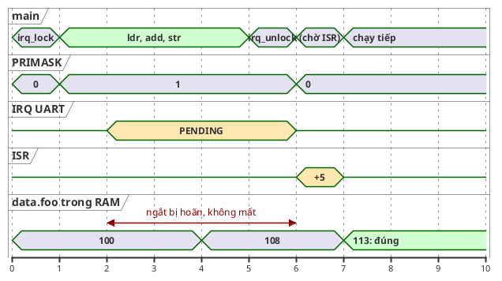

🔬 Dòng `irq_lock` của demo 1, ba lần chạy:

```
  irq_lock: isr=10000  expected= 129934560  actual= 129934560  lost isr updates=0
  irq_lock: isr=10000  expected= 127365960  actual= 127365960  lost isr updates=0
  irq_lock: isr=10000  expected= 126384392  actual= 126384392  lost isr updates=0
```

Cả 10 000 ngắt vẫn chạy đủ (`isr=10000`), và không mất lần nào.

💡 Chú ý số lần main cộng giảm từ khoảng 85–100 triệu xuống khoảng 16 triệu (suy ra từ `expected`). Đó là chi phí của `arch_irq_lock()`/`arch_irq_unlock()` **giả lập** (hai lệnh atomic trên PC, cộng việc kiểm tra pending). Trên Cortex-M, che/mở ngắt chỉ là 2–3 lệnh.

### 9.2. Vì sao phải trả về và nhận lại một "key"

📖 *"This ensures that we can disable interrupts repeatedly and maintain correctness in the code, we save the value of whether interrupts are disabled or enabled into a stack variable called 'key'."*

Tháng 5 trong câu chuyện ở mục 1.2 cho thấy chuyện gì xảy ra nếu không có key: hàm con mở ngắt **vô điều kiện**, phá vùng găng của hàm cha. Với key:

- `arch_irq_lock()` trả về **trạng thái trước khi che**: 0 nếu trước đó ngắt đang mở, 1 nếu đã bị che sẵn.
- `arch_irq_unlock(key)` **khôi phục đúng trạng thái đó**: chỉ mở ngắt khi `key == 0`, tức là khi đây là lớp lock **ngoài cùng**.

Code mô phỏng trong [src/sim_cpu.c](src/sim_cpu.c):

```c
unsigned int arch_irq_lock(void)
{
	/* Đọc trạng thái cũ và che ngắt trong MỘT thao tác, như "mrs + cpsid i" */
	return atomic_exchange(&cpu_self()->primask, 1);
}

void arch_irq_unlock(unsigned int key)
{
	struct sim_cpu *cpu = cpu_self();

	if (key != 0) {
		/* Trước khi lock ngắt đã bị che: giữ nguyên, người lock ngoài cùng sẽ mở */
		return;
	}
	atomic_store(&cpu->primask, 0);

	/* Phần cứng thật: ngắt pending được phục vụ ngay khi mở ngắt. Nếu chính
	 * ta đang ở trong ISR thì chưa: một ngắt không chen được vào chính nó, nó
	 * sẽ chạy sau khi ISR hiện tại return (vòng lặp của lớp unlock ngoài). */
	if (atomic_load(&cpu->in_isr)) {
		return;
	}
	while (atomic_exchange(&cpu->pending, false)) {
		run_isr(cpu);
	}
}
```

Phần kiểm tra `in_isr` mô phỏng thêm một quy tắc phần cứng: một ngắt không chen được vào chính nó (giải thích ở mục 14.4).

💡 Vì sao key nằm **trên stack của người gọi** chứ không phải trong struct spinlock? Vì mỗi lớp lồng nhau cần một key riêng. Nếu key nằm trong object dùng chung, lớp trong sẽ ghi đè key của lớp ngoài. Biến cục bộ thì mỗi lời gọi có một bản riêng, tự nhiên đúng thứ tự "vào sau ra trước".

🔬 Demo 4 trong `make run`, hai spinlock **khác nhau** lồng nhau:

```
4) nested spinlocks and the key
  start          : irq locked=0
  lock A (key=0) : irq locked=1
  lock B (key=1) : irq locked=1
  unlock B       : irq locked=1  <- still locked, A is held
  unlock A       : irq locked=0
```

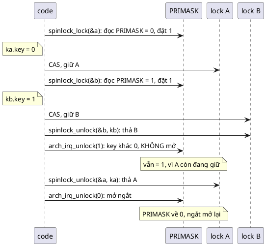

💡 Có một cách khác để lồng an toàn: **bộ đếm lồng nhau**. FreeRTOS trên Cortex-M dùng biến `uxCriticalNesting`: `taskENTER_CRITICAL()` che ngắt và tăng bộ đếm, `taskEXIT_CRITICAL()` giảm bộ đếm và chỉ mở ngắt khi về 0. Kết quả tương đương key, nhưng bộ đếm là state toàn cục (mỗi nhân một biến), còn key nằm trên stack của từng người gọi.

### 9.3. Che bằng PRIMASK hay BASEPRI

📖 Sách nêu hai cách cài `irq_lock` trên ARM:
- **PRIMASK** (`cpsid i`): che mọi ngắt. Đơn giản, chắc chắn.
- **BASEPRI**: chỉ che các ngắt ưu tiên từ một ngưỡng trở xuống. *"In the case of using BASEPRI we will retain the ability to run higher level interrupts but synchronization will not work for these interrupts so they must not share data with application code or any of the application level interrupts."*

💡 Ví dụ thực tế: ngắt điều khiển động cơ (PWM, ADC dòng điện) phải phản ứng trong vài µs, không được để ai che. Đặt nó ở ưu tiên cao hơn ngưỡng BASEPRI, và **cấm** nó dùng chung dữ liệu với phần còn lại. Mọi ngắt khác (UART, I2C, timer) dưới ngưỡng và tuân thủ spinlock. FreeRTOS trên Cortex-M3/M4 làm đúng như vậy với `configMAX_SYSCALL_INTERRUPT_PRIORITY`.

📖 *"Regardless of which way we choose, the end result is that all exceptions that may share data with application code are disabled. Keep in mind that this means that while interrupts are disabled, any events that arrive will be deferred until interrupts are enabled again."*

---

## 10. Giới hạn của che ngắt: nhiều core

📖 *"The biggest problem with this approach is that interrupts are only disabled on a per-core basis. This means that if our code is ever to work correctly on a system with more than one core then we need a better approach."*

PRIMASK là thanh ghi **của từng nhân**. Nhân 0 đặt PRIMASK của nó thành 1 không ảnh hưởng gì tới nhân 1. Nếu nhân 1 cũng chạm vào cùng dữ liệu (vì một ngắt được định tuyến sang nhân 1, hoặc một thread đang chạy trên nhân 1), hai bên chạy **song song thật**, và che ngắt không ngăn được gì:

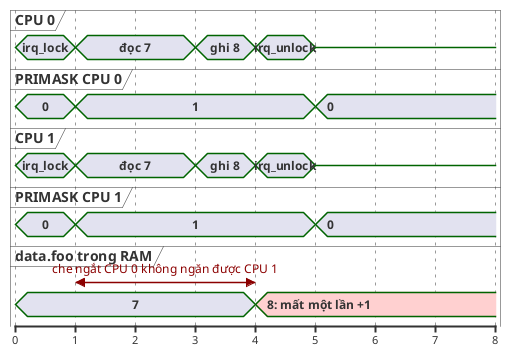

🔬 Demo 3: hai thread của PC đóng vai CPU 0 và CPU 1, mỗi bên cộng 1 triệu lần bằng `data.foo += 1` (câu lệnh C thường, x86 dịch thành **một** lệnh `add [mem], 1`), bọc bằng `arch_irq_lock()`/`arch_irq_unlock()`:

```c
static void smp_work(void)
{
	while (!atomic_load(&smp_go)) {
	}
	for (int i = 0; i < SMP_ADDS; i++) {
		if (smp_how == PROTECT_SPINLOCK) {
			struct spinlock_key key = spinlock_lock(&data_lock);
			data.foo += 1;
			spinlock_unlock(&data_lock, key);
		} else {
			unsigned int key = arch_irq_lock();
			data.foo += 1; /* x86: một lệnh "add [mem], 1" nhưng không có tiền tố lock */
			arch_irq_unlock(key);
		}
	}
}
```

Ba lần chạy:

```
  irq_lock: expected=2000000  actual=1818275  lost=181725
  irq_lock: expected=2000000  actual=1864071  lost=135929
  irq_lock: expected=2000000  actual=1862914  lost=137086
```

Mất khoảng 7–9%. Hai điều rút ra:
1. Che ngắt chỉ có tác dụng trên CPU của mình (đúng như sách).
2. Kể cả **một lệnh** `add [mem], 1` cũng không atomic giữa hai nhân (đúng như mục 3.3 đã báo trước).

📖 Lời giải của sách: *"The solution is using atomic operations and using memory as a way to synchronize our cores and ensure that we maintain our requirement of "only one thread on one cpu returning from locking operation and proceeding into the critical section at a time"."*

---

## 11. Spinlock = che ngắt + CAS

### 11.1. Hai phần, hai nhiệm vụ

📖 *"A spinlock basically combines the interrupt locking we have seen so far with atomic "compare-and-swap" to ensure that we can synchronize our cores."*

| Phần | Chặn ai | Cơ chế |
|---|---|---|
| **Che ngắt** (`arch_irq_lock`) | ISR trên **cùng** nhân | PRIMASK/BASEPRI của nhân này |
| **CAS trong vòng lặp** | Code trên **nhân khác** (thread hoặc ISR) | Biến atomic `locked` trong RAM chung |

📖 Code của sách (trích từ Zephyr, rút gọn):

```c
struct k_spinlock {
    // only needed on multiprocessor systems!
    atomic_t locked;
};

static ALWAYS_INLINE k_spinlock_key_t k_spin_lock(struct k_spinlock *l)
{
    k_spinlock_key_t k;

    // lock interrupts and return current mask (so that nested locking works)
    k.key = arch_irq_lock();

    // only needed on multiprocessor (SMP) systems
    // compare "locked" to zero and if true set to 1 and return previous value (0)
    // this compare and swap is implemented using atomic CPU instruction
    while (!atomic_cas(&l->locked, 0, 1)) {}

    return k;
}

static ALWAYS_INLINE void k_spin_unlock(struct k_spinlock *l,
                    k_spinlock_key_t key)
{
    // clear the lock (only needed for SMP!)
    atomic_clear(&l->locked);

    // unlock interrupts
    arch_irq_unlock(key.key);
}
```

(Đoạn trên là code Zephyr chép từ sách, cần header của Zephyr mới build được; bản tự viết tương đương, build được, nằm ở [inc/spinlock.h](inc/spinlock.h) và được đọc từng dòng ở mục 14.)

📖 Sách kết luận: *"That's it."* Toàn bộ pattern chỉ có vậy.

### 11.2. Hai nhân tranh nhau một spinlock

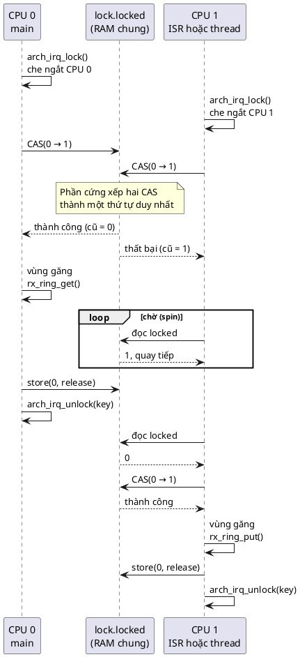

🔬 Dòng `spinlock` của demo 3, ba lần chạy: `expected=2000000  actual=2000000  lost=0`, cả ba lần.

### 11.3. Vòng đời của một spinlock

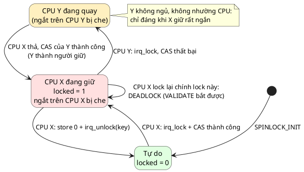

Chú ý trạng thái "CPU Y đang quay": Y **cũng đã che ngắt của nó** trước khi quay. Nghĩa là trong lúc X giữ lock, **cả hai nhân** đều không phục vụ ngắt nào. Đó là lý do quy tắc "giữ thật ngắn" quan trọng gấp đôi trên hệ đa nhân.

### 11.4. Trên chip một nhân: chỉ còn che ngắt

📖 *"on a single core system you can simply omit the looping part and then it simply translates to locking/unlocking of interrupts (but you still retain the possibility of building your code for a multi-core system without having to chase down every place where you disable interrupts)."*

🔬 Cùng một hàm `counter_add()` dùng spinlock, build hai cấu hình (cả hai `-DSPINLOCK_VALIDATE=0`):

```c
#include "spinlock.h"

struct counter {
	int value;
	struct spinlock lock;
};

void counter_add(struct counter *self, int n)
{
	struct spinlock_key key = spinlock_lock(&self->lock);
	self->value += n;
	spinlock_unlock(&self->lock, key);
}
```

`-DSPINLOCK_SMP=0` (một nhân):

```
"counter_add":
	push	rsi
	mov	esi, edx
	push	rbx
	mov	rbx, rcx
	sub	rsp, 40
	call	"arch_irq_lock"
	add	DWORD PTR [rbx], esi
	add	rsp, 40
	pop	rbx
	mov	ecx, eax
	pop	rsi
	jmp	"arch_irq_unlock"
```

`-DSPINLOCK_SMP=1` (nhiều nhân):

```
"counter_add":
	push	rsi
	mov	esi, edx
	push	rbx
	mov	rbx, rcx
	sub	rsp, 40
	call	"arch_irq_lock"
	lea	rdx, 4[rbx]
	mov	r8d, 1
	mov	ecx, eax
	xor	eax, eax
.L9:
	lock cmpxchg	DWORD PTR [rdx], r8d
	jne	.L3
	add	DWORD PTR [rbx], esi
	mov	DWORD PTR 4[rbx], 0
	add	rsp, 40
	pop	rbx
	pop	rsi
	jmp	"arch_irq_unlock"
.L3:
	rep nop
	mov	eax, DWORD PTR [rdx]
	test	eax, eax
	jne	.L3
	jmp	.L9
```

Bản một nhân: đúng là chỉ còn "che ngắt, cộng, mở ngắt". Bản nhiều nhân thêm `lock cmpxchg` (CAS), vòng chờ `.L3` (`rep nop` chính là lệnh `pause`, mục 14.2), và `mov DWORD PTR 4[rbx], 0` để thả (release store, mục 5.3). **Code nguồn của `counter_add` không đổi một chữ.** Đó là lợi ích "generalized approach" của sách: viết một lần, build cho bao nhiêu nhân cũng đúng.

---

## 12. Đặc điểm nhận dạng và các quy tắc

### 12.1. Đặc điểm nhận dạng (Defining Characteristics)

📖 Sách viết *"A spinlock consists of two parts"* nhưng liệt kê **ba** gạch đầu dòng. Đọc kỹ thì thấy: "biến atomic" và "vòng lặp" là hai mặt của cùng một cơ chế (chỉ cần cho đa nhân), phần còn lại là che ngắt.

**1. Biến atomic.** 📖 *"this variable is used together with a set of special atomic operations to ensure that it can only be set by a single core at any given time."*

**Tại sao:** chỉ phần cứng mới bảo đảm được "kiểm tra và đặt" trong một bước giữa các nhân (mục 5). Biến thường hay `volatile` đều thất bại (🔬 mục 5.1).

**2. Vòng lặp chặt khi đang bị giữ.** 📖 *"this is only used when we want our code to support safe execution on a multiprocessor system. [...] We loop until we are able to atomically set the variable when it was previously zero (atomic compare and swap)."*

**Tại sao quay chứ không ngủ:** spinlock nằm **dưới** bộ lập lịch. Muốn ngủ phải có scheduler để chuyển sang thread khác, mà chính scheduler cũng dùng spinlock để bảo vệ dữ liệu của nó (📖 *"Even an RTOS scheduler must use spinlocks to ensure that it is fully thread safe"*). Ngoài ra, ISR không phải thread nên không thể ngủ. Quay vòng là lựa chọn duy nhất ở tầng này, và chỉ chấp nhận được vì vùng găng **rất ngắn**.

**3. Che ngắt, lưu trạng thái cũ vào key.** 📖 *"we then disable interrupts and store the previous state of the interrupts in a variable called 'key'."*

**Tại sao:** che ngắt chặn ISR cùng nhân (mục 9); key cho phép lồng nhau mà không mở ngắt sớm (mục 9.2).

### 12.2. Quy tắc dùng spinlock

📖 Khóa là hợp lệ nếu:
- **Không giành lại chính lock đang giữ:** *"while locking multiple locks is fine, we can not acquire the same lock recursively because that would result in a deadlock."*
- **Lock đó chưa do CPU hiện tại giữ:** *"acquiring the same lock by the same CPU twice would result in a deadlock."*

📖 Mở khóa là hợp lệ nếu:
- **Lock đang do CPU hiện tại giữ:** *"unlocking an already held lock from another CPU is entirely wrong."*

**Tại sao lock đệ quy gây deadlock:** lần lock thứ hai CAS thất bại (biến đang là 1, do chính mình đặt), và vòng lặp chờ **chính mình** thả. Mà mình đang đứng quay trong vòng lặp nên không bao giờ thả.

**Tại sao không được unlock từ CPU khác:** CPU khác không có key đúng (key nằm trên stack của người lock), và ngắt trên CPU của người lock vẫn bị che mãi.

💡 Lock **nhiều** spinlock khác nhau thì được, nhưng phải luôn lock **theo cùng một thứ tự** ở mọi nơi. Nếu CPU 0 giữ A rồi xin B, trong khi CPU 1 giữ B rồi xin A, hai bên quay chờ nhau mãi (deadlock kiểu "vòng tròn", sẽ gặp lại ở bài 12 và 13).

### 12.3. ⚠️ Một chỗ sách tự mâu thuẫn: "recursive locking"

Phần Defining Characteristics của sách nói key *"allows spinlocks to be locked recursively without any issues"*. Câu hỏi quiz số 3 cũng có đáp án nhắc tới *"recursive locking of the same spinlock"*. Nhưng phần Rules lại nói *"we can not acquire the same lock recursively because that would result in a deadlock"*. Hai câu này ngược nhau.

🔬 Mình thử thật bằng file `recursive.c`: lock một spinlock, rồi gọi một hàm lock lại **chính spinlock đó** trên cùng CPU:

```c
#include "sim_cpu.h"
#include "spinlock.h"

#include <stdio.h>

static struct spinlock lock = SPINLOCK_INIT;

static void helper(void)
{
	struct spinlock_key k = spinlock_lock(&lock); /* lần 2: cùng lock, cùng CPU */
	spinlock_unlock(&lock, k);
}

int main(void)
{
	sim_cpu_bind(0);
	struct spinlock_key k = spinlock_lock(&lock);
	printf("locked once, calling helper()...\n");
	fflush(stdout);
	helper();
	spinlock_unlock(&lock, k);
	printf("never printed\n");
	return 0;
}
```

Build ba cấu hình:

| Cấu hình | Kết quả thật |
|---|---|
| `SPINLOCK_SMP=1`, `SPINLOCK_VALIDATE=1` (mặc định của code mẫu) | In `spinlock: recursive lock: this CPU already holds it (cpu 0)` rồi dừng (`abort`) |
| `SPINLOCK_SMP=1`, `SPINLOCK_VALIDATE=0` | Treo. `timeout 3` phải giết tiến trình (exit 124) |
| `SPINLOCK_SMP=0`, `SPINLOCK_VALIDATE=0` (một nhân, chỉ che ngắt) | Chạy qua, in `never printed` (dòng đáng lẽ không tới được) |

Kết luận:
- Key cho phép **lồng các spinlock khác nhau** an toàn (🔬 demo 4), và đó là ý đúng của câu "recursive" trong sách.
- Lock **cùng một** spinlock hai lần chỉ "chạy được" trên bản build một nhân, vì khi đó spinlock chỉ còn là che ngắt. Bật đa nhân là treo. Code dựa vào việc đó là code **chỉ đúng trên một nhân**, đi ngược mục đích của pattern.
- Quy tắc nên nhớ là phần Rules: **không bao giờ lock lại spinlock đang giữ.**

---

## 13. Vì sao phải che ngắt TRƯỚC khi quay

📖 Câu hỏi quiz số 2 của sách: *"Why does modern implementation of spinlock always disable interrupts on current CPU before trying to acquire the lock?"* Đáp án: nếu không, vùng găng có thể bị **ngắt cục bộ** chen ngang.

Hệ quả còn nặng hơn "dữ liệu sai": có thể **treo cứng**. Giả sử chỉ có phần CAS, không che ngắt:

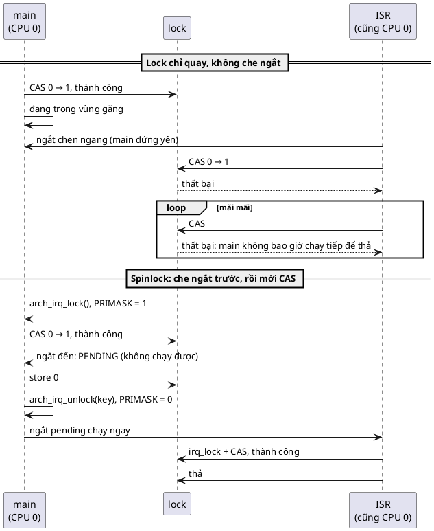

ISR chạy trên cùng nhân với main, và main **đứng yên** cho tới khi ISR return. ISR thì quay chờ main thả lock. Hai bên chờ nhau mãi mãi: **deadlock**.

🔬 Demo 5 trong `make run`: main giữ lock khoảng 10 ms, ngắt đến sau 2 ms. Bản "chỉ quay" giới hạn 50 triệu vòng để không treo máy, quá giới hạn thì báo deadlock:

```
5) ISR on the same CPU wants a lock that main holds
  spin only: isr ran=1  isr deadlocked=YES  foo=0
  spinlock: main still in critical section, isr ran=0 (pending)
  spinlock: isr ran=1  isr deadlocked=no  foo=1
```

- `spin only`: ISR quay hết 50 triệu vòng mà main không hề chạy (vì bị chen ngang), nên báo deadlock. Trên MCU thật, nó quay mãi mãi.
- `spinlock`: trong lúc main giữ lock, `isr ran=0`: ngắt đang pending. Ngay khi main unlock, ISR chạy và giành được lock bình thường (`foo=1`).

💡 Đây cũng là lý do thứ tự trong `spinlock_unlock` là **thả biến atomic trước, mở ngắt sau**. Nếu mở ngắt trước khi thả biến, một ISR có thể chen vào đúng khe đó và quay chờ một lock mà ta chưa kịp thả, lại deadlock.

---

# Phần C — Đọc code

## 14. Đọc code mẫu từng dòng

Các module và quan hệ giữa chúng:

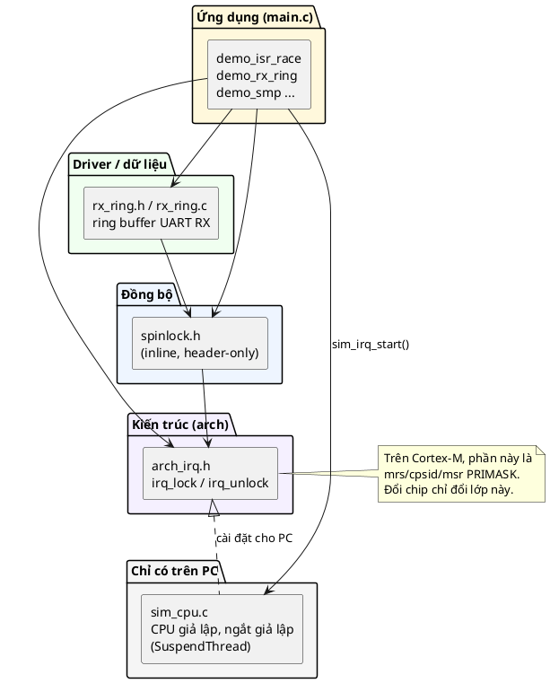

Và các struct:

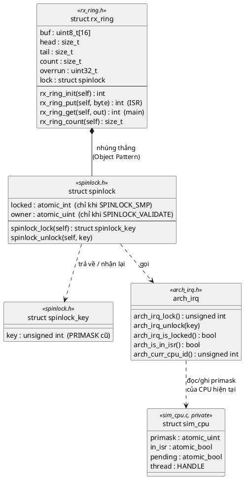

### 14.1. Lớp kiến trúc: [inc/arch_irq.h](inc/arch_irq.h)

```c
unsigned int arch_irq_lock(void);
void arch_irq_unlock(unsigned int key);
bool arch_irq_is_locked(void);
bool arch_is_in_isr(void);
unsigned int arch_curr_cpu_id(void);
```

- Tên và chữ ký giống Zephyr (`arch_irq_lock`, `arch_irq_unlock`) để dễ đối chiếu với sách.
- Đây là **ranh giới phần cứng**: spinlock chỉ gọi các hàm này, không biết bên dưới là PRIMASK, BASEPRI hay bộ mô phỏng. Muốn chạy trên chip thật, chỉ thay file cài đặt (mục 17). Đây là cùng tư tưởng "tách phần phụ thuộc phần cứng ra sau một API" mà bài 2 dùng để giấu header vendor.
- `arch_is_in_isr()` chưa dùng trong bài này, nhưng bài 12 cần nó: semaphore phải từ chối việc "chờ" khi đang ở trong ISR.

### 14.2. Spinlock: [inc/spinlock.h](inc/spinlock.h)

**Các công tắc build:**

```c
#ifndef SPINLOCK_SMP
#define SPINLOCK_SMP 1
#endif

#ifndef SPINLOCK_VALIDATE
#define SPINLOCK_VALIDATE 1
#endif
```

- `SPINLOCK_SMP`: 1 = build cho nhiều nhân (có CAS), 0 = một nhân (chỉ che ngắt). Mặc định 1 vì PC chạy thread song song thật.
- `SPINLOCK_VALIDATE`: bật kiểm tra lỗi dùng sai (lock đệ quy, unlock sai CPU). 💡 Zephyr có đúng tùy chọn này, `CONFIG_SPIN_VALIDATE`, thường bật khi debug và tắt khi release để tiết kiệm.
- `#ifndef` cho phép đổi bằng cờ build `-DSPINLOCK_SMP=0` mà không sửa code, như `UART_POOL_SIZE` ở bài 2.

**Struct:**

```c
struct spinlock {
#if SPINLOCK_SMP
	atomic_int locked; /* 0 = tự do, 1 = có CPU đang giữ */
#endif
#if SPINLOCK_VALIDATE
	atomic_uint owner; /* (id CPU + 1) đang giữ lock, 0 = không ai */
#endif
#if !SPINLOCK_SMP && !SPINLOCK_VALIDATE
	char unused; /* C chuẩn không cho struct rỗng */
#endif
};
```

- `atomic_int` (từ `<stdatomic.h>`, C11) là `_Atomic int`: mọi truy cập qua các hàm `atomic_*` đều atomic. Đây là "atomic variable" trong định nghĩa của sách.
- `owner` lưu `id + 1` để giá trị 0 dành cho "không ai giữ". Nếu lưu thẳng `id`, CPU 0 sẽ trùng với "không ai".
- `char unused`: 📖 Zephyr cho struct rỗng trên chip một nhân (*"only needed on multiprocessor systems!"*), nhờ một phần mở rộng của GCC. Chuẩn C (và cờ `-pedantic`) **không cho** struct không có field nào, nên ta thêm một byte giữ chỗ. 🔬 Kích thước thật ở mục 18.3.
- 💡 Vì sao struct để **public** trong header, ngược với bài 2? Hai lý do: (1) spinlock phải **nhúng thẳng** vào object được bảo vệ (`struct rx_ring` chứa `struct spinlock lock`), mà bài 2 đã chỉ ra object opaque không nhúng được; (2) các hàm phải `static inline` để không tốn lời gọi hàm, mà muốn inline thì code phải thấy field. Đây là trường hợp Object Pattern (bài 1) đúng hơn Opaque.

**Key:**

```c
struct spinlock_key {
	unsigned int key;
};

#define SPINLOCK_INIT {0}
```

- Bọc `unsigned int` trong struct: ai lỡ viết `spinlock_unlock(&lock, 1)` sẽ bị compiler báo lỗi kiểu, thay vì âm thầm mở ngắt sai. 📖 Zephyr cũng làm vậy với `k_spinlock_key_t`. Đây là tinh thần "type safe" mà phần Introduction của sách nhấn mạnh.
- `SPINLOCK_INIT` để khai báo tĩnh: `static struct spinlock data_lock = SPINLOCK_INIT;`. Biến tĩnh không khởi tạo cũng tự là 0, nhưng viết rõ ra thì người đọc biết ngay đây là lock đang tự do.

**`spinlock_cpu_relax`:**

```c
static inline void spinlock_cpu_relax(void)
{
#if defined(__x86_64__) || defined(__i386__)
	__builtin_ia32_pause();
#endif
}
```

- 💡 Lệnh `pause` của x86 (trong assembly ở mục 11.4 hiện ra là `rep nop`) báo cho CPU "đây là vòng chờ". CPU giảm tốc độ thực thi vòng lặp đó, tiết kiệm điện, nhường tài nguyên cho luồng phần cứng anh em (hyper-threading), và tránh một hình phạt hiệu năng khi thoát vòng lặp.
- Trên ARM có lệnh tương tự (`yield`, hoặc `wfe` kèm `sev` khi thả lock), nhưng không bắt buộc. Code mẫu để trống cho các kiến trúc khác.

**`spinlock_lock`, từng bước:**

```c
static inline struct spinlock_key spinlock_lock(struct spinlock *self)
{
	struct spinlock_key k;

	(void)self; /* khi SPINLOCK_SMP = 0 và SPINLOCK_VALIDATE = 0 thì không dùng tới */
```

`(void)self` tránh cảnh báo "unused parameter" (thành lỗi vì `-Werror`) ở cấu hình một nhân không validate, khi thân hàm không còn đụng tới `self`. 🔬 Lỗi này đã thật sự xảy ra khi build cấu hình đó lần đầu.

```c
	k.key = arch_irq_lock();
```

**Bước 1: che ngắt trước.** Lý do ở mục 13. Giá trị cũ của mặt nạ ngắt được cất vào `k.key`.

```c
#if SPINLOCK_VALIDATE
	if (atomic_load_explicit(&self->owner, memory_order_relaxed) == arch_curr_cpu_id() + 1) {
		spinlock_validate_fail("recursive lock: this CPU already holds it");
	}
#endif
```

**Kiểm tra lock đệ quy** (quy tắc 1 và 2 của sách, mục 12.2). Nếu chính CPU này đang là owner thì vòng CAS phía dưới sẽ quay mãi, nên dừng ngay với thông báo rõ ràng còn hơn treo im lặng. `memory_order_relaxed` là đủ: chỉ cần đọc được giá trị mà **chính CPU này** đã ghi, không cần đồng bộ với CPU khác.

```c
#if SPINLOCK_SMP
	int expected = 0;
	while (!atomic_compare_exchange_weak_explicit(&self->locked, &expected, 1,
						      memory_order_acquire,
						      memory_order_relaxed)) {
```

**Bước 2: CAS.** "Nếu `locked` đang bằng `expected` (0) thì ghi 1 và trả `true`; nếu không thì ghi giá trị hiện tại vào `expected` và trả `false`."
- `memory_order_acquire` khi thành công: mọi đọc/ghi trong vùng găng không được chạy lên trước điểm này (mục 6.3).
- `memory_order_relaxed` khi thất bại: thất bại thì chưa vào vùng găng, chưa cần thứ tự gì.
- `_weak` thay vì `_strong`: bản weak được phép **thất bại giả** (thất bại dù giá trị đúng là 0). 💡 Trên ARM, CAS được làm bằng LDREX/STREX, và STREX có thể thất bại vì lý do ngoài lề (một ngắt, một lần ghi khác vào cùng cache line). Bản strong phải tự lặp lại bên trong để che chuyện đó; bản weak để ta tự lặp. Vì đằng nào ta cũng đang ở trong vòng `while`, weak là lựa chọn rẻ hơn.

```c
		do {
			spinlock_cpu_relax();
		} while (atomic_load_explicit(&self->locked, memory_order_relaxed) != 0);
		expected = 0;
	}
#endif
```

**Vòng chờ chỉ đọc** (test-and-test-and-set, TTAS):
- CAS thất bại thì đừng CAS lại ngay. Chỉ **đọc** `locked` cho tới khi thấy 0, rồi mới CAS lại.
- 💡 Vì sao? Mỗi lần CAS là một lần **ghi** (hoặc ít nhất đòi quyền ghi) cache line chứa `locked`, buộc cache line đó chạy qua lại giữa các nhân. Chỉ đọc thì mỗi nhân giữ một bản copy trong cache của mình, quay vòng trên cache, không làm phiền nhân đang giữ lock. 🔬 Mục 18.1 đo thử với 4 nhân: chênh lệch không rõ rệt trên máy này; lợi ích thường chỉ lộ ra khi có nhiều nhân hơn hoặc vùng găng dài hơn.
- `expected = 0;` bắt buộc: CAS thất bại đã ghi giá trị hiện tại (1) vào `expected`. Quên dòng này thì lần CAS sau sẽ so với 1, và "thành công" khi lock **đang bị giữ**, tức là hai bên cùng vào vùng găng. Đây là lỗi kinh điển khi dùng `atomic_compare_exchange_*`.

```c
#if SPINLOCK_VALIDATE
	atomic_store_explicit(&self->owner, arch_curr_cpu_id() + 1, memory_order_relaxed);
#endif
	return k;
}
```

Ghi lại owner **sau** khi đã giữ lock. Trả key về cho người gọi cất trên stack.

**`spinlock_unlock`, từng bước:**

```c
static inline void spinlock_unlock(struct spinlock *self, struct spinlock_key key)
{
	(void)self;

#if SPINLOCK_VALIDATE
	if (atomic_load_explicit(&self->owner, memory_order_relaxed) != arch_curr_cpu_id() + 1) {
		spinlock_validate_fail("unlock by a CPU that does not hold the lock");
	}
	atomic_store_explicit(&self->owner, 0, memory_order_relaxed);
#endif
```

Quy tắc unlock của sách: chỉ CPU đang giữ mới được unlock. Xóa `owner` **trước** khi thả `locked`, để CPU khác vừa giành được lock không bị owner cũ "đè" lên.

```c
#if SPINLOCK_SMP
	atomic_store_explicit(&self->locked, 0, memory_order_release);
#endif

	arch_irq_unlock(key.key);
}
```

- `memory_order_release`: mọi lệnh ghi trong vùng găng phải hiện ra với nhân khác trước khi nhân khác thấy `locked == 0` (mục 6.3). 🔬 Trên x86 đây chỉ là một lệnh `mov` thường (mục 5.3).
- Thả biến atomic **trước**, mở ngắt **sau** (lý do cuối mục 13).
- `arch_irq_unlock(key.key)`: khôi phục đúng trạng thái cũ. Nếu đây là lớp trong cùng của nhiều lock lồng nhau thì ngắt vẫn bị che (🔬 demo 4).

### 14.3. Object được bảo vệ: [inc/rx_ring.h](inc/rx_ring.h), [src/rx_ring.c](src/rx_ring.c)

**Header:**

```c
#define RX_RING_SIZE 16

struct rx_ring {
	uint8_t buf[RX_RING_SIZE];
	size_t head;      /* vị trí ISR sẽ ghi tiếp */
	size_t tail;      /* vị trí main sẽ đọc tiếp */
	size_t count;     /* số byte đang nằm trong ring */
	uint32_t overrun; /* số byte phải bỏ vì ring đầy */
	struct spinlock lock;
};
```

- **Lock nằm trong chính object nó bảo vệ.** Nhìn struct là biết field nào được lock nào bảo vệ. 📖 Chương Mutex của sách khuyên đúng điều này (*"make each shared resource into a well defined object which can also then have a mutex as a member variable"*), và nó áp dụng y nguyên cho spinlock.
- `count` là field được **cả hai phía** sửa: ISR tăng, main giảm. Chính nó tạo ra race. (💡 Một ring buffer chỉ có một người ghi và một người đọc có thể bỏ `count` và tự tính từ `head`/`tail` để khỏi cần lock, mục 21. Ở đây giữ `count` vì nó là cách viết phổ biến, và để có chỗ minh họa race.)

```c
int rx_ring_put(struct rx_ring *self, uint8_t byte);
int rx_ring_get(struct rx_ring *self, uint8_t *out);
size_t rx_ring_count(struct rx_ring *self);
uint32_t rx_ring_overrun(struct rx_ring *self);

int rx_ring_put_nolock(struct rx_ring *self, uint8_t byte);
int rx_ring_get_nolock(struct rx_ring *self, uint8_t *out);
```

- `rx_ring_count` nhận `struct rx_ring *` chứ **không phải** `const struct rx_ring *` như getter của bài 2. Vì để đọc an toàn nó phải lấy lock, tức là **ghi** vào `self->lock`. 💡 Một hệ quả nhỏ nhưng thật: object có lock bên trong thì kể cả hàm "chỉ đọc" cũng làm thay đổi object.
- Cặp `_nolock` chỉ để demo. Header ghi rõ "Firmware thật không bao giờ có cặp hàm này".

**Logic thật, không lấy lock:**

```c
static int ring_put_raw(struct rx_ring *self, uint8_t byte)
{
	size_t n = self->count;

	if (n == RX_RING_SIZE) {
		self->overrun++;
		return -ENOSPC;
	}
	self->buf[self->head] = byte;
	self->head = (self->head + 1) % RX_RING_SIZE;
	self->count = n + 1;
	return 0;
}
```

- Đọc `count` vào `n` ở đầu, ghi `n + 1` ở cuối. Rất nhiều code embedded viết đúng kiểu này (đọc một lần để kiểm tra đầy, ghi lại ở cuối). Khoảng giữa hai dòng đó là **cửa sổ race**.
- Đầy thì bỏ byte, tăng `overrun`, trả `-ENOSPC`. ISR không thể chờ ring có chỗ (ISR không bao giờ được chờ), nên bỏ byte và đếm lại là cách xử lý chuẩn.
- `% RX_RING_SIZE`: với kích thước là lũy thừa của 2, compiler biến phép chia lấy dư thành `and` (🔬 thấy `and eax, 0xf` trong disassembly ở mục 15.3).

`ring_get_raw` đối xứng: đọc `count`, rỗng thì trả `-EAGAIN`, lấy byte ở `tail`, ghi `count = n - 1`.

**Hàm public có lock:**

```c
int rx_ring_put(struct rx_ring *self, uint8_t byte)
{
	if (!self) {
		return -EINVAL;
	}

	/* Lock data, not code: vùng găng chỉ gồm vài lệnh đọc/ghi bộ nhớ */
	struct spinlock_key key = spinlock_lock(&self->lock);
	int ret = ring_put_raw(self, byte);
	spinlock_unlock(&self->lock, key);
	return ret;
}
```

- Kiểm tra tham số **ngoài** vùng găng: không cần lock để kiểm tra `NULL`, và vùng găng càng ngắn càng tốt.
- `ring_put_raw` là hàm `static` trong cùng file, compiler inline nó (🔬 disassembly ở mục 15.3 không có lệnh `call` nào bên trong `rx_ring_get_nolock`). 📖 Sách khuyên vùng găng *"preferably no calls to other functions"*: ở đây không có lời gọi hàm thật nào trong vùng găng.
- Một điểm vào, một điểm ra: `ret` được lưu lại, unlock, rồi mới `return`. Không bao giờ `return` từ giữa vùng găng (sẽ quên unlock, ngắt bị che vĩnh viễn).
- Trả `int` theo quy ước của bài 9: 0, `-ENOSPC`, `-EAGAIN`, `-EINVAL`.

`rx_ring_get`, `rx_ring_count`, `rx_ring_overrun` cùng một khuôn: kiểm tra tham số, lock, vài lệnh, unlock, return.

### 14.4. Bộ mô phỏng: [src/sim_cpu.c](src/sim_cpu.c) (các phần chính)

Phần này không thuộc pattern, chỉ đọc lướt để biết nó không "ăn gian".

```c
struct sim_cpu {
	atomic_uint primask;   /* 1 = đang che ngắt (giống PRIMASK của Cortex-M) */
	atomic_bool in_isr;    /* đang chạy ISR (giống IPSR != 0) */
	atomic_bool pending;   /* có ngắt đến lúc đang che, chờ được chạy */
	HANDLE thread;         /* thread của PC đóng vai CPU này */
	bool bound;
};

static struct sim_cpu sim_cpus[SIM_CPU_MAX];
static struct sim_irq sim_irq;
static _Thread_local struct sim_cpu *curr_cpu;
```

- Mỗi CPU giả lập giữ đúng ba thứ mà phần cứng thật giữ trong thanh ghi: mặt nạ ngắt, cờ "đang trong ISR", bit pending.
- `sim_cpus[]` và `sim_irq` là `static`: bộ mô phỏng **là** phần cứng, và phần cứng chỉ có một bộ. Đây là Singleton (bài 3) ở dạng đơn giản nhất.
- `_Thread_local` (C11): mỗi thread của PC có một bản `curr_cpu` riêng, trỏ tới CPU mà nó đang đóng vai. `arch_irq_lock()` dùng nó để biết che ngắt của CPU nào.

```c
static void fire_preempt(struct sim_cpu *cpu)
{
	while (atomic_load(&cpu->pending)) {
	}

	SuspendThread(cpu->thread);
	CONTEXT ctx;
	ctx.ContextFlags = CONTEXT_CONTROL;
	GetThreadContext(cpu->thread, &ctx);

	/* Đang che ngắt, hoặc đang chạy ISR này rồi (ngắt không lồng vào chính nó):
	 * ngắt chuyển sang pending */
	if (atomic_load(&cpu->primask) || atomic_load(&cpu->in_isr)) {
		atomic_store(&cpu->pending, true);
	} else {
		run_isr(cpu);
	}
	ResumeThread(cpu->thread);
}
```

- `SuspendThread` của Windows là **bất đồng bộ**: nó trả về khi yêu cầu đã gửi đi, chưa chắc thread đã đứng yên. Gọi `GetThreadContext` ngay sau buộc phải chờ tới khi thread thật sự dừng (cần đọc được thanh ghi của nó). Nếu bỏ dòng này, ISR có thể chạy trong lúc main vẫn đang chạy, và mô hình "một nhân" sụp đổ.
- **Dừng rồi mới kiểm tra `primask`**, không phải ngược lại. Nếu kiểm tra trước khi dừng, main có thể che ngắt và vào vùng găng ngay sau lúc kiểm tra, và ISR chen vào vùng găng. Đây chính là một race nhỏ trong bộ mô phỏng, được tránh bằng thứ tự đúng.
- Vòng `while (pending)` ở đầu: chờ ngắt pending trước được phục vụ rồi mới phát ngắt mới, để đếm được chính xác số lần ISR chạy. Như đã nói ở mục 7.3, phần cứng thật thì gộp các ngắt đến trong lúc pending thành một.
- `|| atomic_load(&cpu->in_isr)`: trên Cortex-M, trong lúc một ISR đang chạy, ngắt **cùng mức ưu tiên** (và tất nhiên chính nó) đến thì chỉ pending, không chen vào. Bộ mô phỏng phải tôn trọng quy tắc này, vì một ISR "pending" được chạy ngay trên thread main (trong `arch_irq_unlock`), và lúc đó `primask` đã về 0. 🔬 Phiên bản đầu của bộ mô phỏng **thiếu** điều kiện này, và chính bài test stress ở mục 19 đã bắt được nó (chi tiết ở đó).

### 14.5. Demo: [main.c](main.c)

Các đoạn chính đã được đọc ở mục 8 (demo 1), mục 10 (demo 3), mục 9.2 (demo 4), mục 13 (demo 5). Còn demo 2:

```c
static void uart_rx_isr(void *arg)
{
	(void)arg;
	int ret = ring_use_lock ? rx_ring_put(&ring, uart_dr) : rx_ring_put_nolock(&ring, uart_dr);

	/* Byte bị bỏ vì đầy thì phần cứng giả lập gửi lại ở ngắt sau, để phía main
	 * chỉ cần kiểm tra thứ tự liên tục */
	if (ret == 0) {
		uart_dr++;
		uart_sent++;
	}
}
```

- `uart_dr` đóng vai thanh ghi dữ liệu UART: mỗi ngắt mang byte tiếp theo của dãy 0, 1, 2, ..., 255, 0, ...
- Byte bị bỏ vì đầy thì **gửi lại** ở ngắt sau. Phần cứng thật không làm vậy (byte đó mất), nhưng nhờ vậy phía main chỉ cần kiểm tra "byte sau = byte trước + 1". Mọi lỗi thứ tự đều do race, không do đầy.

```c
	while (!sim_irq_done()) {
		/* main loop bận việc khác một lúc, rồi đọc hết những gì đã nhận */
		sim_busy_wait_us(100);
		while (ring_get(&byte) == 0) {
			received++;
			if (byte != expect) {
				seq_errors++;
			}
			expect = (uint8_t)(byte + 1);
		}
	}
```

- Main loop giống firmware thật: làm việc khác 100 µs, rồi đọc cạn ring. Trong 100 µs đó ring tích được vài byte, nên vòng đọc cạn có nhiều lần `ring_get` thành công liên tiếp. Mỗi lần thành công là một lần mở cửa sổ race.
- `(uint8_t)(byte + 1)`: ép kiểu rõ ràng để 255 + 1 quay về 0 (và tránh cảnh báo chuyển đổi kiểu).

---

## 15. Theo dõi demo chạy từng bước

Output đầy đủ của một lần `make run`:

```
1) main += 8 vs ISR += 5 on one CPU (ldr/add/str like Cortex-M)
  no lock : isr=10000  expected= 783008272  actual= 783007372  lost isr updates=180
  irq_lock: isr=10000  expected= 129934560  actual= 129934560  lost isr updates=0
  spinlock: isr=10000  expected= 107010368  actual= 107010368  lost isr updates=0
2) UART RX ring buffer: ISR producer, main consumer
  no lock : sent=20000  received=19996  sequence errors=   0  ring.count= 0  (bytes really left=4)
  spinlock: sent=20000  received=20000  sequence errors=   0  ring.count= 0  (bytes really left=0)
3) two CPUs, 1000000 increments each
  irq_lock: expected=2000000  actual=1818275  lost=181725
  spinlock: expected=2000000  actual=2000000  lost=0
4) nested spinlocks and the key
  start          : irq locked=0
  lock A (key=0) : irq locked=1
  lock B (key=1) : irq locked=1
  unlock B       : irq locked=1  <- still locked, A is held
  unlock A       : irq locked=0
5) ISR on the same CPU wants a lock that main holds
  spin only: isr ran=1  isr deadlocked=YES  foo=0
  spinlock: main still in critical section, isr ran=0 (pending)
  spinlock: isr ran=1  isr deadlocked=no  foo=1
```

Thời gian chạy khoảng 3,3–3,4 giây (đo bằng `time` ở ba lần chạy: 3,27 s, 3,42 s, 3,40 s).

### 15.1. Demo 1: một lần ISR bị mất, từng lệnh

Giả sử `data.foo = 1000` trước bước 1:

| # | Ai chạy | Lệnh | `r3` của main | `data.foo` | Ghi chú |
|---|---|---|---|---|---|
| 1 | main | `v = *p` (ldr) | 1000 | 1000 | |
| 2 | phần cứng | `SuspendThread(main)` | 1000 (được giữ) | 1000 | main dừng giữa hai lệnh |
| 3 | ISR | `v = *p` | | 1000 | ISR đọc giá trị trong RAM |
| 4 | ISR | `*p = v + 5` | | 1005 | |
| 5 | phần cứng | `ResumeThread(main)` | 1000 | 1005 | main không biết gì |
| 6 | main | `v += 8` | 1008 | 1005 | |
| 7 | main | `*p = v` (str) | 1008 | **1008** | +5 của ISR bị ghi đè |

Có `irq_lock`: bước 2 thấy `primask = 1`, nên đặt `pending = true` và cho main chạy tiếp ngay. Main làm xong bước 6–7 (`data.foo = 1008`), gọi `arch_irq_unlock(0)`, thấy pending, chạy ISR: `data.foo = 1013`. Đúng.

### 15.2. Demo 4: trạng thái sau mỗi lệnh

| # | Lệnh | `primask` của CPU 0 | `a.locked` | `b.locked` | Key trả về |
|---|---|---|---|---|---|
| 0 | (bắt đầu) | 0 | 0 | 0 | |
| 1 | `ka = spinlock_lock(&a)` | 1 | 1 | 0 | `ka.key = 0` |
| 2 | `kb = spinlock_lock(&b)` | 1 | 1 | 1 | `kb.key = 1` |
| 3 | `spinlock_unlock(&b, kb)` | **1** (key 1: không mở) | 1 | 0 | |
| 4 | `spinlock_unlock(&a, ka)` | 0 (key 0: mở) | 0 | 0 | |

`a.owner` và `b.owner` (VALIDATE) lần lượt là 1 (CPU 0 + 1) trong lúc giữ, về 0 khi thả.

### 15.3. Demo 2: vì sao byte bị "kẹt"

🔬 Disassembly của `rx_ring_get_nolock` (`objdump -d -M intel demo.exe`):

```
14000214d:	mov    rdx,QWORD PTR [rcx+0x20]     ; n = self->count
140002151:	test   rdx,rdx
140002154:	je     140002190                    ; n == 0: rỗng
140002156:	mov    r8,QWORD PTR [rcx+0x18]      ; tail
14000215a:	sub    rdx,0x1                      ; n - 1
14000215e:	movzx  r8d,BYTE PTR [rcx+r8*1]      ; buf[tail]
140002163:	mov    BYTE PTR [rax],r8b           ; *out = ...
140002166:	mov    rax,QWORD PTR [rcx+0x18]
14000216a:	mov    QWORD PTR [rcx+0x20],rdx     ; self->count = n - 1
14000216e:	add    rax,0x1
140002172:	and    eax,0xf                      ; % 16
140002175:	mov    QWORD PTR [rcx+0x18],rax     ; tail = ...
```

Cửa sổ race là 7 lệnh, từ `14000214d` (đọc `count`) tới `14000216a` (ghi `count`). Nếu ngắt rơi vào đó:

| # | Ai | Việc | `count` trong RAM | `n` của main | Byte thật trong ring |
|---|---|---|---|---|---|
| 1 | main | `n = count` | 3 | 3 | 3 |
| 2 | ISR | `put`: ghi `buf[head]`, `count = 4` | 4 | 3 | 4 |
| 3 | main | lấy `buf[tail]`, `count = n - 1` | **2** | | 3 |

Sau bước 3, ring chứa 3 byte nhưng `count` nói 2. Byte cuối cùng **kẹt**: nó chỉ được đọc khi có byte mới đến đẩy `count` lên. Đúng hiện tượng "tháng 3" ở mục 1.2: câu trả lời `OK\r\n` của modem thiếu `'\n'` cho tới khi có câu trả lời tiếp theo.

🔬 Ba lần chạy demo 2 (20 000 byte): kẹt 4, 2, 1 byte (`bytes really left` trong khi `ring.count = 0`). Lần chạy `make run` cuối cùng trước khi nộp bài thì không kẹt byte nào. Mỗi lần kẹt là một lần ngắt rơi trúng cửa sổ 7 lệnh.

🔬 Cửa sổ race hẹp nên phải chạy lâu mới thấy hậu quả thứ hai. Cùng demo, 300 000 byte (chạy mất vài chục giây):

```
  no lock : sent=300000  received=299982  sequence errors=37229  ring.count= 0  (bytes really left=18)
  spinlock: sent=300000  received=300000  sequence errors=   0  ring.count= 0  (bytes really left=0)
```

18 lần kẹt cộng dồn. Khi số byte "vô hình" vượt quá 16 (kích thước ring), ISR tưởng ring còn chỗ và **ghi đè lên byte chưa đọc**: 37 229 lỗi thứ tự. (Một lần chạy khác: 27 lần kẹt, 9801 lỗi thứ tự. Con số thay đổi, hiện tượng thì không.) Bản có spinlock: không lỗi nào. Đây là lý do race thường được mô tả là "chạy tốt trong test, hỏng ở hiện trường": thời gian chạy và số sự kiện ở hiện trường lớn hơn nhiều.

### 15.4. Demo 5: dòng thời gian

| Thời điểm | main (CPU 0) | Phần cứng / ISR | `primask` | `pending` |
|---|---|---|---|---|
| 0 ms | `spinlock_lock`: che ngắt, CAS thành công | đếm 2 ms | 1 | 0 |
| 2 ms | (đang trong vùng găng) | dừng main, thấy `primask = 1`: đặt pending, cho main chạy tiếp | 1 | 1 |
| 10 ms | in `isr ran=0 (pending)` | chờ | 1 | 1 |
| 10 ms | `spinlock_unlock`: thả `locked`, `arch_irq_unlock(0)` | | 0 | 0 |
| 10 ms | trong `arch_irq_unlock`: chạy ISR ngay | ISR: lock, `foo++`, unlock | | |

Bản "chỉ quay": ở mốc 2 ms, `primask = 0` (lock không che ngắt), ISR chạy ngay, CAS thất bại, quay 50 triệu vòng **trong lúc main bị dừng**. Main chỉ chạy tiếp sau khi ISR bỏ cuộc.

---

## 16. Các quyết định thiết kế và phương án khác

### Hàm lock trả về key, không trả `int`

Mọi hàm khác trong repo trả `int` (bài 9). Spinlock là ngoại lệ có chủ ý:
- Lock **không thể thất bại** theo nghĩa "trả lỗi cho caller xử lý". Hoặc nó thành công, hoặc là lỗi lập trình (lock đệ quy), và lỗi lập trình thì nên dừng ngay (VALIDATE) chứ không trả mã lỗi để caller có cơ hội lờ đi.
- Spinlock nằm trên đường nóng nhất của hệ thống. Mỗi lần gọi thêm một nhánh kiểm tra mã lỗi là thêm chi phí ở mọi nơi.
- Đây cũng là chữ ký của Zephyr mà sách trích.

💡 Phương án khác: `int spinlock_trylock(struct spinlock *self, struct spinlock_key *key)` trả `-EBUSY` nếu lock đang bị giữ, không quay. Zephyr có `k_spin_trylock`. Hữu ích khi có việc khác để làm thay vì chờ.

### Hàm inline trong header

📖 Sách dùng `static ALWAYS_INLINE`. Code mẫu dùng `static inline`. Lý do: một lời gọi hàm thật tốn vài lệnh (đẩy tham số, `call`, `ret`), trong khi bản thân spinlock một nhân chỉ là 2–3 lệnh. 💡 `inline` chỉ là gợi ý; với `-O2` gcc inline các hàm nhỏ thế này (🔬 assembly ở mục 11.4 không có `call spinlock_lock`). Zephyr dùng `__attribute__((always_inline))` để ép, kể cả khi build `-O0`.

### Một lock cho mỗi object, hay một lock chung

📖 Sách nêu ở Common Pitfalls: *"it is often a waste of memory to have a separate spinlock for multiple instances of an object of the same class. This is why spinlocks in Zephyr often are implemented as static global variables and shared among instances of the same type."*

| | Lock trong mỗi object (code mẫu) | Một lock `static` cho cả module |
|---|---|---|
| RAM | 4–8 byte mỗi object (🔬 mục 18.3) | 4–8 byte cho cả module |
| Trên chip một nhân | Như nhau: đằng nào cũng che toàn bộ ngắt | |
| Trên chip đa nhân | Hai nhân làm việc trên hai ring khác nhau cùng lúc được | Hai nhân phải xếp hàng dù dùng hai ring khác nhau |
| Dễ đọc | Nhìn struct là thấy lock | Phải tìm biến `static` trong `.c` |

Code mẫu chọn lock trong object vì dễ đọc và vì bài này nói nhiều về đa nhân. Bài 12 sẽ làm theo kiểu sách: một spinlock `static` chung cho mọi semaphore, giống `sem.c` của Zephyr. 💡 Lý lẽ của sách đúng nhất trên chip một nhân: spinlock lúc đó chỉ là che ngắt, mà ngắt chỉ có một bộ, nên nhiều biến lock không thêm được gì.

### CAS weak + vòng chờ chỉ đọc (TTAS), thay vì exchange đơn giản

Phương án đơn giản nhất: `while (atomic_exchange(&l->locked, 1)) {}` (test-and-set). Đúng, nhưng mỗi vòng là một lần ghi. Code mẫu dùng CAS như sách, cộng vòng chờ chỉ đọc. 💡 Phương án mạnh hơn nữa là **ticket lock**: mỗi nhân lấy một "số thứ tự" và chờ tới lượt, bảo đảm công bằng (không nhân nào bị bỏ đói). Linux dùng biến thể của ý tưởng này. Code mẫu không làm vì sách không đề cập và bài tập 4 để bạn tự làm.

### `memory_order` tường minh thay vì mặc định

`atomic_store(&l->locked, 0)` (mặc định `seq_cst`) cũng đúng, nhưng trên x86 tốn một `xchg` thay vì `mov` (🔬 mục 5.3). Code mẫu viết rõ `acquire`/`release` vì đó đúng là thứ lock cần, không hơn không kém, và vì viết ra thì người đọc thấy được ý đồ.

### VALIDATE bật mặc định

Bắt lỗi lock đệ quy và unlock sai CPU, đổi lại tốn thêm một biến và vài lệnh. Với code học tập, bắt lỗi rõ ràng quan trọng hơn vài nano giây. Firmware thật thường bật khi debug, tắt khi release.

### Bộ mô phỏng dùng `SuspendThread` thay vì cho ISR chạy song song

Nếu ISR chỉ là một thread chạy song song, demo 1 và demo 5 sẽ đo **concurrency giữa hai nhân**, không phải **ngắt trên một nhân**. Demo 5 sẽ không deadlock (main vẫn chạy tiếp trên nhân của nó và thả lock). Dùng `SuspendThread` mới tái hiện được đúng điều làm ngắt khác thread: **người bị ngắt đứng yên cho tới khi ISR xong**.

---

# Phần D — Thực tế và tổng kết

## 17. Spinlock trên phần cứng và RTOS thật

Các đoạn code trong mục này là code cho chip thật (cần CMSIS, SDK của hãng hoặc RTOS tương ứng). Máy dùng cho bài này không có toolchain ARM, nên chúng **không được build thử**; đây là 💡 kiến thức chung, đối chiếu với tài liệu của từng hãng.

### 17.1. Cortex-M một nhân: thay lớp `arch_irq`

Nhờ tách lớp kiến trúc (mục 14.1), chạy trên STM32 chỉ cần viết lại ba hàm. Dùng các hàm intrinsic của CMSIS:

```c
#include "stm32f4xx.h" /* kéo theo core_cm4.h của CMSIS */

unsigned int arch_irq_lock(void)
{
	unsigned int key = __get_PRIMASK(); /* mrs r0, PRIMASK */
	__disable_irq();                    /* cpsid i */
	return key;
}

void arch_irq_unlock(unsigned int key)
{
	if (key == 0) {
		__enable_irq();                 /* cpsie i */
	}
}
```

Rồi build với `-DSPINLOCK_SMP=0`. Toàn bộ `rx_ring.c`, `spinlock.h` giữ nguyên.

💡 Bản dùng BASEPRI (Cortex-M3/M4/M7) thay `__disable_irq()` bằng `__set_BASEPRI_MAX(ngưỡng)` và lưu `__get_BASEPRI()` làm key. Cortex-M0/M0+ không có BASEPRI.

### 17.2. Các RTOS và SDK: cùng một pattern, khác tên

| Môi trường | Lock | Unlock | Key ở đâu |
|---|---|---|---|
| 📖 Zephyr | `k_spinlock_key_t k = k_spin_lock(&lock);` | `k_spin_unlock(&lock, k);` | Giá trị trả về, như code mẫu |
| 💡 Linux kernel | `spin_lock_irqsave(&lock, flags);` | `spin_unlock_irqrestore(&lock, flags);` | Biến `flags` (macro ghi vào) |
| 💡 FreeRTOS, trong task | `taskENTER_CRITICAL();` | `taskEXIT_CRITICAL();` | Không có key: dùng bộ đếm lồng nhau (mục 9.2) |
| 💡 FreeRTOS, trong ISR | `UBaseType_t s = taskENTER_CRITICAL_FROM_ISR();` | `taskEXIT_CRITICAL_FROM_ISR(s);` | Giá trị trả về |
| 💡 ESP-IDF (ESP32 hai nhân) | `portENTER_CRITICAL(&mux);` | `portEXIT_CRITICAL(&mux);` | `portMUX_TYPE mux` là một spinlock thật: che ngắt + giành biến atomic giữa hai nhân |
| 💡 Pico SDK (RP2040 hai nhân M0+) | `uint32_t s = spin_lock_blocking(lock);` | `spin_unlock(lock, s);` | Giá trị trả về; `lock` là một trong 32 spinlock **phần cứng** của khối SIO |

Đọc bảng này theo chiều dọc sẽ thấy: ở đâu cũng là **che ngắt + (nếu nhiều nhân) giành một thứ atomic + khôi phục trạng thái ngắt**. Khác nhau chỉ ở tên gọi và chỗ cất key.

💡 RP2040 là ví dụ đẹp cho mục 5.4: Cortex-M0+ không có LDREX/STREX, nên chip được thêm phần cứng spinlock riêng. Mỗi spinlock phần cứng là một thanh ghi: **đọc** nó là "thử giành" (trả về khác 0 nếu giành được), **ghi** là "thả". Thao tác atomic được làm bằng mạch điện thay vì bằng lệnh CPU.

### 17.3. Khi nào firmware thật viết spinlock

💡 Trên MCU một nhân chạy bare-metal hoặc RTOS, bạn gặp spinlock (hay tên khác của nó) ở:
- Driver có ring buffer hoặc hàng đợi dùng chung với ISR của chính nó (UART, CAN, USB).
- Bộ đếm thời gian 64-bit mà ISR SysTick tăng và code thường đọc (đọc 64-bit trên chip 32-bit là hai lệnh, bài tập 6).
- Pool cấp phát dùng được từ cả ISR lẫn thread (mục 23).
- Bên trong chính RTOS: hàng đợi thread, danh sách timer.

📖 Và sách khuyên dùng spinlock **kể cả khi bare-metal**: *"even if you are doing bare metal development without an RTOS, spinlock is a valuable abstraction that makes your code more robust. You can easily port spinlock-based code to a system with multiple cores or to a system that uses an rtos - as long as your spinlock implementation itself is portable."*

---

## 18. Chi phí: thời gian, độ trễ ngắt, bộ nhớ

### 18.1. 🔬 Thời gian một lần lock + unlock (trên PC)

File `perf.c`: 2 triệu lần lock/unlock trên một CPU, rồi 4 CPU tranh nhau cùng một lock (mỗi CPU 500 000 lần), so sánh vòng chờ của code mẫu (TTAS) với vòng "CAS liên tục". Hai lần chạy:

```
uncontended, 1 CPU      :   7.5 ns per lock+unlock
4 CPUs contended, TTAS :  97.5 ns per lock+unlock (counter=2000000)
4 CPUs contended, CAS  :  84.4 ns per lock+unlock (counter=2000000)
uncontended, 1 CPU      :   8.0 ns per lock+unlock
4 CPUs contended, TTAS : 104.3 ns per lock+unlock (counter=2000000)
4 CPUs contended, CAS  :  92.0 ns per lock+unlock (counter=2000000)
```

(Ba lần chạy trước đó cho kết quả cùng cỡ: không tranh chấp 8–9 ns, tranh chấp 90–116 ns.)

Đọc kết quả:
- **Không tranh chấp: khoảng 8 ns.** Con số này gồm cả `arch_irq_lock`/`unlock` giả lập (hai lệnh atomic) và phần VALIDATE. Trên Cortex-M một nhân, spinlock chỉ còn `mrs` + `cpsid` + `msr`, cỡ vài chu kỳ.
- **4 nhân tranh nhau: chậm hơn hơn 10 lần.** Mỗi lần đổi chủ, cache line chứa `locked` phải chạy từ nhân này sang nhân kia. Đây là chi phí cố hữu của mọi lock dùng chung trên đa nhân.
- **TTAS không nhanh hơn trên máy này**, thậm chí chậm hơn một chút. Lý thuyết nói TTAS giảm lưu lượng cache khi nhiều nhân cùng chờ; với 4 nhân và vùng găng chỉ một phép cộng, lợi ích đó không lộ ra. Mình giữ TTAS trong code mẫu vì đó là cách viết chuẩn (Linux, Zephyr đều có vòng chờ chỉ đọc hoặc tốt hơn), nhưng **đừng tin "tối ưu" nào mà chưa đo trên phần cứng của mình**.

### 18.2. 🔬 Độ trễ ngắt tăng theo độ dài vùng găng

📖 Drawback thứ hai của sách: *"when a single spinlock is held, NO other code can interrupt the critical section. [...] all events are held back until the spinlock is released. This means that under no circumstances should you ever hold a spinlock longer than necessary to synchronize data access (lock data - not code)."*

File `latency.c`: main giữ spinlock trong 1, 10, 100, 1000 µs, rồi nhả 5 µs, lặp lại; phần cứng giả lập phát 200 ngắt, ghi lại thời điểm phát; ISR đo thời gian từ lúc phát tới lúc mình được chạy. (Để có mốc thời gian, thí nghiệm dùng một bản sao của `sim_cpu.c` có thêm một dòng ghi thời điểm ngay trước `SuspendThread`.) Hai lần chạy:

```
critical section    1 us: isr latency avg    38.5 us, worst   372.6 us
critical section   10 us: isr latency avg    47.0 us, worst  1077.3 us
critical section  100 us: isr latency avg    45.0 us, worst   402.4 us
critical section 1000 us: isr latency avg   393.4 us, worst  1039.9 us
critical section    1 us: isr latency avg    39.4 us, worst   259.9 us
critical section   10 us: isr latency avg    40.3 us, worst   118.4 us
critical section  100 us: isr latency avg    50.2 us, worst   251.0 us
critical section 1000 us: isr latency avg   532.3 us, worst  1187.1 us
```

Đọc kết quả một cách trung thực:
- Mức nền khoảng **40 µs** là chi phí của chính bộ mô phỏng (`SuspendThread`/`ResumeThread` của Windows). Trên Cortex-M3/M4, vào ngắt mất 12 chu kỳ, tức 0,07 µs ở 168 MHz. (Một lần đo sớm hơn, lúc máy rảnh hơn, mức nền là 16 µs.)
- Các giá trị "worst" vài trăm µs ở dòng 1–100 µs là nhiễu của Windows (thread bị hệ điều hành tạm dừng), không phải của spinlock.
- Tín hiệu rõ ràng nằm ở dòng 1000 µs: **trung bình tăng lên 400–530 µs và tệ nhất xấp xỉ 1000 µs**, đúng bằng độ dài vùng găng. Một ngắt đến ngay sau khi lock phải chờ hết vùng găng.

💡 Quy đổi ra hậu quả thật: UART 115 200 baud nhận một byte mỗi 87 µs. MCU có FIFO nhận 1 byte (nhiều dòng STM32 cũ) mà bị che ngắt 1000 µs thì mất khoảng 10 byte. Đó là lý do vùng găng phải tính bằng **lệnh**, không phải bằng micro giây.

### 18.3. 🔬 Bộ nhớ

`sizeof(struct spinlock)` với từng cấu hình (file `sizes.c`):

```
SMP=0 VALIDATE=0: sizeof(struct spinlock) = 1
SMP=0 VALIDATE=1: sizeof(struct spinlock) = 4
SMP=1 VALIDATE=0: sizeof(struct spinlock) = 4
SMP=1 VALIDATE=1: sizeof(struct spinlock) = 8
```

- Bản một nhân không validate: 1 byte (chỉ là `char unused`, vì chuẩn C cấm struct rỗng). Trong Zephyr bản này là struct rỗng, 0 byte.
- Key: một `unsigned int` trên stack của người gọi, 4 byte, chỉ tồn tại trong lúc giữ lock.
- Flash: mỗi chỗ lock/unlock được inline, vài lệnh (🔬 mục 11.4).

---

## 19. Test code có spinlock

### 19.1. 🔬 Hai tầng test

File `test_rx_ring.c`, build cùng `src/rx_ring.c` và `src/sim_cpu.c`:

```c
/* Test chức năng (một ngữ cảnh) + test stress (ISR thật chen ngang) cho rx_ring */
#include "arch_irq.h"
#include "rx_ring.h"
#include "sim_cpu.h"

#include <assert.h>
#include <errno.h>
#include <stdio.h>

static void test_fifo_order_and_full(void)
{
	struct rx_ring r;
	uint8_t b;

	assert(rx_ring_init(&r) == 0);
	assert(rx_ring_get(&r, &b) == -EAGAIN);
	for (int i = 0; i < RX_RING_SIZE; i++) {
		assert(rx_ring_put(&r, (uint8_t)i) == 0);
	}
	assert(rx_ring_put(&r, 99) == -ENOSPC);   /* đầy */
	assert(rx_ring_overrun(&r) == 1);
	for (int i = 0; i < RX_RING_SIZE; i++) {
		assert(rx_ring_get(&r, &b) == 0 && b == (uint8_t)i);
	}
	assert(rx_ring_count(&r) == 0);
	assert(!arch_irq_is_locked());             /* không để quên ngắt bị che */
}

static struct rx_ring stress;
static uint8_t next;
static unsigned long sent; /* số byte ISR đẩy vào thành công */

static void isr(void *arg)
{
	(void)arg;
	if (rx_ring_put(&stress, next) == 0) {
		next++;
		sent++;
	}
}

static void test_stress_with_preemption(void)
{
	struct sim_irq_config cfg = {
		.cpu_id = 0, .preempt = true, .isr = isr, .fire_count = 50000, .gap_us = 5,
	};
	uint8_t expect = 0, b;
	unsigned long received = 0;

	rx_ring_init(&stress);
	sim_irq_start(&cfg);
	for (;;) {
		int done = sim_irq_done();
		if (rx_ring_get(&stress, &b) == 0) {
			assert(b == expect);
			expect = (uint8_t)(b + 1);
			received++;
		} else if (done) {
			break;
		}
	}
	sim_irq_wait(NULL);
	assert(received == sent);  /* không mất, không thừa byte nào */
	assert(!arch_irq_is_locked());
}

int main(void)
{
	sim_cpu_bind(0);
	test_fifo_order_and_full();
	test_stress_with_preemption();
	printf("all rx_ring tests passed\n");
	return 0;
}
```

- **Test chức năng** (một ngữ cảnh): kiểm tra logic FIFO, đầy, rỗng, như mọi module khác. Dòng cuối `assert(!arch_irq_is_locked())` bắt lỗi "quên unlock ở một nhánh nào đó".
- **Test stress** (ISR chen ngang thật): 50 000 ngắt cách nhau 5 µs, kiểm tra thứ tự và số lượng. Race không thể chứng minh là **không có** bằng test, chỉ có thể tăng cơ hội **bắt được**: chạy nhiều, chạy lâu, ngắt dày.

### 19.2. 🔬 Câu chuyện có thật: test stress bắt được bug của chính bộ mô phỏng

Lần đầu chạy test này, nó **thỉnh thoảng thất bại** ở `assert(b == expect)`, dù `rx_ring` đã có spinlock. Điều tra ra lỗi nằm ở bộ mô phỏng: một ISR pending được chạy trên thread main (trong `arch_irq_unlock`), lúc đó `primask` đã về 0, và bộ mô phỏng cho phép **chính ngắt đó chen vào ISR đang chạy**. ISR thứ hai đọc `next` cũ (dòng `rx_ring_put(&stress, next)` đọc `next` **ngoài** spinlock), nên đẩy trùng một byte.

Phần cứng thật không bao giờ làm vậy (một ngắt không lồng vào chính nó), nên đây là lỗi của bộ mô phỏng, đã được sửa bằng điều kiện `in_isr` (mục 14.4). Chạy 20 lần mỗi bản:

```
new sim: 20/20 passed
old sim: 15/20 passed
```

Hai bài học:
1. Lỗi xảy ra **1 trên 4 lần chạy**. Chỉ chạy một lần thì rất dễ bỏ qua. Test concurrency phải chạy lặp lại.
2. Chú ý **biến `next` nằm ngoài spinlock** nhưng vẫn đúng trên phần cứng thật, chỉ vì `next` chỉ do ISR đụng tới, và ISR không chạy chồng lên chính nó. Mọi lập luận "biến này không cần lock" đều dựa trên một giả định về **ai có thể chạy cùng lúc với ai**. Giả định sai (như bộ mô phỏng cũ) là lập luận sụp đổ.

### 19.3. Assert "phải đang giữ lock"

💡 Hàm nội bộ nào **giả định** caller đã giữ lock (như `ring_put_raw`) có thể kiểm tra điều đó khi build debug (đoạn trích, `...` là phần thân giữ nguyên):

```c
static int ring_put_raw(struct rx_ring *self, uint8_t byte)
{
	assert(arch_irq_is_locked()); /* caller phải đang giữ self->lock */
	...
}
```

(Code mẫu không làm vậy vì cặp hàm `_nolock` của demo cố tình gọi nó khi không giữ lock.) Linux kernel có công cụ `lockdep` làm việc này tự động cho mọi lock, kể cả phát hiện hai lock bị lấy theo thứ tự ngược nhau ở hai nơi.

### 19.4. Trên phần cứng thật: đo thời gian che ngắt

💡 Hai cách phổ biến:
- **GPIO + logic analyzer:** bật một chân GPIO ngay sau `arch_irq_lock()`, tắt ngay trước `arch_irq_unlock()`. Độ rộng xung tối đa trên logic analyzer là thời gian che ngắt tối đa.
- **Bộ đếm chu kỳ DWT** (Cortex-M3/M4/M7): đọc `DWT->CYCCNT` ở đầu và cuối vùng găng, lưu giá trị lớn nhất. Không cần dụng cụ, nhưng tốn vài lệnh.

Con số "thời gian che ngắt tối đa" nên nằm trong tài liệu thiết kế, cạnh yêu cầu độ trễ của từng ngắt.

---

## 20. Trade-off

| Tiêu chí | Spinlock | Ghi chú |
|---|---|---|
| **Tốc độ khi không tranh chấp** | Rất nhanh | Một nhân: vài lệnh. 🔬 PC: ~8 ns |
| **Khi tranh chấp** | Người đến sau **đốt CPU** quay vòng | Chấp nhận được chỉ vì vùng găng ngắn. 🔬 4 nhân: ~100 ns mỗi lần |
| **Độ trễ ngắt** | Tăng đúng bằng độ dài vùng găng | 🔬 mục 18.2. Trên đa nhân, mọi nhân đang chờ cũng bị che ngắt |
| **RAM** | 0–8 byte mỗi lock + 4 byte key trên stack | 🔬 mục 18.3 |
| **Dùng trong ISR** | **Được** | Ưu điểm lớn nhất so với mutex |
| **Biết thread** | Không | Không ngủ, không có hàng đợi, không kế thừa ưu tiên |
| **Khả chuyển một nhân ↔ nhiều nhân** | Có | Cùng code nguồn (🔬 mục 11.4) |
| **Độ phức tạp** | Thấp khi dùng, cao khi tự viết | Cài đặt đúng cần atomic + memory order + che ngắt đúng thứ tự |
| **Testability** | Khó | Race chỉ lộ khi chạy lâu; cần bộ mô phỏng hoặc phần cứng |

---

## 21. Khi nào không nên dùng, và các lựa chọn khác

### 21.1. Không dùng spinlock khi

- 📖 **Đồng bộ giữa các thread mà không dính tới ngắt.** *"Spinlocks are not for synchronization between threads - but they are essential to implementing such synchronization safely."* Dùng mutex (bài 13).
- 💡 **Vùng găng dài hoặc có thể chờ:** gọi hàm I/O, chờ phần cứng, `printf`, `malloc`. Che ngắt trong lúc đó là chặn cả hệ thống.
- 💡 **Cần báo hiệu "có việc"** từ ISR sang thread: dùng semaphore (bài 12). Spinlock chỉ bảo vệ dữ liệu, không đánh thức ai.
- 💡 **Chỉ một biến cỡ word với thao tác đơn giản:** một biến atomic là đủ, không cần lock.

### 21.2. 📖 Các lựa chọn sách nêu

- **Tắt ngắt trực tiếp (raw interrupt disable):** *"this works but only on single core systems."* Trên đa nhân phải là spinlock, vì tắt ngắt chỉ có tác dụng trên một nhân.
- **Khóa scheduler:** chặn được thread khác chen vào, nhưng *"it does not protect against interruptions by interrupt handlers which is the kind of protection that the spinlock is explicitly designed to provide."*

📖 *"For the purpose of synchronizing data access at the level closest to hardware between CPUs and interrupt handlers, the spinlock doesn't really have any other alternative that is as simple and lightweight."*

### 21.3. 💡 Các lựa chọn khác

| Lựa chọn | Khi nào hợp | Cái giá |
|---|---|---|
| Biến `_Atomic` (C11) | Một biến đếm, một cờ | Chỉ một biến; trên Cortex-M0 không có lệnh atomic, compiler cần hàm thư viện |
| Chỉ tắt **một** ngắt (`NVIC_DisableIRQ(USART2_IRQn)`) | Dữ liệu chỉ dùng chung với đúng một ISR | Ngắt khác vẫn chạy (tốt cho độ trễ), nhưng chỉ đúng trên một nhân và dễ quên khi thêm ISR thứ hai |
| Ring buffer lock-free một người ghi, một người đọc | UART RX/TX, ADC: đúng một ISR ghi, đúng một nơi đọc | Chỉ đúng với **đúng một** người ghi và **đúng một** người đọc |
| Message passing (ISR chỉ đẩy sự kiện vào hàng đợi) | Mọi xử lý nằm ở thread | Cần hàng đợi an toàn với ISR, mà bên trong nó lại dùng spinlock |

### 21.4. 🔬 Ring buffer lock-free: phá điều kiện "cả hai bên cùng ghi"

Nhớ lại ba điều kiện của race ở mục 4. Ring buffer của code mẫu có `count` bị **cả hai** bên ghi. Bỏ `count` đi, để `head` chỉ do ISR ghi và `tail` chỉ do main ghi, thì không còn biến nào bị hai bên cùng ghi:

```c
/* Ring buffer MỘT người ghi (ISR) + MỘT người đọc (main), không cần lock:
 * mỗi chỉ số chỉ do đúng một bên ghi, bên kia chỉ đọc. */
#include "sim_cpu.h"

#include <errno.h>
#include <stdatomic.h>
#include <stdint.h>
#include <stdio.h>

#define SPSC_SIZE 16 /* lũy thừa của 2 */

struct spsc_ring {
	uint8_t buf[SPSC_SIZE];
	atomic_size_t head; /* chỉ ISR ghi */
	atomic_size_t tail; /* chỉ main ghi */
};

/* Gọi từ ISR (người ghi duy nhất) */
static int spsc_put(struct spsc_ring *self, uint8_t byte)
{
	size_t head = atomic_load_explicit(&self->head, memory_order_relaxed);
	size_t tail = atomic_load_explicit(&self->tail, memory_order_acquire);

	if (head - tail == SPSC_SIZE) {
		return -ENOSPC;
	}
	self->buf[head % SPSC_SIZE] = byte;
	/* release: byte phải nằm trong buf TRƯỚC khi main thấy head mới */
	atomic_store_explicit(&self->head, head + 1, memory_order_release);
	return 0;
}

/* Gọi từ main (người đọc duy nhất) */
static int spsc_get(struct spsc_ring *self, uint8_t *out)
{
	size_t tail = atomic_load_explicit(&self->tail, memory_order_relaxed);
	size_t head = atomic_load_explicit(&self->head, memory_order_acquire);

	if (head == tail) {
		return -EAGAIN;
	}
	*out = self->buf[tail % SPSC_SIZE];
	/* release: đọc xong byte rồi mới trả chỗ cho ISR ghi đè */
	atomic_store_explicit(&self->tail, tail + 1, memory_order_release);
	return 0;
}
```

(Phần `main()` của thí nghiệm giống demo 2: ISR đẩy dãy 0, 1, 2, ..., main đọc và kiểm tra thứ tự; chạy một lần ở chế độ chen ngang một nhân với 20 000 ngắt, một lần ở chế độ hai nhân song song với 2 000 000 ngắt không nghỉ.)

- `head` và `tail` **tăng mãi**, không quay về 0; vị trí trong mảng là `head % SPSC_SIZE`. Nhờ vậy `head - tail` luôn là số byte đang có (phép trừ số không dấu vẫn đúng khi tràn số, vì `SPSC_SIZE` là lũy thừa của 2), và không cần `count`.
- Cặp `release` (bên ghi) / `acquire` (bên đọc) bảo đảm khi main thấy `head` mới thì byte đã nằm trong `buf` (mục 6.3).

🔬 Hai lần chạy:

```
same core (ISR preempts) : sent=20000 received=20000 sequence errors=0
two cores (ISR parallel): sent=1871563 received=1871563 sequence errors=0
same core (ISR preempts) : sent=20000 received=20000 sequence errors=0
two cores (ISR parallel): sent=1577327 received=1577327 sequence errors=0
```

Đúng ở cả hai chế độ, không lock nào, không che ngắt. (Ở chế độ hai nhân, `sent` nhỏ hơn 2 000 000 vì ISR chạy nhanh hơn main đọc, ring đầy, các byte đó bị bỏ và không tính là "đã gửi".)

⚠️ Giới hạn: có **hai** ISR cùng ghi (ví dụ hai UART đổ vào một ring), hoặc hai thread cùng đọc, là `head` hoặc `tail` lại bị hai bên ghi, và phải quay về spinlock. Lock-free không phải là "không cần nghĩ về concurrency", mà là "đã nghĩ rất kỹ để mỗi biến chỉ có một người ghi".

```plantuml
@startuml
set separator none
skinparam defaultFontName Segoe UI
start
:Có dữ liệu được hai ngữ cảnh cùng đọc/ghi;
if (Một trong hai là ISR\n(hoặc CPU khác chạm tới ở mức ngắt)?) then (có)
  if (Chỉ là MỘT biến cỡ word,\nthao tác đơn giản (đếm, cờ)?) then (có)
    :Biến atomic (C11 _Atomic)\nkhông cần lock; <<#D0E8FF>>
  else (không)
    :Spinlock\nvùng găng vài lệnh, không gọi hàm; <<#D0FFD0>>
  endif
else (không, chỉ giữa các thread)
  if (Cần báo hiệu "có việc"\nchứ không phải bảo vệ dữ liệu?) then (có)
    :Semaphore (bài 12); <<#FFF0C0>>
  else (không)
    :Mutex (bài 13)\ncó kế thừa ưu tiên; <<#F0E0FF>>
  endif
endif
stop
@enduml
```

---

## 22. Lỗi hay gặp

| Lỗi | Hậu quả | Cách tránh |
|---|---|---|
| 📖 Giữ spinlock qua lời gọi hàm | Hàm được gọi sau này bị sửa cho chậm đi, không ai biết nó đang chạy trong lúc che ngắt; độ trễ ngắt của cả hệ thống xấu đi | Vùng găng chỉ gồm đọc/ghi bộ nhớ; tính toán, gọi hàm làm ngoài lock |
| 📖 Mỗi instance một spinlock khi không cần | Tốn RAM vô ích (nhất là trên chip một nhân) | Cân nhắc một lock `static` cho cả module (mục 16) |
| Lock lại chính spinlock đang giữ | Deadlock trên đa nhân; trên một nhân "chạy được" nên lỗi bị che giấu (🔬 mục 12.3) | Bật VALIDATE khi debug; tách hàm nội bộ "đã giữ lock" và hàm public "tự lấy lock" |
| `return` giữa vùng găng | Ngắt bị che vĩnh viễn, hệ thống "đơ" | Một điểm ra: lưu kết quả, unlock, rồi return |
| Mở ngắt vô điều kiện (`__enable_irq()`) thay vì khôi phục key | Phá vùng găng của hàm gọi mình (🔬 mục 1.2) | Luôn dùng cặp lock/unlock có key |
| Spinlock không che ngắt, dùng chung với ISR | Deadlock khi ISR chen vào lúc main đang giữ (🔬 mục 13) | Che ngắt **trước** khi CAS; thả biến **trước** khi mở ngắt |
| Chỉ che ngắt trên chip đa nhân | Nhân kia vẫn chạm vào dữ liệu (🔬 mục 10) | Spinlock đầy đủ, build `SPINLOCK_SMP=1` |
| Tin `volatile` là đủ | Lost update vẫn xảy ra (🔬 mục 5.1) | `volatile` cho thanh ghi phần cứng; đồng bộ dùng atomic/lock |
| Gọi hàm có thể chờ (sleep, chờ semaphore, `malloc` có khóa) trong spinlock | Treo hoặc độ trễ khổng lồ; trong RTOS, scheduler không chuyển được thread khi ngắt bị che | Không bao giờ chờ trong lúc giữ spinlock |
| Hai spinlock bị lấy theo thứ tự ngược nhau ở hai nơi | Deadlock giữa hai nhân | Quy ước một thứ tự lock duy nhất cho toàn project |
| Quên `expected = 0` sau CAS thất bại | Hai bên cùng vào vùng găng | Dùng spinlock có sẵn, đừng tự viết lại vòng CAS ở mọi nơi |
| Dùng chung dữ liệu với ngắt ưu tiên **trên** ngưỡng BASEPRI | Spinlock không chặn ngắt đó, race quay lại | Ngắt trên ngưỡng không được chạm vào dữ liệu dùng chung |
| Dùng spinlock trong code ứng dụng giữa các thread | Đốt CPU khi chờ, che ngắt vô ích | Mutex (bài 13) |

---

## 23. Quy trình refactor: từ `__disable_irq()` sang spinlock

1. **Tìm mọi chỗ tắt ngắt:** `grep -rn "__disable_irq\|cpsid\|portDISABLE_INTERRUPTS"`. Mỗi chỗ là một vùng găng đang tồn tại.
2. **Với mỗi vùng găng, xác định dữ liệu nó bảo vệ.** Đặt tên cho dữ liệu đó. Nếu không trả lời được "đang bảo vệ biến nào", có thể nó đang "khóa code" chứ không "khóa dữ liệu".
3. **Gom dữ liệu vào một struct** (Object Pattern) và thêm `struct spinlock lock;` vào chính struct đó. Dữ liệu toàn cục của một module thì dùng một `static struct spinlock` trong file `.c`.
4. **Thay cặp tắt/bật bằng `spinlock_lock`/`spinlock_unlock`**, key cất trong biến cục bộ.
5. **Thu nhỏ vùng găng:** đưa mọi thứ không chạm vào dữ liệu chung (kiểm tra tham số, tính toán, gọi hàm) ra ngoài.
6. **Sửa các nhánh `return` sớm** bên trong vùng găng.
7. **Build với VALIDATE bật** và chạy test stress lặp lại nhiều lần.
8. **Đo lại thời gian che ngắt tối đa** trên phần cứng (mục 19.4).

### 🔬 Áp dụng: pool của bài 02

Pool `uart_pool_get`/`uart_pool_put` ở bài 2 có đúng khe hở "thấy trống rồi mới đánh dấu" (mục 1.1). Thêm spinlock (bản rút gọn, file `pool_locked.c`):

```c
#include "spinlock.h"

#include <stdbool.h>
#include <stddef.h>
#include <stdint.h>

#define UART_POOL_SIZE 2

struct uart {
	uint32_t baudrate; /* rút gọn: đủ để minh họa */
};

static struct uart uart_pool[UART_POOL_SIZE];
static bool uart_pool_used[UART_POOL_SIZE];
/* Một lock cho cả pool: nó bảo vệ uart_pool_used[], state chung của bộ cấp phát */
static struct spinlock uart_pool_lock = SPINLOCK_INIT;

struct uart *uart_pool_get(void)
{
	struct uart *found = NULL;
	struct spinlock_key key = spinlock_lock(&uart_pool_lock);

	for (size_t i = 0; i < UART_POOL_SIZE; i++) {
		if (!uart_pool_used[i]) {
			uart_pool_used[i] = true; /* "thấy trống" và "đánh dấu" giờ là một bước */
			found = &uart_pool[i];
			break;
		}
	}
	spinlock_unlock(&uart_pool_lock, key);
	return found; /* return sau khi đã unlock, không return giữa vùng găng */
}

void uart_pool_put(struct uart **self)
{
	if (!self || !*self) {
		return;
	}

	struct spinlock_key key = spinlock_lock(&uart_pool_lock);
	for (size_t i = 0; i < UART_POOL_SIZE; i++) {
		if (&uart_pool[i] == *self) {
			uart_pool_used[i] = false;
			break;
		}
	}
	spinlock_unlock(&uart_pool_lock, key);
	*self = NULL;
}
```

Chú ý bước 6 của quy trình: bản gốc ở bài 2 có `return &uart_pool[i];` **bên trong** vòng lặp. Nếu chỉ chèn lock/unlock bao quanh vòng lặp mà giữ nguyên `return` đó, ngắt sẽ bị che vĩnh viễn mỗi lần lấy được slot. Bản mới lưu vào `found`, `break`, unlock, rồi mới return.

🔬 Kiểm tra: 4 CPU giả lập, mỗi CPU 200 000 lần lấy/trả, đếm số lần hai CPU cùng giữ một slot. Bản không lock (cùng file, bỏ các dòng lock/unlock), chạy hai lần:

```
double allocations: 525993
double allocations: 547176
```

Bản có lock:

```
double allocations: 0
```

(Vòng lặp tìm slot nằm trong vùng găng. Với pool 2–8 phần tử thì chấp nhận được; pool lớn nên dùng free list để vùng găng chỉ là vài lệnh, như bài giảng 02 mục 13 đã gợi ý.)

---

## 24. Câu hỏi thường gặp (FAQ)

**Hỏi: Chip của tôi một nhân, vậy dùng `__disable_irq()` trực tiếp cho nhanh, có sao không?**

Về tốc độ thì như nhau: với `SPINLOCK_SMP=0`, spinlock **chính là** che ngắt (🔬 mục 11.4). Khác biệt nằm ở chỗ khác: spinlock có key (lồng nhau an toàn), có tên lock (biết đang bảo vệ dữ liệu gì), có VALIDATE (bắt lỗi khi debug), và ngày nào chuyển sang chip hai nhân thì chỉ đổi cờ build. 📖 Đó là câu hỏi quiz số 7 của sách.

**Hỏi: Spinlock và mutex khác nhau ở đâu, nếu cả hai đều "khóa"?**

Người đến sau: spinlock **quay vòng** (đốt CPU, che ngắt), mutex **ngủ** (nhường CPU cho thread khác). Spinlock dùng được trong ISR, mutex thì không. Mutex biết ai đang giữ và có kế thừa ưu tiên, spinlock thì không. 📖 Sách nói so sánh spinlock với các primitive "thread aware" là *"completely wrong"*, vì spinlock *"have no concept of threads"* và *"can be used without any scheduler"*. Chi tiết ở bài 13.

**Hỏi: Có cần spinlock khi ISR chỉ ghi một biến `uint32_t` và main chỉ đọc không?**

Trên Cortex-M3/M4, đọc/ghi một word 32-bit **căn lề** là một lệnh, nên main luôn đọc được giá trị cũ hoặc mới, không bao giờ nửa nọ nửa kia. Một người ghi, một người đọc, một biến: không cần lock. Nhưng nên khai báo `_Atomic` (hoặc ít nhất `volatile`) để compiler không giữ giá trị trong thanh ghi qua vòng lặp. Cần lock khi: biến 64-bit trên chip 32-bit (hai lệnh đọc), nhiều biến phải nhất quán với nhau (như `head` + `count`), hoặc cả hai bên cùng sửa.

**Hỏi: Có được gọi `printf` trong vùng găng không?**

Không. `printf` có thể chạy hàng trăm micro giây (định dạng chuỗi, đẩy ra UART), có thể lấy mutex bên trong thư viện C, và có thể chờ. Đây đúng là lỗi "locking across functions" của sách. Chép dữ liệu cần in ra biến cục bộ trong vùng găng, unlock, rồi mới in.

**Hỏi: Spinlock có công bằng không? Nhân chờ lâu nhất có được trước không?**

Không. Spinlock dựa trên CAS không có hàng đợi: ai CAS trúng lúc lock vừa thả thì người đó được. Về lý thuyết một nhân có thể chờ mãi (starvation). Với vùng găng vài lệnh thì hiếm khi thành vấn đề. Cần công bằng thì dùng ticket lock (bài tập 4).

**Hỏi: Tại sao `rx_ring_count()` lại cần lock, chỉ đọc một biến thôi mà?**

Với code mẫu, đọc một `size_t` thì quả thật là một lệnh. Nhưng giá trị đó chỉ có ý nghĩa nếu nó **nhất quán** với `head`/`tail` tại cùng thời điểm, và với VALIDATE hay cấu hình khác, quy tắc "mọi truy cập vào ring đều qua lock" đơn giản và an toàn hơn việc chứng minh từng trường hợp ngoại lệ. Bài 13 gọi nguyên tắc này là "lock data, not code": dữ liệu nào có lock thì mọi truy cập đều qua lock.

**Hỏi: ISR ưu tiên cao có dùng spinlock được không, khi spinlock nhân của nó đang bị một ISR ưu tiên thấp giữ?**

Trên **cùng** một nhân, chuyện đó không xảy ra được: ISR ưu tiên thấp giữ spinlock thì đã che ngắt (bằng PRIMASK), nên ISR ưu tiên cao không chạy được cho tới khi nó thả. Đó là ý của sách khi nói spinlock *"can be used in interrupts to disable higher priority interrupts"*. Nếu dùng BASEPRI, các ngắt ưu tiên trên ngưỡng vẫn chạy, và chúng không được chạm vào dữ liệu có spinlock.

---

## 25. Tóm tắt và checklist

**Một câu:** *Spinlock che ngắt trên CPU hiện tại (lưu key để lồng nhau an toàn), rồi, nếu có nhiều nhân, giành một biến atomic bằng CAS; vùng găng chỉ vài lệnh đọc/ghi; thả biến trước, khôi phục ngắt sau.*

**Vì sao nó chạy được:** ngắt chỉ chen vào giữa hai lệnh máy, nên che ngắt làm cho ISR cùng nhân chỉ chạy được trước hoặc sau vùng găng; CAS là lệnh phần cứng mà hai nhân không thể cùng thành công; acquire/release bảo đảm dữ liệu trong vùng găng hiện ra đúng thứ tự với nhân khác.

Checklist cho mỗi dữ liệu dùng chung với ISR hoặc nhân khác:

- [ ] Biết rõ dữ liệu nào được bảo vệ, và lock nằm cạnh dữ liệu đó (trong cùng struct hoặc cùng file `.c`)
- [ ] Mọi truy cập vào dữ liệu đó, ở mọi nơi, đều qua lock
- [ ] Key là biến cục bộ, unlock bằng đúng key của lần lock tương ứng
- [ ] Vùng găng chỉ có đọc/ghi bộ nhớ: không gọi hàm, không `printf`, không chờ
- [ ] Không có `return`/`break`/`goto` nhảy ra khỏi vùng găng mà không unlock
- [ ] Không lock lại spinlock đang giữ; nhiều lock thì luôn cùng một thứ tự
- [ ] Không dùng `volatile` thay cho đồng bộ
- [ ] Ngắt ưu tiên trên ngưỡng BASEPRI (nếu có) không chạm vào dữ liệu này
- [ ] Build được cả `SPINLOCK_SMP=0` và `=1`; debug bật VALIDATE
- [ ] Có test stress chạy lặp lại nhiều lần
- [ ] Đã đo (hoặc ước lượng) thời gian che ngắt tối đa

---

## 26. Quiz (có đáp án)

Câu 1–8 là quiz gốc của sách (giữ nguyên các lựa chọn). Câu 9–15 do Claude thêm.

**Câu 1.** 📖 Spinlock được thiết kế để giải quyết vấn đề chính nào?
1. Ngăn truy cập đồng thời vào dữ liệu bởi một sự chen ngang phần cứng, dù là CPU khác chạy bất kỳ code nào hay CPU hiện tại chạy một interrupt handler.
2. Chỉ để đồng bộ truy cập giữa các thread.
3. Chỉ dành cho hệ đa xử lý.

<details><summary>Đáp án</summary>

**1.** Spinlock bảo vệ dữ liệu khỏi hai loại "chen ngang": ISR trên cùng nhân (phần che ngắt) và code trên nhân khác (phần CAS). Đáp án 2 sai vì spinlock *"have no concept of threads"*, sách nói rõ nó không dành cho đồng bộ giữa thread. Đáp án 3 sai vì trên một nhân spinlock vẫn có ích (nó thành che ngắt).
</details>

**Câu 2.** 📖 Vì sao cài đặt spinlock hiện đại luôn che ngắt trên CPU hiện tại **trước khi** thử giành lock?
1. Vì nếu không sẽ làm CPU bị treo.
2. Vì nếu không, vùng găng có thể bị chen ngang bởi interrupt handler cục bộ.
3. Vì nếu không, vùng găng có thể bị chen ngang bởi ngắt cục bộ và cả các CPU khác.

<details><summary>Đáp án</summary>

**2.** Che ngắt chỉ chặn ngắt **cục bộ** (trên nhân này). CPU khác do phần CAS lo, không do che ngắt, nên đáp án 3 sai. Thêm nữa (🔬 mục 13): nếu không che trước, ISR cục bộ chen vào lúc ta đang giữ lock sẽ quay chờ mãi, vì ta bị nó chen ngang nên không bao giờ chạy tiếp để thả. Đáp án 1 có một phần sự thật (deadlock đó trông như "treo"), nhưng lý do gốc là đáp án 2.
</details>

**Câu 3.** 📖 Vì sao phải lưu trạng thái ngắt ban đầu vào biến `key` trên stack khi giành spinlock, rồi khôi phục đúng trạng thái đó sau khi thả? Nó bảo đảm điều gì?
1. Vì cần mở ngắt sau khi spinlock được thả.
2. Vì ta không biết ngắt có đang bị che sẵn hay không, và muốn chắc chắn không mở chúng sai lúc.
3. Vì ta muốn khôi phục trạng thái ngắt về đúng như trước, để có thể dễ dàng lock đệ quy cùng một spinlock, đồng thời không mở ngắt sai lúc.

<details><summary>Đáp án</summary>

Sách chọn **3**. Phần "không mở ngắt sai lúc" là cốt lõi (🔬 mục 1.2 và demo 4: lock lồng nhau chỉ mở ngắt khi thả lock ngoài cùng). ⚠️ Riêng cụm "lock đệ quy cùng một spinlock" mâu thuẫn với phần Rules của chính sách: 🔬 mục 12.3 cho thấy lock lại cùng một spinlock chỉ "chạy được" trên bản build một nhân, còn bản đa nhân thì treo. Hiểu đúng: key cho phép **lồng các spinlock khác nhau** (và lồng các vùng che ngắt). Đáp án 2 đúng nhưng chưa đủ; đáp án 1 sai vì nếu ngắt đã bị che từ trước thì không được mở.
</details>

**Câu 4.** 📖 Vì sao không nên giữ spinlock qua lời gọi hàm?
1. Vì các hàm có thể mở ngắt và code của ta sẽ chạy sai.
2. Vì ta không biết hàm kia sẽ làm gì, và cài đặt của nó có thể thay đổi theo thời gian mà người sửa không biết nó đang được gọi trong lúc giữ spinlock, gây đủ loại vấn đề.
3. Vì spinlock không cho phép gọi bất kỳ hàm nào khi đang giữ.

<details><summary>Đáp án</summary>

**2.** Đây đúng là Common Pitfall "locking across functions" của sách: hàm hôm nay nhanh, mai ai đó thêm một vòng lặp hay một lệnh chờ, và **mọi** ngắt của hệ thống bị trễ theo. Đáp án 3 sai vì về kỹ thuật vẫn gọi được (code mẫu gọi `ring_put_raw`, nhưng đó là hàm `static` cùng file, được inline). Đáp án 1 chỉ là một trường hợp riêng.
</details>

**Câu 5.** 📖 Trên hệ một nhân, lock và unlock spinlock về bản chất được dịch thành gì?
1. Che/mở ngắt và quay trên một biến atomic.
2. Trên hệ một nhân, nó đơn giản là thao tác che ngắt / khôi phục ngắt.
3. Quay trên một biến atomic.

<details><summary>Đáp án</summary>

**2.** 🔬 Mục 11.4: build `SPINLOCK_SMP=0`, hàm dùng spinlock chỉ còn `call arch_irq_lock`, phép cộng, `jmp arch_irq_unlock`. Không còn `lock cmpxchg`, không còn vòng chờ.
</details>

**Câu 6.** 📖 Có được lock một spinlock khác trong lúc đang giữ một spinlock không?
1. Không. Tuyệt đối cấm.
2. Được, miễn là không phải cùng một spinlock.
3. Tùy vào mục đích.

<details><summary>Đáp án</summary>

**2.** 📖 *"while locking multiple locks is fine, we can not acquire the same lock recursively"*. 🔬 Demo 4 lồng A rồi B chạy đúng. 💡 Thêm một điều kiện sách không nói ở chương này: nhiều lock thì phải luôn lấy theo **cùng một thứ tự** ở mọi nơi, nếu không hai nhân có thể chờ nhau mãi.
</details>

**Câu 7.** 📖 Vì sao luôn nên dùng spinlock thay cho che/mở ngắt cấp thấp, kể cả khi chưa có kế hoạch hỗ trợ đa nhân?
1. Vì nó ngăn deadlock.
2. Vì mọi code trong firmware luôn phải an toàn với concurrency.
3. Vì nó bảo đảm code vẫn an toàn trên hệ đa nhân mà không phải sửa chính code đó.

<details><summary>Đáp án</summary>

**3.** Lợi ích "generalized approach" của sách: cùng code nguồn, đổi cờ build là có bản đa nhân (🔬 mục 11.4). Đáp án 1 sai: spinlock dùng sai vẫn deadlock được (🔬 mục 12.3).
</details>

**Câu 8.** 📖 Vì sao hoàn toàn sai khi so sánh spinlock với các primitive đồng bộ "biết thread"?
1. Vì spinlock không có khái niệm thread. Thực tế spinlock dùng được khi không có scheduler nào.
2. Vì spinlock bảo vệ khỏi truy cập đồng thời giữa các CPU chứ không phải code khác.
3. Vì spinlock cho phép thread khác bị interrupt handler chen ngang nếu chúng chạy trên nhân thứ hai.

<details><summary>Đáp án</summary>

**1.** Spinlock không có hàng đợi, không ngủ, không biết ai đang giữ theo nghĩa thread; nó chạy được cả trên bare-metal không có scheduler. Mutex và semaphore thì ngược lại: chúng **dùng** spinlock bên trong và **thêm** khái niệm thread lên trên (bài 12, 13).
</details>

**Câu 9.** Đồng nghiệp sửa lỗi ring buffer bằng cách khai báo `volatile size_t count;`. Bug có hết không? Vì sao?

<details><summary>Đáp án</summary>

Không. `volatile` chỉ bắt compiler đọc/ghi bộ nhớ thật mỗi lần code nhắc tới biến. Nó không làm cho chuỗi "đọc `count`, ..., ghi `count`" thành atomic: ISR vẫn chen vào giữa được. 🔬 Mục 5.1: lock tự chế bằng biến `volatile` vẫn để mất 400 000–485 000 trên 2 000 000 lần cộng.
</details>

**Câu 10.** Trên x86, gcc `-O2` dịch `x += 8;` thành một lệnh `add DWORD PTR [rcx], 8`. Vậy `x += 8` có an toàn khi (a) một ISR trên cùng nhân cũng sửa `x`, (b) một nhân khác cũng sửa `x`?

<details><summary>Đáp án</summary>

(a) An toàn **với lệnh máy đó**, vì ngắt chỉ chen vào giữa hai lệnh (🔬 mục 3.3: 0 lần mất). Nhưng không được dựa vào nó: `-O0` sinh ba lệnh, ARM luôn sinh ba lệnh, chuẩn C không hứa gì. (b) Không an toàn: lệnh đó vẫn đọc rồi ghi bên trong CPU, không có tiền tố `lock`. 🔬 Mục 10: mất 135 000–180 000 trên 2 000 000.
</details>

**Câu 11.** Vì sao `spinlock_unlock` thả biến `locked` **trước**, rồi mới `arch_irq_unlock` **sau**? Đảo thứ tự thì sao?

<details><summary>Đáp án</summary>

Nếu mở ngắt trước, một ISR trên cùng nhân có thể chạy ngay giữa hai bước, thử giành lock và thấy `locked` vẫn là 1 (ta chưa kịp thả). Nó quay chờ, mà ta bị nó chen ngang nên không chạy tiếp để thả: deadlock, giống mục 13. Thả biến trước thì khi ngắt được mở, lock đã tự do.
</details>

**Câu 12.** Tìm lỗi:

```c
int rx_ring_peek(struct rx_ring *self, uint8_t *out)
{
	struct spinlock_key key = spinlock_lock(&self->lock);
	if (self->count == 0) {
		return -EAGAIN;
	}
	*out = self->buf[self->tail];
	spinlock_unlock(&self->lock, key);
	return 0;
}
```

<details><summary>Đáp án</summary>

Nhánh `return -EAGAIN` thoát ra mà **không unlock**: ngắt bị che vĩnh viễn trên CPU này (và trên đa nhân, `locked` mãi là 1, mọi CPU khác quay chờ mãi). Lỗi chỉ lộ khi ring rỗng, có thể không bao giờ gặp trong test. Sửa: lưu kết quả vào `ret`, unlock ở một điểm ra duy nhất. Ngoài ra nên kiểm tra `self`, `out` khác `NULL` (ngoài vùng găng).
</details>

**Câu 13.** Trong vòng CAS, nếu quên dòng `expected = 0;` sau khi CAS thất bại thì chuyện gì xảy ra?

<details><summary>Đáp án</summary>

CAS thất bại ghi giá trị hiện tại của `locked` (là 1) vào `expected`. Lần CAS sau so `locked` với 1: lock **đang bị giữ** (bằng 1) thì CAS "thành công", ghi 1 đè lên 1, và ta bước vào vùng găng cùng lúc với người đang giữ. Mất hoàn toàn tính loại trừ, mà không có lỗi compile hay cảnh báo nào.
</details>

**Câu 14.** Bộ đếm `static volatile uint64_t ticks;` được ISR SysTick tăng mỗi 1 ms, main đọc để đo thời gian. Chip là Cortex-M4 (32-bit). Có cần spinlock không?

<details><summary>Đáp án</summary>

Có (hoặc một kỹ thuật tương đương). Đọc 64-bit trên chip 32-bit là **hai** lệnh đọc 32-bit. Nếu ISR chen vào giữa đúng lúc nửa thấp tràn từ `0xFFFFFFFF` sang 0, main ghép nửa cao cũ với nửa thấp mới, được một giá trị sai khoảng 49,7 ngày (2^32 ms). Cách sửa: đọc trong spinlock; hoặc đọc nửa cao, đọc nửa thấp, đọc lại nửa cao, nếu hai lần nửa cao khác nhau thì đọc lại (bài tập 6). Với bộ đếm 32-bit thì không cần, vì đọc một word căn lề là một lệnh.
</details>

**Câu 15.** Trong demo 2, vì sao ring buffer không lock lại "kẹt" byte chứ không làm mất hay nhân đôi byte ngay lập tức?

<details><summary>Đáp án</summary>

Vì race nằm ở `count`: main đọc `count = n`, ISR tăng lên `n + 1` và ghi byte mới, main ghi `count = n - 1` (đáng lẽ là `n`). Byte mới vẫn nằm đúng chỗ trong `buf`, chỉ có `count` thấp hơn thực tế một đơn vị, nên main tưởng ring rỗng sớm hơn một byte. Byte đó chỉ được đọc khi có byte khác đến. Khi số lần kẹt cộng dồn vượt quá kích thước ring, ISR ghi đè lên byte chưa đọc, và lúc đó mới có lỗi thứ tự (🔬 mục 15.3: 18 lần kẹt, 37 229 lỗi thứ tự sau 300 000 byte).
</details>

---

## 27. Bài tập

### Bài 1: Khóa pool của bài 02 (cơ bản)

Chép `02_OpaquePattern` sang một thư mục nháp, thêm spinlock vào `uart_pool_get`/`uart_pool_put` (copy `spinlock.h`, `arch_irq.h`, `sim_cpu.h`, `sim_cpu.c` từ bài này).
- Dùng **một** spinlock `static` cho cả pool. Giải thích trong comment vì sao không đặt lock trong từng `struct uart`.
- Sửa nhánh `return` bên trong vòng lặp (mục 23).
- Viết test: 4 CPU giả lập lấy/trả 200 000 lần, đếm số lần hai CPU cùng giữ một slot. Chạy 10 lần, ghi kết quả có và không có lock.

### Bài 2: Refactor tắt ngắt lồng nhau (refactor)

Cho đoạn code sau (dùng `irq_disable()`/`irq_enable()` như ở thí nghiệm `naive_enable.c`):

```c
static uint32_t event_count;
static uint8_t last_event;

void event_log(uint8_t ev)
{
	irq_disable();
	event_count++;
	last_event = ev;
	irq_enable();
}

void sensor_poll(void)
{
	irq_disable();
	uint8_t v = sensor_read_shadow();
	event_log(v);          /* gọi lồng trong vùng đã tắt ngắt */
	sensor_clear_shadow();
	irq_enable();
}
```

1. Chỉ ra dòng nào chạy mà **không** được bảo vệ, và vì sao.
2. Refactor theo quy trình mục 23: gom dữ liệu vào struct có spinlock, key cục bộ.
3. `sensor_poll` có cần giữ lock trong lúc gọi `event_log` không? Thu nhỏ vùng găng hết mức có thể.

### Bài 3: Ring buffer lock-free (nâng cao)

Dựa vào mục 21.4, viết module `spsc_ring` hoàn chỉnh (header + `.c`, Object Pattern, trả `int`). Thay `rx_ring` trong demo 2 bằng nó.
- Chứng minh bằng test: chạy ở cả chế độ chen ngang (`preempt = true`) lẫn song song (`preempt = false`), 0 lỗi thứ tự.
- Cố tình cho **hai** "ISR" (hai thread phần cứng, hoặc một ISR và một thread) cùng `spsc_put`. Quan sát lỗi. Giải thích bằng ba điều kiện của race ở mục 4.
- **Câu hỏi suy nghĩ:** đổi `memory_order_release` ở `spsc_put` thành `relaxed`, test trên PC có lỗi không? Vì sao trên x86 có thể không thấy lỗi, nhưng trên Cortex-M7 hai nhân hay ARM Cortex-A thì có thể có? (Gợi ý: mục 6.2 và mục 7.3.)

### Bài 4: Ticket lock (nâng cao)

Viết `struct ticket_lock { atomic_uint next; atomic_uint serving; }`: lock lấy số bằng `atomic_fetch_add(&next, 1)` rồi chờ `serving` bằng số của mình; unlock tăng `serving`. Vẫn phải che ngắt trước.
- Đo với `perf.c` (4 CPU) so với spinlock của code mẫu.
- Đo **độ công bằng**: mỗi CPU đếm số lần mình giành được lock trong 1 giây. So sánh độ chênh lệch giữa các CPU ở hai loại lock.

### Bài 5: `spinlock_trylock` (nhỏ)

Thêm `int spinlock_trylock(struct spinlock *self, struct spinlock_key *key)`: che ngắt, thử CAS **một lần**; thất bại thì khôi phục ngắt và trả `-EBUSY`. Viết test: CPU 1 giữ lock, CPU 0 gọi trylock nhận `-EBUSY` và `arch_irq_is_locked()` trên CPU 0 vẫn là false sau đó.

### Bài 6: Bộ đếm 64-bit (nhỏ)

Viết `uint64_t ticks_get(void)` cho bộ đếm `ticks` 64-bit do một ISR tăng (dùng bộ mô phỏng, ISR tăng `ticks` bằng hai phép ghi 32-bit riêng biệt để giống Cortex-M). Làm hai phiên bản: (a) đọc trong spinlock, (b) đọc nửa cao, nửa thấp, nửa cao lại, lặp nếu khác. Cho `ticks` bắt đầu gần `0xFFFFFFF0` để hay tràn nửa thấp, và kiểm tra không bao giờ đọc được giá trị nhỏ hơn lần đọc trước.

Làm xong bài nào thì gõ `/review-exercise 11_SpinlockPattern` để Claude review.
