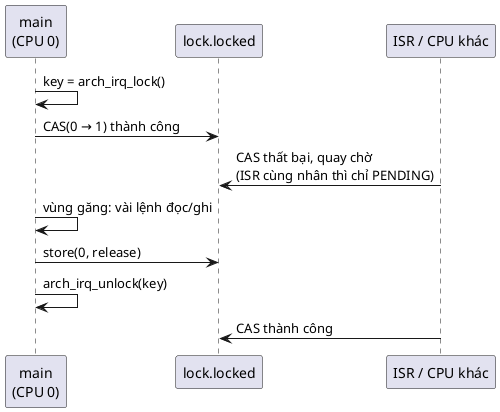

# 11 — Spinlock Pattern

📖 Bài giảng chi tiết: [LECTURE.md](LECTURE.md). File này là ghi chú tóm tắt, bám theo chương *Spinlock Pattern* của sách.

## Overview

Spinlock = **che ngắt trên CPU hiện tại (lưu key) + giành một biến atomic bằng CAS (chỉ khi nhiều nhân)**. Đây là tầng đồng bộ thấp nhất, nằm ngay trên ngắt phần cứng, và là nền móng của semaphore, mutex, condition variable. Trên chip một nhân, spinlock chỉ còn là che ngắt "trong chốc lát".

## Use Cases

- **Đồng bộ dữ liệu với ISR:** code nào dùng chung dữ liệu với một interrupt handler phải che (ít nhất) ngắt đó khi truy cập.
- **Đồng bộ giữa nhiều nhân:** ngắt có thể chạy trên nhân bất kỳ; chỉ atomic + memory barrier mới bảo đảm một ô nhớ chỉ bị một nhân sửa tại một thời điểm.
- Chỉ dùng ở tầng kernel/driver nói chuyện trực tiếp với ngắt. Code ứng dụng giữa các thread dùng mutex/semaphore.

## Benefits

- **Tổng quát:** một API cho cả một nhân lẫn nhiều nhân; đổi cờ build, không sửa code.
- **Rất nhẹ:** một nhân thì chỉ là vài lệnh che/mở ngắt.
- **Dùng được trong ISR**, kể cả để đồng bộ giữa các ISR trên nhiều nhân.

## Drawbacks

- **Không biết thread:** không ngủ, không có hàng đợi, không chuyển CPU sang thread khác.
- **Che ngắt:** trong lúc giữ, mọi sự kiện bị hoãn. Giữ lâu là hỏng độ trễ của cả hệ thống ("lock data, not code").

## Implementation

Xem [inc/spinlock.h](inc/spinlock.h), [inc/arch_irq.h](inc/arch_irq.h), [inc/rx_ring.h](inc/rx_ring.h), [src/rx_ring.c](src/rx_ring.c), [main.c](main.c). Bộ mô phỏng MCU trên PC: [src/sim_cpu.c](src/sim_cpu.c).

| Bước | Lock | Unlock |
|---|---|---|
| 1 | `key = arch_irq_lock()`: che ngắt, nhớ trạng thái cũ | `store(locked, 0, release)` |
| 2 | (đa nhân) quay `CAS(locked, 0 → 1, acquire)` | `arch_irq_unlock(key)`: khôi phục, chỉ mở khi key = 0 |

| 🔬 Kết quả `make run` | Không lock | Có lock |
|---|---|---|
| main += 8 vs ISR += 5, 10 000 ngắt, một nhân | mất 105–489 lần cộng của ISR | 0 |
| Ring buffer UART, 20 000 byte | kẹt 0–4 byte (race hiếm, mỗi lần một khác) | 0 |
| Hai nhân, 2 × 1 000 000 lần cộng, chỉ che ngắt | mất 135 000–180 000 | spinlock: 0 |
| ISR muốn lock mà main đang giữ | lock "chỉ quay": deadlock | spinlock: ISR pending, chạy ngay khi unlock |

## Best Practices

- **Dùng spinlock cả khi bare-metal:** code dễ chuyển sang RTOS hoặc chip nhiều nhân.
- **Lock data, not code:** vùng găng chỉ gồm đọc/ghi bộ nhớ, tốt nhất không gọi hàm nào.
- Lock đặt cạnh dữ liệu nó bảo vệ; mọi truy cập vào dữ liệu đó đều qua lock.
- Che ngắt **trước** khi CAS; thả biến **trước** khi mở ngắt.

## Common Pitfalls

- **Giữ lock qua lời gọi hàm:** hàm được gọi có thể chậm đi theo thời gian, kéo trễ mọi ngắt.
- **Mỗi instance một spinlock:** thường phí RAM; Zephyr hay dùng một lock `static` cho cả loại object.
- Lock lại chính spinlock đang giữ (deadlock trên đa nhân), `return` giữa vùng găng, tin `volatile` là đủ, mở ngắt vô điều kiện thay vì khôi phục key.

## Alternatives

- **Tắt ngắt trực tiếp:** chỉ đúng trên một nhân.
- **Khóa scheduler:** chặn thread khác nhưng không chặn ISR.
- 💡 Biến atomic (một biến đơn), ring buffer lock-free một người ghi một người đọc, mutex/semaphore cho đồng bộ giữa thread.

## Quiz

1. Spinlock được thiết kế để giải quyết vấn đề chính nào?
2. Vì sao spinlock hiện đại luôn che ngắt trên CPU hiện tại trước khi thử giành lock?
3. Vì sao phải lưu trạng thái ngắt vào `key` và khôi phục đúng trạng thái đó?
4. Vì sao không nên giữ spinlock qua lời gọi hàm?
5. Trên hệ một nhân, lock/unlock spinlock thực chất là gì?
6. Có được lock một spinlock khác trong lúc đang giữ một spinlock không?
7. Vì sao nên dùng spinlock thay cho che/mở ngắt trực tiếp, kể cả khi chưa cần đa nhân?
8. Vì sao so sánh spinlock với các primitive "biết thread" là hoàn toàn sai?

(Đáp án và 7 câu thêm trong [LECTURE.md](LECTURE.md#26-quiz-có-đáp-án).)

## Câu hỏi còn thắc mắc

-
