# Bài giảng 12 — Semaphore Pattern

> **Về nguồn:** Bài này bám theo chương *Semaphore Pattern* trong sách của Martin Schröder (bản 0.38.0, file `00_Document/Martin-Schroder-Design-Patterns-Semaphore-Pattern-0.38.0.pdf`).
> - 📖 đánh dấu nội dung **theo sách** (dịch và diễn giải lại).
> - 💡 đánh dấu phần **giải thích thêm**, không có trong sách.
> - 🔬 đánh dấu **thí nghiệm thật**: chương trình đã được build bằng gcc 16.2 (MSYS2 UCRT64, Windows 11 64-bit, CPU 16 luồng) và chạy; output in trong bài là output thật. Kết quả liên quan tới thời gian và thread **thay đổi mỗi lần chạy**, nên bài ghi lại nhiều lần chạy.

Code mẫu đi kèm: [inc/sem.h](inc/sem.h), [src/sem.c](src/sem.c), [inc/kthread.h](inc/kthread.h), [src/kthread.c](src/kthread.c), [inc/uart_tx.h](inc/uart_tx.h), [src/uart_tx.c](src/uart_tx.c), [inc/buf_pool.h](inc/buf_pool.h), [src/buf_pool.c](src/buf_pool.c), [inc/buf_queue.h](inc/buf_queue.h), [src/buf_queue.c](src/buf_queue.c), [main.c](main.c). Chép nguyên từ bài 11: [inc/spinlock.h](inc/spinlock.h), [inc/arch_irq.h](inc/arch_irq.h), [inc/sim_cpu.h](inc/sim_cpu.h), [src/sim_cpu.c](src/sim_cpu.c). Ghi chú ngắn: [README.md](README.md).
Bài trước: [11 — Spinlock](../11_SpinlockPattern/LECTURE.md). Bài sau: [13 — Mutex](../13_MutexPattern/LECTURE.md). Liên quan: [10 — Concurrency](../10_ConcurrencyPattern/LECTURE.md), [02 — Opaque](../02_OpaquePattern/LECTURE.md) (pool), [05 — Callback](../05_CallbackPattern/LECTURE.md), [14 — Conditional](../14_ConditionalPattern/LECTURE.md).

---

## Mục lục

**Phần A — Kiến thức nền**

1. [Bối cảnh: từ "khóa" sang "báo hiệu"](#1-bối-cảnh-từ-khóa-sang-báo-hiệu)
2. [Thread, bộ lập lịch và "ngủ" nghĩa là gì](#2-thread-bộ-lập-lịch-và-ngủ-nghĩa-là-gì)
3. [Chờ một sự kiện: polling và blocking](#3-chờ-một-sự-kiện-polling-và-blocking)
4. [Lost wakeup: vì sao "kiểm tra rồi ngủ" phải là một bước](#4-lost-wakeup-vì-sao-kiểm-tra-rồi-ngủ-phải-là-một-bước)
5. [Mô phỏng kernel trên PC: làm được gì, không làm được gì](#5-mô-phỏng-kernel-trên-pc-làm-được-gì-không-làm-được-gì)

**Phần B — Pattern**

6. [Vấn đề: hàm gửi phải chờ phần cứng mà không được polling](#6-vấn-đề-hàm-gửi-phải-chờ-phần-cứng-mà-không-được-polling)
7. [Ý tưởng cốt lõi: give ở nơi này, take ở nơi khác](#7-ý-tưởng-cốt-lõi-give-ở-nơi-này-take-ở-nơi-khác)
8. [4 đặc điểm nhận dạng và lý do của từng cái](#8-4-đặc-điểm-nhận-dạng-và-lý-do-của-từng-cái)
9. [Đọc code k_sem của Zephyr trong sách](#9-đọc-code-k_sem-của-zephyr-trong-sách)
10. [Count nghĩa là gì](#10-count-nghĩa-là-gì)
11. [Give từ ISR: CPU đi đâu tiếp theo](#11-give-từ-isr-cpu-đi-đâu-tiếp-theo)
12. [Binary và counting: khi các lần give bị gộp lại](#12-binary-và-counting-khi-các-lần-give-bị-gộp-lại)
13. [Semaphore không phải mutex](#13-semaphore-không-phải-mutex)

**Phần C — Đọc code**

14. [Đọc code mẫu từng dòng](#14-đọc-code-mẫu-từng-dòng)
15. [Theo dõi demo chạy từng bước](#15-theo-dõi-demo-chạy-từng-bước)
16. [Các quyết định thiết kế và phương án khác](#16-các-quyết-định-thiết-kế-và-phương-án-khác)

**Phần D — Thực tế và tổng kết**

17. [Semaphore trong RTOS thật](#17-semaphore-trong-rtos-thật)
18. [Chi phí: thời gian và bộ nhớ](#18-chi-phí-thời-gian-và-bộ-nhớ)
19. [Test code dùng semaphore](#19-test-code-dùng-semaphore)
20. [Trade-off](#20-trade-off)
21. [Khi nào không nên dùng, và các lựa chọn khác](#21-khi-nào-không-nên-dùng-và-các-lựa-chọn-khác)
22. [Lỗi hay gặp](#22-lỗi-hay-gặp)
23. [Quy trình refactor: từ cờ polling sang semaphore](#23-quy-trình-refactor-từ-cờ-polling-sang-semaphore)
24. [Câu hỏi thường gặp (FAQ)](#24-câu-hỏi-thường-gặp-faq)
25. [Tóm tắt và checklist](#25-tóm-tắt-và-checklist)
26. [Quiz (có đáp án)](#26-quiz-có-đáp-án)
27. [Bài tập](#27-bài-tập)

---

# Phần A — Kiến thức nền

Bài 11 trả lời câu hỏi *"làm sao để hai bên không đụng nhau?"*. Bài này trả lời một câu hỏi khác hẳn: *"làm sao để một bên **chờ** bên kia mà không tốn CPU, và tỉnh dậy đúng lúc?"*. Muốn trả lời, ta cần hiểu bộ lập lịch (scheduler) làm gì với một thread đang "ngủ".

## 1. Bối cảnh: từ "khóa" sang "báo hiệu"

### 1.1. Nhìn lại bài 11 bằng code

Sau bài 11, ring buffer UART đã an toàn giữa ISR và main:

```c
struct rx_ring {
	uint8_t buf[RX_RING_SIZE];
	size_t head;
	size_t tail;
	size_t count;
	uint32_t overrun;
	struct spinlock lock;
};
```

Và main loop đọc nó như sau (demo 2 của bài 11):

```c
	while (!sim_irq_done()) {
		/* main loop bận việc khác một lúc, rồi đọc hết những gì đã nhận */
		sim_busy_wait_us(100);
		while (ring_get(&byte) == 0) {
			...
		}
	}
```

Dữ liệu thì đúng, nhưng main **không biết khi nào có dữ liệu**. Nó phải hỏi đi hỏi lại: "có byte nào chưa?". Hỏi thưa quá thì phản ứng chậm, hỏi dày quá thì đốt CPU. Spinlock không giúp được: 📖 *"Unlike mutex, a spinlock has no possibility to redirect execution to another thread once it is unlocked."* Spinlock chỉ biết **chặn**, không biết **đánh thức**.

**Bài 10 (Concurrency)** đã nói tới đúng chỗ thiếu này. 📖 Chương Concurrency viết: *"When one thread needs to wait for a signal, it waits for a semaphore. When another thread or interrupt code unblocks this semaphore - the thread that was waiting can be switched to immediately. We just don't get this kind of flexibility with hardware interrupts alone."* Và lợi ích đầu tiên của concurrency là tiết kiệm điện: CPU vào trạng thái `WFI`/`WFE` khi không có gì để làm, điều *"impossible to achieve when your application must poll for changes"*.

**Bài 2 (Opaque)** để lại một pool tĩnh chưa an toàn. Bài 11 đã thêm spinlock cho nó (mục 23 của bài 11). Nhưng khi pool **hết**, `uart_pool_get()` chỉ biết trả `NULL`. Caller muốn "chờ tới khi có slot" thì lại phải polling. Bài này làm cho pool biết **cho người xin ngủ** và **đánh thức** khi có slot trả về (mục 14.4).

### 1.2. Một dự án lớn dần: driver modem qua sáu lần sửa

💡 *Tình huống minh họa (không phải ví dụ trong sách), nhưng mỗi bước là một lỗi có thật trong các dự án firmware. Các con số được đo bằng thí nghiệm trong bài.*

#### Tháng 1: polling cờ phần cứng

Bộ thu thập dữ liệu chạy pin, gửi lệnh AT cho modem qua UART. Hàm gửi viết thẳng:

```c
void modem_send(const uint8_t *data, size_t len)
{
	for (size_t i = 0; i < len; i++) {
		while (!(USART2->SR & USART_SR_TXE)) {
		}
		USART2->DR = data[i];
	}
	while (!(USART2->SR & USART_SR_TC)) {
	}
}
```

(Code cho STM32 thật, cần header CMSIS của ST để build.)

Chạy đúng. Nhưng một lệnh 32 byte ở 9600 baud mất 33 ms, và suốt 33 ms đó CPU **chạy hết tốc lực** trong vòng `while`. 🔬 Mục 3 đo trên PC: chờ một sự kiện 500 ms bằng polling tốn **500 ms CPU**; chờ bằng semaphore tốn **0 ms**. Thiết bị chạy pin chịu không nổi.

#### Tháng 3: cờ do ISR bật

Bạn khác chuyển sang ngắt: ISR "TX complete" đặt `volatile bool tx_done = true;`, còn main loop là một state machine kiểm tra cờ đó ở mỗi vòng. CPU được rảnh, nhưng code của `modem_send` vốn tuần tự ("gửi, chờ, đọc trả lời") bị băm nhỏ thành các trạng thái, khó đọc và khó sửa. 📖 Chương Concurrency gọi đúng tên vấn đề: ta có thể *"make our code into a state machine (making the sequential task much less obvious) or [...] keep our code sequential but separate the different sequences of operations into multiple threads"*.

#### Tháng 4: chuyển sang RTOS, thread chờ bằng `sleep(1)`

Dự án chuyển sang RTOS, mỗi việc một thread. Thread modem chờ cờ bằng vòng `while (!tx_done) { k_sleep(K_MSEC(1)); }`. Đọc dễ hơn, nhưng thread tỉnh dậy **1000 lần mỗi giây** chỉ để thấy cờ chưa bật, và phản ứng trễ tới 1 ms sau khi phần cứng xong.

#### Tháng 6: binary semaphore

Một người đọc tài liệu RTOS và thay cờ bằng semaphore: ISR gọi `sem_give()`, thread gọi `sem_take()`. Thread **ngủ hẳn**, không tốn CPU, và được đánh thức **ngay** khi ngắt xảy ra. Code vẫn tuần tự như tháng 1. Đây chính là ví dụ `some_device_transmit()` của sách (mục 6). 🔬 Demo 1: gửi 8 byte ở 9600 baud (thời gian trên dây 8,3 ms), hàm trả về sau 8,9 ms.

#### Tháng 7: "thỉnh thoảng thread modem treo vĩnh viễn"

Ngoài hiện trường, modem bị nhiễu, UART báo lỗi khung (framing error). ISR được viết `if (no_error) sem_give(&done);`, tức là nhánh lỗi **không give**. Thread chờ `sem_take(K_FOREVER)` không bao giờ tỉnh. 📖 Sách gọi lỗi này là *"Semaphore never given"*. 🔬 Mục 19 tái hiện: ISR lỗi + `K_FOREVER` thì chương trình treo tới khi bị giết; sửa ISR give trên mọi nhánh thì hàm trả `-EIO` sau 1 ms.

#### Tháng 9: dùng semaphore làm "khóa" cho bus I2C

Thấy semaphore tiện, một bạn dùng binary semaphore để bảo vệ bus I2C dùng chung giữa ba thread. Hai lỗi xuất hiện:
- Một nhánh xử lý lỗi gọi `sem_give()` dù thread đó không hề `take`. Semaphore không biết ai đang giữ nó, nên chấp nhận. 🔬 Mục 13: hai thread cùng ở trong vùng găng 26–40 lần trên 400 000 lượt.
- Thread ưu tiên cao bị một thread ưu tiên thấp chặn lâu bất thường (**priority inversion**, mục 13.3).

Sách nói rõ: semaphore là để **báo hiệu**, không phải để **loại trừ lẫn nhau**. Việc đó là của mutex (bài 13).

#### Nhìn lại

| Tháng | Cách chờ | Vấn đề | Bài học |
|---|---|---|---|
| 1 | Polling thanh ghi | Đốt 100% CPU khi chờ | Cần cách chờ không tốn CPU |
| 3 | Cờ + state machine | Code tuần tự bị băm nát | Muốn code tuần tự thì cần thread |
| 4 | Thread + `sleep(1)` + cờ | Thức dậy vô ích, trễ 1 ms | Cần được **đánh thức** đúng lúc |
| 6 | Semaphore | Giải quyết được | Give ở ISR, take ở thread |
| 7 | Semaphore, ISR quên give nhánh lỗi | Thread treo vĩnh viễn | Give trên **mọi** nhánh; dùng timeout |
| 9 | Semaphore làm khóa | Ai cũng give được; priority inversion | Loại trừ lẫn nhau thì dùng mutex |

### 1.3. Đọc kỹ định nghĩa của sách

📖 Câu mở đầu chương:

> *"The semaphore pattern is one step above the spinlock pattern and is in fact implemented using spinlocks. But it has one key difference: instead of targeting mutual exclusion, the semaphore pattern is designed to solve the problem of signaling between application multiple application level threads or application level threads and interrupt handlers."*
>
> *Semaphore pattern nằm trên spinlock một bậc và thật ra được cài đặt bằng spinlock. Nhưng có một khác biệt then chốt: thay vì nhắm tới loại trừ lẫn nhau, semaphore được thiết kế để giải bài toán **báo hiệu** giữa các thread ứng dụng, hoặc giữa thread ứng dụng và interrupt handler.*

Từng vế:

| Vế | Nghĩa là gì |
|---|---|
| *"one step above the spinlock pattern"* | Xếp chồng lên bài 11, không thay thế nó |
| *"implemented using spinlocks"* | Bên trong, mọi thao tác với `count` và hàng đợi đều nằm trong spinlock (mục 9) |
| *"instead of targeting mutual exclusion"* | Mục đích **không phải** là chặn hai bên cùng vào một vùng găng |
| *"signaling"* | Mục đích là **báo hiệu**: "chuyện X đã xảy ra", "có việc rồi" |
| *"between [...] threads or [...] threads and interrupt handlers"* | Người báo có thể là thread hoặc ISR; người chờ luôn là thread |

📖 Và câu thứ hai:

> *"The semaphore pattern thus provides the much needed link on top of the spinlock which allows us to decide where our CPU is going to jump next after a piece of code has executed (and "given" a semaphore)."*
>
> *Semaphore cung cấp mắt xích còn thiếu trên spinlock: nó cho phép quyết định CPU sẽ nhảy tới đâu tiếp theo sau khi một đoạn code chạy xong (và "give" semaphore).*

Chữ quan trọng là **"where our CPU is going to jump next"**. Spinlock không bao giờ quyết định CPU đi đâu. Semaphore thì có: give là một lời nhắn cho bộ lập lịch "hãy cho thread đang chờ chạy".

Viết gọn thành công thức:

> **Semaphore = spinlock (bảo vệ bên trong) + bộ đếm tài nguyên rảnh + hàng đợi thread đang chờ, sắp theo ưu tiên**

### 1.4. Semaphore trong nhóm Concurrency

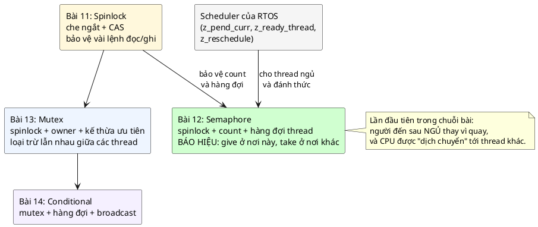

| | Spinlock (bài 11) | **Semaphore (bài 12)** | Mutex (bài 13) |
|---|---|---|---|
| Mục đích | Bảo vệ dữ liệu | **Báo hiệu** | Bảo vệ dữ liệu |
| Biết thread? | Không | **Có** | Có |
| Người chờ làm gì? | Quay vòng | **Ngủ trong hàng đợi** | Ngủ trong hàng đợi |
| Dùng trong ISR? | Có | **Give: có. Take: chỉ khi không chờ** | Không |
| Biết ai đang giữ? | Không (VALIDATE thì biết CPU) | **Không** | Có (owner) |
| Kế thừa ưu tiên? | Không | **Không** | Có |
| Có bộ đếm? | Không | **Có** | Chỉ đếm khóa lồng |
| Ai give/unlock? | Người đã lock | **Bất kỳ ai** | Chỉ owner |

📖 Sách khẳng định ba điều semaphore **không** có: *"The semaphore is not designed as a mutual exclusion mechanism. It does not have priority inheritance. It does not track what thread is holding it - like a mutex would do. Thus the primary class of use cases for a semaphore is signalling."*

### 1.5. Câu hỏi bài này sẽ trả lời

1. Thread "ngủ" nghĩa là gì, và ai đánh thức nó? (mục 2)
2. Vì sao chờ bằng semaphore không tốn CPU còn polling thì có? (mục 3)
3. Vì sao "kiểm tra count rồi đi ngủ" phải là một bước không chia cắt được? (mục 4)
4. `count` thật ra đếm cái gì, và vì sao give **không** tăng count khi có người chờ? (mục 10)
5. Give từ ISR thì khi nào thread được chạy? (mục 11)
6. Vì sao không dùng semaphore thay mutex? (mục 13)

---

## 2. Thread, bộ lập lịch và "ngủ" nghĩa là gì

### 2.1. Thread nhìn từ phía CPU

💡 Một CPU chỉ có **một bộ thanh ghi**: `r0`–`r12`, `sp` (stack pointer), `lr`, `pc` (lệnh tiếp theo), `xPSR`. Tại mỗi thời điểm, bộ thanh ghi đó **là** trạng thái của đoạn code đang chạy.

Một **thread** là một dòng chảy code có **stack riêng**, và một vùng nhớ gọi là **TCB** (Thread Control Block) để cất bộ thanh ghi khi thread không chạy. 📖 Chương Concurrency: *"Each CPU core has a set of registers that define current state of the CPU core and which instruction it is going to fetch next. Context switching means to save and restore this state to control where the CPU will execute the next instruction."*

**Chuyển ngữ cảnh** (context switch) từ thread A sang thread B:
1. Cất các thanh ghi của A vào stack/TCB của A.
2. Nạp các thanh ghi của B từ TCB của B, trong đó có `sp` và `pc`.
3. CPU chạy tiếp ở `pc` của B, trên stack của B, như thể B chưa từng dừng.

📖 Trên ARM, việc này do một ngắt phần mềm đặc biệt làm: *"Software concurrency: this level is supported by special interrupts (PendSV and SVC on arm) and is able to switch software contexts (threads) when instructed to do so either by a timer interrupt or by an explicit CPU instruction (you 'pend' the switch and then it happens when CPU considers it safe to do it)."*

### 2.2. Ba trạng thái quan trọng của thread

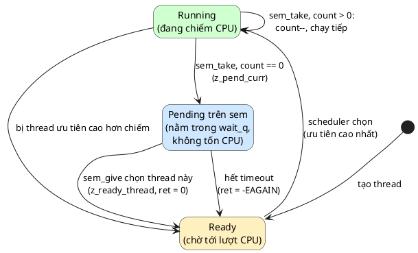

- **Running:** đang chạy trên CPU.
- **Ready:** sẵn sàng chạy, đang chờ tới lượt. Scheduler luôn chọn thread Ready có ưu tiên **cao nhất** (Zephyr: số **nhỏ** là ưu tiên cao).
- **Pending** (Zephyr gọi là *pended*, nhiều tài liệu gọi là *blocked*): đang chờ một thứ gì đó (semaphore, mutex, timeout). Thread pending **không bao giờ được scheduler chọn**, nên không tốn chút CPU nào, cho tới khi ai đó chuyển nó về Ready.

"Ngủ trên semaphore" chính xác là: **chuyển sang Pending, và móc TCB của mình vào hàng đợi của semaphore**. "Đánh thức" là: **gỡ TCB ra khỏi hàng đợi, chuyển về Ready**.

💡 Khi **không** có thread nào Ready, RTOS chạy **idle thread**, và idle thread thường chỉ làm một việc: lệnh `WFI` (wait for interrupt), cho CPU ngủ tới khi có ngắt. Đây là chỗ tiết kiệm điện mà bài 10 nói tới.

### 2.3. Vì sao ISR không bao giờ được ngủ

💡 ISR không phải thread: nó không có TCB, chạy trên stack của thread bị nó chen ngang (hoặc stack riêng cho ngắt), và phần cứng đang giữ trạng thái "đang phục vụ ngắt". Nếu ISR "ngủ", không có chỗ nào để cất nó, và thread bị chen ngang cũng không chạy tiếp được. 📖 Chương Concurrency: *"You can not execute sequences that must sleep from inside an interrupt."*

Hệ quả cho semaphore:
- ISR được **give** (give không bao giờ ngủ).
- ISR được **take với `K_NO_WAIT`** (thử lấy, không được thì thôi).
- ISR **không được take có chờ**. 📖 Zephyr kiểm tra điều này ngay dòng đầu của `k_sem_take` (mục 9.2).

---

## 3. Chờ một sự kiện: polling và blocking

### 3.1. Hai cách chờ

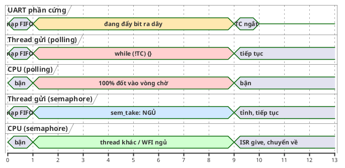

- **Polling** (busy-wait): hỏi liên tục. Đơn giản, phản ứng nhanh, nhưng chiếm trọn CPU trong suốt thời gian chờ.
- **Blocking**: đăng ký "khi nào xong thì gọi tôi", rồi nhường CPU. Cần một cơ chế để "gọi": đó là semaphore.

### 3.2. 🔬 Đo CPU time thật

File `cpu_cost.c`: một "phần cứng" giả lập báo xong sau 500 ms. Main chờ hai lần: lần đầu polling một cờ atomic, lần sau `sem_take(K_FOREVER)`. Đo cả thời gian thực (wall) và **thời gian CPU mà thread main tiêu thụ** (`CLOCK_THREAD_CPUTIME_ID`). Phần chính (trích, `...` là các tham số in ra):

```c
	sim_irq_start(&irq);
	while (!atomic_load(&done_flag)) {
	}
	printf("polling  : waited %.0f ms wall, used %.0f ms CPU\n", ...);
	...
	sim_irq_start(&irq);
	sem_take(&done_sem, K_FOREVER);
	printf("sem_take : waited %.0f ms wall, used %.0f ms CPU\n", ...);
```

Hai lần chạy:

```
polling  : waited 501 ms wall, used 500 ms CPU
sem_take : waited 500 ms wall, used 0 ms CPU
polling  : waited 500 ms wall, used 500 ms CPU
sem_take : waited 500 ms wall, used 0 ms CPU
```

Cùng chờ nửa giây. Polling tiêu tốn **toàn bộ** nửa giây CPU; semaphore tiêu tốn **không** (dưới 1 ms, làm tròn thành 0). Trên MCU chạy pin, 500 ms CPU chạy hết tốc lực so với 500 ms ngủ `WFI` là khác biệt giữa pin dùng vài ngày và pin dùng vài tháng.

💡 Trên PC, thread "ngủ" nhờ hệ điều hành Windows; trên MCU, nhờ scheduler của RTOS chuyển sang thread khác hoặc idle. Cơ chế khác nhau, nguyên lý như nhau: thread đang chờ **không được chọn để chạy**.

---

## 4. Lost wakeup: vì sao "kiểm tra rồi ngủ" phải là một bước

### 4.1. Thử tự làm semaphore

Ý tưởng tự nhiên: `take` kiểm tra `count` dưới spinlock; nếu 0 thì ghi nhận "có người chờ", thả spinlock, rồi **đi ngủ**. `give` thấy có người chờ thì **đánh thức**.

```c
static int naive_take(struct naive_sem *s)
{
	struct spinlock_key key = spinlock_lock(&s->lock);
	if (s->count > 0) {
		s->count--;
		spinlock_unlock(&s->lock, key);
		return 0;
	}
	s->waiting = true;
	spinlock_unlock(&s->lock, key);

	sleep_ms(20); /* khe hở: trên MCU chỉ vài lệnh, ở đây kéo dài để thấy rõ */

	struct timespec deadline;
	clock_gettime(CLOCK_REALTIME, &deadline);
	deadline.tv_sec += 1;
	pthread_mutex_lock(&s->mtx);
	int r = pthread_cond_timedwait(&s->cv, &s->mtx, &deadline);
	pthread_mutex_unlock(&s->mtx);
	return r == ETIMEDOUT ? -EAGAIN : 0;
}

static void naive_give(struct naive_sem *s)
{
	struct spinlock_key key = spinlock_lock(&s->lock);
	if (s->waiting) {
		s->waiting = false;
		pthread_cond_signal(&s->cv); /* chưa ai nằm trên cv: tín hiệu biến mất */
	} else {
		s->count++;
	}
	spinlock_unlock(&s->lock, key);
}
```

(Trích từ thí nghiệm `lost_wakeup.c`; `pthread_cond_*` ở đây chỉ đóng vai "cái giường để ngủ và cái chuông để gọi dậy" của hệ điều hành. Condition variable là chủ đề của bài 14.)

Lỗi nằm ở khe hở giữa `spinlock_unlock` và lúc thật sự nằm xuống ngủ. Nếu `give` rơi đúng vào khe hở đó:

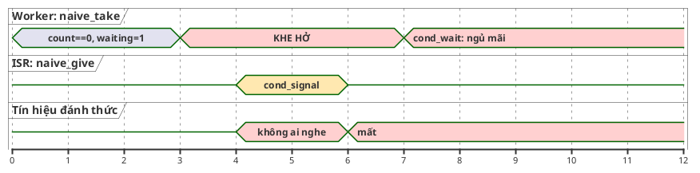

`give` thấy `waiting == true` nên không tăng `count`, mà gửi tín hiệu đánh thức. Nhưng worker chưa nằm xuống, nên tín hiệu **không ai nhận** và biến mất. Rồi worker nằm xuống ngủ, chờ một tín hiệu đã qua. Lỗi này có tên: **lost wakeup**.

### 4.2. 🔬 Tái hiện, và cách sửa

File `lost_wakeup.c`: ISR giả lập give sau 5 ms, rơi vào khe hở 20 ms. Rồi chạy lại đúng kịch bản đó với `sem_take()` của code mẫu, trong đó **cũng chèn một khe hở 20 ms** vào cùng chỗ (bản sao `kthread_gap.c`, khác `kthread.c` đúng một dòng `nanosleep` sau `spinlock_unlock`). Hai lần chạy:

```
naive sem : take -> -11 (1 s timeout, -EAGAIN=-11)
sem.c     : take -> 0
naive sem : take -> -11 (1 s timeout, -EAGAIN=-11)
sem.c     : take -> 0
```

- Bản tự chế: worker **không bao giờ tỉnh**, chỉ thoát được nhờ timeout 1 giây. Với `K_FOREVER`, đó là treo vĩnh viễn.
- Bản của code mẫu: tỉnh đúng, **dù có cùng một khe hở 20 ms**.

Bí quyết của code mẫu (chi tiết ở mục 14.1): worker **khóa "cửa phòng ngủ" của mình trước khi thả spinlock**. Give đến trong khe hở phải chờ ở cửa, tới khi worker đã nằm hẳn xuống:

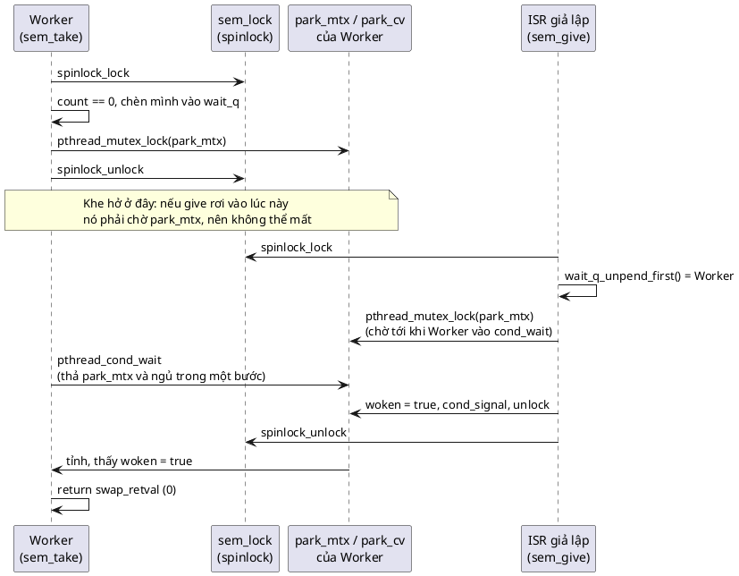

Thêm một lớp an toàn: `give` không chỉ "rung chuông" mà còn **ghi `woken = true` vào TCB** của worker. Worker kiểm tra `woken` trong vòng lặp, nên kể cả khi chuông rung sớm hay rung nhầm, worker vẫn biết chắc mình đã được chọn hay chưa.

📖 Đây chính là lý do Zephyr truyền **cả spinlock** vào hàm cho thread ngủ: `z_pend_curr(&lock, key, &sem->wait_q, timeout)`. Hàm đó *thả spinlock và đưa thread vào trạng thái pending như một bước không thể chen ngang*. Chương Conditional của sách nói rõ cơ chế này ở `k_condvar_wait`: *"we pass this spinlock to the z_pend_curr which will pend current thread and only unlock the spinlock after it has completed this action. This ensures atomicity."*

---

## 5. Mô phỏng kernel trên PC: làm được gì, không làm được gì

PC không có RTOS. Để demo chạy bằng `make run`, bài này có một "kernel" tối giản: [inc/kthread.h](inc/kthread.h), [src/kthread.c](src/kthread.c). Bảng đối chiếu với Zephyr:

| Zephyr (trong sách) | Code mẫu | Trên PC làm bằng |
|---|---|---|
| `struct k_thread` (TCB) | `struct kthread` | Struct trên stack của mỗi thread |
| `_current` | `kthread_current()` | Biến `_Thread_local` |
| `_wait_q_t` (sắp theo ưu tiên) | `struct wait_q` | Danh sách liên kết, chèn theo `prio` |
| `z_pend_curr(&lock, key, &wq, timeout)` | `wait_q_pend_curr(...)` | Khóa `park_mtx`, thả spinlock, `pthread_cond_(timed)wait` |
| `z_unpend_first_thread(&wq)` | `wait_q_unpend_first()` | Gỡ phần tử đầu danh sách |
| `arch_thread_return_value_set()` + `z_ready_thread()` | `kthread_ready(t, retval)` | Ghi `swap_retval`, `woken = true`, `pthread_cond_signal` |
| `z_reschedule(&lock, key)` | `spinlock_unlock()` | Không làm gì thêm: Windows tự cho thread vừa tỉnh chạy |
| ISR | Thread "phần cứng" của `sim_cpu.c`, chế độ `preempt = false` | Chạy song song, đánh dấu `in_isr` |

### 5.1. Những gì bộ mô phỏng KHÔNG tái hiện được

| Trên RTOS thật (một nhân) | Trên PC |
|---|---|
| Scheduler **ưu tiên** quyết định ai chạy: give cho thread ưu tiên cao hơn thì chuyển ngay | Windows tự lập lịch, 16 luồng chạy song song. `prio` của code mẫu **chỉ** quyết định thứ tự trong hàng đợi semaphore, không quyết định ai được CPU |
| Give từ ISR chỉ "pend" PendSV; thread chạy **sau khi ISR return** | ISR giả lập chạy song song trên thread khác; thread vừa tỉnh có thể chạy ngay trong lúc "ISR" chưa xong |
| ISR chen ngang thread trên cùng nhân | Chế độ `preempt = true` của bài 11 **không dùng được** ở đây: nếu thread bị dừng đúng lúc đang giữ `park_mtx` (một mutex của hệ điều hành), ISR gọi `sem_give` sẽ chờ mutex đó mãi. RTOS thật không gặp chuyện này vì dữ liệu của scheduler được bảo vệ bằng spinlock (che ngắt) |
| Priority inversion có thể xảy ra (mục 13.3) | Không tái hiện được: không có scheduler ưu tiên trên một nhân. Chỉ giải thích bằng sơ đồ |
| Timeout tính bằng tick của RTOS (thường 1 ms hoặc nhỏ hơn) | Timeout của Windows làm tròn lên: 🔬 `take(30 ms)` trả về sau 31–49 ms tùy lần |

Nói gọn: mô hình trên PC giống một **hệ nhiều nhân** hơn là một MCU một nhân. Thuật toán của semaphore (count, hàng đợi, không mất tín hiệu) được kiểm chứng đầy đủ; phần "CPU nhảy sang thread nào, lúc nào" thì chỉ giải thích, không đo được.

💡 Vì sao ở đây được dùng mutex/condvar của pthread, trong khi bài 13–14 mới học mutex và condvar? Vì chúng chỉ đóng vai **phần của hệ điều hành** mà semaphore cần nhờ: "cho thread này ngủ" và "đánh thức thread kia". Trong RTOS, đó là `z_pend_curr`/`z_ready_thread`. Code của **semaphore** (file `sem.c`) không gọi pthread nào cả; nó chỉ gọi spinlock và các hàm của `kthread.c`.

---

# Phần B — Pattern

## 6. Vấn đề: hàm gửi phải chờ phần cứng mà không được polling

📖 Sách đặt bài toán: một thao tác phần cứng kéo dài (nạp dữ liệu vào FIFO rồi truyền ra dây), khi xong thì phần cứng phát ngắt. Ta muốn một hàm **nạp dữ liệu, nhường CPU trong lúc phần cứng làm việc, và chỉ return khi phần cứng báo xong**:

```c
void some_device_transmit(
    struct some_device *self,
    const void *data,
    size_t size){
    // (1) load device registers
    // (2) suspend this function until operation is done
    // (3) continue and return only once the operation is done
}
```

📖 Ràng buộc cứng: *"We have a hard requirement that we can not sit and poll the device while we are waiting for it. Instead, we would like the CPU to either be put to low power mode or for it to jump to some other code that needs to run, while we are waiting for the resource to become available again."*

📖 Và lời giải: *"The solution to this problem is a semaphore."* Semaphore phải *"work closely with the RTOS scheduler"* và phải *"work from an interrupt meaning that we must be able to unblock a task waiting for a semaphore from an interrupt handler"*.

Bước (2) là chỗ khó: "tạm dừng hàm này" nghĩa là **đóng băng cả thread** đang chạy nó, giữ nguyên biến cục bộ, vị trí đang chạy dở, rồi sau này **tiếp tục đúng từ chỗ đó**. Chỉ scheduler mới làm được điều đó (mục 2.1), và semaphore là cách nói chuyện với scheduler.

---

## 7. Ý tưởng cốt lõi: give ở nơi này, take ở nơi khác

### 7.1. Hai thao tác

- **take**: "tôi cần một suất". Còn suất thì lấy ngay và chạy tiếp; hết thì **ngủ** trong hàng đợi.
- **give**: "trả một suất / báo một sự kiện". Có người đang ngủ chờ thì đánh thức người đó; không ai chờ thì tăng bộ đếm để người đến sau lấy ngay.

📖 Sách ví với đèn tín hiệu đường sắt: *"A semaphore in software works just like a railroad semaphore - the code will be paused (while other tasks can still run) until the semaphore can be taken. When another task gives the semaphore then our task that is waiting to take is able to acquire it."*

📖 Code của sách cho bài toán ở mục 6:

```c
struct some_device {
    struct k_sem done;
};

// this will be called asynchronously by hardware
static void some_device_isr(void){
    struct some_device *self = &_instance_of_device;
    // check whether transmission is completed
    // ...
    // signal that operation is done
    k_sem_give(&self->done)
}

void some_device_transmit(
    struct some_device *self,
    const void *data,
    size_t size){
    // (1) load device registers
    // ...
    // (2) suspend this function until operation is done
    k_sem_take(&self->done);
    // (3) continue and return only once the operation is done
    // ...
}
```

(Code Zephyr chép từ sách, cần header Zephyr để build; dòng `k_sem_give(&self->done)` trong sách thiếu dấu `;`, và `k_sem_take` thật của Zephyr nhận thêm tham số timeout. Bản tương đương build được là [src/uart_tx.c](src/uart_tx.c), đọc ở mục 14.3.)

### 7.2. "Dịch chuyển tức thời" CPU

📖 Câu ví von đáng nhớ nhất của chương: *"we are now able to call k_sem_give() in one thread (or interrupt) and come out of k_sem_take() in another thread at first valid opportunity. A semaphore thus almost works like a teleporter for our CPU core by teleporting it to different places in code which are market by a call to k_sem_take()."*

Nhìn từ phía thread gửi: nó gọi `k_sem_take()` và "biến mất", rồi một lúc sau "xuất hiện lại" ở dòng ngay sau `k_sem_take()`, với mọi biến cục bộ y nguyên. Trong khoảng giữa, CPU đã đi làm việc khác (hoặc ngủ), và chính lời gọi `k_sem_give()` trong ISR là thứ "kéo" CPU quay về.

### 7.3. 🔬 Demo 1: gửi UART và chờ ngắt "gửi xong"

```c
static void demo_uart_tx(void)
{
	static const uint8_t cmd[] = "AT+CSQ\r\n";
	struct uart_tx uart;

	uart_tx_init(&uart, "UART1", 9600);

	double t0 = now_ms();
	int ret = uart_tx_transmit(&uart, cmd, sizeof(cmd) - 1, 100);
	printf("  transmit %u bytes @9600: ret=%d after %.1f ms (wire time %.1f ms)\n", ...);

	uart_tx_inject_fault(&uart);
	ret = uart_tx_transmit(&uart, cmd, sizeof(cmd) - 1, 100);
	printf("  transmit with line fault: ret=%d (-EIO=%d), thread did not hang\n", ret, -EIO);
}
```

(Trích từ [main.c](main.c), phần `printf` rút gọn.) Ba lần chạy:

```
  transmit 8 bytes @9600: ret=0 after 8.9 ms (wire time 8.3 ms)
  transmit with line fault: ret=-5 (-EIO=-5), thread did not hang
  transmit 8 bytes @9600: ret=0 after 9.0 ms (wire time 8.3 ms)
  transmit 8 bytes @9600: ret=0 after 8.9 ms (wire time 8.3 ms)
```

- 8 byte × 10 bit / 9600 baud ≈ 8,3 ms trên dây. Hàm trả về sau 8,9–9,0 ms. Phần chênh khoảng 0,6 ms là chi phí tạo thread phần cứng giả lập và đánh thức thread của Windows.
- Lần thứ hai, phần cứng báo lỗi. ISR vẫn give, hàm trả `-EIO` thay vì treo.

---

## 8. 4 đặc điểm nhận dạng và lý do của từng cái

📖 Sách liệt kê 4 đặc điểm (*Defining Characteristics*).

### 1. Give/Take

📖 *"Give increments the internal counter and marks the semaphore as free. Take decrements the counter or queues current thread in the semaphore's internal queue until it becomes free again."*

**Tại sao hai thao tác, không phải lock/unlock:** tên gọi nói lên ý đồ. Lock/unlock gợi ý "cùng một người khóa rồi mở". Give/take gợi ý "một người đưa, người khác nhận". 💡 Câu mô tả của sách hơi đơn giản hóa: give chỉ tăng count khi **không** có ai chờ (mục 10).

### 2. Có bộ đếm (counting)

📖 *"the semaphore is usually implemented as a counting semaphore - meaning that it can be taken multiple times without delay and then once the counter reaches zero, the semaphore will queue the calling thread until another thread gives the semaphore. For simple signalling, the semaphore usually has a count of 1 or 0 meaning that it can only be either free or taken."*

**Tại sao:** bộ đếm nhớ được các lần give **chưa ai nhận**. Give trước, take sau vẫn đúng (không như "rung chuông" ở mục 4). Với `limit = 1` ta có **binary semaphore**, dùng cho "xong rồi"; với `limit > 1` ta đếm được nhiều sự kiện hoặc nhiều tài nguyên (mục 12, 14.5).

### 3. Biết thread (thread aware)

📖 *"it can instruct the OS scheduler to jump to a new piece of code when one other piece of code gives the semaphore. This is different from simple spinlock."*

**Tại sao:** đây là điều phân biệt semaphore với spinlock. Spinlock chỉ có "đang bị giữ / tự do". Semaphore nói chuyện với scheduler để cho thread ngủ và đánh thức thread.

### 4. Giữ hàng đợi thread, sắp theo ưu tiên

📖 *"multiple threads can wait on the same semaphore and these are maintained in a priority queue of waiting threads inside the semaphore data structure. This allows the semaphore logic to wake up the highest priority thread when a semaphore is given [...] instead the threads are swapped out and not returned to until the semaphore is given."*

**Tại sao sắp theo ưu tiên chứ không phải ai đến trước:** trong hệ real-time, thread ưu tiên cao là thread có deadline gắt nhất. Nếu nó phải xếp hàng sau thread ưu tiên thấp chỉ vì đến muộn hơn vài micro giây, deadline bị phá.

🔬 Demo 3: ba thread vào chờ theo thứ tự logger (prio 5), motor (prio 1), ui (prio 3); một ISR give ba lần, cách nhau 20 ms:

```
3) three threads wait, ISR gives three times
  waiting order: logger(prio 5), motor(prio 1), ui(prio 3)
  wake order   : motor(prio 1), ui(prio 3), logger(prio 5)
```

Kết quả giống hệt ở cả ba lần chạy.

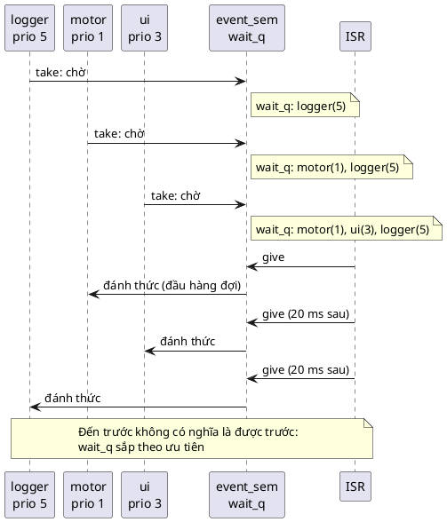

💡 Hai thread **cùng** ưu tiên thì ai đến trước được trước (FIFO), để không ai bị chen hàng mãi. Code mẫu làm vậy bằng cách chèn **sau** mọi thread có ưu tiên cao hơn **hoặc bằng** (mục 14.1).

---

## 9. Đọc code k_sem của Zephyr trong sách

📖 Sách trích code thật của Zephyr. Đây là phần quan trọng nhất của chương, đọc từng dòng.

### 9.1. `z_impl_k_sem_give`

```c
void z_impl_k_sem_give(struct k_sem *sem)
{
	k_spinlock_key_t key = k_spin_lock(&lock);
	struct k_thread *thread;

	thread = z_unpend_first_thread(&sem->wait_q);

	if (thread != NULL) {
		arch_thread_return_value_set(thread, 0);
		z_ready_thread(thread);
	} else {
		sem->count += (sem->count != sem->limit) ? 1U : 0U;
		handle_poll_events(sem);
	}

	z_reschedule(&lock, key);
}
```

(Code Zephyr chép từ sách; cần mã nguồn Zephyr để build.)

| Dòng | Làm gì | Tại sao |
|---|---|---|
| `k_spin_lock(&lock)` | Lấy spinlock (bài 11) | 📖 *"used to maintain mutual exclusion up until the point that we have successfully rescheduled"*. `count` và `wait_q` được cả ISR lẫn thread sửa. Chú ý `lock` là **một biến `static` dùng chung cho mọi semaphore**, đúng như pitfall "multiple instances" của bài 11 |
| `z_unpend_first_thread(&sem->wait_q)` | Lấy thread **đầu hàng đợi** | 📖 *"The queue is already sorted by priority so when we get one thread from it, it will always be the highest priority thread."* |
| `arch_thread_return_value_set(thread, 0)` | Ghi sẵn **giá trị trả về** của `k_sem_take` cho thread kia | Thread kia đang ngủ **bên trong** `k_sem_take`. Khi nó tỉnh, hàm đó sẽ return giá trị này. Đây là cách người give "nói" với người take rằng "bạn lấy được rồi" |
| `z_ready_thread(thread)` | Chuyển thread về Ready | Từ giờ scheduler được phép chọn nó |
| `sem->count += (sem->count != sem->limit) ? 1U : 0U;` | Không ai chờ: tăng count, nhưng **không vượt `limit`** | Bão hòa thay vì tràn. Give thừa bị bỏ qua (mục 12) |
| `handle_poll_events(sem)` | Báo cho cơ chế `k_poll` của Zephyr | Ngoài phạm vi bài này |
| `z_reschedule(&lock, key)` | Thả spinlock **và** cho scheduler quyết định có chuyển thread ngay không | 📖 Nếu không có thread nào vừa Ready, *"reschedule will simply release the spinlock"* |

📖 Câu then chốt của sách: *"The reason why we do not bump the count when there are threads in the queue will become apparent shortly."* (Mục 10.)

### 9.2. `z_impl_k_sem_take`

```c
int z_impl_k_sem_take(struct k_sem *sem, k_timeout_t timeout)
{
	int ret = 0;

	__ASSERT(((arch_is_in_isr() = false) ||
		  K_TIMEOUT_EQ(timeout, K_NO_WAIT)), "");

	k_spinlock_key_t key = k_spin_lock(&lock);

	if (likely(sem->count > 0U)) {
		sem->count--;
		k_spin_unlock(&lock, key);
		ret = 0;
		goto out;
	}

	if (K_TIMEOUT_EQ(timeout, K_NO_WAIT)) {
		k_spin_unlock(&lock, key);
		ret = -EBUSY;
		goto out;
	}

	ret = z_pend_curr(&lock, key, &sem->wait_q, timeout);
out:
	return ret;
}
```

(Code Zephyr chép nguyên từ sách, kể cả lỗi chính tả ở dòng `__ASSERT`, xem bên dưới.)

| Dòng | Làm gì | Tại sao |
|---|---|---|
| `__ASSERT(...)` | Nếu đang trong ISR thì timeout bắt buộc là `K_NO_WAIT` | 📖 *"we assert on the timeout which can not be set if we are in an interrupt handler (it will panic if this is the case)"*. ISR không ngủ được (mục 2.3) |
| `k_spin_lock(&lock)` | Lấy cùng spinlock với give | Kiểm tra `count` và quyết định ngủ phải là một khối với give |
| `if (likely(sem->count > 0U))` | **Đường nhanh**: còn suất thì giảm count, thả lock, return 0 | 📖 *"we can freely grab the free slots without any thread scheduling operations"*. `likely()` là gợi ý cho compiler rằng nhánh này hay xảy ra |
| `if (K_TIMEOUT_EQ(timeout, K_NO_WAIT))` | Không được chờ: thả lock, trả `-EBUSY` | Dùng cho ISR và cho code "thử lấy, không được thì làm việc khác" |
| `z_pend_curr(&lock, key, &sem->wait_q, timeout)` | Vào hàng đợi, **thả lock và ngủ trong một bước** | Chống lost wakeup (mục 4). Hàm return khi được give (trả 0, giá trị do `arch_thread_return_value_set` ghi) hoặc khi hết timeout (trả `-EAGAIN`) |

⚠️ **Lỗi chính tả trong sách:** `arch_is_in_isr() = false` dùng **dấu gán** `=` thay vì so sánh `==`. Viết như vậy thì không compile được (không gán được vào kết quả của lời gọi hàm). 💡 Zephyr thật viết là `arch_is_in_isr() == false`. Đây chỉ là lỗi khi chép vào sách, không ảnh hưởng ý nghĩa.

### 9.3. 🔬 Đường nhanh trông thế nào sau khi compile

Phần `sem_take` của code mẫu ([src/sem.c](src/sem.c)), build `gcc -O2 -S -masm=intel`, đoạn xử lý khi `count > 0`:

```
.L59:
	sub	eax, 1
	mov	DWORD PTR [rbx], eax           ; self->count--
	mov	ebx, DWORD PTR "sem_lock"[rip+4]
	call	"arch_curr_cpu_id"
	add	eax, 1
	cmp	ebx, eax
	jne	.L41
	mov	DWORD PTR "sem_lock"[rip+4], 0 ; owner = 0 (VALIDATE)
	mov	ecx, edi
	mov	DWORD PTR "sem_lock"[rip], 0   ; thả spinlock
	call	"arch_irq_unlock"
```

Không có lời gọi nào tới `wait_q_pend_curr`, không có gì liên quan tới scheduler. 📖 Đúng như phần kết luận của sách: *"taking a semaphore that is free, only involves a simple spinlock acquisition and decrease in the count of free slots."*

---

## 10. Count nghĩa là gì

### 10.1. Count = số tài nguyên đang rảnh

📖 *"It means that our count variable represents the number of resources that are currently free."*

Count **không** phải số lần give, cũng **không** phải số thread đang chờ. Số thread đang chờ nằm ở `wait_q`. Nhờ vậy count **không bao giờ âm**.

Vì sao give không tăng count khi có người chờ? Vì give lúc đó **trao thẳng** suất cho người chờ. Nếu tăng count lên rồi để người chờ tự giảm xuống, thì (1) tốn hai thao tác vô ích, và (2) tệ hơn, trong khoảng giữa, một thread **khác** vừa tới có thể thấy `count > 0` và "cướp" mất suất đó, trong khi thread đã được đánh thức tỉnh dậy với tay trắng. Trao thẳng thì suất thuộc về đúng thread được chọn, không ai chen được.

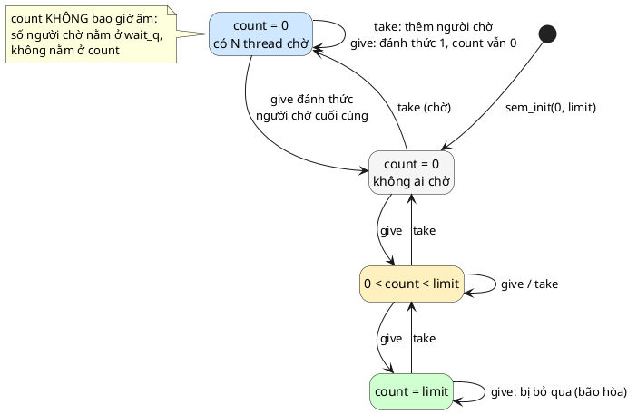

(Với `limit = 1` thì không có trạng thái "0 < count < limit": semaphore nhảy thẳng giữa 0 và 1.)

### 10.2. 🔬 Ba tình huống của sách, chạy thật

📖 Sách đưa ba tình huống trong mục *"Additional details"*. Demo 2 chạy đúng ba tình huống đó:

```
2) what the count means
  case A: init(0, limit 1), a thread waits, then give
    waiter woke with ret=0, count=0  (count stays 0)
  case B: init(0, limit 1), give, give, take
    give      -> count=1
    give      -> count=1  (limit reached, give is dropped)
    take      -> ret=0 count=0
    take      -> ret=-16 (-EBUSY=-16)
  case C: init(2, limit 2)
    give      -> count=2  (nothing changes)
    take x2   -> count=0
    3rd take  -> thread is waiting, count=0
    give      -> waiter woke (ret=0), count=0
    give      -> nobody waits, count=1
```

Đối chiếu với sách:

| Tình huống | 📖 Sách nói | 🔬 Chạy thật |
|---|---|---|
| A: `(0, 1)`, thread chờ, rồi give | *"our pending thread is woken up and the count still remains zero. This is correct, because [...] the thread that just woke up is then "using" this virtual resource."* | `ret=0, count=0` |
| B: `(0, 1)`, give rồi take | *"we now have one slot available. If we now try to take it then our thread instantly returns with the semaphore taken and the count is at zero."* | give: 1; take: `ret=0`, 0. Thêm: give lần hai bị bỏ (vẫn 1), take lần hai `-EBUSY` |
| C: `(2, 2)` | *"If we now give the semaphore then nothing changes. We can also take it twice [...] If we however try to take it the third time, then the thread is put on the queue. If we then give it once, then the count is still zero because we have one thread waiting. If we give it again with no threads waiting then the count of "free" slots goes to one"* | Khớp từng bước |

📖 Sách kết luận: *"Thus you see that the logic in the source code is in fact correct - even though it may not seem obvious when looking at it for the first time."*

---

## 11. Give từ ISR: CPU đi đâu tiếp theo

### 11.1. Trên RTOS thật

📖 Use case đầu tiên của sách: *"inside an interrupt handler, we can give the semaphore and the semaphore will mark the first waiting thread as ready and pend a context switch. Once the interrupt handler is finished, the scheduler interrupt will execute and jump the CPU to the place where the other thread was trying to acquire the semaphore."*

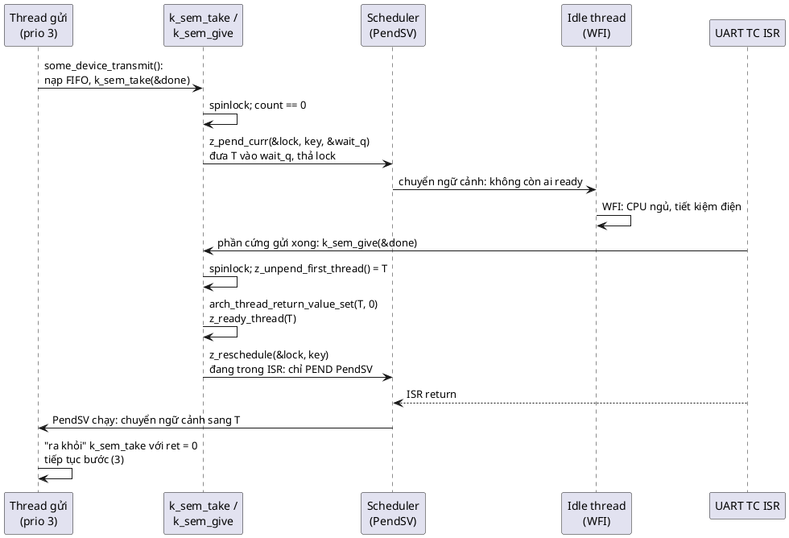

💡 Vì sao không chuyển thread ngay trong ISR? Vì ISR phải chạy trọn vẹn rồi return về đúng chỗ nó chen vào. Chuyển ngữ cảnh giữa chừng sẽ làm hỏng trạng thái của ngắt. Cortex-M giải quyết gọn: PendSV là một ngắt phần mềm có **ưu tiên thấp nhất**. "Pend PendSV" nghĩa là "khi không còn ngắt nào khác đang chạy, hãy chạy PendSV". Thế là việc chuyển thread tự động diễn ra ngay sau khi ISR (và mọi ISR lồng nhau) return.

### 11.2. Khi nào thread được chạy ngay, khi nào phải đợi

📖 Use case thứ hai: give từ thread khác thì *"The scheduler will then run the waiting thread at the first opportunity where it makes sense - ie if the waiting thread is lower priority than the currently running thread then it will have to wait - otherwise it will be waken up right away."*

| Ai give | Thread được đánh thức có ưu tiên | Chuyện gì xảy ra |
|---|---|---|
| ISR | Bất kỳ | Thread thành Ready; chuyển ngữ cảnh (nếu nó cao hơn thread bị ngắt) xảy ra **ngay sau khi ISR return** |
| Thread A | Cao hơn A | Chuyển sang thread kia **ngay trong** `k_sem_give`, trước khi `k_sem_give` return về A |
| Thread A | Thấp hơn hoặc bằng A | A chạy tiếp; thread kia chạy khi A ngủ hoặc hết lượt |

📖 Phần kết luận của sách: *"if the highest priority waiting thread is ready to run then a call to k_sem_give continues directly at the end of k_sem_take inside the other thread that is ready to run."*

### 11.3. Trên PC thì khác thế nào

Như mục 5.1 đã nói: trên PC không có scheduler ưu tiên và không có PendSV. Thread vừa được `kthread_ready()` đánh thức sẽ được **Windows** cho chạy, thường là ngay lập tức trên một luồng CPU khác, có khi cả trước khi "ISR" giả lập return. Thuật toán của semaphore vẫn đúng (thread nào được chọn, count bằng bao nhiêu); chỉ **thời điểm** thread chạy là khác.

---

## 12. Binary và counting: khi các lần give bị gộp lại

### 12.1. 🔬 Năm lần give trong lúc thread đang bận

📖 Use case thứ ba của sách là "đánh thức một thread pool": *"once we give that semaphore, we would be waking up one thread. Thus we can give the semaphore multiple times to wake up more than one thread."*

Nhưng nếu thread **chưa kịp chờ** khi các lần give đến thì sao? Demo 4: ISR give 5 lần (cách nhau 100 µs) trong lúc thread đang bận việc khác; sau đó thread lấy hết những gì có (bằng `K_NO_WAIT` trong vòng lặp):

```c
static void demo_event_collapse(uint32_t limit)
{
	struct sem sig;
	struct sim_irq_config irq = {
		.cpu_id = 6, .preempt = false, .isr = burst_isr, .arg = &sig, .fire_count = 5,
		.gap_us = 100,
	};
	int seen = 0;

	sem_init(&sig, 0, limit);
	sim_irq_start(&irq);
	sim_irq_wait(NULL); /* thread "bận" trong lúc 5 ngắt đến */
	while (sem_take(&sig, K_NO_WAIT) == 0) {
		seen++;
	}
	printf(...);
}
```

```
4) five gives while the thread is busy
  limit  1: isr gave 5 times, thread saw 1 event(s)
  limit 10: isr gave 5 times, thread saw 5 event(s)
```

Với binary semaphore (`limit = 1`), **4 trong 5 sự kiện biến mất**: give lần 2–5 thấy `count == limit` nên bị bỏ qua (dòng `count += (count != limit) ? 1 : 0` của Zephyr). Với `limit = 10`, đủ cả 5.

### 12.2. Chọn loại nào

| Ý nghĩa của give | Loại | Ví dụ |
|---|---|---|
| "Có việc rồi, dậy kiểm tra đi" (thread sẽ tự xem có bao nhiêu việc) | Binary (`limit = 1`) | UART RX: ISR give khi có byte; thread dậy và đọc **cạn** ring buffer |
| "Thêm đúng một việc" (mỗi give là một đơn vị việc riêng) | Counting (`limit` ≥ số việc tối đa có thể dồn lại) | Mỗi give ứng với một gói tin đã nằm trong hàng đợi (demo 5) |
| "Có N tài nguyên" | Counting (`initial = limit = N`) | Pool N buffer (demo 5) |
| "Xong rồi" cho một thao tác duy nhất | Binary, `initial = 0` | `uart_tx_transmit` (demo 1) |

💡 Gộp sự kiện không phải lúc nào cũng là lỗi. Với RX UART, gộp là **đúng**: thread chỉ cần biết "có dữ liệu", rồi tự đọc hết. Lỗi là khi code giả định mỗi give là một sự kiện riêng mà lại dùng binary semaphore. Nhớ lại bài 11, mục 2.1: bit pending của ngắt cũng gộp y như vậy.

---

## 13. Semaphore không phải mutex

📖 Hai drawback của sách đều nói về chuyện này:
- *"No priority boosting: if a high priority thread tries to take a semaphore that has been taken by a low priority thread, the low priority thread will not be boosted in priority in order to complete faster. Generally a semaphore should therefore never be used for mutual exclusion between threads - only for signalling."*
- *"Not suitable for mutual exclusion: design decisions of a semaphore are not compatible with design decisions of a mutex."*

### 13.1. Phép thử của sách

📖 Best practice đầu tiên: *"will I always take it in one thread and give it in another? if this is not the case and you need to both take and give as part of the same sequence then it is a signal to you that you are trying to do mutual exclusion and should therefore consider a spinlock or a mutex depending on whether it should be thread aware or not."*

```plantuml
@startuml
set separator none
skinparam defaultFontName Segoe UI
start
:Cần đồng bộ hai ngữ cảnh;
if (Take và give ở hai nơi khác nhau?\n(ISR give, thread take; producer/consumer)) then (có: báo hiệu)
  if (Cần đánh thức NHIỀU thread cùng lúc,\nhoặc chờ điều kiện phức tạp?) then (có)
    :Condition variable (bài 14); <<#F0E0FF>>
  else (không)
    if (Cần đếm số sự kiện / số tài nguyên?) then (có)
      :Counting semaphore\n(limit > 1); <<#D0FFD0>>
    else (không)
      :Binary semaphore\n(0, limit 1); <<#D0FFD0>>
    endif
  endif
else (không: cùng một thread lock rồi unlock)
  if (Có ISR dính vào, vùng găng vài lệnh?) then (có)
    :Spinlock (bài 11); <<#FFF8DC>>
  else (không)
    :Mutex (bài 13); <<#D0E8FF>>
  endif
endif
stop
@enduml
```

💡 Có một ngoại lệ quen thuộc: **pool tài nguyên** (demo 5). Thread mượn buffer (take) rồi chính nó trả (give) thì trông giống "cùng một chuỗi". Nhưng counting semaphore ở đây không bảo vệ một vùng găng, nó **đếm N tài nguyên giống nhau**, và người trả thường **không phải** người mượn (ISR mượn, worker trả). Sách xếp việc này vào best practice *"Use for resource management"*. Mutex không làm được việc này vì mutex chỉ có một "suất".

### 13.2. 🔬 Semaphore không biết ai đang giữ nó

File `sem_as_mutex.c`: hai thread dùng binary semaphore làm "khóa", mỗi thread 200 000 lượt `take` → vùng găng → `give`. Vùng găng đếm xem có lúc nào **hai** thread cùng ở bên trong. Ở lần chạy thứ hai, thread 2 cứ 1000 lượt lại gọi thêm một `sem_give()` **mà không hề take** (như một nhánh "dọn dẹp lỗi" viết sai):

```c
	for (int i = 0; i < N; i++) {
		if (with_bug && id == 2 && i % 1000 == 0) {
			/* "unlock" một lock mình không giữ: mutex sẽ từ chối (-EPERM),
			 * semaphore thì không có cách nào biết */
			sem_give(&lock_sem);
		}
		sem_take(&lock_sem, K_FOREVER);
		critical();
		sem_give(&lock_sem);
	}
```

Năm lần chạy (mỗi lần gồm hai dòng):

```
correct use: overlapping entries = 0
stray give : overlapping entries = 40
correct use: overlapping entries = 0
stray give : overlapping entries = 30
correct use: overlapping entries = 0
stray give : overlapping entries = 26
correct use: overlapping entries = 0
stray give : overlapping entries = 35
correct use: overlapping entries = 0
stray give : overlapping entries = 32
```

Mỗi lần give "lạc" rơi vào lúc thread 1 đang trong vùng găng, count từ 0 lên 1, và thread 2 take được ngay: hai thread cùng ở trong. Semaphore **không thể** phát hiện, vì nó không lưu ai đang giữ. 📖 Chương Mutex của sách: mutex *"explicitly checks whether it is being locked and unlocked by the same thread"*, và `k_mutex_unlock` trả `-EPERM` nếu người unlock không phải owner.

### 13.3. 💡 Priority inversion

📖 Common Pitfall đầu tiên: *"Priority inversion: This is a situation that occurs when a low-priority thread holds a resource busy that a high-priority thread needs - causing the high priority thread to be blocked. Mutexes avoid this through priority inheritance but semaphores do not have this ability due to simple design and different use case."*

Kịch bản kinh điển trên một nhân, với ba thread H (cao), M (giữa), L (thấp) và một binary semaphore dùng làm khóa:

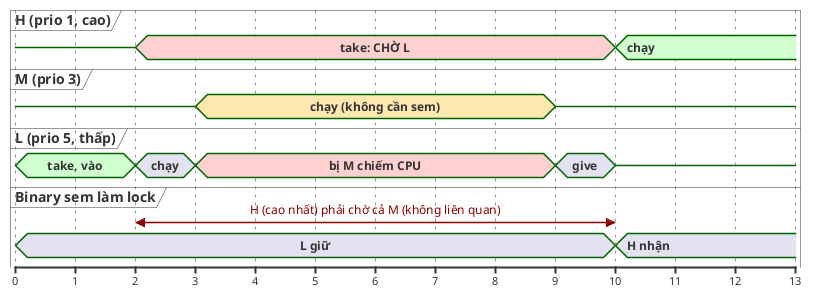

1. L take semaphore, vào vùng găng.
2. H tỉnh dậy, cần semaphore, phải chờ L. Chuyện này bình thường: L sẽ xong sớm.
3. M (không dính gì tới semaphore) tỉnh dậy. M ưu tiên cao hơn L, nên **chiếm CPU của L**. L không chạy được, nên không give được, nên H tiếp tục chờ.
4. H, thread quan trọng nhất, bị chặn bởi M, một thread chẳng liên quan, trong thời gian **không giới hạn**.

Mutex chữa bằng **kế thừa ưu tiên**: khi H chờ một mutex do L giữ, L được tạm nâng lên ưu tiên của H, nên M không chiếm được nó. Semaphore không làm vậy được, vì nó **không biết** L là người đang "giữ" (mục 13.2). Đó là lý do sâu xa của câu "semaphore không phải mutex".

⚠️ Thí nghiệm này **không tái hiện được trên PC** (mục 5.1): Windows chạy H, M, L song song trên nhiều luồng CPU, không có cảnh M "chiếm CPU" của L. Bài 13 có một bộ mô phỏng scheduler riêng để cho thấy priority inversion và kế thừa ưu tiên.

💡 Sách viết (quiz câu 5) rằng mutex *"prevent starvation [...] through priority inheritance"*. Nói chính xác hơn, kế thừa ưu tiên chống **priority inversion không giới hạn** như kịch bản trên; còn "starvation" thường dùng để chỉ một thread mãi không tới lượt, là chuyện rộng hơn.

---

# Phần C — Đọc code

## 14. Đọc code mẫu từng dòng

Các module:

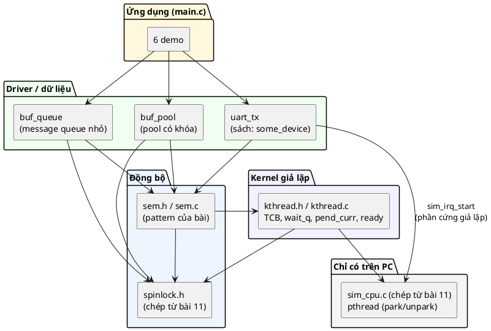

Các struct:

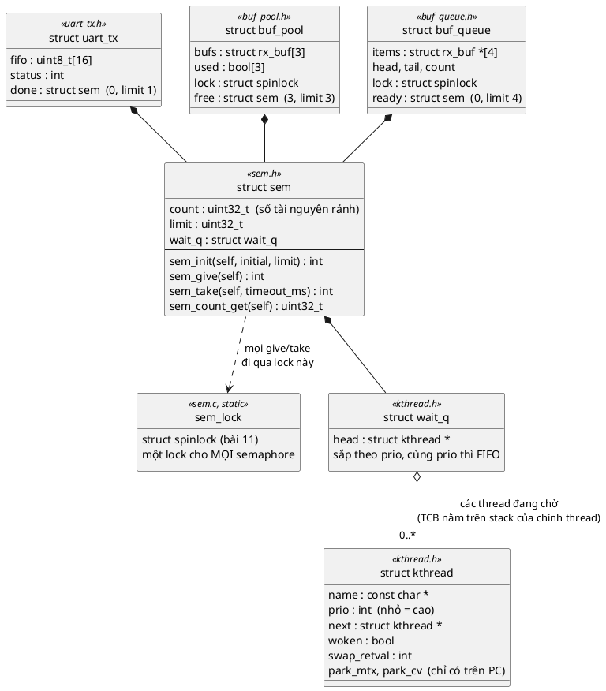

### 14.1. Kernel giả lập: [inc/kthread.h](inc/kthread.h), [src/kthread.c](src/kthread.c)

**Hằng timeout:**

```c
#define K_NO_WAIT 0     /* không chờ: trả lỗi ngay nếu chưa lấy được */
#define K_FOREVER (-1)  /* chờ tới khi lấy được */
```

Cùng tên với Zephyr để dễ đối chiếu. 💡 Zephyr thật dùng kiểu `k_timeout_t` (một struct) thay vì `int32_t`, để không ai truyền nhầm "số tick" và "số mili giây". Code mẫu dùng `int32_t` mili giây cho đơn giản.

**TCB:**

```c
struct kthread {
	const char *name;
	int prio;              /* số nhỏ = ưu tiên cao, giống Zephyr */
	struct kthread *next;  /* móc vào wait queue (danh sách liên kết nội tại) */
	bool woken;            /* đã được lấy ra khỏi wait queue và đánh thức */
	int swap_retval;       /* giá trị pend_curr trả về khi được đánh thức */
	pthread_mutex_t park_mtx;
	pthread_cond_t park_cv;
};
```

- `next` nằm **trong** TCB: đây là **danh sách liên kết nội tại** (intrusive list). Muốn xếp một thread vào hàng đợi, không cần cấp phát node nào, chỉ cần móc con trỏ `next` của chính TCB. 💡 Mỗi thread chỉ chờ **một** thứ tại một thời điểm, nên một con trỏ `next` là đủ. Đây là lý do semaphore của RTOS không bao giờ cần `malloc`.
- `swap_retval`: tên lấy từ Zephyr (`arch_thread_return_value_set` ghi vào một trường có ý nghĩa tương tự). Người give ghi vào đây giá trị mà `sem_take` của người kia sẽ return.
- `park_mtx`, `park_cv`: chỉ có trên PC, là "cái giường" để thread nằm ngủ (mục 5).

**Hàng đợi:**

```c
struct wait_q {
	struct kthread *head;
};
```

Chỉ một con trỏ: 8 byte trên PC (🔬 mục 18.2).

**Chèn theo ưu tiên:**

```c
static void wait_q_insert(struct wait_q *q, struct kthread *t)
{
	struct kthread **pp = &q->head;

	while (*pp && (*pp)->prio <= t->prio) {
		pp = &(*pp)->next;
	}
	t->next = *pp;
	*pp = t;
}
```

- `pp` là **con trỏ tới con trỏ**: nó trỏ vào "ô chứa con trỏ cần sửa", có thể là `q->head` hoặc `next` của phần tử trước. Nhờ vậy chèn vào đầu danh sách và chèn vào giữa dùng chung một đoạn code, không cần nhánh `if (head == NULL)` riêng. (Cùng ý tưởng với `struct uart **self` ở bài 2: muốn sửa một con trỏ thì cầm địa chỉ của nó.)
- `<=` (chứ không phải `<`): đi qua cả những thread **cùng** ưu tiên, chèn vào **sau** chúng. Kết quả: cùng ưu tiên thì FIFO.
- Thời gian chèn tỉ lệ với số thread đang chờ. 💡 Zephyr có cấu hình hàng đợi bằng cây đỏ-đen hoặc mảng nhiều mức ưu tiên cho trường hợp nhiều thread; với vài thread thì danh sách đơn giản là nhanh nhất.

**Lấy ra và gỡ bỏ:**

```c
struct kthread *wait_q_unpend_first(struct wait_q *q)
{
	struct kthread *t = q->head;

	if (t) {
		q->head = t->next;
		t->next = NULL;
	}
	return t;
}
```

Lấy phần tử đầu, tức thread ưu tiên cao nhất (đã sắp sẵn khi chèn). `wait_q_remove()` (dùng khi timeout) duyệt bằng `pp` y như khi chèn.

**Đánh thức:**

```c
void kthread_ready(struct kthread *t, int retval)
{
	pthread_mutex_lock(&t->park_mtx);
	t->swap_retval = retval;
	t->woken = true;
	pthread_cond_signal(&t->park_cv);
	pthread_mutex_unlock(&t->park_mtx);
}
```

Ghi giá trị trả về và cờ `woken` **dưới** `park_mtx`, rồi rung chuông. Vì thread kia kiểm tra `woken` cũng dưới `park_mtx` (xem ngay dưới), nó không thể đọc thiếu.

**Ngủ: `wait_q_pend_curr`**, phần quan trọng nhất của file:

```c
	if (!self) {
		/* Thread chưa đăng ký với kernel thì không có TCB để xếp hàng */
		spinlock_unlock(lock, key);
		return -EPERM;
	}
```

Thread chưa gọi `kthread_init_self()` thì không có TCB. Vẫn phải **thả spinlock** trước khi return: hàm này hứa "khi return, lock đã được thả", và phải giữ lời hứa trên **mọi** nhánh.

```c
	self->woken = false;
	wait_q_insert(q, self);
```

Vào hàng đợi **trong lúc vẫn giữ spinlock** (caller đã lấy). Từ đây, một `sem_give` nào đó có thể chọn ta, nhưng nó phải chờ spinlock.

```c
	pthread_mutex_lock(&self->park_mtx);
	spinlock_unlock(lock, key);
```

Hai dòng làm nên toàn bộ tính đúng đắn (mục 4.2): khóa cửa phòng ngủ **trước**, thả spinlock **sau**. Một give đến ngay sau dòng thứ hai sẽ lấy được spinlock, thấy ta trong hàng đợi, gọi `kthread_ready(self, 0)`, và **dừng ở `pthread_mutex_lock(&t->park_mtx)`** cho tới khi ta nằm xuống.

💡 Có một quy tắc ngầm ở đây: ta **không bao giờ** lấy spinlock trong lúc giữ `park_mtx`, còn người give thì lấy spinlock **rồi mới** lấy `park_mtx`. Thứ tự lock nhất quán, nên không có deadlock (mục 22 của bài 11).

```c
	while (!self->woken && !timed_out) {
		if (timeout_ms == K_FOREVER) {
			pthread_cond_wait(&self->park_cv, &self->park_mtx);
		} else {
			timed_out = pthread_cond_timedwait(&self->park_cv, &self->park_mtx,
							   &deadline) == ETIMEDOUT;
		}
	}
```

- `pthread_cond_wait` thả `park_mtx` và ngủ **trong một bước**, tỉnh dậy thì đã lấy lại `park_mtx`.
- Vòng `while` kiểm tra `woken`: condvar của POSIX được phép tỉnh **giả** (spurious wakeup), nên phải kiểm tra lại điều kiện thật. (Bài 14 sẽ nói kỹ: *"Always check in a loop"*.)
- `deadline` là thời điểm tuyệt đối theo `CLOCK_REALTIME`, vì `pthread_cond_timedwait` đòi như vậy. Hàm `deadline_after_ms()` cộng mili giây vào giờ hiện tại, xử lý tràn nano giây.

```c
	bool woken = self->woken;
	pthread_mutex_unlock(&self->park_mtx);

	if (woken) {
		return self->swap_retval;
	}
```

Được đánh thức: trả về đúng giá trị người give đã ghi (0 với semaphore).

```c
	key = spinlock_lock(lock);
	if (self->woken) {
		ret = self->swap_retval;
	} else {
		wait_q_remove(q, self);
		ret = -EAGAIN;
	}
	spinlock_unlock(lock, key);
	return ret;
```

**Hết giờ.** Phải tự gỡ mình khỏi hàng đợi, nếu không give sau này sẽ "đánh thức" một TCB đã không còn chờ (và có thể đã nằm trên một stack frame đã hết hạn). Nhưng có một race tinh vi: **ngay** giữa lúc hết giờ và lúc ta lấy lại spinlock, một give có thể đã chọn ta. Vì vậy kiểm tra lại `woken` **dưới spinlock**:
- Đã được chọn: coi như lấy được (trả 0). Suất đã được trao thẳng cho ta (count không tăng), nếu ta trả `-EAGAIN` thì suất đó mất vĩnh viễn.
- Chưa: gỡ khỏi hàng đợi, trả `-EAGAIN` như Zephyr.

### 14.2. Semaphore: [inc/sem.h](inc/sem.h), [src/sem.c](src/sem.c)

**Struct:**

```c
struct sem {
	uint32_t count;
	uint32_t limit;
	struct wait_q wait_q;
};

#define SEM_MAX_LIMIT UINT32_MAX
```

- Object Pattern (bài 1), struct public: semaphore phải **nhúng** được vào object khác (`struct uart_tx { ...; struct sem done; }`) và cấp phát tĩnh. Cùng lý do với spinlock ở bài 11.
- **Không có spinlock bên trong**: lock nằm ở `sem.c`, dùng chung (xem ngay dưới).
- 16 byte trên PC (🔬 mục 18.2).

**Lock dùng chung:**

```c
static struct spinlock sem_lock = SPINLOCK_INIT;
```

📖 Giống `static struct k_spinlock lock;` trong `sem.c` của Zephyr mà sách trích. Đây là lời khuyên "often little sense in multiple instances" của bài 11 được áp dụng thật: vùng găng của give/take chỉ vài lệnh, nên một lock cho mọi semaphore gần như không làm ai phải chờ, mà tiết kiệm RAM ở mỗi semaphore.

**`sem_init`:**

```c
int sem_init(struct sem *self, uint32_t initial_count, uint32_t limit)
{
	if (!self || limit == 0 || initial_count > limit) {
		return -EINVAL;
	}

	self->count = initial_count;
	self->limit = limit;
	wait_q_init(&self->wait_q);
	return 0;
}
```

- `limit == 0`: semaphore không bao giờ give được, vô nghĩa. 💡 `k_sem_init` của Zephyr cũng từ chối trường hợp này và trường hợp `initial > limit` với `-EINVAL`.
- Không lấy lock: `init` chỉ được gọi **trước** khi có ai khác dùng semaphore. Init lại một semaphore đang có thread chờ là lỗi lập trình (các thread trong hàng đợi bị "bỏ rơi").

**`sem_give`:**

```c
int sem_give(struct sem *self)
{
	if (!self) {
		return -EINVAL;
	}

	struct spinlock_key key = spinlock_lock(&sem_lock);
	struct kthread *thread = wait_q_unpend_first(&self->wait_q);

	if (thread) {
		kthread_ready(thread, 0);
	} else if (self->count != self->limit) {
		self->count++;
	}

	spinlock_unlock(&sem_lock, key);
	return 0;
}
```

Đối chiếu từng dòng với `z_impl_k_sem_give` (mục 9.1): giống hệt về logic. Khác biệt:
- Trả `int` theo quy ước của repo (bài 9); Zephyr trả `void`.
- `kthread_ready()` gộp `arch_thread_return_value_set()` và `z_ready_thread()`.
- `spinlock_unlock()` thay cho `z_reschedule()`: trên PC không có scheduler để gọi.
- Không có `handle_poll_events()`.

💡 `kthread_ready()` gọi `pthread_mutex_lock` **trong lúc giữ spinlock**, tức là trái với lời khuyên "không gọi hàm có thể chờ trong spinlock" của bài 11. Trên PC đây là cái giá của việc mô phỏng: `park_mtx` chỉ bị giữ trong vài lệnh (hoặc trong lúc thread kia đang chuyển vào `cond_wait`), nên chờ rất ngắn. Trên RTOS thật, `z_ready_thread()` chỉ là vài thao tác trên danh sách, không chờ gì cả.

**`sem_take`:**

```c
int sem_take(struct sem *self, int32_t timeout_ms)
{
	if (!self) {
		return -EINVAL;
	}
	if (arch_is_in_isr() && timeout_ms != K_NO_WAIT) {
		return -EINVAL;
	}
```

Thay cho `__ASSERT` của Zephyr: trả lỗi để demo 6 quan sát được. 💡 Phương án của Zephyr (dừng hẳn chương trình) mạnh tay hơn nhưng đúng tinh thần: đây là **lỗi lập trình**, không phải tình huống lúc chạy cần xử lý. Code mẫu chọn trả lỗi cho dễ học; firmware thật nên assert.

```c
	struct spinlock_key key = spinlock_lock(&sem_lock);

	if (self->count > 0) {
		self->count--;
		spinlock_unlock(&sem_lock, key);
		return 0;
	}

	if (timeout_ms == K_NO_WAIT) {
		spinlock_unlock(&sem_lock, key);
		return -EBUSY;
	}

	return wait_q_pend_curr(&self->wait_q, &sem_lock, key, timeout_ms);
}
```

Giống `z_impl_k_sem_take` từng nhánh. Chú ý nhánh cuối: **không** có `spinlock_unlock` ở đây, vì `wait_q_pend_curr` nhận cả lock lẫn key và tự thả. Đây là chỗ duy nhất trong repo một hàm lấy lock và một hàm **khác** thả lock, và nó có chủ đích (mục 4.2).

`sem_count_get()` chỉ đọc `count` dưới lock. 💡 Giá trị trả về có thể đã cũ ngay khi hàm return (người khác give/take ngay sau). Chỉ dùng để debug hay hiển thị, đừng dùng để quyết định "có nên take không" (dùng `sem_take(K_NO_WAIT)` cho việc đó).

### 14.3. Ví dụ của sách: [inc/uart_tx.h](inc/uart_tx.h), [src/uart_tx.c](src/uart_tx.c)

```c
struct uart_tx {
	const char *name;
	uint32_t byte_time_us;            /* thời gian đẩy 1 byte ra dây: 10 bit / baud */
	uint8_t fifo[UART_TX_FIFO_SIZE];  /* "FIFO phần cứng" giả lập */
	size_t fifo_len;
	int status;                       /* ISR ghi: 0 = gửi xong, -EIO = lỗi đường truyền */
	bool fault;                       /* demo: lần gửi tới sẽ lỗi */
	struct sem done;                  /* ISR give khi phần cứng xong (dù thành công hay lỗi) */
};
```

Ứng với `struct some_device { struct k_sem done; }` của sách, thêm các field để mô phỏng phần cứng và để trả về kết quả.

```c
int uart_tx_init(struct uart_tx *self, const char *name, uint32_t baudrate)
{
	...
	self->byte_time_us = 10u * 1000000u / baudrate;
	return sem_init(&self->done, 0, 1);
}
```

- 10 bit mỗi byte (1 start + 8 data + 1 stop): 9600 baud thì 1041 µs mỗi byte.
- `sem_init(&self->done, 0, 1)`: binary, **ban đầu 0** vì chưa có gì "xong". Nếu khởi tạo 1, lần `transmit` đầu tiên sẽ return ngay lập tức, trước khi phần cứng gửi xong.

**ISR:**

```c
static void uart_tx_isr(void *arg)
{
	struct uart_tx *self = arg;

	self->status = self->fault ? -EIO : 0;
	self->fault = false;
	self->fifo_len = 0;

	sem_give(&self->done);
}
```

- Đọc "thanh ghi trạng thái", ghi kết quả vào `self->status`.
- **Give trên mọi nhánh**, kể cả khi lỗi. 📖 Đây đúng là cách tránh pitfall *"Semaphore never given"* của sách (🔬 mục 19.2).
- `arg` là con trỏ tới object: ISR biết mình phục vụ UART nào mà không cần biến toàn cục. Sách dùng `&_instance_of_device` (một instance tĩnh); code mẫu dùng tham số `arg` theo kiểu callback của bài 5.

**`uart_tx_transmit`:**

```c
	memcpy(self->fifo, data, len);
	self->fifo_len = len;
	self->status = -EINPROGRESS;
```

Bước (1) của sách: nạp thanh ghi. `-EINPROGRESS` là giá trị "chưa có kết quả", để nếu có lỗi logic nào đó đọc `status` quá sớm thì thấy ngay.

```c
	struct sim_irq_config hw = {
		.cpu_id = UART_TX_IRQ_CPU,
		.preempt = false,
		.isr = uart_tx_isr,
		.arg = self,
		.fire_count = 1,
		.gap_us = (uint32_t)len * self->byte_time_us, /* ngắt đến khi byte cuối ra dây */
	};
	int ret = sim_irq_start(&hw);
```

"Bấm START" phần cứng giả lập: sau `len × byte_time_us` micro giây, ngắt "TX complete" đến một lần.

```c
	ret = sem_take(&self->done, timeout_ms);

	sim_irq_wait(NULL); /* dọn thread phần cứng giả lập */
```

Bước (2): ngủ tới khi ISR give. `sim_irq_wait` chỉ là việc dọn dẹp của bộ mô phỏng.

```c
	if (ret) {
		sem_take(&self->done, K_NO_WAIT);
		return ret;
	}

	return self->status;
```

- **Hết giờ** (`-EAGAIN`): phần cứng có thể vẫn báo xong **muộn** và give. Nếu để nguyên, semaphore sẽ còn một "suất" thừa, và lần `transmit` **sau** sẽ return ngay lập tức với kết quả của lần trước. `sem_take(K_NO_WAIT)` xóa suất thừa đó (nếu có). 💡 Zephyr có `k_sem_reset()` cho việc này. Driver thật còn phải dừng phần cứng trước (hủy DMA, xóa FIFO) để ngắt muộn không đến nữa.
- **Thành công**: trả `self->status` do ISR ghi. Đọc `status` ở đây an toàn dù nó được ghi ở "ISR" chạy trên luồng khác: give lấy và thả `sem_lock` (release), take lấy `sem_lock` (acquire), nên mọi thứ ISR ghi **trước** give đều hiện ra với thread **sau** take (mục 6.3 bài 11).

### 14.4. Pool có khóa: [inc/buf_pool.h](inc/buf_pool.h), [src/buf_pool.c](src/buf_pool.c)

Tiếp nối pool của bài 2 và mục 23 của bài 11, giờ thêm khả năng **chờ**:

```c
struct buf_pool {
	struct rx_buf bufs[BUF_POOL_COUNT];
	bool used[BUF_POOL_COUNT];
	struct spinlock lock;
	struct sem free;
	uint32_t in_use;     /* thống kê cho demo */
	uint32_t max_in_use;
};
```

Hai công cụ, hai việc. 📖 Đúng best practice *"Use for resource management"* của sách: *"you can use spinlock for mutual exclusion to a data variable (like a queue) and a semaphore to signal threads that there is work to be done."*
- `free` (counting semaphore, `initial = limit = BUF_POOL_COUNT`): đếm **còn bao nhiêu** buffer rảnh. Ai muốn mượn phải take được một suất.
- `lock` (spinlock): bảo vệ `used[]`, trả lời câu hỏi **slot nào** rảnh.

```c
int buf_pool_get(struct buf_pool *self, struct rx_buf **out, int32_t timeout_ms)
{
	...
	int ret = sem_take(&self->free, timeout_ms);
	if (ret) {
		return ret;
	}

	struct spinlock_key key = spinlock_lock(&self->lock);
	for (size_t i = 0; i < BUF_POOL_COUNT; i++) {
		if (!self->used[i]) {
			self->used[i] = true;
			self->bufs[i].len = 0;
			*out = &self->bufs[i];
			break;
		}
	}
	self->in_use++;
	...
	spinlock_unlock(&self->lock, key);
	return 0;
}
```

- **Bước 1, take trước:** take thành công nghĩa là chắc chắn có ít nhất một slot trống **dành riêng cho mình**, vì semaphore đã trừ đi một suất. Nhờ vậy vòng lặp ở bước 2 **luôn** tìm thấy slot.
- **Bước 2, spinlock:** nhiều người có thể cùng qua bước 1 (mỗi người một suất), rồi cùng tìm slot. `used[]` phải nằm trong spinlock, không thì hai người cùng chọn một slot (🔬 bài 11 mục 23).
- ISR gọi với `K_NO_WAIT`: hết buffer thì nhận `-EBUSY`. Thread có thể chờ.

```c
int buf_pool_put(struct buf_pool *self, struct rx_buf **buf)
{
	...
	struct spinlock_key key = spinlock_lock(&self->lock);
	for (size_t i = 0; i < BUF_POOL_COUNT; i++) {
		if (&self->bufs[i] == *buf && self->used[i]) {
			self->used[i] = false;
			self->in_use--;
			found = true;
			break;
		}
	}
	spinlock_unlock(&self->lock, key);

	if (!found) {
		return -EINVAL;
	}
	*buf = NULL;
	return sem_give(&self->free);
}
```

- `&& self->used[i]`: trả một buffer **hai lần** thì lần hai không tìm thấy, trả `-EINVAL`. Không có điều kiện này, lần trả thứ hai sẽ give thêm một suất "ma", và pool tưởng có 4 buffer trong khi chỉ có 3. Đây là bài tập 5 của bài 2, giờ được làm luôn.
- `*buf = NULL`: như `uart_pool_put(&p)` của bài 2.
- **Give sau khi slot đã thật sự trống.** Nếu give trước rồi mới xóa `used[i]`, một thread được đánh thức có thể chạy bước 2 của `get` **trước** khi slot được xóa, và không tìm thấy slot nào.

### 14.5. Message queue thu nhỏ: [inc/buf_queue.h](inc/buf_queue.h), [src/buf_queue.c](src/buf_queue.c)

```c
struct buf_queue {
	struct rx_buf *items[BUF_QUEUE_LEN];
	size_t head;
	size_t tail;
	size_t count;
	struct spinlock lock;
	struct sem ready;
};
```

Ring buffer của **con trỏ** tới buffer (không chép dữ liệu), bảo vệ bằng spinlock; semaphore `ready` (`0, limit 4`) báo "có bao nhiêu phần tử đang chờ xử lý". 💡 Đây chính là cách `k_msgq`/`k_fifo` của Zephyr hay `xQueue` của FreeRTOS được xây: một ring buffer + spinlock + semaphore (hoặc hàng đợi thread tương đương).

```c
int buf_queue_put(struct buf_queue *self, struct rx_buf *buf)
{
	...
	struct spinlock_key key = spinlock_lock(&self->lock);
	if (self->count == BUF_QUEUE_LEN) {
		spinlock_unlock(&self->lock, key);
		return -ENOSPC;
	}
	self->items[self->head] = buf;
	self->head = (self->head + 1) % BUF_QUEUE_LEN;
	self->count++;
	spinlock_unlock(&self->lock, key);

	return sem_give(&self->ready);
}
```

- Gọi được từ ISR: không có gì chờ. Đầy thì trả `-ENOSPC` ngay.
- **Ghi dữ liệu xong, thả lock, rồi mới give.** Worker được đánh thức chắc chắn thấy phần tử. 📖 Sách nói ở best practice thứ hai: *"giving a semaphore from a critical section guarded by a spinlock will defer the time when a thread will wake up in response to the semaphore until the critical section ends"*. Give **sau** khi thả lock thì thread tỉnh dậy không phải chờ lock nữa.
- `buf = NULL` được phép: demo dùng nó làm tin "dừng" cho worker.

```c
int buf_queue_get(struct buf_queue *self, struct rx_buf **out, int32_t timeout_ms)
{
	...
	int ret = sem_take(&self->ready, timeout_ms);
	if (ret) {
		return ret;
	}

	struct spinlock_key key = spinlock_lock(&self->lock);
	*out = self->items[self->tail];
	self->tail = (self->tail + 1) % BUF_QUEUE_LEN;
	self->count--;
	spinlock_unlock(&self->lock, key);
	return 0;
}
```

Mỗi lần take thành công ứng với **đúng một** lần put đã hoàn tất, nên không cần kiểm tra `count == 0`. Đây là lý do `ready` phải là **counting** (`limit = BUF_QUEUE_LEN`): nếu là binary, ba lần put nhanh liên tiếp chỉ để lại một suất (mục 12), và hai phần tử nằm kẹt trong hàng đợi không ai lấy.

### 14.6. Demo 5: [main.c](main.c), ISR → pool → queue → worker

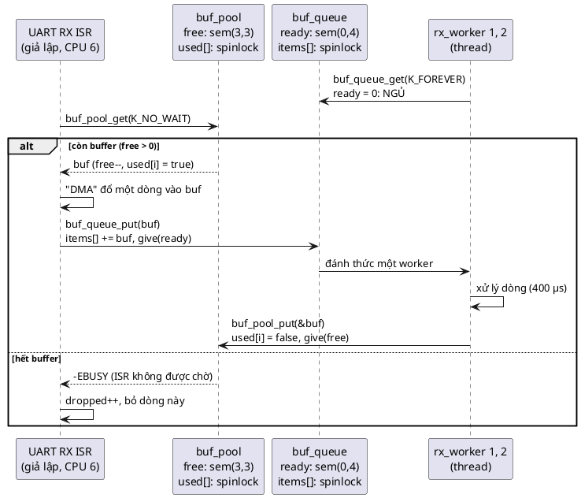

```c
static void uart_rx_line_isr(void *arg)
{
	struct rx_buf *buf;

	(void)arg;
	/* ISR KHÔNG được chờ: hết buffer thì bỏ dòng này và đếm lại */
	if (buf_pool_get(&pool, &buf, K_NO_WAIT) != 0) {
		atomic_fetch_add(&rx_dropped, 1);
		rx_seq++;
		return;
	}
	/* "DMA" đổ một dòng: 4 byte số thứ tự + byte kiểm tra */
	memcpy(buf->data, &rx_seq, sizeof(rx_seq));
	buf->data[4] = (uint8_t)(rx_seq * 7u);
	buf->len = 5;
	rx_seq++;
	buf_queue_put(&queue, buf);
}
```

- Trong cả chuỗi này, **ISR không bao giờ chờ**: `buf_pool_get(K_NO_WAIT)` và `buf_queue_put` đều trả về ngay.
- Byte kiểm tra `seq * 7`: worker tính lại để phát hiện buffer bị hai bên ghi đè lẫn nhau (`corrupt`).
- `rx_seq` chỉ do ISR đọc/ghi, và ISR không chạy chồng lên chính nó, nên không cần lock (giống `next` ở bài 11 mục 19.2).

```c
static void *rx_worker_main(void *arg)
{
	...
	for (;;) {
		buf_queue_get(&queue, &buf, K_FOREVER);
		if (!buf) {
			break; /* tin "dừng" */
		}
		...
		sim_busy_wait_us(400); /* "xử lý" một dòng: parse lệnh, ghi log... */
		buf_pool_put(&pool, &buf);
		atomic_fetch_add(&rx_processed, 1);
	}
	return NULL;
}
```

Worker take ở `buf_queue` (chờ việc), give ở `buf_pool` (trả tài nguyên). Hai worker, mỗi dòng 400 µs, tức là xử lý tối đa khoảng 5000 dòng/giây.

---

## 15. Theo dõi demo chạy từng bước

Output đầy đủ của một lần `make run`:

```
1) blocking transmit, woken by the TX-complete interrupt
  transmit 8 bytes @9600: ret=0 after 8.9 ms (wire time 8.3 ms)
  transmit with line fault: ret=-5 (-EIO=-5), thread did not hang
2) what the count means
  case A: init(0, limit 1), a thread waits, then give
    waiter woke with ret=0, count=0  (count stays 0)
  case B: init(0, limit 1), give, give, take
    give      -> count=1
    give      -> count=1  (limit reached, give is dropped)
    take      -> ret=0 count=0
    take      -> ret=-16 (-EBUSY=-16)
  case C: init(2, limit 2)
    give      -> count=2  (nothing changes)
    take x2   -> count=0
    3rd take  -> thread is waiting, count=0
    give      -> waiter woke (ret=0), count=0
    give      -> nobody waits, count=1
3) three threads wait, ISR gives three times
  waiting order: logger(prio 5), motor(prio 1), ui(prio 3)
  wake order   : motor(prio 1), ui(prio 3), logger(prio 5)
4) five gives while the thread is busy
  limit  1: isr gave 5 times, thread saw 1 event(s)
  limit 10: isr gave 5 times, thread saw 5 event(s)
5) UART RX lines: ISR -> buffer pool -> queue -> 2 workers
  one line every 300 us: processed=2000 dropped=   0 corrupt=0  max buffers in use=2/3
  one line every 100 us: processed=1003 dropped= 997 corrupt=0  max buffers in use=3/3
6) timeouts and errors
  take(K_NO_WAIT)         -> -16 (-EBUSY=-16)
  take(30 ms)             -> -11 (-EAGAIN=-11) after 35.3 ms
  take(K_FOREVER) in ISR  -> -22 (-EINVAL=-22)
```

Thời gian chạy khoảng 1,2 giây (đo bằng `time` ở ba lần: 1,22 s, 1,20 s, 1,22 s).

### 15.1. Demo 1: dòng thời gian một lần transmit

| Thời điểm | Thread main | "Phần cứng" | `done.count` | `done.wait_q` |
|---|---|---|---|---|
| 0 ms | `memcpy` vào FIFO, `status = -EINPROGRESS`, `sim_irq_start` | bắt đầu đếm 8,3 ms | 0 | rỗng |
| ~0 ms | `sem_take(100 ms)`: count = 0, vào hàng đợi, ngủ | | 0 | main |
| 8,3 ms | (ngủ, không tốn CPU) | ISR: `status = 0`, `sem_give` | 0 (trao thẳng) | rỗng |
| ~8,9 ms | tỉnh, `sem_take` trả 0, `sim_irq_wait`, return `status` = 0 | | 0 | rỗng |

### 15.2. Demo 2, tình huống C: trạng thái sau mỗi lệnh

| # | Lệnh | `count` | `wait_q` | Kết quả |
|---|---|---|---|---|
| 1 | `sem_init(2, 2)` | 2 | rỗng | |
| 2 | `sem_give` | 2 | rỗng | đã bằng `limit`: bỏ qua |
| 3 | `sem_take(K_NO_WAIT)` | 1 | rỗng | 0 |
| 4 | `sem_take(K_NO_WAIT)` | 0 | rỗng | 0 |
| 5 | waiter: `sem_take(K_FOREVER)` | 0 | waiter | ngủ |
| 6 | `sem_give` | **0** | rỗng | `wait_q` có người: trao thẳng, waiter trả 0 |
| 7 | `sem_give` | 1 | rỗng | không ai chờ: tăng count |

Bước 6 là chỗ "trông như sai" mà sách nói tới: give mà count không tăng.

### 15.3. Demo 3: hàng đợi sau mỗi lần take

| Sự kiện | `wait_q` (đầu → cuối) |
|---|---|
| logger (5) take | logger(5) |
| motor (1) take | motor(1) → logger(5): motor chèn **trước** vì 1 < 5 |
| ui (3) take | motor(1) → ui(3) → logger(5): ui chèn giữa |
| ISR give | ui(3) → logger(5); motor tỉnh |
| ISR give | logger(5); ui tỉnh |
| ISR give | rỗng; logger tỉnh |

### 15.4. Demo 5: vì sao 300 µs không rớt dòng nào còn 100 µs thì rớt gần một nửa

| | Một dòng mỗi 300 µs | Một dòng mỗi 100 µs |
|---|---|---|
| Dòng đến mỗi giây | ~3300 | ~10 000 |
| Năng lực của 2 worker (400 µs/dòng) | ~5000 | ~5000 |
| Kết quả (5 lần chạy) | processed 2000, dropped 0; max 2/3 ở ba lần, 3/3 ở hai lần | processed 1001–1003, dropped 997–999, max 3/3 |

- 300 µs: worker theo kịp. Thường chỉ 2 buffer cùng lúc bị chiếm (mỗi worker giữ một). Thỉnh thoảng (2 trên 5 lần chạy) một dòng mới đến đúng lúc cả hai worker còn đang bận với dòng 400 µs của mình, nên nó nằm chờ trong hàng đợi và chiếm buffer thứ 3. Pool không hết hẳn nên không rớt dòng nào.
- 100 µs: dòng đến nhanh gấp đôi năng lực xử lý. Pool hết, ISR nhận `-EBUSY` và bỏ dòng: khoảng một nửa số dòng bị rớt, đúng bằng tỉ lệ 5000/10000.
- `corrupt = 0` ở mọi lần: không buffer nào bị hai bên dùng cùng lúc.
- 💡 Đây là **backpressure** đúng cách cho ISR: không chờ, không ghi đè, mà bỏ và **đếm**. Firmware thật sẽ báo con số `dropped` lên log để biết cần tăng pool hay tăng tốc worker.

### 15.5. Demo 6: timeout

- `take(K_NO_WAIT)` trên semaphore rỗng: `-EBUSY` (-16), ngay lập tức.
- `take(30 ms)`: `-EAGAIN` (-11) sau 35,3 ms; ba lần chạy cho 35,3 / 31,0 / 49,0 ms. Phần dư là do bộ định thời của Windows (mục 5.1), không phải do semaphore.
- `take(K_FOREVER)` gọi từ "ISR": `-EINVAL` (-22). Zephyr sẽ dừng hẳn bằng assert.

---

## 16. Các quyết định thiết kế và phương án khác

### Lock dùng chung cho mọi semaphore

Đã bàn ở mục 14.2. Phương án khác: mỗi `struct sem` có spinlock riêng. Lợi trên hệ nhiều nhân có rất nhiều semaphore bận cùng lúc; trên MCU một nhân thì không lợi gì (spinlock lúc đó chỉ là che ngắt). Code mẫu theo Zephyr và sách.

### Trao thẳng thay vì tăng count rồi đánh thức

Đã bàn ở mục 10.1. Phương án "tăng count, đánh thức tất cả, để chúng tranh nhau" đơn giản hơn nhưng gây ra **thundering herd**: N thread thức dậy, một thread thắng, N − 1 thread lại ngủ. Tốn CPU, và không bảo đảm thread ưu tiên cao nhất thắng.

### Hàng đợi sắp theo ưu tiên thay vì FIFO

📖 Sách yêu cầu priority queue. 💡 FreeRTOS cũng đánh thức task ưu tiên cao nhất đang chờ. POSIX `sem_post` thì chỉ hứa đánh thức "một" thread, thứ tự do scheduler. Code mẫu: theo ưu tiên, cùng ưu tiên thì FIFO.

### Timeout: `int32_t` mili giây

Zephyr dùng `k_timeout_t` để phân biệt rõ đơn vị (tick, ms, µs) và tránh tràn số. Code mẫu dùng `int32_t` mili giây với hai giá trị đặc biệt `K_NO_WAIT = 0`, `K_FOREVER = -1`. Đủ cho bài học, nhưng `sem_take(&s, 5)` có thể bị đọc nhầm là "5 tick". Bài tập 4 gợi ý làm lại cho chặt.

### Take trong ISR: trả lỗi thay vì assert

Đã bàn ở mục 14.2.

### TCB nằm trên stack của thread

Mỗi thread khai báo `struct kthread self;` trong hàm của nó. Không có `malloc`, không có pool TCB. Hợp với quy ước "tránh `malloc`" của repo và với cách RTOS cấp phát tĩnh `K_THREAD_DEFINE`. Đổi lại: thread phải **không return** khỏi hàm đó trong lúc TCB còn nằm trong hàng đợi nào (`wait_q_pend_curr` tự gỡ khi timeout, nên điều kiện này được giữ).

### Mô phỏng ISR bằng thread song song, không chen ngang

Đã bàn ở mục 5.1: chế độ `preempt = true` của bài 11 có thể deadlock với `park_mtx` của pthread. Cái giá là không tái hiện được "thread chạy sau khi ISR return".

---

# Phần D — Thực tế và tổng kết

## 17. Semaphore trong RTOS thật

Các đoạn code trong mục này cần SDK của từng RTOS để build, nên **không được build thử**; đây là 💡 kiến thức chung, đối chiếu với tài liệu của từng RTOS.

### 17.1. Cùng một pattern, khác tên

| RTOS / API | Khởi tạo | Give | Take | Give từ ISR |
|---|---|---|---|---|
| 📖 Zephyr | `K_SEM_DEFINE(s, 0, 1)` hoặc `k_sem_init(&s, 0, 1)` | `k_sem_give(&s)` | `k_sem_take(&s, K_MSEC(100))` | Cùng `k_sem_give`, kernel tự biết đang ở ISR |
| 💡 FreeRTOS | `xSemaphoreCreateBinary()`, `xSemaphoreCreateCounting(max, init)` (có bản `...Static`) | `xSemaphoreGive(s)` | `xSemaphoreTake(s, pdMS_TO_TICKS(100))` | `xSemaphoreGiveFromISR(s, &woken)` rồi `portYIELD_FROM_ISR(woken)` |
| 💡 CMSIS-RTOS2 | `osSemaphoreNew(max, init, NULL)` | `osSemaphoreRelease(s)` | `osSemaphoreAcquire(s, 100)` | `osSemaphoreRelease` gọi được từ ISR |
| 💡 POSIX | `sem_init(&s, 0, 0)` | `sem_post(&s)` | `sem_wait(&s)`, `sem_timedwait` | `sem_post` an toàn trong signal handler |

💡 FreeRTOS cho thấy rất rõ cơ chế ở mục 11: `xSemaphoreGiveFromISR` **không** chuyển task, nó chỉ ghi vào biến `woken` "có task ưu tiên cao hơn vừa được đánh thức". Gọi `portYIELD_FROM_ISR(woken)` ở **cuối** ISR là yêu cầu "pend PendSV", để task đó chạy ngay khi ISR return. Quên dòng này thì task vẫn được đánh thức, nhưng phải chờ tới tick tiếp theo mới chạy: đúng đáp án sai số 3 trong quiz câu 1 của sách.

💡 FreeRTOS tạo binary semaphore ở trạng thái **rỗng** (count 0), giống `sem_init(&done, 0, 1)` của code mẫu.

### 17.2. Ví dụ của sách viết cho Zephyr thật

```c
#include <zephyr/kernel.h>

struct some_device {
	struct k_sem done;
	int status;
};

static void some_device_isr(const void *arg)
{
	struct some_device *self = (struct some_device *)arg;

	self->status = read_status_register_and_clear();
	k_sem_give(&self->done); /* trên mọi nhánh */
}

int some_device_transmit(struct some_device *self, const void *data, size_t size)
{
	load_fifo(data, size);
	start_transmission();

	int ret = k_sem_take(&self->done, K_MSEC(100));
	if (ret) {
		abort_transmission();
		k_sem_reset(&self->done); /* xóa give muộn, nếu có */
		return ret;
	}
	return self->status;
}
```

(`read_status_register_and_clear`, `load_fifo`, `start_transmission`, `abort_transmission` là các hàm truy cập thanh ghi của driver, không viết ra ở đây.)

So với bản trong sách: thêm timeout, thêm `status` để báo lỗi, và xử lý give muộn. Đó chính là ba việc mà [src/uart_tx.c](src/uart_tx.c) làm trên PC.

### 17.3. Task notification của FreeRTOS: semaphore "nhúng" vào thread

💡 FreeRTOS có **direct-to-task notification**: mỗi task có sẵn một bộ đếm 32-bit trong TCB. ISR gọi `vTaskNotifyGiveFromISR(task, &woken)`, task gọi `ulTaskNotifyTake(pdTRUE, timeout)`. Nhanh hơn và tốn ít RAM hơn semaphore (không cần object riêng), nhưng chỉ có **đúng một** task nhận được. Đó là semaphore được tối ưu cho trường hợp phổ biến nhất: một ISR báo cho một thread cụ thể.

---

## 18. Chi phí: thời gian và bộ nhớ

### 18.1. 🔬 Thời gian (trên PC)

File `sem_cost.c`: 2 triệu lần `give` + `take(K_NO_WAIT)` khi không ai chờ; và 20 000 vòng "ping-pong" giữa hai thread (thread A give `ping` rồi take `pong`, thread B take `ping` rồi give `pong`). Bốn lần chạy:

```
give + take, nobody waits :   30.2 ns
ping-pong round trip      :   16.3 us
give + take, nobody waits :   26.0 ns
ping-pong round trip      :   14.6 us
give + take, nobody waits :   28.4 ns
ping-pong round trip      :   12.5 us
give + take, nobody waits :   26.4 ns
ping-pong round trip      :   11.8 us
```

- **Không ai chờ: khoảng 26–30 ns** cho cả give lẫn take, tức là hai lần lock/unlock spinlock (bài 11 đo được ~8 ns mỗi lần) cộng vài phép tính. Đúng như sách nói: semaphore *"very lightweight"*, đường nhanh chỉ là spinlock và một phép trừ.
- **Một vòng ping-pong: 12–16 µs**, tức là 6–8 µs cho mỗi lần "give đánh thức một thread đang ngủ". Gần như toàn bộ là chi phí của Windows để đánh thức một thread. Trên RTOS ở MCU, một lần chuyển ngữ cảnh thường chỉ vài µs hoặc ít hơn (phụ thuộc chip và RTOS; con số cụ thể cần đo trên phần cứng của mình).

### 18.2. 🔬 Bộ nhớ

File `sizes12.c`, trên PC 64-bit:

```
sizeof(struct sem)       = 16
sizeof(struct wait_q)    = 8
sizeof(struct kthread)   = 48
sizeof(struct uart_tx)   = 64
sizeof(struct buf_pool)  = 160
sizeof(struct buf_queue) = 80
```

- `struct sem`: 16 byte = `count` (4) + `limit` (4) + `wait_q` (con trỏ 8). Trên Cortex-M 32-bit, con trỏ 4 byte nên còn 12 byte.
- Spinlock của semaphore **không** nằm trong `struct sem` (lock dùng chung), nên thêm bao nhiêu semaphore cũng không tốn thêm lock.
- Hàng đợi không tốn gì thêm cho mỗi thread chờ: dùng con trỏ `next` có sẵn trong TCB (mục 14.1).
- `struct kthread` 48 byte trên PC chủ yếu là `pthread_mutex_t` và `pthread_cond_t`; TCB của RTOS thật lớn hơn nhiều (chứa cả ngữ cảnh thanh ghi, con trỏ stack, ...), nhưng đó là chi phí của **thread**, không phải của semaphore.

---

## 19. Test code dùng semaphore

### 19.1. Test logic bằng một thread

Phần lớn logic của semaphore test được mà không cần thread nào: give, take `K_NO_WAIT`, kiểm tra count, kiểm tra `-EBUSY` (demo 2, tình huống B). Phần cần thread (có người chờ) thì cho một thread vào chờ, ngủ một chút để chắc nó đã nằm trong hàng đợi, rồi give (hàm `start_waiter()` trong [main.c](main.c)).

💡 "Ngủ 50 ms để chắc thread đã vào hàng đợi" là cách làm **tạm** của demo: trên máy rất bận, 50 ms có thể không đủ. Cách chắc chắn hơn là thêm một hàm debug cho biết số thread trong `wait_q`, và chờ tới khi nó bằng 1 (bài tập 6).

### 19.2. 🔬 Test mọi nhánh của ISR

📖 Common Pitfall *"Semaphore never given"*: *"Suppose an interrupt only signals if transfer was successful but does not signal if transfer had an error. Thus a thread waiting for an operation to complete will never be unblocked [...] the best way to prevent them is to fully unit test all code paths through your interrupt handlers making sure that the semaphores are given correctly along all paths."*

Thí nghiệm `never_given.c`: dùng một bản sao lỗi của `uart_tx.c`, trong đó ISR chỉ give khi thành công (khác bản gốc đúng ba dòng):

```c
	if (self->status == 0) {
		sem_give(&self->done); /* LỖI: nhánh lỗi không give */
	}
```

Rồi gọi `uart_tx_transmit` với lỗi đường truyền được bật:

```
--- buggy ISR, K_FOREVER (killed after 3 s)
transmit with fault, timeout=-1 ...
exit=124
--- buggy ISR, timeout 100 ms
transmit with fault, timeout=100 ...
ret=-11 after 121 ms
--- correct ISR, K_FOREVER
transmit with fault, timeout=-1 ...
ret=-5 after 1 ms
```

(Một lần chạy khác của dòng giữa: `ret=-11 after 108 ms`.)

- ISR lỗi + `K_FOREVER`: treo, phải giết bằng `timeout 3` (exit 124). Trên thiết bị thật: thread modem chết lặng, watchdog (nếu có) reset cả máy.
- ISR lỗi + timeout 100 ms: thread không treo, nhận `-EAGAIN`. Timeout không sửa được lỗi, nhưng biến "treo vĩnh viễn" thành "lỗi có thể báo cáo".
- ISR đúng: `-EIO` sau 1 ms, caller biết ngay chuyện gì xảy ra.

Bài học kép: **give trên mọi nhánh** (sửa gốc), và **luôn dùng timeout** cho các chờ đợi phụ thuộc phần cứng (phòng thủ).

### 19.3. Những gì nên có trong bộ test

| Test | Bắt được lỗi gì |
|---|---|
| Give trước, take sau | Mất sự kiện nếu semaphore được cài như "chuông" (mục 4) |
| Take trước (chờ), give sau | Đánh thức đúng, count vẫn 0 |
| Give vượt limit | Bão hòa đúng, không tràn |
| Take `K_NO_WAIT` khi rỗng | `-EBUSY`, không chờ |
| Take có timeout khi không ai give | `-EAGAIN`, thread được gỡ khỏi hàng đợi (give sau đó tăng count chứ không "đánh thức" ai) |
| Nhiều thread chờ, khác ưu tiên | Thứ tự đánh thức theo ưu tiên |
| Nhiều thread chờ, cùng ưu tiên | FIFO |
| Mọi nhánh của ISR (thành công, lỗi, timeout phần cứng) | "Semaphore never given" |
| Take có chờ từ ISR | Bị từ chối |

---

## 20. Trade-off

| Tiêu chí | Semaphore | Ghi chú |
|---|---|---|
| **CPU khi chờ** | **0** | 🔬 mục 3: 0 ms so với 500 ms của polling |
| **Đường nhanh** (còn suất) | Rất rẻ | 🔬 ~26–30 ns cho give + take trên PC |
| **Đánh thức thread** | Đắt hơn: một lần chuyển ngữ cảnh | 🔬 6–8 µs trên Windows; MCU nhanh hơn |
| **RAM** | Rất ít | 🔬 16 byte trên PC, 12 byte trên 32-bit; lock dùng chung |
| **Dùng trong ISR** | Give: có. Take: chỉ `K_NO_WAIT` | Ưu điểm lớn so với mutex |
| **Ngữ nghĩa** | Báo hiệu, đếm tài nguyên | **Không** phải loại trừ lẫn nhau |
| **Biết ai giữ** | Không | Không phát hiện được give "lạc" (🔬 mục 13.2) |
| **Priority inversion** | Không chống được | Mutex có kế thừa ưu tiên (bài 13) |
| **Gộp sự kiện** | Binary: gộp; counting: đếm tới `limit` | 🔬 mục 12 |
| **Testability** | Khá tốt | Logic test được bằng một thread; nhánh ISR cần test riêng |

---

## 21. Khi nào không nên dùng, và các lựa chọn khác

### 21.1. Không dùng semaphore khi

- 📖 **Loại trừ lẫn nhau giữa các thread:** dùng mutex. *"A mutex must be given in the same thread that has acquired it - thus mutexes can not be used for signalling between threads."* Ngược lại, semaphore không nên dùng cho loại trừ lẫn nhau.
- 📖 **Cần đánh thức nhiều thread cùng lúc, hoặc chờ một điều kiện phức tạp:** dùng condition variable (bài 14). *"these are more complex patterns which can be used to signal many threads at once"*. 📖 Use case "thread pool" của sách cũng nhắc: *"all threads are not woken up atomically - only one at a time. For atomic wakeup of multiple threads you can use broadcasting feature of condition variable pattern."*
- 💡 **Dữ liệu dùng chung với ISR:** semaphore không bảo vệ dữ liệu. Dùng spinlock (bài 11), và semaphore chỉ để báo "có dữ liệu" (như `buf_queue`).
- 💡 **Chờ trong ISR:** không bao giờ được.

### 21.2. 💡 Các lựa chọn khác

| Lựa chọn | Khi nào hợp |
|---|---|
| Task notification (FreeRTOS), `k_poll`/`k_event` (Zephyr) | Báo hiệu cho đúng một thread, nhẹ hơn; hoặc chờ nhiều nguồn sự kiện cùng lúc |
| Event flags / event group | Thread chờ **tổ hợp** nhiều sự kiện ("đã có A **và** B", "A **hoặc** B") |
| Message queue (`k_msgq`, `xQueue`) | Báo hiệu **kèm dữ liệu**; bên trong chính là ring buffer + spinlock + hàng đợi thread, như `buf_queue` |
| Work queue (bài 10) | ISR đẩy một **việc** sang thread chung của hệ thống, khỏi tạo thread riêng chỉ để chờ |
| Polling | Thời gian chờ cực ngắn (vài chục chu kỳ), ngắn hơn cả chi phí chuyển ngữ cảnh; hoặc lúc khởi động, trước khi có scheduler |

---

## 22. Lỗi hay gặp

| Lỗi | Hậu quả | Cách tránh |
|---|---|---|
| 📖 Dùng semaphore làm khóa (priority inversion) | Thread ưu tiên cao bị thread ưu tiên trung bình chặn không giới hạn | Loại trừ lẫn nhau thì dùng mutex |
| 📖 Deadlock vòng tròn giữa nhiều semaphore | Các thread chờ nhau mãi | 📖 *"always give and take multiple semaphores in the same sequence order"* (🔬 mục 22.1) |
| 📖 Semaphore never given (nhánh lỗi không give) | Thread treo vĩnh viễn | Give trên mọi nhánh của ISR; test mọi nhánh; dùng timeout (🔬 mục 19.2) |
| Give "lạc" từ nơi không take | Mất tính loại trừ (nếu đang dùng làm khóa), hoặc thread tỉnh dậy khi chưa có gì | Chỉ một nơi give cho mỗi ý nghĩa; mutex nếu là loại trừ (🔬 mục 13.2) |
| Khởi tạo binary semaphore "xong rồi" bằng 1 | Lần chờ đầu tiên return ngay khi phần cứng chưa xong | Báo hiệu "xong" thì khởi tạo 0 |
| Binary semaphore cho sự kiện cần đếm | Mất sự kiện khi chúng dồn lại (🔬 mục 12) | Counting với `limit` đủ lớn, hoặc thread đọc cạn mỗi lần tỉnh |
| Give trước khi ghi dữ liệu | Thread tỉnh dậy đọc dữ liệu chưa có | Ghi dữ liệu xong, thả lock, **rồi** mới give |
| Take có chờ trong ISR | Zephyr: assert/panic; RTOS khác: hỏng trạng thái | ISR chỉ give hoặc take `K_NO_WAIT` (🔬 demo 6) |
| Timeout rồi bỏ đi, ngắt đến muộn và give | Lần chờ sau return ngay với kết quả cũ | Dừng phần cứng, xóa give thừa (`k_sem_reset` / take `K_NO_WAIT`) |
| `K_FOREVER` cho mọi lần chờ phần cứng | Một lỗi phần cứng là treo thread | Timeout hợp lý, xử lý `-EAGAIN` |
| FreeRTOS: give từ ISR mà quên `portYIELD_FROM_ISR` | Thread chạy trễ tới tick sau | Luôn kiểm tra `woken` và yield ở cuối ISR |
| Vòng lặp `while (sem_take(&s, K_NO_WAIT) != 0) {}` | Quay lại polling, đốt CPU | Dùng timeout hoặc `K_FOREVER` để thật sự ngủ |
| `sem_init` lại một semaphore đang có thread chờ | Các thread trong hàng đợi bị bỏ rơi | Chỉ init một lần, trước khi dùng |

### 22.1. 🔬 Deadlock vòng tròn

📖 Sách mô tả: *"if the first thread acquires the semaphore for resource A and the second thread acquires the semaphore for resource B - and then both threads try to acquire the second semaphore to the other resource that each needs."*

File `circular.c`: hai thread, hai binary semaphore A và B (khởi tạo 1, dùng như tài nguyên). Lần đầu T1 lấy A rồi B, T2 lấy B rồi A; lần sau cả hai lấy A rồi B. Lần take thứ hai có timeout 500 ms để chương trình không treo:

```c
	sem_take(first, K_FOREVER);
	sleep_ms(20); /* đủ lâu để thread kia kịp lấy semaphore đầu tiên của nó */
	int ret = sem_take(second, 500);
```

```
T1 takes A then B, T2 takes B then A:
  T1: second take -> -11 (timed out: deadlock)
  T2: second take -> -11 (timed out: deadlock)
both take A then B:
  T1: second take -> 0
  T2: second take -> 0
```

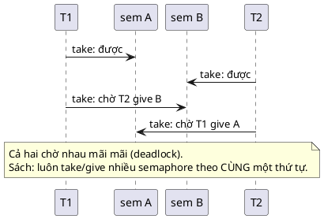

Cùng thứ tự thì T2 phải chờ ở A (không giữ gì), T1 lấy được cả hai, làm xong, trả lại, rồi T2 làm. 💡 Chú ý ví dụ này đang dùng semaphore như **khóa tài nguyên**, chính là cách dùng mà sách khuyên tránh. Với mutex, quy tắc "cùng thứ tự" vẫn y nguyên (📖 chương Mutex có cùng pitfall).

---

## 23. Quy trình refactor: từ cờ polling sang semaphore

1. **Tìm các vòng chờ:** `while (!flag)`, `while (!(REG & BIT))`, `while (...) { sleep(1); }`. Mỗi vòng là một chỗ thread đang tự hỏi thay vì được báo.
2. **Xác định ai báo:** ISR nào (hoặc thread nào) làm cho điều kiện thành đúng? Đó là nơi sẽ give.
3. **Chọn loại semaphore:** sự kiện "xong rồi" hay "có việc, đọc cạn đi" thì binary `(0, 1)`; mỗi sự kiện là một đơn vị việc thì counting với `limit` đủ lớn (mục 12.2).
4. **Đặt semaphore vào object** liên quan (Object Pattern), khởi tạo cùng object.
5. **Phía báo:** ghi dữ liệu (dưới spinlock nếu cần), rồi give. Give trên **mọi** nhánh, kể cả lỗi.
6. **Phía chờ:** thay vòng chờ bằng `sem_take(&s, timeout)`. Xử lý `-EAGAIN`.
7. **Xử lý give muộn** sau timeout (dừng phần cứng, xóa give thừa).
8. **Test:** mọi nhánh của ISR, timeout, give trước/take sau.

### Áp dụng: đọc ADC

Trước (thread hỏi cờ mỗi 1 ms):

```c
/* TRƯỚC: ISR bật cờ, thread hỏi cờ mỗi 1 ms */
#include <stdatomic.h>
#include <stdbool.h>
#include <time.h>

static atomic_bool adc_done;
static volatile int adc_value;

void adc_isr(int sample);
int adc_read_blocking(void);

void adc_isr(int sample)
{
	adc_value = sample;
	atomic_store(&adc_done, true);
}

int adc_read_blocking(void)
{
	struct timespec one_ms = { 0, 1000000L };

	while (!atomic_load(&adc_done)) {
		nanosleep(&one_ms, NULL); /* thức dậy 1000 lần/giây để hỏi */
	}
	atomic_store(&adc_done, false);
	return adc_value;
}
```

Sau (ISR give, thread take, có timeout, không có state toàn cục):

```c
/* SAU: ISR give, thread take. Không hỏi, không trễ 1 ms */
#include "sem.h"

struct adc {
	int value;
	struct sem done; /* (0, limit 1): "đã có mẫu mới" */
};

int adc_init(struct adc *self);
void adc_isr(struct adc *self, int sample);
int adc_read(struct adc *self, int32_t timeout_ms, int *out);

int adc_init(struct adc *self)
{
	self->value = 0;
	return sem_init(&self->done, 0, 1);
}

void adc_isr(struct adc *self, int sample)
{
	self->value = sample;   /* ghi dữ liệu TRƯỚC */
	sem_give(&self->done);  /* rồi mới báo */
}

int adc_read(struct adc *self, int32_t timeout_ms, int *out)
{
	int ret = sem_take(&self->done, timeout_ms);

	if (ret) {
		return ret; /* -EAGAIN: ADC không trả lời */
	}
	*out = self->value;
	return 0;
}
```

(Cả hai file đã được compile với `-std=c11 -Wall -Wextra -Werror -pedantic`.)

Những gì thay đổi, ngoài semaphore:
- State nằm trong `struct adc` (bài 1), không còn biến `static` toàn cục.
- `adc_read` trả `int` và đưa dữ liệu qua tham số ra (bài 9), nhờ vậy báo được `-EAGAIN`.
- Không còn `volatile`: `value` được ghi trước give và đọc sau take, semaphore lo phần thứ tự bộ nhớ.

---

## 24. Câu hỏi thường gặp (FAQ)

**Hỏi: ISR give trước khi thread kịp gọi take thì có mất không?**

Không, đó chính là lợi ích của bộ đếm. Give khi không ai chờ thì `count` lên 1, take sau đó lấy ngay và return 0 (demo 2, tình huống B). Khác với "chuông" ở mục 4, chỉ có tác dụng nếu đang có người nghe. Chỉ mất khi **nhiều** give dồn lại vượt `limit` (mục 12).

**Hỏi: Nhiều ISR khác nhau give cùng một semaphore được không?**

Được. Give lấy spinlock bên trong, nên an toàn với nhiều ISR và nhiều nhân. Ví dụ: ISR "RX xong" và ISR "lỗi đường truyền" cùng give một semaphore "có chuyện, dậy xem đi". Thread tỉnh dậy thì đọc trạng thái để biết chuyện gì.

**Hỏi: Một số sách nói count âm nghĩa là có thread đang chờ. Sao ở đây count không bao giờ âm?**

Đó là cách mô tả trong định nghĩa gốc của Dijkstra (thao tác P/V) và nhiều sách hệ điều hành: count giảm xuống dưới 0, giá trị âm là số thread đang chờ. Zephyr (và code mẫu) tách hai thông tin đó ra: `count` chỉ đếm tài nguyên rảnh (≥ 0), số thread chờ nằm ở `wait_q`. 📖 Sách theo cách của Zephyr: *"our count variable represents the number of resources that are currently free."* Hai cách tương đương về hành vi.

**Hỏi: Vậy binary semaphore và mutex chỉ khác nhau ở tên?**

Không. Mutex có **owner** (chỉ người lock mới unlock được), có **kế thừa ưu tiên**, cho phép **lock lồng** bởi cùng thread, và **không** dùng được trong ISR. Binary semaphore không có thứ nào trong số đó, nhưng give được từ ISR và từ bất kỳ thread nào. 📖 Sách: *"design decisions of a semaphore are not compatible with design decisions of a mutex."* Chi tiết ở bài 13.

**Hỏi: Thread đang chờ semaphore có tốn CPU không? Có tốn RAM không?**

CPU: không (🔬 mục 3). RAM: không thêm gì ngoài TCB và stack mà thread vốn đã có; hàng đợi dùng con trỏ `next` trong TCB. 📖 Sách: các thread trong hàng đợi *"do not consume any resources until the semaphore becomes available again."*

**Hỏi: Sao không give ngay trong vùng găng của spinlock cho chắc?**

Được, và đúng (dữ liệu và tín hiệu nhất quán). Nhưng 📖 sách lưu ý giờ thread tỉnh dậy sẽ bị hoãn tới lúc spinlock được thả. Code mẫu (`buf_queue_put`) thả spinlock rồi mới give: dữ liệu đã nằm yên trong ring, thread tỉnh dậy lấy được ngay mà không phải chờ lock.

**Hỏi: Có nên dùng counting semaphore để đếm số byte trong ring buffer UART không?**

Thường là không: mỗi byte một lần give là quá nhiều chuyển ngữ cảnh, và `limit` phải lớn bằng ring. Cách phổ biến: ISR give **binary** semaphore khi có byte mới (hoặc khi gặp `'\n'`, hoặc khi hết thời gian rảnh của đường truyền), thread tỉnh dậy và **đọc cạn** ring (bài tập 1).

**Hỏi: Semaphore của POSIX (`sem_t`) có giống không?**

Cùng ý tưởng (đếm + chờ), khác chi tiết: không có `limit`, thứ tự đánh thức phụ thuộc chính sách lập lịch, và `sem_post` được phép gọi trong signal handler (giống "give từ ISR"). Trên Linux, dùng nó giữa các thread của chương trình người dùng; trong kernel Linux thì có `struct semaphore` riêng.

---

## 25. Tóm tắt và checklist

**Một câu:** *Semaphore là bộ đếm tài nguyên rảnh cộng hàng đợi thread sắp theo ưu tiên, bảo vệ bằng spinlock; give trao thẳng cho thread chờ cao nhất (hoặc tăng count), take lấy ngay nếu còn hoặc ngủ không tốn CPU; dùng để báo hiệu giữa ISR và thread, không dùng để loại trừ lẫn nhau.*

**Vì sao nó chạy được:** kiểm tra count và vào hàng đợi nằm trong cùng một spinlock với give; việc thả spinlock và ngủ là một bước không chia cắt (`z_pend_curr`), nên không có khe hở cho lost wakeup; give ghi sẵn giá trị trả về cho thread chờ rồi chuyển nó về Ready, scheduler lo phần còn lại.

Checklist cho mỗi semaphore:

- [ ] Trả lời được: "ai give, ai take?" Hai nơi khác nhau (nếu cùng một thread lock/unlock thì cân nhắc mutex)
- [ ] Giá trị khởi tạo đúng ý nghĩa: báo "xong" thì 0; pool N tài nguyên thì N
- [ ] `limit` đúng: binary nếu sự kiện được phép gộp, counting nếu mỗi give là một đơn vị
- [ ] Phía give: dữ liệu đã ghi xong (và thả spinlock) trước khi give
- [ ] Give trên **mọi** nhánh của ISR, kể cả lỗi
- [ ] Phía take: có timeout cho mọi chờ đợi phụ thuộc phần cứng, xử lý `-EAGAIN`
- [ ] Sau timeout: dừng phần cứng và xóa give muộn
- [ ] ISR chỉ give hoặc take `K_NO_WAIT`
- [ ] Nhiều semaphore thì luôn take theo cùng thứ tự
- [ ] Không dùng semaphore để bảo vệ dữ liệu: dữ liệu dùng chung có spinlock/mutex riêng
- [ ] Có test cho mọi nhánh của ISR và cho timeout

---

## 26. Quiz (có đáp án)

Câu 1–7 là quiz gốc của sách (giữ nguyên các lựa chọn). Câu 8–15 do Claude thêm.

**Câu 1.** 📖 Semaphore bảo đảm thế nào rằng give ở một thread làm CPU đi thẳng tới cuối lời gọi take của thread đang chờ? Khi nào điều đó xảy ra và khi nào không?
1. Khi give, hàm scheduler được gọi từ trong hàm give và chuyển ngữ cảnh sang thread mới ngay lập tức.
2. Khi give, việc chuyển ngữ cảnh được "pend". Nếu hiện tại chưa chuyển được (như trong ngắt) thì nó được hoãn tới khi chuyển được. Nếu thread vừa được đánh thức có ưu tiên cao hơn thì chuyển sang nó ngay.
3. Khi give, việc chuyển ngữ cảnh được kích hoạt nhưng chỉ xảy ra khi system tick hết hạn và tới lượt chạy thread khác.

<details><summary>Đáp án</summary>

**2.** Give ghi sẵn giá trị trả về cho thread chờ, chuyển nó về Ready và gọi `z_reschedule`. Đang trong ISR thì chỉ pend PendSV, thread chạy ngay sau khi ISR return (mục 11.1). Từ một thread: nếu thread vừa tỉnh ưu tiên cao hơn thì chuyển ngay trong lời gọi give; nếu thấp hơn thì đợi (mục 11.2). Đáp án 1 sai vì không chuyển được giữa ISR; đáp án 3 sai vì không phải chờ tick (trừ khi quên `portYIELD_FROM_ISR` trên FreeRTOS, mục 17.1).
</details>

**Câu 2.** 📖 Vì sao count **không** tăng khi có thread đang chờ? Count thật ra biểu diễn cái gì?
1. Vì count không biểu diễn số thread đang chờ.
2. Vì count chỉ giảm khi semaphore được lấy.
3. Vì nếu không thì count phải tăng rồi lại giảm, một thao tác lãng phí.

<details><summary>Đáp án</summary>

Đáp án ý của sách là **1**, kèm lời giải thích: count là **số tài nguyên đang rảnh**. Khi có người chờ, give trao thẳng tài nguyên cho người đó, tài nguyên không "rảnh" lúc nào cả, nên count không đổi. Đáp án 3 cũng chứa một phần sự thật (tăng rồi giảm là thừa), nhưng lý do quan trọng hơn là **đúng nghĩa** và **không bị chen hàng**: nếu tăng count, một thread khác vừa tới có thể lấy mất suất của thread đã được đánh thức (mục 10.1). 🔬 Demo 2 tình huống A và C cho thấy count vẫn 0 sau give đánh thức.
</details>

**Câu 3.** 📖 Semaphore khác spinlock thế nào?
1. Semaphore biết thread và dùng để đánh thức từng thread một, còn spinlock dùng để loại trừ lẫn nhau giữa ngắt trên cùng CPU và code chạy trên CPU khác.
2. Semaphore dùng được trong ngắt.
3. Semaphore dùng thay spinlock được.

<details><summary>Đáp án</summary>

**1.** Đáp án 2 đúng một phần nhưng không phải điểm khác biệt (spinlock cũng dùng được trong ngắt). Đáp án 3 sai: semaphore được **xây trên** spinlock, và không bảo vệ dữ liệu.
</details>

**Câu 4.** 📖 Semaphore khác mutex thế nào? Mutex có chức năng gì mà semaphore không có?
1. Semaphore chỉ là một cài đặt đơn giản hơn của mutex.
2. Semaphore dùng để báo hiệu, còn mutex dùng để loại trừ lẫn nhau giữa các thread.
3. Semaphore dùng để loại trừ lẫn nhau giữa các ngắt, còn mutex chỉ dùng cho thread.

<details><summary>Đáp án</summary>

**2.** Mutex có thêm: owner (chỉ người lock được unlock, 🔬 mục 13.2 cho thấy semaphore không chặn được give lạc), kế thừa ưu tiên (mục 13.3), lock lồng bởi cùng thread.
</details>

**Câu 5.** 📖 Vì sao không bao giờ nên dùng semaphore thay cho mutex để loại trừ lẫn nhau?
1. Vì nó không giữ hàng đợi các thread đang chờ.
2. Vì nó không ngăn được starvation như mutex làm bằng kế thừa ưu tiên.
3. Vì nó không biết tới ngắt.

<details><summary>Đáp án</summary>

Sách chọn **2**. 💡 Nói chính xác hơn, kế thừa ưu tiên chống **priority inversion không giới hạn** (mục 13.3). Ngoài ra còn lý do thứ hai: semaphore không biết ai đang giữ, nên không chặn được give lạc. Đáp án 1 sai: semaphore **có** hàng đợi. Đáp án 3 sai: semaphore give được từ ngắt.
</details>

**Câu 6.** 📖 Khi nhiều thread đang chờ một semaphore và semaphore được give (bởi thread khác hoặc ngắt), thread nào được chạy trước?
1. Thread ưu tiên cao nhất.
2. Thread ưu tiên thấp nhất.
3. Thread bắt đầu chờ sớm nhất mà chưa được chạy.

<details><summary>Đáp án</summary>

**1.** Hàng đợi sắp theo ưu tiên (🔬 demo 3: logger chờ trước nhưng motor prio 1 được đánh thức trước). Cùng ưu tiên thì mới tới lượt "ai chờ trước".
</details>

**Câu 7.** 📖 Khi semaphore được give từ interrupt handler, lúc nào CPU chuyển sang thread vừa được đánh thức?
1. Ở cơ hội sớm nhất sau khi return khỏi interrupt handler hiện tại.
2. Khi system tick hết hạn.
3. Ngay lập tức.

<details><summary>Đáp án</summary>

**1.** Không chuyển được giữa ISR; PendSV (ưu tiên thấp nhất) chạy ngay khi ISR và mọi ISR lồng nhau return (mục 11.1).
</details>

**Câu 8.** Vì sao "kiểm tra count, thả spinlock, rồi đi ngủ" là sai? Code mẫu tránh bằng cách nào?

<details><summary>Đáp án</summary>

Give có thể rơi vào khe hở giữa lúc thả spinlock và lúc thật sự ngủ: nó thấy có người chờ nên gửi tín hiệu đánh thức, nhưng người đó chưa nằm xuống nên tín hiệu mất, rồi người đó ngủ mãi (lost wakeup, 🔬 mục 4.2). Code mẫu khóa `park_mtx` **trước** khi thả spinlock, nên give đến trong khe hở phải chờ tới khi thread đã nằm trong `pthread_cond_wait`; thêm cờ `woken` trong TCB để thread biết chắc mình đã được chọn. Zephyr làm điều tương đương bằng cách truyền spinlock vào `z_pend_curr`.
</details>

**Câu 9.** ISR give 5 lần trong lúc thread đang bận. Thread sau đó lấy được mấy lần nếu semaphore là `(0, limit 1)`? `(0, limit 10)`? Khi nào việc "gộp" là chấp nhận được?

<details><summary>Đáp án</summary>

1 lần và 5 lần (🔬 demo 4). Gộp chấp nhận được khi give chỉ có nghĩa "có việc, dậy xem đi" và thread tự đọc cạn mọi việc đang có (ví dụ ring buffer RX). Không chấp nhận được khi mỗi give là một đơn vị việc riêng (mỗi gói tin trong hàng đợi), lúc đó cần counting với `limit` ≥ số việc tối đa có thể dồn lại.
</details>

**Câu 10.** Tìm lỗi:

```c
static struct sem rx_done; /* sem_init(&rx_done, 0, 1) lúc khởi động */
static int rx_status;

void spi_rx_isr(bool crc_ok)
{
	if (crc_ok) {
		rx_status = 0;
		sem_give(&rx_done);
	} else {
		rx_status = -EIO;
	}
}

int spi_receive(void)
{
	sem_take(&rx_done, K_FOREVER);
	return rx_status;
}
```

<details><summary>Đáp án</summary>

Nhánh CRC lỗi **không give**: `spi_receive` chờ mãi (📖 "semaphore never given", 🔬 mục 19.2). Thêm nữa, `K_FOREVER` biến lỗi đó thành treo vĩnh viễn, và giá trị trả về của `sem_take` bị bỏ qua. Sửa: give ở cả hai nhánh (đưa `sem_give` ra sau `if/else`), dùng timeout và kiểm tra kết quả của `sem_take`. Nên gói `rx_done`, `rx_status` vào một struct object thay vì biến toàn cục.
</details>

**Câu 11.** Vì sao `buf_pool_put` give **sau** khi đã xóa `used[i]`, còn `buf_queue_put` give **sau** khi đã ghi phần tử vào ring? Đảo thứ tự thì sao?

<details><summary>Đáp án</summary>

Vì thread được give đánh thức sẽ lập tức đi tìm thứ mà give hứa: một slot trống, hoặc một phần tử trong ring. Give trước khi thứ đó thật sự sẵn sàng thì thread tỉnh dậy, take thành công, nhưng không tìm thấy slot trống (vòng lặp chạy hết mà không gán `*out`) hoặc đọc phải phần tử cũ/rác. Quy tắc chung: **dữ liệu trước, tín hiệu sau**.
</details>

**Câu 12.** `uart_tx_transmit` hết timeout trả `-EAGAIN`. Vì sao nó còn gọi `sem_take(&self->done, K_NO_WAIT)` trước khi return?

<details><summary>Đáp án</summary>

Phần cứng có thể báo xong **muộn**, sau khi ta đã bỏ đi, và ISR give. Semaphore khi đó còn một suất thừa. Lần `transmit` sau sẽ take được ngay suất đó và return trước khi phần cứng gửi xong lần mới. `sem_take(K_NO_WAIT)` xóa suất thừa (nếu có). Zephyr dùng `k_sem_reset`; driver thật còn phải dừng phần cứng để ngắt muộn không đến nữa.
</details>

**Câu 13.** Trong `wait_q_pend_curr`, khi hết giờ, vì sao phải lấy lại spinlock và kiểm tra `woken` lần nữa, thay vì cứ thế trả `-EAGAIN`?

<details><summary>Đáp án</summary>

Vì ngay giữa lúc hết giờ và lúc lấy lại spinlock, một give có thể đã chọn thread này (gỡ khỏi hàng đợi, ghi `woken = true`) và **không tăng count** (trao thẳng). Nếu thread vẫn trả `-EAGAIN`, suất đó mất vĩnh viễn: semaphore "rò" một tài nguyên. Kiểm tra dưới spinlock cho biết chắc: đã được chọn thì trả 0, chưa thì tự gỡ khỏi hàng đợi và trả `-EAGAIN`.
</details>

**Câu 14.** Bạn cần: một ISR báo "có dữ liệu ADC", một thread xử lý. Rồi thêm yêu cầu: ba thread hiển thị phải **cùng** được cập nhật mỗi khi có cấu hình mới. Dùng gì cho mỗi việc?

<details><summary>Đáp án</summary>

Việc 1: binary semaphore `(0, 1)` (hoặc task notification): một nơi give (ISR), một nơi take (thread). Việc 2: condition variable với broadcast (bài 14), vì cần đánh thức **cả ba** thread cùng lúc. 📖 Sách: semaphore đánh thức *"only one at a time"*; *"For atomic wakeup of multiple threads you can use broadcasting feature of condition variable pattern."*
</details>

**Câu 15.** Pool buffer dùng counting semaphore: thread mượn (take) rồi chính nó trả (give). Như vậy có vi phạm lời khuyên "take ở một nơi, give ở nơi khác" của sách không?

<details><summary>Đáp án</summary>

Không thật sự. Lời khuyên đó để phát hiện việc dùng semaphore làm **khóa** cho **một** vùng găng. Pool thì khác: semaphore **đếm N tài nguyên giống nhau**, không bảo vệ vùng găng nào (việc đó do spinlock của pool làm), và người trả thường khác người mượn (demo 5: ISR mượn, worker trả). Sách xếp việc này vào best practice *"Use for resource management"*. Mutex không thay được vì mutex chỉ có một suất.
</details>

---

## 27. Bài tập

### Bài 1: Driver UART RX theo dòng (cơ bản)

Ghép ring buffer của bài 11 với một binary semaphore:
- ISR (giả lập, `preempt = false`) đẩy từng byte của các chuỗi `"OK\r\n"`, `"+CSQ: 23,0\r\n"` vào `struct rx_ring`; khi gặp `'\n'` thì give.
- Thread chờ semaphore (có timeout), tỉnh dậy thì đọc cạn ring, ghép thành dòng, in ra.
- Cho ISR gửi 3 dòng thật nhanh liên tiếp. Thread có in đủ 3 dòng không? Giải thích bằng mục 12.

### Bài 2: Refactor polling (refactor)

Lấy đoạn `modem_send` "tháng 1" ở mục 1.2, viết lại cho PC theo quy trình mục 23: object `struct modem`, semaphore `done`, ISR giả lập "TX complete", timeout, xử lý give muộn. Đo CPU time của thread gửi trước và sau (dùng `CLOCK_THREAD_CPUTIME_ID` như `cpu_cost.c`).

### Bài 3: Thread pool (nâng cao)

📖 Use case "Waking up a thread pool": tạo 3 worker cùng chờ một counting semaphore `(0, 16)`. Main đẩy 10 "việc" vào một `buf_queue`-like (mỗi việc là một số nguyên) và give 10 lần.
- Mỗi worker ghi lại những việc nó làm. Việc có được chia đều không? Vì sao (trên PC) có thể không đều?
- Cho các worker ưu tiên khác nhau. Ai được đánh thức trước? Ai làm nhiều việc nhất?

### Bài 4: Timeout có kiểu (nhỏ)

Thay `int32_t timeout_ms` bằng `struct k_timeout { int64_t ms; }` cùng các macro `K_MSEC(n)`, `K_NO_WAIT`, `K_FOREVER`, để `sem_take(&s, 5)` **không compile được**. (Gợi ý: struct không chuyển ngầm từ số nguyên. Cùng tinh thần với `struct spinlock_key` ở bài 11.)

### Bài 5: `sem_reset` (nhỏ)

Thêm `int sem_reset(struct sem *self)`: đặt `count = 0`, và đánh thức **mọi** thread đang chờ với giá trị trả về `-EAGAIN` (giống `k_sem_reset` của Zephyr). Sửa `uart_tx_transmit` dùng nó. Viết test: hai thread chờ, gọi reset, cả hai trả `-EAGAIN`.

### Bài 6: Test chắc chắn hơn (nhỏ)

Thêm một hàm chỉ dùng cho test, `size_t sem_waiters(struct sem *self)`, đếm số thread trong `wait_q` (dưới spinlock). Viết lại `start_waiter()` trong `main.c` để chờ tới khi `sem_waiters() == 1` thay vì ngủ 50 ms. Viết test chứng minh hai thread **cùng** ưu tiên được đánh thức theo thứ tự đến (FIFO).

### Bài 7: Hàng đợi có giới hạn bằng hai semaphore (nâng cao)

Viết `struct msg_q` chứa N phần tử `int`, **không** dùng pool, chỉ dùng: một ring buffer + spinlock, semaphore `free` `(N, N)` và semaphore `filled` `(0, N)`.
- `msg_q_put(self, value, timeout)`: take `free` (chờ nếu đầy), ghi, give `filled`.
- `msg_q_get(self, &value, timeout)`: take `filled` (chờ nếu rỗng), đọc, give `free`.
- Chứng minh bằng test: 2 producer, 2 consumer, 100 000 phần tử, không mất, không trùng.
- **Câu hỏi suy nghĩ:** `msg_q_put` có gọi được từ ISR không? Với timeout nào?

Làm xong bài nào thì gõ `/review-exercise 12_SemaphorePattern` để Claude review.
