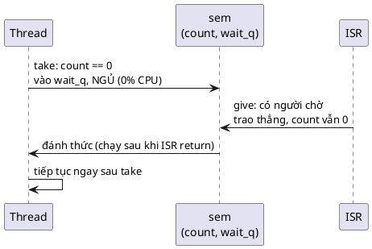

# 12 — Semaphore Pattern

📖 Bài giảng chi tiết: [LECTURE.md](LECTURE.md). File này là ghi chú tóm tắt, bám theo chương *Semaphore Pattern* của sách.

## Overview

Semaphore = **spinlock (bảo vệ bên trong) + bộ đếm tài nguyên rảnh + hàng đợi thread đang chờ, sắp theo ưu tiên**. Mục đích là **báo hiệu** giữa ISR và thread, hoặc giữa các thread: give ở nơi này, take ở nơi khác. Thread chờ thì **ngủ**, không tốn CPU, và được đánh thức đúng lúc. Không dùng để loại trừ lẫn nhau.

## Use Cases

- **Báo hiệu từ ISR sang thread:** thread take và ngủ; ISR give khi phần cứng xong; thread chạy tiếp đúng chỗ đang chờ.
- **Báo hiệu giữa các thread:** thread đánh thức chạy ngay nếu ưu tiên cao hơn, không thì đợi tới lượt.
- **Đánh thức một thread pool:** give N lần đánh thức N thread, mỗi lần một thread (muốn đánh thức cùng lúc thì dùng condition variable).
- Quản lý tài nguyên: counting semaphore đếm N buffer, spinlock bảo vệ danh sách buffer.

## Benefits

- **Rất nhẹ:** take khi còn suất chỉ là spinlock + một phép trừ.
- **Dùng được từ ISR:** cách đơn giản và nhẹ nhất để ISR báo cho thread (mutex không dùng được trong ISR; work queue tốn RAM hơn).

## Drawbacks

- **Không kế thừa ưu tiên:** dùng làm khóa thì gặp priority inversion.
- **Không hợp với loại trừ lẫn nhau:** không biết ai đang giữ, ai cũng give được.

## Implementation

Xem [inc/sem.h](inc/sem.h), [src/sem.c](src/sem.c), [src/kthread.c](src/kthread.c) (kernel giả lập: TCB, hàng đợi, ngủ/đánh thức), [src/uart_tx.c](src/uart_tx.c) (ví dụ của sách), [src/buf_pool.c](src/buf_pool.c), [src/buf_queue.c](src/buf_queue.c), [main.c](main.c).

| Thao tác | Có thread chờ / còn suất | Không có thread chờ / hết suất |
|---|---|---|
| `sem_give` | Trao thẳng cho thread ưu tiên cao nhất, **count không đổi** | `count++`, không vượt `limit` |
| `sem_take` | `count--`, return 0 ngay | `K_NO_WAIT`: `-EBUSY`; còn lại: vào hàng đợi, thả spinlock và ngủ **trong một bước**; hết giờ: `-EAGAIN` |

| 🔬 Kết quả `make run` | |
|---|---|
| Gửi 8 byte @9600 (8,3 ms trên dây) | Return sau 8,9–9,0 ms; lỗi đường truyền thì `-EIO`, không treo |
| Ba thread chờ theo thứ tự prio 5, 1, 3 | Được đánh thức theo thứ tự 1, 3, 5 |
| ISR give 5 lần khi thread bận | Binary: thấy 1; counting (limit 10): thấy 5 |
| UART RX: ISR → pool 3 buffer → queue → 2 worker | 300 µs/dòng: rớt 0; 100 µs/dòng: rớt ~50%, không buffer nào hỏng |
| Polling vs semaphore, chờ 500 ms | 500 ms CPU vs 0 ms CPU |

## Best Practices

- **Give ở một thread, take ở thread khác.** Nếu cùng một chuỗi vừa take vừa give, có lẽ bạn đang làm loại trừ lẫn nhau: dùng spinlock hoặc mutex.
- **Quản lý tài nguyên:** spinlock cho dữ liệu, semaphore để báo có việc. Give sau khi thả spinlock để thread tỉnh dậy không phải chờ lock.
- **Tránh phụ thuộc vòng tròn** giữa các semaphore.
- 💡 Dữ liệu trước, tín hiệu sau; give trên mọi nhánh của ISR; luôn có timeout cho chờ đợi phụ thuộc phần cứng.

## Common Pitfalls

- **Priority inversion:** thread thấp giữ, thread cao chờ, thread giữa chiếm CPU; semaphore không có kế thừa ưu tiên.
- **Deadlock:** hai thread lấy hai semaphore theo thứ tự ngược nhau. Luôn take/give theo cùng một thứ tự.
- **Semaphore never given:** ISR chỉ give khi thành công, nhánh lỗi quên give; thread treo vĩnh viễn. Test mọi nhánh của ISR.
- 💡 Binary cho sự kiện cần đếm (mất sự kiện), khởi tạo sai (1 thay vì 0), give muộn sau timeout.

## Alternatives

- **Condition variable:** đánh thức nhiều thread cùng lúc, chờ điều kiện phức tạp.
- **Mutex:** loại trừ lẫn nhau giữa các thread; phải unlock ở chính thread đã lock, nên không dùng để báo hiệu.
- 💡 Task notification (FreeRTOS), event flags, message queue, work queue.

## Quiz

1. Give ở một thread làm CPU đi thẳng tới cuối lời gọi take của thread đang chờ bằng cách nào? Khi nào có, khi nào không?
2. Vì sao count không tăng khi có thread đang chờ? Count thật ra biểu diễn gì?
3. Semaphore khác spinlock thế nào?
4. Semaphore khác mutex thế nào? Mutex có gì mà semaphore không có?
5. Vì sao không bao giờ nên dùng semaphore thay mutex để loại trừ lẫn nhau?
6. Nhiều thread cùng chờ, semaphore được give: thread nào chạy trước?
7. Give từ interrupt handler thì khi nào CPU chuyển sang thread vừa được đánh thức?

(Đáp án và 8 câu thêm trong [LECTURE.md](LECTURE.md#26-quiz-có-đáp-án).)

## Câu hỏi còn thắc mắc

-
