# Bài giảng 13 — Mutex Pattern (Mutual Exclusion)

> **Về nguồn:** Bài này bám theo chương *Mutual Exclusion Pattern* trong sách của Martin Schröder (bản 0.38.0, file `00_Document/Martin-Schroder-Design-Patterns-Mutual-Exclusion-Pattern-0.38.0.pdf`). Sách dùng chữ *mutex* xuyên suốt chương, nên bài này gọi tắt là **Mutex Pattern**.
> - 📖 đánh dấu nội dung **theo sách** (dịch và diễn giải lại).
> - 💡 đánh dấu phần **giải thích thêm**, không có trong sách.
> - 🔬 đánh dấu **thí nghiệm thật**: chương trình đã được build bằng gcc 16.2 (MSYS2 UCRT64, Windows 11 64-bit, CPU 16 luồng, thư viện winpthreads) với `-std=c11 -Wall -Wextra -Werror -pedantic -pthread` và chạy; output in trong bài là output thật. Chương trình nhiều thread cho kết quả **khác nhau giữa các lần chạy**; khi đó bài ghi rõ đã chạy mấy lần và thấy gì.
>
> ⚠️ **Giới hạn của mô phỏng trên PC:** thread của Windows không phải task của RTOS. PC có nhiều core chạy song song thật, scheduler của Windows không tuân thủ priority nghiêm ngặt, không có ISR, và winpthreads **không hỗ trợ** priority inheritance (🔬 mục 11). Những gì phụ thuộc vào các thứ đó (priority inversion, gọi mutex từ ISR) được giải thích bằng code Zephyr trích từ sách (📖, **không chạy**) và bằng một **bộ mô phỏng scheduler** viết bằng C (🔬, mô hình chứ không phải RTOS thật).

Code mẫu đi kèm: [inc/mutex.h](inc/mutex.h), [src/mutex.c](src/mutex.c), [inc/i2c_bus.h](inc/i2c_bus.h), [src/i2c_bus.c](src/i2c_bus.c), [src/i2c_sim.h](src/i2c_sim.h), [src/i2c_sim.c](src/i2c_sim.c), [inc/tmp102.h](inc/tmp102.h), [src/tmp102.c](src/tmp102.c), [main.c](main.c). Ghi chú ngắn: [README.md](README.md).
Bài trước: [10 — Concurrency](../10_ConcurrencyPattern/LECTURE.md), [11 — Spinlock](../11_SpinlockPattern/LECTURE.md), [12 — Semaphore](../12_SemaphorePattern/LECTURE.md). Bài sau: [14 — Conditional](../14_ConditionalPattern/LECTURE.md).

---

## Mục lục

**Phần A — Kiến thức nền**

1. [Bối cảnh: vì sao spinlock và semaphore chưa đủ](#1-bối-cảnh-vì-sao-spinlock-và-semaphore-chưa-đủ)
2. [Race condition từ gốc: đọc - sửa - ghi](#2-race-condition-từ-gốc-đọc---sửa---ghi)
3. [Critical section: vì sao "biến atomic" là chưa đủ](#3-critical-section-vì-sao-biến-atomic-là-chưa-đủ)
4. [Thread, scheduler và trạng thái của thread](#4-thread-scheduler-và-trạng-thái-của-thread)
5. [Priority và priority inversion](#5-priority-và-priority-inversion)

**Phần B — Pattern**

6. [Vấn đề: bus dùng chung không có khóa](#6-vấn-đề-bus-dùng-chung-không-có-khóa)
7. [Ý tưởng cốt lõi: khóa có chủ sở hữu và hàng đợi](#7-ý-tưởng-cốt-lõi-khóa-có-chủ-sở-hữu-và-hàng-đợi)
8. [5 đặc điểm nhận dạng và lý do của từng cái](#8-5-đặc-điểm-nhận-dạng-và-lý-do-của-từng-cái)
9. [Đọc code k_mutex của Zephyr trong sách](#9-đọc-code-k_mutex-của-zephyr-trong-sách)
10. [Priority inheritance chạy thế nào](#10-priority-inheritance-chạy-thế-nào)
11. [Ownership và khóa lồng: đối chiếu với pthread](#11-ownership-và-khóa-lồng-đối-chiếu-với-pthread)
12. [Mutex và interrupt](#12-mutex-và-interrupt)

**Phần C — Đọc code**

13. [Đọc code mẫu từng dòng](#13-đọc-code-mẫu-từng-dòng)
14. [Theo dõi demo chạy từng bước](#14-theo-dõi-demo-chạy-từng-bước)
15. [Các quyết định thiết kế và phương án khác](#15-các-quyết-định-thiết-kế-và-phương-án-khác)

**Phần D — Thực tế và tổng kết**

16. [Mutex trong thực tế: Zephyr, FreeRTOS, CMSIS, Linux](#16-mutex-trong-thực-tế-zephyr-freertos-cmsis-linux)
17. [Test code có mutex](#17-test-code-có-mutex)
18. [Trade-off](#18-trade-off)
19. [Khi nào không nên dùng](#19-khi-nào-không-nên-dùng)
20. [Lỗi hay gặp](#20-lỗi-hay-gặp)
21. [Quy trình refactor: thêm mutex vào một driver](#21-quy-trình-refactor-thêm-mutex-vào-một-driver)
22. [Câu hỏi thường gặp (FAQ)](#22-câu-hỏi-thường-gặp-faq)
23. [Tóm tắt và checklist](#23-tóm-tắt-và-checklist)
24. [Quiz (có đáp án)](#24-quiz-có-đáp-án)
25. [Bài tập](#25-bài-tập)

---

# Phần A — Kiến thức nền

Mutex là thứ đầu tiên trong chuỗi concurrency mà bạn sẽ dùng **hằng ngày** trong code ứng dụng. Spinlock nằm trong kernel, semaphore dùng để báo hiệu; còn "nhiều thread cùng dùng một driver" thì gần như luôn cần mutex. Phần A dựng lại từ gốc: dữ liệu bị hỏng thế nào khi hai luồng chen nhau, scheduler quyết định ai chạy ra sao, và priority inversion là gì.

## 1. Bối cảnh: vì sao spinlock và semaphore chưa đủ

### 1.1. Nhìn lại bài 11: spinlock

📖 Ở chương *Spinlock*, sách xây primitive thấp nhất: **khóa ngắt + compare-and-swap**. Code (trích từ sách, Zephyr, **không chạy**):

```c
/* 📖 Trích sách, chương Spinlock (Zephyr) */
static ALWAYS_INLINE k_spinlock_key_t k_spin_lock(struct k_spinlock *l)
{
	k_spinlock_key_t k;

	k.key = arch_irq_lock();               /* tắt ngắt, nhớ trạng thái cũ vào key */
	while (!atomic_cas(&l->locked, 0, 1)) { /* chỉ cần khi có nhiều core */
	}
	return k;
}

static ALWAYS_INLINE void k_spin_unlock(struct k_spinlock *l, k_spinlock_key_t key)
{
	atomic_clear(&l->locked);
	arch_irq_unlock(key.key);               /* trả ngắt về đúng trạng thái cũ */
}
```

Những gì cần nhớ từ bài 11 để hiểu bài này:

| Tính chất của spinlock (📖) | Hệ quả |
|---|---|
| Tắt ngắt trong suốt thời gian giữ khóa | **Không ai** chen vào được, kể cả ISR. Nhưng mọi sự kiện phần cứng bị hoãn lại |
| "No concept of threads" | Không biết ai đang giữ, không có hàng đợi, không đưa CPU sang thread khác |
| Chỉ giữ trong vài lệnh, không gọi hàm khác | Không thể giữ trong một transfer I2C dài vài trăm micro giây |
| Dùng được trong ISR | Là công cụ duy nhất để đồng bộ **thread ↔ ISR** |

📖 Sách nói thẳng: *"Spinlocks are not for synchronization between threads - but they are essential to implementing such synchronization safely."* Spinlock không phải công cụ cho thread, nhưng mọi công cụ cho thread đều xây trên nó.

### 1.2. Nhìn lại bài 12: semaphore

📖 Semaphore đứng trên spinlock, thêm **bộ đếm** và **hàng đợi thread**. Thread `take` khi bộ đếm bằng 0 thì bị **suspend** (không tốn CPU), thread hay ISR khác `give` thì thread đó được đánh thức. Ví dụ của sách:

```c
/* 📖 Trích sách, chương Semaphore (Zephyr) */
struct some_device {
	struct k_sem done;
};

static void some_device_isr(void)
{
	struct some_device *self = &_instance_of_device;
	k_sem_give(&self->done);          /* ISR báo: phần cứng đã xong */
}

void some_device_transmit(struct some_device *self, const void *data, size_t size)
{
	/* (1) nạp thanh ghi */
	k_sem_take(&self->done);          /* (2) ngủ tới khi ISR give */
	/* (3) tiếp tục */
}
```

Semaphore đã giải được điều spinlock không làm được: **chờ lâu mà không đốt CPU**. Vậy sao không dùng semaphore (khởi tạo bằng 1) làm khóa cho bus I2C luôn? 📖 Sách trả lời ngay trong chương Semaphore:

> *"The semaphore is not designed as a mutual exclusion mechanism. It does not have priority inheritance. It does not track what thread is holding it - like a mutex would do."*

Ba lỗ hổng: **không có priority inheritance**, **không biết ai đang giữ**, nên cũng **không chặn được người lạ "give" hộ**. 📖 Lời khuyên của bài 12: *"will I always take it in one thread and give it in another?"* Nếu cùng một thread vừa take vừa give, tức là bạn đang làm mutual exclusion, và nên dùng spinlock hoặc mutex.

### 1.3. Một dự án lớn dần: bus I2C dùng chung qua năm lần sửa

💡 *Tình huống minh họa (không phải ví dụ trong sách), nhưng mỗi bước đều là lỗi có thật hay gặp trong firmware.*

#### Tháng 1: một thread, mọi thứ ổn

Một bộ ghi dữ liệu môi trường chạy Zephyr. Trên bus I2C1 có cảm biến nhiệt độ TMP102 (địa chỉ `0x48`) và EEPROM 24C02 (`0x50`). Chỉ có một thread `sensor_thread` đọc nhiệt độ mỗi giây và ghi vào EEPROM. Driver bus viết theo Object Pattern, không có khóa nào. Chạy hoàn hảo, vì chỉ có một người dùng bus.

#### Tháng 3: thêm thread thứ hai

Khách hàng muốn log được ghi ngay cả khi không đọc cảm biến. Team tách ra `logger_thread` riêng, cũng ghi EEPROM qua I2C1. Vài ngày sau, log bắt đầu có những dòng *"nhiệt độ = 160.5 °C"* trong phòng máy lạnh, và EEPROM thỉnh thoảng chứa byte rác.

Nguyên nhân (mục 3 sẽ chứng minh bằng thí nghiệm): một lần đọc cảm biến là **chuỗi nhiều bước** trên **một bộ thanh ghi duy nhất** của khối I2C. Logger chen vào giữa chuỗi, đổi địa chỉ đích, và sensor đọc nhầm từ EEPROM.

#### Tháng 4: "sửa" bằng cách tắt ngắt

Một bạn đã học bài 11 bọc mỗi transfer bằng `irq_lock()`/`irq_unlock()`. Dữ liệu hết sai. Nhưng một transfer I2C ở 100 kHz dài cỡ 0,5 ms, và trong suốt 0,5 ms đó **mọi ngắt bị chặn**. UART ở 115200 baud nhận một byte mỗi ~87 µs, FIFO chỉ có vài byte: bộ thu GPS bắt đầu mất ký tự. 📖 Đúng điều sách cảnh báo: spinlock chỉ dùng *"for very short periods of time"*, và *"lock data - not code"*.

#### Tháng 6: "sửa" bằng semaphore khởi tạo bằng 1

Đổi sang `k_sem_take(&bus_sem)` / `k_sem_give(&bus_sem)`. Ngắt không còn bị chặn, thread chờ thì ngủ. Ổn được hai tháng. Rồi xuất hiện:

1. **Watchdog reset ngẫu nhiên.** `logger_thread` (priority thấp) đang giữ bus thì bị một thread xử lý mạng (priority trung bình, chạy lâu) chiếm CPU. `control_thread` (priority cao nhất, phải đọc nhiệt độ mỗi 10 ms để điều khiển quạt) đứng chờ bus... chờ luôn cả thread mạng không liên quan. Trễ hạn, watchdog cắn. Đây là **priority inversion** (mục 5), đúng lỗi đã làm robot Mars Pathfinder tự reset năm 1997 💡.
2. **Một bug ở nhánh xử lý lỗi** gọi `k_sem_give(&bus_sem)` hai lần. Semaphore không biết ai đang giữ nên vui vẻ tăng bộ đếm lên 2... và từ đó hai thread vào bus cùng lúc, lỗi tháng 3 quay lại, nhưng chỉ thỉnh thoảng.

#### Tháng 8: thêm hàm "đọc snapshot"

Cần đọc thanh ghi config và nhiệt độ **liền nhau** để không ai đổi config ở giữa. Bạn viết `tmp102_read_snapshot()`: take semaphore của bus, rồi gọi `tmp102_read_temp()`... mà hàm này cũng take semaphore. Thread **tự chặn chính mình** mãi mãi: self-deadlock. Cách chữa thường thấy là tách mỗi hàm thành hai bản `_locked` / `_unlocked`, số hàm nhân đôi.

#### Nhìn lại

| Tháng | Chuyện gì xảy ra | Thiếu cái gì |
|---|---|---|
| 3 | Hai thread chen nhau trên bus | **Mutual exclusion** |
| 4 | Tắt ngắt: đúng dữ liệu nhưng mất sự kiện phần cứng | Khóa **không chặn ngắt**, thread chờ thì **ngủ** |
| 6 (1) | Thread cao bị thread trung bình chặn gián tiếp | **Priority inheritance** |
| 6 (2) | Người không giữ khóa lại mở khóa | **Ownership** (chỉ owner được mở) |
| 8 | Hàm có khóa gọi hàm có khóa, tự deadlock | **Khóa lồng** (recursive) |

Năm dòng ở cột phải chính là năm đặc điểm của mutex mà sách liệt kê (mục 8). Mutex sinh ra để gom đủ năm thứ đó vào một primitive.

### 1.4. Đọc kỹ định nghĩa của sách

📖 Câu mở đầu chương:

> *"The mutex pattern is primarily designed for mutual exclusion between threads."*
>
> *Mutex pattern được thiết kế chủ yếu cho việc **loại trừ lẫn nhau giữa các thread**.*

| Vế | Nghĩa là gì |
|---|---|
| *"primarily designed for"* | Đây là **mục đích thiết kế**, không phải "cũng dùng được cho". Dùng mutex để báo hiệu (lock ở thread này, unlock ở thread kia) là dùng sai mục đích, và thực tế bị cấm (mục 11) |
| *"mutual exclusion"* | **Loại trừ lẫn nhau**: tại một thời điểm, tối đa **một** bên được ở trong vùng code truy cập tài nguyên chung. Chữ *mutex* chính là ghép từ **mut**ual **ex**clusion |
| *"between threads"* | Giữa các **thread**, không phải giữa thread và ISR. Đây là ranh giới cứng với spinlock |

Câu thứ hai và thứ ba bổ sung hai ranh giới quan trọng:

> *"Unlike the semaphore and the spinlock, the mutex can not be used from interrupts. It is the first synchronization primitive in our pattern stack that is required to be both locked and unlocked by the same application level thread."*

| Vế | Nghĩa là gì |
|---|---|
| *"can not be used from interrupts"* | Khác spinlock và semaphore (cả hai gọi được từ ISR). Mục 12 giải thích vì sao |
| *"the first ... in our pattern stack"* | Sách xếp các primitive thành một **chồng** (stack): spinlock → semaphore → mutex → conditional. Mutex là tầng đầu tiên **chỉ** sống trong thế giới thread |
| *"both locked and unlocked by the same ... thread"* | **Ownership**: thread nào lock thì chính thread đó phải unlock. Đây là ràng buộc định nghĩa nên mutex |

Viết gọn thành công thức:

> **Mutex = khóa của thread + chủ sở hữu (owner) + hàng đợi có priority + priority inheritance + khóa lồng**

### 1.5. Mutex trong nhóm Concurrency

📖 Theo chương *Concurrency*, một hệ thống concurrent luôn có ba phần: **scheduler**, **hỗ trợ phần cứng**, và **synchronization** (*"spinlocks, semaphores, mutexes, conditional variables and other higher level concepts"*). Bốn bài 11–14 là bốn tầng của phần synchronization:

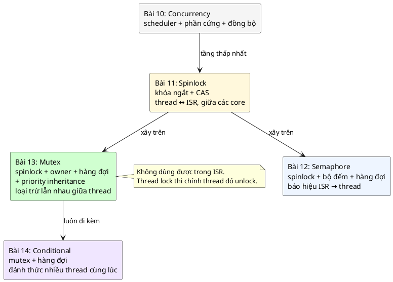

| | Spinlock (11) | Semaphore (12) | **Mutex (13)** | Conditional (14) |
|---|---|---|---|---|
| Mục đích chính | Bảo vệ dữ liệu dùng chung với ISR / core khác | **Báo hiệu** | **Loại trừ lẫn nhau giữa thread** | Chờ một điều kiện bất kỳ, đánh thức nhiều thread |
| Gọi từ ISR | Được | `give` được | **Không** | `signal` được (theo sách) |
| Tắt ngắt khi giữ | **Có** | Không | **Không** | Không |
| Thread chờ thì | Quay vòng (đa core) | Ngủ trong hàng đợi | **Ngủ trong hàng đợi** | Ngủ trong hàng đợi |
| Biết ai đang giữ | Không | Không | **Có (owner)** | (qua mutex) |
| Khóa lồng | Không (deadlock) | Không | **Có** | Không áp dụng |
| Priority inheritance | Không áp dụng | Không | **Có** | (qua mutex) |
| Giữ được lâu | Không, vài lệnh | Có | **Có, nhưng càng ngắn càng tốt** | Có |

### 1.6. Câu hỏi bài này sẽ trả lời

1. Dữ liệu bị hỏng **chính xác thế nào** khi hai thread cùng dùng một bus? Biến `_Atomic` có cứu được không? (Mục 2–3)
2. Mutex làm gì **bên trong** khi lock một khóa đang bận? Ai được vào tiếp khi unlock? (Mục 7, 9, 13)
3. Priority inversion là gì và priority inheritance chữa nó ra sao? (Mục 5, 10)
4. Vì sao **chỉ owner** được unlock, vì sao **cho phép khóa lồng**, và vì sao **cấm dùng trong ISR**? (Mục 11–12)
5. Deadlock xảy ra thế nào và tránh bằng quy tắc gì? (Mục 20)

---

## 2. Race condition từ gốc: đọc - sửa - ghi

### 2.1. Một dòng C là nhiều lệnh máy

📖 Chương Spinlock đã disassemble câu `self->foo += 8;` trên ARM và chỉ ra nó luôn gồm **ít nhất ba lệnh**: `ldr` (đọc từ RAM vào thanh ghi), `add` (cộng trong thanh ghi), `str` (ghi thanh ghi về RAM). Giữa hai lệnh bất kỳ, CPU có thể bị ngắt, hoặc (với thread) scheduler có thể chuyển sang thread khác. Trên máy nhiều core, thread kia thậm chí chạy **song song** cùng lúc.

### 2.2. Interleaving: hai thread chen nhau

Giả sử `value = 5`, thread A và thread B cùng chạy `value = value + 1`. Kết quả đúng phải là 7.

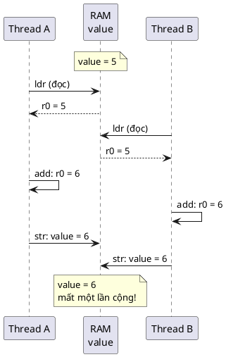

Không có gì "hỏng" trong từng thread. Mỗi thread làm đúng ba bước của nó. Cái sai nằm ở **thứ tự xen kẽ** (interleaving). Có rất nhiều thứ tự xen kẽ có thể xảy ra; chỉ cần **một** trong số đó cho kết quả sai là chương trình có bug. Đây gọi là **race condition**: kết quả phụ thuộc vào việc ai "chạy đua" tới trước.

### 2.3. 🔬 Thí nghiệm: hai thread, mỗi thread cộng 1 triệu lần

```c
/* Hai thread cùng tăng một biến đếm: không khóa, và có khóa bằng struct mutex */
#include "mutex.h"
#include <pthread.h>
#include <stdio.h>

#define N 1000000

struct counter {
	struct mutex lock;
	volatile long value; /* volatile để compiler không gộp vòng lặp thành một phép cộng */
	int use_lock;
};

static void *inc(void *arg)
{
	struct counter *c = arg;
	for (int i = 0; i < N; i++) {
		if (c->use_lock) {
			mutex_lock(&c->lock, MUTEX_FOREVER);
		}
		c->value = c->value + 1; /* đọc - cộng - ghi: ba bước, không nguyên tử */
		if (c->use_lock) {
			mutex_unlock(&c->lock);
		}
	}
	return NULL;
}

static long run(int use_lock)
{
	struct counter c = { .value = 0, .use_lock = use_lock };
	pthread_t a, b;
	mutex_init(&c.lock);
	pthread_create(&a, NULL, inc, &c);
	pthread_create(&b, NULL, inc, &c);
	pthread_join(a, NULL);
	pthread_join(b, NULL);
	mutex_deinit(&c.lock);
	return c.value;
}

int main(void)
{
	printf("khong khoa: %ld (mong doi %d)\n", run(0), 2 * N);
	printf("co mutex  : %ld (mong doi %d)\n", run(1), 2 * N);
	return 0;
}
```

Build: `gcc -std=c11 -Wall -Wextra -Werror -pedantic -pthread -Iinc race.c src/mutex.c`. Chạy 5 lần, output thật:

```
khong khoa: 1176258 (mong doi 2000000)
co mutex  : 2000000 (mong doi 2000000)
khong khoa: 1212101 (mong doi 2000000)
co mutex  : 2000000 (mong doi 2000000)
khong khoa: 1237192 (mong doi 2000000)
co mutex  : 2000000 (mong doi 2000000)
khong khoa: 1273551 (mong doi 2000000)
co mutex  : 2000000 (mong doi 2000000)
khong khoa: 1260744 (mong doi 2000000)
co mutex  : 2000000 (mong doi 2000000)
```

Đọc kết quả:
- Không khóa: mất khoảng **37–41%** số lần cộng, và **mỗi lần chạy mất một số khác nhau**. Đây là đặc trưng của race condition: không lặp lại được, nên rất khó debug.
- Có mutex: **đúng 2 000 000 cả 5 lần**.
- 💡 `volatile` ở đây **không** làm phép cộng an toàn. Nó chỉ buộc compiler thật sự đọc/ghi RAM mỗi vòng (nếu không, gcc `-O2` có thể gộp cả vòng lặp thành `value += N`, che mất hiện tượng). Nói chính xác theo chuẩn C11, hai thread cùng ghi một biến thường mà không đồng bộ là **data race = undefined behavior**; bản "không khóa" ở trên chỉ để minh họa, không bao giờ viết vậy trong code thật.

💡 Trên MCU **một core**, hai thread không chạy song song thật, nhưng scheduler có thể preempt thread A ngay giữa `ldr` và `str` (khi tick timer hoặc một ISR làm một thread priority cao hơn sẵn sàng). Xác suất thấp hơn trên PC nhiều core, nghĩa là bug **hiếm hơn**, tức là **nguy hiểm hơn**: nó lọt qua test và xuất hiện ở hiện trường.

---

## 3. Critical section: vì sao "biến atomic" là chưa đủ

### 3.1. Critical section

**Critical section** (vùng găng) là đoạn code truy cập tài nguyên dùng chung mà phải chạy **liền mạch như một khối** đối với mọi bên khác cùng dùng tài nguyên đó. Ở thí nghiệm trên, critical section chỉ là một dòng `value = value + 1`. Với bus I2C, critical section là **cả một transfer**:

```
START → gửi địa chỉ thiết bị → gửi số thanh ghi → RESTART → gửi lại địa chỉ → đọc N byte → STOP
```

### 3.2. Ý nghĩ sai: "dùng `_Atomic` là xong"

C11 có `<stdatomic.h>`: mỗi phép đọc/ghi/cộng trên biến `_Atomic` là **nguyên tử** (không bị cắt ngang). Có người nghĩ: cho thanh ghi địa chỉ của bus là `_Atomic` thì hết race. Sai, vì **từng bước** nguyên tử không có nghĩa **cả chuỗi bước** nguyên tử.

Code mẫu cố ý dùng `_Atomic uint8_t hw_target` cho thanh ghi mô phỏng (để thí nghiệm không có undefined behavior), rồi cho bạn bỏ mutex bằng cờ build `-DI2C_BUS_DEMO_NO_LOCK`:

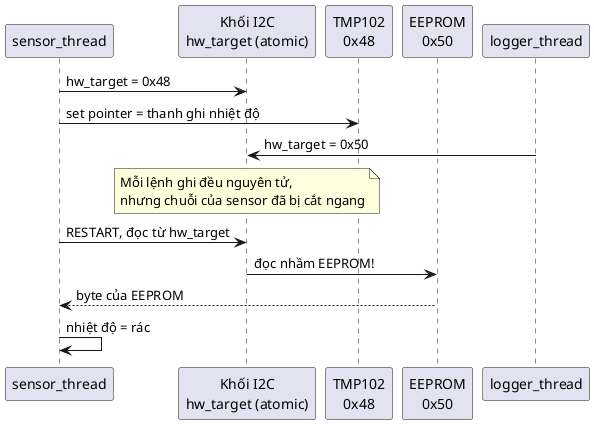

### 3.3. 🔬 Thí nghiệm: bus I2C có và không có mutex

Demo phần 1 của [main.c](main.c): `sensor_thread` đọc TMP102 300 lần (cảm biến mô phỏng luôn trả 25,000 °C, đọc ra số khác là đọc nhầm), `logger_thread` ghi rồi đọc lại EEPROM 300 lần. Chạy 5 lần mỗi bản:

Bản có mutex (`make run`):

```
sensor thread: 300 lan doc TMP102, sai 0
logger thread: 300 lan ghi + doc lai EEPROM, sai 0
```

(cả 5 lần đều sai 0)

Bản bỏ mutex (`make clean; make run EXTRA=-DI2C_BUS_DEMO_NO_LOCK`), 5 lần:

```
sensor thread: 300 lan doc TMP102, sai 278
logger thread: 300 lan ghi + doc lai EEPROM, sai 172
sensor thread: 300 lan doc TMP102, sai 280
logger thread: 300 lan ghi + doc lai EEPROM, sai 172
sensor thread: 300 lan doc TMP102, sai 277
logger thread: 300 lan ghi + doc lai EEPROM, sai 174
sensor thread: 300 lan doc TMP102, sai 277
logger thread: 300 lan ghi + doc lai EEPROM, sai 171
sensor thread: 300 lan doc TMP102, sai 274
logger thread: 300 lan ghi + doc lai EEPROM, sai 175
```

Gần **93%** lần đọc cảm biến sai, dù mọi thanh ghi mô phỏng đều là `_Atomic`. Tỉ lệ cao như vậy vì trên PC hai thread chạy song song thật trên hai core và mỗi transfer kéo dài ~100 µs (CPU bận chờ cờ như một driver polling). Trên MCU một core, tỉ lệ sẽ thấp hơn nhiều, nhưng không bằng 0. (💡 Ở bản bỏ khóa, bộ đếm `transfers++` cũng thành data race, nên con số thống kê của bản đó không còn đáng tin.)

**Kết luận:** thứ cần bảo vệ là **bất biến của cả chuỗi thao tác** ("từ START tới STOP, thanh ghi đích không đổi"), không phải từng biến. Atomic bảo vệ từng biến; mutex bảo vệ cả critical section.

---

## 4. Thread, scheduler và trạng thái của thread

### 4.1. Thread là gì, theo góc nhìn của CPU

📖 Chương Concurrency: mỗi core có một bộ **thanh ghi** quyết định trạng thái hiện tại và lệnh tiếp theo; *"context switching means to save and restore this state"*. Một **thread** chỉ là: một bộ thanh ghi đã lưu + một vùng stack riêng + vài thông tin quản lý (priority, trạng thái). Trên Cortex-M, việc chuyển thread được thực hiện trong ngắt PendSV.

### 4.2. Ba trạng thái quan trọng

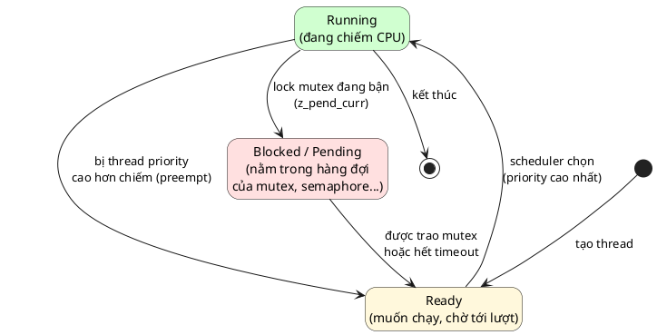

- **Blocked** là trạng thái *không tốn CPU*. Thread nằm im trong hàng đợi của một đối tượng đồng bộ; scheduler bỏ qua nó. Đây là khác biệt lớn với spinlock, nơi core chờ phải **quay vòng** (spin) và đốt CPU.
- Chuyển từ Blocked sang Ready **không** do thread tự làm được (nó đang ngủ). Phải có **người khác** (thread unlock mutex, ISR give semaphore, timer hết hạn) đưa nó ra khỏi hàng đợi. Vì vậy mọi primitive có hàng đợi đều cần một chỗ ghi "ai đang chờ".

### 4.3. Scheduler chọn ai

💡 RTOS embedded (Zephyr, FreeRTOS) thường dùng **preemptive priority scheduling**: tại mọi thời điểm, thread **Ready có priority cao nhất** được chạy. Nếu một thread priority cao hơn vừa thành Ready (ví dụ vì được trao mutex), nó **chiếm CPU ngay**, kể cả khi thread đang chạy chưa xong. 📖 Đây là lý do sách nói unlock mutex *"may switch context right away during the unlock and before the unlock function returns"*.

⚠️ Windows không làm như vậy với thread bình thường: nó chia thời gian, tăng giảm priority động, và chạy song song trên nhiều core. Vì vậy mọi hiện tượng phụ thuộc priority ở bài này được minh họa bằng bộ mô phỏng (mục 10), không bằng thread Windows.

---

## 5. Priority và priority inversion

### 5.1. Priority thể hiện điều gì

💡 Priority là cách bạn nói với scheduler *"việc này gấp hơn việc kia"*. Thread điều khiển động cơ phải phản hồi trong 1 ms thì priority cao; thread ghi log thì priority thấp. Hệ thống đúng hạn (real-time) khi **thread priority cao không bao giờ bị chờ việc của thread priority thấp lâu hơn mức cần thiết**.

### 5.2. Priority inversion: thread cao bị thread trung bình chặn

📖 Chương Semaphore định nghĩa: *"a situation that occurs when a low-priority thread holds a resource busy that a high-priority thread needs - causing the high priority thread to be blocked."*

Bản thân việc H chờ L trả bus là **không tránh được** (bus chỉ có một). Cái nguy hiểm là trường hợp **không giới hạn** (unbounded): có thêm thread M priority trung bình, không dính gì tới bus. Kịch bản (ba task, một CPU):

1. L (thấp) lock bus, đang trong critical section.
2. H (cao) thức dậy, chiếm CPU, cố lock bus → bị chặn, nằm chờ.
3. M (trung bình) thức dậy. M cao hơn L nên **chiếm CPU của L**. L không chạy được, nên không trả bus được.
4. H (cao nhất) giờ phải chờ **M** chạy xong, dù M không liên quan gì tới bus. Nếu có nhiều task M, H chờ vô hạn.

Thứ tự ưu tiên thực tế đã bị **đảo ngược**: M > H. Đó là chữ *inversion*.

### 5.3. 🔬 Mô phỏng: không có priority inheritance

Bộ mô phỏng (mã nguồn đầy đủ ở mục 10.3) chạy một scheduler preemptive theo priority trên một CPU, theo từng tick. L chạy 1 tick, lock, critical section 4 tick; H tới ở tick 2, chạy 1 tick rồi lock; M tới ở tick 3 và chạy 8 tick không dùng mutex. Output thật, chế độ **không** có inheritance (như khi dùng semaphore làm khóa):

```
KHONG co priority inheritance (vd. dung semaphore lam lock)
tick  0         1         2
      012345678901234567890123
H(3)  ..#bbbbbbbbbbbCC#.......
M(2)  ...########.............
L(1)  #C---------CCC---#......
H bi chan 11 tick, xong o tick 17
```

(`#` chạy, `C` chạy khi giữ mutex, `b` bị chặn chờ mutex, `-` sẵn sàng nhưng bị task khác chiếm CPU, `.` chưa tới hoặc đã xong.)

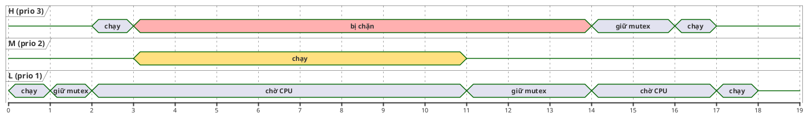

H bị chặn **11 tick**, trong đó 8 tick là do M, một task không hề dùng bus. Thời gian chặn của H giờ phụ thuộc vào **mọi** task có priority nằm giữa L và H, tức là không còn tính trước được.

Mục 10 sẽ cho thấy priority inheritance rút con số này xuống 3 tick.

---

# Phần B — Pattern

## 6. Vấn đề: bus dùng chung không có khóa

Driver bus trước khi có mutex (đúng như bản `I2C_BUS_DEMO_NO_LOCK` của code mẫu): mọi thread gọi thẳng `i2c_bus_write_read()`, các bước của transfer chen nhau tùy ý. Ba hướng "sửa" sai lầm ở mục 1.3 và kết quả:

| Cách | Dữ liệu đúng? | Ngắt bị chặn? | Thread chờ thì | Priority inversion | Người lạ mở khóa | Hàm có khóa gọi hàm có khóa |
|---|---|---|---|---|---|---|
| Không khóa | ❌ | Không | (không chờ) | — | — | — |
| `irq_lock` / spinlock | ✅ | **Có, suốt transfer** | (không ai chạy được) | — | Không phát hiện | Spinlock: deadlock (📖) |
| Semaphore = 1 | ✅ | Không | Ngủ | **Có** | **Không phát hiện** | **Deadlock** |
| **Mutex** | ✅ | Không | Ngủ | **Được chặn** | **`-EPERM`** | **Khóa lồng, chạy tiếp** |

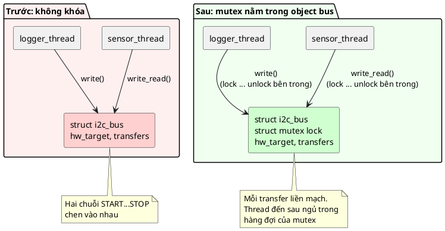

Chú ý vị trí của khóa: **bên trong object bus, bên trong các hàm public của driver**. Thread ứng dụng không cần biết có khóa. 📖 Đây chính là best practice đầu tiên của sách (mục 8, 13).

---

## 7. Ý tưởng cốt lõi: khóa có chủ sở hữu và hàng đợi

Một mutex chỉ cần ba mẩu dữ liệu (📖 đúng như các field `owner`, `lock_count`, `wait_q` trong `struct k_mutex` mà sách trích):

| Field | Ý nghĩa | Phục vụ đặc điểm nào |
|---|---|---|
| `owner` | Thread đang giữ | Ownership, khóa lồng, priority inheritance |
| `lock_count` | 0 = mở; ≥ 1 = số lần owner đã lock | Khóa lồng |
| `wait_q` | Hàng đợi thread bị chặn, xếp theo priority | Thread chờ thì ngủ; trao cho người priority cao nhất |

Cộng thêm một **spinlock** (📖 *"A mutex implementation uses spinlock underneath to synchronize access to the mutex data structure and to this queue of threads"*) để chính ba field này không bị race.

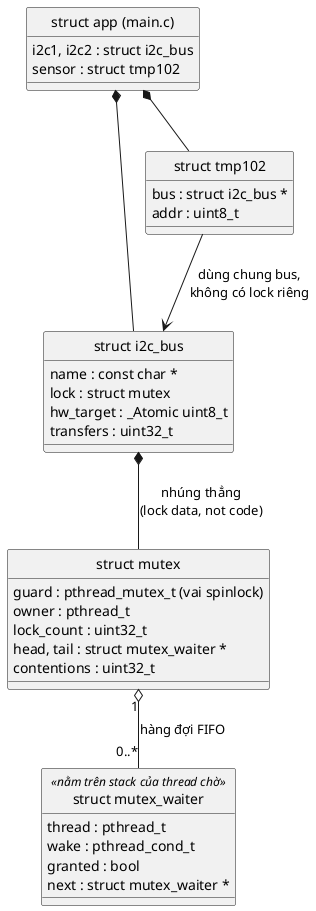

### 7.1. Lock

📖 Khi một thread cố lock (sách liệt kê ba trường hợp):
1. Mutex **đang mở** → ghi thread hiện tại làm owner, trả về thành công. 💡 *Bản PDF ghi "If the mutex is locked then current thread id is stored as owner", nhưng code ngay bên dưới (`mutex->lock_count == 0U`) cho thấy ý đúng là "đang **mở**". Đây là lỗi đánh máy của sách.*
2. Mutex **đang bị thread khác giữ** → thread hiện tại vào hàng đợi, trạng thái **suspended**.
3. Nếu người đang giữ có **priority thấp hơn** → nâng priority của owner lên bằng priority của thread đang cố lock.

Thêm trường hợp thứ tư, chính owner lock lần nữa → tăng `lock_count` (khóa lồng).

### 7.2. Unlock

📖 Nếu hàng đợi có người: chọn **thread priority cao nhất**, đặt nó thành "ready", gọi scheduler để chuyển thẳng sang nó. Owner cũ được trả lại priority gốc. Nếu không có ai chờ: mutex về trạng thái mở.

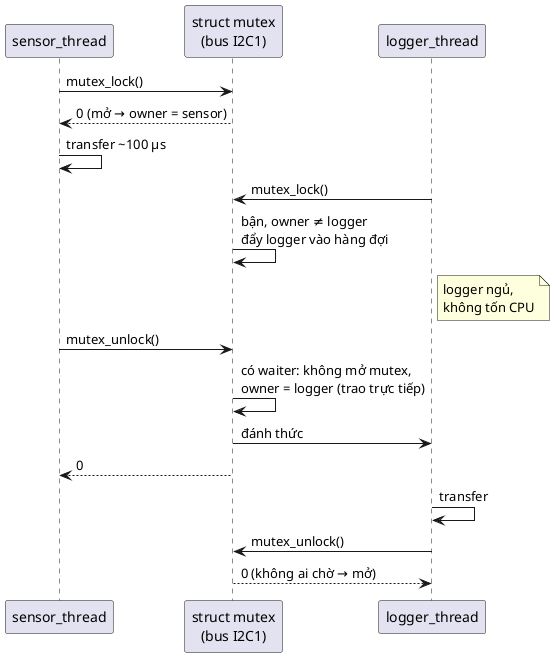

### 7.3. Vòng đời của một mutex

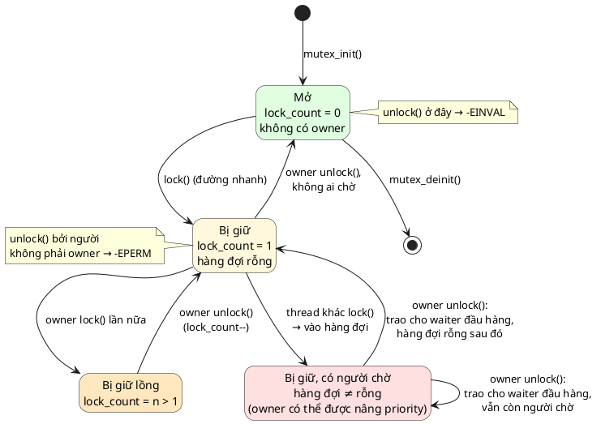

Và vòng đời của **một thread đang cố lock**:

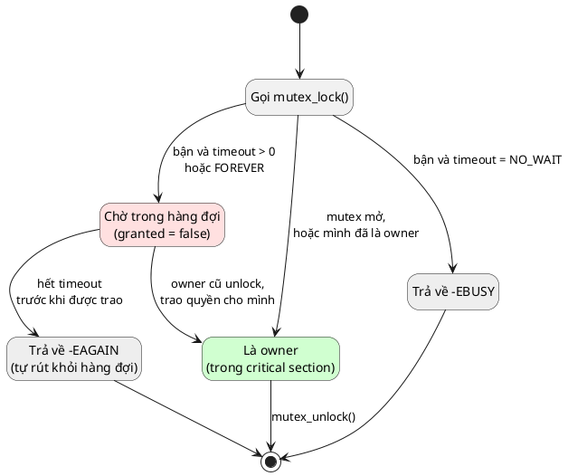

---

## 8. 5 đặc điểm nhận dạng và lý do của từng cái

📖 Sách mở phần *Defining Characteristics* bằng câu: *"The key defining characteristic of a mutex is that it must be locked and unlocked by the same application level thread."* Sau đó liệt kê năm đặc điểm.

### 1. Lock/Unlock

📖 Hai thao tác chính. *Lock* cố giành khóa độc quyền; *Unlock* nhả khóa và **đánh thức thread kế tiếp** đang chờ.

**Tại sao chỉ có hai:** mutex chỉ có một việc là bảo vệ critical section. Không có bộ đếm tài nguyên như semaphore (📖 nhược điểm *"Single resource only"*).

### 2. Mutual exclusion

📖 Bảo đảm loại trừ lẫn nhau giữa các thread: *một* thread, trên *bất kỳ* CPU nào, được giữ một mutex tại một thời điểm.

**Tại sao nhấn "on any CPU":** trên hệ đa core, tắt ngắt chỉ có tác dụng trên core hiện tại (📖 bài 11). Mutex dựa trên spinlock có CAS nên vẫn đúng khi hai thread chạy trên hai core. 🔬 Mọi thí nghiệm ở bài này chạy trên PC 16 luồng, tức là đa core thật.

### 3. Không tắt ngắt (Does not disable interrupts)

📖 *"the mutex is not aware of interrupts and does not hold interrupts disabled while mutex is locked. The system can still process interrupts and respond to hardware events as normal."*

**Tại sao:** đây là thứ giải quyết vấn đề tháng 4. Spinlock bên trong mutex chỉ được giữ trong vài lệnh (đọc/sửa `owner`, `lock_count`, hàng đợi), còn **critical section của bạn** (cả transfer I2C) chạy với ngắt bật bình thường.

### 4. Có hàng đợi thread và priority inheritance

📖 Giống semaphore, mutex giữ một hàng đợi thread; *"but unlike the semaphore, the mutex also implements priority inheritance for threads that currently hold the mutex"*.

**Tại sao:** hàng đợi giúp thread chờ được ngủ; priority inheritance giải quyết vấn đề tháng 6 (1). Và priority inheritance **chỉ làm được** vì mutex biết owner là ai (đặc điểm 5 + ownership).

### 5. Cho phép khóa lồng bởi cùng một thread

📖 *"the same thread can try to lock the same mutex twice without any issues. The mutex is thread aware and knows about the owner"*. Nhờ vậy *"the same thread can call other functions that also try to lock the mutex"*.

**Tại sao:** giải quyết vấn đề tháng 8. 📖 Phần Implementation nói rõ lợi ích: *không phải tách mỗi hàm thành hai bản*, một bản làm việc và một bản public lock rồi gọi bản kia.

⚠️ Đặc điểm này là của **k_mutex trong Zephyr**. Không phải mutex nào cũng vậy: `pthread_mutex_t` mặc định **không** cho khóa lồng, mutex của Linux kernel cũng không, FreeRTOS tách thành hai loại. 🔬 Mục 11 đo thật trên winpthreads.

---

## 9. Đọc code k_mutex của Zephyr trong sách

📖 Sách trích implementation của Zephyr để giải thích cơ chế. Code này **không chạy được trên PC** (cần kernel Zephyr); mình đọc từng đoạn để hiểu, rồi ở Phần C so với bản tự viết.

### 9.1. `k_mutex_lock`

```c
/* 📖 Trích sách (Zephyr), có lược bớt chỗ sách ghi "..." */
static struct k_spinlock lock;   /* một spinlock chung cho MỌI mutex */

int k_mutex_lock(struct k_mutex *mutex, k_timeout_t timeout)
{
	int new_prio;
	k_spinlock_key_t key;
	bool resched = false;

	__ASSERT(!arch_is_in_isr(), "mutexes cannot be used inside ISRs");
	key = k_spin_lock(&lock);

	if (likely((mutex->lock_count == 0U) || (mutex->owner == _current))) {
		mutex->owner_orig_prio = (mutex->lock_count == 0U) ?
					 _current->base.prio :
					 mutex->owner_orig_prio;
		mutex->lock_count++;
		mutex->owner = _current;
		k_spin_unlock(&lock, key);
		return 0;
	}

	if (unlikely(K_TIMEOUT_EQ(timeout, K_NO_WAIT))) {
		k_spin_unlock(&lock, key);
		return -EBUSY;
	}

	new_prio = new_prio_for_inheritance(_current->base.prio, mutex->owner->base.prio);
	if (z_is_prio_higher(new_prio, mutex->owner->base.prio)) {
		resched = adjust_owner_prio(mutex, new_prio);
	}

	int got_mutex = z_pend_curr(&lock, key, &mutex->wait_q, timeout);
	if (got_mutex == 0) {
		return 0;
	}

	/* timed out */
	key = k_spin_lock(&lock);
	struct k_thread *waiter = z_waitq_head(&mutex->wait_q);
	new_prio = (waiter != NULL) ?
		   new_prio_for_inheritance(waiter->base.prio, mutex->owner_orig_prio) :
		   mutex->owner_orig_prio;
	resched = adjust_owner_prio(mutex, new_prio) || resched;
	if (resched) {
		z_reschedule(&lock, key);
	} else {
		k_spin_unlock(&lock, key);
	}
	return -EAGAIN;
}
```

Đọc từng khối:

| Dòng | Làm gì | Tại sao (📖 + 💡) |
|---|---|---|
| `static struct k_spinlock lock;` | Một spinlock dùng chung cho mọi mutex | 💡 Khớp với pitfall của bài 11: spinlock giữ rất ngắn nên một cái chung cho cả lớp là đủ, tiết kiệm RAM |
| `__ASSERT(!arch_is_in_isr(), ...)` | Gọi từ ISR → panic | 📖 *"Mutexes are not interrupt aware and so this is always invalid and must generate a panic."* |
| `key = k_spin_lock(&lock);` | Vào vùng an toàn để đọc/sửa field | 📖 Không được có context switch ở giữa, nếu không mutex rơi vào trạng thái *"inconsistent"* |
| `if (lock_count == 0 \|\| owner == _current)` | Đường nhanh: mở, hoặc khóa lồng | 📖 Khóa lồng tránh deadlock khi hàm có khóa gọi hàm có khóa |
| `owner_orig_prio = ...` | Lần lock đầu tiên: nhớ priority gốc của owner | Để unlock trả lại đúng priority sau khi có thể đã bị nâng |
| `lock_count++; owner = _current;` | Ghi nhận | |
| `if (K_NO_WAIT) return -EBUSY;` | Không muốn chờ | 📖 Dùng cho "try lock", ví dụ trong work queue (mục 20) |
| `new_prio_for_inheritance(...)`, `adjust_owner_prio(...)` | Nâng priority của owner nếu mình cao hơn | 📖 Priority inheritance |
| `z_pend_curr(&lock, key, &mutex->wait_q, timeout)` | Đưa thread hiện tại vào hàng đợi, **rồi mới** nhả spinlock, rồi gọi scheduler | 💡 Truyền cả spinlock vào để "vào hàng đợi" và "nhả khóa" là một bước liền: không có khe hở nào để người unlock lỡ mất mình |
| `if (got_mutex == 0) return 0;` | Được người unlock trao quyền | Khi thread thức dậy ở đây, nó **đã là owner** (người unlock đã ghi `owner = new_owner`) |
| Khối `/* timed out */` | Hết giờ: tính lại priority của owner theo waiter còn lại, trả `-EAGAIN` | 📖 Owner không được giữ mãi priority cao "của một người đã bỏ đi" |

### 9.2. `k_mutex_unlock`

```c
/* 📖 Trích sách (Zephyr) */
int k_mutex_unlock(struct k_mutex *mutex)
{
	struct k_thread *new_owner;

	__ASSERT(!arch_is_in_isr(), "mutexes cannot be used inside ISRs");

	CHECKIF(mutex->owner == NULL) {
		return -EINVAL;
	}
	/* The current thread does not own the mutex. */
	CHECKIF(mutex->owner != _current) {
		return -EPERM;
	}

	__ASSERT_NO_MSG(mutex->lock_count > 0U);

	if (mutex->lock_count > 1U) {
		mutex->lock_count--;
		goto k_mutex_unlock_return;
	}

	k_spinlock_key_t key = k_spin_lock(&lock);
	adjust_owner_prio(mutex, mutex->owner_orig_prio);

	/* Get the new owner, if any */
	new_owner = z_unpend_first_thread(&mutex->wait_q);
	mutex->owner = new_owner;

	if (new_owner != NULL) {
		mutex->owner_orig_prio = new_owner->base.prio;
		arch_thread_return_value_set(new_owner, 0);
		z_ready_thread(new_owner);
		z_reschedule(&lock, key);
	} else {
		mutex->lock_count = 0U;
		k_spin_unlock(&lock, key);
	}

k_mutex_unlock_return:
	return 0;
}
```

| Dòng | Làm gì | Tại sao |
|---|---|---|
| `owner == NULL → -EINVAL` | Mở một mutex đang mở | 📖 *"Unlocking is invalid if the mutex was never locked."* |
| `owner != _current → -EPERM` | Người không phải owner đòi mở | 📖 *"... unlocked by a thread different from the thread that locked it."* Đây là chỗ mutex khác semaphore |
| `if (lock_count > 1) lock_count--` | Thoát một tầng lồng, vẫn giữ | 📖 Không cần spinlock ở đây vì *"we are guaranteed to be the owner"*: chỉ owner mới sửa `lock_count` |
| `adjust_owner_prio(..., owner_orig_prio)` | Trả priority gốc | Hết thời gian "được nâng" |
| `new_owner = z_unpend_first_thread(...)` | Lấy waiter **đầu hàng đợi** | 📖 Hàng đợi đã xếp theo priority, nên đầu hàng là người priority cao nhất |
| `mutex->owner = new_owner;` | **Trao thẳng** quyền giữ | 💡 Mutex không mở ra lúc nào cả. Không ai chen ngang được giữa "unlock" và "waiter thức dậy" (mục 15.1 sẽ đo xem điều này quan trọng thế nào) |
| `arch_thread_return_value_set(new_owner, 0)` | Đặt sẵn giá trị trả về `0` cho `z_pend_curr` của waiter | Đó là cái `got_mutex == 0` ở `k_mutex_lock` |
| `z_ready_thread` + `z_reschedule` | Waiter thành Ready, gọi scheduler | 📖 Nếu waiter priority cao hơn, context switch xảy ra **ngay trong** `k_mutex_unlock`, trước khi hàm này return |
| `lock_count = 0` (nhánh else) | Không ai chờ → mở | |

---

## 10. Priority inheritance chạy thế nào

### 10.1. Ý tưởng

📖 *"Priority inheritance means that a higher priority thread can never be blocked for longer than necessary if a lower priority thread is holding a mutex that it is trying to lock."*

Khi H bị chặn bởi mutex mà L đang giữ, L **tạm thời thừa hưởng** priority của H. Bây giờ M (trung bình) không chiếm được CPU của L nữa. L chạy nốt critical section, unlock, rơi về priority gốc, và mutex được trao cho H. H chỉ phải chờ **đúng phần critical section còn lại của L**: đó là "*longer than necessary*" mà sách nói.

### 10.2. 🔬 Mô phỏng: có priority inheritance

Cùng kịch bản ở mục 5.3, bật inheritance. Output thật:

```
CO priority inheritance (mutex)
tick  0         1         2
      012345678901234567890123
H(3)  ..#bbbCC#...............
M(2)  ...------########.......
L(1)  #C-PPP-----------#......
H bi chan 3 tick, xong o tick 9
```

(`P` = L đang chạy với priority được nâng lên 3.)

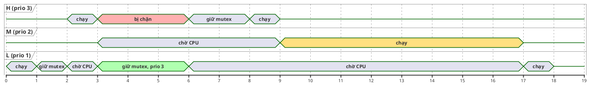

| | Không inheritance | Có inheritance |
|---|---|---|
| H bị chặn | **11 tick** | **3 tick** (đúng phần critical section còn lại của L) |
| H xong lúc | tick 17 | **tick 9** |
| M xong lúc | tick 11 | tick 17 (M chịu thiệt, đúng thứ tự ưu tiên) |
| L xong lúc | tick 18 | tick 18 (tổng công việc không đổi) |

Tổng thời gian CPU không thay đổi. Priority inheritance chỉ **sắp xếp lại** để thứ tự ưu tiên được tôn trọng.

### 10.3. Mã nguồn bộ mô phỏng

<details><summary>🔬 prio_sim.c (bấm để mở, build: <code>gcc -std=c11 -Wall -Wextra -Werror -pedantic prio_sim.c</code>)</summary>

```c
/*
 * Mô phỏng scheduler preemptive theo priority trên MỘT CPU, đơn vị thời gian là tick.
 * Ba task L < M < H; L và H dùng chung một mutex (bus I2C), M không đụng tới nó.
 * Đây là mô hình trên giấy chạy bằng C, không phải RTOS thật.
 */
#include <stdbool.h>
#include <stdio.h>

enum op { RUN, LOCK, UNLOCK, END };

struct step {
	enum op op;
	int ticks; /* chỉ dùng cho RUN */
};

struct task {
	const char *name;
	int base_prio;
	int prio;     /* priority hiệu lực (có thể được nâng nhờ inheritance) */
	int arrive;
	const struct step *script;
	int pc;       /* bước hiện tại trong script */
	int left;     /* số tick còn lại của bước RUN hiện tại */
	bool blocked;
	bool holding;
	char line[64];
};

#define NTASK 3
#define TICKS 24

static const struct step script_l[] = { { RUN, 1 }, { LOCK, 0 }, { RUN, 4 }, { UNLOCK, 0 }, { RUN, 1 }, { END, 0 } };
static const struct step script_m[] = { { RUN, 8 }, { END, 0 } };
static const struct step script_h[] = { { RUN, 1 }, { LOCK, 0 }, { RUN, 2 }, { UNLOCK, 0 }, { RUN, 1 }, { END, 0 } };

static struct task *owner;

static void load_step(struct task *t)
{
	t->left = t->script[t->pc].ticks;
}

static void simulate(bool inherit)
{
	struct task tasks[NTASK] = {
		{ "L", 1, 1, 0, script_l, 0, 0, false, false, "" },
		{ "M", 2, 2, 3, script_m, 0, 0, false, false, "" },
		{ "H", 3, 3, 2, script_h, 0, 0, false, false, "" },
	};
	int h_blocked = 0;
	int h_done = -1;

	owner = NULL;
	for (int i = 0; i < NTASK; i++) {
		load_step(&tasks[i]);
	}

	for (int tick = 0; tick < TICKS; tick++) {
		struct task *run = NULL;

		/* Chọn task: lặp vì LOCK/UNLOCK tốn 0 tick và có thể làm đổi lựa chọn */
		for (;;) {
			run = NULL;
			for (int i = 0; i < NTASK; i++) {
				struct task *t = &tasks[i];
				if (tick >= t->arrive && !t->blocked && t->script[t->pc].op != END &&
				    (!run || t->prio > run->prio)) {
					run = t;
				}
			}
			if (!run) {
				break;
			}
			enum op op = run->script[run->pc].op;
			if (op == LOCK) {
				if (!owner) {
					owner = run;
					run->holding = true;
					run->pc++;
					load_step(run);
				} else {
					run->blocked = true; /* vào hàng đợi của mutex */
					if (inherit && run->prio > owner->prio) {
						owner->prio = run->prio; /* priority inheritance */
					}
				}
				continue;
			}
			if (op == UNLOCK) {
				run->holding = false;
				run->prio = run->base_prio; /* trả lại priority gốc */
				owner = NULL;
				/* Trao mutex cho waiter có priority cao nhất */
				struct task *next = NULL;
				for (int i = 0; i < NTASK; i++) {
					if (tasks[i].blocked && (!next || tasks[i].prio > next->prio)) {
						next = &tasks[i];
					}
				}
				if (next) {
					next->blocked = false;
					next->holding = true;
					owner = next;
					next->pc++;
					load_step(next);
				}
				run->pc++;
				load_step(run);
				continue;
			}
			break; /* RUN */
		}

		for (int i = 0; i < NTASK; i++) {
			struct task *t = &tasks[i];
			char c = '.';
			if (t == run) {
				c = t->holding ? 'C' : '#';
			} else if (tick >= t->arrive && t->script[t->pc].op != END) {
				c = t->blocked ? 'b' : '-';
			}
			if (t == run && t->prio != t->base_prio) {
				c = 'P'; /* đang chạy với priority được nâng */
			}
			t->line[tick] = c;
			t->line[tick + 1] = '\0';
		}
		if (tasks[2].blocked) {
			h_blocked++;
		}
		if (run && --run->left == 0) {
			run->pc++;
			load_step(run);
			if (run == &tasks[2] && run->script[run->pc].op == END) {
				h_done = tick + 1;
			}
		}
	}

	printf("%s\n", inherit ? "CO priority inheritance (mutex)" : "KHONG co priority inheritance (vd. dung semaphore lam lock)");
	printf("tick  0         1         2\n");
	printf("      012345678901234567890123\n");
	for (int i = NTASK - 1; i >= 0; i--) {
		printf("%s(%d)  %s\n", tasks[i].name, tasks[i].base_prio, tasks[i].line);
	}
	printf("H bi chan %d tick, xong o tick %d\n\n", h_blocked, h_done);
}

int main(void)
{
	simulate(false);
	simulate(true);
	printf("# = chay, C = chay khi giu mutex, P = chay voi priority duoc nang,\n");
	printf("b = bi chan cho mutex, - = san sang nhung bi task khac chiem CPU, . = chua toi / da xong\n");
	return 0;
}
```

</details>

### 10.4. Giới hạn của priority inheritance

💡 Những điều sách không nói, nhưng nên biết:
- **Chuỗi lồng nhau:** H chờ mutex A do L1 giữ, L1 lại đang chờ mutex B do L2 giữ. Inheritance phải lan truyền (L2 cũng được nâng). Một số RTOS làm (*transitive inheritance*), một số chỉ nâng một tầng. Cách đơn giản nhất: **đừng giữ mutex này trong khi chờ mutex khác** nếu tránh được.
- **Inheritance không làm critical section ngắn đi.** H vẫn chờ hết phần còn lại của L. Nếu L giữ bus trong 20 ms, H chờ tới 20 ms. "Lock data, not code" (mục 20) vẫn bắt buộc.
- **Priority ceiling** là phương án khác: mutex được gán sẵn một "trần" priority, ai lock nó là được nâng ngay lên trần đó. Không cần chờ có người tranh chấp mới nâng. `pthread_mutexattr_setprotocol(PTHREAD_PRIO_PROTECT)` của POSIX là kiểu này.
- **Trên PC không đo được.** 🔬 winpthreads trả về lỗi khi xin inheritance:

```
setprotocol(PRIO_INHERIT)           -> 129 (not supported)
```

(129 là `ENOTSUP` trên UCRT; mã nguồn thí nghiệm ở mục 11.3.) 🔬 Một chi tiết bất ngờ: cùng file `.exe` đó, chạy trong một shell mà `PATH` tìm thấy `libwinpthread-1.dll` của Git for Windows (`/mingw64/bin`) trước bản của MSYS2 (`/c/msys64/ucrt64/bin`), thì kết quả là `22 (Invalid argument)` cả 30/30 lần. Hai phiên bản DLL trả hai mã lỗi khác nhau, nhưng cùng một ý: **không hỗ trợ**. (Bài học phụ: chương trình Windows nạp DLL theo `PATH` lúc chạy, nên hành vi có thể đổi theo máy.) Đó là lý do mutex tự viết trong code mẫu **không** có priority inheritance, và mục 10.2 dùng bộ mô phỏng.

---

## 11. Ownership và khóa lồng: đối chiếu với pthread

### 11.1. Vì sao chỉ owner được unlock

Ba lý do, từ quan trọng nhất:

1. **Bảo đảm mutual exclusion.** 📖 Một phương án trong quiz của sách: nếu thread khác được unlock, *"we would not be able to guarantee mutual exclusion because another thread would then be able to free a mutex while we expect it to be locked."* Thread A đang ở giữa transfer I2C, thread B "mở hộ", thread C vào bus: lỗi tháng 3 quay lại.
2. **Priority inheritance cần biết nâng priority cho ai.** 📖 Nhược điểm *"Threads only"*: mutex *"needs to know the owner thread of the mutex in order to handle priority inheritance"*. Không có owner thì không có người để nâng.
3. **Bắt lỗi lập trình.** 📖 Lợi ích *"Ease of use"*: mutex kiểm tra lock/unlock cùng thread, cho thêm *"extra level of debugging"*. Bug "give hai lần" ở tháng 6 sẽ bị trả `-EPERM` thay vì âm thầm phá khóa.

Hệ quả: **mutex không dùng để báo hiệu** được. Muốn "thread A báo cho thread B" thì dùng semaphore (📖 Alternatives).

### 11.2. Vì sao cho phép khóa lồng, và cái giá

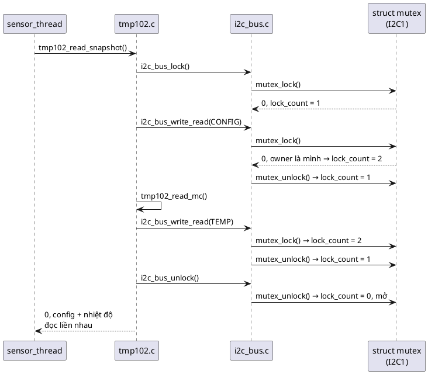

Cái giá (💡):
- Phải đếm: **mỗi lock một unlock**. Quên một unlock ở tầng trong thì mutex không bao giờ mở.
- Khóa lồng che giấu thiết kế lộn xộn: không còn biết hàm nào "đang giữ khóa" khi được gọi.
- Khóa lồng **không hợp với condition variable** (bài 14): `wait` chỉ nhả **một** tầng, mutex vẫn bị giữ, và mọi người khác bị chặn.

Vì vậy nhiều nhóm (Linux kernel chẳng hạn) cố ý cấm khóa lồng và dùng quy ước `_locked`. Sách chọn phía ngược lại, theo Zephyr.

### 11.3. 🔬 pthread làm gì trong các tình huống này

```c
#include <errno.h>
#include <pthread.h>
#include <stdio.h>
#include <string.h>
#include <time.h>

static pthread_mutex_t m_default;
static pthread_mutex_t m_err;

static void *other_unlock(void *arg)
{
	(void)arg;
	int r1 = pthread_mutex_unlock(&m_err);
	printf("ERRORCHECK: unlock tu thread khac   -> %d (%s)\n", r1, r1 ? strerror(r1) : "OK");
	int r2 = pthread_mutex_unlock(&m_default);
	printf("DEFAULT   : unlock tu thread khac   -> %d (%s)\n", r2, r2 ? strerror(r2) : "OK");
	return NULL;
}

int main(void)
{
	pthread_mutexattr_t a;
	pthread_mutexattr_init(&a);
	int r = pthread_mutexattr_setprotocol(&a, PTHREAD_PRIO_INHERIT);
	printf("setprotocol(PRIO_INHERIT)           -> %d (%s)\n", r, r ? strerror(r) : "OK");
	int proto = -1;
	pthread_mutexattr_getprotocol(&a, &proto);
	printf("getprotocol                         -> %d (INHERIT=%d NONE=%d)\n", proto, PTHREAD_PRIO_INHERIT, PTHREAD_PRIO_NONE);
	pthread_mutexattr_destroy(&a);

	pthread_mutex_init(&m_default, NULL);
	pthread_mutexattr_init(&a);
	pthread_mutexattr_settype(&a, PTHREAD_MUTEX_ERRORCHECK);
	pthread_mutex_init(&m_err, &a);

	pthread_mutex_lock(&m_default);
	r = pthread_mutex_trylock(&m_default);
	printf("DEFAULT   : trylock lan 2 cung thread -> %d (%s)\n", r, r ? strerror(r) : "OK");
	struct timespec ts;
	clock_gettime(CLOCK_REALTIME, &ts);
	ts.tv_nsec += 200000000; if (ts.tv_nsec >= 1000000000) { ts.tv_sec++; ts.tv_nsec -= 1000000000; }
	r = pthread_mutex_timedlock(&m_default, &ts);
	printf("DEFAULT   : timedlock lan 2 (200ms)  -> %d (%s)\n", r, r ? strerror(r) : "OK");

	pthread_mutex_lock(&m_err);
	r = pthread_mutex_lock(&m_err);
	printf("ERRORCHECK: lock lan 2 cung thread   -> %d (%s)\n", r, r ? strerror(r) : "OK");

	pthread_t t;
	pthread_create(&t, NULL, other_unlock, NULL);
	pthread_join(t, NULL);
	r = pthread_mutex_trylock(&m_default);
	printf("DEFAULT   : trylock sau khi thread khac unlock -> %d (%s)\n", r, r ? strerror(r) : "OK");

	pthread_mutexattr_settype(&a, PTHREAD_MUTEX_RECURSIVE);
	pthread_mutex_t m_rec;
	pthread_mutex_init(&m_rec, &a);
	int r1 = pthread_mutex_lock(&m_rec), r2 = pthread_mutex_lock(&m_rec);
	printf("RECURSIVE : lock 2 lan               -> %d, %d\n", r1, r2);
	return 0;
}
```

Output thật (winpthreads của MSYS2 UCRT64, gcc 16.2; dòng đầu là `22 (Invalid argument)` nếu DLL của Git for Windows được nạp, xem mục 10.4):

```
setprotocol(PRIO_INHERIT)           -> 129 (not supported)
getprotocol                         -> 0 (INHERIT=8 NONE=0)
DEFAULT   : trylock lan 2 cung thread -> 16 (Resource device)
DEFAULT   : timedlock lan 2 (200ms)  -> 138 (timed out)
ERRORCHECK: lock lan 2 cung thread   -> 36 (Resource deadlock avoided)
ERRORCHECK: unlock tu thread khac   -> 1 (Operation not permitted)
DEFAULT   : unlock tu thread khac   -> 0 (OK)
DEFAULT   : trylock sau khi thread khac unlock -> 0 (OK)
RECURSIVE : lock 2 lan               -> 0, 0
```

Đọc từng dòng:

| Tình huống | Kết quả | Ý nghĩa |
|---|---|---|
| Xin priority inheritance | `ENOTSUP` (hoặc `EINVAL`, tùy DLL) | winpthreads không có. 💡 Trên Linux (glibc) thì có |
| Mutex mặc định, cùng thread lock lần 2 | `EBUSY` với trylock, **hết giờ** với timedlock | Với `pthread_mutex_lock` thường, thread **treo vĩnh viễn**: self-deadlock của tháng 8 |
| `ERRORCHECK`, lock lần 2 | `EDEADLK` (36) | Phát hiện và báo lỗi thay vì treo |
| `ERRORCHECK`, unlock từ thread khác | `EPERM` (1) | Có kiểm tra ownership |
| **Mặc định, unlock từ thread khác** | **`0` (OK)!** | Mutex mặc định của winpthreads **không kiểm tra owner**: người lạ mở được, và thread khác vào được ngay sau đó (dòng `trylock ... -> 0`). POSIX gọi đây là undefined behavior; winpthreads chọn "cho qua" |
| `RECURSIVE`, lock 2 lần | `0, 0` | Khóa lồng giống k_mutex |

💡 Kết luận thực tế: khi dùng pthread, mutex "mặc định" **không có** các bảo vệ mà sách mô tả. Muốn hành vi gần k_mutex thì phải chọn `PTHREAD_MUTEX_RECURSIVE` (khóa lồng) hoặc `PTHREAD_MUTEX_ERRORCHECK` (kiểm tra owner, nhưng cấm lồng). Đó là một lý do code mẫu tự viết `struct mutex` có đủ cả hai.

---

## 12. Mutex và interrupt

📖 Sách nhắc đi nhắc lại: mutex **tuyệt đối không** dùng trong ISR, cả lock lẫn unlock, và Zephyr assert để panic nếu vi phạm. Lý do:

1. **ISR không phải thread.** ISR không có "owner" để ghi vào `mutex->owner`, không có priority thread để kế thừa, và quan trọng nhất: **ISR không được ngủ**. Nếu mutex đang bận, ISR không thể vào hàng đợi và chờ, vì không có thread nào để suspend. Nó chiếm CPU của thread đang chạy (có thể chính là owner!) cho tới khi return.
2. **Ownership không còn ý nghĩa.** Nếu ISR lock, ai unlock? Thread bị ngắt ngang? Đó chính là báo hiệu, việc của semaphore.

📖 Phương án 1 của quiz 1 trong sách (sách không in đáp án; đây là phương án khớp với nội dung chương): thiết kế "chỉ cho thread" giúp **tập trung tối ưu cho thread** và bảo đảm được việc *"locking/unlocking by the same context"*; nếu phải hỗ trợ ngắt thì không bảo đảm được điều đó.

💡 Một phương án quiz trong sách viết *"Mutex uses spinlock which can not be used inside interrupt handlers"*. Câu này **sai**: chương Spinlock nói rõ spinlock *"usable in interrupt handlers"*. Mutex dùng spinlock bên trong không phải là lý do cấm ISR.

**Vậy dữ liệu chia sẻ giữa thread và ISR thì sao?** 📖 Nhược điểm *"Threads only"*: *"In such a scenario, a spinlock should be used instead."* Mẫu thường gặp:

| Ai với ai | Công cụ |
|---|---|
| Thread ↔ thread, critical section dài (transfer I2C) | **Mutex** |
| Thread ↔ ISR, vài phép gán (con trỏ ring buffer) | **Spinlock** (bài 11) |
| ISR báo cho thread "xong rồi" | **Semaphore** (bài 12) |
| Driver I2C dùng ngắt | Mutex quanh cả transfer (giữa các thread) **+** semaphore để ISR báo transfer xong **+** spinlock cho vài biến dùng chung với ISR |

💡 PC không có ISR nên phần này không có thí nghiệm; `struct mutex` của code mẫu cũng không phát hiện được "gọi từ ISR" như `__ASSERT(!arch_is_in_isr())` của Zephyr.


---

# Phần C — Đọc code

## 13. Đọc code mẫu từng dòng

Code mẫu gồm bốn module xếp chồng:

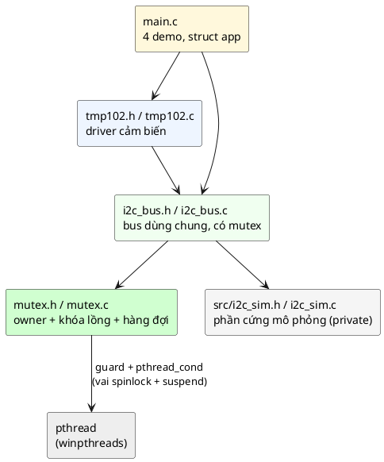

### 13.1. [inc/mutex.h](inc/mutex.h)

```c
#define MUTEX_NO_WAIT 0
#define MUTEX_FOREVER (-1)
```
Hai giá trị đặc biệt của `timeout_ms`, cùng ý nghĩa với `K_NO_WAIT` / `K_FOREVER` của Zephyr. `-1` được đặt trong ngoặc để macro an toàn trong mọi biểu thức (ví dụ `x-MUTEX_FOREVER` không thành `x--1`).

```c
struct mutex_waiter {
	pthread_t thread;
	pthread_cond_t wake;
	bool granted;
	struct mutex_waiter *next;
};
```
Một phần tử của hàng đợi, ứng với `struct k_thread` nằm trong `wait_q` của Zephyr.
- Node này **nằm trên stack của thread đang chờ** (khai báo cục bộ trong `mutex_lock`). Mutex không cần `malloc` hay pool: số waiter tối đa bằng số thread, và mỗi thread tự mang chỗ cho mình. 💡 Wait queue của Zephyr và Linux cũng dựa trên ý tưởng "mỗi thread chờ tự mang node của nó".
- `wake`: mỗi waiter một biến điều kiện riêng, để người unlock **đánh thức đúng một người** (người được trao), không đánh thức cả đám.
- `granted`: cờ "đã được trao quyền". Thread chờ chỉ thoát khi cờ này bật. Đây là **predicate** mà bài 14 sẽ nói kỹ.

```c
struct mutex {
	pthread_mutex_t guard;
	pthread_t owner;
	uint32_t lock_count;
	struct mutex_waiter *head;
	struct mutex_waiter *tail;
	uint32_t contentions;
};
```
- **Object Pattern, không Opaque**, và đây là chủ ý: 📖 best practice *"have a mutex as a member variable"* đòi hỏi `struct i2c_bus` chứa thẳng `struct mutex lock;`. Bài 2 đã chỉ ra opaque object **không lồng được** vào struct khác. `struct k_mutex` của Zephyr cũng public vì cùng lý do.
- `guard` đóng vai spinlock của k_mutex: mọi field bên dưới chỉ được đọc/ghi khi đang giữ `guard`. 💡 Trên PC mình không thể tắt ngắt hay tự suspend thread, nên mượn `pthread_mutex_t`. Nó chỉ được giữ trong vài lệnh, giống spinlock.
- `owner`: chỉ có nghĩa khi `lock_count > 0`. `pthread_t` không có giá trị "rỗng" chuẩn, nên không dùng `owner == NULL` như Zephyr mà dựa vào `lock_count`.
- `head`/`tail`: hàng đợi FIFO dạng danh sách liên kết đơn. Có `tail` để thêm vào cuối trong O(1).
- `contentions`: thống kê, để demo thấy được tranh chấp có xảy ra.

Các hàm trả mã lỗi kiểu Zephyr, thống nhất với Return Value pattern (bài 9). Riêng `mutex_lock_depth()` là hàm phụ cho demo/test: cho biết thread hiện tại đang khóa lồng mấy tầng.

### 13.2. [src/mutex.c](src/mutex.c)

**`mutex_init`:**

```c
	if (pthread_mutex_init(&self->guard, NULL) != 0) {
		return -ENOMEM;
	}
	self->lock_count = 0;
	self->head = NULL;
	self->tail = NULL;
	self->contentions = 0;
	return 0;
```
`pthread_mutex_init` có thể thất bại khi hệ điều hành hết tài nguyên, nên kiểm tra. Không khởi tạo `owner`, vì `lock_count = 0` đã nói "không có owner".

**`mutex_deinit`:**

```c
	pthread_mutex_lock(&self->guard);
	bool busy = self->lock_count != 0 || self->head != NULL;
	pthread_mutex_unlock(&self->guard);
	if (busy) {
		return -EBUSY;
	}
	pthread_mutex_destroy(&self->guard);
```
Hủy một mutex đang có người giữ hoặc có người chờ là lỗi nặng: các node trong hàng đợi đang trỏ vào bộ nhớ sắp chết. Trả `-EBUSY` để caller biết. 💡 Chú ý `busy` được tính **trong** `guard` rồi mới nhả: đọc `lock_count` không giữ `guard` là data race.

**Ba hàm hàng đợi** `queue_push`, `queue_pop`, `queue_remove`: thao tác danh sách liên kết thông thường. Comment ghi rõ *"chỉ được gọi khi đang giữ guard"*: chúng không tự khóa, vì luôn được gọi từ bên trong vùng đã khóa. `queue_remove` cần cho trường hợp timeout: waiter tự rút khỏi **giữa** hàng.

**`deadline_after_ms`:**

```c
	timespec_get(&ts, TIME_UTC);
	ts.tv_sec += timeout_ms / 1000;
	ts.tv_nsec += (long)(timeout_ms % 1000) * 1000000L;
	if (ts.tv_nsec >= 1000000000L) {
		ts.tv_sec += 1;
		ts.tv_nsec -= 1000000000L;
	}
```
`pthread_cond_timedwait` nhận **mốc thời gian tuyệt đối** ("dừng chờ lúc 10:15:03.250"), không nhận khoảng chờ ("chờ 50 ms"). 💡 Lý do: khi thread bị đánh thức giữa chừng rồi chờ tiếp trong vòng `while`, mốc tuyệt đối giữ nguyên, nên tổng thời gian chờ không bị cộng dồn. `timespec_get` là hàm của C11. Phải chuẩn hóa `tv_nsec` về dưới 1 tỉ, nếu không pthread trả `EINVAL`.

**`mutex_lock`, từng khối:**

```c
	if (!self || timeout_ms < MUTEX_FOREVER) {
		return -EINVAL;
	}
	pthread_t me = pthread_self();
	pthread_mutex_lock(&self->guard);
```
Kiểm tra tham số: timeout âm khác `-1` là vô nghĩa. Lấy định danh thread hiện tại (tương đương `_current` của Zephyr). Vào vùng `guard`.

```c
	if (self->lock_count == 0) {
		self->lock_count = 1;
		self->owner = me;
		pthread_mutex_unlock(&self->guard);
		return 0;
	}
```
Đường nhanh 1: mutex đang mở. Comment nói *"khi còn waiter thì mutex không bao giờ ở trạng thái mở"*: đó là **bất biến** do `mutex_unlock` bảo đảm (trao thẳng cho waiter thay vì mở ra). Nhờ bất biến này, thread mới tới **không thể chen ngang** người đã xếp hàng.

```c
	if (pthread_equal(self->owner, me)) {
		self->lock_count++;
		pthread_mutex_unlock(&self->guard);
		return 0;
	}
```
Đường nhanh 2: khóa lồng. 💡 Phải dùng `pthread_equal()`, không dùng `==`: chuẩn POSIX cho phép `pthread_t` là struct. Đọc `owner` an toàn vì đang giữ `guard` và `lock_count > 0`.

```c
	if (timeout_ms == MUTEX_NO_WAIT) {
		pthread_mutex_unlock(&self->guard);
		return -EBUSY;
	}
```
"Try lock". Mọi đường thoát đều nhả `guard` trước khi return: quên một chỗ là deadlock toàn bộ mutex.

```c
	struct mutex_waiter w = { .thread = me, .granted = false, .next = NULL };
	struct timespec deadline = deadline_after_ms(timeout_ms > 0 ? timeout_ms : 0);
	int ret = 0;

	pthread_cond_init(&w.wake, NULL);
	queue_push(self, &w);
	self->contentions++;
```
Đường chậm. Tạo node trên stack, đưa vào cuối hàng. Mọi việc này xảy ra **khi vẫn giữ `guard`**, nên không có khe hở nào để người unlock "không thấy" mình.

```c
	while (!w.granted) {
		if (timeout_ms == MUTEX_FOREVER) {
			pthread_cond_wait(&w.wake, &self->guard);
		} else if (pthread_cond_timedwait(&w.wake, &self->guard, &deadline) == ETIMEDOUT &&
			   !w.granted) {
			queue_remove(self, &w);
			ret = -EAGAIN;
			break;
		}
	}
```
Đây là chỗ thay cho `z_pend_curr(&lock, key, &mutex->wait_q, timeout)` của Zephyr.
- `pthread_cond_wait(&w.wake, &self->guard)` **nhả `guard` và ngủ trong một bước nguyên tử**, rồi khi thức dậy thì **giữ lại `guard`** trước khi return. Đúng tính chất "vào hàng đợi rồi mới nhả spinlock" của `z_pend_curr`. (Bài 14 giải thích kỹ cơ chế này.)
- Vòng `while (!w.granted)`: POSIX cho phép `pthread_cond_wait` trả về mà không ai đánh thức (*spurious wakeup*). Kiểm tra lại cờ là bắt buộc.
- Nhánh timeout kiểm tra `!w.granted` **lần nữa**: có thể đúng lúc hết giờ thì người unlock vừa trao quyền. Khi đó ta đã là owner, không được rút khỏi hàng và phải trả 0. Bỏ điều kiện này là bug: thread trả `-EAGAIN` nhưng thực ra đang giữ mutex, và không ai unlock nó nữa (Quiz câu 7).

```c
	pthread_mutex_unlock(&self->guard);
	pthread_cond_destroy(&w.wake);
	return ret;
```
Khi `granted`, người unlock đã ghi sẵn `owner = me` và giữ nguyên `lock_count = 1`, nên ở đây không phải làm gì thêm. `pthread_cond_destroy` sau khi nhả `guard` là an toàn: người unlock chỉ chạm vào `w.wake` khi đang giữ `guard`, và lúc đó node đã bị lấy ra khỏi hàng.

**`mutex_unlock`, từng khối:**

```c
	if (self->lock_count == 0) {
		pthread_mutex_unlock(&self->guard);
		return -EINVAL;
	}
	if (!pthread_equal(self->owner, pthread_self())) {
		pthread_mutex_unlock(&self->guard);
		return -EPERM;
	}
```
Hai kiểm tra của sách, cùng thứ tự với Zephyr: mutex đang mở → `-EINVAL`; không phải owner → `-EPERM`.

```c
	if (self->lock_count > 1) {
		self->lock_count--;
		pthread_mutex_unlock(&self->guard);
		return 0;
	}
```
Thoát một tầng lồng. 💡 Khác Zephyr một chút: Zephyr làm việc này **không** cần spinlock (vì chỉ owner sửa `lock_count`). Ở đây mình vẫn giữ `guard` vì thread khác có thể đang **đọc** `lock_count` trong `mutex_lock`; đọc và ghi đồng thời không đồng bộ là data race theo C11.

```c
	struct mutex_waiter *next = queue_pop(self);
	if (next) {
		self->owner = next->thread;
		next->granted = true;
		pthread_cond_signal(&next->wake);
	} else {
		self->lock_count = 0;
	}
```
Trái tim của thiết kế: **handoff** (trao thẳng). Có người chờ thì `owner` chuyển thẳng sang người đầu hàng, `lock_count` giữ nguyên 1, mutex **không mở ra lúc nào**. Không ai chờ thì mới mở. So với `k_mutex_unlock` của sách: `z_unpend_first_thread` ↔ `queue_pop`, `mutex->owner = new_owner` ↔ `self->owner = next->thread`, `z_ready_thread` ↔ `pthread_cond_signal`. Khác biệt chính: hàng đợi của mình là **FIFO**, của Zephyr **xếp theo priority**, và mình không có priority inheritance.

**`mutex_lock_depth`:** đọc `lock_count` dưới `guard`, trả số tầng nếu mình là owner, ngược lại `-EPERM`.

### 13.3. [src/i2c_sim.h](src/i2c_sim.h) và [src/i2c_sim.c](src/i2c_sim.c): phần cứng mô phỏng

- Header nằm trong `src/`, không nằm trong `inc/`: chỉ `i2c_bus.c` được thấy "phần cứng". Đây là hàng rào dependency của bài 2.
- TMP102: mảng `tmp102_regs[8]` chứa 4 thanh ghi 16 bit. Thanh ghi 0 = `0x1900` (25,0 °C), thanh ghi 1 = `0x60A0` (giá trị config mặc định theo datasheet TMP102). `tmp102_ptr` là **con trỏ thanh ghi bên trong chip**: byte đầu tiên master ghi vào chip đặt con trỏ này, các byte đọc sau đó đi từ con trỏ trở đi.
- EEPROM 24C02: 256 byte, cũng có con trỏ địa chỉ bên trong, tự tăng sau mỗi byte (và tự quay về 0 sau 255: `atomic_fetch_add` trên `uint8_t` tràn tự nhiên).
- Mọi biến đều `_Atomic`. 💡 Biến `static` ở đây không vi phạm quy tắc "không có state global" của bài 1: chúng mô phỏng **phần cứng**, và phần cứng là state toàn cục thật sự (chỉ có một con chip TMP102 trên board).
- `i2c_sim_byte_delay()`: bận chờ ~20 µs bằng `timespec_get`. 🔬 Không dùng `nanosleep` vì trên Windows nó làm tròn lên ~15,6 ms: đo thật, `20 x nanosleep(1ms) = 309.3 ms`, còn `nanosleep(100us)` thì không ngủ chút nào (`0.0 ms`). Bận chờ cũng giống một driver I2C polling thật: CPU quay vòng đọc cờ `TXE`/`RXNE`.

### 13.4. [inc/i2c_bus.h](inc/i2c_bus.h) và [src/i2c_bus.c](src/i2c_bus.c)

```c
struct i2c_bus {
	const char *name;
	struct mutex lock;
	_Atomic uint8_t hw_target;
	uint32_t transfers;
};
```
- `lock` nằm **trong** object: mỗi bus một mutex. 📖 *"Lock data, not code"*: khóa thuộc về dữ liệu (bus I2C1), không thuộc về hàm `i2c_bus_write_read`. Hai bus I2C1 và I2C2 không chặn nhau.
- `hw_target` mô phỏng thanh ghi địa chỉ đích của khối I2C (trên STM32 là trường `SADD` của `I2C_CR2`). Cả bus chỉ có **một** thanh ghi này, nên đây là tài nguyên cần bảo vệ.
- `transfers` là field thường, không atomic: chỉ được sửa khi đang giữ `lock`. Đó là quy ước "field này được bảo vệ bởi lock kia". 💡 Nên viết quy ước này thành comment cạnh mỗi field.

```c
#ifdef I2C_BUS_DEMO_NO_LOCK
#define XFER_LOCK(self) 0
#define XFER_UNLOCK(self) ((void)0)
#else
#define XFER_LOCK(self) mutex_lock(&(self)->lock, MUTEX_FOREVER)
#define XFER_UNLOCK(self) mutex_unlock(&(self)->lock)
#endif
```
Cờ build chỉ để làm thí nghiệm ở mục 3.3. `XFER_LOCK` trả `0` để `int ret = XFER_LOCK(self);` vẫn compile được. `((void)0)` là cách viết chuẩn của một macro "không làm gì" dùng như một câu lệnh. Makefile có biến `EXTRA` để thêm cờ: `make clean; make run EXTRA=-DI2C_BUS_DEMO_NO_LOCK`.

**`i2c_bus_write_read`:**

```c
	int ret = XFER_LOCK(self);
	if (ret) {
		return ret;
	}
	hw_start(self, addr);
	ret = i2c_sim_set_pointer(atomic_load(&self->hw_target), reg);
	i2c_sim_byte_delay();

	hw_start(self, addr); /* repeated START, chuyển sang đọc */
	for (size_t i = 0; i < len && ret == 0; i++) {
		ret = i2c_sim_read_next(atomic_load(&self->hw_target), &buf[i]);
		i2c_sim_byte_delay();
	}
	self->transfers++;

	XFER_UNLOCK(self);
	return ret;
```
- Toàn bộ chuỗi START–ghi thanh ghi–RESTART–đọc nằm giữa một cặp lock/unlock: đó là critical section.
- Mọi bước gửi đi đều đọc lại `hw_target` (như phần cứng thật dùng thanh ghi `SADD` hiện tại), nên nếu ai đó đổi nó giữa chừng, ta đọc nhầm thiết bị. Không có lock là lỗi; có lock thì không ai đổi được.
- **Chỉ một chỗ return sau khi lock**, và `XFER_UNLOCK` đứng ngay trước nó. 💡 Đây là thói quen quan trọng: mỗi `return` sớm giữa lock và unlock là một cơ hội quên unlock. Lỗi trong vòng lặp được truyền ra bằng `ret`, không bằng `return`.
- `i2c_bus_write` cấu trúc y hệt.

**`i2c_bus_lock` / `i2c_bus_unlock`:** cho driver giữ bus qua **nhiều** transfer. Mutex bên trong là khóa lồng nên các transfer bên trong lock thêm một tầng mà không deadlock (sequence ở mục 11.2). 💡 Linux có `i2c_lock_bus()` với cùng mục đích.

### 13.5. [inc/tmp102.h](inc/tmp102.h) và [src/tmp102.c](src/tmp102.c)

```c
struct tmp102 {
	struct i2c_bus *bus;
	uint8_t addr;
};
```
Driver cảm biến **không có lock riêng**. Tài nguyên dùng chung là bus, không phải cảm biến (struct này không có state thay đổi sau `init`). Thêm một mutex ở đây chỉ tốn RAM và tạo thêm cơ hội deadlock.

**`tmp102_read_mc`:**

```c
	int16_t value = (int16_t)(((uint16_t)raw[0] << 8) | raw[1]);
	*milli_c = (int32_t)(value / 16) * 625 / 10;
```
- Ghép hai byte (MSB trước) thành 16 bit có dấu. Ép `raw[0]` sang `uint16_t` trước khi dịch để tránh dịch số có dấu.
- 12 bit nhiệt độ căn trái, 0,0625 °C mỗi LSB. `value / 16` lấy 12 bit; nhân `625 / 10` = 62,5 m°C mỗi LSB. Với `0x1900`: 6400 / 16 = 400; 400 × 625 / 10 = **25000** m°C.
- Comment giải thích vì sao **chia 16** thay vì `>> 4`: dịch phải số âm là *implementation-defined* trong C; 4 bit thấp của TMP102 luôn bằng 0 nên phép chia cho đúng kết quả mà không phụ thuộc compiler.

**`tmp102_read_snapshot`:** lock bus, đọc config, gọi `tmp102_read_mc` (hàm này tự lock lần nữa), unlock. Một `return` duy nhất sau unlock. Đây là ví dụ khóa lồng của sách: *"the same thread can call other functions that also try to lock the mutex"*.

### 13.6. [main.c](main.c)

- `struct app` chứa mọi state của demo; thread nhận con trỏ tới nó qua tham số `void *arg` của `pthread_create`. Không có biến global.
- 💡 `app->sensor_errors` chỉ được `sensor_thread` ghi, `app->logger_errors` chỉ `logger_thread` ghi, và main chỉ đọc **sau** `pthread_join`. `pthread_join` bảo đảm mọi thứ thread đã ghi đều nhìn thấy được sau khi join, nên không cần lock.
- Demo 3 dùng `pthread_mutex` + `pthread_cond` trực tiếp (`ready_lock`, `ready_cv`) để main **chờ cho tới khi holder thật sự giữ bus** rồi mới thử lock. Nếu chỉ `sleep` một chút rồi hy vọng, demo có thể chạy sai khi máy bận. Đây là một **condition variable** dùng theo đúng mẫu của bài 14.
- Demo 4: mỗi thread khóa bus thứ nhất, ngủ 50 ms để "mở rộng cửa sổ" (nếu không, một thread có thể làm xong trước khi thread kia bắt đầu, và deadlock không lộ ra), rồi khóa bus thứ hai **với timeout 200 ms** để demo thoát ra được.

---

## 14. Theo dõi demo chạy từng bước

Output đầy đủ của `make run` (lần chạy được dùng cho bảng bên dưới):

```
=== 1. Hai thread dung chung bus I2C1 ===
sensor thread: 300 lan doc TMP102, sai 0
logger thread: 300 lan ghi + doc lai EEPROM, sai 0
bus I2C1: 900 transfer, lock phai cho 599 lan

=== 2. Khoa long (recursive) ===
lock lan 1 -> depth 1
lock lan 2 -> depth 2 (cung thread: khong deadlock)
unlock     -> depth 1 (van dang giu)
unlock     -> depth -1 (-EPERM: khong con la owner)
tmp102_read_snapshot -> 0, config=0x60A0, temp=25000 mC

=== 3. Ma loi ===
holder thread dang giu bus I2C1 trong 300 ms
main: lock NO_WAIT        -> -16 (-EBUSY = -16)
main: lock timeout 50 ms  -> -11 (-EAGAIN = -11)
main: unlock khi khong giu -> -1 (-EPERM = -1)
main: unlock khi bus mo   -> -22 (-EINVAL = -22)
main: lock sau khi holder xong -> 0

=== 4. Thu tu khoa ===
Nguoc thu tu (AB-BA):
  copy_task : lock I2C1 -> I2C2, lan 2 -> -11
  calib_task: lock I2C2 -> I2C1, lan 2 -> -11
Cung thu tu (luon I2C1 truoc I2C2):
  copy_task : lock I2C1 -> I2C2, lan 2 -> 0
  calib_task: lock I2C1 -> I2C2, lan 2 -> 0
```

Phần nào thay đổi giữa các lần chạy (🔬 đã chạy hơn 10 lần với code cuối cùng):
- Phần 1: "sai 0" **mọi lần**; "phai cho 599 lan" cũng lặp lại mọi lần (giải thích bên dưới).
- Phần 4, AB-BA: lúc **cả hai** cùng `-11`, lúc chỉ một bên `-11` còn bên kia `0`. Trong 9 lần ghi lại: 4 lần cả hai `-11`, 5 lần một bên `-11`. Chưa lần nào cả hai cùng `0`.
- Phần 2, 3, và phần "cùng thứ tự" của 4: giống hệt mọi lần.

### Phần 1

| Bước | Sự kiện | Trạng thái mutex của I2C1 |
|---|---|---|
| 1 | `i2c_bus_init` → `mutex_init` | `lock_count=0`, hàng đợi rỗng |
| 2 | Hai thread được tạo, cùng gọi transfer đầu tiên | Một thread vào đường nhanh: `lock_count=1`, owner = thread đó. Thread kia vào hàng: `contentions=1` |
| 3 | Owner unlock | Trao thẳng cho waiter: owner đổi, `lock_count` vẫn 1 |
| 4 | Thread vừa unlock lập tức lock lại cho transfer tiếp theo | Mutex không mở (vừa trao cho người kia) → nó vào hàng: `contentions++` |
| ... | Lặp lại: hai thread thay phiên nhau | Gần như **mỗi** lần lock đều phải chờ |
| cuối | Một thread hết việc, thread còn lại chạy một mình | Không còn tranh chấp |

Vì sao đúng **599**: tổng cộng 300 (sensor) + 600 (logger: ghi + đọc lại) = 900 lần lock. Hai thread thay phiên nhau: 300 lần lock của sensor và 300 lần lock xen kẽ tương ứng của logger đều phải chờ, trừ lần lock đầu tiên của cả chương trình: 300 + 300 − 1 = 599. 300 lần lock còn lại của logger diễn ra sau khi sensor đã xong, không còn ai tranh. (Mục 15.1 cho thấy nếu không trao thẳng thì con số này là... 1.)

### Phần 2

| Lệnh | `lock_count` | `owner` | `mutex_lock_depth` in ra |
|---|---|---|---|
| `mutex_init(&m)` | 0 | — | |
| `mutex_lock` | 1 | main | 1 |
| `mutex_lock` | 2 | main | 2 |
| `mutex_unlock` | 1 | main | 1 |
| `mutex_unlock` | 0 | — | -1 (`-EPERM`) |
| `tmp102_read_snapshot` (mutex của I2C1) | 0 → 1 → 2 → 1 → 2 → 1 → 0 | main | trả 0, config `0x60A0`, 25000 m°C |

### Phần 3

| t | holder thread | main | Kết quả |
|---|---|---|---|
| 0 | `i2c_bus_lock` → owner, báo `ready` | chờ `ready` | |
| ~0 | `sleep_ms(300)` | `i2c_bus_lock(NO_WAIT)` | `-16` = `-EBUSY` |
| ~0 → 50 ms | (vẫn ngủ) | `i2c_bus_lock(50)`: vào hàng, hết giờ, tự rút | `-11` = `-EAGAIN` |
| ~50 ms | | `i2c_bus_unlock`: owner là holder | `-1` = `-EPERM` |
| ~300 ms | `i2c_bus_unlock` → mở (hàng rỗng) | `pthread_join` | |
| sau đó | (đã kết thúc) | `i2c_bus_unlock` khi bus đang mở | `-22` = `-EINVAL` |
| | | `i2c_bus_lock(NO_WAIT)` | `0` |

💡 Giá trị số của mã lỗi (`EBUSY=16`, `EAGAIN=11`, `EPERM=1`, `EINVAL=22`) là của thư viện C trên Windows (UCRT). Trên Zephyr hay Linux có thể khác. Code luôn so sánh với hằng (`-EBUSY`), không so với số.

### Phần 4

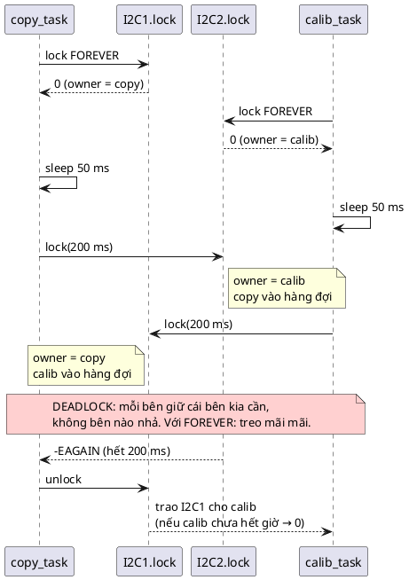

Vì sao lúc thì cả hai `-11`, lúc thì một bên `0`: cả hai bắt đầu chờ gần như cùng lúc, hạn chờ cách nhau rất ít. Bên hết giờ trước nhả khóa đầu tiên của nó. Nếu bên kia **chưa** kịp hết giờ, nó được trao khóa ngay (`0`). Nếu nó cũng vừa hết giờ, cả hai `-11`. Dù thế nào, **ít nhất một bên thất bại**: thiết kế này sai, timeout chỉ giúp ta *nhìn thấy* lỗi.

Khi cả hai khóa **cùng thứ tự** (I2C1 trước I2C2): thread đến sau bị chặn ngay ở khóa **đầu tiên**, khi nó chưa giữ gì cả. Không thể có vòng chờ. Cả hai `0`.

---

## 15. Các quyết định thiết kế và phương án khác

### 15.1. Trao thẳng (handoff) hay mở rồi giành (barging)

Bản đầu tiên mình viết cho bài này **không** trao thẳng: `mutex_unlock` đặt `lock_count = 0` rồi đánh thức một waiter, waiter thức dậy và tự lock. Nghe hợp lý, cho tới khi demo phần 1 in ra *"lock phai cho 1 lan"*.

🔬 Thí nghiệm: hai thread, mỗi thread lock 300 lần, giữ ~100 µs mỗi lần; ghi lại ai giữ mutex theo thứ tự (`S`/`L`) và đếm số lần quyền giữ đổi chủ.

```c
/* Ai giữ mutex lần lượt? Đếm số lần quyền giữ đổi chủ giữa hai thread. */
#include "mutex.h"
#include <pthread.h>
#include <stdio.h>
#include <time.h>

#define ROUNDS 300

struct ctx {
	struct mutex lock;
	char log[2 * ROUNDS + 1];
	int pos;
};

struct arg {
	struct ctx *ctx;
	char id;
};

static void busy_us(long us)
{
	struct timespec a, b;
	timespec_get(&a, TIME_UTC);
	do {
		timespec_get(&b, TIME_UTC);
	} while ((b.tv_sec - a.tv_sec) * 1000000000L + (b.tv_nsec - a.tv_nsec) < us * 1000L);
}

static void *worker(void *p)
{
	struct arg *a = p;
	for (int i = 0; i < ROUNDS; i++) {
		mutex_lock(&a->ctx->lock, MUTEX_FOREVER);
		a->ctx->log[a->ctx->pos++] = a->id;
		busy_us(100); /* giữ bus ~100 us như một transfer */
		mutex_unlock(&a->ctx->lock);
	}
	return NULL;
}

int main(void)
{
	static struct ctx c;
	struct arg a = { &c, 'S' }, b = { &c, 'L' };
	pthread_t ta, tb;
	mutex_init(&c.lock);
	pthread_create(&ta, NULL, worker, &a);
	pthread_create(&tb, NULL, worker, &b);
	pthread_join(ta, NULL);
	pthread_join(tb, NULL);
	int switches = 0;
	for (int i = 1; i < c.pos; i++) switches += c.log[i] != c.log[i - 1];
	printf("doi chu %3d lan / %d lan lock, contentions=%u, 60 ky tu dau: %.60s\n", switches, c.pos,
	       (unsigned)c.lock.contentions, c.log);
	return 0;
}
```

Với bản **barging** (một bản `mutex.c` khác chỉ dùng cho thí nghiệm: unlock mở mutex rồi `pthread_cond_signal`), 3 lần chạy:

```
doi chu   1 lan / 600 lan lock, contentions=1, 60 ky tu dau: SSSSSSSSSSSSSSSSSSSSSSSSSSSSSSSSSSSSSSSSSSSSSSSSSSSSSSSSSSSS
doi chu   1 lan / 600 lan lock, contentions=1, 60 ky tu dau: SSSSSSSSSSSSSSSSSSSSSSSSSSSSSSSSSSSSSSSSSSSSSSSSSSSSSSSSSSSS
doi chu   1 lan / 600 lan lock, contentions=1, 60 ky tu dau: SSSSSSSSSSSSSSSSSSSSSSSSSSSSSSSSSSSSSSSSSSSSSSSSSSSSSSSSSSSS
```

Thread `S` giữ mutex **300 lần liên tiếp**, thread `L` chờ suốt từ đầu tới khi `S` xong hết. Lý do: `S` unlock, đánh thức `L`; nhưng `L` cần vài micro giây để được hệ điều hành cho chạy lại, trong khi `S` (đang chạy sẵn) gọi `mutex_lock` ngay lệnh tiếp theo, thấy mutex mở, và giành lại. Đây là **starvation** (📖 Common Pitfalls), gây ra bởi chính cách cài đặt mutex.

Với **`pthread_mutex_t` gốc** của winpthreads (cùng chương trình, thay `struct mutex` bằng `pthread_mutex_t`), 5 lần chạy: đổi chủ 1, 1, 1, **2**, 1 lần. Nó cũng barging.

Với bản **handoff** cuối cùng của code mẫu, 5 lần chạy:

```
doi chu 599 lan / 600 lan lock, contentions=599, 60 ky tu dau: SLSLSLSLSLSLSLSLSLSLSLSLSLSLSLSLSLSLSLSLSLSLSLSLSLSLSLSLSLSL
doi chu 599 lan / 600 lan lock, contentions=599, 60 ky tu dau: LSLSLSLSLSLSLSLSLSLSLSLSLSLSLSLSLSLSLSLSLSLSLSLSLSLSLSLSLSLS
doi chu 599 lan / 600 lan lock, contentions=599, 60 ky tu dau: SLSLSLSLSLSLSLSLSLSLSLSLSLSLSLSLSLSLSLSLSLSLSLSLSLSLSLSLSLSL
doi chu 599 lan / 600 lan lock, contentions=599, 60 ky tu dau: SLSLSLSLSLSLSLSLSLSLSLSLSLSLSLSLSLSLSLSLSLSLSLSLSLSLSLSLSLSL
doi chu 599 lan / 600 lan lock, contentions=599, 60 ky tu dau: SLSLSLSLSLSLSLSLSLSLSLSLSLSLSLSLSLSLSLSLSLSLSLSLSLSLSLSLSLSL
```

Thay phiên hoàn hảo. Nhưng công bằng có giá. 🔬 Đo chi phí trung bình một cặp lock/unlock (build `-O2`, 2 triệu vòng):

```c
/* Chi phí một cặp lock/unlock khi KHÔNG có tranh chấp (một thread) và khi có tranh chấp */
#include "mutex.h"
#include <pthread.h>
#include <stdio.h>
#include <time.h>

#define N 2000000

static double now_ns(void)
{
	struct timespec t;
	timespec_get(&t, TIME_UTC);
	return t.tv_sec * 1e9 + t.tv_nsec;
}

struct shared {
	struct mutex lock;
	long value;
};

static void *hammer(void *arg)
{
	struct shared *s = arg;
	for (int i = 0; i < N; i++) {
		mutex_lock(&s->lock, MUTEX_FOREVER);
		s->value++;
		mutex_unlock(&s->lock);
	}
	return NULL;
}

int main(void)
{
	pthread_mutex_t raw;
	struct shared s = { .value = 0 };
	pthread_mutex_init(&raw, NULL);
	mutex_init(&s.lock);

	double t0 = now_ns();
	for (int i = 0; i < N; i++) {
		pthread_mutex_lock(&raw);
		pthread_mutex_unlock(&raw);
	}
	double t1 = now_ns();
	for (int i = 0; i < N; i++) {
		mutex_lock(&s.lock, MUTEX_FOREVER);
		mutex_unlock(&s.lock);
	}
	double t2 = now_ns();
	printf("khong tranh chap, pthread_mutex : %6.1f ns / cap lock+unlock\n", (t1 - t0) / N);
	printf("khong tranh chap, struct mutex  : %6.1f ns / cap lock+unlock\n", (t2 - t1) / N);

	pthread_t a, b;
	t0 = now_ns();
	pthread_create(&a, NULL, hammer, &s);
	pthread_create(&b, NULL, hammer, &s);
	pthread_join(a, NULL);
	pthread_join(b, NULL);
	t1 = now_ns();
	printf("2 thread tranh chap, struct mutex: %6.1f ns / cap lock+unlock (contentions=%u)\n",
	       (t1 - t0) / (2.0 * N), (unsigned)s.lock.contentions);
	return 0;
}
```

Kết quả 3 lần chạy với mỗi bản `mutex.c` (khoảng giá trị min – max):

| Tình huống | Link với bản handoff (code mẫu) | Link với bản barging |
|---|---|---|
| Không tranh chấp, `pthread_mutex_t` gốc | 6,6 – 7,7 ns | 7,3 – 9,4 ns |
| Không tranh chấp, `struct mutex` | 22,8 – 27,4 ns | 21,7 – 23,9 ns |
| 2 thread tranh chấp liên tục, `struct mutex` | **9 374 – 10 161 ns** (contentions ≈ 3,9 triệu) | **74 – 86 ns** (contentions ≈ 25 000 – 35 000) |

(Dòng đầu là cùng một phép đo `pthread_mutex_t`, khác nhau chỉ vì ở hai lần chạy khác nhau.)

Đọc kết quả:
- 📖 Sách nói *"Mutex locking and unlocking operation is very inexpensive when the probability of threads trying to lock the same mutex concurrently is low."* 🔬 Đúng: không tranh chấp, mỗi cặp chỉ ~25 ns (một lần lấy và nhả `guard`).
- Khi tranh chấp liên tục với critical section **cực ngắn** (`value++`), handoff chậm hơn barging **hơn 100 lần**: gần như mỗi lần lock đều phải ngủ và được đánh thức (một context switch, vài micro giây). Barging cho thread đang chạy giữ khóa nhiều lần liền, ít context switch, nên rất nhanh, đổi lại là không công bằng.

**Chọn thế nào:** 💡 RTOS embedded (Zephyr k_mutex, theo đúng code sách trích) chọn handoff theo priority, vì mục tiêu là **thời gian đáp ứng có giới hạn** (real-time), không phải throughput. Với critical section dài như transfer I2C (~100 µs), chi phí vài micro giây của handoff là không đáng kể. Thư viện desktop thường chọn barging vì throughput. Code mẫu chọn handoff để giống sách.

### 15.2. Hàng đợi FIFO thay vì theo priority

Zephyr chèn waiter vào `wait_q` **theo priority**, và đó là điều kiện để "trao cho người priority cao nhất". Code mẫu dùng FIFO vì thread Windows không có priority theo nghĩa RTOS. Đổi sang hàng theo priority chỉ cần thêm field `prio` vào `struct mutex_waiter` và sửa `queue_push` thành chèn có thứ tự (Bài tập 4).

### 15.3. Không có priority inheritance

Windows không cho nâng/hạ priority thread theo kiểu RTOS một cách có ý nghĩa, và winpthreads không hỗ trợ `PTHREAD_PRIO_INHERIT` (🔬 mục 10.4). Thay vì giả vờ, code mẫu bỏ hẳn tính năng này và dùng bộ mô phỏng ở mục 10.

### 15.4. Tự viết thay vì dùng thẳng `pthread_mutex_t`

| Phương án | Ưu | Nhược |
|---|---|---|
| `pthread_mutex_t` mặc định | Nhanh nhất (~7 ns) | Không khóa lồng, không kiểm tra owner (🔬 unlock từ thread khác trả `0`), không công bằng |
| `pthread_mutex_t` + `RECURSIVE` / `ERRORCHECK` | Có sẵn | Phải chọn một trong hai; vẫn barging |
| **Tự viết `struct mutex`** (code mẫu) | Đủ 4/5 đặc điểm của sách (thiếu inheritance), mã lỗi kiểu Zephyr, đọc được từng dòng | Chậm hơn ~3 lần khi không tranh chấp, rất chậm khi tranh chấp dày |

Trong firmware thật, bạn **không** tự viết mutex: 📖 chương Concurrency: *"Do not reinvent the scheduler"*. Dùng `k_mutex` của Zephyr hoặc mutex của FreeRTOS. Tự viết ở đây là để **hiểu**.

### 15.5. Một mutex cho mỗi bus, không phải một mutex toàn cục

📖 Use case *"Thread safety"*: *"typically implemented as mutual exclusion using a separate mutex for each instance of the object"*. Một mutex chung cho mọi bus thì I2C1 và I2C2 chặn nhau vô cớ. 💡 Ngược với spinlock (📖 bài 11: thường **dùng chung** một spinlock cho cả lớp object, vì chỉ giữ vài lệnh). Mutex giữ lâu, nên chia theo instance mới có lợi.

### 15.6. Khóa ở trong driver, không bắt caller tự khóa

Phương án khác: `i2c_bus_write_read` không khóa, và ghi tài liệu "caller phải lock trước". Nhanh hơn một chút, nhưng mỗi caller là một cơ hội quên. 📖 Best practice: object có mutex làm thành viên *"making it clear that the lock should be used by all public API functions"*. Code mẫu làm cả hai: transfer tự khóa, và có thêm `i2c_bus_lock` cho giao dịch nhiều transfer.

---

# Phần D — Thực tế và tổng kết

## 16. Mutex trong thực tế: Zephyr, FreeRTOS, CMSIS, Linux

💡 Phần này mô tả API thật để bạn nhận ra pattern khi đọc code. **Không có đoạn nào được chạy** trong bài này (không có board); hãy đối chiếu với tài liệu của phiên bản bạn dùng.

### Zephyr

```c
/* 💡 Zephyr, không chạy trong bài */
K_MUTEX_DEFINE(i2c1_lock);                       /* cấp phát tĩnh lúc build */

int ret = k_mutex_lock(&i2c1_lock, K_MSEC(10));  /* 0, -EBUSY (K_NO_WAIT), -EAGAIN (hết giờ) */
if (ret == 0) {
	/* ... transfer ... */
	k_mutex_unlock(&i2c1_lock);              /* 0, -EINVAL, -EPERM */
}
```
Khóa lồng: có. Priority inheritance: có. Gọi trong ISR: assert. Đây chính là code sách trích.

### FreeRTOS

```c
/* 💡 FreeRTOS, không chạy trong bài */
SemaphoreHandle_t bus_mutex = xSemaphoreCreateMutex();           /* có priority inheritance */
SemaphoreHandle_t nest_mutex = xSemaphoreCreateRecursiveMutex(); /* khóa lồng */

if (xSemaphoreTake(bus_mutex, pdMS_TO_TICKS(10)) == pdTRUE) {
	/* ... */
	xSemaphoreGive(bus_mutex);
}
xSemaphoreTakeRecursive(nest_mutex, portMAX_DELAY);
xSemaphoreGiveRecursive(nest_mutex);
```
💡 Chú ý cái tên: FreeRTOS gọi mutex là "semaphore" và dùng chung hàm `Take`/`Give`, nhưng **loại tạo bằng `xSemaphoreCreateMutex` có owner và priority inheritance**, loại `xSemaphoreCreateBinary` thì không. Nhầm hai loại là gặp đúng priority inversion của mục 5. Mutex thường của FreeRTOS **không** cho khóa lồng; phải dùng bản `Recursive` với cặp hàm riêng.

### CMSIS-RTOS2

```c
/* 💡 CMSIS-RTOS2, không chạy trong bài */
const osMutexAttr_t attr = {
	.name = "i2c1",
	.attr_bits = osMutexRecursive | osMutexPrioInherit, /* chọn từng tính năng */
};
osMutexId_t bus_mutex = osMutexNew(&attr);
osMutexAcquire(bus_mutex, 10U);
osMutexRelease(bus_mutex);
```

### Linux kernel

💡 `struct mutex` của Linux kernel: có owner, **không** cho khóa lồng (lock lần hai là deadlock; bật `CONFIG_DEBUG_MUTEXES` thì được báo), không dùng trong ISR. Có thêm bộ kiểm tra *lockdep* tự phát hiện vi phạm thứ tự khóa lúc chạy. Driver I2C trong kernel dùng `i2c_lock_bus()` / `i2c_unlock_bus()`, cùng ý tưởng với `i2c_bus_lock` của code mẫu.

| | Zephyr `k_mutex` | FreeRTOS mutex | CMSIS-RTOS2 | Linux kernel | pthread mặc định |
|---|---|---|---|---|---|
| Owner | Có | Có | Có | Có | 🔬 winpthreads: không kiểm tra |
| Khóa lồng | **Có** | Loại riêng | Tùy chọn | Không | Không (tùy chọn `RECURSIVE`) |
| Priority inheritance | Có | Có | Tùy chọn | Có (`rt_mutex`) | Tùy chọn (🔬 winpthreads: không có) |
| Timeout | Có | Có | Có | Không trực tiếp (có bản interruptible/killable) | `timedlock` |
| Trong ISR | Cấm | Cấm | Cấm | Cấm | Không áp dụng |

---

## 17. Test code có mutex

Bug concurrency không lặp lại được, nên test phải có hai loại.

### 17.1. Test chức năng: các mã lỗi, xác định và lặp lại được

```c
#include "mutex.h"

#include <assert.h>
#include <errno.h>
#include <pthread.h>

struct ctx {
	struct mutex m;
	int unlock_result;
};

static void *try_unlock(void *arg)
{
	struct ctx *c = arg;
	c->unlock_result = mutex_unlock(&c->m); /* không phải owner */
	return NULL;
}

int main(void)
{
	struct ctx c;
	pthread_t t;

	assert(mutex_init(&c.m) == 0);
	assert(mutex_unlock(&c.m) == -EINVAL);        /* mở một mutex đang mở */
	assert(mutex_lock(&c.m, MUTEX_FOREVER) == 0);
	assert(mutex_lock(&c.m, MUTEX_NO_WAIT) == 0); /* owner khóa lồng: không cần chờ */
	assert(mutex_lock_depth(&c.m) == 2);
	assert(mutex_deinit(&c.m) == -EBUSY);         /* không hủy khi đang giữ */

	pthread_create(&t, NULL, try_unlock, &c);
	pthread_join(t, NULL);
	assert(c.unlock_result == -EPERM);

	assert(mutex_unlock(&c.m) == 0);
	assert(mutex_unlock(&c.m) == 0);
	assert(mutex_lock_depth(&c.m) == -EPERM);
	assert(mutex_lock(&c.m, -5) == -EINVAL);      /* timeout vô nghĩa */
	assert(mutex_deinit(&c.m) == 0);
	return 0;
}
```

🔬 Build `gcc -std=c11 -Wall -Wextra -Werror -pedantic -pthread -Iinc test_mutex.c src/mutex.c`, chạy: thoát với mã 0, không assert nào hỏng.

### 17.2. Stress test: chạy nhiều, đếm lỗi

Đây chính là demo phần 1 và thí nghiệm `race.c`: nhiều thread, nhiều vòng, kiểm tra **bất biến** (nhiệt độ luôn 25000, bộ đếm luôn đúng 2 000 000). Một lần qua không chứng minh được gì; **một lần trượt** là chứng minh có bug. Hai mẹo:
- **Mở rộng cửa sổ race** bằng cách thêm delay ở giữa critical section (như `i2c_sim_byte_delay` hay `sleep_ms(50)` trong demo 4). Bug hiếm thành bug thường.
- 💡 Trên Linux, build với `-fsanitize=thread` (ThreadSanitizer) sẽ báo data race lúc chạy. MinGW trên Windows không có TSan, nên bài này không thử được.

### 17.3. Deadlock trong test: dùng timeout

Code thật thường lock `FOREVER`. Trong test, dùng phiên bản có timeout (hoặc bọc cả test bằng watchdog) để test **trả lỗi** thay vì treo CI mãi mãi. Demo 4 làm đúng như vậy.

---

## 18. Trade-off

| Tiêu chí | Spinlock (bài 11) | Semaphore làm khóa | **Mutex** |
|---|---|---|---|
| **Đúng dữ liệu** | Có | Có (nếu không ai give nhầm) | Có |
| **Ảnh hưởng ngắt** | Chặn ngắt suốt critical section | Không | **Không** |
| **Thread chờ** | (không có khái niệm thread) | Ngủ | **Ngủ** |
| **Priority inversion** | Không áp dụng | Không giới hạn | **Có giới hạn** (inheritance) |
| **Bắt lỗi lập trình** | Không | Không | **`-EPERM`, `-EINVAL`** |
| **Hàm có khóa gọi hàm có khóa** | Deadlock (📖) | Deadlock | **Được (Zephyr)** |
| **RAM mỗi khóa** | 1 word (0 trên single core) | Bộ đếm + hàng đợi | Owner + bộ đếm + hàng đợi + priority gốc |
| **Chi phí không tranh chấp** | Vài lệnh | Spinlock + kiểm tra | Spinlock + kiểm tra (🔬 ~25 ns trên PC) |
| **Chi phí khi phải chờ** | Đốt CPU | Context switch | Context switch (🔬 ~10 µs/cặp khi tranh chấp dày, bản handoff) |
| **Dùng trong ISR** | Có | `give` có | **Không** |
| **Flash** | Rất nhỏ | Nhỏ | Lớn hơn (logic inheritance) |

💡 Một chi phí ẩn: **mỗi mutex là một điểm có thể deadlock**. Càng nhiều mutex, càng nhiều cặp thứ tự phải giữ đúng. Đừng thêm mutex "cho chắc".

---

## 19. Khi nào không nên dùng

📖 Sách nêu hai lựa chọn khác:
- **Semaphore**: khi việc lock xảy ra ở một thread và unlock ở thread khác. *"This is a case of signaling and so a semaphore is better suited than a mutex."*
- **Condition variable**: khi cần *chờ một điều kiện trở thành đúng* mà không giữ tài nguyên bị khóa trong lúc chờ (bài 14).

💡 Thêm các trường hợp:

| Tình huống | Đừng dùng mutex, dùng | Vì sao |
|---|---|---|
| Chia sẻ dữ liệu với ISR | Spinlock (bài 11) | Mutex cấm trong ISR |
| ISR báo "xong" cho thread | Semaphore (bài 12) | Báo hiệu, không phải loại trừ |
| Một biến đếm / cờ đơn lẻ | `<stdatomic.h>` (`atomic_fetch_add`) | Một thao tác nguyên tử là đủ, không cần critical section |
| Nhiều thread cần cùng một peripheral phức tạp | **Một thread sở hữu peripheral**, các thread khác gửi yêu cầu qua message queue | Không có tranh chấp, không có deadlock, không có inversion |
| Dữ liệu chỉ ghi lúc khởi động, sau đó chỉ đọc | Không cần khóa | Không có ghi đồng thời |
| Đọc rất nhiều, ghi hiếm | Reader-writer lock, hoặc chuẩn bị bản mới rồi đổi con trỏ nguyên tử | Mutex bắt mọi reader xếp hàng vô ích |
| Chương trình chỉ có một thread (superloop) | Không cần | Không có thread khác. Nhưng vẫn cần spinlock với ISR |

📖 Lưu ý chương Concurrency: *"Do not use threads as level of abstraction"*. Nhiều mutex trong firmware thường là triệu chứng của **quá nhiều thread**. Bớt thread thì bớt mutex.

---

## 20. Lỗi hay gặp

### 20.1. 📖 Deadlock do thứ tự khóa

📖 *"This issue is handled by always locking and unlocking multiple mutexes in the same order."* 🔬 Demo 4 đã cho thấy AB-BA. Câu hỏi: **thứ tự unlock** có quan trọng không? Thí nghiệm: hai thread, mỗi thread 2000 vòng lock a rồi b (hoặc b rồi a), timeout 20 ms cho khóa thứ hai:

```c
/* Thứ tự LOCK quyết định deadlock; thứ tự UNLOCK thì không. */
#include "mutex.h"
#include <pthread.h>
#include <stdio.h>

#define ROUNDS 2000

struct pair {
	struct mutex a;
	struct mutex b;
};

struct job {
	struct pair *p;
	int reverse_lock;   /* 1: khóa b trước a */
	int reverse_unlock; /* 1: mở a trước b */
	int timeouts;
};

static void *worker(void *arg)
{
	struct job *j = arg;
	struct mutex *first = j->reverse_lock ? &j->p->b : &j->p->a;
	struct mutex *second = j->reverse_lock ? &j->p->a : &j->p->b;

	for (int i = 0; i < ROUNDS; i++) {
		mutex_lock(first, MUTEX_FOREVER);
		if (mutex_lock(second, 20) != 0) { /* 20 ms: lâu hơn rất nhiều so với một vòng bình thường */
			j->timeouts++;
			mutex_unlock(first);
			continue;
		}
		if (j->reverse_unlock) {
			mutex_unlock(first);
			mutex_unlock(second);
		} else {
			mutex_unlock(second);
			mutex_unlock(first);
		}
	}
	return NULL;
}

static void run(const char *title, int lock2_rev, int unlock1_rev, int unlock2_rev)
{
	struct pair p;
	struct job j1 = { &p, 0, unlock1_rev, 0 };
	struct job j2 = { &p, lock2_rev, unlock2_rev, 0 };
	pthread_t t1, t2;
	mutex_init(&p.a);
	mutex_init(&p.b);
	pthread_create(&t1, NULL, worker, &j1);
	pthread_create(&t2, NULL, worker, &j2);
	pthread_join(t1, NULL);
	pthread_join(t2, NULL);
	printf("%-48s timeout: %d + %d / %d vong\n", title, j1.timeouts, j2.timeouts, 2 * ROUNDS);
}

int main(void)
{
	setvbuf(stdout, NULL, _IONBF, 0);
	run("cung thu tu lock, cung thu tu unlock", 0, 0, 0);
	run("cung thu tu lock, thu tu unlock khac nhau", 0, 0, 1);
	run("nguoc thu tu lock (AB-BA)", 1, 0, 0);
	return 0;
}
```

Output thật, 2 lần chạy:

```
cung thu tu lock, cung thu tu unlock             timeout: 0 + 0 / 4000 vong
cung thu tu lock, thu tu unlock khac nhau        timeout: 0 + 0 / 4000 vong
nguoc thu tu lock (AB-BA)                        timeout: 737 + 694 / 4000 vong
```
```
cung thu tu lock, cung thu tu unlock             timeout: 0 + 0 / 4000 vong
cung thu tu lock, thu tu unlock khac nhau        timeout: 0 + 0 / 4000 vong
nguoc thu tu lock (AB-BA)                        timeout: 385 + 376 / 4000 vong
```

⚠️ **Đối chiếu với sách:** sách nói *"locking and unlocking ... in the same order"*, và phương án 3 của quiz 4 nói các mutex *"must be always unlocked in reverse order"*. 🔬 Thí nghiệm cho thấy: **chỉ thứ tự lock quyết định deadlock**. Unlock theo thứ tự nào cũng không gây chờ vòng, vì unlock không bao giờ phải chờ ai. 💡 Unlock theo thứ tự ngược lại (LIFO) vẫn là **thói quen tốt** vì code dễ đọc và lồng nhau gọn gàng, nhưng đó là phong cách, không phải điều kiện tránh deadlock. (Bản AB-BA mất ~28 giây mỗi lần chạy, vì mỗi lần deadlock tốn 20 ms chờ timeout.)

💡 Bốn điều kiện cần để có deadlock (Coffman, 1971): (1) tài nguyên độc quyền, (2) giữ cái này trong khi chờ cái khác, (3) không ai tước được khóa của người khác, (4) **chờ vòng tròn**. Mutex luôn có (1)–(3); quy tắc "luôn khóa theo một thứ tự toàn cục" phá điều kiện (4). Cách làm trong dự án: đánh số các mutex (ví dụ `I2C1 = 10`, `I2C2 = 20`, `FLASH = 30`) và chỉ được lock số lớn hơn khi đang giữ số nhỏ hơn (Bài tập 6).

### 20.2. 📖 Thread starvation: giữ khóa lâu hơn cần thiết

📖 *"holding the mutex for longer than necessary causing other threads to be delayed. This issue is handled by locking only while accessing data."* Và best practice *"Lock data, not code"*: *"data should be copied to stack and the resource should be released before processing the values"*.

🔬 Thí nghiệm: sensor thread đọc TMP102 rồi xử lý ~20 ms (lọc số, format log). Bản sai giữ bus trong lúc xử lý; bản đúng đọc xong là nhả, xử lý trên biến cục bộ. Một thread khác liên tục đọc EEPROM và đo transfer chậm nhất:

```c
/* "Lock data, not code": xử lý dữ liệu khi còn giữ bus làm thread khác chờ lâu */
#include "i2c_bus.h"
#include "tmp102.h"
#include <pthread.h>
#include <stdio.h>
#include <time.h>

struct ctx {
	struct i2c_bus bus;
	struct tmp102 sensor;
	int process_inside_lock;
	volatile int stop;
	double worst_ms;
};

static double now_ms(void)
{
	struct timespec t;
	timespec_get(&t, TIME_UTC);
	return t.tv_sec * 1e3 + t.tv_nsec / 1e6;
}

static void slow_processing(void) /* lọc số, format log... khoảng 20 ms CPU */
{
	double t0 = now_ms();
	while (now_ms() - t0 < 20.0) {
	}
}

static void *sensor_task(void *arg)
{
	struct ctx *c = arg;
	for (int i = 0; i < 20; i++) {
		int32_t mc;
		if (c->process_inside_lock) {
			i2c_bus_lock(&c->bus, MUTEX_FOREVER);
			tmp102_read_mc(&c->sensor, &mc);
			slow_processing(); /* SAI: giữ bus trong lúc làm việc không liên quan tới bus */
			i2c_bus_unlock(&c->bus);
		} else {
			tmp102_read_mc(&c->sensor, &mc); /* chép dữ liệu ra biến cục bộ, nhả bus ngay */
			slow_processing();
		}
	}
	c->stop = 1;
	return NULL;
}

static void *eeprom_task(void *arg)
{
	struct ctx *c = arg;
	uint8_t b = 0;
	while (!c->stop) {
		double t0 = now_ms();
		i2c_bus_write_read(&c->bus, 0x50, 0, &b, 1);
		double dt = now_ms() - t0;
		if (dt > c->worst_ms) {
			c->worst_ms = dt;
		}
	}
	return NULL;
}

static void run(int inside)
{
	struct ctx c = { .process_inside_lock = inside, .stop = 0, .worst_ms = 0 };
	pthread_t a, b;
	i2c_bus_init(&c.bus, "I2C1");
	tmp102_init(&c.sensor, &c.bus, 0x48);
	pthread_create(&a, NULL, sensor_task, &c);
	pthread_create(&b, NULL, eeprom_task, &c);
	pthread_join(a, NULL);
	pthread_join(b, NULL);
	printf("%-32s: EEPROM transfer cham nhat %.2f ms\n",
	       inside ? "xu ly TRONG luc giu bus" : "chep ra roi nha bus ngay", c.worst_ms);
}

int main(void)
{
	run(1);
	run(0);
	return 0;
}
```

Output thật, 3 lần chạy:

```
xu ly TRONG luc giu bus         : EEPROM transfer cham nhat 20.27 ms
chep ra roi nha bus ngay        : EEPROM transfer cham nhat 0.27 ms
xu ly TRONG luc giu bus         : EEPROM transfer cham nhat 20.26 ms
chep ra roi nha bus ngay        : EEPROM transfer cham nhat 0.41 ms
xu ly TRONG luc giu bus         : EEPROM transfer cham nhat 20.25 ms
chep ra roi nha bus ngay        : EEPROM transfer cham nhat 0.23 ms
```

Trễ tệ nhất của thread kia tăng khoảng **50–90 lần**, chỉ vì một dòng nằm sai chỗ. (💡 `volatile int stop` ở thí nghiệm này là cách làm nhanh cho demo, và về chuẩn C11 là data race; code thật nên dùng `atomic_int`.)

📖 Sách cũng nhắc giới hạn của lời khuyên này: không được nhả khóa giữa "đọc" và "ghi" nếu việc ghi phụ thuộc giá trị vừa đọc (*"if you need to later write data then you can not release the lock between read and write operation"*). Nhả khóa giữa chừng là mở cửa cho race của mục 2.

### 20.3. Các lỗi khác

| Lỗi | Hậu quả | Cách tránh |
|---|---|---|
| Quên unlock ở một nhánh lỗi (`return -EIO;` giữa lock và unlock) | Mutex bị giữ mãi, mọi thread khác treo | Một điểm return sau unlock (như `i2c_bus_write_read`), hoặc `goto out;` |
| Lock/unlock mutex trong ISR | Zephyr: assert/panic; RTOS khác: hỏng hàng đợi | 📖 Dùng spinlock hoặc semaphore |
| Dùng semaphore nhị phân làm khóa | Priority inversion không giới hạn, ai cũng give được | 📖 Dùng mutex |
| FreeRTOS: dùng `xSemaphoreCreateBinary` thay vì `xSemaphoreCreateMutex` | Như trên, dù tên hàm giống nhau | 💡 Đọc kỹ loại khi tạo |
| Gọi hàm chặn lâu (`k_sleep`, chờ semaphore) khi đang giữ mutex | Mọi thread cần mutex chờ theo | Chỉ giữ khi truy cập dữ liệu. 💡 Ngoại lệ có chủ đích: driver chờ ISR báo "transfer xong" khi đang giữ mutex của bus, vì bus thật sự bận trong lúc đó |
| 📖 Work queue chờ mutex bận | Cả work queue (dùng chung bởi nhiều module) bị chặn | 📖 *"Reschedule on busy"*: lock với `K_NO_WAIT`, nếu `-EBUSY` thì đặt lại work item để chạy sau |
| Mutex khóa lồng + condition variable | `wait` chỉ nhả một tầng, người khác không bao giờ vào được | Xem bài 14 |
| `pthread_mutex_t` mặc định và khóa lồng | Treo vĩnh viễn (🔬 mục 11.3) | `PTHREAD_MUTEX_RECURSIVE`, hoặc sửa thiết kế |
| Hủy (`deinit`) mutex khi còn người chờ | Dùng bộ nhớ đã chết | Kiểm tra `-EBUSY` (code mẫu) |
| Copy một struct chứa mutex (`struct i2c_bus b2 = b1;`) | Hai bản copy của "cùng một" khóa, không bảo vệ gì | 💡 Không bao giờ copy object có mutex; chỉ truyền con trỏ |
| Một mutex khổng lồ cho cả hệ thống | Mọi thứ chạy tuần tự, mất ý nghĩa của thread | Một mutex cho mỗi tài nguyên (mục 15.5) |

---

## 21. Quy trình refactor: thêm mutex vào một driver

Theo đúng lời khuyên trong phần Introduction của sách: viết cho chạy trước, rồi refactor theo pattern.

1. **Liệt kê tài nguyên dùng chung**: object nào được gọi từ hơn một thread? (bus, ring buffer, bảng cấu hình...). Object chỉ một thread dùng thì không cần khóa.
2. **Kiểm tra có ISR không.** Nếu ISR cũng chạm vào dữ liệu đó: phần dữ liệu chung với ISR dùng spinlock, không dùng mutex.
3. **Thêm `struct mutex lock;` vào chính struct của object** đó (Object Pattern). Khởi tạo trong `_init`, hủy trong `_deinit`.
4. **Ghi chú cho từng field** được bảo vệ bởi lock nào.
5. **Khóa bên trong mọi hàm public** chạm vào các field đó. Mỗi hàm: lock ở đầu, **một** điểm unlock ở cuối.
6. **Thu hẹp critical section**: chỉ bao quanh đọc/ghi dữ liệu; xử lý trên bản sao cục bộ (📖 *lock data, not code*).
7. **Giao dịch nhiều bước** (như snapshot): thêm cặp `_lock`/`_unlock` public, dựa vào khóa lồng, hoặc tách bản `_locked` nếu RTOS không hỗ trợ khóa lồng.
8. **Nếu có nhiều mutex**: đặt thứ tự toàn cục và ghi vào tài liệu.
9. **Kiểm tra mã lỗi** của lock khi dùng timeout; nhánh `-EAGAIN` phải có hành động rõ ràng.
10. **Stress test** nhiều thread, nhiều lần chạy; với Zephyr/FreeRTOS, test trên board thật hoặc QEMU/Renode.

---

## 22. Câu hỏi thường gặp (FAQ)

**Hỏi: Mutex và semaphore nhị phân (giá trị 0/1) khác nhau thế nào, nếu cả hai đều "chỉ một người vào"?**

Khác ở **ownership**. Semaphore không biết ai đang giữ, nên ai cũng give được, không có priority inheritance, và give hai lần làm hỏng khóa. Mutex biết owner, nên có `-EPERM`, có inheritance, có khóa lồng. 📖 Và khác ở mục đích: semaphore để **báo hiệu** (give ở chỗ này, take ở chỗ khác), mutex để **loại trừ** (lock và unlock trong cùng thread).

**Hỏi: Có nên dùng mutex cho một biến `uint32_t` đơn lẻ không?**

Thường là không. Một `atomic_fetch_add` hay `atomic_store` là đủ và nhanh hơn nhiều. Mutex cần khi có **nhiều bước** phải liền nhau (mục 3), hoặc nhiều biến phải nhất quán với nhau (ví dụ `head` và `count` của một ring buffer).

**Hỏi: Chỉ đọc thôi thì có cần lock không?**

Cần, nếu có thread khác **ghi** cùng lúc. Đọc một struct 8 byte trên MCU 32 bit cần hai lệnh; đọc xen giữa hai lần ghi của thread khác cho ra nửa cũ nửa mới (*torn read*). Chỉ không cần nếu dữ liệu không bao giờ đổi sau khi khởi tạo.

**Hỏi: `volatile` có thay mutex được không?**

Không. 🔬 Thí nghiệm `race.c` dùng `volatile long` và vẫn mất ~40% số lần cộng. `volatile` chỉ cấm compiler bỏ qua lần đọc/ghi; nó không làm chuỗi lệnh thành nguyên tử, không ngăn core khác chen vào. `volatile` dành cho **thanh ghi phần cứng**.

**Hỏi: Mutex có làm chương trình chậm không?**

Khi không tranh chấp: rất ít (🔬 ~25 ns trên PC). Khi tranh chấp: mỗi lần chờ là một context switch. Nếu tranh chấp dày, vấn đề là **thiết kế** (critical section quá dài, quá nhiều thread dùng một tài nguyên), không phải mutex.

**Hỏi: Có cần timeout không, hay cứ `FOREVER`?**

Với lỗi lập trình (deadlock), timeout không chữa được gì, chỉ biến "treo" thành "trả lỗi". Nhưng trả lỗi thì log được, và hệ thống có cơ hội tự phục hồi. 📖 Với work queue: dùng `NO_WAIT` và đặt lại việc. 💡 Nhiều team dùng `FOREVER` trong code, và trong bản debug thì thêm assert "chờ quá X ms".

**Hỏi: Hai thread priority bằng nhau tranh một mutex thì ai được trước?**

Zephyr: hàng đợi xếp theo priority, cùng priority thì theo thứ tự đến. Code mẫu: FIFO hoàn toàn. pthread: không bảo đảm gì (🔬 mục 15.1: winpthreads để một thread giữ 300 lần liên tiếp).

**Hỏi: Gọi `printf` khi đang giữ mutex có sao không?**

`printf` có thể chậm (trên firmware thường là UART polling) và bản thân nó có khóa bên trong. Đó là cách nhanh nhất để vi phạm "lock data, not code" và tạo một thứ tự khóa ngầm (mutex của bạn → khóa của stdio). Chép dữ liệu ra biến cục bộ, unlock, rồi mới in.

---

## 23. Tóm tắt và checklist

**Một câu:** *Mutex là khóa của thread: biết ai đang giữ, chỉ người đó được mở, người đến sau ngủ trong hàng đợi theo priority, người giữ được nâng priority khi người cao hơn phải chờ, và chính người giữ được khóa lồng.*

**Vì sao nó chạy được:** một spinlock bên trong bảo vệ ba field `owner`, `lock_count`, `wait_q` trong vài lệnh; "vào hàng đợi" và "nhả spinlock" là một bước liền; unlock trao thẳng quyền giữ cho waiter đầu hàng nên không ai chen ngang được.

Checklist cho mỗi object dùng chung giữa các thread:

- [ ] Biết chính xác những thread nào dùng object này; không có ISR nào chạm vào (nếu có: spinlock)
- [ ] `struct mutex lock;` nằm trong struct của object, khởi tạo trong `_init`, hủy trong `_deinit`
- [ ] Mỗi field ghi rõ được bảo vệ bởi lock nào
- [ ] Mọi hàm public chạm vào field đó đều lock; caller không phải tự lock
- [ ] Mỗi hàm có đúng một điểm unlock; không `return` sớm giữa lock và unlock
- [ ] Critical section chỉ chứa truy cập dữ liệu; xử lý trên bản sao cục bộ
- [ ] Không gọi hàm chặn lâu, `printf`, hay hàm có khóa của module khác khi đang giữ (trừ khi có chủ đích và đã ghi lại)
- [ ] Nhiều mutex: có thứ tự lock toàn cục, được ghi lại
- [ ] Lock có timeout: nhánh lỗi được xử lý
- [ ] Không bao giờ copy object chứa mutex
- [ ] FreeRTOS: dùng `xSemaphoreCreateMutex`, không dùng binary semaphore
- [ ] Đã stress test nhiều thread, nhiều lần chạy

---

## 24. Quiz (có đáp án)

Câu 1–4 là quiz gốc của sách (dịch lại, giữ các phương án). Sách không in đáp án; đáp án dưới đây do Claude chọn và giải thích dựa trên nội dung chương và thí nghiệm. Câu 5–12 do Claude thêm.

**Câu 1.** 📖 Vì sao lock/unlock mutex từ ISR là bất hợp lệ? Quyết định thiết kế này giúp làm được tính năng then chốt nào?
1. Nó giúp tập trung implementation riêng cho thread và làm mutex thành cơ chế loại trừ lẫn nhau tối ưu giữa các thread. Nếu phải hỗ trợ ngắt thì không thể bảo đảm lock/unlock bởi cùng một context.
2. Nó không cho phép loại trừ lẫn nhau giữa các ISR.
3. Mutex dùng spinlock, mà spinlock không dùng được trong ISR.

<details><summary>Đáp án</summary>

**Phương án 1.** ISR không phải thread: không có owner để ghi nhận, không có priority thread để kế thừa, và không được ngủ trong hàng đợi. Cấm ISR cho phép mutex dựa hoàn toàn vào "thread hiện tại" (`_current`), nhờ đó có ownership, `-EPERM`, khóa lồng và priority inheritance. Phương án 3 **sai**: chương Spinlock nói rõ spinlock dùng được trong ISR. Phương án 2 không phải mục tiêu của mutex (đồng bộ với ISR là việc của spinlock).
</details>

**Câu 2.** 📖 Vì sao mutex không được lock ở thread này và unlock ở thread khác? Nếu cho phép thì hệ quả là gì, và tính năng then chốt nào của mutex không thể làm được?
1. Vì mutex phải theo dõi thread nào đang lock để đánh thức thread đó khi mutex rảnh.
2. Nếu cho phép thread khác unlock, ta không bảo đảm được mutual exclusion, vì thread khác có thể giải phóng mutex trong khi ta đang cho rằng nó vẫn bị khóa.
3. Sẽ không thể cài đặt concurrency với ngắt nếu cho phép điều này.

<details><summary>Đáp án</summary>

**Phương án 2.** Thread A đang giữa critical section; thread B unlock hộ; thread C lock và vào cùng lúc với A. Mutual exclusion bị phá. Ngoài ra, không có owner xác định thì **priority inheritance** không biết nâng priority cho ai, và khóa lồng không biết ai được phép lồng. Phương án 1 lẫn lộn: mutex đánh thức **waiter**, không phải owner. Muốn "lock ở đây, mở ở kia" tức là đang báo hiệu: dùng semaphore.
</details>

**Câu 3.** 📖 Một thread priority thấp đang giữ mutex và đang bị suspend (bị thread khác chiếm CPU), thì một thread priority cao cố lock cùng mutex. Chuyện gì xảy ra với thread priority thấp? Khi nào nó được chạy lại?
1. Thread được đặt vào hàng đợi nội bộ của mutex.
2. Priority của thread đang giữ mutex được nâng lên cho tới khi nó nhả mutex.
3. Priority của thread đang cố lock được nâng lên.

<details><summary>Đáp án</summary>

**Phương án 2.** Thread thấp (owner) thừa hưởng priority của thread cao. Nó chạy lại **ngay khi không còn thread Ready nào có priority cao hơn priority mới đó**, tức là nó chiếm lại CPU từ các thread trung bình (🔬 mô phỏng mục 10.2: L chạy ở tick 3–5 với priority 3, M phải chờ). Nó giữ priority cao tới lúc unlock, rồi rơi về priority gốc; mutex được trao cho thread cao. Phương án 1 mô tả **thread cao** (nó mới là người vào hàng đợi), không phải thread thấp.
</details>

**Câu 4.** 📖 Khi lock/unlock nhiều mutex, phải theo thứ tự nào để tránh deadlock?
1. Có thể lock và unlock theo thứ tự bất kỳ.
2. Đây là tình huống không hợp lệ. Lúc nào cũng chỉ nên dùng một mutex.
3. Có thể lock theo thứ tự bất kỳ, nhưng luôn phải unlock theo thứ tự ngược với thứ tự đã lock.

<details><summary>Đáp án</summary>

⚠️ **Không phương án nào đúng.** Phần Common Pitfalls của chính sách trả lời: *"always locking and unlocking multiple mutexes in the same order"*. Điều kiện thật sự là: **mọi thread phải lock các mutex theo cùng một thứ tự toàn cục**. 🔬 Thí nghiệm mục 20.1: cùng thứ tự lock thì 0 timeout dù thứ tự unlock khác nhau; ngược thứ tự lock (AB-BA) thì hàng trăm lần deadlock. Phương án 3 sai ở cả hai vế: lock theo thứ tự bất kỳ chính là nguyên nhân deadlock, còn thứ tự unlock không ảnh hưởng tới deadlock (unlock ngược thứ tự chỉ là thói quen tốt cho dễ đọc). Phương án 2 không thực tế.
</details>

**Câu 5.** Ba lần "sửa" trong lịch sử dự án ở mục 1.3 (tắt ngắt, semaphore, hàm snapshot) lần lượt thiếu đặc điểm nào của mutex?

<details><summary>Đáp án</summary>

Tắt ngắt: thiếu "không tắt ngắt" và "thread chờ thì ngủ" (critical section dài làm mất sự kiện UART). Semaphore: thiếu **priority inheritance** (watchdog reset do priority inversion) và **ownership** (give hai lần làm hỏng khóa). Hàm snapshot gọi hàm có khóa: thiếu **khóa lồng** (self-deadlock).
</details>

**Câu 6.** Tại sao cho thanh ghi `hw_target` là `_Atomic` vẫn không ngăn được lỗi đọc nhầm thiết bị?

<details><summary>Đáp án</summary>

Atomic chỉ bảo đảm **từng** lần đọc/ghi không bị cắt ngang. Bất biến cần bảo vệ là của **cả chuỗi**: từ START tới STOP, thanh ghi đích không được đổi. Thread khác vẫn có thể ghi `hw_target` (một cách nguyên tử) **giữa** hai bước của ta. 🔬 Thí nghiệm mục 3.3: ~93% lần đọc sai dù mọi biến đều atomic. Cần mutex bao quanh cả transfer.
</details>

**Câu 7.** Trong `mutex_lock` của code mẫu, nhánh timeout kiểm tra `!w.granted` thêm một lần sau khi `pthread_cond_timedwait` trả `ETIMEDOUT`. Bỏ kiểm tra đó thì lỗi gì có thể xảy ra?

<details><summary>Đáp án</summary>

Đúng lúc hết giờ, người unlock có thể đã lấy node ra khỏi hàng, đặt `owner = me` và `granted = true`. Nếu không kiểm tra, thread gọi `queue_remove` (không tìm thấy, vô hại) rồi trả `-EAGAIN`; caller tin rằng mình **không** giữ mutex nên không unlock. Mutex bị giữ mãi bởi một thread không biết mình đang giữ: mọi thread khác treo.
</details>

**Câu 8.** Vì sao `mutex_unlock` của code mẫu "trao thẳng" quyền giữ cho waiter thay vì đặt `lock_count = 0` rồi đánh thức waiter? Cái giá là gì?

<details><summary>Đáp án</summary>

Nếu mở rồi mới đánh thức, thread vừa unlock (đang chạy sẵn) lock lại ngay, trước khi waiter kịp thức dậy. 🔬 Mục 15.1: một thread giữ mutex 300 lần liên tiếp, thread kia **chết đói** (starvation). Trao thẳng làm mutex không bao giờ mở khi còn waiter, bảo đảm FIFO (Zephyr: theo priority), đúng như `mutex->owner = new_owner` trong `k_mutex_unlock`. Cái giá: khi tranh chấp dày với critical section cực ngắn, gần như mỗi lần lock là một context switch: 🔬 ~10 µs/cặp so với ~80 ns của barging.
</details>

**Câu 9.** Driver TMP102 trong code mẫu không có mutex riêng. Như vậy có an toàn không? Khi nào nó cần mutex riêng?

<details><summary>Đáp án</summary>

An toàn, vì tài nguyên dùng chung là **bus** (đã có mutex), còn `struct tmp102` chỉ chứa `bus` và `addr`, không đổi sau `init`. Nếu driver có state thay đổi lúc chạy và nhiều thread cùng dùng (cache giá trị cuối, bộ lọc trung bình trượt, chế độ đang cấu hình), state đó cần được bảo vệ: hoặc bằng mutex riêng của driver, hoặc giữ bus suốt thao tác (như `tmp102_read_snapshot`). Nếu thêm mutex riêng, phải cố định thứ tự: luôn khóa mutex của driver **trước** mutex của bus.
</details>

**Câu 10.** Một ISR UART đẩy byte vào ring buffer mà `logger_thread` đọc ra. Bạn bảo vệ ring buffer bằng gì? Còn việc ISR báo "có dữ liệu mới"?

<details><summary>Đáp án</summary>

Ring buffer dùng chung với ISR: **spinlock** (critical section vài lệnh: cập nhật `head`, `count`). Không dùng mutex vì mutex cấm trong ISR. Báo "có dữ liệu mới": **semaphore** (ISR `give`, thread `take`). Mutex chỉ xuất hiện nếu có **nhiều thread** cùng đọc ring buffer với thao tác dài.
</details>

**Câu 11.** 🔬 Theo thí nghiệm mục 11.3, gọi `pthread_mutex_unlock` trên một `pthread_mutex_t` mặc định từ thread không phải owner thì winpthreads làm gì? Rút ra bài học gì khi viết code chạy trên nhiều nền tảng?

<details><summary>Đáp án</summary>

Trả về `0` (thành công) và mutex thật sự được mở: thread khác `trylock` được ngay. POSIX coi đây là hành vi không xác định, nên mỗi thư viện làm một kiểu. Bài học: đừng dựa vào hành vi của mutex "mặc định". Chọn rõ kiểu (`PTHREAD_MUTEX_ERRORCHECK` khi cần bắt lỗi ownership), hoặc dùng một lớp bọc có kiểm tra như `struct mutex` của code mẫu.
</details>

**Câu 12.** Bạn dùng FreeRTOS. Đồng nghiệp tạo khóa bus bằng `xSemaphoreCreateBinary()` rồi `xSemaphoreGive()` một lần để "mở". Code chạy đúng trong test. Bạn có đồng ý cho merge không?

<details><summary>Đáp án</summary>

Không. Binary semaphore không có owner và **không có priority inheritance**. Khi có ba thread priority khác nhau, sẽ gặp priority inversion không giới hạn (🔬 mô phỏng mục 5.3: H bị chặn 11 tick thay vì 3). Test hiếm khi bắt được vì cần đúng thứ tự thời gian. Dùng `xSemaphoreCreateMutex()` (hoặc `xSemaphoreCreateRecursiveMutex()` nếu cần khóa lồng).
</details>

---

## 25. Bài tập

### Bài 1: Ring buffer an toàn giữa các thread (cơ bản)

Lấy ring buffer ở Bài tập 2 của bài 2 (hoặc viết mới), thêm `struct mutex lock;` vào struct:
- `ring_put` và `ring_get` khóa bên trong.
- Viết `int ring_put_many(struct ring *self, const uint8_t *data, size_t len)`: hoặc ghi **hết** `len` byte, hoặc không ghi gì (`-ENOSPC`). Dùng khóa lồng để gọi lại `ring_put`.
- Test: 2 thread producer mỗi thread đẩy 10 000 byte, 1 thread consumer đếm; tổng phải đúng 20 000. Chạy 10 lần.
- Build thử bản bỏ khóa và ghi lại số byte bị mất.

### Bài 2: Tìm lỗi (đọc code)

```c
int sensor_hub_read_all(struct sensor_hub *self, struct readings *out)
{
	mutex_lock(&self->lock, MUTEX_FOREVER);
	if (!self->powered) {
		return -ENODEV;
	}
	for (int i = 0; i < self->count; i++) {
		int ret = sensor_read(self->sensors[i], &out->value[i]);
		if (ret) {
			return ret;
		}
		printf("sensor %d = %ld\n", i, (long)out->value[i]);
	}
	mutex_unlock(&self->lock);
	return 0;
}
```

Tìm **ít nhất ba** lỗi (gợi ý: các nhánh `return`, `printf`, thiếu kiểm tra tham số). Viết lại cho đúng với một điểm unlock duy nhất.

### Bài 3: Thứ tự khóa (refactor)

Thêm module `struct calib_store` (mảng hệ số hiệu chỉnh trong RAM, có mutex riêng). Viết `calib_store_sync_to_eeprom()` cần giữ cả mutex của `calib_store` lẫn mutex của bus I2C1, và `tmp102_apply_calib()` cũng cần cả hai. Quy định một thứ tự toàn cục, ghi thành comment ở đầu `calib_store.h`, và chứng minh bằng stress test (có timeout) rằng không có deadlock. Sau đó cố ý đảo thứ tự ở một hàm và xem test có bắt được không.

### Bài 4: Hàng đợi theo priority (nâng cao)

Thêm field `int prio` vào `struct mutex_waiter` và một hàm `mutex_lock_prio(self, timeout_ms, prio)`. Sửa `queue_push` để chèn theo priority giảm dần, cùng priority thì FIFO. Test: 3 thread prio 1, 2, 3 lần lượt vào hàng đợi khi mutex đang bị giữ; khi unlock, thứ tự được trao phải là 3, 2, 1. **Câu hỏi suy nghĩ:** hàng đợi theo priority có thể làm thread priority thấp chết đói không? Vì sao RTOS chấp nhận điều đó?

### Bài 5: Mở rộng bộ mô phỏng priority inversion (nâng cao)

Sửa `prio_sim.c` ở mục 10.3:
- Thêm task M2 (priority 2, tới ở tick 5, chạy 6 tick). Đo lại thời gian H bị chặn khi không có và có inheritance. Kết quả có khớp với nhận xét "thời gian chặn phụ thuộc mọi task priority trung gian" không?
- Cài đặt **priority ceiling**: mutex có trần priority 3, ai lock là được nâng ngay lên 3. So sánh với inheritance: H bị chặn bao lâu? M chịu ảnh hưởng thế nào?

### Bài 6: Phát hiện vi phạm thứ tự khóa (nâng cao)

Lấy cảm hứng từ *lockdep* của Linux: gán cho mỗi `struct mutex` một số `level` lúc init. Mỗi thread nhớ (bằng `_Thread_local` của C11) level của mutex cao nhất nó đang giữ. `mutex_lock` trả `-EDEADLK` nếu thread cố lock một mutex có level **nhỏ hơn hoặc bằng** level đang giữ (trừ khóa lồng chính mutex đó). Viết lại demo 4: bản AB-BA giờ phải bị bắt **ngay lập tức**, không cần chờ timeout.

Làm xong bài nào thì gõ `/review-exercise 13_MutexPattern` để Claude review.
