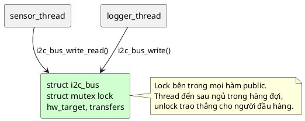

# 13 — Mutex Pattern (Mutual Exclusion)

📖 Bài giảng chi tiết: [LECTURE.md](LECTURE.md). File này là ghi chú tóm tắt, bám theo chương *Mutual Exclusion Pattern* của sách.

## Overview

Mutex = **khóa của thread**: biết ai đang giữ (owner), chỉ owner được unlock, thread đến sau **ngủ** trong hàng đợi theo priority, owner được **nâng priority** khi thread cao hơn phải chờ, và owner được **khóa lồng**. Xây trên spinlock (bài 11), nhưng **không tắt ngắt** và **cấm dùng trong ISR**.

## Use Cases

- **Truy cập độc quyền** tài nguyên dùng chung giữa các thread (bus I2C/SPI, ring buffer, bảng cấu hình).
- **Thread safety của API**: mỗi instance object có một mutex riêng làm thành viên.

## Benefits

- **Tránh priority inversion** nhờ priority inheritance (semaphore không có).
- **Dễ dùng, dễ debug**: kiểm tra lock/unlock cùng thread (`-EPERM`, `-EINVAL`).
- Khóa lồng: hàm có khóa gọi hàm có khóa không deadlock (k_mutex của Zephyr).
- Không chặn ngắt: hệ thống vẫn đáp ứng sự kiện phần cứng.
- Rất rẻ khi không tranh chấp (🔬 ~25 ns trên PC).

## Drawbacks

- **Chỉ một tài nguyên**: không có bộ đếm như semaphore (bộ đếm chỉ dùng cho khóa lồng).
- **Chỉ cho thread**: không dùng trong ISR, không đồng bộ thread ↔ ISR (dùng spinlock).
- Mỗi mutex là một điểm có thể deadlock; tranh chấp dày thì tốn context switch.

## Implementation

Xem [inc/mutex.h](inc/mutex.h), [src/mutex.c](src/mutex.c), [inc/i2c_bus.h](inc/i2c_bus.h), [src/i2c_bus.c](src/i2c_bus.c), [inc/tmp102.h](inc/tmp102.h), [src/tmp102.c](src/tmp102.c), [main.c](main.c).

| Thao tác | Code mẫu | Zephyr | Mã trả về |
|---|---|---|---|
| Lock | `mutex_lock(m, timeout_ms)` | `k_mutex_lock(m, timeout)` | `0`, `-EBUSY` (NO_WAIT), `-EAGAIN` (hết giờ) |
| Unlock | `mutex_unlock(m)` | `k_mutex_unlock(m)` | `0`, `-EINVAL` (đang mở), `-EPERM` (không phải owner) |

Bên trong: `guard` (vai spinlock) bảo vệ `owner`, `lock_count`, hàng đợi waiter (node nằm trên stack của thread chờ). Unlock **trao thẳng** cho waiter đầu hàng (handoff) để không ai chen ngang. Bản PC **không có** priority inheritance (winpthreads không hỗ trợ); xem bộ mô phỏng trong bài giảng.

`make run` chạy 4 demo; `make clean; make run EXTRA=-DI2C_BUS_DEMO_NO_LOCK` để thấy race khi bỏ mutex.

## Best Practices

- **Thiết kế hướng object**: mutex là thành viên của object được bảo vệ; mọi hàm public dùng nó.
- **Lock data, not code**: chỉ khóa quanh truy cập dữ liệu; chép ra stack rồi nhả trước khi xử lý (trừ khi đọc-sửa-ghi).
- **Work queue**: lock với `NO_WAIT`, bận thì đặt lại work item thay vì chặn cả work queue.
- Một điểm unlock cho mỗi hàm; không `return` sớm giữa lock và unlock.

## Common Pitfalls

- **Deadlock**: lock nhiều mutex theo thứ tự khác nhau. Chữa: **mọi thread lock theo cùng một thứ tự** (🔬 thứ tự unlock không ảnh hưởng).
- **Starvation**: giữ mutex lâu hơn cần thiết (🔬 trễ của thread khác tăng ~75 lần).
- Dùng trong ISR; dùng semaphore nhị phân làm khóa; quên unlock ở nhánh lỗi; khóa lồng + condition variable.

## Alternatives

- **Semaphore** (bài 12): khi lock ở thread này, unlock ở thread khác, tức là báo hiệu.
- **Condition variable** (bài 14): chờ một điều kiện mà không giữ tài nguyên bị khóa.
- **Spinlock** (bài 11): khi dữ liệu dùng chung với ISR.

## Quiz

1. Vì sao lock/unlock mutex từ ISR là bất hợp lệ? Quyết định này giúp làm được tính năng then chốt nào?
2. Vì sao mutex không được lock ở thread này và unlock ở thread khác? Hệ quả và tính năng nào sẽ mất?
3. Thread priority thấp đang giữ mutex (và đang bị suspend) thì thread priority cao cố lock. Chuyện gì xảy ra với thread thấp, khi nào nó chạy lại?
4. Khi dùng nhiều mutex, lock/unlock theo thứ tự nào để tránh deadlock?

(Đáp án và 8 câu thêm trong [LECTURE.md](LECTURE.md#24-quiz-có-đáp-án).)

## Câu hỏi còn thắc mắc

-
