# Bài giảng 14 — Conditional Pattern (Condition Variable)

> **Về nguồn:** Bài này bám theo chương *Conditional Pattern* trong sách của Martin Schröder (bản 0.38.0, file `00_Document/Martin-Schroder-Design-Patterns-Conditional-Pattern-0.38.0.pdf`). Sách gọi primitive này là *conditional variable*; tài liệu POSIX và Zephyr gọi là *condition variable* (`pthread_cond_t`, `k_condvar`). Bài này dùng cả hai tên, viết tắt là **condvar**.
> - 📖 đánh dấu nội dung **theo sách** (dịch và diễn giải lại).
> - 💡 đánh dấu phần **giải thích thêm**, không có trong sách.
> - 🔬 đánh dấu **thí nghiệm thật**: chương trình đã được build bằng gcc 16.2 (MSYS2 UCRT64, Windows 11 64-bit, CPU 16 luồng, winpthreads) với `-std=c11 -Wall -Wextra -Werror -pedantic -pthread` và chạy; output trong bài là output thật. Chương trình nhiều thread cho kết quả khác nhau giữa các lần chạy; bài ghi rõ đã chạy mấy lần và thấy gì.
>
> ⚠️ **Giới hạn của mô phỏng trên PC:** thread Windows không phải task RTOS (không có priority nghiêm ngặt, chạy song song trên nhiều core), và PC **không có ISR**. Khi bài nói "ISR", thí nghiệm dùng một **thread đóng vai ISR** (không khóa mutex, giống ràng buộc của ISR thật). Code Zephyr trích từ sách được đánh dấu 📖 và **không chạy**.

Code mẫu đi kèm: [inc/condvar.h](inc/condvar.h), [src/condvar.c](src/condvar.c), [inc/sys_events.h](inc/sys_events.h), [src/sys_events.c](src/sys_events.c), [inc/sample_queue.h](inc/sample_queue.h), [src/sample_queue.c](src/sample_queue.c), [main.c](main.c). Module mutex dùng lại nguyên từ bài 13: [inc/mutex.h](inc/mutex.h), [src/mutex.c](src/mutex.c). Ghi chú ngắn: [README.md](README.md).
Bài trước: [11 — Spinlock](../11_SpinlockPattern/LECTURE.md), [12 — Semaphore](../12_SemaphorePattern/LECTURE.md), [13 — Mutex](../13_MutexPattern/LECTURE.md). Đây là **bài cuối** của khóa; mục 25 tổng kết cả 14 bài.

---

## Mục lục

**Phần A — Kiến thức nền**

1. [Bối cảnh: chờ một điều kiện, không phải chờ một khóa](#1-bối-cảnh-chờ-một-điều-kiện-không-phải-chờ-một-khóa)
2. [Ba cách chờ sai: ngủ cố định, hỏi vòng, semaphore](#2-ba-cách-chờ-sai-ngủ-cố-định-hỏi-vòng-semaphore)
3. [Predicate, và vì sao "kiểm tra rồi ngủ" phải là một bước](#3-predicate-và-vì-sao-kiểm-tra-rồi-ngủ-phải-là-một-bước)
4. [Condvar không có bộ nhớ](#4-condvar-không-có-bộ-nhớ)

**Phần B — Pattern**

5. [Ý tưởng cốt lõi: wait, signal, broadcast](#5-ý-tưởng-cốt-lõi-wait-signal-broadcast)
6. [4 đặc điểm nhận dạng và lý do của từng cái](#6-4-đặc-điểm-nhận-dạng-và-lý-do-của-từng-cái)
7. [Đọc code k_condvar của Zephyr trong sách](#7-đọc-code-k_condvar-của-zephyr-trong-sách)
8. [Vòng while: spurious wakeup và wakeup bị "cướp"](#8-vòng-while-spurious-wakeup-và-wakeup-bị-cướp)
9. [Signal hay broadcast](#9-signal-hay-broadcast)
10. [Broadcast trên một CPU và nhiều CPU](#10-broadcast-trên-một-cpu-và-nhiều-cpu)
11. [Condvar và interrupt](#11-condvar-và-interrupt)

**Phần C — Đọc code**

12. [Đọc code mẫu từng dòng](#12-đọc-code-mẫu-từng-dòng)
13. [Theo dõi demo chạy từng bước](#13-theo-dõi-demo-chạy-từng-bước)
14. [Các quyết định thiết kế và phương án khác](#14-các-quyết-định-thiết-kế-và-phương-án-khác)

**Phần D — Thực tế và tổng kết**

15. [Condvar trong thực tế: Zephyr, POSIX, FreeRTOS, Linux](#15-condvar-trong-thực-tế-zephyr-posix-freertos-linux)
16. [Test code có condvar](#16-test-code-có-condvar)
17. [Trade-off](#17-trade-off)
18. [Khi nào không nên dùng](#18-khi-nào-không-nên-dùng)
19. [Lỗi hay gặp](#19-lỗi-hay-gặp)
20. [Quy trình refactor: từ cờ + polling sang condvar](#20-quy-trình-refactor-từ-cờ--polling-sang-condvar)
21. [Câu hỏi thường gặp (FAQ)](#21-câu-hỏi-thường-gặp-faq)
22. [Tóm tắt và checklist](#22-tóm-tắt-và-checklist)
23. [Quiz (có đáp án)](#23-quiz-có-đáp-án)
24. [Bài tập](#24-bài-tập)
25. [Tổng kết khóa học: 14 pattern](#25-tổng-kết-khóa-học-14-pattern)

---

# Phần A — Kiến thức nền

Ba bài trước trả lời câu hỏi *"làm sao để chỉ một bên được chạm vào dữ liệu"* (spinlock, mutex) và *"làm sao để một bên báo cho một bên khác"* (semaphore). Bài này trả lời câu hỏi còn lại: *"làm sao để **nhiều** thread chờ cho tới khi một **điều kiện bất kỳ** trở thành đúng, mà không đốt CPU và không lỡ mất lúc nó đúng"*.

## 1. Bối cảnh: chờ một điều kiện, không phải chờ một khóa

### 1.1. Nhìn lại bài 13: mutex bảo vệ dữ liệu, nhưng không chờ được dữ liệu

Kết quả của bài 13: dữ liệu dùng chung nằm trong một object, mutex là thành viên của object đó, mọi hàm public lock/unlock bên trong.

```c
/* Kết quả bài 13 (rút gọn từ 13_MutexPattern/inc/i2c_bus.h) */
struct i2c_bus {
	const char *name;
	struct mutex lock;      /* khóa nằm trong object: lock data, not code */
	_Atomic uint8_t hw_target;
	uint32_t transfers;     /* được bảo vệ bởi lock */
};

int mutex_lock(struct mutex *self, int32_t timeout_ms);  /* 0, -EBUSY, -EAGAIN */
int mutex_unlock(struct mutex *self);                    /* 0, -EINVAL, -EPERM */
```

Mutex trả lời được câu *"tôi có được vào không?"*. Nó chờ **khóa** được nhả. Nhưng giả sử thread MQTT cần chờ *"đã đọc xong cấu hình VÀ đã có IP"*. Hai cờ đó nằm trong một object có mutex:

```c
struct sys_state {
	struct mutex lock;
	bool config_loaded;  /* được bảo vệ bởi lock */
	bool net_up;         /* được bảo vệ bởi lock */
};
```

Thread MQTT lock được mutex ngay (không ai giữ lâu), đọc hai cờ, thấy `false`... rồi sao? Giữ mutex mà chờ thì thread mạng không bao giờ lock được để bật `net_up`. Nhả mutex rồi lock lại liên tục thì đốt CPU. 📖 Chính chương Mutex đã chỉ sang bài này trong phần Alternatives: *"Condition variable: condition variable provides a way to unlock a mutex while waiting for a condition to become true."*

### 1.2. Nhìn lại bài 12: semaphore báo hiệu, nhưng từng người một và có bộ đếm

📖 Semaphore là công cụ báo hiệu: một bên `give`, một bên đang `take` thì được đánh thức. Nó có hai đặc tính khiến nó vụng về cho bài toán ở trên:

1. **Đánh thức từng thread một.** 📖 Chương Semaphore, use case *"Waking up a thread pool"*: *"Note however, that all threads are not woken up atomically - only one at a time. For atomic wakeup of multiple threads you can use broadcasting feature of condition variable pattern."* Muốn đánh thức ba thread thì phải `give` ba lần, và người `give` phải biết **có bao nhiêu** người đang chờ.
2. **Có bộ đếm, tức là có "trí nhớ".** Mỗi `give` không ai nhận được cộng dồn. Đó là ưu điểm khi báo "có một gói tin mới", nhưng là nhược điểm khi điều kiện có thể **đúng rồi lại sai** (mạng lên rồi xuống): các `give` cũ nằm lại và đánh thức người chờ sai lúc.
3. **Không gắn với dữ liệu.** Semaphore chỉ nói "có ai đó đã give". Nó không nói `net_up` đang bằng bao nhiêu, và không bảo vệ việc đọc `net_up`.

### 1.3. Một dự án lớn dần: chuỗi khởi động của một gateway IoT

💡 *Tình huống minh họa (không phải ví dụ trong sách), nhưng từng bước đều là cách làm hay gặp.*

Gateway có các thread: `config_loader` (đọc cấu hình từ flash, ~100 ms), `net_driver` (DHCP, vài trăm ms tới vài giây), `ntp_client` (cần mạng, đồng bộ giờ), `data_logger` (cần cấu hình), `mqtt_client` (cần cấu hình + mạng + **giờ đúng**, vì chứng chỉ TLS chỉ kiểm tra được khi đồng hồ đúng).

#### Tháng 1: `k_sleep(K_SECONDS(3))`

Mọi thread phụ thuộc đều ngủ 3 giây lúc khởi động, "chắc là đủ". Chạy được trên bàn lab. Ở hiện trường, DHCP của khách mất 5 giây: MQTT kết nối khi chưa có IP, báo lỗi, khách phàn nàn thiết bị "lúc được lúc không". Trên mạng nhanh thì ngược lại, thiết bị phí 3 giây vô ích mỗi lần khởi động.

#### Tháng 2: hỏi vòng (polling) các cờ

```c
while (!(state.config_loaded && state.net_up)) {
	k_sleep(K_MSEC(10));
}
```

Đúng hơn, nhưng: đọc cờ không khóa (data race), mỗi thread chờ thức dậy 100 lần/giây chỉ để thấy "chưa", CPU không bao giờ vào được chế độ ngủ sâu, pin tụt. 📖 Chương Concurrency gọi kiểu chương trình hỏi vòng là *"horrible"*: *"This is impossible to achieve when your application must poll for changes."* Đổi `10 ms` thành `100 ms` thì đỡ tốn CPU nhưng thêm tới 100 ms trễ.

#### Tháng 3: mỗi mốc một semaphore

`config_sem`, `net_sem`. `config_loader` làm xong thì `k_sem_give(&config_sem)`... nhưng có **hai** thread chờ cấu hình (logger và MQTT). Sửa thành give hai lần. Tháng sau thêm thread `ota_updater` cũng chờ cấu hình, quên sửa thành give ba lần: OTA không bao giờ chạy. Người báo hiệu phải biết danh sách người chờ: hai module vốn độc lập giờ dính vào nhau.

#### Tháng 4: cờ + semaphore

Thêm cờ để ai tới muộn khỏi phải chờ:

```c
if (!state.net_up) {          /* (1) kiểm tra */
	k_sem_take(&net_sem, K_FOREVER);  /* (2) ngủ */
}
```

Thỉnh thoảng MQTT treo vĩnh viễn ở (2). Nguyên nhân: `net_driver` bật cờ và give **đúng lúc giữa (1) và (2)**... rồi give tiếp cho người khác, hoặc semaphore đã bị người khác take mất. Đây là lỗi **lost wakeup**: kiểm tra và ngủ là hai bước, và tín hiệu lọt qua khe giữa chúng (mục 3).

#### Tháng 6: mạng rớt rồi lên lại

DHCP gia hạn thất bại, `net_up` về `false` rồi `true` lại. Mỗi lần lên lại, `net_driver` give semaphore. Lần khởi động lại module MQTT sau đó, semaphore còn **dư** vài lần give cũ: MQTT đi qua ngay trong khi mạng đang rớt.

#### Nhìn lại

| Tháng | Cách làm | Hỏng ở đâu |
|---|---|---|
| 1 | Ngủ cố định | Không gắn với điều kiện thật |
| 2 | Hỏi vòng | Tốn CPU/pin, hoặc trễ; data race nếu không khóa |
| 3 | Semaphore cho mỗi mốc | Người báo phải biết **số** người chờ |
| 4 | Cờ + semaphore | "Kiểm tra" và "ngủ" là hai bước: **mất tín hiệu** |
| 6 | Semaphore nhớ give cũ | Tín hiệu không gắn với **trạng thái hiện tại** |

Cái cần là: (a) một chỗ chờ **không tốn CPU**, (b) đánh thức **tất cả** người chờ mà không cần biết họ là ai, (c) người thức dậy **tự kiểm tra lại** trạng thái hiện tại thay vì tin vào tín hiệu, (d) "kiểm tra rồi ngủ" là **một bước** không có khe hở. Đó chính là condition variable.

### 1.4. Đọc kỹ định nghĩa của sách

📖 Câu mở đầu chương:

> *"The conditional variable pattern provides a special kind of synchronization primitive that implements a mechanism that allows one or more threads to wait for a certain condition to be met before proceeding."*
>
> *Conditional variable pattern cung cấp một loại primitive đồng bộ đặc biệt, cho phép **một hoặc nhiều thread chờ cho tới khi một điều kiện nhất định được thỏa** rồi mới đi tiếp.*

| Vế | Nghĩa là gì |
|---|---|
| *"a special kind of synchronization primitive"* | Một primitive riêng, nằm trên mutex trong "chồng" primitive của sách |
| *"one or more threads"* | Khác semaphore (đánh thức từng người): condvar sinh ra cho **nhiều** người chờ |
| *"wait for a certain condition"* | Chờ một **điều kiện**, không phải chờ một tài nguyên hay một tín hiệu. Điều kiện là bất cứ biểu thức nào trên dữ liệu của bạn (`config_loaded && net_up`, `count > 0`...) |
| *"to be met before proceeding"* | Thread chỉ đi tiếp khi điều kiện **đúng**, không phải khi "có ai báo" |

Câu thứ ba và thứ tư:

> *"A conditional variable is typically used together with a mutex lock to ensure that the condition being waited on is properly protected from concurrent access."*
>
> *"The basic mechanism is that a thread acquires the mutex, checks the condition and if the condition is not met, the thread releases the mutex and waits on the conditional variable."*

| Vế | Nghĩa là gì |
|---|---|
| *"used together with a mutex"* | Condvar **không đứng một mình**. Điều kiện là dữ liệu dùng chung, nên phải có mutex bảo vệ (bài 13) |
| *"acquires the mutex, checks the condition"* | Kiểm tra điều kiện **khi đang giữ mutex**: không ai đổi được nó trong lúc ta đọc |
| *"releases the mutex and waits"* | Nhả mutex và ngủ. 📖 Đoạn sau của sách nhấn mạnh hai việc này phải **nguyên tử** (mục 3, 7) |

Và câu cuối của phần mở đầu:

> *"Another thread, having acquired the mutex, can then change the condition and signal the queued threads by using the conditional variable. The waiting thread then re-acquires the mutex lock and continues execution."*

Người báo cũng **giữ mutex khi đổi điều kiện**, rồi báo. Người chờ thức dậy thì **lấy lại mutex** trước khi chạy tiếp.

Công thức gọn:

> **Condvar = hàng đợi thread + "nhả mutex và ngủ" nguyên tử + "thức dậy thì lấy lại mutex"; điều kiện là dữ liệu của bạn, được bảo vệ bởi mutex của bạn.**

### 1.5. Condvar trong nhóm Concurrency

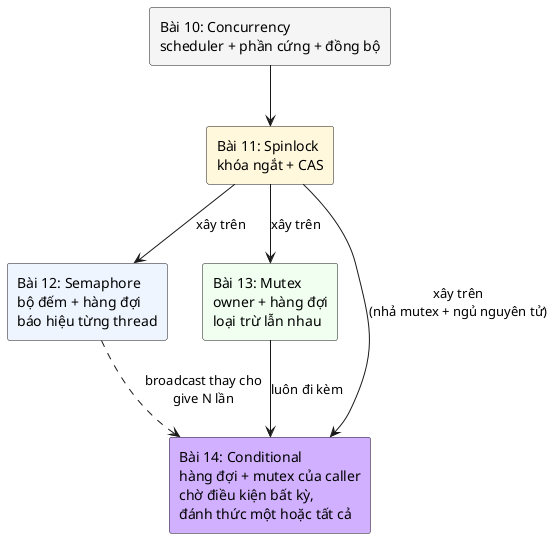

| | Semaphore (12) | Mutex (13) | **Condvar (14)** |
|---|---|---|---|
| Thread chờ cái gì | Bộ đếm > 0 | Khóa được nhả | **Một điều kiện bất kỳ trên dữ liệu của bạn** |
| Đánh thức | Một thread mỗi `give` | Một thread (người kế tiếp) | **Một (`signal`) hoặc tất cả (`broadcast`)** |
| Có bộ nhớ (tín hiệu lúc không ai chờ có được giữ lại?) | **Có** (bộ đếm) | Không áp dụng | **Không** (mục 4) |
| Đi kèm mutex | Không | Chính nó | **Bắt buộc** |
| Gọi từ ISR | `give` được | Không | `signal`/`broadcast` được theo sách, **có điều kiện** (mục 11) |
| Người thức dậy phải kiểm tra lại | Không | Không | **Có, luôn luôn** |

### 1.6. Câu hỏi bài này sẽ trả lời

1. Vì sao "kiểm tra điều kiện rồi ngủ" phải là **một bước**, và condvar làm điều đó thế nào? (Mục 3, 7, 12)
2. Vì sao luôn phải kiểm tra điều kiện trong **vòng `while`**? (Mục 8)
3. Khi nào `signal`, khi nào `broadcast`? (Mục 9)
4. Sau `broadcast`, các thread chạy **theo thứ tự nào**? (Mục 10)
5. Có báo hiệu condvar từ ISR được không, và cái bẫy là gì? (Mục 11)

---

## 2. Ba cách chờ sai: ngủ cố định, hỏi vòng, semaphore

### 2.1. Ngủ cố định

Như tháng 1: thời gian chờ không liên quan gì tới điều kiện thật. Hoặc quá ngắn (lỗi), hoặc quá dài (phí). Không bàn thêm.

### 2.2. Hỏi vòng: 🔬 đo xem tốn bao nhiêu

Thí nghiệm: một thread chờ cờ `ready` (được bảo vệ bởi mutex) trong khoảng 200 ms. Bản polling khóa mutex, đọc cờ, nhả mutex, lặp lại. Bản condvar dùng đúng mẫu của sách. Đếm số lần waiter phải kiểm tra cờ.

```c
/* Chờ một cờ "config loaded" trong ~200 ms: hỏi vòng (polling) so với condvar */
#include "condvar.h"
#include "mutex.h"
#include <pthread.h>
#include <stdbool.h>
#include <stdio.h>
#include <time.h>

struct gate {
	struct mutex lock;
	struct condvar cv;
	bool ready;
	long checks; /* số lần waiter phải khóa mutex để xem cờ */
};

static void sleep_ms(long ms)
{
	struct timespec d = { ms / 1000, (ms % 1000) * 1000000L };
	nanosleep(&d, NULL);
}

static void *poll_waiter(void *arg)
{
	struct gate *g = arg;
	for (;;) {
		mutex_lock(&g->lock, MUTEX_FOREVER);
		g->checks++;
		bool ready = g->ready;
		mutex_unlock(&g->lock);
		if (ready) {
			return NULL;
		}
	}
}

static void *cv_waiter(void *arg)
{
	struct gate *g = arg;
	mutex_lock(&g->lock, MUTEX_FOREVER);
	g->checks++;
	while (!g->ready) {
		condvar_wait(&g->cv, &g->lock, MUTEX_FOREVER);
		g->checks++;
	}
	mutex_unlock(&g->lock);
	return NULL;
}

static void run(const char *name, void *(*fn)(void *))
{
	struct gate g = { .ready = false, .checks = 0 };
	pthread_t t;
	mutex_init(&g.lock);
	condvar_init(&g.cv);
	pthread_create(&t, NULL, fn, &g);
	sleep_ms(200); /* config_loader đọc flash */
	mutex_lock(&g.lock, MUTEX_FOREVER);
	g.ready = true;
	condvar_broadcast(&g.cv);
	mutex_unlock(&g.lock);
	pthread_join(t, NULL);
	printf("%-8s: waiter kiem tra co %ld lan\n", name, g.checks);
}

int main(void)
{
	run("polling", poll_waiter);
	run("condvar", cv_waiter);
	return 0;
}
```

Build: `gcc -std=c11 -Wall -Wextra -Werror -pedantic -pthread -Iinc poll.c src/mutex.c src/condvar.c`. Output thật, 3 lần chạy:

```
polling : waiter kiem tra co 6337912 lan
condvar : waiter kiem tra co 2 lan
polling : waiter kiem tra co 6835396 lan
condvar : waiter kiem tra co 2 lan
polling : waiter kiem tra co 6558077 lan
condvar : waiter kiem tra co 2 lan
```

Hơn **6 triệu** lần khóa mutex chỉ để thấy "chưa", so với **2** lần (một lần đầu, một lần sau khi được đánh thức). Trên MCU, 6 triệu lần đó là CPU không bao giờ được vào `WFI`, tức là pin. Và nếu thêm `k_sleep(10)` vào vòng polling để đỡ tốn CPU, ta đổi lấy tới 10 ms trễ.

### 2.3. Semaphore: đúng cho một người, sai cho nhiều người

Semaphore giải được việc "ngủ không tốn CPU". Nhưng như tháng 3–6 ở trên: người báo phải biết số người chờ, tín hiệu không gắn với trạng thái hiện tại, và "kiểm tra cờ rồi take" có khe hở. 📖 Sách so sánh trong phần Alternatives: semaphore *"can be used to signal an event to one thread at a time just like a conditional variable but the drawback is that we do not have the same implementation guarantees"*.

---

## 3. Predicate, và vì sao "kiểm tra rồi ngủ" phải là một bước

### 3.1. Predicate

💡 **Predicate** (vị từ) là biểu thức đúng/sai mô tả điều kiện ta chờ: `ready`, `(bits & mask) == mask`, `count > 0 || closed`. Ba điều về predicate:

1. Nó là **dữ liệu của bạn**, nằm trong object của bạn, **không** nằm trong condvar. 📖 *"The conditional variable is used to signal waiting threads about the change in the condition - it does not however contain data about what has changed."*
2. Nó được bảo vệ bởi **một mutex** (đọc và ghi đều khi đang giữ mutex đó).
3. Người chờ **luôn** tự đánh giá lại nó sau khi thức dậy.

### 3.2. Khe hở giữa "kiểm tra" và "ngủ": lost wakeup

Giả sử ta có một hàm `sleep_until_woken()` không biết gì về mutex, và viết:

```c
mutex_lock(&self->lock);
while (!self->net_up) {
	mutex_unlock(&self->lock);   /* (A) phải nhả để net_driver vào được */
	sleep_until_woken();         /* (B) ngủ */
	mutex_lock(&self->lock);
}
```

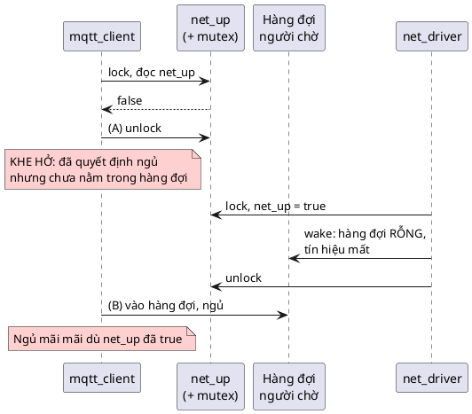

Không có gì sai trong từng thread. Lỗi nằm ở chỗ **(A) và (B) là hai bước**. Lời giải duy nhất là làm cho "nhả mutex" và "vào hàng đợi" thành **một bước không ai chen vào được**. 📖 Đó chính là điều sách nói ở phần *Waiting For Events*: *"we must atomically unlock the supplied mutex first and then place our current thread on the queue"*. Condvar là primitive làm đúng việc đó.

### 3.3. 🔬 Thí nghiệm: lost wakeup có thật

Thí nghiệm dưới đây dùng **chính condvar đúng** của code mẫu, nhưng bên báo (một thread đóng vai ISR "PHY link up") bật cờ và broadcast **mà không khóa mutex**. Waiter bị "preempt" 30 ms ngay sau khi kiểm tra cờ (mô phỏng bằng `sleep_ms(30)` khi vẫn giữ mutex, trước khi gọi `condvar_wait`). Cờ là `atomic_bool` để không có data race, chỉ còn lỗi logic.

```c
/*
 * Mất tín hiệu (lost wakeup): "ISR" (mô phỏng bằng thread) bật cờ và broadcast
 * mà KHÔNG khóa mutex, đúng lúc waiter đã kiểm tra cờ nhưng chưa vào hàng đợi.
 */
#include "condvar.h"
#include "mutex.h"
#include <pthread.h>
#include <stdatomic.h>
#include <stdio.h>
#include <time.h>

struct link {
	struct mutex lock;
	struct condvar cv;
	atomic_bool up;   /* atomic để không có data race; vẫn không cứu được logic */
	int isr_takes_mutex;
};

static void sleep_ms(long ms)
{
	struct timespec d = { ms / 1000, (ms % 1000) * 1000000L };
	nanosleep(&d, NULL);
}

static double now_ms(void)
{
	struct timespec t;
	timespec_get(&t, TIME_UTC);
	return t.tv_sec * 1e3 + t.tv_nsec / 1e6;
}

static void *fake_isr(void *arg) /* ngắt "PHY link up" tới sau 10 ms */
{
	struct link *l = arg;
	sleep_ms(10);
	if (l->isr_takes_mutex) {
		mutex_lock(&l->lock, MUTEX_FOREVER); /* ISR thật KHÔNG được làm vậy: đây là bản "thread hóa" */
	}
	atomic_store(&l->up, true);
	int woken = condvar_broadcast(&l->cv);
	if (l->isr_takes_mutex) {
		mutex_unlock(&l->lock);
	}
	printf("  isr: link up, broadcast danh thuc %d thread\n", woken);
	return NULL;
}

static void run(int isr_takes_mutex)
{
	struct link l = { .isr_takes_mutex = isr_takes_mutex };
	pthread_t isr;
	atomic_init(&l.up, false);
	mutex_init(&l.lock);
	condvar_init(&l.cv);

	printf("%s:\n", isr_takes_mutex ? "Ben bao co khoa mutex" : "Ben bao KHONG khoa mutex (kieu ISR)");
	double t0 = now_ms();
	pthread_create(&isr, NULL, fake_isr, &l);

	mutex_lock(&l.lock, MUTEX_FOREVER);
	int waits = 0;
	while (!atomic_load(&l.up)) {
		sleep_ms(30); /* mô phỏng bị preempt ngay sau khi kiểm tra cờ: cửa sổ nguy hiểm */
		int ret = condvar_wait(&l.cv, &l.lock, 1000);
		waits++;
		printf("  waiter: condvar_wait -> %d sau %.0f ms\n", ret, now_ms() - t0);
	}
	mutex_unlock(&l.lock);
	pthread_join(isr, NULL);
	printf("  waiter thay link up sau %.0f ms (%d lan wait)\n\n", now_ms() - t0, waits);
}

int main(void)
{
	run(0);
	run(1);
	return 0;
}
```

Output thật (lần chạy 1 trong 3; hai lần còn lại giống hệt về hành vi, thời gian lệch vài ms: 1035/31 và 1034/30):

```
Ben bao KHONG khoa mutex (kieu ISR):
  isr: link up, broadcast danh thuc 0 thread
  waiter: condvar_wait -> -11 sau 1037 ms
  waiter thay link up sau 1038 ms (1 lan wait)

Ben bao co khoa mutex:
  isr: link up, broadcast danh thuc 1 thread
  waiter: condvar_wait -> 0 sau 30 ms
  waiter thay link up sau 31 ms (1 lan wait)
```

Đọc kết quả:
- Bên báo **không khóa mutex**: broadcast lúc waiter đang ở khe hở, hàng đợi rỗng, `danh thuc 0 thread`. Waiter vào hàng đợi **sau đó** và chỉ thoát nhờ timeout 1000 ms (`-11` = `-EAGAIN`). Với `MUTEX_FOREVER`, nó **treo mãi mãi**.
- Bên báo **khóa mutex**: nó bị chặn ở `mutex_lock` cho tới khi waiter thật sự nằm trong hàng đợi (vì `condvar_wait` nhả mutex **sau khi** đã vào hàng). Broadcast `danh thuc 1 thread`, waiter dậy ngay ở 30 ms.

**Quy tắc rút ra:** đổi predicate **luôn luôn khi đang giữ mutex**, kể cả khi predicate là biến atomic. Atomic chống được data race, không chống được lost wakeup. Mục 11 bàn tiếp vì sao điều này khiến "signal từ ISR" phức tạp hơn sách nói.

---

## 4. Condvar không có bộ nhớ

Semaphore nhớ: `give` lúc không ai chờ làm bộ đếm tăng, người `take` sau đó đi qua ngay. Condvar **không nhớ gì**: `signal`/`broadcast` lúc hàng đợi rỗng là **mất**. 📖 Sách viết trong phần Implementation: signal *"unblocks one thread that is waiting in the queue (or is ignored if no threads are currently waiting)"*.

🔬 Demo phần 3 của [main.c](main.c):

```
broadcast khi khong ai cho    -> 0 thread duoc danh thuc (tin hieu mat)
wait 50 ms sau do             -> -11 (-EAGAIN = -11), van giu mutex: depth 1
```

Broadcast trước, wait sau: wait hết giờ. Nghe như nhược điểm, nhưng đây chính là **thiết kế đúng**: "trí nhớ" nằm ở **predicate**. Người tới muộn kiểm tra predicate trước khi ngủ; nếu điều kiện đã đúng thì không ngủ chút nào. Nhờ đó condvar tránh được lỗi tháng 6 (tín hiệu cũ của semaphore): không có tín hiệu cũ nào nằm lại, chỉ có **trạng thái hiện tại**.

| | Tín hiệu lúc không ai chờ | Người tới muộn biết điều kiện đã đúng nhờ |
|---|---|---|
| Semaphore | Được cộng vào bộ đếm | Bộ đếm (có thể đã cũ) |
| Condvar | **Mất** | **Predicate** (luôn là trạng thái hiện tại) |

---

# Phần B — Pattern

## 5. Ý tưởng cốt lõi: wait, signal, broadcast

📖 Ba thao tác (*"Wait/Signal/Broadcast"*):

| Thao tác | Ai gọi | Làm gì |
|---|---|---|
| **Wait** | Thread chờ, **đang giữ mutex** | Nhả mutex và vào hàng đợi (nguyên tử), ngủ; khi được đánh thức thì lấy lại mutex rồi mới return |
| **Signal** | Thread (hoặc ISR) báo | Đánh thức **một** thread trong hàng đợi; hàng rỗng thì không làm gì |
| **Broadcast** | Thread (hoặc ISR) báo | Đánh thức **mọi** thread trong hàng đợi |

### 5.1. Mẫu dùng chuẩn của sách

📖 Sách mô tả kịch bản: một cờ `done` (ở code là `ready`) được bảo vệ bởi mutex `lock`; mỗi thread lock mutex rồi kiểm tra cờ; nếu `false` thì nhả mutex và ngủ tới khi có tín hiệu; khi thức dậy thì lock lại và kiểm tra lại. Code (Zephyr, **không chạy**; sách thiếu dấu `;` sau `}` của struct, mình thêm vào):

```c
/* 📖 Trích sách (Zephyr) */
struct context {
	struct k_mutex lock;   /* mutex for ready */
	bool ready;            /* threads only continue when this is true */
	struct k_condvar cv;   /* condvar for signalling */
};

/* this will be called from several threads to wait for ready */
void wait_for_ready(struct context *self)
{
	k_mutex_lock(&self->lock);
	while (!self->ready) {
		/* this will atomically do the following:
		 * (1) unlock the mutex
		 * (2) put the thread to sleep
		 * Upon wakeup from signal:
		 * (1) lock the mutex again */
		k_condvar_wait(&self->cv, &self->lock, TIMEOUT);
	}
	k_mutex_unlock(&self->lock);
	/* our thread continues here */
}

/* this is called from one thread once condition is ready */
void signal_ready(struct context *self)
{
	k_mutex_lock(&self->lock);
	self->ready = true;
	k_condvar_broadcast(&self->cv);
	k_mutex_unlock(&self->lock);
}
```

💡 Lưu ý: chữ ký thật của `k_mutex_lock` trong Zephyr có thêm tham số timeout (`k_mutex_lock(&lock, K_FOREVER)`, như chương Mutex trích); đoạn này của sách viết gọn.

Ba "nhân vật" luôn đi cùng nhau, nằm chung một struct: **mutex** (`lock`), **predicate** (`ready`), **condvar** (`cv`). Đây là Object Pattern áp dụng cho đồng bộ hóa: dữ liệu và công cụ bảo vệ nó ở cùng một chỗ.

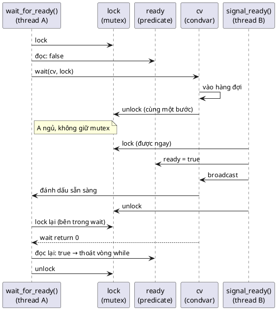

Các trạng thái mà một thread chờ đi qua (theo code mẫu; Zephyr tương tự):

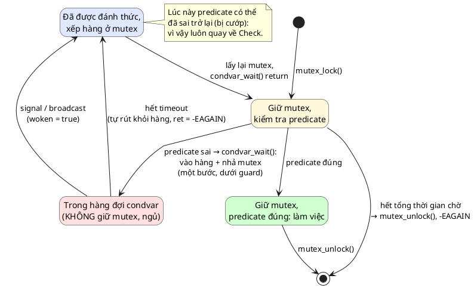

Chú ý mũi tên `Relock → Check`: **không có** mũi tên nào đi thẳng từ "được đánh thức" sang "làm việc". Đó là vòng `while` vẽ thành hình.

### 5.2. Trước và sau

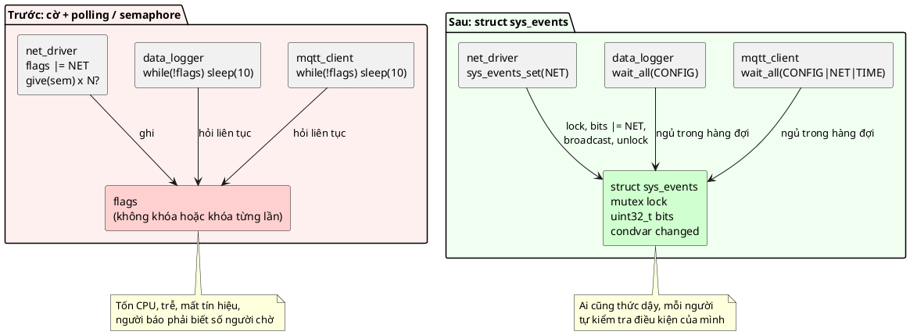

### 5.3. Struct của code mẫu

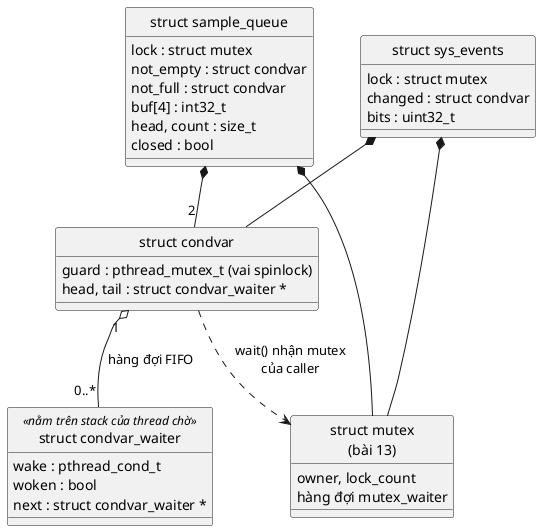

Chú ý: `struct condvar` **không** chứa con trỏ tới mutex. Mutex được truyền vào mỗi lần `wait`, giống `k_condvar_wait(cv, mutex, timeout)` và `pthread_cond_wait(cv, mutex)`. Predicate (`bits`, `count`, `closed`) nằm ở object dùng condvar.

---

## 6. 4 đặc điểm nhận dạng và lý do của từng cái

📖 Sách liệt kê bốn đặc điểm (*Defining Characteristics*).

### 1. Wait / Signal / Broadcast

📖 *"Wait is executed by the waiting thread, Signal unblocks one thread, Broadcast unblocks all threads waiting."*

**Tại sao cần cả hai kiểu đánh thức:** có điều kiện chỉ "nuôi" được một người (một mẫu ADC mới: chỉ một consumer lấy được), có điều kiện liên quan tới tất cả (mạng đã lên: mọi thread chờ mạng đều đi được). Mục 9.

### 2. Bảo vệ bằng mutex (Mutex protection)

📖 *"a conditional variable is always used in conjunction with a mutex. When a thread is waiting on a conditional variable, it releases the lock, and when the condition is met and conditional variable is signalled, the thread reacquires the lock and continues execution with the mutex locked."*

**Tại sao:** predicate là dữ liệu dùng chung, nên cần mutex (bài 13). Và mutex phải được nhả **bên trong** wait (nguyên tử với việc vào hàng đợi), nếu không thì lost wakeup (🔬 mục 3.3). Khi wait return, thread **lại đang giữ mutex**, nên có thể đọc predicate ngay. 📖 Phần Benefits: *"to the waiting thread it looks like it had the mutex locked at all times even though the mutex was unlocked while it was asleep."*

### 3. Đánh thức đồng thời (Simultaneous wakeup)

📖 *"This is different from semaphore and mutex where only one thread is picked from the wait queue in that all the waiting threads can be marked as ready before a reschedule is triggered. In such a scenario the threads always proceed in sequence of priority and sometimes in parallel depending on how many CPU cores are available."*

**Tại sao:** đây là thứ semaphore không làm được (📖 chương Semaphore tự thừa nhận). Mọi waiter được chuyển sang "ready" **trong cùng một critical section**, trước khi scheduler kịp chạy ai. Mục 10 xem chuyện gì xảy ra sau đó.

### 4. Kiểm tra trong vòng lặp (Checked in a loop)

📖 *"the condition which is signalled through the conditional variable is typically checked in a loop. This is because the conditional variable can be used to wake up the main thread for multiple different conditions and it is up to the thread waiting on the conditional variable to check exactly which condition has been met."*

**Tại sao:** `wait` return không có nghĩa "điều kiện của **bạn** đã đúng". Nó chỉ nghĩa "có gì đó đã thay đổi" (hoặc hết giờ, hoặc spurious). Mục 8 đo thật ba lý do.

---

## 7. Đọc code k_condvar của Zephyr trong sách

📖 Code dưới đây trích từ sách (Zephyr), **không chạy được trên PC**. Như k_mutex, ba hàm đều dùng một spinlock tĩnh `lock` chung.

### 7.1. `k_condvar_wait`

```c
/* 📖 Trích sách (Zephyr) */
int k_condvar_wait(struct k_condvar *condvar, struct k_mutex *mutex, k_timeout_t timeout)
{
	k_spinlock_key_t key;
	int ret;

	key = k_spin_lock(&lock);
	k_mutex_unlock(mutex);

	ret = z_pend_curr(&lock, key, &condvar->wait_q, timeout);
	k_mutex_lock(mutex, K_FOREVER);

	return ret;
}
```

| Dòng | Làm gì | Tại sao (📖 + 💡) |
|---|---|---|
| `key = k_spin_lock(&lock);` | Vào vùng spinlock **trước** khi nhả mutex | Người signal cũng phải lấy spinlock này. Chừng nào ta còn giữ nó, không ai signal được |
| `k_mutex_unlock(mutex);` | Nhả mutex của caller | Để thread khác vào đổi predicate. Nhưng chúng chưa signal được (spinlock) |
| `z_pend_curr(&lock, key, &condvar->wait_q, timeout)` | Đưa thread vào hàng đợi, **rồi mới** nhả spinlock, rồi gọi scheduler | 📖 *"pend current thread and only unlock the spinlock after it has completed this action. This ensures atomicity."* Khe hở ở mục 3.2 bị bịt kín |
| `k_mutex_lock(mutex, K_FOREVER);` | Thức dậy thì lấy lại mutex | 📖 *"we are guaranteed to always hold the mutex when returning from k_condvar_wait"*. FOREVER vì caller luôn tin rằng mình đang giữ mutex sau wait |
| `return ret;` | `0` nếu được đánh thức, `-EAGAIN` nếu hết giờ | 📖 *"The timeout ... is only used as timeout for receiving a signal"*: hết giờ vẫn lấy lại mutex rồi mới return |

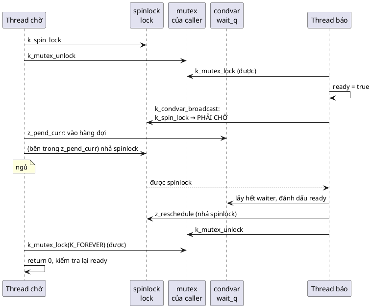

### 7.2. `k_condvar_signal`

```c
/* 📖 Trích sách (Zephyr) */
int k_condvar_signal(struct k_condvar *condvar)
{
	k_spinlock_key_t key = k_spin_lock(&lock);

	struct k_thread *thread = z_unpend_first_thread(&condvar->wait_q);
	if (thread != NULL) {
		arch_thread_return_value_set(thread, 0);
		z_ready_thread(thread);
		z_reschedule(&lock, key);
	} else {
		k_spin_unlock(&lock, key);
	}

	return 0;
}
```

Lấy waiter **đầu hàng** (hàng đợi của Zephyr xếp theo priority, nên đó là người priority cao nhất), đặt giá trị trả về `0` cho `z_pend_curr` của nó, chuyển nó sang ready, gọi scheduler. Hàng rỗng thì chỉ nhả spinlock: tín hiệu mất (mục 4). 📖 *"If the new thread is eligible for reschedule then the code will continue at that thread's k_condvar_wait call and we will attempt to acquire the mutex there."*

### 7.3. `k_condvar_broadcast`

```c
/* 📖 Trích sách (Zephyr) */
int k_condvar_broadcast(struct k_condvar *condvar)
{
	struct k_thread *pending_thread;
	k_spinlock_key_t key;
	int woken = 0;

	key = k_spin_lock(&lock);

	/* wake up any threads that are waiting to write */
	while ((pending_thread = z_unpend_first_thread(&condvar->wait_q)) != NULL) {
		woken++;
		arch_thread_return_value_set(pending_thread, 0);
		z_ready_thread(pending_thread);
	}

	z_reschedule(&lock, key);

	return woken;
}
```

Điểm mấu chốt: **cả vòng lặp** nằm trong một lần giữ spinlock, và `z_reschedule` chỉ được gọi **sau** vòng lặp. 📖 *"the whole looping operation is guaranteed to be done atomically and we only exit the critical section after we have rescheduled"*. Không thread nào được chạy (kể cả trên core khác) trước khi **mọi** waiter đã được đánh dấu ready. Giá trị trả về là số thread được đánh thức.

---

## 8. Vòng while: spurious wakeup và wakeup bị "cướp"

📖 Best practice *"Always check in a loop"*: *"Code can evolve in such a way that your conditional variable is signaled even when your expected condition is not met and your code needs to continue to work correctly even when that is the case."*

Có (ít nhất) bốn lý do `wait` return khi predicate **của bạn** vẫn sai:

| Lý do | Ví dụ | Code mẫu có bị không? |
|---|---|---|
| 1. Condvar dùng chung cho **nhiều điều kiện** | `sys_events`: `CONFIG_LOADED` được bật, nhưng `ntp_client` chờ `NET_UP` | **Có**: demo phần 1, `ntp_client` bị đánh thức 2 lần |
| 2. **Bị cướp** (stolen wakeup): người khác tới trước và làm điều kiện sai trở lại | Một mẫu ADC, hai consumer cùng thức dậy | **Có**: 🔬 mục 8.1 |
| 3. **Hết giờ** | `condvar_wait(..., 500)` return `-EAGAIN` | **Có** |
| 4. **Spurious wakeup**: thư viện/hệ điều hành đánh thức mà không ai signal | 📖 *"On Linux such other reasons could be a signal received by the process which requires the system call to be restarted."* | **Không**: `condvar_wait` tự lọc (mục 12). 🔬 pthread của Windows: không quan sát được (mục 8.2) |

### 8.1. 🔬 Thí nghiệm: `if` thay cho `while`

Hai consumer chờ mẫu; producer đặt **một** mẫu nhưng (cố ý) dùng broadcast, nên cả hai thức dậy.

```c
/* "if" thay cho "while": hai consumer cùng thức dậy vì broadcast, nhưng chỉ có MỘT mẫu */
#include "condvar.h"
#include "mutex.h"
#include <pthread.h>
#include <stdio.h>
#include <time.h>

struct box {
	struct mutex lock;
	struct condvar cv;
	int count;     /* số mẫu đang có */
	int use_while;
};

struct consumer {
	struct box *box;
	const char *name;
};

static void sleep_ms(long ms)
{
	struct timespec d = { ms / 1000, (ms % 1000) * 1000000L };
	nanosleep(&d, NULL);
}

static void *consume(void *arg)
{
	struct consumer *c = arg;
	struct box *b = c->box;

	mutex_lock(&b->lock, MUTEX_FOREVER);
	if (b->use_while) {
		while (b->count == 0) {
			if (condvar_wait(&b->cv, &b->lock, 300) == -EAGAIN) {
				break;
			}
		}
	} else if (b->count == 0) {
		condvar_wait(&b->cv, &b->lock, 300); /* SAI: chỉ kiểm tra một lần */
	}
	if (b->count > 0 || !b->use_while) {
		b->count--; /* lấy một mẫu */
		printf("  %s lay mau, count con %d%s\n", c->name, b->count, b->count < 0 ? "  <-- LOI: lay tu hang rong!" : "");
	} else {
		printf("  %s het gio, khong co mau (dung)\n", c->name);
	}
	mutex_unlock(&b->lock);
	return NULL;
}

static void run(int use_while)
{
	struct box b = { .count = 0, .use_while = use_while };
	struct consumer c1 = { &b, "filter_a" }, c2 = { &b, "filter_b" };
	pthread_t t1, t2;
	mutex_init(&b.lock);
	condvar_init(&b.cv);

	printf("%s:\n", use_while ? "Dung while" : "Dung if");
	pthread_create(&t1, NULL, consume, &c1);
	pthread_create(&t2, NULL, consume, &c2);
	sleep_ms(50); /* cả hai đã vào hàng đợi */
	mutex_lock(&b.lock, MUTEX_FOREVER);
	b.count = 1;                  /* chỉ MỘT mẫu */
	condvar_broadcast(&b.cv);     /* nhưng đánh thức cả hai */
	mutex_unlock(&b.lock);
	pthread_join(t1, NULL);
	pthread_join(t2, NULL);
	printf("  count cuoi cung = %d\n\n", b.count);
}

int main(void)
{
	run(0);
	run(1);
	return 0;
}
```

Output thật (chạy 2 lần, hành vi giống nhau; thứ tự `filter_a`/`filter_b` có thể đổi):

```
Dung if:
  filter_a lay mau, count con 0
  filter_b lay mau, count con -1  <-- LOI: lay tu hang rong!
  count cuoi cung = -1

Dung while:
  filter_a lay mau, count con 0
  filter_b het gio, khong co mau (dung)
  count cuoi cung = 0
```

Với `if`: `filter_b` thức dậy, **không kiểm tra lại**, lấy từ hàng rỗng: `count = -1`. Trong một ring buffer thật, đó là đọc rác và làm hỏng chỉ số `head`. Với `while`: `filter_b` thấy `count == 0`, ngủ tiếp, cuối cùng hết giờ một cách đúng đắn.

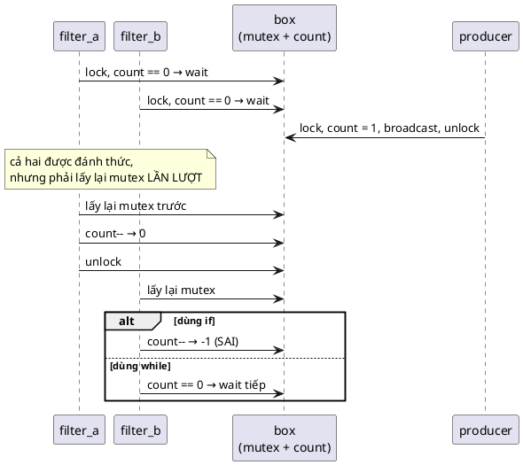

### 8.2. 🔬 Spurious wakeup có thật không?

📖 Sách (Common Pitfalls) cảnh báo spurious wakeup và lấy ví dụ Linux. POSIX cũng cho phép `pthread_cond_wait`/`pthread_cond_timedwait` return mà không ai signal. Thí nghiệm trên winpthreads: 300 lần `pthread_cond_timedwait` 5 ms, không ai signal.

```c
/* pthread_cond_timedwait có trả về sớm khi không ai signal không? (spurious wakeup) */
#include <errno.h>
#include <pthread.h>
#include <stdio.h>
#include <time.h>

int main(void)
{
	pthread_mutex_t m;
	pthread_cond_t cv;
	int timeouts = 0, early = 0;
	pthread_mutex_init(&m, NULL);
	pthread_cond_init(&cv, NULL);

	pthread_mutex_lock(&m);
	for (int i = 0; i < 300; i++) {
		struct timespec ts;
		timespec_get(&ts, TIME_UTC);
		ts.tv_nsec += 5000000L; /* 5 ms */
		if (ts.tv_nsec >= 1000000000L) {
			ts.tv_sec++;
			ts.tv_nsec -= 1000000000L;
		}
		int r = pthread_cond_timedwait(&cv, &m, &ts); /* không có ai signal */
		if (r == ETIMEDOUT) {
			timeouts++;
		} else {
			early++;
		}
	}
	pthread_mutex_unlock(&m);
	printf("300 lan timedwait khong ai signal: %d lan het gio, %d lan tra ve som (spurious)\n", timeouts, early);
	return 0;
}
```

Output thật:

```
300 lan timedwait khong ai signal: 300 lan het gio, 0 lan tra ve som (spurious)
```

**Không quan sát được** spurious wakeup nào. Điều đó **không** có nghĩa là an toàn để bỏ vòng `while`: (a) chuẩn cho phép, (b) nền tảng khác có thể khác (Linux với tín hiệu như sách nói), (c) quan trọng hơn cả, lý do 1–3 ở bảng trên xảy ra **thường xuyên** trong code thật, như thí nghiệm 8.1. 💡 Trong thực tế, "wakeup bị cướp" (lý do 2) gây bug nhiều hơn spurious wakeup "thật" rất nhiều.

---

## 9. Signal hay broadcast

### 9.1. 🔬 Thí nghiệm: một cổng, ba thread chờ

Ba thread chờ `open == true` (timeout 500 ms để demo không treo). Mở cổng, rồi `signal` (lần 1) hoặc `broadcast` (lần 2). Đo mỗi thread qua cổng bao lâu sau khi cổng mở.

```c
/* signal so với broadcast cho một "cổng" mà ba thread cùng chờ (timeout 500 ms để demo thoát được) */
#include "condvar.h"
#include "mutex.h"
#include <pthread.h>
#include <stdbool.h>
#include <stdio.h>
#include <time.h>

struct gate {
	struct mutex lock;
	struct condvar cv;
	bool open;
	double opened_at;
};

struct waiter_arg {
	struct gate *g;
	int ret;          /* kết quả của lần condvar_wait cuối */
	double delay_ms;  /* qua cổng bao lâu sau khi cổng mở */
};

static double now_ms(void)
{
	struct timespec t;
	timespec_get(&t, TIME_UTC);
	return t.tv_sec * 1e3 + t.tv_nsec / 1e6;
}

static void sleep_ms(long ms)
{
	struct timespec d = { ms / 1000, (ms % 1000) * 1000000L };
	nanosleep(&d, NULL);
}

static void *waiter(void *arg)
{
	struct waiter_arg *w = arg;
	struct gate *g = w->g;
	mutex_lock(&g->lock, MUTEX_FOREVER);
	while (!g->open) {
		w->ret = condvar_wait(&g->cv, &g->lock, 500);
	}
	w->delay_ms = now_ms() - g->opened_at;
	mutex_unlock(&g->lock);
	return NULL;
}

static void run(int broadcast)
{
	struct gate g = { .open = false };
	struct waiter_arg w[3] = { { &g, 0, 0 }, { &g, 0, 0 }, { &g, 0, 0 } };
	pthread_t t[3];
	mutex_init(&g.lock);
	condvar_init(&g.cv);
	for (int i = 0; i < 3; i++) {
		pthread_create(&t[i], NULL, waiter, &w[i]);
	}
	sleep_ms(50);
	mutex_lock(&g.lock, MUTEX_FOREVER);
	g.open = true;
	g.opened_at = now_ms();
	if (broadcast) {
		condvar_broadcast(&g.cv);
	} else {
		condvar_signal(&g.cv);
	}
	mutex_unlock(&g.lock);
	for (int i = 0; i < 3; i++) {
		pthread_join(t[i], NULL);
	}
	printf("%-9s:", broadcast ? "broadcast" : "signal");
	for (int i = 0; i < 3; i++) {
		printf("  waiter%d qua cong sau %3.0f ms (wait -> %d)", i, w[i].delay_ms, w[i].ret);
	}
	printf("\n");
}

int main(void)
{
	run(0);
	run(1);
	return 0;
}
```

Output thật, 3 lần chạy:

```
signal   :  waiter0 qua cong sau 454 ms (wait -> -11)  waiter1 qua cong sau   0 ms (wait -> 0)  waiter2 qua cong sau 454 ms (wait -> -11)
broadcast:  waiter0 qua cong sau   0 ms (wait -> 0)  waiter1 qua cong sau   0 ms (wait -> 0)  waiter2 qua cong sau   0 ms (wait -> 0)
signal   :  waiter0 qua cong sau 452 ms (wait -> -11)  waiter1 qua cong sau   0 ms (wait -> 0)  waiter2 qua cong sau 452 ms (wait -> -11)
broadcast:  waiter0 qua cong sau   0 ms (wait -> 0)  waiter1 qua cong sau   0 ms (wait -> 0)  waiter2 qua cong sau   0 ms (wait -> 0)
signal   :  waiter0 qua cong sau   0 ms (wait -> 0)  waiter1 qua cong sau 458 ms (wait -> -11)  waiter2 qua cong sau 458 ms (wait -> -11)
broadcast:  waiter0 qua cong sau   0 ms (wait -> 0)  waiter1 qua cong sau   0 ms (wait -> 0)  waiter2 qua cong sau   0 ms (wait -> 0)
```

Với `signal`: đúng **một** thread qua ngay (lúc thì waiter1, lúc thì waiter0: người đứng đầu hàng đợi là ai tùy thứ tự chúng vào hàng). Hai thread còn lại ngủ tiếp **dù cổng đã mở**, chỉ thoát nhờ timeout (~450 ms còn lại của 500 ms). Với `FOREVER`, chúng treo mãi. Với `broadcast`: cả ba qua ngay.

### 9.2. Quy tắc chọn

| Dùng **signal** khi | Dùng **broadcast** khi |
|---|---|
| Mỗi lần thay đổi chỉ cho phép **đúng một** waiter đi tiếp (một mẫu mới, một slot trống) | Thay đổi có thể làm **nhiều** waiter đi tiếp (cổng mở, mạng lên, cấu hình đổi) |
| **Mọi** waiter chờ **cùng một** điều kiện (nếu không, signal có thể đánh thức người "sai" và người "đúng" ngủ tiếp) | Waiter chờ **các điều kiện khác nhau** trên cùng condvar (`sys_events`: mỗi thread một mask) |
| Hiệu năng quan trọng (đánh thức thừa tốn context switch) | Trạng thái "kết thúc" (`close`, `shutdown`): **mọi** người chờ phải biết |

💡 Khi phân vân: **broadcast luôn đúng** (với vòng `while`), chỉ có thể tốn thêm vài lần thức dậy thừa. Signal sai chỗ thì treo. Code mẫu dùng cả hai: `sample_queue_put/get` dùng signal (một mẫu nuôi một consumer), `sample_queue_close` và `sys_events_set` dùng broadcast.

💡 Một mẫu hay gặp: **hai condvar, một mutex**. `sample_queue` có `not_empty` (consumer chờ) và `not_full` (producer chờ), chung một mutex vì cả hai điều kiện cùng đọc `count`. Tách hai condvar để `signal` luôn đánh thức đúng loại người chờ.

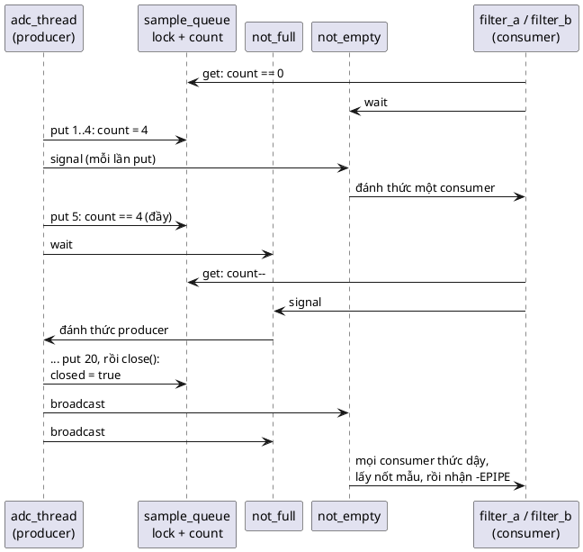

---

## 10. Broadcast trên một CPU và nhiều CPU

### 10.1. Thức dậy cùng lúc, chạy lần lượt

Broadcast đánh dấu mọi waiter là ready **cùng lúc** (📖 đặc điểm 3). Nhưng mỗi waiter, trước khi return khỏi `wait`, phải **lấy lại mutex**. Mutex chỉ có một người giữ được. Vì vậy:

- 📖 Trên **một CPU**: *"the threads always proceed in sequence of priority"*. Thread priority cao nhất chạy trước, lấy mutex, kiểm tra predicate, làm việc, nhả mutex; rồi đến người tiếp theo.
- 📖 Trên **nhiều CPU**: *"sometimes in parallel depending on how many CPU cores are available"*. Phần code **sau khi nhả mutex** có thể chạy song song; phần **giữ mutex** vẫn lần lượt.

🔬 Thí nghiệm: 5 waiter vào hàng đợi theo thứ tự 0..4 (cách nhau 20 ms). Người báo broadcast, **giữ mutex thêm 10 ms**, rồi nhả. Mỗi waiter giữ mutex 2 ms sau khi ra khỏi wait.

```c
/* Sau broadcast: các waiter thức dậy cùng lúc nhưng ra khỏi wait LẦN LƯỢT, từng người giữ mutex */
#include "condvar.h"
#include "mutex.h"
#include <pthread.h>
#include <stdbool.h>
#include <stdio.h>
#include <time.h>

#define N 5

struct gate {
	struct mutex lock;
	struct condvar cv;
	bool open;
	int order;
	double t_unlock;
};

struct arg {
	struct gate *g;
	int id;
	int got;      /* thứ tự ra khỏi wait */
	double at_ms; /* thời điểm ra khỏi wait, tính từ lúc người broadcast nhả mutex */
};

static double now_ms(void)
{
	struct timespec t;
	timespec_get(&t, TIME_UTC);
	return t.tv_sec * 1e3 + t.tv_nsec / 1e6;
}

static void sleep_ms(long ms)
{
	struct timespec d = { ms / 1000, (ms % 1000) * 1000000L };
	nanosleep(&d, NULL);
}

static void busy_ms(double ms)
{
	double t0 = now_ms();
	while (now_ms() - t0 < ms) {
	}
}

static void *waiter(void *p)
{
	struct arg *a = p;
	mutex_lock(&a->g->lock, MUTEX_FOREVER);
	while (!a->g->open) {
		condvar_wait(&a->g->cv, &a->g->lock, MUTEX_FOREVER);
	}
	a->got = a->g->order++;
	a->at_ms = now_ms() - a->g->t_unlock;
	busy_ms(2); /* mỗi thread giữ mutex 2 ms để đọc cấu hình */
	mutex_unlock(&a->g->lock);
	return NULL;
}

int main(void)
{
	struct gate g = { .open = false, .order = 0 };
	struct arg a[N];
	pthread_t t[N];
	mutex_init(&g.lock);
	condvar_init(&g.cv);
	for (int i = 0; i < N; i++) {
		a[i] = (struct arg){ &g, i, -1, 0 };
		pthread_create(&t[i], NULL, waiter, &a[i]);
		sleep_ms(20); /* vào hàng đợi theo thứ tự 0, 1, 2, ... */
	}
	mutex_lock(&g.lock, MUTEX_FOREVER);
	g.open = true;
	int woken = condvar_broadcast(&g.cv);
	busy_ms(10); /* vẫn giữ mutex: các waiter đã "thức" nhưng chưa ai ra khỏi wait được */
	g.t_unlock = now_ms();
	mutex_unlock(&g.lock);
	for (int i = 0; i < N; i++) {
		pthread_join(t[i], NULL);
	}
	printf("broadcast danh thuc %d thread\n", woken);
	for (int i = 0; i < N; i++) {
		printf("  waiter%d: ra khoi wait thu %d, %.1f ms sau khi mutex duoc nha\n", a[i].id, a[i].got, a[i].at_ms);
	}
	return 0;
}
```

Output thật, 3 lần chạy:

```
broadcast danh thuc 5 thread
  waiter0: ra khoi wait thu 2, 4.1 ms sau khi mutex duoc nha
  waiter1: ra khoi wait thu 1, 2.1 ms sau khi mutex duoc nha
  waiter2: ra khoi wait thu 0, 0.0 ms sau khi mutex duoc nha
  waiter3: ra khoi wait thu 4, 8.1 ms sau khi mutex duoc nha
  waiter4: ra khoi wait thu 3, 6.1 ms sau khi mutex duoc nha
broadcast danh thuc 5 thread
  waiter0: ra khoi wait thu 2, 4.1 ms sau khi mutex duoc nha
  waiter1: ra khoi wait thu 0, 0.0 ms sau khi mutex duoc nha
  waiter2: ra khoi wait thu 1, 2.1 ms sau khi mutex duoc nha
  waiter3: ra khoi wait thu 3, 6.1 ms sau khi mutex duoc nha
  waiter4: ra khoi wait thu 4, 8.1 ms sau khi mutex duoc nha
broadcast danh thuc 5 thread
  waiter0: ra khoi wait thu 2, 4.1 ms sau khi mutex duoc nha
  waiter1: ra khoi wait thu 3, 6.1 ms sau khi mutex duoc nha
  waiter2: ra khoi wait thu 4, 8.2 ms sau khi mutex duoc nha
  waiter3: ra khoi wait thu 0, 0.0 ms sau khi mutex duoc nha
  waiter4: ra khoi wait thu 1, 2.1 ms sau khi mutex duoc nha
```

Đọc kết quả:
- **Không ai** ra khỏi wait trong 10 ms người báo còn giữ mutex: mọi mốc thời gian đều tính từ lúc mutex được nhả và người đầu tiên ra ở `0.0 ms`.
- Năm thread ra **lần lượt, cách nhau đúng ~2 ms**: chính là 2 ms mỗi người giữ mutex. Dù 16 luồng CPU rảnh, phần giữ mutex không bao giờ song song.
- **Thứ tự** ra khỏi wait **không** phải thứ tự vào hàng condvar (0..4), và đổi giữa các lần chạy. Lý do: sau broadcast, cả năm thread chạy đua để xếp hàng ở **mutex** (`mutex_lock` bên trong `condvar_wait`); ai được Windows cho chạy trước thì xếp trước, và từ đó mutex FIFO của bài 13 trao lần lượt. Khớp với phương án 1 trong quiz của sách (*"They continue in the order in which they are able to acquire the mutex."*; sách không in đáp án, đây là phương án khớp với nội dung chương). Trên RTOS một CPU, thứ tự đó là thứ tự **priority**.

### 10.2. Biểu đồ thời gian trên một CPU (mô hình)

💡 Mô hình theo mô tả của sách cho RTOS một CPU, ba waiter W1 > W2 > W3 về priority, mỗi người giữ mutex 2 tick (không phải đo, chỉ minh họa):

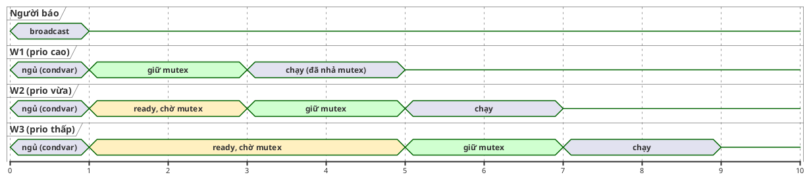

### 10.3. Nhiều CPU: có thread nào chạy trước khi broadcast xong không?

📖 Quiz của sách hỏi đúng câu này. Với implementation của Zephyr ở mục 7.3: **không**. Vòng lặp đánh dấu ready nằm trọn trong spinlock (trên đa core, spinlock có CAS chặn core khác), và `z_reschedule` chỉ chạy sau vòng lặp. Code mẫu cũng vậy: `condvar_broadcast` lấy hết hàng đợi trong một lần giữ `guard`. 🔬 Thí nghiệm 10.1 cho thấy thêm một tầng bảo vệ nữa: dù có được đánh dấu sớm, waiter vẫn không ra khỏi `wait` khi người báo còn giữ mutex.

💡 Đó là lý do mẫu của sách đặt `broadcast` **trước** `unlock`: mọi waiter thức dậy thấy cùng một trạng thái đã được cập nhật đầy đủ. Đặt broadcast **sau** unlock cũng đúng (vì waiter luôn kiểm tra predicate dưới mutex), và đôi khi tránh được việc waiter thức dậy rồi lập tức chặn ở mutex; nhưng phải chắc chắn object không bị hủy giữa unlock và broadcast.

---

## 11. Condvar và interrupt

📖 Sách liệt kê ở phần Benefits: *"Can be signaled from interrupt handler: conditional variables can be signaled from interrupt handlers - although you can not wait for a conditional variable inside an interrupt handler for obvious reasons."* Và trong Best Practices: dùng condvar khi cần *"signal threads from an interrupt with additional data that must have mutual exclusion protection between threads"*.

Nửa sau (không wait trong ISR) là hiển nhiên: ISR không ngủ được. Nửa đầu đúng **về cơ chế**: `k_condvar_signal`/`broadcast` của sách chỉ dùng spinlock, không dùng mutex, nên về mặt kỹ thuật gọi được trong ISR.

⚠️ **Nhưng có một cái bẫy mà sách không nhắc.** Quy tắc ở mục 3: predicate phải được đổi **khi đang giữ mutex**. ISR **không được** lock mutex (bài 13). Vậy ISR đổi predicate thế nào?
- Nếu ISR bật cờ rồi signal mà không có mutex: 🔬 mục 3.3 cho thấy **lost wakeup** xảy ra khi ISR rơi đúng vào khe giữa "waiter kiểm tra cờ" và "waiter vào hàng đợi". Với Zephyr, khe đó là từ lúc kiểm tra predicate tới lúc `k_condvar_wait` gọi `k_spin_lock` (ngắt vẫn bật trong khoảng đó). 💡 Đây là phân tích của mình dựa trên code sách trích, không phải trích từ sách; mình không chạy được trên Zephyr thật.
- Waiter dùng **timeout** thì không treo vĩnh viễn, nhưng có thể trễ tới hết timeout (1000 ms trong thí nghiệm).

💡 Các cách làm an toàn:

| Cách | Ý tưởng | Ghi chú |
|---|---|---|
| ISR **không** chạm vào predicate; ISR `give` semaphore (bài 12) hoặc submit work item; một **thread** nhận, lock mutex, đổi predicate, broadcast | Đưa việc đổi predicate về thế giới thread | 📖 Khớp với best practice của chương Concurrency: *"Interrupts only for loading hardware"*, đẩy logic sang work queue/thread. Cách khuyên dùng |
| Predicate được bảo vệ bằng **spinlock** thay vì (hoặc thêm vào) mutex, và waiter kiểm tra predicate **trong cùng spinlock** mà condvar dùng | Bịt khe hở ở mức spinlock | Cần API cho phép wait với spinlock (Zephyr không có `k_condvar_wait` với spinlock); phức tạp, dễ sai |
| Waiter luôn dùng timeout ngắn và kiểm tra lại | Chấp nhận trễ tối đa = timeout | Polling trá hình |

Nói gọn: **"signal được từ ISR" là đúng về API, nhưng thiết kế an toàn hầu như luôn đi qua một thread.**

📖 Câu hỏi quiz 1 của sách (*"Can a conditional variable be signaled from an interrupt handler?"*) có phương án *"Yes. This is perfectly fine."*, khớp với phần Benefits. Sách không in đáp án; xem mục 23 cho đáp án kèm lưu ý ở trên.

---

# Phần C — Đọc code

## 12. Đọc code mẫu từng dòng

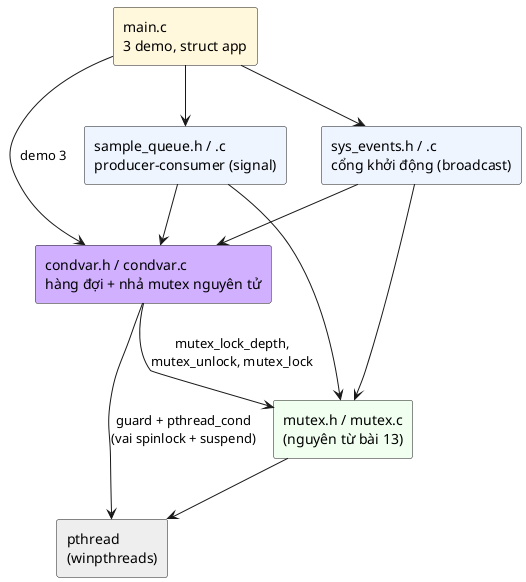

### 12.1. [inc/condvar.h](inc/condvar.h)

```c
struct condvar_waiter {
	pthread_cond_t wake;
	bool woken;
	struct condvar_waiter *next;
};
```
Cùng ý tưởng với `struct mutex_waiter` của bài 13: mỗi thread đang chờ tự mang một node **trên stack của nó**, condvar không cần cấp phát. `wake` là "chuông" riêng để đánh thức đúng người; `woken` là cờ "đã được signal/broadcast lấy ra khỏi hàng". Không cần field `thread`: condvar không có khái niệm owner.

```c
struct condvar {
	pthread_mutex_t guard;
	struct condvar_waiter *head;
	struct condvar_waiter *tail;
};
```
- `guard` đóng vai spinlock `lock` trong code Zephyr: bảo vệ hàng đợi và làm cho "vào hàng + nhả mutex" thành một bước.
- **Không có** con trỏ tới mutex và **không có** predicate. Comment ở đầu struct nói rõ: condvar không chứa điều kiện. Đây là chỗ người mới hay hiểu sai: condvar không phải "biến chứa điều kiện", mà là **hàng đợi những người đang chờ một điều kiện**.
- Struct public (Object Pattern) vì cùng lý do với `struct mutex`: phải nhúng được vào `struct sys_events`, `struct sample_queue`.

Comment trước `condvar_wait` ghi đủ hợp đồng: phải giữ mutex **đúng một tầng**, return thì đang giữ mutex, và *"Return 0 KHÔNG có nghĩa là điều kiện đã đúng"*.

### 12.2. [src/condvar.c](src/condvar.c)

`condvar_init`, `condvar_deinit`, ba hàm hàng đợi và `deadline_after_ms`: giống hệt bản của `mutex.c` (bài 13, mục 13.2). `condvar_deinit` trả `-EBUSY` nếu còn thread đang ngủ trên condvar.

**`condvar_wait`, từng khối:**

```c
	int depth = mutex_lock_depth(mutex);
	if (depth < 0) {
		return -EPERM;
	}
	if (depth > 1) {
		return -EDEADLK;
	}
```
Hai kiểm tra không có trong code Zephyr của sách, mình thêm vào vì đây là hai lỗi dùng sai hay gặp nhất:
- Không giữ mutex mà gọi wait: predicate vừa đọc không được bảo vệ, lost wakeup gần như chắc chắn. `-EPERM`.
- Mutex đang bị **khóa lồng** (bài 13 cho phép): `mutex_unlock` bên dưới chỉ bớt một tầng, mutex **vẫn bị giữ** trong lúc ta ngủ, nên không ai vào đổi được predicate: treo (hoặc tới timeout). 💡 Code Zephyr trích trong sách gọi `k_mutex_unlock` một lần và không kiểm tra điều này. `-EDEADLK`.

```c
	struct condvar_waiter w = { .woken = false, .next = NULL };
	struct timespec deadline = deadline_after_ms(timeout_ms > 0 ? timeout_ms : 0);
	int ret = 0;

	pthread_cond_init(&w.wake, NULL);

	pthread_mutex_lock(&self->guard);
	queue_push(self, &w);
	mutex_unlock(mutex);
```
Ba dòng cuối là trái tim của pattern, tương ứng `k_spin_lock(&lock); k_mutex_unlock(mutex); z_pend_curr(...)`:
1. Lấy `guard`: từ giây phút này **không ai signal/broadcast được** (họ cần `guard`).
2. Vào hàng đợi.
3. Nhả mutex: thread khác giờ lock được mutex, đổi predicate, rồi gọi broadcast... và bị chặn ở `guard` cho tới khi ta thật sự đang ngủ.

Thứ tự "vào hàng **trước**, nhả mutex **sau**" khác code Zephyr một chút (Zephyr nhả mutex rồi mới pend, nhưng cả hai đều nằm trong spinlock nên tương đương). Mình chọn thứ tự này để ngay cả khi đọc riêng hai dòng cũng thấy rõ không có khe hở.

```c
	while (!w.woken) {
		if (timeout_ms == MUTEX_FOREVER) {
			pthread_cond_wait(&w.wake, &self->guard);
		} else if (pthread_cond_timedwait(&w.wake, &self->guard, &deadline) == ETIMEDOUT &&
			   !w.woken) {
			queue_remove(self, &w);
			ret = -EAGAIN;
			break;
		}
	}
```
`pthread_cond_wait(&w.wake, &self->guard)` nhả `guard` và ngủ nguyên tử: đây là chỗ người báo được phép vào. Vòng `while (!w.woken)` **lọc spurious wakeup của pthread**: nếu pthread đánh thức nhầm, ta ngủ lại. Vì vậy `condvar_wait` của code mẫu chỉ return khi (a) được signal/broadcast thật, hoặc (b) hết giờ. Nhánh timeout kiểm tra `!w.woken` thêm một lần, cùng lý do như bài 13 (quiz câu 7 của bài 13): có thể vừa được đánh thức đúng lúc hết giờ.

💡 Dù `condvar_wait` không có spurious wakeup, **caller vẫn phải dùng vòng `while`**, vì ba lý do còn lại ở mục 8 (nhiều điều kiện, bị cướp, hết giờ).

```c
	pthread_mutex_unlock(&self->guard);
	pthread_cond_destroy(&w.wake);

	mutex_lock(mutex, MUTEX_FOREVER);
	return ret;
```
Nhả `guard` **trước** khi lấy lại mutex. Nếu làm ngược lại (giữ `guard` trong lúc chờ mutex), người đang giữ mutex mà gọi broadcast sẽ chặn ở `guard`, còn ta chặn ở mutex: deadlock. Lấy lại mutex với `MUTEX_FOREVER` như sách, kể cả khi hết giờ: caller luôn giữ mutex khi wait return (`depth 1` trong demo 3).

**`condvar_signal`:**

```c
	pthread_mutex_lock(&self->guard);
	struct condvar_waiter *w = queue_pop(self);
	if (w) {
		w->woken = true;
		pthread_cond_signal(&w->wake);
	}
	pthread_mutex_unlock(&self->guard);
	return 0;
```
Lấy người đầu hàng, bật cờ, rung chuông. Hàng rỗng thì không làm gì: tín hiệu mất (mục 4). Không cần giữ mutex của caller: hàm này chỉ chạm vào hàng đợi (được `guard` bảo vệ). Nhưng **người gọi** thường nên giữ mutex khi đổi predicate (mục 3.3).

**`condvar_broadcast`:**

```c
	pthread_mutex_lock(&self->guard);
	struct condvar_waiter *w;
	while ((w = queue_pop(self)) != NULL) {
		w->woken = true;
		pthread_cond_signal(&w->wake);
		woken++;
	}
	pthread_mutex_unlock(&self->guard);
	return woken;
```
Cả vòng lặp trong một lần giữ `guard`: mọi waiter được đánh dấu trước khi bất kỳ ai trong số họ kịp chạy, đúng tinh thần `k_condvar_broadcast` (📖 *"the whole looping operation is guaranteed to be done atomically"*). Trả về số thread được đánh thức, giống Zephyr.

### 12.3. [inc/sys_events.h](inc/sys_events.h) và [src/sys_events.c](src/sys_events.c): cổng khởi động

```c
#define SYS_EVT_CONFIG_LOADED (1u << 0)
#define SYS_EVT_NET_UP (1u << 1)
#define SYS_EVT_TIME_SYNCED (1u << 2)

struct sys_events {
	struct mutex lock;
	struct condvar changed;
	uint32_t bits;
};
```
Bộ ba của sách: **mutex** (`lock`), **predicate** (`bits`), **condvar** (`changed`), trong một object. Mỗi mốc là một bit, nên một thread chờ được **tổ hợp** mốc bất kỳ: đúng use case 📖 *"Waiting for a set of multiple complex conditions to occur"*. Tên `changed` (thay vì `ready`) nhắc rằng tín hiệu chỉ nghĩa "đã có thay đổi".

**`sys_events_set`:**

```c
	mutex_lock(&self->lock, MUTEX_FOREVER);
	self->bits |= bits;
	int woken = condvar_broadcast(&self->changed);
	mutex_unlock(&self->lock);
	return woken;
```
Đúng mẫu `signal_ready` của sách: lock, đổi predicate, broadcast, unlock. **Broadcast** vì mỗi waiter chờ một mask khác nhau; signal có thể đánh thức `data_logger` khi người cần đánh thức là `ntp_client`.

**`sys_events_wait_all`:**

```c
	int64_t deadline = now_ms() + (timeout_ms > 0 ? timeout_ms : 0);
	...
	mutex_lock(&self->lock, MUTEX_FOREVER);
	while ((self->bits & mask) != mask) {
		int32_t remaining = MUTEX_FOREVER;
		if (timeout_ms != MUTEX_FOREVER) {
			int64_t left = deadline - now_ms();
			if (left <= 0) {
				ret = -EAGAIN;
				break;
			}
			remaining = (int32_t)left;
		}
		condvar_wait(&self->changed, &self->lock, remaining);
		count++;
	}
	mutex_unlock(&self->lock);
```
- Đúng mẫu `wait_for_ready` của sách: lock, `while` (predicate sai) wait, unlock.
- Predicate là `(bits & mask) == mask`: **mọi** bit trong mask đều bật.
- **Hạn chót tính một lần** trước vòng lặp, mỗi vòng chỉ chờ phần còn lại. 💡 Nếu truyền nguyên `timeout_ms` vào mỗi `condvar_wait`, một thread bị đánh thức "thừa" mỗi 900 ms sẽ chờ mãi với timeout 1000 ms: timeout không bao giờ xảy ra. Đây là lỗi tinh vi khi viết vòng chờ có timeout.
- Không dùng giá trị trả về của `condvar_wait`: dù `0` hay `-EAGAIN`, ta đều quay lại kiểm tra predicate và thời gian. Predicate quyết định, không phải tín hiệu.
- `count` đếm số lần bị đánh thức, trả qua `wakeups` cho demo thấy vòng lặp hoạt động.

### 12.4. [inc/sample_queue.h](inc/sample_queue.h) và [src/sample_queue.c](src/sample_queue.c): producer-consumer

📖 Use case *"Producer-consumer pattern"*: condvar dùng để *"repeatedly wake up a consumer thread when a new item is added by the producer"*.

```c
struct sample_queue {
	struct mutex lock;
	struct condvar not_empty;
	struct condvar not_full;
	int32_t buf[SAMPLE_QUEUE_CAP];
	size_t head;
	size_t count;
	bool closed;
};
```
Ring buffer 4 phần tử. **Một mutex, hai condvar**: hai điều kiện khác nhau (`count > 0` cho consumer, `count < CAP` cho producer) nhưng cùng đọc `count`, nên cùng mutex. `closed` là điều kiện thứ ba, liên quan tới cả hai phía.

**`sample_queue_put`:**

```c
	while (self->count == SAMPLE_QUEUE_CAP && !self->closed) {
		int32_t left = remaining_ms(timeout_ms, deadline);
		if (left == 0) {
			ret = -EAGAIN;
			break;
		}
		condvar_wait(&self->not_full, &self->lock, left);
	}
	if (ret == 0 && self->closed) {
		ret = -EPIPE;
	}
	if (ret == 0) {
		self->buf[(self->head + self->count) % SAMPLE_QUEUE_CAP] = value;
		self->count++;
		condvar_signal(&self->not_empty);
	}
```
- Predicate chờ là "còn chỗ **hoặc** đã đóng". Thiếu `|| closed` thì producer đang chờ chỗ sẽ không bao giờ biết hàng đợi đã đóng.
- Vị trí ghi là `(head + count) % CAP`: cuối hàng hiện tại.
- **Signal**, không broadcast: một mẫu mới chỉ một consumer lấy được. Broadcast cũng đúng (nhờ `while`), chỉ tốn thêm lần thức dậy thừa.
- `-EPIPE` (*broken pipe*) là mã lỗi quen thuộc cho "đầu bên kia đã đóng".

**`sample_queue_get`:** đối xứng. Chờ "có mẫu **hoặc** đã đóng"; nếu ra khỏi vòng mà `count == 0` thì nghĩa là đã đóng và hết mẫu: `-EPIPE`. Chú ý: hàng đợi đã đóng nhưng **còn mẫu** thì consumer vẫn lấy được hết, không mất dữ liệu.

**`sample_queue_close`:**

```c
	mutex_lock(&self->lock, MUTEX_FOREVER);
	self->closed = true;
	condvar_broadcast(&self->not_empty);
	condvar_broadcast(&self->not_full);
	mutex_unlock(&self->lock);
```
**Broadcast** cả hai phía: "đã đóng" liên quan tới **mọi** người đang chờ. Dùng signal ở đây là lỗi kinh điển: chỉ một consumer thoát, các consumer khác treo, `pthread_join` treo theo.

### 12.5. [main.c](main.c)

- `struct app` chứa `sys_events`, `sample_queue`, mốc thời gian và một `print_lock` để các dòng `printf` từ nhiều thread không chen vào nhau. Không có biến global.
- **Demo 1:** ba waiter (`mqtt_client` cần cả ba mốc, `data_logger` cần cấu hình, `ntp_client` cần mạng) chờ tối đa 2000 ms. Hai setter: `config_loader` sau 100 ms, `net_driver` sau 250 ms. `ntp_client` khi chạy được thì "đồng bộ giờ" 50 ms rồi tự bật `TIME_SYNCED`. `sleep_ms(20)` trước khi tạo setter chỉ để waiter kịp vào hàng đợi cho demo dễ đọc; comment ghi rõ: nếu chưa kịp thì vẫn đúng, vì waiter kiểm tra predicate trước khi ngủ (mục 4).
- **Demo 2:** hai consumer, một producer đẩy 20 mẫu (1..20) rồi `close`. Kiểm tra tổng số mẫu và tổng giá trị (1 + ... + 20 = 210): không mất, không trùng mẫu nào.
- **Demo 3:** bốn quy tắc: wait khi không giữ mutex, wait khi mutex khóa lồng, broadcast lúc không ai chờ, wait hết giờ vẫn giữ mutex.

---

## 13. Theo dõi demo chạy từng bước

Output đầy đủ của `make run`:

```
=== 1. Cong khoi dong (broadcast) ===
[ 127 ms] config_loader set moc, danh thuc 3
[ 127 ms] data_logger   bat dau chay, so lan bi danh thuc = 1
[ 271 ms] net_driver    set moc, danh thuc 2
[ 271 ms] ntp_client    bat dau chay, so lan bi danh thuc = 2
[ 328 ms] ntp_client    set TIME_SYNCED, danh thuc 1
[ 328 ms] mqtt_client   bat dau chay, so lan bi danh thuc = 3

=== 2. Producer - consumer (signal + close/broadcast) ===
filter_a: 9 mau, filter_b: 11 mau
tong 20 mau (mong doi 20), tong gia tri 210 (mong doi 210)
get sau khi dong -> -32 (-EPIPE = -32)

=== 3. Quy tac cua condvar_wait ===
wait khi KHONG giu mutex      -> -1 (-EPERM = -1)
wait khi mutex bi khoa long   -> -36 (-EDEADLK = -36)
broadcast khi khong ai cho    -> 0 thread duoc danh thuc (tin hieu mat)
wait 50 ms sau do             -> -11 (-EAGAIN = -11), van giu mutex: depth 1
```

Phần nào thay đổi giữa các lần chạy (🔬 5 lần):
- Demo 1: thứ tự dòng và số lần bị đánh thức **giống hệt cả 5 lần**; chỉ mốc thời gian lệch vài ms (127–143 ms, 271–281 ms, 328–343 ms). Mốc thời gian lớn hơn con số danh nghĩa (100 + 20 ms...) vì `nanosleep` trên Windows làm tròn lên bội số ~15,6 ms (🔬 bài 13, mục 13.3).
- Demo 2: cách chia mẫu giữa hai consumer đổi mỗi lần (9/11, 11/9, 12/8, 10/10, 12/8), **tổng luôn là 20 mẫu, 210**.
- Demo 3: giống hệt mọi lần.

### Demo 1

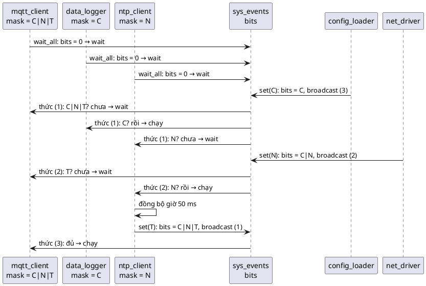

| t (ms) | Sự kiện | `bits` | Hàng đợi `changed` sau sự kiện | Ghi chú |
|---|---|---|---|---|
| 0 | Ba waiter gọi `wait_all` | 0 | mqtt, logger, ntp | Mỗi người: lock, predicate sai, `condvar_wait` |
| ~127 | `config_loader`: `set(CONFIG)` | `C` | (rỗng) | `broadcast` trả **3** |
| ~127 | logger thức, `(C & C) == C` | | | Chạy, `wakeups = 1` |
| ~127 | mqtt thức, `(C & CNT) != CNT` | | mqtt | Ngủ lại |
| ~127 | ntp thức, `(C & N) != N` | | mqtt, ntp | Ngủ lại |
| ~271 | `net_driver`: `set(NET)` | `C\|N` | (rỗng) | `broadcast` trả **2** |
| ~271 | ntp thức, đủ | | | Chạy, `wakeups = 2` |
| ~271 | mqtt thức, thiếu `T` | | mqtt | Ngủ lại |
| ~328 | ntp: `set(TIME_SYNCED)` | `C\|N\|T` | (rỗng) | `broadcast` trả **1** |
| ~328 | mqtt thức, đủ | | | Chạy, `wakeups = 3` |

Thấy được gì:
- **Ba waiter, một mutex**. ⚠️ **Đối chiếu với sách:** phần Drawbacks viết *"waiting for a conditional variable always requires one mutex per thread that will be waiting concurrently"*. 🔬 Demo này (và mọi thí nghiệm ở mục 8–10) dùng **một** mutex cho tất cả waiter của cùng một condvar, và chạy đúng. Đó cũng là cách POSIX quy định (mọi thread chờ đồng thời trên một `pthread_cond_t` phải dùng **cùng** một mutex). 💡 Có lẽ ý sách là "mỗi condvar cần một mutex đi kèm"; chi phí bộ nhớ thật sự là mutex đó cộng với node chờ trên stack của mỗi waiter.
- `config_loader` và `net_driver` **không biết** ai đang chờ. Thêm thread `ota_updater` chờ `CONFIG` không cần sửa dòng nào ở phía báo (khác hẳn tháng 3 ở mục 1.3).
- Hai lần mqtt "thức dậy vô ích": cái giá nhỏ của broadcast, đổi lại sự đơn giản và an toàn.

### Demo 2

| Bước | Sự kiện | `count` | Ai chờ trên `not_empty` / `not_full` |
|---|---|---|---|
| 1 | Hai consumer `get`: `count == 0` → wait | 0 | a, b / — |
| 2 | Producer `put(1)`: ghi, `signal(not_empty)` | 1 | b / — (a được đánh thức) |
| 3 | a lấy mẫu 1, `signal(not_full)` (không ai chờ, mất) | 0 | |
| ... | Producer nhanh hơn consumer: `count` lên 4 | 4 | |
| k | Producer `put`: đầy → wait trên `not_full` | 4 | — / producer |
| k+1 | Một consumer `get`, `signal(not_full)` | 3 | producer được đánh thức |
| ... | Lặp tới mẫu 20 | | |
| cuối | Producer `close`: `closed = true`, broadcast cả hai | ≥ 0 | Mọi consumer thức dậy |
| | Consumer lấy nốt mẫu còn lại, rồi `get` → `-EPIPE` | 0 | Hai consumer thoát vòng lặp |
| | main: `get(..., 0)` sau khi đóng | 0 | `-32` = `-EPIPE` |

Tổng luôn 20 mẫu và 210: mutex bảo đảm không mẫu nào bị lấy hai lần hay bị ghi đè; vòng `while` bảo đảm consumer không bao giờ lấy từ hàng rỗng; broadcast lúc đóng bảo đảm không consumer nào treo.

### Demo 3

| Lệnh | Trạng thái mutex `m` | Kết quả | Vì sao |
|---|---|---|---|
| `condvar_wait(&cv, &m, 10)` khi chưa lock | mở | `-1` (`-EPERM`) | `mutex_lock_depth` trả `-EPERM` |
| lock, lock, `condvar_wait` | depth 2 | `-36` (`-EDEADLK`) | Khóa lồng: nhả một tầng không đủ |
| unlock một tầng | depth 1 | | |
| `condvar_broadcast(&cv)` | depth 1 | `0` | Hàng rỗng: tín hiệu mất |
| `condvar_wait(&cv, &m, 50)` | depth 1 → (nhả) → 1 | `-11` (`-EAGAIN`) | Không ai báo nữa; hết giờ, lấy lại mutex |
| `mutex_lock_depth(&m)` | depth 1 | `1` | Return từ wait luôn đang giữ mutex |

---

## 14. Các quyết định thiết kế và phương án khác

### 14.1. Tự xây hàng đợi thay vì bọc thẳng `pthread_cond_t`

Phương án đơn giản nhất là `struct condvar { pthread_cond_t c; }` và `condvar_wait` gọi `pthread_cond_wait`. Không làm được, vì `pthread_cond_wait` cần một **`pthread_mutex_t`**, còn caller dùng `struct mutex` của bài 13 (có owner, khóa lồng, hàng đợi riêng). Hai lựa chọn:

| Phương án | Ưu | Nhược |
|---|---|---|
| Dùng `pthread_mutex_t` + `pthread_cond_t` thẳng | Ngắn, nhanh, có sẵn | Mất `struct mutex` của bài 13 (không owner check, không handoff); không thấy được cơ chế bên trong |
| **Tự xây hàng đợi node trên stack + `guard`** (code mẫu) | Dùng được với `struct mutex`; cấu trúc khớp từng dòng với `k_condvar` của sách; lọc được spurious wakeup; `broadcast` trả số thread | Dài hơn; mỗi waiter một `pthread_cond_t` (chi phí init/destroy) |

Trong firmware thật, dùng `k_condvar` của Zephyr hoặc `pthread_cond_t`. 📖 *"Do not reinvent the scheduler."*

### 14.2. `guard` riêng cho mỗi condvar, không phải một spinlock toàn cục

Zephyr dùng một spinlock tĩnh chung cho mọi condvar (giữ rất ngắn, tiết kiệm RAM; 📖 pitfall của bài 11). Code mẫu cho mỗi condvar một `guard` để hai condvar không liên quan không chặn nhau trên PC nhiều core. Cả hai đều đúng; khác nhau ở RAM và mức tranh chấp.

### 14.3. Kiểm tra `-EPERM` và `-EDEADLK`

Zephyr (theo code sách trích) tin caller. Code mẫu kiểm tra vì hai lỗi này **im lặng** nếu không kiểm tra: không giữ mutex → lost wakeup thỉnh thoảng; khóa lồng → treo. Cái giá: một lần lấy `guard` của mutex trong `mutex_lock_depth`. 💡 Phương án khác: kiểm tra bằng `assert` chỉ trong bản debug.

### 14.4. Lấy lại mutex với FOREVER, kể cả khi hết giờ

Theo sách. Lý do: caller viết `while (!pred) wait(...)` rồi `unlock`. Nếu wait có thể return **không** giữ mutex, mọi caller phải phân biệt hai trường hợp, và quên một lần là unlock một mutex mình không giữ (`-EPERM` ở bài 13, hoặc tệ hơn với mutex không kiểm tra owner).

### 14.5. Hạn chót tổng cho cả vòng chờ

`sys_events_wait_all` và `sample_queue_put/get` tính deadline **một lần**, rồi truyền phần còn lại cho từng `condvar_wait` (mục 12.3). Phương án "mỗi vòng chờ lại `timeout_ms` từ đầu" ngắn hơn nhưng sai khi có wakeup thừa.

### 14.6. Hàng đợi FIFO

Như bài 13: Zephyr xếp theo priority, code mẫu FIFO vì thread Windows không có priority theo nghĩa RTOS. Với `signal`, điều này quyết định **ai** được đánh thức; với `broadcast` thì không quan trọng (mọi người đều thức, rồi xếp hàng ở mutex, 🔬 mục 10.1).

### 14.7. Hai condvar cho `sample_queue`, một condvar cho `sys_events`

`sample_queue` có hai **loại** người chờ (producer, consumer) với hai điều kiện đối nghịch: hai condvar để `signal` luôn trúng đúng loại. `sys_events` có nhiều người chờ với các mask khác nhau nhưng cùng một loại sự kiện ("bits thay đổi"): một condvar + broadcast là đủ và đơn giản nhất.

---

# Phần D — Thực tế và tổng kết

## 15. Condvar trong thực tế: Zephyr, POSIX, FreeRTOS, Linux

💡 Phần này để bạn nhận ra pattern khi đọc code. **Không có đoạn nào được chạy** trong bài (không có board), trừ POSIX (chính là pthread dùng bên trong code mẫu).

### Zephyr

```c
/* 💡 Zephyr, không chạy trong bài */
K_MUTEX_DEFINE(net_lock);
K_CONDVAR_DEFINE(net_changed);
static bool net_up; /* được bảo vệ bởi net_lock */

void wait_net(void)
{
	k_mutex_lock(&net_lock, K_FOREVER);
	while (!net_up) {
		k_condvar_wait(&net_changed, &net_lock, K_FOREVER);
	}
	k_mutex_unlock(&net_lock);
}
```
Đúng các hàm sách trích: `k_condvar_wait`, `k_condvar_signal`, `k_condvar_broadcast` (trả số thread được đánh thức).

### POSIX (`pthread_cond_t`)

Mẫu y hệt, với `pthread_mutex_lock` / `pthread_cond_wait(&cv, &m)` / `pthread_cond_signal` / `pthread_cond_broadcast`. Code mẫu bài 13 (demo 3, `ready_lock`/`ready_cv`) đã dùng đúng mẫu này. Khác biệt đáng chú ý: POSIX **cho phép spurious wakeup** (🔬 winpthreads: 0/300 lần, mục 8.2), và `pthread_cond_broadcast` không trả số thread được đánh thức.

### FreeRTOS: không có condvar

💡 FreeRTOS **không có** condition variable. Các công cụ thay thế:
- **Event Groups** (`xEventGroupSetBits`, `xEventGroupWaitBits(..., xWaitForAllBits = pdTRUE, ...)`): đúng bài toán của `sys_events` ở bài này, nhiều task chờ các tổ hợp bit, được đánh thức cùng lúc. Đây là "condvar đóng gói sẵn cho predicate dạng bitmask".
- **Task notifications**: báo hiệu nhẹ tới **một** task cụ thể (giống semaphore riêng của mỗi task).
- Tự xây condvar từ mutex + danh sách task + notification (giống cách code mẫu tự xây từ `guard` + node).

### CMSIS-RTOS2

💡 Không có condvar; có **Event Flags** (`osEventFlagsSet`, `osEventFlagsWait` với `osFlagsWaitAll`), cùng vai trò với Event Groups.

### Linux kernel

💡 `wait_event(wq, condition)` / `wake_up(&wq)`: macro `wait_event` **tự viết sẵn vòng `while`** quanh condition, nên người dùng không quên được. Và `wake_up` có thể gọi từ ngắt; điều kiện thường là biến được cập nhật cẩn thận với barrier, hoặc được bảo vệ bằng spinlock. Đó là phương án 2 ở bảng mục 11.

| | Zephyr `k_condvar` | POSIX `pthread_cond_t` | FreeRTOS Event Group | Linux `wait_event` |
|---|---|---|---|---|
| Predicate | Của bạn, bất kỳ | Của bạn, bất kỳ | **Chỉ bitmask** | Của bạn, bất kỳ |
| Đi kèm | `k_mutex` | `pthread_mutex_t` | (tự bảo vệ bên trong) | (thường là spinlock / atomic) |
| Đánh thức tất cả | `broadcast` | `broadcast` | Set bit → mọi task thỏa mask | `wake_up_all` |
| Vòng `while` | Bạn tự viết | Bạn tự viết | Bên trong | Bên trong macro |
| Báo từ ISR | `signal` (theo sách) | Không áp dụng | `xEventGroupSetBitsFromISR` (qua daemon task) | `wake_up` |

💡 Chú ý cột FreeRTOS: `xEventGroupSetBitsFromISR` **không** set bit ngay trong ISR mà đẩy việc đó cho timer daemon task. Đó chính là phương án 1 ở mục 11 ("đưa việc đổi predicate về một thread"), được thư viện làm sẵn.

---

## 16. Test code có condvar

### 16.1. Test chức năng, xác định

```c
#include "condvar.h"
#include "mutex.h"
#include "sample_queue.h"
#include "sys_events.h"

#include <assert.h>
#include <errno.h>
#include <pthread.h>

static void *set_net_later(void *arg)
{
	struct timespec d = { 0, 50 * 1000000L };
	nanosleep(&d, NULL);
	sys_events_set(arg, SYS_EVT_NET_UP);
	return NULL;
}

int main(void)
{
	/* condvar: các hợp đồng của condvar_wait */
	struct mutex m;
	struct condvar cv;
	assert(mutex_init(&m) == 0 && condvar_init(&cv) == 0);
	assert(condvar_wait(&cv, &m, 10) == -EPERM);
	assert(mutex_lock(&m, MUTEX_FOREVER) == 0);
	assert(condvar_broadcast(&cv) == 0);          /* không ai chờ */
	assert(condvar_wait(&cv, &m, 20) == -EAGAIN);
	assert(mutex_lock_depth(&m) == 1);            /* vẫn giữ mutex sau timeout */
	assert(mutex_unlock(&m) == 0);
	assert(condvar_deinit(&cv) == 0 && mutex_deinit(&m) == 0);

	/* sys_events: điều kiện đã đúng thì không chờ; chưa đúng thì hết giờ; có người set thì qua */
	struct sys_events ev;
	uint32_t wakeups = 99;
	assert(sys_events_init(&ev) == 0);
	assert(sys_events_set(&ev, SYS_EVT_CONFIG_LOADED) == 0);
	assert(sys_events_wait_all(&ev, SYS_EVT_CONFIG_LOADED, 0, &wakeups) == 0 && wakeups == 0);
	assert(sys_events_wait_all(&ev, SYS_EVT_NET_UP, 30, NULL) == -EAGAIN);
	pthread_t t;
	pthread_create(&t, NULL, set_net_later, &ev);
	assert(sys_events_wait_all(&ev, SYS_EVT_CONFIG_LOADED | SYS_EVT_NET_UP, 1000, &wakeups) == 0);
	assert(wakeups == 1);
	pthread_join(t, NULL);
	assert(sys_events_deinit(&ev) == 0);

	/* sample_queue: đầy, rỗng, đóng */
	struct sample_queue q;
	int32_t v;
	assert(sample_queue_init(&q) == 0);
	for (int32_t i = 0; i < SAMPLE_QUEUE_CAP; i++) {
		assert(sample_queue_put(&q, i, 0) == 0);
	}
	assert(sample_queue_put(&q, 99, 0) == -EAGAIN);   /* đầy */
	assert(sample_queue_get(&q, &v, 0) == 0 && v == 0); /* FIFO */
	assert(sample_queue_close(&q) == 0);
	assert(sample_queue_put(&q, 5, 0) == -EPIPE);
	for (int i = 1; i < SAMPLE_QUEUE_CAP; i++) {
		assert(sample_queue_get(&q, &v, 0) == 0 && v == i); /* đã đóng vẫn lấy hết được */
	}
	assert(sample_queue_get(&q, &v, 0) == -EPIPE);
	assert(sample_queue_deinit(&q) == 0);
	return 0;
}
```

🔬 Build `gcc -std=c11 -Wall -Wextra -Werror -pedantic -pthread -Iinc test_condvar.c src/*.c`, chạy: thoát với mã 0, không assert nào hỏng.

### 16.2. Stress test và test "đừng treo"

- Demo 2 là một stress test nhỏ: bất biến "tổng 20 mẫu, 210" phải đúng **mọi** lần chạy. Tăng `SAMPLES` lên 100 000 và số consumer lên 4 để tìm lỗi hiếm.
- Mọi test dùng condvar nên có **timeout** (như test trên): bug của condvar thường là **treo** (lost wakeup, signal thay vì broadcast), và một test treo làm CI treo theo.
- Mở rộng cửa sổ race bằng `sleep` giữa "kiểm tra predicate" và "wait" (như 🔬 mục 3.3) để chứng minh code của bạn **không** dựa vào may mắn.

---

## 17. Trade-off

| Tiêu chí | Polling | Semaphore | **Condvar** |
|---|---|---|---|
| **CPU khi chờ** | Cao (🔬 > 6 triệu lần kiểm tra / 200 ms) | 0 | **0** (🔬 2 lần kiểm tra) |
| **Trễ khi điều kiện đúng** | Tới một chu kỳ poll | Ngay | **Ngay** |
| **Điều kiện tùy ý** | Có | Không (chỉ "có token") | **Có** (📖 *"Arbitrary conditions"*) |
| **Đánh thức nhiều thread** | (ai cũng tự thấy) | Give N lần, phải biết N | **Broadcast** |
| **Tín hiệu lúc không ai chờ** | Không áp dụng | Được nhớ (có thể cũ) | **Mất**; predicate là trí nhớ |
| **Mutex trong lúc chờ** | Lock/unlock liên tục | Không liên quan | **Được nhả** (📖 *"Mutex unlocked while waiting"*) |
| **Độ phức tạp** | Thấp | Thấp | **Cao hơn** (📖 Drawbacks: luôn `while`, luôn giữ mutex) |
| **Bộ nhớ** | Không | Bộ đếm + hàng đợi | Hàng đợi + **một mutex cho mỗi condvar** + node trên stack mỗi waiter |
| **Từ ISR** | Không áp dụng | `give`: tự nhiên | `signal`: được về API, nhưng predicate cần cẩn thận (mục 11) |

📖 Sách kết luận condvar *"is a very simple concept to implement and it is also quite light weight besides the necessity to always lock a mutex"*, nhưng cũng khuyên *"Use sparingly"*: *"Usually you can accomplish the signalling with a semaphore in a much more lightweight fashion."*

---

## 18. Khi nào không nên dùng

📖 Best practice *"Use sparingly"*: chỉ dùng condvar khi (1) cần báo cho thread từ ISR **kèm dữ liệu cần mutual exclusion giữa các thread**, hoặc (2) **thật sự cần đánh thức nhiều thread cùng lúc**. Còn lại, semaphore nhẹ hơn.

📖 Ba lựa chọn khác sách nêu:

| Lựa chọn | Khi nào | Hạn chế (📖) |
|---|---|---|
| **Semaphore** | Báo cho **một** thread, mỗi sự kiện một lần (ISR báo "DMA xong") | Không có các bảo đảm của condvar: không gắn với mutex, không nhả mutex khi chờ |
| **Work queue** | Kiểm tra điều kiện bằng một work item, rồi gọi danh sách callback đã đăng ký (bài 5) | *"does not provide a way for threads to queue for a broadcasted event notification"*: không cho nhiều thread **chờ** cùng lúc |
| **Event bus** | Nhiều thread đăng ký một topic, sự kiện được phát tới mọi subscriber | Nặng hơn; phù hợp kiến trúc hướng sự kiện lớn |

💡 Thêm:

| Tình huống | Dùng | Vì sao |
|---|---|---|
| Predicate chỉ là vài bit "mốc đã xảy ra" | Event group (FreeRTOS), Event flags (CMSIS), hoặc module như `sys_events` | Đóng gói sẵn mutex + condvar + vòng lặp, khó dùng sai |
| Chuyển dữ liệu từ thread này sang thread kia | Message queue (`k_msgq`, `xQueue`) | Hàng đợi có sẵn chờ khi rỗng/đầy; `sample_queue` chính là tự xây cái này |
| Chỉ một thread chờ một sự kiện từ ISR | Semaphore hoặc task notification | Đơn giản, an toàn từ ISR |
| Chờ "tất cả các thread đã tới điểm X" | Barrier (`pthread_barrier_t`) | Một mẫu cụ thể dựng sẵn trên mutex + condvar |

---

## 19. Lỗi hay gặp

| Lỗi | Hậu quả | Cách tránh |
|---|---|---|
| 📖 Dùng `if` thay cho `while` | Chạy tiếp khi điều kiện sai (🔬 mục 8.1: `count = -1`) | **Luôn** `while (!predicate) wait(...)` |
| Đổi predicate mà không giữ mutex | Lost wakeup: waiter ngủ mãi (🔬 mục 3.3) | Lock, đổi, signal/broadcast, unlock |
| Kiểm tra predicate ngoài mutex rồi mới lock và wait | Như trên | Lock trước, kiểm tra sau |
| Dùng `signal` khi nhiều waiter chờ các điều kiện khác nhau, hoặc khi điều kiện mở cho tất cả | Một thread qua, những thread khác treo (🔬 mục 9.1) | Broadcast cho thay đổi "chung" (`close`, cổng mở) |
| Coi condvar như semaphore (signal trước, mong wait sau nhận được) | Tín hiệu mất (🔬 mục 4) | Predicate là trí nhớ; kiểm tra trước khi wait |
| Gọi wait khi mutex đang bị khóa lồng | Mutex vẫn bị giữ khi ngủ: treo (code mẫu trả `-EDEADLK`) | Không khóa lồng quanh wait |
| Timeout "mỗi vòng" thay vì "tổng" | Không bao giờ hết giờ nếu có wakeup thừa đều đặn | Tính deadline một lần (mục 12.3) |
| Báo từ ISR mà predicate không được bảo vệ đúng | Lost wakeup, chỉ thoát nhờ timeout | Đưa việc đổi predicate về thread (mục 11) |
| Dùng nhiều mutex khác nhau cho cùng một condvar | POSIX: hành vi không xác định; predicate không được bảo vệ nhất quán | Mỗi condvar gắn với **đúng một** mutex |
| Xử lý lâu khi vẫn giữ mutex sau khi wait return | Các waiter khác xếp hàng ở mutex, broadcast thành tuần tự chậm (🔬 mục 10.1: mỗi người 2 ms là cả hàng chờ) | Đọc/chép dữ liệu cần thiết, unlock, rồi mới xử lý (*lock data, not code*, bài 13) |
| Hủy object (condvar, mutex) khi còn thread đang chờ | Dùng bộ nhớ đã chết | `close` + broadcast, `join` mọi thread, rồi mới `deinit` (thứ tự trong `main.c`) |

---

## 20. Quy trình refactor: từ cờ + polling sang condvar

1. **Tìm các vòng chờ**: `while (!flag) k_sleep(...)`, `k_sem_take` đi kèm kiểm tra cờ, `sleep` cố định lúc khởi động.
2. **Gom predicate vào một object** cùng với một `struct mutex` (Object Pattern). Mọi đọc/ghi predicate đi qua hàm của object, khi đang giữ mutex.
3. **Thêm `struct condvar`** vào object đó. Nếu có hai loại người chờ với điều kiện đối nghịch (đầy/rỗng), thêm hai condvar.
4. **Phía báo**: lock, đổi predicate, `broadcast` (hoặc `signal` nếu chắc chắn chỉ một người được đi), unlock.
5. **Phía chờ**: lock, `while (!predicate) condvar_wait(...)`, làm việc **ngắn**, unlock. Có timeout thì tính deadline tổng.
6. **Phía ISR**: không đổi predicate trực tiếp; give semaphore / submit work, để một thread làm bước 4.
7. **Trạng thái kết thúc** (`close`, `shutdown`): thêm vào predicate của mọi phía chờ, và broadcast.
8. **Xóa** cờ cũ, semaphore cũ, các `sleep` cố định.
9. **Test**: bất biến + timeout + mở rộng cửa sổ race.

---

## 21. Câu hỏi thường gặp (FAQ)

**Hỏi: Tại sao condvar không tự chứa điều kiện cho đỡ phải viết vòng `while`?**

Vì điều kiện có thể là **bất cứ thứ gì** (📖 *"Arbitrary conditions"*): một bit, một bộ đếm, một tổ hợp phức tạp của nhiều field. Condvar chỉ lo phần khó (nhả mutex + ngủ nguyên tử, đánh thức). Khi điều kiện có dạng cố định, người ta đóng gói lại: Event Group của FreeRTOS (bitmask), `wait_event` của Linux, `sys_events` và `sample_queue` của bài này.

**Hỏi: Có cần giữ mutex khi gọi `signal`/`broadcast` không?**

Về cơ chế, không (code mẫu và Zephyr chỉ cần spinlock/`guard`). Nhưng **phải giữ mutex khi đổi predicate**, và việc đó gần như luôn xảy ra ngay trước signal. Mẫu an toàn và dễ đọc nhất là mẫu của sách: lock, đổi, broadcast, unlock.

**Hỏi: Condvar khác Event Group của FreeRTOS chỗ nào?**

Event Group là một trường hợp đặc biệt: predicate cố định là "các bit này đã bật (tất cả/một trong số)", có sẵn mutex và vòng lặp bên trong. Condvar là công cụ tổng quát để xây những thứ như vậy. `sys_events` của bài này chính là một Event Group tự xây.

**Hỏi: Spurious wakeup hiếm vậy (🔬 0/300), sao phải lo?**

Vì vòng `while` không chỉ để chống spurious wakeup. Nó chống cả wakeup bị cướp, condvar dùng chung cho nhiều điều kiện, timeout (mục 8). Ba thứ đó xảy ra **thường xuyên**. Và chuẩn POSIX cho phép spurious, nên code không có `while` là code sai trên giấy, dù hôm nay chạy được.

**Hỏi: Broadcast có gây "thundering herd" (cả đàn thức dậy rồi tranh nhau) không?**

Có. 🔬 Mục 10.1: năm thread thức cùng lúc rồi xếp hàng ở mutex, ra lần lượt. Với vài thread thì không đáng kể. Với hàng chục thread và critical section dài thì tốn. Cách giảm: giữ critical section sau wait thật ngắn, dùng `signal` khi chỉ một người đi được, hoặc tách condvar theo loại người chờ.

**Hỏi: Có dùng condvar để chờ ISR "DMA xong" được không?**

Được, nhưng thường không nên: chỉ một thread chờ, một sự kiện, từ ISR. Đó là việc của semaphore (bài 12), nhẹ hơn và không có cái bẫy predicate-không-mutex ở mục 11.

**Hỏi: Một thread có thể chờ trên hai condvar cùng lúc không?**

Không: `wait` chặn trên đúng một condvar. Muốn chờ "A hoặc B", gộp A và B vào **một** predicate dưới **một** mutex, dùng **một** condvar, và mọi phía thay đổi A hoặc B đều broadcast condvar đó (như `sys_events`).

---

## 22. Tóm tắt và checklist

**Một câu:** *Condvar là hàng đợi cho những thread chờ một điều kiện bất kỳ trên dữ liệu được bảo vệ bởi mutex: wait nhả mutex và ngủ trong một bước, thức dậy thì lấy lại mutex, và người thức dậy luôn tự kiểm tra lại điều kiện trong vòng `while`.*

**Vì sao nó chạy được:** người báo phải giữ mutex để đổi điều kiện và phải giữ spinlock (`guard`) để đánh thức; người chờ chỉ nhả mutex khi đã nằm trong hàng đợi dưới spinlock đó. Không có khe hở nào để tín hiệu lọt qua.

Checklist:

- [ ] Predicate, mutex và condvar nằm trong cùng một object
- [ ] Mọi đọc/ghi predicate đều khi đang giữ **đúng** mutex đó (kể cả predicate là biến atomic)
- [ ] Phía chờ: `lock` → `while (!predicate) wait` → làm việc ngắn → `unlock`
- [ ] Không có `if` thay cho `while` ở bất kỳ đâu
- [ ] Không gọi wait khi mutex đang bị khóa lồng
- [ ] Có timeout thì tính deadline **tổng**, và xử lý nhánh hết giờ
- [ ] Phía báo: `lock` → đổi predicate → `broadcast`/`signal` → `unlock`
- [ ] Dùng `signal` chỉ khi đúng một waiter được phép đi và mọi waiter chờ cùng điều kiện; còn lại `broadcast`
- [ ] Trạng thái kết thúc (`close`) nằm trong predicate của mọi phía chờ và luôn broadcast
- [ ] ISR không đổi predicate trực tiếp; đi qua semaphore/work queue tới một thread
- [ ] Mỗi condvar gắn với đúng một mutex
- [ ] Hủy object chỉ sau khi mọi thread chờ đã thoát (`close` + `join`)

---

## 23. Quiz (có đáp án)

Câu 1–6 là quiz gốc của sách (dịch lại, giữ các phương án). Sách không in đáp án; đáp án dưới đây do Claude chọn và giải thích dựa trên nội dung chương và thí nghiệm. Câu 7–13 do Claude thêm.

**Câu 1.** 📖 Có thể signal một condvar từ ISR không?
1. Không. Condvar chỉ được signal từ thread.
2. Có. Hoàn toàn ổn.
3. Có, nhưng mỗi lần chỉ đánh thức được một thread.

<details><summary>Đáp án</summary>

**Phương án 2**, theo phần Benefits của sách và code `k_condvar_signal`/`broadcast` (chỉ dùng spinlock, không dùng mutex). ⚠️ Lưu ý của bài (mục 11, 🔬 mục 3.3): "được gọi" khác "an toàn". ISR không lock được mutex nên không đổi được predicate theo quy tắc; nếu ISR bật cờ rồi signal đúng lúc waiter đã kiểm tra cờ nhưng chưa vào hàng đợi, tín hiệu mất. Thiết kế an toàn: ISR give semaphore/submit work, một thread lock mutex, đổi predicate, broadcast. Phương án 3 sai vì broadcast từ ISR vẫn đánh thức tất cả.
</details>

**Câu 2.** 📖 Khi dùng broadcast, lúc nào mọi thread thức dậy, và nếu chỉ có một CPU thì chúng chạy tiếp theo thứ tự nào?
1. Chúng chạy tiếp theo thứ tự lấy được mutex.
2. Chúng chạy tiếp lần lượt từng thread theo thứ tự đã bắt đầu chờ condvar.
3. Chúng chạy tiếp cùng lúc, song song.

<details><summary>Đáp án</summary>

**Phương án 1.** Mọi waiter được đánh dấu ready **cùng lúc** trong một critical section (vòng lặp của `k_condvar_broadcast`). Sau đó mỗi thread phải lấy lại mutex trước khi return khỏi wait, nên chúng ra **lần lượt** theo thứ tự lấy được mutex; trên RTOS một CPU, đó là thứ tự priority (📖 *"proceed in sequence of priority"*). 🔬 Mục 10.1: năm thread ra cách nhau đúng 2 ms (thời gian mỗi người giữ mutex), và thứ tự **không** trùng thứ tự vào hàng condvar (phương án 2 sai). Phương án 3 sai: phần giữ mutex không bao giờ song song.
</details>

**Câu 3.** 📖 Nếu có nhiều CPU và dùng broadcast, có thread nào được chạy trước khi mọi thread đã được đánh thức không?
1. Không. Việc reschedule chỉ xảy ra khi mọi waiter đã được đánh dấu sẵn sàng.
2. Có, nhưng chỉ khi thread mới có priority cao hơn.
3. Có, nhưng chỉ khi dùng broadcast.

<details><summary>Đáp án</summary>

**Phương án 1.** Trong `k_condvar_broadcast`, cả vòng lặp `z_unpend_first_thread` / `z_ready_thread` nằm trong spinlock (trên đa core, spinlock có CAS chặn core khác), và `z_reschedule` chỉ được gọi sau vòng lặp. 📖 *"we only exit the critical section after we have rescheduled"*. `condvar_broadcast` của code mẫu cũng lấy hết hàng đợi trong một lần giữ `guard`.
</details>

**Câu 4.** 📖 Khác biệt chính giữa Conditional pattern và Semaphore pattern là gì?
1. Conditional pattern bảo đảm rõ ràng rằng mutex luôn được giữ khi thread hiện tại đang chạy, nhưng được nhả khi thread bị swap ra (đang chờ). Semaphore không có cơ chế như vậy.
2. Semaphore dùng được từ ISR còn condvar thì không.
3. Logic gần như giống nhau.

<details><summary>Đáp án</summary>

**Phương án 1.** Đây là bảo đảm cốt lõi (📖 Benefits: *"to the waiting thread it looks like it had the mutex locked at all times even though the mutex was unlocked while it was asleep"*). Nhờ vậy predicate tùy ý được kiểm tra an toàn, và người khác vẫn đổi được nó trong lúc ta ngủ. Phương án 2 sai: theo sách, cả hai đều signal được từ ISR (với lưu ý ở câu 1). Phương án 3 sai: semaphore có bộ đếm (trí nhớ), không gắn với mutex, đánh thức từng thread; condvar không có bộ nhớ, gắn với mutex, có broadcast.
</details>

**Câu 5.** 📖 Nếu nhiều thread đang chờ một condvar và condvar được signal (không phải broadcast), thread nào được chọn chạy trước?
1. Chúng đều có thể chạy nếu có nhiều core, nhưng chỉ return khỏi `wait` sau khi đã lấy được mutex.
2. Chúng luôn chạy lần lượt.
3. Chúng chạy tiếp cùng lúc và tất cả đều return khỏi wait để code ứng dụng kiểm tra điều kiện.

<details><summary>Đáp án</summary>

⚠️ **Không phương án nào trả lời đúng câu hỏi.** Signal đánh thức **đúng một** thread: thread đứng **đầu hàng đợi**. Trong Zephyr, hàng đợi xếp theo priority nên đó là **thread priority cao nhất** (`z_unpend_first_thread`, 📖 *"The signaling operation awakens next highest priority thread"*); cùng priority thì theo thứ tự đến. Trong code mẫu (hàng FIFO), đó là thread vào hàng sớm nhất. Các thread còn lại **ngủ tiếp** (🔬 mục 9.1: hai thread chỉ thoát nhờ timeout). Phương án 1 đúng một vế: thread được đánh thức chỉ return khỏi wait sau khi lấy lại mutex. Phương án 2 và 3 mô tả broadcast, không phải signal.
</details>

**Câu 6.** 📖 Vì sao luôn phải kiểm tra điều kiện trong vòng lặp, kể cả khi bạn biết mình chỉ signal khi điều kiện đúng? Nếu không làm vậy, khi nào bạn gặp rắc rối?
1. Vì một thread khác có thể đã đổi điều kiện.
2. Vì ta có quyền truy cập độc quyền vào điều kiện.
3. Vì lời gọi `wait` có thể thức dậy vì nhiều lý do như timeout, không nhất thiết vì điều kiện đã đúng.

<details><summary>Đáp án</summary>

**Phương án 1 và 3 đều đúng** (phương án 2 là lý do ngược lại). (1) Wakeup bị **cướp**: giữa lúc bạn được đánh thức và lúc bạn lấy lại được mutex, thread khác có thể đã chạy và làm điều kiện sai trở lại (🔬 mục 8.1: `count = -1` khi dùng `if`). (3) `wait` return vì **timeout**, vì condvar dùng chung cho **điều kiện khác** (🔬 demo 1: `ntp_client` bị đánh thức khi `CONFIG` được bật), hoặc vì **spurious wakeup** (📖 Linux và tín hiệu; 🔬 winpthreads: không quan sát được trong 300 lần, nhưng chuẩn cho phép). 📖 Và code thay đổi theo thời gian: *"Code can evolve in such a way that your conditional variable is signaled even when your expected condition is not met."*
</details>

**Câu 7.** Trong `condvar_wait` của code mẫu, vì sao phải `queue_push` và `mutex_unlock` khi **đang giữ `guard`**? Nếu nhả `guard` trước rồi mới vào hàng thì sao?

<details><summary>Đáp án</summary>

Người báo phải lấy `guard` mới signal/broadcast được. Giữ `guard` từ trước khi nhả mutex tới lúc đã nằm trong hàng đợi và ngủ (`pthread_cond_wait` nhả `guard` nguyên tử) bảo đảm: mọi broadcast xảy ra sau khi predicate được đổi (người đổi phải lấy mutex, tức là sau khi ta nhả mutex) đều thấy ta trong hàng đợi. Nếu có khe giữa "nhả mutex" và "vào hàng", người báo có thể đổi predicate và broadcast đúng trong khe đó: hàng rỗng, ta ngủ mãi (lost wakeup, 🔬 mục 3.3).
</details>

**Câu 8.** Vì sao `condvar_wait` nhả `guard` **trước** khi gọi `mutex_lock` để lấy lại mutex?

<details><summary>Đáp án</summary>

Nếu giữ `guard` trong lúc chờ mutex: thread đang giữ mutex có thể đang gọi `condvar_broadcast` (cần `guard`) → nó chờ `guard`, ta chờ mutex của nó: **deadlock** hai khóa (đúng bài 13, mục 20.1). Quy tắc thứ tự: không bao giờ giữ `guard` của condvar khi chờ mutex của caller.
</details>

**Câu 9.** Đồng nghiệp viết `sample_queue_close()` dùng `condvar_signal(&self->not_empty)`. Với một consumer thì test qua. Có vấn đề gì khi có ba consumer?

<details><summary>Đáp án</summary>

Chỉ một consumer được đánh thức để thấy `closed = true` và thoát. Hai consumer kia vẫn ngủ trong hàng đợi `not_empty`; không còn ai `put` nữa nên chúng **treo mãi**, và `pthread_join` ở main treo theo. Trạng thái kết thúc liên quan tới mọi người chờ: phải **broadcast** (🔬 mục 9.1: với signal, hai trong ba thread chỉ thoát nhờ timeout).
</details>

**Câu 10.** `sys_events_wait_all` tính `deadline` một lần trước vòng `while`. Nếu thay bằng `condvar_wait(..., timeout_ms)` mỗi vòng (không tính phần còn lại), lỗi gì có thể xảy ra?

<details><summary>Đáp án</summary>

Mỗi lần bị đánh thức "thừa" (một mốc khác được bật), thời gian chờ bắt đầu lại từ đầu. Nếu mốc khác được bật đều đặn với chu kỳ ngắn hơn `timeout_ms`, timeout **không bao giờ xảy ra** dù điều kiện của ta không bao giờ đúng. Tổng thời gian chờ có thể vượt xa con số caller yêu cầu.
</details>

**Câu 11.** Vì sao condvar "không có bộ nhớ" lại là ưu điểm so với semaphore trong bài toán "mạng lên/xuống"?

<details><summary>Đáp án</summary>

Semaphore cộng dồn mọi `give` không ai nhận; khi mạng lên, xuống, lên lại nhiều lần, các token cũ nằm lại và đánh thức người chờ **sau này** dù lúc đó mạng có thể đang xuống (tháng 6 ở mục 1.3). Với condvar, "trí nhớ" là **predicate** `net_up` luôn phản ánh trạng thái hiện tại; người tới muộn kiểm tra predicate trước khi ngủ, và người thức dậy kiểm tra lại. Không có tín hiệu cũ nào tồn tại (🔬 demo 3: broadcast lúc không ai chờ đánh thức 0 thread).
</details>

**Câu 12.** Sách viết rằng condvar *"always requires one mutex per thread that will be waiting concurrently"*. Thí nghiệm của bài này cho thấy gì?

<details><summary>Đáp án</summary>

Không đúng như câu chữ: demo 1 có ba thread cùng chờ trên một condvar với **một** mutex, các thí nghiệm mục 8–10 cũng vậy, và đều chạy đúng. POSIX còn **yêu cầu** mọi thread chờ đồng thời trên một condvar dùng cùng một mutex. Chi phí bộ nhớ thật: một mutex cho mỗi condvar (hoặc cho mỗi nhóm predicate) cộng một node chờ trên stack của mỗi waiter.
</details>

**Câu 13.** Thiết kế một thread `ota_updater` chỉ được chạy khi đã có cấu hình **và** pin trên 30% **và** không có thread nào đang ghi flash. Bạn tổ chức predicate, mutex và condvar thế nào?

<details><summary>Đáp án</summary>

Một object (ví dụ `struct ota_gate`) chứa **một** mutex, các field `bool config_loaded`, `uint8_t battery_pct`, `uint32_t flash_writers`, và **một** condvar `changed`. Predicate: `config_loaded && battery_pct > 30 && flash_writers == 0`. Mọi nơi thay đổi bất kỳ field nào (config loader, thread đo pin, mỗi lần bắt đầu/kết thúc ghi flash) đều: lock, sửa field, **broadcast**, unlock. `ota_updater`: lock, `while (!predicate) condvar_wait(...)`, rồi (vẫn giữ mutex) tăng `flash_writers` để "giữ chỗ", unlock, làm OTA, cuối cùng lock, giảm `flash_writers`, broadcast, unlock. Thread đo pin chạy từ ISR ADC thì đi qua semaphore/work queue tới một thread trước khi sửa `battery_pct` (mục 11).
</details>

---

## 24. Bài tập

### Bài 1: Barrier tự xây (cơ bản)

Dùng `struct mutex` + `struct condvar` viết `struct barrier` với `barrier_init(self, n)` và `int barrier_wait(self)`: mỗi thread gọi `barrier_wait` bị chặn cho tới khi **đủ n thread** đã gọi, rồi tất cả cùng đi tiếp. Gợi ý: predicate không chỉ là "đủ n người", vì barrier phải **dùng lại được** nhiều vòng; thêm một biến "thế hệ" (`generation`) và chờ tới khi thế hệ đổi. Test: 4 thread, 1000 vòng, kiểm tra không thread nào vượt lên trước một vòng.

### Bài 2: Tìm lỗi (đọc code)

```c
int net_wait_up(struct net *self, int32_t timeout_ms)
{
	if (self->up) {
		return 0;
	}
	mutex_lock(&self->lock, MUTEX_FOREVER);
	if (!self->up) {
		condvar_wait(&self->changed, &self->lock, timeout_ms);
	}
	mutex_unlock(&self->lock);
	return self->up ? 0 : -EAGAIN;
}

void net_isr_link_change(struct net *self, bool up)
{
	self->up = up;
	condvar_signal(&self->changed);
}
```

Tìm **ít nhất bốn** lỗi (gợi ý: đọc `up` ở đâu, `if`/`while`, signal/broadcast, ISR và predicate, timeout). Viết lại đúng, với phía ISR đi qua một thread.

### Bài 3: `sample_queue` có `put_many` (refactor)

Thêm `int sample_queue_put_many(struct sample_queue *self, const int32_t *values, size_t n, int32_t timeout_ms)`: ghi **cả n** mẫu liền nhau (không consumer nào chen giữa, không mẫu của producer khác xen vào), chờ cho tới khi đủ `n` chỗ trống. Câu hỏi: sau khi ghi, nên `signal` hay `broadcast` `not_empty`? Nếu `n > SAMPLE_QUEUE_CAP` thì sao?

### Bài 4: Reader-writer lock (nâng cao)

Dùng một `struct mutex` và hai `struct condvar` viết reader-writer lock: nhiều reader cùng lúc, writer độc quyền. Phiên bản 1: ưu tiên reader. Phiên bản 2: ưu tiên writer (writer đang chờ thì reader mới phải chờ). Viết stress test cho thấy phiên bản 1 có thể làm writer **chết đói** (đếm thời gian chờ tối đa của writer).

### Bài 5: Bịt lỗ hổng ISR (nâng cao)

Lấy thí nghiệm `lost.c` ở mục 3.3. Thêm một thread `net_worker` và một semaphore đơn giản (tự xây bằng `struct mutex` + `struct condvar` + bộ đếm, như bài 12). "ISR" chỉ `give` semaphore; `net_worker` `take`, rồi lock mutex, đặt `up = true`, broadcast. Chứng minh bằng thí nghiệm (giữ nguyên `sleep_ms(30)` mở rộng cửa sổ) rằng waiter giờ dậy ở ~30 ms thay vì ~1000 ms. Câu hỏi: vì sao semaphore không bị lỗi lost wakeup như condvar khi được give từ ISR?

### Bài 6: Event group đầy đủ (nâng cao)

Mở rộng `sys_events` thành một event group giống FreeRTOS: thêm `sys_events_clear(self, bits)`, `sys_events_wait_any(self, mask, timeout_ms, uint32_t *matched)`, và tùy chọn "xóa bit sau khi chờ được" (`clear_on_exit`). Suy nghĩ: với `clear_on_exit`, hai thread cùng chờ một bit thì ai được? Có cần `broadcast` không, hay `signal` là đủ?

Làm xong bài nào thì gõ `/review-exercise 14_ConditionalPattern` để Claude review.

---

## 25. Tổng kết khóa học: 14 pattern

Bài này khép lại lộ trình 14 pattern theo đúng thứ tự trong chương Introduction của sách. Nhìn lại cả chặng đường:

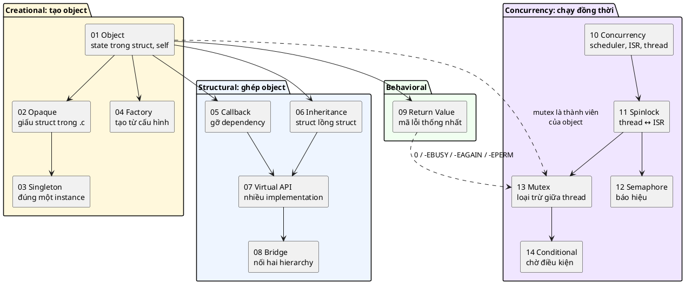

| # | Pattern | Một câu | Bài giảng |
|---|---|---|---|
| 01 | Object | Mọi state nằm trong struct, mọi hàm nhận `self` | [01_ObjectPattern](../01_ObjectPattern/LECTURE.md) |
| 02 | Opaque | Định nghĩa struct nằm trong `.c`, bên ngoài chỉ cầm con trỏ | [02_OpaquePattern](../02_OpaquePattern/LECTURE.md) |
| 03 | Singleton | Ép đúng một instance và nói rõ ý đồ đó | [03_SingletonPattern](../03_SingletonPattern/LECTURE.md) |
| 04 | Factory | Tạo cấu trúc dữ liệu phức tạp từ dữ liệu cấu hình | [04_FactoryPattern](../04_FactoryPattern/LECTURE.md) |
| 05 | Callback | Gỡ dependency bằng con trỏ hàm có kiểm soát | [05_CallbackPattern](../05_CallbackPattern/LECTURE.md) |
| 06 | Inheritance | Quan hệ kế thừa bằng struct lồng struct | [06_InheritancePattern](../06_InheritancePattern/LECTURE.md) |
| 07 | Virtual API | Nhiều implementation chung một API, type-safe | [07_VirtualApiPattern](../07_VirtualApiPattern/LECTURE.md) |
| 08 | Bridge | Nối hai hierarchy độc lập qua Virtual API | [08_BridgePattern](../08_BridgePattern/LECTURE.md) |
| 09 | Return Value | Quy ước giá trị trả về thống nhất, luôn kiểm tra | [09_ReturnValuePattern](../09_ReturnValuePattern/LECTURE.md) |
| 10 | Concurrency | Concurrency để đáp ứng sự kiện đúng hạn, không hỏi vòng | [10_ConcurrencyPattern](../10_ConcurrencyPattern/LECTURE.md) |
| 11 | Spinlock | Khóa ngắt + CAS: đồng bộ thread ↔ ISR và giữa các core | [11_SpinlockPattern](../11_SpinlockPattern/LECTURE.md) |
| 12 | Semaphore | Bộ đếm + hàng đợi: báo hiệu từ ISR/thread sang thread | [12_SemaphorePattern](../12_SemaphorePattern/LECTURE.md) |
| 13 | Mutex | Khóa có owner, khóa lồng, priority inheritance giữa các thread | [13_MutexPattern](../13_MutexPattern/LECTURE.md) |
| 14 | Conditional | Chờ điều kiện bất kỳ, nhả mutex khi ngủ, đánh thức một hoặc tất cả | [14_ConditionalPattern](../14_ConditionalPattern/LECTURE.md) |

Ba sợi chỉ xuyên suốt cả khóa:
1. **Object Pattern ở khắp nơi.** Ngay cả ở bài cuối, `struct sys_events` vẫn là một object: state (`bits`), công cụ bảo vệ state (`lock`, `changed`), và hàm nhận `self`. Mutex và condvar là thành viên của object, không phải biến global. 📖 Chương Mutex nói thẳng: *"Without object oriented design, things tend to get very messy."*
2. **Return Value Pattern cho mọi primitive.** `0`, `-EBUSY`, `-EAGAIN`, `-EPERM`, `-EDEADLK`, `-EPIPE`: mỗi mã lỗi nói chính xác chuyện gì xảy ra, và caller luôn kiểm tra.
3. **Tầng trên xây trên tầng dưới.** Opaque mở rộng Object; Virtual API ghép Callback và Inheritance; Bridge dựa trên Virtual API; semaphore, mutex và condvar đều dựa trên spinlock, và condvar luôn đi kèm mutex. Hiểu tầng dưới thì tầng trên không còn là phép màu.

📖 Lời khuyên trong chương Introduction vẫn đúng cho bước tiếp theo: viết cho chạy trước, rồi refactor theo pattern, và **áp dụng nhất quán ở mọi nơi**: giá trị của pattern nằm ở sự nhất quán, không nằm ở một lần dùng.
