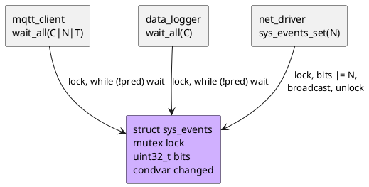

# 14 — Conditional Pattern (Condition Variable)

📖 Bài giảng chi tiết: [LECTURE.md](LECTURE.md). File này là ghi chú tóm tắt, bám theo chương *Conditional Pattern* của sách. Đây là bài cuối; tổng kết cả khóa ở [mục 25 của bài giảng](LECTURE.md#25-tổng-kết-khóa-học-14-pattern).

## Overview

Condvar = **hàng đợi cho các thread chờ một điều kiện bất kỳ**. Điều kiện (predicate) là dữ liệu của bạn, được bảo vệ bởi **một mutex**. `wait` nhả mutex và ngủ trong **một bước nguyên tử**, thức dậy thì lấy lại mutex rồi mới return. Người thức dậy **luôn kiểm tra lại** điều kiện trong vòng `while`.



## Use Cases

- **Báo cho nhiều thread** cùng lúc khi một điều kiện xảy ra (mạng lên, cấu hình đã nạp).
- **Chờ một tổ hợp điều kiện phức tạp**: kiểm tra an toàn khi giữ mutex, ngủ khi mutex được nhả.
- **Producer-consumer**: đánh thức consumer khi có phần tử mới, producer khi có chỗ trống.

## Benefits

- **Điều kiện tùy ý**, không chỉ "có tài nguyên hay không".
- **Mutex được nhả trong lúc chờ**; với thread chờ, trông như mutex luôn được giữ.
- **Broadcast**: đánh thức mọi người chờ mà người báo không cần biết họ là ai.
- Theo sách: **signal được từ ISR** (lưu ý: ISR không khóa được mutex, nên an toàn hơn là đi qua một thread).

## Drawbacks

- **Phức tạp hơn**: luôn `while`, luôn giữ mutex khi kiểm tra/đổi điều kiện.
- **Bộ nhớ**: cần một mutex đi kèm. (⚠️ Sách nói "một mutex cho mỗi thread chờ"; 🔬 thí nghiệm cho thấy mọi waiter của một condvar dùng chung **một** mutex.)
- Không có bộ nhớ: signal lúc không ai chờ là mất (predicate mới là "trí nhớ").

## Implementation

Xem [inc/condvar.h](inc/condvar.h), [src/condvar.c](src/condvar.c), [inc/sys_events.h](inc/sys_events.h), [src/sys_events.c](src/sys_events.c), [inc/sample_queue.h](inc/sample_queue.h), [src/sample_queue.c](src/sample_queue.c), [main.c](main.c). Mutex dùng lại từ bài 13 ([inc/mutex.h](inc/mutex.h), [src/mutex.c](src/mutex.c)).

```c
/* Phía chờ */
mutex_lock(&self->lock, MUTEX_FOREVER);
while (!predicate) {
	condvar_wait(&self->cv, &self->lock, timeout_ms);
}
/* ... làm việc ngắn ... */
mutex_unlock(&self->lock);

/* Phía báo */
mutex_lock(&self->lock, MUTEX_FOREVER);
/* đổi predicate */
condvar_broadcast(&self->cv); /* hoặc condvar_signal nếu chỉ một người được đi */
mutex_unlock(&self->lock);
```

| Hàm | Trả về |
|---|---|
| `condvar_wait(cv, m, timeout_ms)` | `0` (được đánh thức, **chưa chắc điều kiện đúng**), `-EAGAIN` (hết giờ, vẫn giữ mutex), `-EPERM` (không giữ mutex), `-EDEADLK` (mutex khóa lồng) |
| `condvar_signal(cv)` | `0`; đánh thức người đầu hàng |
| `condvar_broadcast(cv)` | số thread được đánh thức |

## Best Practices

- **Dùng tiết kiệm**: chỉ khi cần báo kèm dữ liệu cần mutual exclusion, hoặc cần đánh thức nhiều thread; còn lại semaphore nhẹ hơn.
- **Luôn kiểm tra trong vòng lặp.**
- Predicate, mutex, condvar nằm trong cùng một object; đổi predicate luôn khi giữ mutex.
- Signal khi đúng một người được đi; broadcast cho thay đổi chung (`close`, cổng mở).
- Timeout là tổng thời gian chờ, tính deadline một lần.

## Common Pitfalls

- **Spurious wakeup** và các lý do thức dậy khi điều kiện sai (bị cướp, điều kiện khác, timeout) → vòng `while` (🔬 `if` cho `count = -1`).
- Đổi predicate không giữ mutex → **lost wakeup** (🔬 waiter treo tới hết timeout).
- Signal thay vì broadcast → các waiter khác treo.
- Wait khi mutex khóa lồng; hủy object khi còn người chờ.

## Alternatives

- **Semaphore** (bài 12): báo cho một thread mỗi lần, có bộ đếm, nhẹ hơn.
- **Work queue**: kiểm tra điều kiện trong work item, gọi callback; không cho nhiều thread cùng chờ.
- **Event bus**: phát sự kiện tới mọi subscriber của một topic.
- 💡 Event group (FreeRTOS) / event flags (CMSIS): condvar đóng gói sẵn cho predicate dạng bitmask.

## Quiz

1. Có thể signal một condvar từ ISR không?
2. Khi broadcast, lúc nào mọi thread thức dậy, và trên một CPU chúng chạy tiếp theo thứ tự nào?
3. Nhiều CPU + broadcast: có thread nào chạy trước khi mọi thread đã được đánh thức không?
4. Khác biệt chính giữa Conditional pattern và Semaphore pattern?
5. Signal (không broadcast) khi nhiều thread đang chờ: thread nào chạy trước?
6. Vì sao luôn kiểm tra điều kiện trong vòng lặp, kể cả khi chỉ signal lúc điều kiện đúng?

(Đáp án và 7 câu thêm trong [LECTURE.md](LECTURE.md#23-quiz-có-đáp-án).)

## Câu hỏi còn thắc mắc

-
